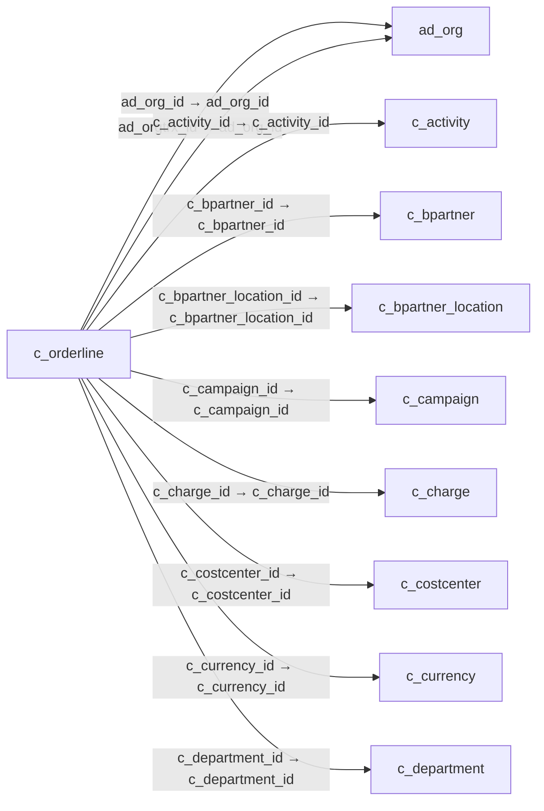

# c_orderline — 판매 주문·구매 발주 명세

[전체 일람](../TABLE_INDEX.md) · [분류 일람](README.md) · [AI 사용 안내](../README.md) · [외래키 읽는 법](../RELATIONSHIPS.md)

## 기본 정보

| 항목 | 내용 |
|---|---|
| 물리명 | `adempiere.c_orderline` |
| 한국어 논리명(문서용 해석) | 판매 주문·구매 발주 명세 |
| 원본 논리명 | Sales Order Line |
| 원본 사전 ID | 260 |
| 분류 | `c` — 거래처·주문·청구·결제·회계 기준 |
| 전체 테넌트 행 수 | 27 |
| 물리 열 수 | 61 |
| 나가는 FK / 들어오는 FK | 27 / 15 |
| 구조·행 수 확인 시점 | 2026-11-03T23:29:01+09:00 |

## 의미와 쓰임

주문·발주에 포함된 개별 상품 등의 상세 행을 관리한다. 사전명은 Sales Order Line이지만 상위 c_order의 판매·구매 구분에 따라 해석해야 한다.

- 설명 근거: 물리명·열·외래키 구조를 근거로 보수적으로 해석.
- 한국어 이름과 개요는 문서용 해석입니다. 공식 한국어 번역으로 간주하지 않습니다.
- 원본 설명: Sales Order Line
- 원본 도움말: —
- PostgreSQL 테이블 주석: —

## 키와 열

### 기본키·고유 제약조건

| 종류 | 제약조건 | 열(순서 유지) |
|---|---|---|
| PRIMARY KEY | `c_orderline_pkey` | `c_orderline_id` |
| UNIQUE | `c_orderline_uu_idx` | `c_orderline_uu` |

### 열 목록

원본 논리명·설명은 `AD_Column`에서 가져왔습니다. 기본값은 실제 PostgreSQL 메타데이터이며, 비어 있는 항목은 `—`로 표시합니다.

| 순서 | 물리명 | 원본 논리명 | PostgreSQL 타입 | NULL | PK | 기본값 | 설명 |
|---:|---|---|---|---|---|---|---|
| 1 | `c_orderline_id` | Sales Order Line | numeric(10,0) | 불가 | 예 | — | Sales Order Line |
| 2 | `ad_client_id` | Tenant | numeric(10,0) | 불가 | — | — | Tenant for this installation. |
| 3 | `ad_org_id` | Organization | numeric(10,0) | 불가 | — | — | Organizational entity within tenant |
| 4 | `isactive` | Active | character(1) | 불가 | — | 'Y'::bpchar | The record is active in the system |
| 5 | `created` | Created | timestamp without time zone | 불가 | — | now() | Date this record was created |
| 6 | `createdby` | Created By | numeric(10,0) | 불가 | — | — | User who created this records |
| 7 | `updated` | Updated | timestamp without time zone | 불가 | — | now() | Date this record was updated |
| 8 | `updatedby` | Updated By | numeric(10,0) | 불가 | — | — | User who updated this records |
| 9 | `c_order_id` | Order | numeric(10,0) | 불가 | — | — | Order |
| 10 | `line` | Line No | numeric(10,0) | 불가 | — | — | Unique line for this document |
| 11 | `c_bpartner_id` | Business Partner | numeric(10,0) | 허용 | — | — | Identifies a Business Partner |
| 12 | `c_bpartner_location_id` | Partner Location | numeric(10,0) | 허용 | — | — | Identifies the (ship to) address for this Business Partner |
| 13 | `dateordered` | Date Ordered | timestamp without time zone | 불가 | — | — | Date of Order |
| 14 | `datepromised` | Date Promised | timestamp without time zone | 허용 | — | — | Date Order was promised |
| 15 | `datedelivered` | Date Delivered | timestamp without time zone | 허용 | — | — | Date when the product was delivered |
| 16 | `dateinvoiced` | Date Invoiced | timestamp without time zone | 허용 | — | — | Date printed on Invoice |
| 17 | `description` | Description | character varying(255) | 허용 | — | — | Optional short description of the record |
| 18 | `m_product_id` | Product | numeric(10,0) | 허용 | — | — | Product, Service, Item |
| 19 | `m_warehouse_id` | Warehouse | numeric(10,0) | 불가 | — | — | Storage Warehouse and Service Point |
| 20 | `c_uom_id` | UOM | numeric(10,0) | 불가 | — | — | Unit of Measure |
| 21 | `qtyordered` | Ordered Quantity | numeric | 불가 | — | 0 | Ordered Quantity |
| 22 | `qtyreserved` | Reserved Quantity | numeric | 불가 | — | 0 | Reserved Quantity |
| 23 | `qtydelivered` | Delivered Quantity | numeric | 불가 | — | 0 | Delivered Quantity |
| 24 | `qtyinvoiced` | Quantity Invoiced | numeric | 불가 | — | 0 | Invoiced Quantity |
| 25 | `m_shipper_id` | Shipper | numeric(10,0) | 허용 | — | — | Method or manner of product delivery |
| 26 | `c_currency_id` | Currency | numeric(10,0) | 불가 | — | — | The Currency for this record |
| 27 | `pricelist` | List Price | numeric | 불가 | — | 0 | List Price |
| 28 | `priceactual` | Unit Price | numeric | 불가 | — | 0 | Actual Price  |
| 29 | `pricelimit` | Limit Price | numeric | 불가 | — | 0 | Lowest price for a product |
| 30 | `linenetamt` | Line Amount | numeric | 불가 | — | 0 | Line Extended Amount (Quantity * Actual Price) without Freight and Charges |
| 31 | `discount` | Discount % | numeric | 허용 | — | — | Discount in percent |
| 32 | `freightamt` | Freight Amount | numeric | 불가 | — | 0 | Freight Amount  |
| 33 | `c_charge_id` | Charge | numeric(10,0) | 허용 | — | — | Additional document charges |
| 34 | `c_tax_id` | Tax | numeric(10,0) | 불가 | — | — | Tax identifier |
| 35 | `s_resourceassignment_id` | Resource Assignment | numeric(10,0) | 허용 | — | — | Resource Assignment |
| 36 | `ref_orderline_id` | Referenced Order Line | numeric(10,0) | 허용 | — | — | Reference to corresponding Sales/Purchase Order |
| 37 | `m_attributesetinstance_id` | Attribute Set Instance | numeric(10,0) | 허용 | — | 0 | Product Attribute Set Instance |
| 38 | `isdescription` | Description Only | character(1) | 불가 | — | 'N'::bpchar | if true, the line is just description and no transaction |
| 39 | `processed` | Processed | character(1) | 불가 | — | 'N'::bpchar | The document has been processed |
| 40 | `qtyentered` | Quantity | numeric | 불가 | — | — | The Quantity Entered is based on the selected UoM |
| 41 | `priceentered` | Price | numeric | 불가 | — | — | Price Entered - the price based on the selected/base UoM |
| 42 | `c_project_id` | Project | numeric(10,0) | 허용 | — | — | Financial Project |
| 43 | `pricecost` | Cost Price | numeric | 허용 | — | — | Price per Unit of Measure including all indirect costs (Freight, etc.) |
| 44 | `qtylostsales` | Lost Sales Qty | numeric | 불가 | — | 0 | Quantity of potential sales |
| 45 | `c_projectphase_id` | Project Phase | numeric(10,0) | 허용 | — | — | Phase of a Project |
| 46 | `c_projecttask_id` | Project Task | numeric(10,0) | 허용 | — | — | Actual Project Task in a Phase |
| 47 | `rrstartdate` | Revenue Recognition Start | timestamp without time zone | 허용 | — | — | Revenue Recognition Start Date |
| 48 | `rramt` | Revenue Recognition Amt | numeric | 허용 | — | — | Revenue Recognition Amount |
| 49 | `c_campaign_id` | Campaign | numeric(10,0) | 허용 | — | — | Marketing Campaign |
| 50 | `c_activity_id` | Activity | numeric(10,0) | 허용 | — | — | Business Activity |
| 51 | `user1_id` | User Element List 1 | numeric(10,0) | 허용 | — | — | User defined list element #1 |
| 52 | `user2_id` | User Element List 2 | numeric(10,0) | 허용 | — | — | User defined list element #2 |
| 53 | `ad_orgtrx_id` | Trx Organization | numeric(10,0) | 허용 | — | — | Performing or initiating organization |
| 54 | `link_orderline_id` | Linked Order Line | numeric(10,0) | 허용 | — | — | This field links a sales order line to the purchase order line that is generated from it. |
| 55 | `pp_cost_collector_id` | Manufacturing Cost Collector | numeric(10,0) | 허용 | — | — | — |
| 56 | `m_promotion_id` | Promotion | numeric(10,0) | 허용 | — | — | — |
| 57 | `c_orderline_uu` | C_OrderLine_UU | uuid | 허용 | — | — | — |
| 58 | `createshipment` | Create Shipment | character(1) | 허용 | — | 'N'::bpchar | — |
| 59 | `createproduction` | Create Production | character(1) | 허용 | — | 'N'::bpchar | — |
| 60 | `c_department_id` | Department | numeric(10,0) | 허용 | — | NULL::numeric | — |
| 61 | `c_costcenter_id` | Cost Center | numeric(10,0) | 허용 | — | NULL::numeric | — |

## 외래키 흐름

화살표는 **FK를 가진 자식 → 참조되는 부모**입니다. 업무 처리의 시간 순서나 무조건적인 1:N 관계를 뜻하지 않습니다.

주변 관계 40개 중 10개를 그림으로 표시합니다. **전체 관계는 아래 두 표에 모두 포함**합니다.

### 이 테이블이 참조하는 부모 — 나가는 FK

| 제약조건 | 참조하는 쪽(자식) | 자식 열 | 참조받는 쪽(부모) | 부모 열 | 삭제 / 갱신 | 검증 / 지연 가능 |
|---|---|---|---|---|---|---|
| `adorg_corderline` <!-- FK_OUT: adempiere.c_orderline.adorg_corderline --> | [`c_orderline`](c_orderline.md) | `ad_org_id` | [`ad_org`](../ad/ad_org.md) | `ad_org_id` | NO ACTION / NO ACTION | 완료 / 가능 (초기 지연) |
| `adorgtrx_corderline` <!-- FK_OUT: adempiere.c_orderline.adorgtrx_corderline --> | [`c_orderline`](c_orderline.md) | `ad_orgtrx_id` | [`ad_org`](../ad/ad_org.md) | `ad_org_id` | NO ACTION / NO ACTION | 완료 / 가능 (초기 지연) |
| `cactivity_corderline` <!-- FK_OUT: adempiere.c_orderline.cactivity_corderline --> | [`c_orderline`](c_orderline.md) | `c_activity_id` | [`c_activity`](c_activity.md) | `c_activity_id` | NO ACTION / NO ACTION | 완료 / 가능 (초기 지연) |
| `cbpartner_soline` <!-- FK_OUT: adempiere.c_orderline.cbpartner_soline --> | [`c_orderline`](c_orderline.md) | `c_bpartner_id` | [`c_bpartner`](c_bpartner.md) | `c_bpartner_id` | NO ACTION / NO ACTION | 완료 / 가능 (초기 지연) |
| `cbpartnerlocation_soline` <!-- FK_OUT: adempiere.c_orderline.cbpartnerlocation_soline --> | [`c_orderline`](c_orderline.md) | `c_bpartner_location_id` | [`c_bpartner_location`](c_bpartner_location.md) | `c_bpartner_location_id` | NO ACTION / NO ACTION | 완료 / 가능 (초기 지연) |
| `ccampaign_corderline` <!-- FK_OUT: adempiere.c_orderline.ccampaign_corderline --> | [`c_orderline`](c_orderline.md) | `c_campaign_id` | [`c_campaign`](c_campaign.md) | `c_campaign_id` | NO ACTION / NO ACTION | 완료 / 가능 (초기 지연) |
| `ccharge_corderline` <!-- FK_OUT: adempiere.c_orderline.ccharge_corderline --> | [`c_orderline`](c_orderline.md) | `c_charge_id` | [`c_charge`](c_charge.md) | `c_charge_id` | NO ACTION / NO ACTION | 완료 / 가능 (초기 지연) |
| `ccostcenter_corderline` <!-- FK_OUT: adempiere.c_orderline.ccostcenter_corderline --> | [`c_orderline`](c_orderline.md) | `c_costcenter_id` | [`c_costcenter`](c_costcenter.md) | `c_costcenter_id` | NO ACTION / NO ACTION | 완료 / 가능 (초기 지연) |
| `ccurrency_corderline` <!-- FK_OUT: adempiere.c_orderline.ccurrency_corderline --> | [`c_orderline`](c_orderline.md) | `c_currency_id` | [`c_currency`](c_currency.md) | `c_currency_id` | NO ACTION / NO ACTION | 완료 / 가능 (초기 지연) |
| `cdepartment_corderline` <!-- FK_OUT: adempiere.c_orderline.cdepartment_corderline --> | [`c_orderline`](c_orderline.md) | `c_department_id` | [`c_department`](c_department.md) | `c_department_id` | NO ACTION / NO ACTION | 완료 / 가능 (초기 지연) |
| `celemenrvalueuser1_corderline` <!-- FK_OUT: adempiere.c_orderline.celemenrvalueuser1_corderline --> | [`c_orderline`](c_orderline.md) | `user1_id` | [`c_elementvalue`](c_elementvalue.md) | `c_elementvalue_id` | NO ACTION / NO ACTION | 완료 / 가능 (초기 지연) |
| `celemenrvalueuser2_corderline` <!-- FK_OUT: adempiere.c_orderline.celemenrvalueuser2_corderline --> | [`c_orderline`](c_orderline.md) | `user2_id` | [`c_elementvalue`](c_elementvalue.md) | `c_elementvalue_id` | NO ACTION / NO ACTION | 완료 / 가능 (초기 지연) |
| `corder_corderline` <!-- FK_OUT: adempiere.c_orderline.corder_corderline --> | [`c_orderline`](c_orderline.md) | `c_order_id` | [`c_order`](c_order.md) | `c_order_id` | NO ACTION / NO ACTION | 완료 / 가능 (초기 지연) |
| `corderline_ref` <!-- FK_OUT: adempiere.c_orderline.corderline_ref --> | [`c_orderline`](c_orderline.md) | `ref_orderline_id` | [`c_orderline`](c_orderline.md) | `c_orderline_id` | NO ACTION / NO ACTION | 완료 / 가능 (초기 지연) |
| `cproject_corderline` <!-- FK_OUT: adempiere.c_orderline.cproject_corderline --> | [`c_orderline`](c_orderline.md) | `c_project_id` | [`c_project`](c_project.md) | `c_project_id` | NO ACTION / NO ACTION | 완료 / 가능 (초기 지연) |
| `cprojectphase_corderline` <!-- FK_OUT: adempiere.c_orderline.cprojectphase_corderline --> | [`c_orderline`](c_orderline.md) | `c_projectphase_id` | [`c_projectphase`](c_projectphase.md) | `c_projectphase_id` | SET NULL / NO ACTION | 완료 / 가능 (초기 지연) |
| `cprojecttask_corderline` <!-- FK_OUT: adempiere.c_orderline.cprojecttask_corderline --> | [`c_orderline`](c_orderline.md) | `c_projecttask_id` | [`c_projecttask`](c_projecttask.md) | `c_projecttask_id` | SET NULL / NO ACTION | 완료 / 가능 (초기 지연) |
| `ctax_corderline` <!-- FK_OUT: adempiere.c_orderline.ctax_corderline --> | [`c_orderline`](c_orderline.md) | `c_tax_id` | [`c_tax`](c_tax.md) | `c_tax_id` | NO ACTION / NO ACTION | 완료 / 가능 (초기 지연) |
| `cuom_corderline` <!-- FK_OUT: adempiere.c_orderline.cuom_corderline --> | [`c_orderline`](c_orderline.md) | `c_uom_id` | [`c_uom`](c_uom.md) | `c_uom_id` | NO ACTION / NO ACTION | 완료 / 가능 (초기 지연) |
| `linkorderline_corderline` <!-- FK_OUT: adempiere.c_orderline.linkorderline_corderline --> | [`c_orderline`](c_orderline.md) | `link_orderline_id` | [`c_orderline`](c_orderline.md) | `c_orderline_id` | SET NULL / NO ACTION | 완료 / 가능 (초기 지연) |
| `mattrsetinst_corderline` <!-- FK_OUT: adempiere.c_orderline.mattrsetinst_corderline --> | [`c_orderline`](c_orderline.md) | `m_attributesetinstance_id` | [`m_attributesetinstance`](../m/m_attributesetinstance.md) | `m_attributesetinstance_id` | NO ACTION / NO ACTION | 완료 / 가능 (초기 지연) |
| `mproduct_corderline` <!-- FK_OUT: adempiere.c_orderline.mproduct_corderline --> | [`c_orderline`](c_orderline.md) | `m_product_id` | [`m_product`](../m/m_product.md) | `m_product_id` | NO ACTION / NO ACTION | 완료 / 가능 (초기 지연) |
| `mpromotion_corderline` <!-- FK_OUT: adempiere.c_orderline.mpromotion_corderline --> | [`c_orderline`](c_orderline.md) | `m_promotion_id` | [`m_promotion`](../m/m_promotion.md) | `m_promotion_id` | NO ACTION / NO ACTION | 완료 / 가능 (초기 지연) |
| `mshipper_corderline` <!-- FK_OUT: adempiere.c_orderline.mshipper_corderline --> | [`c_orderline`](c_orderline.md) | `m_shipper_id` | [`m_shipper`](../m/m_shipper.md) | `m_shipper_id` | NO ACTION / NO ACTION | 완료 / 가능 (초기 지연) |
| `mwarehouse_corderline` <!-- FK_OUT: adempiere.c_orderline.mwarehouse_corderline --> | [`c_orderline`](c_orderline.md) | `m_warehouse_id` | [`m_warehouse`](../m/m_warehouse.md) | `m_warehouse_id` | NO ACTION / NO ACTION | 완료 / 가능 (초기 지연) |
| `ppcostcollector_corderline` <!-- FK_OUT: adempiere.c_orderline.ppcostcollector_corderline --> | [`c_orderline`](c_orderline.md) | `pp_cost_collector_id` | [`pp_cost_collector`](../pp/pp_cost_collector.md) | `pp_cost_collector_id` | NO ACTION / NO ACTION | 완료 / 가능 (초기 지연) |
| `sresourceassign_corderline` <!-- FK_OUT: adempiere.c_orderline.sresourceassign_corderline --> | [`c_orderline`](c_orderline.md) | `s_resourceassignment_id` | [`s_resourceassignment`](../s/s_resourceassignment.md) | `s_resourceassignment_id` | NO ACTION / NO ACTION | 완료 / 가능 (초기 지연) |

### 이 테이블을 참조하는 자식 — 들어오는 FK

| 제약조건 | 참조하는 쪽(자식) | 자식 열 | 참조받는 쪽(부모) | 부모 열 | 삭제 / 갱신 | 검증 / 지연 가능 |
|---|---|---|---|---|---|---|
| `corderline_ccommissiondetail` <!-- FK_IN: adempiere.c_commissiondetail.corderline_ccommissiondetail --> | [`c_commissiondetail`](c_commissiondetail.md) | `c_orderline_id` | [`c_orderline`](c_orderline.md) | `c_orderline_id` | NO ACTION / NO ACTION | 완료 / 가능 (초기 지연) |
| `corderline_cinvoiceline` <!-- FK_IN: adempiere.c_invoiceline.corderline_cinvoiceline --> | [`c_invoiceline`](c_invoiceline.md) | `c_orderline_id` | [`c_orderline`](c_orderline.md) | `c_orderline_id` | NO ACTION / NO ACTION | 완료 / 가능 (초기 지연) |
| `corderline_corderlandedcostall` <!-- FK_IN: adempiere.c_orderlandedcostallocation.corderline_corderlandedcostall --> | [`c_orderlandedcostallocation`](c_orderlandedcostallocation.md) | `c_orderline_id` | [`c_orderline`](c_orderline.md) | `c_orderline_id` | NO ACTION / NO ACTION | 완료 / 가능 (초기 지연) |
| `corderline_ref` <!-- FK_IN: adempiere.c_orderline.corderline_ref --> | [`c_orderline`](c_orderline.md) | `ref_orderline_id` | [`c_orderline`](c_orderline.md) | `c_orderline_id` | NO ACTION / NO ACTION | 완료 / 가능 (초기 지연) |
| `linkorderline_corderline` <!-- FK_IN: adempiere.c_orderline.linkorderline_corderline --> | [`c_orderline`](c_orderline.md) | `link_orderline_id` | [`c_orderline`](c_orderline.md) | `c_orderline_id` | SET NULL / NO ACTION | 완료 / 가능 (초기 지연) |
| `corderline_iorder` <!-- FK_IN: adempiere.i_order.corderline_iorder --> | [`i_order`](../i/i_order.md) | `c_orderline_id` | [`c_orderline`](c_orderline.md) | `c_orderline_id` | SET NULL / NO ACTION | 완료 / 가능 (초기 지연) |
| `corderline_mcostdetail` <!-- FK_IN: adempiere.m_costdetail.corderline_mcostdetail --> | [`m_costdetail`](../m/m_costdetail.md) | `c_orderline_id` | [`c_orderline`](c_orderline.md) | `c_orderline_id` | NO ACTION / NO ACTION | 완료 / 가능 (초기 지연) |
| `corderline_mdemanddetail` <!-- FK_IN: adempiere.m_demanddetail.corderline_mdemanddetail --> | [`m_demanddetail`](../m/m_demanddetail.md) | `c_orderline_id` | [`c_orderline`](c_orderline.md) | `c_orderline_id` | CASCADE / NO ACTION | 완료 / 가능 (초기 지연) |
| `corderline_minout` <!-- FK_IN: adempiere.m_inoutline.corderline_minout --> | [`m_inoutline`](../m/m_inoutline.md) | `c_orderline_id` | [`c_orderline`](c_orderline.md) | `c_orderline_id` | NO ACTION / NO ACTION | 완료 / 가능 (초기 지연) |
| `corderline_mmatchpo` <!-- FK_IN: adempiere.m_matchpo.corderline_mmatchpo --> | [`m_matchpo`](../m/m_matchpo.md) | `c_orderline_id` | [`c_orderline`](c_orderline.md) | `c_orderline_id` | NO ACTION / NO ACTION | 완료 / 가능 (초기 지연) |
| `corderline_mproduction` <!-- FK_IN: adempiere.m_production.corderline_mproduction --> | [`m_production`](../m/m_production.md) | `c_orderline_id` | [`c_orderline`](c_orderline.md) | `c_orderline_id` | NO ACTION / NO ACTION | 완료 / 가능 (초기 지연) |
| `corderline_mrequisitionline` <!-- FK_IN: adempiere.m_requisitionline.corderline_mrequisitionline --> | [`m_requisitionline`](../m/m_requisitionline.md) | `c_orderline_id` | [`c_orderline`](c_orderline.md) | `c_orderline_id` | NO ACTION / NO ACTION | 완료 / 가능 (초기 지연) |
| `corderline_ppmrp` <!-- FK_IN: adempiere.pp_mrp.corderline_ppmrp --> | [`pp_mrp`](../pp/pp_mrp.md) | `c_orderline_id` | [`c_orderline`](c_orderline.md) | `c_orderline_id` | NO ACTION / NO ACTION | 완료 / 가능 (초기 지연) |
| `corderline_pporder` <!-- FK_IN: adempiere.pp_order.corderline_pporder --> | [`pp_order`](../pp/pp_order.md) | `c_orderline_id` | [`c_orderline`](c_orderline.md) | `c_orderline_id` | NO ACTION / NO ACTION | 완료 / 가능 (초기 지연) |
| `corderline_stimeexpenseline` <!-- FK_IN: adempiere.s_timeexpenseline.corderline_stimeexpenseline --> | [`s_timeexpenseline`](../s/s_timeexpenseline.md) | `c_orderline_id` | [`c_orderline`](c_orderline.md) | `c_orderline_id` | NO ACTION / NO ACTION | 완료 / 가능 (초기 지연) |

## 조회 시 주의

- FK 표의 자식 열과 부모 열을 같은 순서로 대응시킵니다. 복합 FK는 모든 열의 동등 조건을 `AND`로 연결합니다.
- 테이블 이름이나 `_id` 열 이름만으로 물리 FK가 있다고 가정하지 않습니다. FK 미선언은 업무 관계가 없다는 뜻도 아닙니다.
- 자식이 여러 행인 테이블과 조인하면 부모의 금액·건수가 중복될 수 있습니다. 집계 단위를 먼저 정합니다.
- `ad_client_id`가 있습니다. 업무 분석에서는 대상 테넌트를 명시합니다. GardenWorld는 `11`, 시스템 공통 설정은 `0`일 수 있으므로 일괄 필터 적용 전에 테이블 역할을 확인합니다.
- 행 수는 위 확인 시점의 전체 테넌트 값입니다. 최신 업무 실적이나 현재 실행 결과로 재사용하지 않습니다.
