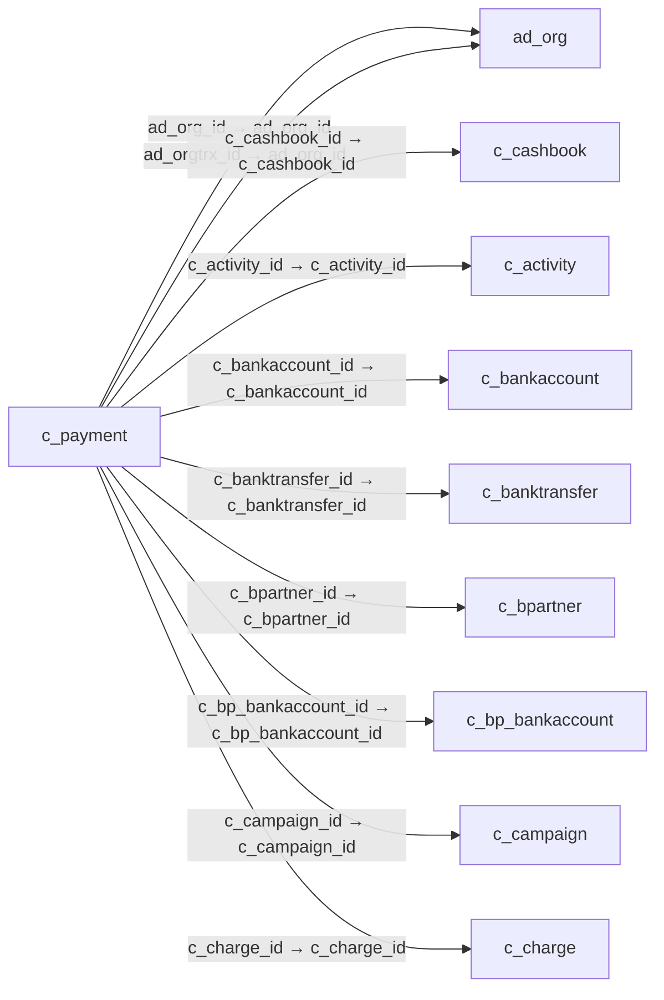

# c_payment — 수금·지급 전표

[전체 일람](../TABLE_INDEX.md) · [분류 일람](README.md) · [AI 사용 안내](../README.md) · [외래키 읽는 법](../RELATIONSHIPS.md)

## 기본 정보

| 항목 | 내용 |
|---|---|
| 물리명 | `adempiere.c_payment` |
| 한국어 논리명(문서용 해석) | 수금·지급 전표 |
| 원본 논리명 | Payment |
| 원본 사전 ID | 335 |
| 분류 | `c` — 거래처·주문·청구·결제·회계 기준 |
| 전체 테넌트 행 수 | 2 |
| 물리 열 수 | 105 |
| 나가는 FK / 들어오는 FK | 27 / 21 |
| 구조·행 수 확인 시점 | 2026-11-03T23:29:01+09:00 |

## 의미와 쓰임

고객 수금과 공급업체 등에 대한 지급을 함께 저장하며 isreceipt로 입출금 방향을 구분한다. 은행계좌·거래처·청구서·금액·결제수단 및 소거·대사 상태를 관리한다.

- 설명 근거: 물리명·열·외래키 구조를 근거로 보수적으로 해석.
- 한국어 이름과 개요는 문서용 해석입니다. 공식 한국어 번역으로 간주하지 않습니다.
- 원본 설명: Payment identifier
- 원본 도움말: —
- PostgreSQL 테이블 주석: —

## 키와 열

### 기본키·고유 제약조건

| 종류 | 제약조건 | 열(순서 유지) |
|---|---|---|
| PRIMARY KEY | `c_payment_pkey` | `c_payment_id` |
| UNIQUE | `c_payment_uu_idx` | `c_payment_uu` |

### 열 목록

원본 논리명·설명은 `AD_Column`에서 가져왔습니다. 기본값은 실제 PostgreSQL 메타데이터이며, 비어 있는 항목은 `—`로 표시합니다.

| 순서 | 물리명 | 원본 논리명 | PostgreSQL 타입 | NULL | PK | 기본값 | 설명 |
|---:|---|---|---|---|---|---|---|
| 1 | `c_payment_id` | Payment | numeric(10,0) | 불가 | 예 | — | Payment identifier |
| 2 | `ad_client_id` | Tenant | numeric(10,0) | 불가 | — | — | Tenant for this installation. |
| 3 | `ad_org_id` | Organization | numeric(10,0) | 불가 | — | — | Organizational entity within tenant |
| 4 | `isactive` | Active | character(1) | 불가 | — | 'Y'::bpchar | The record is active in the system |
| 5 | `created` | Created | timestamp without time zone | 불가 | — | now() | Date this record was created |
| 6 | `createdby` | Created By | numeric(10,0) | 불가 | — | — | User who created this records |
| 7 | `updated` | Updated | timestamp without time zone | 불가 | — | now() | Date this record was updated |
| 8 | `updatedby` | Updated By | numeric(10,0) | 불가 | — | — | User who updated this records |
| 9 | `documentno` | Document No | character varying(30) | 불가 | — | — | Document sequence number of the document |
| 10 | `datetrx` | Transaction Date | timestamp without time zone | 불가 | — | — | Transaction Date |
| 11 | `isreceipt` | Receipt | character(1) | 불가 | — | 'Y'::bpchar | This is a sales transaction (receipt) |
| 12 | `c_doctype_id` | Document Type | numeric(10,0) | 불가 | — | — | Document type or rules |
| 13 | `trxtype` | Transaction Type | character(1) | 불가 | — | — | Type of credit card transaction |
| 14 | `c_bankaccount_id` | Bank Account | numeric(10,0) | 허용 | — | — | Account at the Bank |
| 15 | `c_bpartner_id` | Business Partner | numeric(10,0) | 허용 | — | — | Identifies a Business Partner |
| 16 | `c_invoice_id` | Invoice | numeric(10,0) | 허용 | — | — | Invoice Identifier |
| 17 | `c_bp_bankaccount_id` | Partner Bank Account | numeric(10,0) | 허용 | — | — | Bank Account of the Business Partner |
| 18 | `c_paymentbatch_id` | Payment Batch | numeric(10,0) | 허용 | — | — | Payment batch for EFT |
| 19 | `tendertype` | Tender type | character(1) | 불가 | — | — | Method of Payment |
| 20 | `creditcardtype` | Credit Card | character(1) | 허용 | — | — | Credit Card (Visa, MC, AmEx) |
| 21 | `creditcardnumber` | Number | character varying(20) | 허용 | — | — | Credit Card Number  |
| 22 | `creditcardvv` | Verification Code | character varying(4) | 허용 | — | — | Credit Card Verification code on credit card |
| 23 | `creditcardexpmm` | Exp. Month | numeric(10,0) | 허용 | — | — | Expiry Month |
| 24 | `creditcardexpyy` | Exp. Year | numeric(10,0) | 허용 | — | — | Expiry Year |
| 25 | `micr` | Micr | character varying(20) | 허용 | — | — | Combination of routing no, account and check no |
| 26 | `routingno` | Routing No | character varying(20) | 허용 | — | — | Bank Routing Number |
| 27 | `accountno` | Account No | character varying(20) | 허용 | — | — | Account Number |
| 28 | `checkno` | Check No | character varying(20) | 허용 | — | — | Check Number |
| 29 | `a_name` | Account Name | character varying(60) | 허용 | — | — | Name on Credit Card or Account holder |
| 30 | `a_street` | Account Street | character varying(60) | 허용 | — | — | Street address of the Credit Card or Account holder |
| 31 | `a_city` | Account City | character varying(60) | 허용 | — | — | City or the Credit Card or Account Holder |
| 32 | `a_state` | Account State | character varying(40) | 허용 | — | — | State of the Credit Card or Account holder |
| 33 | `a_zip` | Account Zip/Postal | character varying(20) | 허용 | — | — | Zip Code of the Credit Card or Account Holder |
| 34 | `a_ident_dl` | Driver License | character varying(20) | 허용 | — | — | Payment Identification - Driver License |
| 35 | `a_ident_ssn` | Social Security No | character varying(20) | 허용 | — | — | Payment Identification - Social Security No |
| 36 | `a_email` | Account EMail | character varying(60) | 허용 | — | — | Email Address |
| 37 | `voiceauthcode` | Voice authorization code | character varying(20) | 허용 | — | — | Voice Authorization Code from credit card company |
| 38 | `orig_trxid` | Original Transaction ID | character varying(20) | 허용 | — | — | Original Transaction ID |
| 39 | `ponum` | PO Number | character varying(60) | 허용 | — | — | Purchase Order Number |
| 40 | `c_currency_id` | Currency | numeric(10,0) | 불가 | — | — | The Currency for this record |
| 41 | `payamt` | Payment amount | numeric | 불가 | — | 0 | Amount being paid |
| 42 | `discountamt` | Discount Amount | numeric | 허용 | — | 0 | Calculated amount of discount |
| 43 | `writeoffamt` | Write-off Amount | numeric | 허용 | — | 0 | Amount to write-off |
| 44 | `taxamt` | Tax Amount | numeric | 허용 | — | 0 | Tax Amount for a document |
| 45 | `isapproved` | Approved | character(1) | 불가 | — | 'N'::bpchar | Indicates if this document requires approval |
| 46 | `r_pnref` | Reference | character varying(20) | 허용 | — | — | Payment reference |
| 47 | `r_result` | Result | character varying(20) | 허용 | — | — | Result of transmission |
| 48 | `r_respmsg` | Response Message | character varying(60) | 허용 | — | — | Response message |
| 49 | `r_authcode` | Authorization Code | character varying(20) | 허용 | — | — | Authorization Code returned |
| 50 | `r_avsaddr` | Address verified | character(1) | 허용 | — | — | This address has been verified |
| 51 | `r_avszip` | Zip verified | character(1) | 허용 | — | — | The Zip Code has been verified |
| 52 | `r_info` | Info | character varying(2000) | 허용 | — | — | Response info |
| 53 | `processing` | Process Now | character(1) | 허용 | — | — | — |
| 54 | `oprocessing` | Online Processing | character(1) | 허용 | — | — | This payment can be processed online |
| 55 | `docstatus` | Document Status | character(2) | 불가 | — | — | The current status of the document |
| 56 | `docaction` | Document Action | character(2) | 불가 | — | — | The targeted status of the document |
| 57 | `isreconciled` | Reconciled | character(1) | 불가 | — | 'N'::bpchar | Payment is reconciled with bank statement |
| 58 | `isallocated` | Allocated | character(1) | 불가 | — | 'N'::bpchar | Indicates if the payment has been allocated |
| 59 | `isonline` | Online Access | character(1) | 불가 | — | 'N'::bpchar | Can be accessed online  |
| 60 | `processed` | Processed | character(1) | 불가 | — | 'N'::bpchar | The document has been processed |
| 61 | `posted` | Posted | character(1) | 불가 | — | 'N'::bpchar | Posting status |
| 62 | `isoverunderpayment` | Over/Under Payment | character(1) | 불가 | — | 'Y'::bpchar | Over-Payment (unallocated) or Under-Payment (partial payment) |
| 63 | `overunderamt` | Over/Under Payment | numeric | 허용 | — | 0 | Over-Payment (unallocated) or Under-Payment (partial payment) Amount |
| 64 | `a_country` | Account Country | character varying(40) | 허용 | — | — | Country |
| 65 | `c_project_id` | Project | numeric(10,0) | 허용 | — | — | Financial Project |
| 66 | `isselfservice` | Self-Service | character(1) | 불가 | — | 'N'::bpchar | This is a Self-Service entry or this entry can be changed via Self-Service |
| 67 | `chargeamt` | Charge amount | numeric | 허용 | — | 0 | Charge Amount |
| 68 | `c_charge_id` | Charge | numeric(10,0) | 허용 | — | — | Additional document charges |
| 69 | `isdelayedcapture` | Delayed Capture | character(1) | 불가 | — | 'N'::bpchar | Charge after Shipment |
| 70 | `r_authcode_dc` | Authorization Code (DC) | character varying(20) | 허용 | — | — | Authorization Code Delayed Capture returned |
| 71 | `r_cvv2match` | CVV Match | character(1) | 허용 | — | — | Credit Card Verification Code Match |
| 72 | `r_pnref_dc` | Reference (DC) | character varying(20) | 허용 | — | — | Payment Reference Delayed Capture |
| 73 | `swipe` | Swipe | character varying(80) | 허용 | — | — | Track 1 and 2 of the Credit Card |
| 74 | `ad_orgtrx_id` | Trx Organization | numeric(10,0) | 허용 | — | — | Performing or initiating organization |
| 75 | `c_campaign_id` | Campaign | numeric(10,0) | 허용 | — | — | Marketing Campaign |
| 76 | `c_activity_id` | Activity | numeric(10,0) | 허용 | — | — | Business Activity |
| 77 | `user1_id` | User Element List 1 | numeric(10,0) | 허용 | — | — | User defined list element #1 |
| 78 | `user2_id` | User Element List 2 | numeric(10,0) | 허용 | — | — | User defined list element #2 |
| 79 | `c_conversiontype_id` | Currency Type | numeric(10,0) | 허용 | — | — | Currency Conversion Rate Type |
| 80 | `description` | Description | character varying(255) | 허용 | — | — | Optional short description of the record |
| 81 | `dateacct` | Account Date | timestamp without time zone | 불가 | — | — | Accounting Date |
| 82 | `c_order_id` | Order | numeric(10,0) | 허용 | — | — | Order |
| 83 | `isprepayment` | Prepayment | character(1) | 불가 | — | 'N'::bpchar | The Payment/Receipt is a Prepayment |
| 84 | `ref_payment_id` | Referenced Payment | numeric(10,0) | 허용 | — | — | — |
| 85 | `reversal_id` | Reversal ID | numeric(10,0) | 허용 | — | — | ID of document reversal |
| 86 | `c_cashbook_id` | Cash Book | numeric(10,0) | 허용 | — | — | Cash Book for recording petty cash transactions |
| 87 | `processedon` | Processed On | numeric | 허용 | — | — | The date+time (expressed in decimal format) when the document has been processed |
| 88 | `c_payment_uu` | C_Payment_UU | uuid | 허용 | — | — | — |
| 89 | `c_postendertype_id` | POS Tender Type | numeric(10,0) | 허용 | — | NULL::numeric | — |
| 90 | `c_paymentprocessor_id` | Payment Processor | numeric(10,0) | 허용 | — | NULL::numeric | Payment processor for electronic payments |
| 91 | `customerpaymentprofileid` | Customer Payment Profile ID | character varying(60) | 허용 | — | NULL::character varying | — |
| 92 | `customerprofileid` | Customer Profile ID | character varying(60) | 허용 | — | NULL::character varying | — |
| 93 | `customeraddressid` | Customer Address ID | character varying(60) | 허용 | — | NULL::character varying | — |
| 94 | `isvoided` | Voided | character(1) | 불가 | — | 'N'::bpchar | — |
| 95 | `r_voidmsg` | Void Message | character varying(255) | 허용 | — | NULL::character varying | — |
| 96 | `c_depositbatch_id` | Deposit Batch | numeric(10,0) | 허용 | — | NULL::numeric | — |
| 97 | `iban` | IBAN | character varying(40) | 허용 | — | NULL::character varying | International Bank Account Number |
| 98 | `swiftcode` | Swift code | character varying(20) | 허용 | — | NULL::character varying | Swift Code or BIC |
| 99 | `currencyrate` | Rate | numeric | 허용 | — | — | Currency Conversion Rate |
| 100 | `convertedamt` | Converted Amount | numeric | 허용 | — | — | Converted Amount |
| 101 | `isoverridecurrencyrate` | Override Currency Conversion Rate | character(1) | 불가 | — | 'N'::bpchar | Override Currency Conversion Rate |
| 102 | `c_banktransfer_id` | Bank Transfer | numeric(10,0) | 허용 | — | NULL::numeric | Bank Transfer |
| 103 | `c_department_id` | Department | numeric(10,0) | 허용 | — | NULL::numeric | — |
| 104 | `c_costcenter_id` | Cost Center | numeric(10,0) | 허용 | — | NULL::numeric | — |
| 105 | `c_employee_id` | Employee | numeric(10,0) | 허용 | — | NULL::numeric | Identifies a Business Partner |

## 외래키 흐름

화살표는 **FK를 가진 자식 → 참조되는 부모**입니다. 업무 처리의 시간 순서나 무조건적인 1:N 관계를 뜻하지 않습니다.

주변 관계 46개 중 10개를 그림으로 표시합니다. **전체 관계는 아래 두 표에 모두 포함**합니다.

### 이 테이블이 참조하는 부모 — 나가는 FK

| 제약조건 | 참조하는 쪽(자식) | 자식 열 | 참조받는 쪽(부모) | 부모 열 | 삭제 / 갱신 | 검증 / 지연 가능 |
|---|---|---|---|---|---|---|
| `adorg_cpayment` <!-- FK_OUT: adempiere.c_payment.adorg_cpayment --> | [`c_payment`](c_payment.md) | `ad_org_id` | [`ad_org`](../ad/ad_org.md) | `ad_org_id` | NO ACTION / NO ACTION | 완료 / 가능 (초기 지연) |
| `adorgtrx_cpayment` <!-- FK_OUT: adempiere.c_payment.adorgtrx_cpayment --> | [`c_payment`](c_payment.md) | `ad_orgtrx_id` | [`ad_org`](../ad/ad_org.md) | `ad_org_id` | NO ACTION / NO ACTION | 완료 / 가능 (초기 지연) |
| `c_payment__c_cashbo_c_cashbook` <!-- FK_OUT: adempiere.c_payment.c_payment__c_cashbo_c_cashbook --> | [`c_payment`](c_payment.md) | `c_cashbook_id` | [`c_cashbook`](c_cashbook.md) | `c_cashbook_id` | NO ACTION / NO ACTION | 완료 / 가능 (초기 지연) |
| `cactivity_cpayment` <!-- FK_OUT: adempiere.c_payment.cactivity_cpayment --> | [`c_payment`](c_payment.md) | `c_activity_id` | [`c_activity`](c_activity.md) | `c_activity_id` | NO ACTION / NO ACTION | 완료 / 가능 (초기 지연) |
| `cbankaccount_cpayment` <!-- FK_OUT: adempiere.c_payment.cbankaccount_cpayment --> | [`c_payment`](c_payment.md) | `c_bankaccount_id` | [`c_bankaccount`](c_bankaccount.md) | `c_bankaccount_id` | NO ACTION / NO ACTION | 완료 / 가능 (초기 지연) |
| `cbanktransfer_cpayment` <!-- FK_OUT: adempiere.c_payment.cbanktransfer_cpayment --> | [`c_payment`](c_payment.md) | `c_banktransfer_id` | [`c_banktransfer`](c_banktransfer.md) | `c_banktransfer_id` | NO ACTION / NO ACTION | 완료 / 가능 (초기 지연) |
| `cbpartner_cpayment` <!-- FK_OUT: adempiere.c_payment.cbpartner_cpayment --> | [`c_payment`](c_payment.md) | `c_bpartner_id` | [`c_bpartner`](c_bpartner.md) | `c_bpartner_id` | NO ACTION / NO ACTION | 완료 / 가능 (초기 지연) |
| `cbpbankacct_cpayment` <!-- FK_OUT: adempiere.c_payment.cbpbankacct_cpayment --> | [`c_payment`](c_payment.md) | `c_bp_bankaccount_id` | [`c_bp_bankaccount`](c_bp_bankaccount.md) | `c_bp_bankaccount_id` | SET NULL / NO ACTION | 완료 / 가능 (초기 지연) |
| `ccampaign_cpayment` <!-- FK_OUT: adempiere.c_payment.ccampaign_cpayment --> | [`c_payment`](c_payment.md) | `c_campaign_id` | [`c_campaign`](c_campaign.md) | `c_campaign_id` | NO ACTION / NO ACTION | 완료 / 가능 (초기 지연) |
| `ccharge_cpayment` <!-- FK_OUT: adempiere.c_payment.ccharge_cpayment --> | [`c_payment`](c_payment.md) | `c_charge_id` | [`c_charge`](c_charge.md) | `c_charge_id` | NO ACTION / NO ACTION | 완료 / 가능 (초기 지연) |
| `cconversiontype_cpayment` <!-- FK_OUT: adempiere.c_payment.cconversiontype_cpayment --> | [`c_payment`](c_payment.md) | `c_conversiontype_id` | [`c_conversiontype`](c_conversiontype.md) | `c_conversiontype_id` | NO ACTION / NO ACTION | 완료 / 가능 (초기 지연) |
| `ccostcenter_cpayment` <!-- FK_OUT: adempiere.c_payment.ccostcenter_cpayment --> | [`c_payment`](c_payment.md) | `c_costcenter_id` | [`c_costcenter`](c_costcenter.md) | `c_costcenter_id` | NO ACTION / NO ACTION | 완료 / 가능 (초기 지연) |
| `ccurrency_cpayment` <!-- FK_OUT: adempiere.c_payment.ccurrency_cpayment --> | [`c_payment`](c_payment.md) | `c_currency_id` | [`c_currency`](c_currency.md) | `c_currency_id` | NO ACTION / NO ACTION | 완료 / 가능 (초기 지연) |
| `cdepartment_cpayment` <!-- FK_OUT: adempiere.c_payment.cdepartment_cpayment --> | [`c_payment`](c_payment.md) | `c_department_id` | [`c_department`](c_department.md) | `c_department_id` | NO ACTION / NO ACTION | 완료 / 가능 (초기 지연) |
| `cdepositbatch_cpayment` <!-- FK_OUT: adempiere.c_payment.cdepositbatch_cpayment --> | [`c_payment`](c_payment.md) | `c_depositbatch_id` | [`c_depositbatch`](c_depositbatch.md) | `c_depositbatch_id` | NO ACTION / NO ACTION | 완료 / 가능 (초기 지연) |
| `cdoctype_cpayment` <!-- FK_OUT: adempiere.c_payment.cdoctype_cpayment --> | [`c_payment`](c_payment.md) | `c_doctype_id` | [`c_doctype`](c_doctype.md) | `c_doctype_id` | NO ACTION / NO ACTION | 완료 / 가능 (초기 지연) |
| `celementvalueuser1_cpayment` <!-- FK_OUT: adempiere.c_payment.celementvalueuser1_cpayment --> | [`c_payment`](c_payment.md) | `user1_id` | [`c_elementvalue`](c_elementvalue.md) | `c_elementvalue_id` | NO ACTION / NO ACTION | 완료 / 가능 (초기 지연) |
| `celementvalueuser2_cpayment` <!-- FK_OUT: adempiere.c_payment.celementvalueuser2_cpayment --> | [`c_payment`](c_payment.md) | `user2_id` | [`c_elementvalue`](c_elementvalue.md) | `c_elementvalue_id` | NO ACTION / NO ACTION | 완료 / 가능 (초기 지연) |
| `cemployee_cpayment` <!-- FK_OUT: adempiere.c_payment.cemployee_cpayment --> | [`c_payment`](c_payment.md) | `c_employee_id` | [`c_bpartner`](c_bpartner.md) | `c_bpartner_id` | NO ACTION / NO ACTION | 완료 / 가능 (초기 지연) |
| `cinvoice_cpayment` <!-- FK_OUT: adempiere.c_payment.cinvoice_cpayment --> | [`c_payment`](c_payment.md) | `c_invoice_id` | [`c_invoice`](c_invoice.md) | `c_invoice_id` | NO ACTION / NO ACTION | 완료 / 가능 (초기 지연) |
| `corder_cpayment` <!-- FK_OUT: adempiere.c_payment.corder_cpayment --> | [`c_payment`](c_payment.md) | `c_order_id` | [`c_order`](c_order.md) | `c_order_id` | NO ACTION / NO ACTION | 완료 / 가능 (초기 지연) |
| `cpaymentbatch_cpayment` <!-- FK_OUT: adempiere.c_payment.cpaymentbatch_cpayment --> | [`c_payment`](c_payment.md) | `c_paymentbatch_id` | [`c_paymentbatch`](c_paymentbatch.md) | `c_paymentbatch_id` | NO ACTION / NO ACTION | 완료 / 가능 (초기 지연) |
| `cpaymentprocessor_cpayment` <!-- FK_OUT: adempiere.c_payment.cpaymentprocessor_cpayment --> | [`c_payment`](c_payment.md) | `c_paymentprocessor_id` | [`c_paymentprocessor`](c_paymentprocessor.md) | `c_paymentprocessor_id` | NO ACTION / NO ACTION | 완료 / 가능 (초기 지연) |
| `cpostendertype_cpayment` <!-- FK_OUT: adempiere.c_payment.cpostendertype_cpayment --> | [`c_payment`](c_payment.md) | `c_postendertype_id` | [`c_postendertype`](c_postendertype.md) | `c_postendertype_id` | NO ACTION / NO ACTION | 완료 / 가능 (초기 지연) |
| `cproject_cpayment` <!-- FK_OUT: adempiere.c_payment.cproject_cpayment --> | [`c_payment`](c_payment.md) | `c_project_id` | [`c_project`](c_project.md) | `c_project_id` | NO ACTION / NO ACTION | 완료 / 가능 (초기 지연) |
| `refpayment_cpayment` <!-- FK_OUT: adempiere.c_payment.refpayment_cpayment --> | [`c_payment`](c_payment.md) | `ref_payment_id` | [`c_payment`](c_payment.md) | `c_payment_id` | NO ACTION / NO ACTION | 완료 / 가능 (초기 지연) |
| `reversal_cpayment` <!-- FK_OUT: adempiere.c_payment.reversal_cpayment --> | [`c_payment`](c_payment.md) | `reversal_id` | [`c_payment`](c_payment.md) | `c_payment_id` | NO ACTION / NO ACTION | 완료 / 가능 (초기 지연) |

### 이 테이블을 참조하는 자식 — 들어오는 FK

| 제약조건 | 참조하는 쪽(자식) | 자식 열 | 참조받는 쪽(부모) | 부모 열 | 삭제 / 갱신 | 검증 / 지연 가능 |
|---|---|---|---|---|---|---|
| `cpayment_bbuyerfunds` <!-- FK_IN: adempiere.b_buyerfunds.cpayment_bbuyerfunds --> | [`b_buyerfunds`](../b/b_buyerfunds.md) | `c_payment_id` | [`c_payment`](c_payment.md) | `c_payment_id` | NO ACTION / NO ACTION | 완료 / 가능 (초기 지연) |
| `cpayment_bsellerfunds` <!-- FK_IN: adempiere.b_sellerfunds.cpayment_bsellerfunds --> | [`b_sellerfunds`](../b/b_sellerfunds.md) | `c_payment_id` | [`c_payment`](c_payment.md) | `c_payment_id` | NO ACTION / NO ACTION | 완료 / 가능 (초기 지연) |
| `cpayment_callocationline` <!-- FK_IN: adempiere.c_allocationline.cpayment_callocationline --> | [`c_allocationline`](c_allocationline.md) | `c_payment_id` | [`c_payment`](c_payment.md) | `c_payment_id` | NO ACTION / NO ACTION | 완료 / 가능 (초기 지연) |
| `cpayment_cbankstmtline` <!-- FK_IN: adempiere.c_bankstatementline.cpayment_cbankstmtline --> | [`c_bankstatementline`](c_bankstatementline.md) | `c_payment_id` | [`c_payment`](c_payment.md) | `c_payment_id` | NO ACTION / NO ACTION | 완료 / 가능 (초기 지연) |
| `cpayment_ccashline` <!-- FK_IN: adempiere.c_cashline.cpayment_ccashline --> | [`c_cashline`](c_cashline.md) | `c_payment_id` | [`c_payment`](c_payment.md) | `c_payment_id` | NO ACTION / NO ACTION | 완료 / 가능 (초기 지연) |
| `cpayment_cdepositbatchline` <!-- FK_IN: adempiere.c_depositbatchline.cpayment_cdepositbatchline --> | [`c_depositbatchline`](c_depositbatchline.md) | `c_payment_id` | [`c_payment`](c_payment.md) | `c_payment_id` | NO ACTION / NO ACTION | 완료 / 가능 (초기 지연) |
| `cpayment_cdunningrunline` <!-- FK_IN: adempiere.c_dunningrunline.cpayment_cdunningrunline --> | [`c_dunningrunline`](c_dunningrunline.md) | `c_payment_id` | [`c_payment`](c_payment.md) | `c_payment_id` | SET NULL / NO ACTION | 완료 / 가능 (초기 지연) |
| `cpayment_cinvoice` <!-- FK_IN: adempiere.c_invoice.cpayment_cinvoice --> | [`c_invoice`](c_invoice.md) | `c_payment_id` | [`c_payment`](c_payment.md) | `c_payment_id` | NO ACTION / NO ACTION | 완료 / 가능 (초기 지연) |
| `cpayment_corder` <!-- FK_IN: adempiere.c_order.cpayment_corder --> | [`c_order`](c_order.md) | `c_payment_id` | [`c_payment`](c_payment.md) | `c_payment_id` | NO ACTION / NO ACTION | 완료 / 가능 (초기 지연) |
| `refpayment_cpayment` <!-- FK_IN: adempiere.c_payment.refpayment_cpayment --> | [`c_payment`](c_payment.md) | `ref_payment_id` | [`c_payment`](c_payment.md) | `c_payment_id` | NO ACTION / NO ACTION | 완료 / 가능 (초기 지연) |
| `reversal_cpayment` <!-- FK_IN: adempiere.c_payment.reversal_cpayment --> | [`c_payment`](c_payment.md) | `reversal_id` | [`c_payment`](c_payment.md) | `c_payment_id` | NO ACTION / NO ACTION | 완료 / 가능 (초기 지연) |
| `cpayment_cpaymentallocate` <!-- FK_IN: adempiere.c_paymentallocate.cpayment_cpaymentallocate --> | [`c_paymentallocate`](c_paymentallocate.md) | `c_payment_id` | [`c_payment`](c_payment.md) | `c_payment_id` | CASCADE / NO ACTION | 완료 / 가능 (초기 지연) |
| `cpayment_cpaymenttransaction` <!-- FK_IN: adempiere.c_paymenttransaction.cpayment_cpaymenttransaction --> | [`c_paymenttransaction`](c_paymenttransaction.md) | `c_payment_id` | [`c_payment`](c_payment.md) | `c_payment_id` | NO ACTION / NO ACTION | 완료 / 가능 (초기 지연) |
| `cpayment_cpayselectioncheck` <!-- FK_IN: adempiere.c_payselectioncheck.cpayment_cpayselectioncheck --> | [`c_payselectioncheck`](c_payselectioncheck.md) | `c_payment_id` | [`c_payment`](c_payment.md) | `c_payment_id` | NO ACTION / NO ACTION | 완료 / 가능 (초기 지연) |
| `cpayment_cpospayment` <!-- FK_IN: adempiere.c_pospayment.cpayment_cpospayment --> | [`c_pospayment`](c_pospayment.md) | `c_payment_id` | [`c_payment`](c_payment.md) | `c_payment_id` | NO ACTION / NO ACTION | 완료 / 가능 (초기 지연) |
| `cpayment_crecurring` <!-- FK_IN: adempiere.c_recurring.cpayment_crecurring --> | [`c_recurring`](c_recurring.md) | `c_payment_id` | [`c_payment`](c_payment.md) | `c_payment_id` | NO ACTION / NO ACTION | 완료 / 가능 (초기 지연) |
| `cpayment_crecurringrun` <!-- FK_IN: adempiere.c_recurring_run.cpayment_crecurringrun --> | [`c_recurring_run`](c_recurring_run.md) | `c_payment_id` | [`c_payment`](c_payment.md) | `c_payment_id` | CASCADE / NO ACTION | 완료 / 가능 (초기 지연) |
| `cpayment_ibankstatement` <!-- FK_IN: adempiere.i_bankstatement.cpayment_ibankstatement --> | [`i_bankstatement`](../i/i_bankstatement.md) | `c_payment_id` | [`c_payment`](c_payment.md) | `c_payment_id` | SET NULL / NO ACTION | 완료 / 가능 (초기 지연) |
| `cpayment_ipayment` <!-- FK_IN: adempiere.i_payment.cpayment_ipayment --> | [`i_payment`](../i/i_payment.md) | `c_payment_id` | [`c_payment`](c_payment.md) | `c_payment_id` | SET NULL / NO ACTION | 완료 / 가능 (초기 지연) |
| `cpayment_rrequest` <!-- FK_IN: adempiere.r_request.cpayment_rrequest --> | [`r_request`](../r/r_request.md) | `c_payment_id` | [`c_payment`](c_payment.md) | `c_payment_id` | NO ACTION / NO ACTION | 완료 / 가능 (초기 지연) |
| `cpayment_rrequestaction` <!-- FK_IN: adempiere.r_requestaction.cpayment_rrequestaction --> | [`r_requestaction`](../r/r_requestaction.md) | `c_payment_id` | [`c_payment`](c_payment.md) | `c_payment_id` | NO ACTION / NO ACTION | 완료 / 가능 (초기 지연) |

## 조회 시 주의

- FK 표의 자식 열과 부모 열을 같은 순서로 대응시킵니다. 복합 FK는 모든 열의 동등 조건을 `AND`로 연결합니다.
- 테이블 이름이나 `_id` 열 이름만으로 물리 FK가 있다고 가정하지 않습니다. FK 미선언은 업무 관계가 없다는 뜻도 아닙니다.
- 자식이 여러 행인 테이블과 조인하면 부모의 금액·건수가 중복될 수 있습니다. 집계 단위를 먼저 정합니다.
- `ad_client_id`가 있습니다. 업무 분석에서는 대상 테넌트를 명시합니다. GardenWorld는 `11`, 시스템 공통 설정은 `0`일 수 있으므로 일괄 필터 적용 전에 테이블 역할을 확인합니다.
- 행 수는 위 확인 시점의 전체 테넌트 값입니다. 최신 업무 실적이나 현재 실행 결과로 재사용하지 않습니다.
