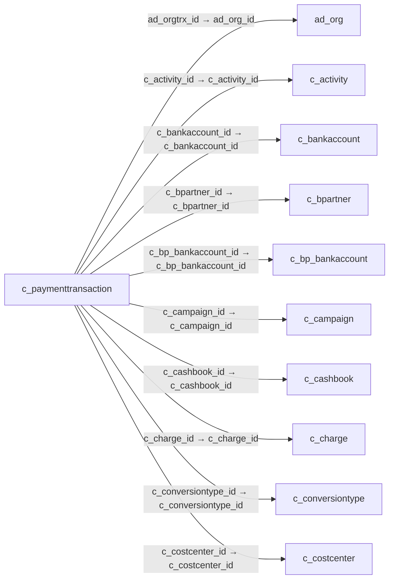

# c_paymenttransaction — 결제 거래

[전체 일람](../TABLE_INDEX.md) · [분류 일람](README.md) · [AI 사용 안내](../README.md) · [외래키 읽는 법](../RELATIONSHIPS.md)

## 기본 정보

| 항목 | 내용 |
|---|---|
| 물리명 | `adempiere.c_paymenttransaction` |
| 한국어 논리명(문서용 해석) | 결제 거래 |
| 원본 논리명 | Payment Transaction |
| 원본 사전 ID | 200031 |
| 분류 | `c` — 거래처·주문·청구·결제·회계 기준 |
| 전체 테넌트 행 수 | 0 |
| 물리 열 수 | 81 |
| 나가는 FK / 들어오는 FK | 22 / 1 |
| 구조·행 수 확인 시점 | 2026-11-03T23:29:01+09:00 |

## 의미와 쓰임

전자결제 등의 개별 거래에서 결제수단·금액·처리기·승인 및 취소 결과와 연결 입출금 전표를 기록한다.

- 설명 근거: 물리명·열·외래키 구조를 근거로 보수적으로 해석.
- 한국어 이름과 개요는 문서용 해석입니다. 공식 한국어 번역으로 간주하지 않습니다.
- 원본 설명: Payment Transaction
- 원본 도움말: —
- PostgreSQL 테이블 주석: —

## 키와 열

### 기본키·고유 제약조건

| 종류 | 제약조건 | 열(순서 유지) |
|---|---|---|
| PRIMARY KEY | `c_paymenttransaction_key` | `c_paymenttransaction_id` |
| UNIQUE | `c_paymenttransaction_uu_idx` | `c_paymenttransaction_uu` |

### 열 목록

원본 논리명·설명은 `AD_Column`에서 가져왔습니다. 기본값은 실제 PostgreSQL 메타데이터이며, 비어 있는 항목은 `—`로 표시합니다.

| 순서 | 물리명 | 원본 논리명 | PostgreSQL 타입 | NULL | PK | 기본값 | 설명 |
|---:|---|---|---|---|---|---|---|
| 1 | `a_city` | Account City | character varying(60) | 허용 | — | NULL::character varying | City or the Credit Card or Account Holder |
| 2 | `a_country` | Account Country | character varying(40) | 허용 | — | NULL::character varying | Country |
| 3 | `a_email` | Account EMail | character varying(60) | 허용 | — | NULL::character varying | Email Address |
| 4 | `a_ident_dl` | Driver License | character varying(20) | 허용 | — | NULL::character varying | Payment Identification - Driver License |
| 5 | `a_ident_ssn` | Social Security No | character varying(20) | 허용 | — | NULL::character varying | Payment Identification - Social Security No |
| 6 | `a_name` | Account Name | character varying(60) | 허용 | — | NULL::character varying | Name on Credit Card or Account holder |
| 7 | `a_state` | Account State | character varying(40) | 허용 | — | NULL::character varying | State of the Credit Card or Account holder |
| 8 | `a_street` | Account Street | character varying(60) | 허용 | — | NULL::character varying | Street address of the Credit Card or Account holder |
| 9 | `a_zip` | Account Zip/Postal | character varying(20) | 허용 | — | NULL::character varying | Zip Code of the Credit Card or Account Holder |
| 10 | `accountno` | Account No | character varying(20) | 허용 | — | NULL::character varying | Account Number |
| 11 | `ad_client_id` | Tenant | numeric(10,0) | 불가 | — | — | Tenant for this installation. |
| 12 | `ad_org_id` | Organization | numeric(10,0) | 불가 | — | — | Organizational entity within tenant |
| 13 | `ad_orgtrx_id` | Trx Organization | numeric(10,0) | 허용 | — | NULL::numeric | Performing or initiating organization |
| 14 | `c_activity_id` | Activity | numeric(10,0) | 허용 | — | NULL::numeric | Business Activity |
| 15 | `c_bankaccount_id` | Bank Account | numeric(10,0) | 허용 | — | NULL::numeric | Account at the Bank |
| 16 | `c_bp_bankaccount_id` | Partner Bank Account | numeric(10,0) | 허용 | — | NULL::numeric | Bank Account of the Business Partner |
| 17 | `c_bpartner_id` | Business Partner | numeric(10,0) | 불가 | — | — | Identifies a Business Partner |
| 18 | `c_campaign_id` | Campaign | numeric(10,0) | 허용 | — | NULL::numeric | Marketing Campaign |
| 19 | `c_cashbook_id` | Cash Book | numeric(10,0) | 허용 | — | NULL::numeric | Cash Book for recording petty cash transactions |
| 20 | `c_charge_id` | Charge | numeric(10,0) | 허용 | — | NULL::numeric | Additional document charges |
| 21 | `c_conversiontype_id` | Currency Type | numeric(10,0) | 허용 | — | NULL::numeric | Currency Conversion Rate Type |
| 22 | `c_currency_id` | Currency | numeric(10,0) | 불가 | — | — | The Currency for this record |
| 23 | `c_doctype_id` | — | numeric(10,0) | 허용 | — | — | — |
| 24 | `c_invoice_id` | Invoice | numeric(10,0) | 허용 | — | NULL::numeric | Invoice Identifier |
| 25 | `c_order_id` | Order | numeric(10,0) | 허용 | — | NULL::numeric | Order |
| 26 | `c_payment_id` | Payment | numeric(10,0) | 허용 | — | NULL::numeric | Payment identifier |
| 27 | `c_paymentbatch_id` | Payment Batch | numeric(10,0) | 허용 | — | NULL::numeric | Payment batch for EFT |
| 28 | `c_paymentprocessor_id` | Payment Processor | numeric(10,0) | 허용 | — | NULL::numeric | Payment processor for electronic payments |
| 29 | `c_paymenttransaction_id` | Payment Transaction | numeric(10,0) | 불가 | 예 | — | — |
| 30 | `c_paymenttransaction_uu` | C_PaymentTransaction_UU | uuid | 허용 | — | — | — |
| 31 | `c_postendertype_id` | POS Tender Type | numeric(10,0) | 허용 | — | NULL::numeric | — |
| 32 | `c_project_id` | Project | numeric(10,0) | 허용 | — | NULL::numeric | Financial Project |
| 33 | `checkno` | Check No | character varying(20) | 허용 | — | NULL::character varying | Check Number |
| 34 | `created` | Created | timestamp without time zone | 불가 | — | statement_timestamp() | Date this record was created |
| 35 | `createdby` | Created By | numeric(10,0) | 불가 | — | — | User who created this records |
| 36 | `creditcardexpmm` | Exp. Month | numeric(10,0) | 허용 | — | 1 | Expiry Month |
| 37 | `creditcardexpyy` | Exp. Year | numeric(10,0) | 허용 | — | 3 | Expiry Year |
| 38 | `creditcardnumber` | Number | character varying(20) | 허용 | — | NULL::character varying | Credit Card Number  |
| 39 | `creditcardtype` | Credit Card | character(1) | 허용 | — | 'M'::bpchar | Credit Card (Visa, MC, AmEx) |
| 40 | `creditcardvv` | Verification Code | character varying(4) | 허용 | — | NULL::character varying | Credit Card Verification code on credit card |
| 41 | `customeraddressid` | Customer Address ID | character varying(60) | 허용 | — | NULL::character varying | — |
| 42 | `customerpaymentprofileid` | Customer Payment Profile ID | character varying(60) | 허용 | — | NULL::character varying | — |
| 43 | `customerprofileid` | Customer Profile ID | character varying(60) | 허용 | — | NULL::character varying | — |
| 44 | `datetrx` | Transaction Date | timestamp without time zone | 불가 | — | — | Transaction Date |
| 45 | `description` | Description | character varying(255) | 허용 | — | NULL::character varying | Optional short description of the record |
| 46 | `isactive` | Active | character(1) | 불가 | — | 'Y'::bpchar | The record is active in the system |
| 47 | `isapproved` | Approved | character(1) | 불가 | — | 'N'::bpchar | Indicates if this document requires approval |
| 48 | `isdelayedcapture` | Delayed Capture | character(1) | 불가 | — | — | Charge after Shipment |
| 49 | `isonline` | Online Access | character(1) | 불가 | — | — | Can be accessed online  |
| 50 | `isreceipt` | Receipt | character(1) | 불가 | — | — | This is a sales transaction (receipt) |
| 51 | `isselfservice` | Self-Service | character(1) | 불가 | — | — | This is a Self-Service entry or this entry can be changed via Self-Service |
| 52 | `isvoided` | Voided | character(1) | 불가 | — | 'N'::bpchar | — |
| 53 | `micr` | Micr | character varying(20) | 허용 | — | NULL::character varying | Combination of routing no, account and check no |
| 54 | `orig_trxid` | Original Transaction ID | character varying(20) | 허용 | — | NULL::character varying | Original Transaction ID |
| 55 | `payamt` | Payment amount | numeric | 불가 | — | 0 | Amount being paid |
| 56 | `ponum` | PO Number | character varying(60) | 허용 | — | NULL::character varying | Purchase Order Number |
| 57 | `r_authcode` | Authorization Code | character varying(20) | 허용 | — | NULL::character varying | Authorization Code returned |
| 58 | `r_avsaddr` | Address verified | character(1) | 허용 | — | NULL::bpchar | This address has been verified |
| 59 | `r_avszip` | Zip verified | character(1) | 허용 | — | NULL::bpchar | The Zip Code has been verified |
| 60 | `r_cvv2match` | CVV Match | character(1) | 허용 | — | NULL::bpchar | Credit Card Verification Code Match |
| 61 | `r_info` | Info | character varying(2000) | 허용 | — | NULL::character varying | Response info |
| 62 | `r_pnref` | Reference | character varying(20) | 허용 | — | NULL::character varying | Payment reference |
| 63 | `r_respmsg` | Response Message | character varying(60) | 허용 | — | NULL::character varying | Response message |
| 64 | `r_result` | Result | character varying(20) | 허용 | — | NULL::character varying | Result of transmission |
| 65 | `r_voidmsg` | Void Message | character varying(255) | 허용 | — | NULL::character varying | — |
| 66 | `ref_paymenttransaction_id` | Referenced Payment Transaction | numeric(10,0) | 허용 | — | NULL::numeric | — |
| 67 | `routingno` | Routing No | character varying(20) | 허용 | — | NULL::character varying | Bank Routing Number |
| 68 | `taxamt` | Tax Amount | numeric | 허용 | — | — | Tax Amount for a document |
| 69 | `tendertype` | Tender type | character(1) | 불가 | — | 'K'::bpchar | Method of Payment |
| 70 | `trxtype` | Transaction Type | character(1) | 불가 | — | 'S'::bpchar | Type of credit card transaction |
| 71 | `updated` | Updated | timestamp without time zone | 불가 | — | statement_timestamp() | Date this record was updated |
| 72 | `updatedby` | Updated By | numeric(10,0) | 불가 | — | — | User who updated this records |
| 73 | `user1_id` | User Element List 1 | numeric(10,0) | 허용 | — | NULL::numeric | User defined list element #1 |
| 74 | `user2_id` | User Element List 2 | numeric(10,0) | 허용 | — | NULL::numeric | User defined list element #2 |
| 75 | `voiceauthcode` | Voice authorization code | character varying(20) | 허용 | — | NULL::character varying | Voice Authorization Code from credit card company |
| 76 | `voidit` | Void It | character(1) | 허용 | — | NULL::bpchar | — |
| 77 | `processed` | Processed | character(1) | 불가 | — | 'N'::bpchar | The document has been processed |
| 78 | `iban` | IBAN | character varying(40) | 허용 | — | NULL::character varying | International Bank Account Number |
| 79 | `swiftcode` | Swift code | character varying(20) | 허용 | — | NULL::character varying | Swift Code or BIC |
| 80 | `c_department_id` | Department | numeric(10,0) | 허용 | — | NULL::numeric | — |
| 81 | `c_costcenter_id` | Cost Center | numeric(10,0) | 허용 | — | NULL::numeric | — |

## 외래키 흐름

화살표는 **FK를 가진 자식 → 참조되는 부모**입니다. 업무 처리의 시간 순서나 무조건적인 1:N 관계를 뜻하지 않습니다.

주변 관계 22개 중 10개를 그림으로 표시합니다. **전체 관계는 아래 두 표에 모두 포함**합니다.

### 이 테이블이 참조하는 부모 — 나가는 FK

| 제약조건 | 참조하는 쪽(자식) | 자식 열 | 참조받는 쪽(부모) | 부모 열 | 삭제 / 갱신 | 검증 / 지연 가능 |
|---|---|---|---|---|---|---|
| `adorgtrx_cpaymenttransaction` <!-- FK_OUT: adempiere.c_paymenttransaction.adorgtrx_cpaymenttransaction --> | [`c_paymenttransaction`](c_paymenttransaction.md) | `ad_orgtrx_id` | [`ad_org`](../ad/ad_org.md) | `ad_org_id` | NO ACTION / NO ACTION | 완료 / 가능 (초기 지연) |
| `cactivity_cpaymenttransaction` <!-- FK_OUT: adempiere.c_paymenttransaction.cactivity_cpaymenttransaction --> | [`c_paymenttransaction`](c_paymenttransaction.md) | `c_activity_id` | [`c_activity`](c_activity.md) | `c_activity_id` | NO ACTION / NO ACTION | 완료 / 가능 (초기 지연) |
| `cbankaccount_cpaymenttransacti` <!-- FK_OUT: adempiere.c_paymenttransaction.cbankaccount_cpaymenttransacti --> | [`c_paymenttransaction`](c_paymenttransaction.md) | `c_bankaccount_id` | [`c_bankaccount`](c_bankaccount.md) | `c_bankaccount_id` | NO ACTION / NO ACTION | 완료 / 가능 (초기 지연) |
| `cbpartner_cpaymenttransaction` <!-- FK_OUT: adempiere.c_paymenttransaction.cbpartner_cpaymenttransaction --> | [`c_paymenttransaction`](c_paymenttransaction.md) | `c_bpartner_id` | [`c_bpartner`](c_bpartner.md) | `c_bpartner_id` | NO ACTION / NO ACTION | 완료 / 가능 (초기 지연) |
| `cbpbankaccount_cpaymenttransac` <!-- FK_OUT: adempiere.c_paymenttransaction.cbpbankaccount_cpaymenttransac --> | [`c_paymenttransaction`](c_paymenttransaction.md) | `c_bp_bankaccount_id` | [`c_bp_bankaccount`](c_bp_bankaccount.md) | `c_bp_bankaccount_id` | NO ACTION / NO ACTION | 완료 / 가능 (초기 지연) |
| `ccampaign_cpaymenttransaction` <!-- FK_OUT: adempiere.c_paymenttransaction.ccampaign_cpaymenttransaction --> | [`c_paymenttransaction`](c_paymenttransaction.md) | `c_campaign_id` | [`c_campaign`](c_campaign.md) | `c_campaign_id` | NO ACTION / NO ACTION | 완료 / 가능 (초기 지연) |
| `ccashbook_cpaymenttransaction` <!-- FK_OUT: adempiere.c_paymenttransaction.ccashbook_cpaymenttransaction --> | [`c_paymenttransaction`](c_paymenttransaction.md) | `c_cashbook_id` | [`c_cashbook`](c_cashbook.md) | `c_cashbook_id` | NO ACTION / NO ACTION | 완료 / 가능 (초기 지연) |
| `ccharge_cpaymenttransaction` <!-- FK_OUT: adempiere.c_paymenttransaction.ccharge_cpaymenttransaction --> | [`c_paymenttransaction`](c_paymenttransaction.md) | `c_charge_id` | [`c_charge`](c_charge.md) | `c_charge_id` | NO ACTION / NO ACTION | 완료 / 가능 (초기 지연) |
| `cconversiontype_cpaymenttransa` <!-- FK_OUT: adempiere.c_paymenttransaction.cconversiontype_cpaymenttransa --> | [`c_paymenttransaction`](c_paymenttransaction.md) | `c_conversiontype_id` | [`c_conversiontype`](c_conversiontype.md) | `c_conversiontype_id` | NO ACTION / NO ACTION | 완료 / 가능 (초기 지연) |
| `ccostcenter_cpaymenttransaction` <!-- FK_OUT: adempiere.c_paymenttransaction.ccostcenter_cpaymenttransaction --> | [`c_paymenttransaction`](c_paymenttransaction.md) | `c_costcenter_id` | [`c_costcenter`](c_costcenter.md) | `c_costcenter_id` | NO ACTION / NO ACTION | 완료 / 가능 (초기 지연) |
| `ccurrency_cpaymenttransaction` <!-- FK_OUT: adempiere.c_paymenttransaction.ccurrency_cpaymenttransaction --> | [`c_paymenttransaction`](c_paymenttransaction.md) | `c_currency_id` | [`c_currency`](c_currency.md) | `c_currency_id` | NO ACTION / NO ACTION | 완료 / 가능 (초기 지연) |
| `cdepartment_cpaymenttransaction` <!-- FK_OUT: adempiere.c_paymenttransaction.cdepartment_cpaymenttransaction --> | [`c_paymenttransaction`](c_paymenttransaction.md) | `c_department_id` | [`c_department`](c_department.md) | `c_department_id` | NO ACTION / NO ACTION | 완료 / 가능 (초기 지연) |
| `cinvoice_cpaymenttransaction` <!-- FK_OUT: adempiere.c_paymenttransaction.cinvoice_cpaymenttransaction --> | [`c_paymenttransaction`](c_paymenttransaction.md) | `c_invoice_id` | [`c_invoice`](c_invoice.md) | `c_invoice_id` | NO ACTION / NO ACTION | 완료 / 가능 (초기 지연) |
| `corder_cpaymenttransaction` <!-- FK_OUT: adempiere.c_paymenttransaction.corder_cpaymenttransaction --> | [`c_paymenttransaction`](c_paymenttransaction.md) | `c_order_id` | [`c_order`](c_order.md) | `c_order_id` | NO ACTION / NO ACTION | 완료 / 가능 (초기 지연) |
| `cpayment_cpaymenttransaction` <!-- FK_OUT: adempiere.c_paymenttransaction.cpayment_cpaymenttransaction --> | [`c_paymenttransaction`](c_paymenttransaction.md) | `c_payment_id` | [`c_payment`](c_payment.md) | `c_payment_id` | NO ACTION / NO ACTION | 완료 / 가능 (초기 지연) |
| `cpaymentbatch_cpaymenttransact` <!-- FK_OUT: adempiere.c_paymenttransaction.cpaymentbatch_cpaymenttransact --> | [`c_paymenttransaction`](c_paymenttransaction.md) | `c_paymentbatch_id` | [`c_paymentbatch`](c_paymentbatch.md) | `c_paymentbatch_id` | NO ACTION / NO ACTION | 완료 / 가능 (초기 지연) |
| `cpaymentprocessor_cpaymenttran` <!-- FK_OUT: adempiere.c_paymenttransaction.cpaymentprocessor_cpaymenttran --> | [`c_paymenttransaction`](c_paymenttransaction.md) | `c_paymentprocessor_id` | [`c_paymentprocessor`](c_paymentprocessor.md) | `c_paymentprocessor_id` | NO ACTION / NO ACTION | 완료 / 가능 (초기 지연) |
| `cpostendertype_cpaymenttransac` <!-- FK_OUT: adempiere.c_paymenttransaction.cpostendertype_cpaymenttransac --> | [`c_paymenttransaction`](c_paymenttransaction.md) | `c_postendertype_id` | [`c_postendertype`](c_postendertype.md) | `c_postendertype_id` | NO ACTION / NO ACTION | 완료 / 가능 (초기 지연) |
| `cproject_cpaymenttransaction` <!-- FK_OUT: adempiere.c_paymenttransaction.cproject_cpaymenttransaction --> | [`c_paymenttransaction`](c_paymenttransaction.md) | `c_project_id` | [`c_project`](c_project.md) | `c_project_id` | NO ACTION / NO ACTION | 완료 / 가능 (초기 지연) |
| `refpaymenttransaction_cpayment` <!-- FK_OUT: adempiere.c_paymenttransaction.refpaymenttransaction_cpayment --> | [`c_paymenttransaction`](c_paymenttransaction.md) | `ref_paymenttransaction_id` | [`c_paymenttransaction`](c_paymenttransaction.md) | `c_paymenttransaction_id` | NO ACTION / NO ACTION | 완료 / 가능 (초기 지연) |
| `user1_cpaymenttransaction` <!-- FK_OUT: adempiere.c_paymenttransaction.user1_cpaymenttransaction --> | [`c_paymenttransaction`](c_paymenttransaction.md) | `user1_id` | [`c_elementvalue`](c_elementvalue.md) | `c_elementvalue_id` | NO ACTION / NO ACTION | 완료 / 가능 (초기 지연) |
| `user2_cpaymenttransaction` <!-- FK_OUT: adempiere.c_paymenttransaction.user2_cpaymenttransaction --> | [`c_paymenttransaction`](c_paymenttransaction.md) | `user2_id` | [`c_elementvalue`](c_elementvalue.md) | `c_elementvalue_id` | NO ACTION / NO ACTION | 완료 / 가능 (초기 지연) |

### 이 테이블을 참조하는 자식 — 들어오는 FK

| 제약조건 | 참조하는 쪽(자식) | 자식 열 | 참조받는 쪽(부모) | 부모 열 | 삭제 / 갱신 | 검증 / 지연 가능 |
|---|---|---|---|---|---|---|
| `refpaymenttransaction_cpayment` <!-- FK_IN: adempiere.c_paymenttransaction.refpaymenttransaction_cpayment --> | [`c_paymenttransaction`](c_paymenttransaction.md) | `ref_paymenttransaction_id` | [`c_paymenttransaction`](c_paymenttransaction.md) | `c_paymenttransaction_id` | NO ACTION / NO ACTION | 완료 / 가능 (초기 지연) |

## 조회 시 주의

- FK 표의 자식 열과 부모 열을 같은 순서로 대응시킵니다. 복합 FK는 모든 열의 동등 조건을 `AND`로 연결합니다.
- 테이블 이름이나 `_id` 열 이름만으로 물리 FK가 있다고 가정하지 않습니다. FK 미선언은 업무 관계가 없다는 뜻도 아닙니다.
- 자식이 여러 행인 테이블과 조인하면 부모의 금액·건수가 중복될 수 있습니다. 집계 단위를 먼저 정합니다.
- `ad_client_id`가 있습니다. 업무 분석에서는 대상 테넌트를 명시합니다. GardenWorld는 `11`, 시스템 공통 설정은 `0`일 수 있으므로 일괄 필터 적용 전에 테이블 역할을 확인합니다.
- 수집 시점에 0행입니다. 이 표만으로 거래 실적·처리 결과를 계산할 수 없습니다.
- 행 수는 위 확인 시점의 전체 테넌트 값입니다. 최신 업무 실적이나 현재 실행 결과로 재사용하지 않습니다.
