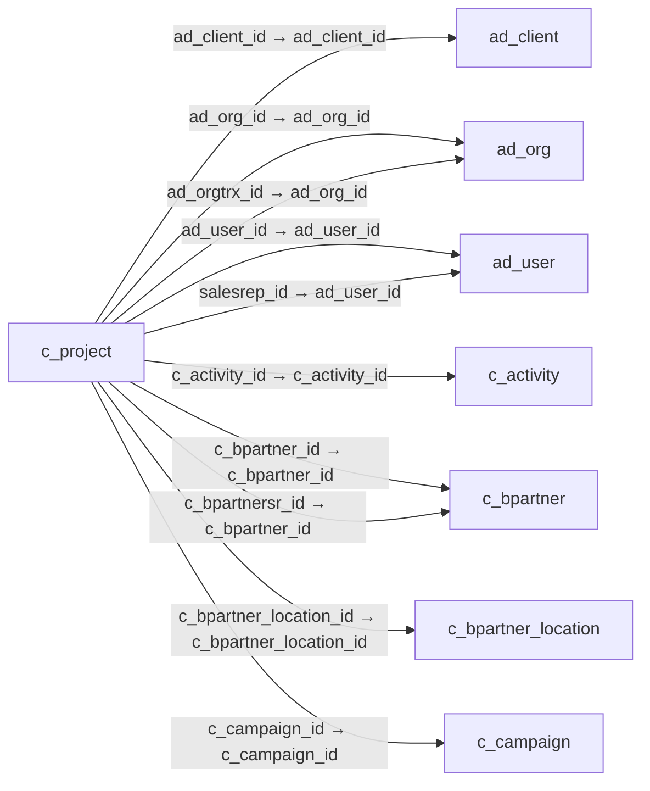

# c_project — 프로젝트

[전체 일람](../TABLE_INDEX.md) · [분류 일람](README.md) · [AI 사용 안내](../README.md) · [외래키 읽는 법](../RELATIONSHIPS.md)

## 기본 정보

| 항목 | 내용 |
|---|---|
| 물리명 | `adempiere.c_project` |
| 한국어 논리명(문서용 해석) | 프로젝트 |
| 원본 논리명 | Project |
| 원본 사전 ID | 203 |
| 분류 | `c` — 거래처·주문·청구·결제·회계 기준 |
| 전체 테넌트 행 수 | 2 |
| 물리 열 수 | 48 |
| 나가는 FK / 들어오는 FK | 16 / 49 |
| 구조·행 수 확인 시점 | 2026-11-03T23:29:01+09:00 |

## 의미와 쓰임

재무 관리 대상 프로젝트를 정의하며 단계·작업·투입·회계 내역을 프로젝트별로 연결한다.

- 설명 근거: 원본 애플리케이션 사전 명칭·설명을 한국어로 해석.
- 한국어 이름과 개요는 문서용 해석입니다. 공식 한국어 번역으로 간주하지 않습니다.
- 원본 설명: Financial Project
- 원본 도움말: —
- PostgreSQL 테이블 주석: —

## 키와 열

### 기본키·고유 제약조건

| 종류 | 제약조건 | 열(순서 유지) |
|---|---|---|
| PRIMARY KEY | `c_project_pkey` | `c_project_id` |
| UNIQUE | `c_project_uu_idx` | `c_project_uu` |

### 별도 고유 인덱스

PK·UNIQUE 제약조건의 인덱스와 별도로 존재하는 고유 인덱스입니다. 식·조건·열 순서는 원본 정의를 따릅니다.

- `c_project_value`: `CREATE UNIQUE INDEX c_project_value ON adempiere.c_project USING btree (ad_client_id, value)`

### 열 목록

원본 논리명·설명은 `AD_Column`에서 가져왔습니다. 기본값은 실제 PostgreSQL 메타데이터이며, 비어 있는 항목은 `—`로 표시합니다.

| 순서 | 물리명 | 원본 논리명 | PostgreSQL 타입 | NULL | PK | 기본값 | 설명 |
|---:|---|---|---|---|---|---|---|
| 1 | `c_project_id` | Project | numeric(10,0) | 불가 | 예 | — | Financial Project |
| 2 | `ad_client_id` | Tenant | numeric(10,0) | 불가 | — | — | Tenant for this installation. |
| 3 | `ad_org_id` | Organization | numeric(10,0) | 불가 | — | — | Organizational entity within tenant |
| 4 | `isactive` | Active | character(1) | 불가 | — | 'Y'::bpchar | The record is active in the system |
| 5 | `created` | Created | timestamp without time zone | 불가 | — | now() | Date this record was created |
| 6 | `createdby` | Created By | numeric(10,0) | 불가 | — | — | User who created this records |
| 7 | `updated` | Updated | timestamp without time zone | 불가 | — | now() | Date this record was updated |
| 8 | `updatedby` | Updated By | numeric(10,0) | 불가 | — | — | User who updated this records |
| 9 | `value` | Search Key | character varying(40) | 불가 | — | — | Search key for the record in the format required - must be unique |
| 10 | `name` | Name | character varying(60) | 불가 | — | — | Alphanumeric identifier of the entity |
| 11 | `description` | Description | character varying(255) | 허용 | — | — | Optional short description of the record |
| 12 | `note` | Note | character varying(2000) | 허용 | — | — | Optional additional user defined information |
| 13 | `issummary` | Summary Level | character(1) | 불가 | — | 'N'::bpchar | This is a summary entity |
| 14 | `ad_user_id` | User/Contact | numeric(10,0) | 허용 | — | — | User within the system - Internal or Business Partner Contact |
| 15 | `c_bpartner_id` | Business Partner | numeric(10,0) | 허용 | — | — | Identifies a Business Partner |
| 16 | `c_bpartner_location_id` | Partner Location | numeric(10,0) | 허용 | — | — | Identifies the (ship to) address for this Business Partner |
| 17 | `poreference` | Order Reference | character varying(20) | 허용 | — | — | Transaction Reference Number (Sales Order, Purchase Order) of your Business Partner |
| 18 | `c_paymentterm_id` | Payment Term | numeric(10,0) | 허용 | — | — | The terms of Payment (timing, discount) |
| 19 | `c_currency_id` | Currency | numeric(10,0) | 불가 | — | — | The Currency for this record |
| 20 | `m_pricelist_version_id` | Price List Version | numeric(10,0) | 허용 | — | — | Identifies a unique instance of a Price List |
| 21 | `c_campaign_id` | Campaign | numeric(10,0) | 허용 | — | — | Marketing Campaign |
| 22 | `iscommitment` | Commitment | character(1) | 불가 | — | 'Y'::bpchar | Is this document a (legal) commitment? |
| 23 | `plannedamt` | Planned Amount | numeric | 불가 | — | 0 | Planned amount for this project |
| 24 | `plannedqty` | Planned Quantity | numeric | 불가 | — | 0 | Planned quantity for this project |
| 25 | `plannedmarginamt` | Planned Margin | numeric | 불가 | — | 0 | Project's planned margin amount |
| 26 | `committedamt` | Committed Amount | numeric | 불가 | — | 0 | The (legal) commitment amount |
| 27 | `datecontract` | Contract Date | timestamp without time zone | 허용 | — | — | The (planned) effective date of this document. |
| 28 | `datefinish` | Finish Date | timestamp without time zone | 허용 | — | — | Finish or (planned) completion date |
| 29 | `generateto` | Generate To | character(1) | 허용 | — | — | Generate To |
| 30 | `processed` | Processed | character(1) | 불가 | — | 'N'::bpchar | The document has been processed |
| 31 | `salesrep_id` | Sales Representative | numeric(10,0) | 허용 | — | — | Sales Representative or Company Agent |
| 32 | `copyfrom` | Copy From | character(1) | 허용 | — | — | Copy From Record |
| 33 | `c_projecttype_id` | Project Type | numeric(10,0) | 허용 | — | — | Type of the project |
| 34 | `committedqty` | Committed Quantity | numeric | 불가 | — | 0 | The (legal) commitment Quantity |
| 35 | `invoicedamt` | Invoiced Amount | numeric | 불가 | — | 0 | The amount invoiced |
| 36 | `invoicedqty` | Quantity Invoiced | numeric | 불가 | — | 0 | The quantity invoiced |
| 37 | `projectbalanceamt` | Project Balance | numeric | 불가 | — | 0 | Total Project Balance |
| 38 | `c_phase_id` | Standard Phase | numeric(10,0) | 허용 | — | — | Standard Phase of the Project Type |
| 39 | `iscommitceiling` | Commitment is Ceiling | character(1) | 불가 | — | 'N'::bpchar | The commitment amount/quantity is the chargeable ceiling  |
| 40 | `m_warehouse_id` | Warehouse | numeric(10,0) | 허용 | — | — | Storage Warehouse and Service Point |
| 41 | `projectcategory` | Project Category | character(1) | 허용 | — | 'N'::bpchar | Project Category |
| 42 | `processing` | Process Now | character(1) | 허용 | — | — | — |
| 43 | `c_bpartnersr_id` | BPartner (Agent) | numeric(10,0) | 허용 | — | — | Business Partner (Agent or Sales Rep) |
| 44 | `projinvoicerule` | Invoice Rule | character(1) | 불가 | — | '-'::bpchar | Invoice Rule for the project |
| 45 | `projectlinelevel` | Line Level | character(1) | 불가 | — | 'P'::bpchar | Project Line Level |
| 46 | `c_project_uu` | C_Project_UU | uuid | 허용 | — | — | — |
| 47 | `ad_orgtrx_id` | Trx Organization | numeric(10,0) | 허용 | — | NULL::numeric | Performing or initiating organization |
| 48 | `c_activity_id` | Activity | numeric(10,0) | 허용 | — | NULL::numeric | Business Activity |

## 외래키 흐름

화살표는 **FK를 가진 자식 → 참조되는 부모**입니다. 업무 처리의 시간 순서나 무조건적인 1:N 관계를 뜻하지 않습니다.

주변 관계 65개 중 10개를 그림으로 표시합니다. **전체 관계는 아래 두 표에 모두 포함**합니다.

### 이 테이블이 참조하는 부모 — 나가는 FK

| 제약조건 | 참조하는 쪽(자식) | 자식 열 | 참조받는 쪽(부모) | 부모 열 | 삭제 / 갱신 | 검증 / 지연 가능 |
|---|---|---|---|---|---|---|
| `adclient_cproject` <!-- FK_OUT: adempiere.c_project.adclient_cproject --> | [`c_project`](c_project.md) | `ad_client_id` | [`ad_client`](../ad/ad_client.md) | `ad_client_id` | NO ACTION / NO ACTION | 완료 / 가능 (초기 지연) |
| `adorg_cproject` <!-- FK_OUT: adempiere.c_project.adorg_cproject --> | [`c_project`](c_project.md) | `ad_org_id` | [`ad_org`](../ad/ad_org.md) | `ad_org_id` | NO ACTION / NO ACTION | 완료 / 가능 (초기 지연) |
| `adorgtrx_cproject` <!-- FK_OUT: adempiere.c_project.adorgtrx_cproject --> | [`c_project`](c_project.md) | `ad_orgtrx_id` | [`ad_org`](../ad/ad_org.md) | `ad_org_id` | NO ACTION / NO ACTION | 완료 / 가능 (초기 지연) |
| `aduser_cproject` <!-- FK_OUT: adempiere.c_project.aduser_cproject --> | [`c_project`](c_project.md) | `ad_user_id` | [`ad_user`](../ad/ad_user.md) | `ad_user_id` | SET NULL / NO ACTION | 완료 / 가능 (초기 지연) |
| `aduser_sr_cproject` <!-- FK_OUT: adempiere.c_project.aduser_sr_cproject --> | [`c_project`](c_project.md) | `salesrep_id` | [`ad_user`](../ad/ad_user.md) | `ad_user_id` | NO ACTION / NO ACTION | 완료 / 가능 (초기 지연) |
| `cactivity_cproject` <!-- FK_OUT: adempiere.c_project.cactivity_cproject --> | [`c_project`](c_project.md) | `c_activity_id` | [`c_activity`](c_activity.md) | `c_activity_id` | NO ACTION / NO ACTION | 완료 / 가능 (초기 지연) |
| `cbpartner_cproject` <!-- FK_OUT: adempiere.c_project.cbpartner_cproject --> | [`c_project`](c_project.md) | `c_bpartner_id` | [`c_bpartner`](c_bpartner.md) | `c_bpartner_id` | NO ACTION / NO ACTION | 완료 / 가능 (초기 지연) |
| `cbpartnersr_cproject` <!-- FK_OUT: adempiere.c_project.cbpartnersr_cproject --> | [`c_project`](c_project.md) | `c_bpartnersr_id` | [`c_bpartner`](c_bpartner.md) | `c_bpartner_id` | NO ACTION / NO ACTION | 완료 / 가능 (초기 지연) |
| `cbplocation_cproject` <!-- FK_OUT: adempiere.c_project.cbplocation_cproject --> | [`c_project`](c_project.md) | `c_bpartner_location_id` | [`c_bpartner_location`](c_bpartner_location.md) | `c_bpartner_location_id` | NO ACTION / NO ACTION | 완료 / 가능 (초기 지연) |
| `ccampaign_cproject` <!-- FK_OUT: adempiere.c_project.ccampaign_cproject --> | [`c_project`](c_project.md) | `c_campaign_id` | [`c_campaign`](c_campaign.md) | `c_campaign_id` | NO ACTION / NO ACTION | 완료 / 가능 (초기 지연) |
| `ccurrency_cproject` <!-- FK_OUT: adempiere.c_project.ccurrency_cproject --> | [`c_project`](c_project.md) | `c_currency_id` | [`c_currency`](c_currency.md) | `c_currency_id` | NO ACTION / NO ACTION | 완료 / 가능 (초기 지연) |
| `cpaymentterm_cproject` <!-- FK_OUT: adempiere.c_project.cpaymentterm_cproject --> | [`c_project`](c_project.md) | `c_paymentterm_id` | [`c_paymentterm`](c_paymentterm.md) | `c_paymentterm_id` | NO ACTION / NO ACTION | 완료 / 가능 (초기 지연) |
| `cphase_cproject` <!-- FK_OUT: adempiere.c_project.cphase_cproject --> | [`c_project`](c_project.md) | `c_phase_id` | [`c_phase`](c_phase.md) | `c_phase_id` | NO ACTION / NO ACTION | 완료 / 가능 (초기 지연) |
| `cprojecttype_cproject` <!-- FK_OUT: adempiere.c_project.cprojecttype_cproject --> | [`c_project`](c_project.md) | `c_projecttype_id` | [`c_projecttype`](c_projecttype.md) | `c_projecttype_id` | NO ACTION / NO ACTION | 완료 / 가능 (초기 지연) |
| `mpricelistversion_cproject` <!-- FK_OUT: adempiere.c_project.mpricelistversion_cproject --> | [`c_project`](c_project.md) | `m_pricelist_version_id` | [`m_pricelist_version`](../m/m_pricelist_version.md) | `m_pricelist_version_id` | NO ACTION / NO ACTION | 완료 / 가능 (초기 지연) |
| `mwarehouse_cproject` <!-- FK_OUT: adempiere.c_project.mwarehouse_cproject --> | [`c_project`](c_project.md) | `m_warehouse_id` | [`m_warehouse`](../m/m_warehouse.md) | `m_warehouse_id` | NO ACTION / NO ACTION | 완료 / 가능 (초기 지연) |

### 이 테이블을 참조하는 자식 — 들어오는 FK

| 제약조건 | 참조하는 쪽(자식) | 자식 열 | 참조받는 쪽(부모) | 부모 열 | 삭제 / 갱신 | 검증 / 지연 가능 |
|---|---|---|---|---|---|---|
| `cproject_aasset` <!-- FK_IN: adempiere.a_asset.cproject_aasset --> | [`a_asset`](../a/a_asset.md) | `c_project_id` | [`c_project`](c_project.md) | `c_project_id` | NO ACTION / NO ACTION | 완료 / 가능 (초기 지연) |
| `cproject_aassetaddition` <!-- FK_IN: adempiere.a_asset_addition.cproject_aassetaddition --> | [`a_asset_addition`](../a/a_asset_addition.md) | `c_project_id` | [`c_project`](c_project.md) | `c_project_id` | NO ACTION / NO ACTION | 완료 / 가능 (초기 지연) |
| `cproject_caschemaelement` <!-- FK_IN: adempiere.c_acctschema_element.cproject_caschemaelement --> | [`c_acctschema_element`](c_acctschema_element.md) | `c_project_id` | [`c_project`](c_project.md) | `c_project_id` | NO ACTION / NO ACTION | 완료 / 가능 (초기 지연) |
| `cproject_ccash` <!-- FK_IN: adempiere.c_cash.cproject_ccash --> | [`c_cash`](c_cash.md) | `c_project_id` | [`c_project`](c_project.md) | `c_project_id` | NO ACTION / NO ACTION | 완료 / 가능 (초기 지연) |
| `cproject_ccashplan` <!-- FK_IN: adempiere.c_cashplan.cproject_ccashplan --> | [`c_cashplan`](c_cashplan.md) | `c_project_id` | [`c_project`](c_project.md) | `c_project_id` | NO ACTION / NO ACTION | 완료 / 가능 (초기 지연) |
| `cproject_ccashplanline` <!-- FK_IN: adempiere.c_cashplanline.cproject_ccashplanline --> | [`c_cashplanline`](c_cashplanline.md) | `c_project_id` | [`c_project`](c_project.md) | `c_project_id` | NO ACTION / NO ACTION | 완료 / 가능 (초기 지연) |
| `cproject_cinvoice` <!-- FK_IN: adempiere.c_invoice.cproject_cinvoice --> | [`c_invoice`](c_invoice.md) | `c_project_id` | [`c_project`](c_project.md) | `c_project_id` | NO ACTION / NO ACTION | 완료 / 가능 (초기 지연) |
| `cproject_cinvoicebatchline` <!-- FK_IN: adempiere.c_invoicebatchline.cproject_cinvoicebatchline --> | [`c_invoicebatchline`](c_invoicebatchline.md) | `c_project_id` | [`c_project`](c_project.md) | `c_project_id` | NO ACTION / NO ACTION | 완료 / 가능 (초기 지연) |
| `cproject_cinvoiceline` <!-- FK_IN: adempiere.c_invoiceline.cproject_cinvoiceline --> | [`c_invoiceline`](c_invoiceline.md) | `c_project_id` | [`c_project`](c_project.md) | `c_project_id` | NO ACTION / NO ACTION | 완료 / 가능 (초기 지연) |
| `cproject_corder` <!-- FK_IN: adempiere.c_order.cproject_corder --> | [`c_order`](c_order.md) | `c_project_id` | [`c_project`](c_project.md) | `c_project_id` | NO ACTION / NO ACTION | 완료 / 가능 (초기 지연) |
| `cproject_corderline` <!-- FK_IN: adempiere.c_orderline.cproject_corderline --> | [`c_orderline`](c_orderline.md) | `c_project_id` | [`c_project`](c_project.md) | `c_project_id` | NO ACTION / NO ACTION | 완료 / 가능 (초기 지연) |
| `cproject_cpayment` <!-- FK_IN: adempiere.c_payment.cproject_cpayment --> | [`c_payment`](c_payment.md) | `c_project_id` | [`c_project`](c_project.md) | `c_project_id` | NO ACTION / NO ACTION | 완료 / 가능 (초기 지연) |
| `cproject_cpaymenttransaction` <!-- FK_IN: adempiere.c_paymenttransaction.cproject_cpaymenttransaction --> | [`c_paymenttransaction`](c_paymenttransaction.md) | `c_project_id` | [`c_project`](c_project.md) | `c_project_id` | NO ACTION / NO ACTION | 완료 / 가능 (초기 지연) |
| `c_project_projectacct` <!-- FK_IN: adempiere.c_project_acct.c_project_projectacct --> | [`c_project_acct`](c_project_acct.md) | `c_project_id` | [`c_project`](c_project.md) | `c_project_id` | CASCADE / NO ACTION | 완료 / 가능 (초기 지연) |
| `cproject_cprojectissue` <!-- FK_IN: adempiere.c_projectissue.cproject_cprojectissue --> | [`c_projectissue`](c_projectissue.md) | `c_project_id` | [`c_project`](c_project.md) | `c_project_id` | NO ACTION / NO ACTION | 완료 / 가능 (초기 지연) |
| `cproject_cprojectline` <!-- FK_IN: adempiere.c_projectline.cproject_cprojectline --> | [`c_projectline`](c_projectline.md) | `c_project_id` | [`c_project`](c_project.md) | `c_project_id` | CASCADE / NO ACTION | 완료 / 가능 (초기 지연) |
| `cproject_cprojectphase` <!-- FK_IN: adempiere.c_projectphase.cproject_cprojectphase --> | [`c_projectphase`](c_projectphase.md) | `c_project_id` | [`c_project`](c_project.md) | `c_project_id` | NO ACTION / NO ACTION | 완료 / 가능 (초기 지연) |
| `cproject_crecurring` <!-- FK_IN: adempiere.c_recurring.cproject_crecurring --> | [`c_recurring`](c_recurring.md) | `c_project_id` | [`c_project`](c_project.md) | `c_project_id` | NO ACTION / NO ACTION | 완료 / 가능 (초기 지연) |
| `cproject_crecurringrun` <!-- FK_IN: adempiere.c_recurring_run.cproject_crecurringrun --> | [`c_recurring_run`](c_recurring_run.md) | `c_project_id` | [`c_project`](c_project.md) | `c_project_id` | CASCADE / NO ACTION | 완료 / 가능 (초기 지연) |
| `cproject_vc` <!-- FK_IN: adempiere.c_validcombination.cproject_vc --> | [`c_validcombination`](c_validcombination.md) | `c_project_id` | [`c_project`](c_project.md) | `c_project_id` | NO ACTION / NO ACTION | 완료 / 가능 (초기 지연) |
| `cproject_ddorder` <!-- FK_IN: adempiere.dd_order.cproject_ddorder --> | [`dd_order`](../dd/dd_order.md) | `c_project_id` | [`c_project`](c_project.md) | `c_project_id` | NO ACTION / NO ACTION | 완료 / 가능 (초기 지연) |
| `cproject_ddorderline` <!-- FK_IN: adempiere.dd_orderline.cproject_ddorderline --> | [`dd_orderline`](../dd/dd_orderline.md) | `c_project_id` | [`c_project`](c_project.md) | `c_project_id` | NO ACTION / NO ACTION | 완료 / 가능 (초기 지연) |
| `c_project_fact_acct` <!-- FK_IN: adempiere.fact_acct.c_project_fact_acct --> | [`fact_acct`](../fact/fact_acct.md) | `c_project_id` | [`c_project`](c_project.md) | `c_project_id` | NO ACTION / NO ACTION | 완료 / 가능 (초기 지연) |
| `cproject_factacctsummary` <!-- FK_IN: adempiere.fact_acct_summary.cproject_factacctsummary --> | [`fact_acct_summary`](../fact/fact_acct_summary.md) | `c_project_id` | [`c_project`](c_project.md) | `c_project_id` | NO ACTION / NO ACTION | 완료 / 가능 (초기 지연) |
| `cproject_gldist` <!-- FK_IN: adempiere.gl_distribution.cproject_gldist --> | [`gl_distribution`](../gl/gl_distribution.md) | `c_project_id` | [`c_project`](c_project.md) | `c_project_id` | NO ACTION / NO ACTION | 완료 / 가능 (초기 지연) |
| `cproject_gldistline` <!-- FK_IN: adempiere.gl_distributionline.cproject_gldistline --> | [`gl_distributionline`](../gl/gl_distributionline.md) | `c_project_id` | [`c_project`](c_project.md) | `c_project_id` | NO ACTION / NO ACTION | 완료 / 가능 (초기 지연) |
| `cproject_gljournalline` <!-- FK_IN: adempiere.gl_journalline.cproject_gljournalline --> | [`gl_journalline`](../gl/gl_journalline.md) | `c_project_id` | [`c_project`](c_project.md) | `c_project_id` | NO ACTION / NO ACTION | 완료 / 가능 (초기 지연) |
| `cproject_hrcontract` <!-- FK_IN: adempiere.hr_contract.cproject_hrcontract --> | [`hr_contract`](../hr/hr_contract.md) | `c_project_id` | [`c_project`](c_project.md) | `c_project_id` | NO ACTION / NO ACTION | 완료 / 가능 (초기 지연) |
| `cproject_hrmovement` <!-- FK_IN: adempiere.hr_movement.cproject_hrmovement --> | [`hr_movement`](../hr/hr_movement.md) | `c_project_id` | [`c_project`](c_project.md) | `c_project_id` | NO ACTION / NO ACTION | 완료 / 가능 (초기 지연) |
| `cproject_ifajournal` <!-- FK_IN: adempiere.i_fajournal.cproject_ifajournal --> | [`i_fajournal`](../i/i_fajournal.md) | `c_project_id` | [`c_project`](c_project.md) | `c_project_id` | NO ACTION / NO ACTION | 완료 / 가능 (초기 지연) |
| `cproject_igljournal` <!-- FK_IN: adempiere.i_gljournal.cproject_igljournal --> | [`i_gljournal`](../i/i_gljournal.md) | `c_project_id` | [`c_project`](c_project.md) | `c_project_id` | SET NULL / NO ACTION | 완료 / 가능 (초기 지연) |
| `cproject_iinvoice` <!-- FK_IN: adempiere.i_invoice.cproject_iinvoice --> | [`i_invoice`](../i/i_invoice.md) | `c_project_id` | [`c_project`](c_project.md) | `c_project_id` | SET NULL / NO ACTION | 완료 / 가능 (초기 지연) |
| `cproject_imovement` <!-- FK_IN: adempiere.i_movement.cproject_imovement --> | [`i_movement`](../i/i_movement.md) | `c_project_id` | [`c_project`](c_project.md) | `c_project_id` | NO ACTION / NO ACTION | 완료 / 가능 (초기 지연) |
| `cproject_iorder` <!-- FK_IN: adempiere.i_order.cproject_iorder --> | [`i_order`](../i/i_order.md) | `c_project_id` | [`c_project`](c_project.md) | `c_project_id` | SET NULL / NO ACTION | 완료 / 가능 (초기 지연) |
| `cproject_minout` <!-- FK_IN: adempiere.m_inout.cproject_minout --> | [`m_inout`](../m/m_inout.md) | `c_project_id` | [`c_project`](c_project.md) | `c_project_id` | NO ACTION / NO ACTION | 완료 / 가능 (초기 지연) |
| `cproject_minoutline` <!-- FK_IN: adempiere.m_inoutline.cproject_minoutline --> | [`m_inoutline`](../m/m_inoutline.md) | `c_project_id` | [`c_project`](c_project.md) | `c_project_id` | NO ACTION / NO ACTION | 완료 / 가능 (초기 지연) |
| `cproject_minventory` <!-- FK_IN: adempiere.m_inventory.cproject_minventory --> | [`m_inventory`](../m/m_inventory.md) | `c_project_id` | [`c_project`](c_project.md) | `c_project_id` | NO ACTION / NO ACTION | 완료 / 가능 (초기 지연) |
| `cproject_mmovement` <!-- FK_IN: adempiere.m_movement.cproject_mmovement --> | [`m_movement`](../m/m_movement.md) | `c_project_id` | [`c_project`](c_project.md) | `c_project_id` | NO ACTION / NO ACTION | 완료 / 가능 (초기 지연) |
| `cproject_mproduction` <!-- FK_IN: adempiere.m_production.cproject_mproduction --> | [`m_production`](../m/m_production.md) | `c_project_id` | [`c_project`](c_project.md) | `c_project_id` | NO ACTION / NO ACTION | 완료 / 가능 (초기 지연) |
| `cproject_padocumentstatus` <!-- FK_IN: adempiere.pa_documentstatus.cproject_padocumentstatus --> | [`pa_documentstatus`](../pa/pa_documentstatus.md) | `c_project_id` | [`c_project`](c_project.md) | `c_project_id` | NO ACTION / NO ACTION | 완료 / 가능 (초기 지연) |
| `cproject_pareportcolumn` <!-- FK_IN: adempiere.pa_reportcolumn.cproject_pareportcolumn --> | [`pa_reportcolumn`](../pa/pa_reportcolumn.md) | `c_project_id` | [`c_project`](c_project.md) | `c_project_id` | NO ACTION / NO ACTION | 완료 / 가능 (초기 지연) |
| `cproject_pareportsource` <!-- FK_IN: adempiere.pa_reportsource.cproject_pareportsource --> | [`pa_reportsource`](../pa/pa_reportsource.md) | `c_project_id` | [`c_project`](c_project.md) | `c_project_id` | NO ACTION / NO ACTION | 완료 / 가능 (초기 지연) |
| `cproject_ppcostcollector` <!-- FK_IN: adempiere.pp_cost_collector.cproject_ppcostcollector --> | [`pp_cost_collector`](../pp/pp_cost_collector.md) | `c_project_id` | [`c_project`](c_project.md) | `c_project_id` | NO ACTION / NO ACTION | 완료 / 가능 (초기 지연) |
| `cproject_pporder` <!-- FK_IN: adempiere.pp_order.cproject_pporder --> | [`pp_order`](../pp/pp_order.md) | `c_project_id` | [`c_project`](c_project.md) | `c_project_id` | NO ACTION / NO ACTION | 완료 / 가능 (초기 지연) |
| `cproject_rissueproject` <!-- FK_IN: adempiere.r_issueproject.cproject_rissueproject --> | [`r_issueproject`](../r/r_issueproject.md) | `c_project_id` | [`c_project`](c_project.md) | `c_project_id` | NO ACTION / NO ACTION | 완료 / 가능 (초기 지연) |
| `cproject_rrequest` <!-- FK_IN: adempiere.r_request.cproject_rrequest --> | [`r_request`](../r/r_request.md) | `c_project_id` | [`c_project`](c_project.md) | `c_project_id` | NO ACTION / NO ACTION | 완료 / 가능 (초기 지연) |
| `cproject_rrequestaction` <!-- FK_IN: adempiere.r_requestaction.cproject_rrequestaction --> | [`r_requestaction`](../r/r_requestaction.md) | `c_project_id` | [`c_project`](c_project.md) | `c_project_id` | NO ACTION / NO ACTION | 완료 / 가능 (초기 지연) |
| `cproject_stimeexpenseline` <!-- FK_IN: adempiere.s_timeexpenseline.cproject_stimeexpenseline --> | [`s_timeexpenseline`](../s/s_timeexpenseline.md) | `c_project_id` | [`c_project`](c_project.md) | `c_project_id` | NO ACTION / NO ACTION | 완료 / 가능 (초기 지연) |
| `cproject_taging` <!-- FK_IN: adempiere.t_aging.cproject_taging --> | [`t_aging`](../t/t_aging.md) | `c_project_id` | [`c_project`](c_project.md) | `c_project_id` | CASCADE / NO ACTION | 완료 / 가능 (초기 지연) |

## 조회 시 주의

- FK 표의 자식 열과 부모 열을 같은 순서로 대응시킵니다. 복합 FK는 모든 열의 동등 조건을 `AND`로 연결합니다.
- 테이블 이름이나 `_id` 열 이름만으로 물리 FK가 있다고 가정하지 않습니다. FK 미선언은 업무 관계가 없다는 뜻도 아닙니다.
- 자식이 여러 행인 테이블과 조인하면 부모의 금액·건수가 중복될 수 있습니다. 집계 단위를 먼저 정합니다.
- `ad_client_id`가 있습니다. 업무 분석에서는 대상 테넌트를 명시합니다. GardenWorld는 `11`, 시스템 공통 설정은 `0`일 수 있으므로 일괄 필터 적용 전에 테이블 역할을 확인합니다.
- 행 수는 위 확인 시점의 전체 테넌트 값입니다. 최신 업무 실적이나 현재 실행 결과로 재사용하지 않습니다.
