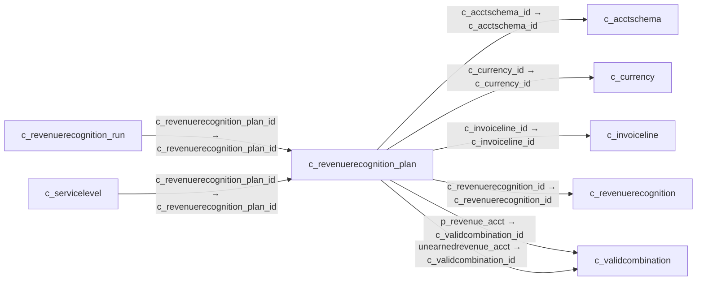

# c_revenuerecognition_plan — 수익 인식 계획

[전체 일람](../TABLE_INDEX.md) · [분류 일람](README.md) · [AI 사용 안내](../README.md) · [외래키 읽는 법](../RELATIONSHIPS.md)

## 기본 정보

| 항목 | 내용 |
|---|---|
| 물리명 | `adempiere.c_revenuerecognition_plan` |
| 한국어 논리명(문서용 해석) | 수익 인식 계획 |
| 원본 논리명 | Revenue Recognition Plan |
| 원본 사전 ID | 443 |
| 분류 | `c` — 거래처·주문·청구·결제·회계 기준 |
| 전체 테넌트 행 수 | 0 |
| 물리 열 수 | 17 |
| 나가는 FK / 들어오는 FK | 6 / 2 |
| 구조·행 수 확인 시점 | 2026-11-03T23:29:01+09:00 |

## 의미와 쓰임

정의된 방식에 따라 수익을 인식하거나 기록할 계획을 관리한다.

- 설명 근거: 원본 애플리케이션 사전 명칭·설명을 한국어로 해석.
- 한국어 이름과 개요는 문서용 해석입니다. 공식 한국어 번역으로 간주하지 않습니다.
- 원본 설명: Plan for recognizing or recording revenue
- 원본 도움말: —
- PostgreSQL 테이블 주석: —

## 키와 열

### 기본키·고유 제약조건

| 종류 | 제약조건 | 열(순서 유지) |
|---|---|---|
| UNIQUE | `c_revenuerecognition_pl_uu_idx` | `c_revenuerecognition_plan_uu` |
| PRIMARY KEY | `c_revenuerecognition_plan_pkey` | `c_revenuerecognition_plan_id` |

### 열 목록

원본 논리명·설명은 `AD_Column`에서 가져왔습니다. 기본값은 실제 PostgreSQL 메타데이터이며, 비어 있는 항목은 `—`로 표시합니다.

| 순서 | 물리명 | 원본 논리명 | PostgreSQL 타입 | NULL | PK | 기본값 | 설명 |
|---:|---|---|---|---|---|---|---|
| 1 | `c_revenuerecognition_plan_id` | Revenue Recognition Plan | numeric(10,0) | 불가 | 예 | — | Plan for recognizing or recording revenue |
| 2 | `ad_client_id` | Tenant | numeric(10,0) | 불가 | — | — | Tenant for this installation. |
| 3 | `ad_org_id` | Organization | numeric(10,0) | 불가 | — | — | Organizational entity within tenant |
| 4 | `isactive` | Active | character(1) | 불가 | — | 'Y'::bpchar | The record is active in the system |
| 5 | `created` | Created | timestamp without time zone | 불가 | — | now() | Date this record was created |
| 6 | `createdby` | Created By | numeric(10,0) | 불가 | — | — | User who created this records |
| 7 | `updated` | Updated | timestamp without time zone | 불가 | — | now() | Date this record was updated |
| 8 | `updatedby` | Updated By | numeric(10,0) | 불가 | — | — | User who updated this records |
| 9 | `c_acctschema_id` | Accounting Schema | numeric(10,0) | 불가 | — | — | Rules for accounting |
| 10 | `c_revenuerecognition_id` | Revenue Recognition | numeric(10,0) | 불가 | — | — | Method for recording revenue |
| 11 | `c_invoiceline_id` | Invoice Line | numeric(10,0) | 불가 | — | — | Invoice Detail Line |
| 12 | `unearnedrevenue_acct` | Unearned Revenue | numeric(10,0) | 불가 | — | — | Account for unearned revenue |
| 13 | `p_revenue_acct` | Product Revenue | numeric(10,0) | 불가 | — | — | Account for Product Revenue (Sales Account) |
| 14 | `c_currency_id` | Currency | numeric(10,0) | 불가 | — | — | The Currency for this record |
| 15 | `totalamt` | Total Amount | numeric | 불가 | — | 0 | Total Amount |
| 16 | `recognizedamt` | Recognized Amount | numeric | 불가 | — | 0 | — |
| 17 | `c_revenuerecognition_plan_uu` | C_RevenueRecognition_Plan_UU | uuid | 허용 | — | — | — |

## 외래키 흐름

화살표는 **FK를 가진 자식 → 참조되는 부모**입니다. 업무 처리의 시간 순서나 무조건적인 1:N 관계를 뜻하지 않습니다.

주변 관계 8개 중 8개를 그림으로 표시합니다. **전체 관계는 아래 두 표에 모두 포함**합니다.

### 이 테이블이 참조하는 부모 — 나가는 FK

| 제약조건 | 참조하는 쪽(자식) | 자식 열 | 참조받는 쪽(부모) | 부모 열 | 삭제 / 갱신 | 검증 / 지연 가능 |
|---|---|---|---|---|---|---|
| `cacctschema_crevrecplan` <!-- FK_OUT: adempiere.c_revenuerecognition_plan.cacctschema_crevrecplan --> | [`c_revenuerecognition_plan`](c_revenuerecognition_plan.md) | `c_acctschema_id` | [`c_acctschema`](c_acctschema.md) | `c_acctschema_id` | NO ACTION / NO ACTION | 완료 / 가능 (초기 지연) |
| `ccurrency_crevenuerecplan` <!-- FK_OUT: adempiere.c_revenuerecognition_plan.ccurrency_crevenuerecplan --> | [`c_revenuerecognition_plan`](c_revenuerecognition_plan.md) | `c_currency_id` | [`c_currency`](c_currency.md) | `c_currency_id` | NO ACTION / NO ACTION | 완료 / 가능 (초기 지연) |
| `cinvoiceline_crevenuerecplan` <!-- FK_OUT: adempiere.c_revenuerecognition_plan.cinvoiceline_crevenuerecplan --> | [`c_revenuerecognition_plan`](c_revenuerecognition_plan.md) | `c_invoiceline_id` | [`c_invoiceline`](c_invoiceline.md) | `c_invoiceline_id` | NO ACTION / NO ACTION | 완료 / 가능 (초기 지연) |
| `crevenuerecognition_plan` <!-- FK_OUT: adempiere.c_revenuerecognition_plan.crevenuerecognition_plan --> | [`c_revenuerecognition_plan`](c_revenuerecognition_plan.md) | `c_revenuerecognition_id` | [`c_revenuerecognition`](c_revenuerecognition.md) | `c_revenuerecognition_id` | NO ACTION / NO ACTION | 완료 / 가능 (초기 지연) |
| `vc_prevenue_crevenuerecognitio` <!-- FK_OUT: adempiere.c_revenuerecognition_plan.vc_prevenue_crevenuerecognitio --> | [`c_revenuerecognition_plan`](c_revenuerecognition_plan.md) | `p_revenue_acct` | [`c_validcombination`](c_validcombination.md) | `c_validcombination_id` | NO ACTION / NO ACTION | 완료 / 가능 (초기 지연) |
| `vc_unearnedrevenue_crevenuerec` <!-- FK_OUT: adempiere.c_revenuerecognition_plan.vc_unearnedrevenue_crevenuerec --> | [`c_revenuerecognition_plan`](c_revenuerecognition_plan.md) | `unearnedrevenue_acct` | [`c_validcombination`](c_validcombination.md) | `c_validcombination_id` | NO ACTION / NO ACTION | 완료 / 가능 (초기 지연) |

### 이 테이블을 참조하는 자식 — 들어오는 FK

| 제약조건 | 참조하는 쪽(자식) | 자식 열 | 참조받는 쪽(부모) | 부모 열 | 삭제 / 갱신 | 검증 / 지연 가능 |
|---|---|---|---|---|---|---|
| `crevrecplan_crefrecrun` <!-- FK_IN: adempiere.c_revenuerecognition_run.crevrecplan_crefrecrun --> | [`c_revenuerecognition_run`](c_revenuerecognition_run.md) | `c_revenuerecognition_plan_id` | [`c_revenuerecognition_plan`](c_revenuerecognition_plan.md) | `c_revenuerecognition_plan_id` | NO ACTION / NO ACTION | 완료 / 가능 (초기 지연) |
| `crevrecplan_cservicelevel` <!-- FK_IN: adempiere.c_servicelevel.crevrecplan_cservicelevel --> | [`c_servicelevel`](c_servicelevel.md) | `c_revenuerecognition_plan_id` | [`c_revenuerecognition_plan`](c_revenuerecognition_plan.md) | `c_revenuerecognition_plan_id` | NO ACTION / NO ACTION | 완료 / 가능 (초기 지연) |

## 조회 시 주의

- FK 표의 자식 열과 부모 열을 같은 순서로 대응시킵니다. 복합 FK는 모든 열의 동등 조건을 `AND`로 연결합니다.
- 테이블 이름이나 `_id` 열 이름만으로 물리 FK가 있다고 가정하지 않습니다. FK 미선언은 업무 관계가 없다는 뜻도 아닙니다.
- 자식이 여러 행인 테이블과 조인하면 부모의 금액·건수가 중복될 수 있습니다. 집계 단위를 먼저 정합니다.
- `ad_client_id`가 있습니다. 업무 분석에서는 대상 테넌트를 명시합니다. GardenWorld는 `11`, 시스템 공통 설정은 `0`일 수 있으므로 일괄 필터 적용 전에 테이블 역할을 확인합니다.
- 수집 시점에 0행입니다. 이 표만으로 거래 실적·처리 결과를 계산할 수 없습니다.
- 행 수는 위 확인 시점의 전체 테넌트 값입니다. 최신 업무 실적이나 현재 실행 결과로 재사용하지 않습니다.
