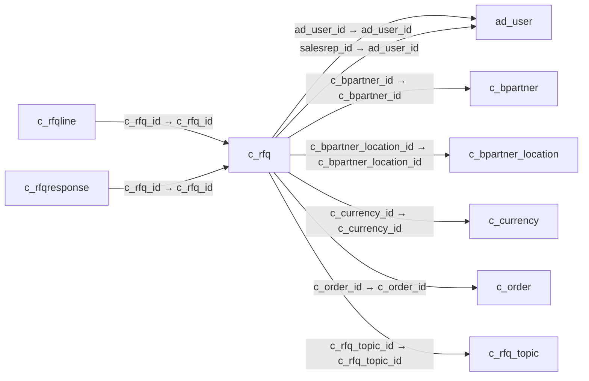

# c_rfq — 견적 요청

[전체 일람](../TABLE_INDEX.md) · [분류 일람](README.md) · [AI 사용 안내](../README.md) · [외래키 읽는 법](../RELATIONSHIPS.md)

## 기본 정보

| 항목 | 내용 |
|---|---|
| 물리명 | `adempiere.c_rfq` |
| 한국어 논리명(문서용 해석) | 견적 요청 |
| 원본 논리명 | RfQ |
| 원본 사전 ID | 677 |
| 분류 | `c` — 거래처·주문·청구·결제·회계 기준 |
| 전체 테넌트 행 수 | 1 |
| 물리 열 수 | 38 |
| 나가는 FK / 들어오는 FK | 7 / 2 |
| 구조·행 수 확인 시점 | 2026-11-03T23:29:01+09:00 |

## 의미와 쓰임

잠재 공급업체에 제시할 견적 요청의 머리글을 관리한다.

- 설명 근거: 원본 애플리케이션 사전 명칭·설명을 한국어로 해석.
- 한국어 이름과 개요는 문서용 해석입니다. 공식 한국어 번역으로 간주하지 않습니다.
- 원본 설명: Request for Quotation
- 원본 도움말: —
- PostgreSQL 테이블 주석: —

## 키와 열

### 기본키·고유 제약조건

| 종류 | 제약조건 | 열(순서 유지) |
|---|---|---|
| PRIMARY KEY | `c_rfq_pkey` | `c_rfq_id` |
| UNIQUE | `c_rfq_uu_idx` | `c_rfq_uu` |

### 열 목록

원본 논리명·설명은 `AD_Column`에서 가져왔습니다. 기본값은 실제 PostgreSQL 메타데이터이며, 비어 있는 항목은 `—`로 표시합니다.

| 순서 | 물리명 | 원본 논리명 | PostgreSQL 타입 | NULL | PK | 기본값 | 설명 |
|---:|---|---|---|---|---|---|---|
| 1 | `c_rfq_id` | RfQ | numeric(10,0) | 불가 | 예 | — | Request for Quotation |
| 2 | `ad_client_id` | Tenant | numeric(10,0) | 불가 | — | — | Tenant for this installation. |
| 3 | `ad_org_id` | Organization | numeric(10,0) | 불가 | — | — | Organizational entity within tenant |
| 4 | `isactive` | Active | character(1) | 불가 | — | 'Y'::bpchar | The record is active in the system |
| 5 | `created` | Created | timestamp without time zone | 불가 | — | now() | Date this record was created |
| 6 | `createdby` | Created By | numeric(10,0) | 불가 | — | — | User who created this records |
| 7 | `updated` | Updated | timestamp without time zone | 불가 | — | now() | Date this record was updated |
| 8 | `updatedby` | Updated By | numeric(10,0) | 불가 | — | — | User who updated this records |
| 9 | `name` | Name | character varying(60) | 불가 | — | — | Alphanumeric identifier of the entity |
| 10 | `description` | Description | character varying(255) | 허용 | — | — | Optional short description of the record |
| 11 | `help` | Comment/Help | character varying(2000) | 허용 | — | — | Comment or Hint |
| 12 | `c_rfq_topic_id` | RfQ Topic | numeric(10,0) | 불가 | — | — | Topic for Request for Quotations |
| 13 | `c_currency_id` | Currency | numeric(10,0) | 불가 | — | — | The Currency for this record |
| 14 | `dateresponse` | Response Date | timestamp without time zone | 불가 | — | — | Date of the Response |
| 15 | `isrfqresponseaccepted` | Responses Accepted | character(1) | 불가 | — | 'Y'::bpchar | Are Responses to the Request for Quotation accepted |
| 16 | `dateworkstart` | Work Start | timestamp without time zone | 허용 | — | — | Date when work is (planned to be) started |
| 17 | `deliverydays` | Delivery Days | numeric(10,0) | 허용 | — | 0 | Number of Days (planned) until Delivery |
| 18 | `dateworkcomplete` | Work Complete | timestamp without time zone | 허용 | — | — | Date when work is (planned to be) complete |
| 19 | `quotetype` | RfQ Type | character(1) | 불가 | — | — | Request for Quotation Type |
| 20 | `isquotetotalamt` | Quote Total Amt | character(1) | 불가 | — | 'N'::bpchar | The response can have just the total amount for the RfQ |
| 21 | `isquoteallqty` | Quote All Quantities | character(1) | 불가 | — | 'Y'::bpchar | Suppliers are requested to provide responses for all quantities |
| 22 | `isselfservice` | Self-Service | character(1) | 불가 | — | 'N'::bpchar | This is a Self-Service entry or this entry can be changed via Self-Service |
| 23 | `isinvitedvendorsonly` | Invited Vendors Only | character(1) | 불가 | — | 'N'::bpchar | Only invited vendors can respond to an RfQ |
| 24 | `c_bpartner_id` | Business Partner | numeric(10,0) | 허용 | — | — | Identifies a Business Partner |
| 25 | `c_bpartner_location_id` | Partner Location | numeric(10,0) | 허용 | — | — | Identifies the (ship to) address for this Business Partner |
| 26 | `ad_user_id` | User/Contact | numeric(10,0) | 허용 | — | — | User within the system - Internal or Business Partner Contact |
| 27 | `salesrep_id` | Sales Representative | numeric(10,0) | 불가 | — | — | Sales Representative or Company Agent |
| 28 | `margin` | Margin % | numeric | 허용 | — | — | Margin for a product as a percentage |
| 29 | `createso` | Create SO | character(1) | 허용 | — | — | — |
| 30 | `createpo` | Create PO | character(1) | 허용 | — | — | Create Purchase Order |
| 31 | `publishrfq` | Publish RfQ | character(1) | 허용 | — | — | — |
| 32 | `c_order_id` | Order | numeric(10,0) | 허용 | — | — | Order |
| 33 | `copylines` | Copy Lines | character(1) | 허용 | — | — | — |
| 34 | `rankrfq` | Rank RfQ | character(1) | 허용 | — | — | — |
| 35 | `processing` | Process Now | character(1) | 허용 | — | — | — |
| 36 | `processed` | Processed | character(1) | 불가 | — | 'N'::bpchar | The document has been processed |
| 37 | `documentno` | Document No | character varying(30) | 불가 | — | '.'::character varying | Document sequence number of the document |
| 38 | `c_rfq_uu` | C_RfQ_UU | uuid | 허용 | — | — | — |

## 외래키 흐름

화살표는 **FK를 가진 자식 → 참조되는 부모**입니다. 업무 처리의 시간 순서나 무조건적인 1:N 관계를 뜻하지 않습니다.

주변 관계 9개 중 9개를 그림으로 표시합니다. **전체 관계는 아래 두 표에 모두 포함**합니다.

### 이 테이블이 참조하는 부모 — 나가는 FK

| 제약조건 | 참조하는 쪽(자식) | 자식 열 | 참조받는 쪽(부모) | 부모 열 | 삭제 / 갱신 | 검증 / 지연 가능 |
|---|---|---|---|---|---|---|
| `aduser_crfq` <!-- FK_OUT: adempiere.c_rfq.aduser_crfq --> | [`c_rfq`](c_rfq.md) | `ad_user_id` | [`ad_user`](../ad/ad_user.md) | `ad_user_id` | NO ACTION / NO ACTION | 완료 / 가능 (초기 지연) |
| `adusersalesrep_crfq` <!-- FK_OUT: adempiere.c_rfq.adusersalesrep_crfq --> | [`c_rfq`](c_rfq.md) | `salesrep_id` | [`ad_user`](../ad/ad_user.md) | `ad_user_id` | NO ACTION / NO ACTION | 완료 / 가능 (초기 지연) |
| `cbpartner_crfq` <!-- FK_OUT: adempiere.c_rfq.cbpartner_crfq --> | [`c_rfq`](c_rfq.md) | `c_bpartner_id` | [`c_bpartner`](c_bpartner.md) | `c_bpartner_id` | NO ACTION / NO ACTION | 완료 / 가능 (초기 지연) |
| `cbplocation_crfq` <!-- FK_OUT: adempiere.c_rfq.cbplocation_crfq --> | [`c_rfq`](c_rfq.md) | `c_bpartner_location_id` | [`c_bpartner_location`](c_bpartner_location.md) | `c_bpartner_location_id` | NO ACTION / NO ACTION | 완료 / 가능 (초기 지연) |
| `ccurrency_crfq` <!-- FK_OUT: adempiere.c_rfq.ccurrency_crfq --> | [`c_rfq`](c_rfq.md) | `c_currency_id` | [`c_currency`](c_currency.md) | `c_currency_id` | NO ACTION / NO ACTION | 완료 / 가능 (초기 지연) |
| `corder_crfq` <!-- FK_OUT: adempiere.c_rfq.corder_crfq --> | [`c_rfq`](c_rfq.md) | `c_order_id` | [`c_order`](c_order.md) | `c_order_id` | NO ACTION / NO ACTION | 완료 / 가능 (초기 지연) |
| `crfqtopic_crfq` <!-- FK_OUT: adempiere.c_rfq.crfqtopic_crfq --> | [`c_rfq`](c_rfq.md) | `c_rfq_topic_id` | [`c_rfq_topic`](c_rfq_topic.md) | `c_rfq_topic_id` | NO ACTION / NO ACTION | 완료 / 가능 (초기 지연) |

### 이 테이블을 참조하는 자식 — 들어오는 FK

| 제약조건 | 참조하는 쪽(자식) | 자식 열 | 참조받는 쪽(부모) | 부모 열 | 삭제 / 갱신 | 검증 / 지연 가능 |
|---|---|---|---|---|---|---|
| `crfq_crfqline` <!-- FK_IN: adempiere.c_rfqline.crfq_crfqline --> | [`c_rfqline`](c_rfqline.md) | `c_rfq_id` | [`c_rfq`](c_rfq.md) | `c_rfq_id` | CASCADE / NO ACTION | 완료 / 가능 (초기 지연) |
| `crfq_crfqresponse` <!-- FK_IN: adempiere.c_rfqresponse.crfq_crfqresponse --> | [`c_rfqresponse`](c_rfqresponse.md) | `c_rfq_id` | [`c_rfq`](c_rfq.md) | `c_rfq_id` | CASCADE / NO ACTION | 완료 / 가능 (초기 지연) |

## 조회 시 주의

- FK 표의 자식 열과 부모 열을 같은 순서로 대응시킵니다. 복합 FK는 모든 열의 동등 조건을 `AND`로 연결합니다.
- 테이블 이름이나 `_id` 열 이름만으로 물리 FK가 있다고 가정하지 않습니다. FK 미선언은 업무 관계가 없다는 뜻도 아닙니다.
- 자식이 여러 행인 테이블과 조인하면 부모의 금액·건수가 중복될 수 있습니다. 집계 단위를 먼저 정합니다.
- `ad_client_id`가 있습니다. 업무 분석에서는 대상 테넌트를 명시합니다. GardenWorld는 `11`, 시스템 공통 설정은 `0`일 수 있으므로 일괄 필터 적용 전에 테이블 역할을 확인합니다.
- 행 수는 위 확인 시점의 전체 테넌트 값입니다. 최신 업무 실적이나 현재 실행 결과로 재사용하지 않습니다.
