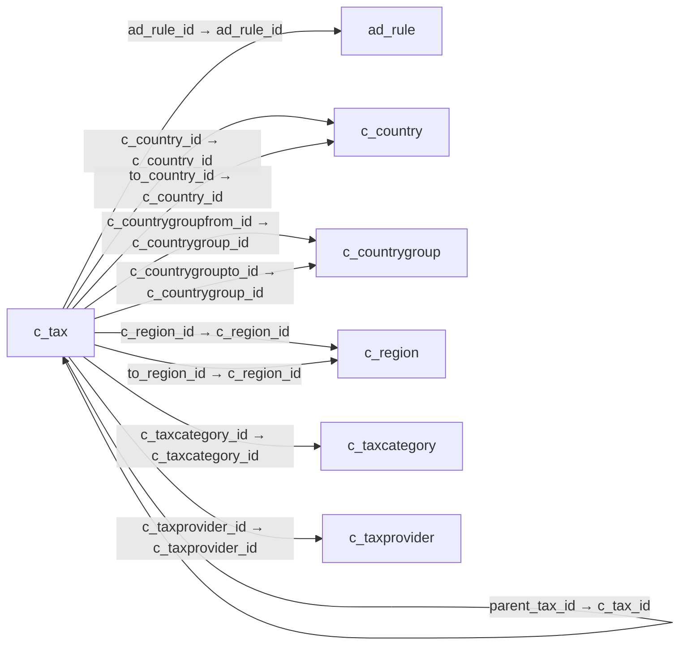

# c_tax — 세금

[전체 일람](../TABLE_INDEX.md) · [분류 일람](README.md) · [AI 사용 안내](../README.md) · [외래키 읽는 법](../RELATIONSHIPS.md)

## 기본 정보

| 항목 | 내용 |
|---|---|
| 물리명 | `adempiere.c_tax` |
| 한국어 논리명(문서용 해석) | 세금 |
| 원본 논리명 | Tax |
| 원본 사전 ID | 261 |
| 분류 | `c` — 거래처·주문·청구·결제·회계 기준 |
| 전체 테넌트 행 수 | 6 |
| 물리 열 수 | 32 |
| 나가는 FK / 들어오는 FK | 10 / 17 |
| 구조·행 수 확인 시점 | 2026-11-03T23:29:01+09:00 |

## 의미와 쓰임

거래에서 적용하는 세금의 기준정보를 관리한다.

- 설명 근거: 원본 애플리케이션 사전 명칭·설명을 한국어로 해석.
- 한국어 이름과 개요는 문서용 해석입니다. 공식 한국어 번역으로 간주하지 않습니다.
- 원본 설명: Tax identifier
- 원본 도움말: —
- PostgreSQL 테이블 주석: —

## 키와 열

### 기본키·고유 제약조건

| 종류 | 제약조건 | 열(순서 유지) |
|---|---|---|
| PRIMARY KEY | `c_tax_pkey` | `c_tax_id` |
| UNIQUE | `c_tax_uu_idx` | `c_tax_uu` |

### 별도 고유 인덱스

PK·UNIQUE 제약조건의 인덱스와 별도로 존재하는 고유 인덱스입니다. 식·조건·열 순서는 원본 정의를 따릅니다.

- `c_tax_name`: `CREATE UNIQUE INDEX c_tax_name ON adempiere.c_tax USING btree (ad_client_id, name)`

### 열 목록

원본 논리명·설명은 `AD_Column`에서 가져왔습니다. 기본값은 실제 PostgreSQL 메타데이터이며, 비어 있는 항목은 `—`로 표시합니다.

| 순서 | 물리명 | 원본 논리명 | PostgreSQL 타입 | NULL | PK | 기본값 | 설명 |
|---:|---|---|---|---|---|---|---|
| 1 | `c_tax_id` | Tax | numeric(10,0) | 불가 | 예 | — | Tax identifier |
| 2 | `ad_client_id` | Tenant | numeric(10,0) | 불가 | — | — | Tenant for this installation. |
| 3 | `ad_org_id` | Organization | numeric(10,0) | 불가 | — | — | Organizational entity within tenant |
| 4 | `isactive` | Active | character(1) | 불가 | — | 'Y'::bpchar | The record is active in the system |
| 5 | `created` | Created | timestamp without time zone | 불가 | — | now() | Date this record was created |
| 6 | `createdby` | Created By | numeric(10,0) | 불가 | — | — | User who created this records |
| 7 | `updated` | Updated | timestamp without time zone | 불가 | — | now() | Date this record was updated |
| 8 | `name` | Name | character varying(60) | 불가 | — | — | Alphanumeric identifier of the entity |
| 9 | `updatedby` | Updated By | numeric(10,0) | 불가 | — | — | User who updated this records |
| 10 | `description` | Description | character varying(255) | 허용 | — | — | Optional short description of the record |
| 11 | `taxindicator` | Tax Indicator | character varying(10) | 허용 | — | — | Short form for Tax to be printed on documents |
| 12 | `isdocumentlevel` | Document Level | character(1) | 불가 | — | 'Y'::bpchar | Tax is calculated on document level (rather than line by line) |
| 13 | `validfrom` | Valid from | timestamp without time zone | 불가 | — | — | Valid from including this date (first day) |
| 14 | `issummary` | Summary Level | character(1) | 불가 | — | 'N'::bpchar | This is a summary entity |
| 15 | `requirestaxcertificate` | Requires Tax Certificate | character(1) | 불가 | — | 'N'::bpchar | This tax rate requires the Business Partner to be tax exempt |
| 16 | `rate` | Rate | numeric | 불가 | — | — | Rate or Tax or Exchange |
| 17 | `parent_tax_id` | Parent Tax | numeric(10,0) | 허용 | — | — | Parent Tax indicates a tax that is made up of multiple taxes |
| 18 | `c_country_id` | Country | numeric(10,0) | 허용 | — | — | Country  |
| 19 | `c_region_id` | Region | numeric(10,0) | 허용 | — | — | Identifies a geographical Region |
| 20 | `to_country_id` | To | numeric(10,0) | 허용 | — | — | Receiving Country |
| 21 | `to_region_id` | To | numeric(10,0) | 허용 | — | — | Receiving Region |
| 22 | `c_taxcategory_id` | Tax Category | numeric(10,0) | 불가 | — | — | Tax Category |
| 23 | `isdefault` | Default | character(1) | 불가 | — | 'N'::bpchar | Default value |
| 24 | `istaxexempt` | SO Tax exempt | character(1) | 불가 | — | 'N'::bpchar | Business partner is exempt from tax on sales |
| 25 | `sopotype` | SO/PO Type | character(1) | 불가 | — | 'B'::bpchar | Sales Tax applies to sales situations, Purchase Tax to purchase situations |
| 26 | `issalestax` | Sales Tax | character(1) | 불가 | — | 'N'::bpchar | This is a sales tax (i.e. not a value added tax) |
| 27 | `ad_rule_id` | Rule | numeric(10,0) | 허용 | — | — | — |
| 28 | `c_tax_uu` | C_Tax_UU | uuid | 허용 | — | — | — |
| 29 | `c_taxprovider_id` | Tax Provider | numeric(10,0) | 허용 | — | NULL::numeric | — |
| 30 | `c_countrygroupfrom_id` | Country Group From | numeric(10,0) | 허용 | — | NULL::numeric | — |
| 31 | `c_countrygroupto_id` | Country Group To | numeric(10,0) | 허용 | — | NULL::numeric | — |
| 32 | `taxpostingindicator` | Posting Indicator | character(1) | 허용 | — | '0'::bpchar | Type of input tax (deductible and non deductible) |

## 외래키 흐름

화살표는 **FK를 가진 자식 → 참조되는 부모**입니다. 업무 처리의 시간 순서나 무조건적인 1:N 관계를 뜻하지 않습니다.

주변 관계 26개 중 10개를 그림으로 표시합니다. **전체 관계는 아래 두 표에 모두 포함**합니다.

### 이 테이블이 참조하는 부모 — 나가는 FK

| 제약조건 | 참조하는 쪽(자식) | 자식 열 | 참조받는 쪽(부모) | 부모 열 | 삭제 / 갱신 | 검증 / 지연 가능 |
|---|---|---|---|---|---|---|
| `adrule_ctax` <!-- FK_OUT: adempiere.c_tax.adrule_ctax --> | [`c_tax`](c_tax.md) | `ad_rule_id` | [`ad_rule`](../ad/ad_rule.md) | `ad_rule_id` | NO ACTION / NO ACTION | 완료 / 가능 (초기 지연) |
| `c_country_c_tax` <!-- FK_OUT: adempiere.c_tax.c_country_c_tax --> | [`c_tax`](c_tax.md) | `c_country_id` | [`c_country`](c_country.md) | `c_country_id` | NO ACTION / NO ACTION | 완료 / 가능 (초기 지연) |
| `c_countryto_c_tax` <!-- FK_OUT: adempiere.c_tax.c_countryto_c_tax --> | [`c_tax`](c_tax.md) | `to_country_id` | [`c_country`](c_country.md) | `c_country_id` | NO ACTION / NO ACTION | 완료 / 가능 (초기 지연) |
| `c_region_c_tax` <!-- FK_OUT: adempiere.c_tax.c_region_c_tax --> | [`c_tax`](c_tax.md) | `c_region_id` | [`c_region`](c_region.md) | `c_region_id` | NO ACTION / NO ACTION | 완료 / 가능 (초기 지연) |
| `c_regionto_c_tax` <!-- FK_OUT: adempiere.c_tax.c_regionto_c_tax --> | [`c_tax`](c_tax.md) | `to_region_id` | [`c_region`](c_region.md) | `c_region_id` | NO ACTION / NO ACTION | 완료 / 가능 (초기 지연) |
| `ccountrygroupfrom_ctax` <!-- FK_OUT: adempiere.c_tax.ccountrygroupfrom_ctax --> | [`c_tax`](c_tax.md) | `c_countrygroupfrom_id` | [`c_countrygroup`](c_countrygroup.md) | `c_countrygroup_id` | NO ACTION / NO ACTION | 완료 / 가능 (초기 지연) |
| `ccountrygroupto_ctax` <!-- FK_OUT: adempiere.c_tax.ccountrygroupto_ctax --> | [`c_tax`](c_tax.md) | `c_countrygroupto_id` | [`c_countrygroup`](c_countrygroup.md) | `c_countrygroup_id` | NO ACTION / NO ACTION | 완료 / 가능 (초기 지연) |
| `ctax_parent` <!-- FK_OUT: adempiere.c_tax.ctax_parent --> | [`c_tax`](c_tax.md) | `parent_tax_id` | [`c_tax`](c_tax.md) | `c_tax_id` | NO ACTION / NO ACTION | 완료 / 가능 (초기 지연) |
| `ctaxcategory_ctax` <!-- FK_OUT: adempiere.c_tax.ctaxcategory_ctax --> | [`c_tax`](c_tax.md) | `c_taxcategory_id` | [`c_taxcategory`](c_taxcategory.md) | `c_taxcategory_id` | CASCADE / NO ACTION | 완료 / 가능 (초기 지연) |
| `ctaxprovider_ctax` <!-- FK_OUT: adempiere.c_tax.ctaxprovider_ctax --> | [`c_tax`](c_tax.md) | `c_taxprovider_id` | [`c_taxprovider`](c_taxprovider.md) | `c_taxprovider_id` | NO ACTION / NO ACTION | 완료 / 가능 (초기 지연) |

### 이 테이블을 참조하는 자식 — 들어오는 FK

| 제약조건 | 참조하는 쪽(자식) | 자식 열 | 참조받는 쪽(부모) | 부모 열 | 삭제 / 갱신 | 검증 / 지연 가능 |
|---|---|---|---|---|---|---|
| `ctax_cinvoicebatchline` <!-- FK_IN: adempiere.c_invoicebatchline.ctax_cinvoicebatchline --> | [`c_invoicebatchline`](c_invoicebatchline.md) | `c_tax_id` | [`c_tax`](c_tax.md) | `c_tax_id` | NO ACTION / NO ACTION | 완료 / 가능 (초기 지연) |
| `ctax_cinvoiceline` <!-- FK_IN: adempiere.c_invoiceline.ctax_cinvoiceline --> | [`c_invoiceline`](c_invoiceline.md) | `c_tax_id` | [`c_tax`](c_tax.md) | `c_tax_id` | NO ACTION / NO ACTION | 완료 / 가능 (초기 지연) |
| `ctax_cinvoicetax` <!-- FK_IN: adempiere.c_invoicetax.ctax_cinvoicetax --> | [`c_invoicetax`](c_invoicetax.md) | `c_tax_id` | [`c_tax`](c_tax.md) | `c_tax_id` | NO ACTION / NO ACTION | 완료 / 가능 (초기 지연) |
| `ctax_corderline` <!-- FK_IN: adempiere.c_orderline.ctax_corderline --> | [`c_orderline`](c_orderline.md) | `c_tax_id` | [`c_tax`](c_tax.md) | `c_tax_id` | NO ACTION / NO ACTION | 완료 / 가능 (초기 지연) |
| `ctax_cordertax` <!-- FK_IN: adempiere.c_ordertax.ctax_cordertax --> | [`c_ordertax`](c_ordertax.md) | `c_tax_id` | [`c_tax`](c_tax.md) | `c_tax_id` | NO ACTION / NO ACTION | 완료 / 가능 (초기 지연) |
| `ctax_parent` <!-- FK_IN: adempiere.c_tax.ctax_parent --> | [`c_tax`](c_tax.md) | `parent_tax_id` | [`c_tax`](c_tax.md) | `c_tax_id` | NO ACTION / NO ACTION | 완료 / 가능 (초기 지연) |
| `ctax_ctaxacct` <!-- FK_IN: adempiere.c_tax_acct.ctax_ctaxacct --> | [`c_tax_acct`](c_tax_acct.md) | `c_tax_id` | [`c_tax`](c_tax.md) | `c_tax_id` | CASCADE / NO ACTION | 완료 / 가능 (초기 지연) |
| `ctax_ctaxtrl` <!-- FK_IN: adempiere.c_tax_trl.ctax_ctaxtrl --> | [`c_tax_trl`](c_tax_trl.md) | `c_tax_id` | [`c_tax`](c_tax.md) | `c_tax_id` | CASCADE / NO ACTION | 완료 / 가능 (초기 지연) |
| `ctax_ctaxdeclline` <!-- FK_IN: adempiere.c_taxdeclarationline.ctax_ctaxdeclline --> | [`c_taxdeclarationline`](c_taxdeclarationline.md) | `c_tax_id` | [`c_tax`](c_tax.md) | `c_tax_id` | NO ACTION / NO ACTION | 완료 / 가능 (초기 지연) |
| `ctax_ctaxdefinition` <!-- FK_IN: adempiere.c_taxdefinition.ctax_ctaxdefinition --> | [`c_taxdefinition`](c_taxdefinition.md) | `c_tax_id` | [`c_tax`](c_tax.md) | `c_tax_id` | NO ACTION / NO ACTION | 완료 / 가능 (초기 지연) |
| `ctax_ctaxpostal` <!-- FK_IN: adempiere.c_taxpostal.ctax_ctaxpostal --> | [`c_taxpostal`](c_taxpostal.md) | `c_tax_id` | [`c_tax`](c_tax.md) | `c_tax_id` | NO ACTION / NO ACTION | 완료 / 가능 (초기 지연) |
| `ctax_factacct` <!-- FK_IN: adempiere.fact_acct.ctax_factacct --> | [`fact_acct`](../fact/fact_acct.md) | `c_tax_id` | [`c_tax`](c_tax.md) | `c_tax_id` | NO ACTION / NO ACTION | 완료 / 가능 (초기 지연) |
| `ctax_gljournalline` <!-- FK_IN: adempiere.gl_journalline.ctax_gljournalline --> | [`gl_journalline`](../gl/gl_journalline.md) | `c_tax_id` | [`c_tax`](c_tax.md) | `c_tax_id` | NO ACTION / NO ACTION | 완료 / 가능 (초기 지연) |
| `ctax_iinvoice` <!-- FK_IN: adempiere.i_invoice.ctax_iinvoice --> | [`i_invoice`](../i/i_invoice.md) | `c_tax_id` | [`c_tax`](c_tax.md) | `c_tax_id` | SET NULL / NO ACTION | 완료 / 가능 (초기 지연) |
| `ctax_iorder` <!-- FK_IN: adempiere.i_order.ctax_iorder --> | [`i_order`](../i/i_order.md) | `c_tax_id` | [`c_tax`](c_tax.md) | `c_tax_id` | SET NULL / NO ACTION | 완료 / 가능 (초기 지연) |
| `ctax_mrmaline` <!-- FK_IN: adempiere.m_rmaline.ctax_mrmaline --> | [`m_rmaline`](../m/m_rmaline.md) | `c_tax_id` | [`c_tax`](c_tax.md) | `c_tax_id` | NO ACTION / NO ACTION | 완료 / 가능 (초기 지연) |
| `ctax_mrmatax` <!-- FK_IN: adempiere.m_rmatax.ctax_mrmatax --> | [`m_rmatax`](../m/m_rmatax.md) | `c_tax_id` | [`c_tax`](c_tax.md) | `c_tax_id` | NO ACTION / NO ACTION | 완료 / 가능 (초기 지연) |

## 조회 시 주의

- FK 표의 자식 열과 부모 열을 같은 순서로 대응시킵니다. 복합 FK는 모든 열의 동등 조건을 `AND`로 연결합니다.
- 테이블 이름이나 `_id` 열 이름만으로 물리 FK가 있다고 가정하지 않습니다. FK 미선언은 업무 관계가 없다는 뜻도 아닙니다.
- 자식이 여러 행인 테이블과 조인하면 부모의 금액·건수가 중복될 수 있습니다. 집계 단위를 먼저 정합니다.
- `ad_client_id`가 있습니다. 업무 분석에서는 대상 테넌트를 명시합니다. GardenWorld는 `11`, 시스템 공통 설정은 `0`일 수 있으므로 일괄 필터 적용 전에 테이블 역할을 확인합니다.
- 행 수는 위 확인 시점의 전체 테넌트 값입니다. 최신 업무 실적이나 현재 실행 결과로 재사용하지 않습니다.
