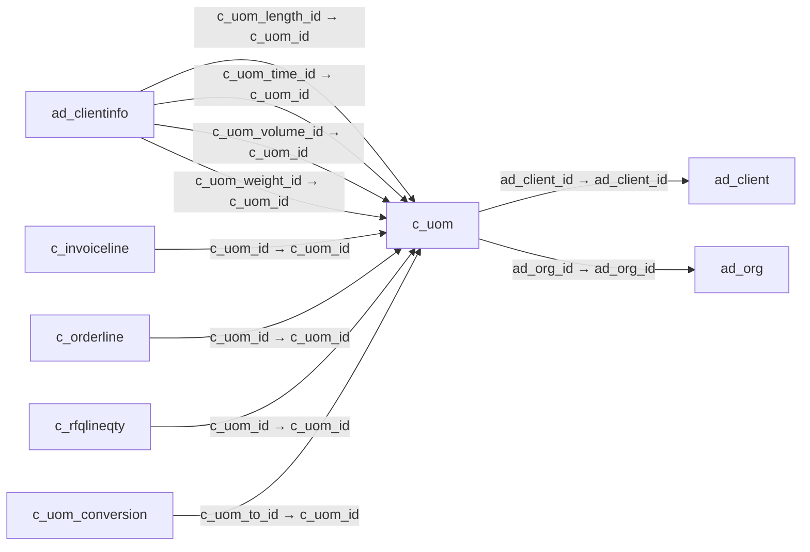

# c_uom — 측정 단위

[전체 일람](../TABLE_INDEX.md) · [분류 일람](README.md) · [AI 사용 안내](../README.md) · [외래키 읽는 법](../RELATIONSHIPS.md)

## 기본 정보

| 항목 | 내용 |
|---|---|
| 물리명 | `adempiere.c_uom` |
| 한국어 논리명(문서용 해석) | 측정 단위 |
| 원본 논리명 | UOM |
| 원본 사전 ID | 146 |
| 분류 | `c` — 거래처·주문·청구·결제·회계 기준 |
| 전체 테넌트 행 수 | 15 |
| 물리 열 수 | 18 |
| 나가는 FK / 들어오는 FK | 2 / 42 |
| 구조·행 수 확인 시점 | 2026-11-03T23:29:01+09:00 |

## 의미와 쓰임

상품과 거래 수량을 표현하는 측정 단위를 정의한다.

- 설명 근거: 원본 애플리케이션 사전 명칭·설명을 한국어로 해석.
- 한국어 이름과 개요는 문서용 해석입니다. 공식 한국어 번역으로 간주하지 않습니다.
- 원본 설명: Unit of Measure
- 원본 도움말: —
- PostgreSQL 테이블 주석: —

## 키와 열

### 기본키·고유 제약조건

| 종류 | 제약조건 | 열(순서 유지) |
|---|---|---|
| PRIMARY KEY | `c_uom_pkey` | `c_uom_id` |
| UNIQUE | `c_uom_uu_idx` | `c_uom_uu` |

### 별도 고유 인덱스

PK·UNIQUE 제약조건의 인덱스와 별도로 존재하는 고유 인덱스입니다. 식·조건·열 순서는 원본 정의를 따릅니다.

- `c_uom_name`: `CREATE UNIQUE INDEX c_uom_name ON adempiere.c_uom USING btree (ad_client_id, name)`

### 열 목록

원본 논리명·설명은 `AD_Column`에서 가져왔습니다. 기본값은 실제 PostgreSQL 메타데이터이며, 비어 있는 항목은 `—`로 표시합니다.

| 순서 | 물리명 | 원본 논리명 | PostgreSQL 타입 | NULL | PK | 기본값 | 설명 |
|---:|---|---|---|---|---|---|---|
| 1 | `c_uom_id` | UOM | numeric(10,0) | 불가 | 예 | — | Unit of Measure |
| 2 | `ad_client_id` | Tenant | numeric(10,0) | 불가 | — | — | Tenant for this installation. |
| 3 | `ad_org_id` | Organization | numeric(10,0) | 불가 | — | — | Organizational entity within tenant |
| 4 | `isactive` | Active | character(1) | 불가 | — | 'Y'::bpchar | The record is active in the system |
| 5 | `created` | Created | timestamp without time zone | 불가 | — | now() | Date this record was created |
| 6 | `updated` | Updated | timestamp without time zone | 불가 | — | now() | Date this record was updated |
| 7 | `createdby` | Created By | numeric(10,0) | 불가 | — | — | User who created this records |
| 8 | `updatedby` | Updated By | numeric(10,0) | 불가 | — | — | User who updated this records |
| 9 | `x12de355` | UOM Code | character varying(4) | 불가 | — | — | UOM EDI X12 Code |
| 10 | `uomsymbol` | Symbol | character varying(10) | 허용 | — | — | Symbol for a Unit of Measure |
| 11 | `name` | Name | character varying(60) | 불가 | — | — | Alphanumeric identifier of the entity |
| 12 | `description` | Description | character varying(255) | 허용 | — | — | Optional short description of the record |
| 13 | `stdprecision` | Standard Precision | numeric(10,0) | 불가 | — | — | Rule for rounding  calculated amounts |
| 14 | `costingprecision` | Costing Precision | numeric(10,0) | 불가 | — | — | Rounding used costing calculations |
| 15 | `isdefault` | Default | character(1) | 불가 | — | 'N'::bpchar | Default value |
| 16 | `uomtype` | UOM Type | character varying(2) | 허용 | — | NULL::character varying | — |
| 17 | `c_uom_uu` | C_UOM_UU | uuid | 허용 | — | — | — |
| 18 | `uncefact` | UN/CEFACT Code | character varying(10) | 허용 | — | NULL::character varying | Code for Units of Measure used in International Trade |

## 외래키 흐름

화살표는 **FK를 가진 자식 → 참조되는 부모**입니다. 업무 처리의 시간 순서나 무조건적인 1:N 관계를 뜻하지 않습니다.

주변 관계 44개 중 10개를 그림으로 표시합니다. **전체 관계는 아래 두 표에 모두 포함**합니다.

### 이 테이블이 참조하는 부모 — 나가는 FK

| 제약조건 | 참조하는 쪽(자식) | 자식 열 | 참조받는 쪽(부모) | 부모 열 | 삭제 / 갱신 | 검증 / 지연 가능 |
|---|---|---|---|---|---|---|
| `c_uomclient` <!-- FK_OUT: adempiere.c_uom.c_uomclient --> | [`c_uom`](c_uom.md) | `ad_client_id` | [`ad_client`](../ad/ad_client.md) | `ad_client_id` | NO ACTION / NO ACTION | 완료 / 가능 (초기 지연) |
| `c_uomorg` <!-- FK_OUT: adempiere.c_uom.c_uomorg --> | [`c_uom`](c_uom.md) | `ad_org_id` | [`ad_org`](../ad/ad_org.md) | `ad_org_id` | NO ACTION / NO ACTION | 완료 / 가능 (초기 지연) |

### 이 테이블을 참조하는 자식 — 들어오는 FK

| 제약조건 | 참조하는 쪽(자식) | 자식 열 | 참조받는 쪽(부모) | 부모 열 | 삭제 / 갱신 | 검증 / 지연 가능 |
|---|---|---|---|---|---|---|
| `c_uom_length_ad_clientinfo` <!-- FK_IN: adempiere.ad_clientinfo.c_uom_length_ad_clientinfo --> | [`ad_clientinfo`](../ad/ad_clientinfo.md) | `c_uom_length_id` | [`c_uom`](c_uom.md) | `c_uom_id` | NO ACTION / NO ACTION | 완료 / 가능 (초기 지연) |
| `c_uom_time_ad_clientinfo` <!-- FK_IN: adempiere.ad_clientinfo.c_uom_time_ad_clientinfo --> | [`ad_clientinfo`](../ad/ad_clientinfo.md) | `c_uom_time_id` | [`c_uom`](c_uom.md) | `c_uom_id` | NO ACTION / NO ACTION | 완료 / 가능 (초기 지연) |
| `c_uom_volume_ad_clientinfo` <!-- FK_IN: adempiere.ad_clientinfo.c_uom_volume_ad_clientinfo --> | [`ad_clientinfo`](../ad/ad_clientinfo.md) | `c_uom_volume_id` | [`c_uom`](c_uom.md) | `c_uom_id` | NO ACTION / NO ACTION | 완료 / 가능 (초기 지연) |
| `c_uom_weight_ad_clientinfo` <!-- FK_IN: adempiere.ad_clientinfo.c_uom_weight_ad_clientinfo --> | [`ad_clientinfo`](../ad/ad_clientinfo.md) | `c_uom_weight_id` | [`c_uom`](c_uom.md) | `c_uom_id` | NO ACTION / NO ACTION | 완료 / 가능 (초기 지연) |
| `cuom_cinvoiceline` <!-- FK_IN: adempiere.c_invoiceline.cuom_cinvoiceline --> | [`c_invoiceline`](c_invoiceline.md) | `c_uom_id` | [`c_uom`](c_uom.md) | `c_uom_id` | NO ACTION / NO ACTION | 완료 / 가능 (초기 지연) |
| `cuom_corderline` <!-- FK_IN: adempiere.c_orderline.cuom_corderline --> | [`c_orderline`](c_orderline.md) | `c_uom_id` | [`c_uom`](c_uom.md) | `c_uom_id` | NO ACTION / NO ACTION | 완료 / 가능 (초기 지연) |
| `cuom_crfqlineqty` <!-- FK_IN: adempiere.c_rfqlineqty.cuom_crfqlineqty --> | [`c_rfqlineqty`](c_rfqlineqty.md) | `c_uom_id` | [`c_uom`](c_uom.md) | `c_uom_id` | NO ACTION / NO ACTION | 완료 / 가능 (초기 지연) |
| `c_uomconversionto` <!-- FK_IN: adempiere.c_uom_conversion.c_uomconversionto --> | [`c_uom_conversion`](c_uom_conversion.md) | `c_uom_to_id` | [`c_uom`](c_uom.md) | `c_uom_id` | NO ACTION / NO ACTION | 완료 / 가능 (초기 지연) |
| `cuom_cuomconversion` <!-- FK_IN: adempiere.c_uom_conversion.cuom_cuomconversion --> | [`c_uom_conversion`](c_uom_conversion.md) | `c_uom_id` | [`c_uom`](c_uom.md) | `c_uom_id` | NO ACTION / NO ACTION | 완료 / 가능 (초기 지연) |
| `cuom_cuomtrl` <!-- FK_IN: adempiere.c_uom_trl.cuom_cuomtrl --> | [`c_uom_trl`](c_uom_trl.md) | `c_uom_id` | [`c_uom`](c_uom.md) | `c_uom_id` | CASCADE / NO ACTION | 완료 / 가능 (초기 지연) |
| `cuom_ddorderline` <!-- FK_IN: adempiere.dd_orderline.cuom_ddorderline --> | [`dd_orderline`](../dd/dd_orderline.md) | `c_uom_id` | [`c_uom`](c_uom.md) | `c_uom_id` | NO ACTION / NO ACTION | 완료 / 가능 (초기 지연) |
| `c_uom_fact_acct` <!-- FK_IN: adempiere.fact_acct.c_uom_fact_acct --> | [`fact_acct`](../fact/fact_acct.md) | `c_uom_id` | [`c_uom`](c_uom.md) | `c_uom_id` | NO ACTION / NO ACTION | 완료 / 가능 (초기 지연) |
| `cuom_gljournalline` <!-- FK_IN: adempiere.gl_journalline.cuom_gljournalline --> | [`gl_journalline`](../gl/gl_journalline.md) | `c_uom_id` | [`c_uom`](c_uom.md) | `c_uom_id` | NO ACTION / NO ACTION | 완료 / 가능 (초기 지연) |
| `cuom_ifajournal` <!-- FK_IN: adempiere.i_fajournal.cuom_ifajournal --> | [`i_fajournal`](../i/i_fajournal.md) | `c_uom_id` | [`c_uom`](c_uom.md) | `c_uom_id` | NO ACTION / NO ACTION | 완료 / 가능 (초기 지연) |
| `cuom_ifixedasset` <!-- FK_IN: adempiere.i_fixedasset.cuom_ifixedasset --> | [`i_fixedasset`](../i/i_fixedasset.md) | `c_uom_id` | [`c_uom`](c_uom.md) | `c_uom_id` | NO ACTION / NO ACTION | 완료 / 가능 (초기 지연) |
| `cuom_igljournal` <!-- FK_IN: adempiere.i_gljournal.cuom_igljournal --> | [`i_gljournal`](../i/i_gljournal.md) | `c_uom_id` | [`c_uom`](c_uom.md) | `c_uom_id` | NO ACTION / NO ACTION | 완료 / 가능 (초기 지연) |
| `cuom_iorder` <!-- FK_IN: adempiere.i_order.cuom_iorder --> | [`i_order`](../i/i_order.md) | `c_uom_id` | [`c_uom`](c_uom.md) | `c_uom_id` | SET NULL / NO ACTION | 완료 / 가능 (초기 지연) |
| `cuom_ipricelist` <!-- FK_IN: adempiere.i_pricelist.cuom_ipricelist --> | [`i_pricelist`](../i/i_pricelist.md) | `c_uom_id` | [`c_uom`](c_uom.md) | `c_uom_id` | NO ACTION / NO ACTION | 완료 / 가능 (초기 지연) |
| `cuom_iproduct` <!-- FK_IN: adempiere.i_product.cuom_iproduct --> | [`i_product`](../i/i_product.md) | `c_uom_id` | [`c_uom`](c_uom.md) | `c_uom_id` | SET NULL / NO ACTION | 완료 / 가능 (초기 지연) |
| `cuom_minoutline` <!-- FK_IN: adempiere.m_inoutline.cuom_minoutline --> | [`m_inoutline`](../m/m_inoutline.md) | `c_uom_id` | [`c_uom`](c_uom.md) | `c_uom_id` | NO ACTION / NO ACTION | 완료 / 가능 (초기 지연) |
| `cuom_mmovementline` <!-- FK_IN: adempiere.m_movementline.cuom_mmovementline --> | [`m_movementline`](../m/m_movementline.md) | `c_uom_id` | [`c_uom`](c_uom.md) | `c_uom_id` | NO ACTION / NO ACTION | 완료 / 가능 (초기 지연) |
| `cuomlength_mpackage` <!-- FK_IN: adempiere.m_package.cuomlength_mpackage --> | [`m_package`](../m/m_package.md) | `c_uom_length_id` | [`c_uom`](c_uom.md) | `c_uom_id` | NO ACTION / NO ACTION | 완료 / 가능 (초기 지연) |
| `cuomweight_mpackage` <!-- FK_IN: adempiere.m_package.cuomweight_mpackage --> | [`m_package`](../m/m_package.md) | `c_uom_weight_id` | [`c_uom`](c_uom.md) | `c_uom_id` | NO ACTION / NO ACTION | 완료 / 가능 (초기 지연) |
| `cuomlength_mpackagemps` <!-- FK_IN: adempiere.m_packagemps.cuomlength_mpackagemps --> | [`m_packagemps`](../m/m_packagemps.md) | `c_uom_length_id` | [`c_uom`](c_uom.md) | `c_uom_id` | NO ACTION / NO ACTION | 완료 / 가능 (초기 지연) |
| `cuomweight_mpackagemps` <!-- FK_IN: adempiere.m_packagemps.cuomweight_mpackagemps --> | [`m_packagemps`](../m/m_packagemps.md) | `c_uom_weight_id` | [`c_uom`](c_uom.md) | `c_uom_id` | NO ACTION / NO ACTION | 완료 / 가능 (초기 지연) |
| `cuom_mproduct` <!-- FK_IN: adempiere.m_product.cuom_mproduct --> | [`m_product`](../m/m_product.md) | `c_uom_id` | [`c_uom`](c_uom.md) | `c_uom_id` | NO ACTION / NO ACTION | 완료 / 가능 (초기 지연) |
| `c_uom_m_product_po` <!-- FK_IN: adempiere.m_product_po.c_uom_m_product_po --> | [`m_product_po`](../m/m_product_po.md) | `c_uom_id` | [`c_uom`](c_uom.md) | `c_uom_id` | NO ACTION / NO ACTION | 완료 / 가능 (초기 지연) |
| `cuom_mrequisitionline` <!-- FK_IN: adempiere.m_requisitionline.cuom_mrequisitionline --> | [`m_requisitionline`](../m/m_requisitionline.md) | `c_uom_id` | [`c_uom`](c_uom.md) | `c_uom_id` | NO ACTION / NO ACTION | 완료 / 가능 (초기 지연) |
| `cuomlength_mshippingtransactio` <!-- FK_IN: adempiere.m_shippingtransaction.cuomlength_mshippingtransactio --> | [`m_shippingtransaction`](../m/m_shippingtransaction.md) | `c_uom_length_id` | [`c_uom`](c_uom.md) | `c_uom_id` | NO ACTION / NO ACTION | 완료 / 가능 (초기 지연) |
| `cuomweight_mshippingtransactio` <!-- FK_IN: adempiere.m_shippingtransaction.cuomweight_mshippingtransactio --> | [`m_shippingtransaction`](../m/m_shippingtransaction.md) | `c_uom_weight_id` | [`c_uom`](c_uom.md) | `c_uom_id` | NO ACTION / NO ACTION | 완료 / 가능 (초기 지연) |
| `cuomlength_mshippingtransactln` <!-- FK_IN: adempiere.m_shippingtransactionline.cuomlength_mshippingtransactln --> | [`m_shippingtransactionline`](../m/m_shippingtransactionline.md) | `c_uom_length_id` | [`c_uom`](c_uom.md) | `c_uom_id` | NO ACTION / NO ACTION | 완료 / 가능 (초기 지연) |
| `cuomweight_mshippingtransactln` <!-- FK_IN: adempiere.m_shippingtransactionline.cuomweight_mshippingtransactln --> | [`m_shippingtransactionline`](../m/m_shippingtransactionline.md) | `c_uom_weight_id` | [`c_uom`](c_uom.md) | `c_uom_id` | NO ACTION / NO ACTION | 완료 / 가능 (초기 지연) |
| `cuom_ppcostcollector` <!-- FK_IN: adempiere.pp_cost_collector.cuom_ppcostcollector --> | [`pp_cost_collector`](../pp/pp_cost_collector.md) | `c_uom_id` | [`c_uom`](c_uom.md) | `c_uom_id` | NO ACTION / NO ACTION | 완료 / 가능 (초기 지연) |
| `cuom_pporder` <!-- FK_IN: adempiere.pp_order.cuom_pporder --> | [`pp_order`](../pp/pp_order.md) | `c_uom_id` | [`c_uom`](c_uom.md) | `c_uom_id` | NO ACTION / NO ACTION | 완료 / 가능 (초기 지연) |
| `cuom_pporderbom` <!-- FK_IN: adempiere.pp_order_bom.cuom_pporderbom --> | [`pp_order_bom`](../pp/pp_order_bom.md) | `c_uom_id` | [`c_uom`](c_uom.md) | `c_uom_id` | NO ACTION / NO ACTION | 완료 / 가능 (초기 지연) |
| `cuom_pporderbomline` <!-- FK_IN: adempiere.pp_order_bomline.cuom_pporderbomline --> | [`pp_order_bomline`](../pp/pp_order_bomline.md) | `c_uom_id` | [`c_uom`](c_uom.md) | `c_uom_id` | NO ACTION / NO ACTION | 완료 / 가능 (초기 지연) |
| `cuom_ppproductbom` <!-- FK_IN: adempiere.pp_product_bom.cuom_ppproductbom --> | [`pp_product_bom`](../pp/pp_product_bom.md) | `c_uom_id` | [`c_uom`](c_uom.md) | `c_uom_id` | NO ACTION / NO ACTION | 완료 / 가능 (초기 지연) |
| `cuom_ppproductbomline` <!-- FK_IN: adempiere.pp_product_bomline.cuom_ppproductbomline --> | [`pp_product_bomline`](../pp/pp_product_bomline.md) | `c_uom_id` | [`c_uom`](c_uom.md) | `c_uom_id` | NO ACTION / NO ACTION | 완료 / 가능 (초기 지연) |
| `cuom_sexpensetype` <!-- FK_IN: adempiere.s_expensetype.cuom_sexpensetype --> | [`s_expensetype`](../s/s_expensetype.md) | `c_uom_id` | [`c_uom`](c_uom.md) | `c_uom_id` | NO ACTION / NO ACTION | 완료 / 가능 (초기 지연) |
| `cuom_sresourcetype` <!-- FK_IN: adempiere.s_resourcetype.cuom_sresourcetype --> | [`s_resourcetype`](../s/s_resourcetype.md) | `c_uom_id` | [`c_uom`](c_uom.md) | `c_uom_id` | NO ACTION / NO ACTION | 완료 / 가능 (초기 지연) |
| `cuom_stimeexpenseline` <!-- FK_IN: adempiere.s_timeexpenseline.cuom_stimeexpenseline --> | [`s_timeexpenseline`](../s/s_timeexpenseline.md) | `c_uom_id` | [`c_uom`](c_uom.md) | `c_uom_id` | NO ACTION / NO ACTION | 완료 / 가능 (초기 지연) |
| `cuom_straining` <!-- FK_IN: adempiere.s_training.cuom_straining --> | [`s_training`](../s/s_training.md) | `c_uom_id` | [`c_uom`](c_uom.md) | `c_uom_id` | NO ACTION / NO ACTION | 완료 / 가능 (초기 지연) |

## 조회 시 주의

- FK 표의 자식 열과 부모 열을 같은 순서로 대응시킵니다. 복합 FK는 모든 열의 동등 조건을 `AND`로 연결합니다.
- 테이블 이름이나 `_id` 열 이름만으로 물리 FK가 있다고 가정하지 않습니다. FK 미선언은 업무 관계가 없다는 뜻도 아닙니다.
- 자식이 여러 행인 테이블과 조인하면 부모의 금액·건수가 중복될 수 있습니다. 집계 단위를 먼저 정합니다.
- `ad_client_id`가 있습니다. 업무 분석에서는 대상 테넌트를 명시합니다. GardenWorld는 `11`, 시스템 공통 설정은 `0`일 수 있으므로 일괄 필터 적용 전에 테이블 역할을 확인합니다.
- 행 수는 위 확인 시점의 전체 테넌트 값입니다. 최신 업무 실적이나 현재 실행 결과로 재사용하지 않습니다.
