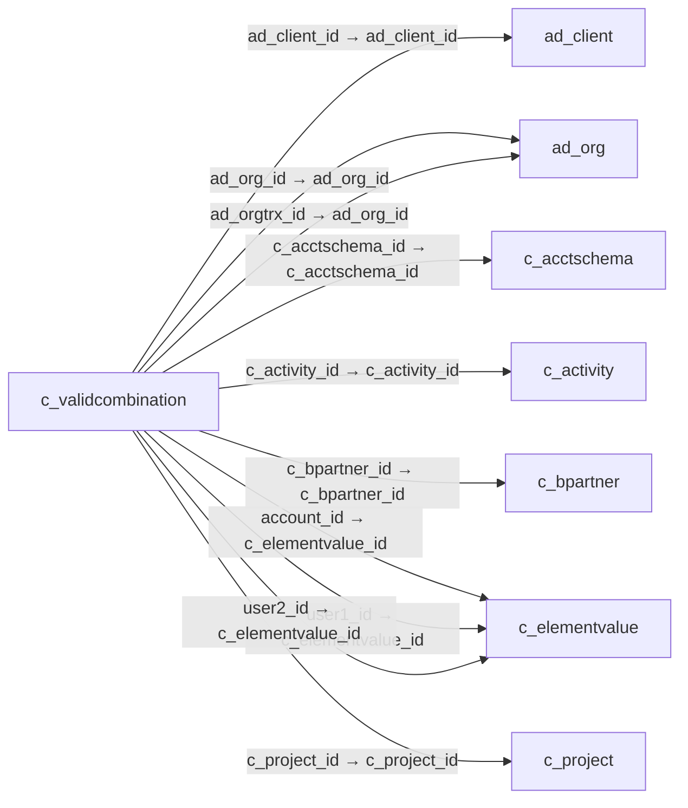

# c_validcombination — 유효 계정 조합

[전체 일람](../TABLE_INDEX.md) · [분류 일람](README.md) · [AI 사용 안내](../README.md) · [외래키 읽는 법](../RELATIONSHIPS.md)

## 기본 정보

| 항목 | 내용 |
|---|---|
| 물리명 | `adempiere.c_validcombination` |
| 한국어 논리명(문서용 해석) | 유효 계정 조합 |
| 원본 논리명 | Combination |
| 원본 사전 ID | 176 |
| 분류 | `c` — 거래처·주문·청구·결제·회계 기준 |
| 전체 테넌트 행 수 | 157 |
| 물리 열 수 | 29 |
| 나가는 FK / 들어오는 FK | 16 / 247 |
| 구조·행 수 확인 시점 | 2026-11-03T23:29:01+09:00 |

## 의미와 쓰임

회계에서 사용할 유효한 계정 및 분석 요소 조합을 관리한다.

- 설명 근거: 원본 애플리케이션 사전 명칭·설명을 한국어로 해석.
- 한국어 이름과 개요는 문서용 해석입니다. 공식 한국어 번역으로 간주하지 않습니다.
- 원본 설명: Valid Account Combination
- 원본 도움말: —
- PostgreSQL 테이블 주석: —

## 키와 열

### 기본키·고유 제약조건

| 종류 | 제약조건 | 열(순서 유지) |
|---|---|---|
| PRIMARY KEY | `c_validcombination_pkey` | `c_validcombination_id` |
| UNIQUE | `c_validcombination_uu_idx` | `c_validcombination_uu` |

### 별도 고유 인덱스

PK·UNIQUE 제약조건의 인덱스와 별도로 존재하는 고유 인덱스입니다. 식·조건·열 순서는 원본 정의를 따릅니다.

- `c_validcombination_alt`: `CREATE UNIQUE INDEX c_validcombination_alt ON adempiere.c_validcombination USING btree (c_acctschema_id, ad_org_id, account_id, c_subacct_id, m_product_id, c_bpartner_id, ad_orgtrx_id, c_locfrom_id, c_locto_id, c_salesregion_id, c_project_id, c_campaign_id, c_activity_id, user1_id, user2_id, userelement1_id, userelement2_id)`

### 열 목록

원본 논리명·설명은 `AD_Column`에서 가져왔습니다. 기본값은 실제 PostgreSQL 메타데이터이며, 비어 있는 항목은 `—`로 표시합니다.

| 순서 | 물리명 | 원본 논리명 | PostgreSQL 타입 | NULL | PK | 기본값 | 설명 |
|---:|---|---|---|---|---|---|---|
| 1 | `c_validcombination_id` | Combination | numeric(10,0) | 불가 | 예 | — | Valid Account Combination |
| 2 | `ad_client_id` | Tenant | numeric(10,0) | 불가 | — | — | Tenant for this installation. |
| 3 | `ad_org_id` | Organization | numeric(10,0) | 불가 | — | — | Organizational entity within tenant |
| 4 | `isactive` | Active | character(1) | 불가 | — | 'Y'::bpchar | The record is active in the system |
| 5 | `created` | Created | timestamp without time zone | 불가 | — | now() | Date this record was created |
| 6 | `createdby` | Created By | numeric(10,0) | 불가 | — | — | User who created this records |
| 7 | `updated` | Updated | timestamp without time zone | 불가 | — | now() | Date this record was updated |
| 8 | `updatedby` | Updated By | numeric(10,0) | 불가 | — | — | User who updated this records |
| 9 | `alias` | Alias | character varying(40) | 허용 | — | — | Defines an alternate method of indicating an account combination. |
| 10 | `combination` | Combination | character varying(60) | 허용 | — | — | Unique combination of account elements |
| 11 | `description` | Description | character varying(255) | 허용 | — | — | Optional short description of the record |
| 12 | `isfullyqualified` | Fully Qualified | character(1) | 불가 | — | 'Y'::bpchar | This account is fully qualified |
| 13 | `c_acctschema_id` | Accounting Schema | numeric(10,0) | 불가 | — | — | Rules for accounting |
| 14 | `account_id` | Account | numeric(10,0) | 불가 | — | — | Account used |
| 15 | `m_product_id` | Product | numeric(10,0) | 허용 | — | — | Product, Service, Item |
| 16 | `c_bpartner_id` | Business Partner | numeric(10,0) | 허용 | — | — | Identifies a Business Partner |
| 17 | `ad_orgtrx_id` | Trx Organization | numeric(10,0) | 허용 | — | — | Performing or initiating organization |
| 18 | `c_locfrom_id` | Location From | numeric(10,0) | 허용 | — | — | Location that inventory was moved from |
| 19 | `c_locto_id` | Location To | numeric(10,0) | 허용 | — | — | Location that inventory was moved to |
| 20 | `c_salesregion_id` | Sales Region | numeric(10,0) | 허용 | — | — | Sales coverage region |
| 21 | `c_project_id` | Project | numeric(10,0) | 허용 | — | — | Financial Project |
| 22 | `c_campaign_id` | Campaign | numeric(10,0) | 허용 | — | — | Marketing Campaign |
| 23 | `c_activity_id` | Activity | numeric(10,0) | 허용 | — | — | Business Activity |
| 24 | `user1_id` | User Element List 1 | numeric(10,0) | 허용 | — | — | User defined list element #1 |
| 25 | `user2_id` | User Element List 2 | numeric(10,0) | 허용 | — | — | User defined list element #2 |
| 26 | `c_subacct_id` | Sub Account | numeric(10,0) | 허용 | — | — | Sub account for Element Value |
| 27 | `userelement1_id` | User Column 1 | numeric(10,0) | 허용 | — | — | User defined accounting Element |
| 28 | `userelement2_id` | User Column 2 | numeric(10,0) | 허용 | — | — | User defined accounting Element |
| 29 | `c_validcombination_uu` | C_ValidCombination_UU | uuid | 허용 | — | — | — |

## 외래키 흐름

화살표는 **FK를 가진 자식 → 참조되는 부모**입니다. 업무 처리의 시간 순서나 무조건적인 1:N 관계를 뜻하지 않습니다.

주변 관계 263개 중 10개를 그림으로 표시합니다. **전체 관계는 아래 두 표에 모두 포함**합니다.

### 이 테이블이 참조하는 부모 — 나가는 FK

| 제약조건 | 참조하는 쪽(자식) | 자식 열 | 참조받는 쪽(부모) | 부모 열 | 삭제 / 갱신 | 검증 / 지연 가능 |
|---|---|---|---|---|---|---|
| `adclient_vc` <!-- FK_OUT: adempiere.c_validcombination.adclient_vc --> | [`c_validcombination`](c_validcombination.md) | `ad_client_id` | [`ad_client`](../ad/ad_client.md) | `ad_client_id` | NO ACTION / NO ACTION | 완료 / 가능 (초기 지연) |
| `adorg_vc` <!-- FK_OUT: adempiere.c_validcombination.adorg_vc --> | [`c_validcombination`](c_validcombination.md) | `ad_org_id` | [`ad_org`](../ad/ad_org.md) | `ad_org_id` | NO ACTION / NO ACTION | 완료 / 가능 (초기 지연) |
| `adorgtrx_vc` <!-- FK_OUT: adempiere.c_validcombination.adorgtrx_vc --> | [`c_validcombination`](c_validcombination.md) | `ad_orgtrx_id` | [`ad_org`](../ad/ad_org.md) | `ad_org_id` | NO ACTION / NO ACTION | 완료 / 가능 (초기 지연) |
| `cacctschema_cvalidcombination` <!-- FK_OUT: adempiere.c_validcombination.cacctschema_cvalidcombination --> | [`c_validcombination`](c_validcombination.md) | `c_acctschema_id` | [`c_acctschema`](c_acctschema.md) | `c_acctschema_id` | CASCADE / NO ACTION | 완료 / 가능 (초기 지연) |
| `cactivity_cvalidcombination` <!-- FK_OUT: adempiere.c_validcombination.cactivity_cvalidcombination --> | [`c_validcombination`](c_validcombination.md) | `c_activity_id` | [`c_activity`](c_activity.md) | `c_activity_id` | NO ACTION / NO ACTION | 완료 / 가능 (초기 지연) |
| `cbpartner_vc` <!-- FK_OUT: adempiere.c_validcombination.cbpartner_vc --> | [`c_validcombination`](c_validcombination.md) | `c_bpartner_id` | [`c_bpartner`](c_bpartner.md) | `c_bpartner_id` | NO ACTION / NO ACTION | 완료 / 가능 (초기 지연) |
| `celementvalueaccount_vc` <!-- FK_OUT: adempiere.c_validcombination.celementvalueaccount_vc --> | [`c_validcombination`](c_validcombination.md) | `account_id` | [`c_elementvalue`](c_elementvalue.md) | `c_elementvalue_id` | CASCADE / NO ACTION | 완료 / 가능 (초기 지연) |
| `celementvalueuser1_vc` <!-- FK_OUT: adempiere.c_validcombination.celementvalueuser1_vc --> | [`c_validcombination`](c_validcombination.md) | `user1_id` | [`c_elementvalue`](c_elementvalue.md) | `c_elementvalue_id` | NO ACTION / NO ACTION | 완료 / 가능 (초기 지연) |
| `celementvalueuser2_vc` <!-- FK_OUT: adempiere.c_validcombination.celementvalueuser2_vc --> | [`c_validcombination`](c_validcombination.md) | `user2_id` | [`c_elementvalue`](c_elementvalue.md) | `c_elementvalue_id` | NO ACTION / NO ACTION | 완료 / 가능 (초기 지연) |
| `cproject_vc` <!-- FK_OUT: adempiere.c_validcombination.cproject_vc --> | [`c_validcombination`](c_validcombination.md) | `c_project_id` | [`c_project`](c_project.md) | `c_project_id` | NO ACTION / NO ACTION | 완료 / 가능 (초기 지연) |
| `csalesregion_vc` <!-- FK_OUT: adempiere.c_validcombination.csalesregion_vc --> | [`c_validcombination`](c_validcombination.md) | `c_salesregion_id` | [`c_salesregion`](c_salesregion.md) | `c_salesregion_id` | NO ACTION / NO ACTION | 완료 / 가능 (초기 지연) |
| `csubacct_cvalidcombination` <!-- FK_OUT: adempiere.c_validcombination.csubacct_cvalidcombination --> | [`c_validcombination`](c_validcombination.md) | `c_subacct_id` | [`c_subacct`](c_subacct.md) | `c_subacct_id` | NO ACTION / NO ACTION | 완료 / 가능 (초기 지연) |
| `mlocationfrom_vc` <!-- FK_OUT: adempiere.c_validcombination.mlocationfrom_vc --> | [`c_validcombination`](c_validcombination.md) | `c_locfrom_id` | [`c_location`](c_location.md) | `c_location_id` | NO ACTION / NO ACTION | 완료 / 가능 (초기 지연) |
| `mlocationto_vc` <!-- FK_OUT: adempiere.c_validcombination.mlocationto_vc --> | [`c_validcombination`](c_validcombination.md) | `c_locto_id` | [`c_location`](c_location.md) | `c_location_id` | NO ACTION / NO ACTION | 완료 / 가능 (초기 지연) |
| `mproduct_vc` <!-- FK_OUT: adempiere.c_validcombination.mproduct_vc --> | [`c_validcombination`](c_validcombination.md) | `m_product_id` | [`m_product`](../m/m_product.md) | `m_product_id` | NO ACTION / NO ACTION | 완료 / 가능 (초기 지연) |
| `socampaign_vc` <!-- FK_OUT: adempiere.c_validcombination.socampaign_vc --> | [`c_validcombination`](c_validcombination.md) | `c_campaign_id` | [`c_campaign`](c_campaign.md) | `c_campaign_id` | NO ACTION / NO ACTION | 완료 / 가능 (초기 지연) |

### 이 테이블을 참조하는 자식 — 들어오는 FK

| 제약조건 | 참조하는 쪽(자식) | 자식 열 | 참조받는 쪽(부모) | 부모 열 | 삭제 / 갱신 | 검증 / 지연 가능 |
|---|---|---|---|---|---|---|
| `aaccumdepreciation_aassetacct` <!-- FK_IN: adempiere.a_asset_acct.aaccumdepreciation_aassetacct --> | [`a_asset_acct`](../a/a_asset_acct.md) | `a_accumdepreciation_acct` | [`c_validcombination`](c_validcombination.md) | `c_validcombination_id` | NO ACTION / NO ACTION | 완료 / 가능 (초기 지연) |
| `aassetvc_aassetacct` <!-- FK_IN: adempiere.a_asset_acct.aassetvc_aassetacct --> | [`a_asset_acct`](../a/a_asset_acct.md) | `a_asset_acct` | [`c_validcombination`](c_validcombination.md) | `c_validcombination_id` | NO ACTION / NO ACTION | 완료 / 가능 (초기 지연) |
| `adepreciationvc_aassetacct` <!-- FK_IN: adempiere.a_asset_acct.adepreciationvc_aassetacct --> | [`a_asset_acct`](../a/a_asset_acct.md) | `a_depreciation_acct` | [`c_validcombination`](c_validcombination.md) | `c_validcombination_id` | NO ACTION / NO ACTION | 완료 / 가능 (초기 지연) |
| `adisposalgain_aassetacct` <!-- FK_IN: adempiere.a_asset_acct.adisposalgain_aassetacct --> | [`a_asset_acct`](../a/a_asset_acct.md) | `a_disposal_gain_acct` | [`c_validcombination`](c_validcombination.md) | `c_validcombination_id` | NO ACTION / NO ACTION | 완료 / 가능 (초기 지연) |
| `adisposalloss_aassetacct` <!-- FK_IN: adempiere.a_asset_acct.adisposalloss_aassetacct --> | [`a_asset_acct`](../a/a_asset_acct.md) | `a_disposal_loss_acct` | [`c_validcombination`](c_validcombination.md) | `c_validcombination_id` | NO ACTION / NO ACTION | 완료 / 가능 (초기 지연) |
| `adisposalrevenue_aassetacct` <!-- FK_IN: adempiere.a_asset_acct.adisposalrevenue_aassetacct --> | [`a_asset_acct`](../a/a_asset_acct.md) | `a_disposal_revenue_acct` | [`c_validcombination`](c_validcombination.md) | `c_validcombination_id` | NO ACTION / NO ACTION | 완료 / 가능 (초기 지연) |
| `arevaladepoffsetcur_aassetacct` <!-- FK_IN: adempiere.a_asset_acct.arevaladepoffsetcur_aassetacct --> | [`a_asset_acct`](../a/a_asset_acct.md) | `a_reval_adep_offset_cur_acct` | [`c_validcombination`](c_validcombination.md) | `c_validcombination_id` | NO ACTION / NO ACTION | 완료 / 가능 (초기 지연) |
| `arevaladepoffsetprior_aassetac` <!-- FK_IN: adempiere.a_asset_acct.arevaladepoffsetprior_aassetac --> | [`a_asset_acct`](../a/a_asset_acct.md) | `a_reval_adep_offset_prior_acct` | [`c_validcombination`](c_validcombination.md) | `c_validcombination_id` | NO ACTION / NO ACTION | 완료 / 가능 (초기 지연) |
| `arevalcostoffset_aassetacct` <!-- FK_IN: adempiere.a_asset_acct.arevalcostoffset_aassetacct --> | [`a_asset_acct`](../a/a_asset_acct.md) | `a_reval_cost_offset_acct` | [`c_validcombination`](c_validcombination.md) | `c_validcombination_id` | NO ACTION / NO ACTION | 완료 / 가능 (초기 지연) |
| `arevalcostoffsetprior_aassetac` <!-- FK_IN: adempiere.a_asset_acct.arevalcostoffsetprior_aassetac --> | [`a_asset_acct`](../a/a_asset_acct.md) | `a_reval_cost_offset_prior_acct` | [`c_validcombination`](c_validcombination.md) | `c_validcombination_id` | NO ACTION / NO ACTION | 완료 / 가능 (초기 지연) |
| `arevaldepexpoffset_aassetacct` <!-- FK_IN: adempiere.a_asset_acct.arevaldepexpoffset_aassetacct --> | [`a_asset_acct`](../a/a_asset_acct.md) | `a_reval_depexp_offset_acct` | [`c_validcombination`](c_validcombination.md) | `c_validcombination_id` | NO ACTION / NO ACTION | 완료 / 가능 (초기 지연) |
| `aaccumdepreciation_aassetchang` <!-- FK_IN: adempiere.a_asset_change.aaccumdepreciation_aassetchang --> | [`a_asset_change`](../a/a_asset_change.md) | `a_accumdepreciation_acct` | [`c_validcombination`](c_validcombination.md) | `c_validcombination_id` | NO ACTION / NO ACTION | 완료 / 가능 (초기 지연) |
| `aassetvc_aassetchange` <!-- FK_IN: adempiere.a_asset_change.aassetvc_aassetchange --> | [`a_asset_change`](../a/a_asset_change.md) | `a_asset_acct` | [`c_validcombination`](c_validcombination.md) | `c_validcombination_id` | NO ACTION / NO ACTION | 완료 / 가능 (초기 지연) |
| `adepreciation_aassetchange` <!-- FK_IN: adempiere.a_asset_change.adepreciation_aassetchange --> | [`a_asset_change`](../a/a_asset_change.md) | `a_depreciation_acct` | [`c_validcombination`](c_validcombination.md) | `c_validcombination_id` | NO ACTION / NO ACTION | 완료 / 가능 (초기 지연) |
| `adisposalloss_aassetchange` <!-- FK_IN: adempiere.a_asset_change.adisposalloss_aassetchange --> | [`a_asset_change`](../a/a_asset_change.md) | `a_disposal_loss_acct` | [`c_validcombination`](c_validcombination.md) | `c_validcombination_id` | NO ACTION / NO ACTION | 완료 / 가능 (초기 지연) |
| `adisposalrevenue_aassetchange` <!-- FK_IN: adempiere.a_asset_change.adisposalrevenue_aassetchange --> | [`a_asset_change`](../a/a_asset_change.md) | `a_disposal_revenue_acct` | [`c_validcombination`](c_validcombination.md) | `c_validcombination_id` | NO ACTION / NO ACTION | 완료 / 가능 (초기 지연) |
| `cvalidcombinati_aassetchange` <!-- FK_IN: adempiere.a_asset_change.cvalidcombinati_aassetchange --> | [`a_asset_change`](../a/a_asset_change.md) | `c_validcombination_id` | [`c_validcombination`](c_validcombination.md) | `c_validcombination_id` | NO ACTION / NO ACTION | 완료 / 가능 (초기 지연) |
| `aaccumdepreciation_aassetgroup` <!-- FK_IN: adempiere.a_asset_group_acct.aaccumdepreciation_aassetgroup --> | [`a_asset_group_acct`](../a/a_asset_group_acct.md) | `a_accumdepreciation_acct` | [`c_validcombination`](c_validcombination.md) | `c_validcombination_id` | NO ACTION / NO ACTION | 완료 / 가능 (초기 지연) |
| `aasset_aassetgroupacct` <!-- FK_IN: adempiere.a_asset_group_acct.aasset_aassetgroupacct --> | [`a_asset_group_acct`](../a/a_asset_group_acct.md) | `a_asset_acct` | [`c_validcombination`](c_validcombination.md) | `c_validcombination_id` | NO ACTION / NO ACTION | 완료 / 가능 (초기 지연) |
| `adepreciationvc_aassetgroupacc` <!-- FK_IN: adempiere.a_asset_group_acct.adepreciationvc_aassetgroupacc --> | [`a_asset_group_acct`](../a/a_asset_group_acct.md) | `a_depreciation_acct` | [`c_validcombination`](c_validcombination.md) | `c_validcombination_id` | NO ACTION / NO ACTION | 완료 / 가능 (초기 지연) |
| `adisposalgain_aassetgroupacct` <!-- FK_IN: adempiere.a_asset_group_acct.adisposalgain_aassetgroupacct --> | [`a_asset_group_acct`](../a/a_asset_group_acct.md) | `a_disposal_gain_acct` | [`c_validcombination`](c_validcombination.md) | `c_validcombination_id` | NO ACTION / NO ACTION | 완료 / 가능 (초기 지연) |
| `adisposalloss_aassetgroupacct` <!-- FK_IN: adempiere.a_asset_group_acct.adisposalloss_aassetgroupacct --> | [`a_asset_group_acct`](../a/a_asset_group_acct.md) | `a_disposal_loss_acct` | [`c_validcombination`](c_validcombination.md) | `c_validcombination_id` | NO ACTION / NO ACTION | 완료 / 가능 (초기 지연) |
| `adisposalrevenue_aassetgroupac` <!-- FK_IN: adempiere.a_asset_group_acct.adisposalrevenue_aassetgroupac --> | [`a_asset_group_acct`](../a/a_asset_group_acct.md) | `a_disposal_revenue_acct` | [`c_validcombination`](c_validcombination.md) | `c_validcombination_id` | NO ACTION / NO ACTION | 완료 / 가능 (초기 지연) |
| `arevaladepoffsetcur_aassetgrou` <!-- FK_IN: adempiere.a_asset_group_acct.arevaladepoffsetcur_aassetgrou --> | [`a_asset_group_acct`](../a/a_asset_group_acct.md) | `a_reval_adep_offset_cur_acct` | [`c_validcombination`](c_validcombination.md) | `c_validcombination_id` | NO ACTION / NO ACTION | 완료 / 가능 (초기 지연) |
| `arevaladepoffsetprior_aassetgr` <!-- FK_IN: adempiere.a_asset_group_acct.arevaladepoffsetprior_aassetgr --> | [`a_asset_group_acct`](../a/a_asset_group_acct.md) | `a_reval_adep_offset_prior_acct` | [`c_validcombination`](c_validcombination.md) | `c_validcombination_id` | NO ACTION / NO ACTION | 완료 / 가능 (초기 지연) |
| `arevalcostoffset_aassetgroupac` <!-- FK_IN: adempiere.a_asset_group_acct.arevalcostoffset_aassetgroupac --> | [`a_asset_group_acct`](../a/a_asset_group_acct.md) | `a_reval_cost_offset_acct` | [`c_validcombination`](c_validcombination.md) | `c_validcombination_id` | NO ACTION / NO ACTION | 완료 / 가능 (초기 지연) |
| `arevalcostoffsetprior_aassetgr` <!-- FK_IN: adempiere.a_asset_group_acct.arevalcostoffsetprior_aassetgr --> | [`a_asset_group_acct`](../a/a_asset_group_acct.md) | `a_reval_cost_offset_prior_acct` | [`c_validcombination`](c_validcombination.md) | `c_validcombination_id` | NO ACTION / NO ACTION | 완료 / 가능 (초기 지연) |
| `arevaldepexpoffset_aassetgroup` <!-- FK_IN: adempiere.a_asset_group_acct.arevaldepexpoffset_aassetgroup --> | [`a_asset_group_acct`](../a/a_asset_group_acct.md) | `a_reval_depexp_offset_acct` | [`c_validcombination`](c_validcombination.md) | `c_validcombination_id` | NO ACTION / NO ACTION | 완료 / 가능 (초기 지연) |
| `aaccumdepreciation_aassettrans` <!-- FK_IN: adempiere.a_asset_transfer.aaccumdepreciation_aassettrans --> | [`a_asset_transfer`](../a/a_asset_transfer.md) | `a_accumdepreciation_acct` | [`c_validcombination`](c_validcombination.md) | `c_validcombination_id` | NO ACTION / NO ACTION | 완료 / 가능 (초기 지연) |
| `aaccumdepreciationnew_aassettr` <!-- FK_IN: adempiere.a_asset_transfer.aaccumdepreciationnew_aassettr --> | [`a_asset_transfer`](../a/a_asset_transfer.md) | `a_accumdepreciation_new_acct` | [`c_validcombination`](c_validcombination.md) | `c_validcombination_id` | NO ACTION / NO ACTION | 완료 / 가능 (초기 지연) |
| `aassetnew_aassettransfer` <!-- FK_IN: adempiere.a_asset_transfer.aassetnew_aassettransfer --> | [`a_asset_transfer`](../a/a_asset_transfer.md) | `a_asset_new_acct` | [`c_validcombination`](c_validcombination.md) | `c_validcombination_id` | NO ACTION / NO ACTION | 완료 / 가능 (초기 지연) |
| `aassetvc_aassettransfer` <!-- FK_IN: adempiere.a_asset_transfer.aassetvc_aassettransfer --> | [`a_asset_transfer`](../a/a_asset_transfer.md) | `a_asset_acct` | [`c_validcombination`](c_validcombination.md) | `c_validcombination_id` | NO ACTION / NO ACTION | 완료 / 가능 (초기 지연) |
| `adepreciation_aassettransfer` <!-- FK_IN: adempiere.a_asset_transfer.adepreciation_aassettransfer --> | [`a_asset_transfer`](../a/a_asset_transfer.md) | `a_depreciation_acct` | [`c_validcombination`](c_validcombination.md) | `c_validcombination_id` | NO ACTION / NO ACTION | 완료 / 가능 (초기 지연) |
| `adepreciationnew_aassettransfe` <!-- FK_IN: adempiere.a_asset_transfer.adepreciationnew_aassettransfe --> | [`a_asset_transfer`](../a/a_asset_transfer.md) | `a_depreciation_new_acct` | [`c_validcombination`](c_validcombination.md) | `c_validcombination_id` | NO ACTION / NO ACTION | 완료 / 가능 (초기 지연) |
| `adisposalloss_aassettransfer` <!-- FK_IN: adempiere.a_asset_transfer.adisposalloss_aassettransfer --> | [`a_asset_transfer`](../a/a_asset_transfer.md) | `a_disposal_loss_acct` | [`c_validcombination`](c_validcombination.md) | `c_validcombination_id` | NO ACTION / NO ACTION | 완료 / 가능 (초기 지연) |
| `adisposallossnew_aassettransfe` <!-- FK_IN: adempiere.a_asset_transfer.adisposallossnew_aassettransfe --> | [`a_asset_transfer`](../a/a_asset_transfer.md) | `a_disposal_loss_new_acct` | [`c_validcombination`](c_validcombination.md) | `c_validcombination_id` | NO ACTION / NO ACTION | 완료 / 가능 (초기 지연) |
| `adisposalrevenue_aassettransfe` <!-- FK_IN: adempiere.a_asset_transfer.adisposalrevenue_aassettransfe --> | [`a_asset_transfer`](../a/a_asset_transfer.md) | `a_disposal_revenue_acct` | [`c_validcombination`](c_validcombination.md) | `c_validcombination_id` | NO ACTION / NO ACTION | 완료 / 가능 (초기 지연) |
| `adisposalrevenuenew_aassettran` <!-- FK_IN: adempiere.a_asset_transfer.adisposalrevenuenew_aassettran --> | [`a_asset_transfer`](../a/a_asset_transfer.md) | `a_disposal_revenue_new_acct` | [`c_validcombination`](c_validcombination.md) | `c_validcombination_id` | NO ACTION / NO ACTION | 완료 / 가능 (초기 지연) |
| `aaccountnumber_adepreciationex` <!-- FK_IN: adempiere.a_depreciation_exp.aaccountnumber_adepreciationex --> | [`a_depreciation_exp`](../a/a_depreciation_exp.md) | `a_account_number_acct` | [`c_validcombination`](c_validcombination.md) | `c_validcombination_id` | NO ACTION / NO ACTION | 완료 / 가능 (초기 지연) |
| `craccou_adepreciationexp` <!-- FK_IN: adempiere.a_depreciation_exp.craccou_adepreciationexp --> | [`a_depreciation_exp`](../a/a_depreciation_exp.md) | `cr_account_id` | [`c_validcombination`](c_validcombination.md) | `c_validcombination_id` | NO ACTION / NO ACTION | 완료 / 가능 (초기 지연) |
| `draccou_adepreciationexp` <!-- FK_IN: adempiere.a_depreciation_exp.draccou_adepreciationexp --> | [`a_depreciation_exp`](../a/a_depreciation_exp.md) | `dr_account_id` | [`c_validcombination`](c_validcombination.md) | `c_validcombination_id` | NO ACTION / NO ACTION | 완료 / 가능 (초기 지연) |
| `afundingmodevc_afundingmodeacc` <!-- FK_IN: adempiere.a_fundingmode_acct.afundingmodevc_afundingmodeacc --> | [`a_fundingmode_acct`](../a/a_fundingmode_acct.md) | `a_fundingmode_acct` | [`c_validcombination`](c_validcombination.md) | `c_validcombination_id` | NO ACTION / NO ACTION | 완료 / 가능 (초기 지연) |
| `chrevenue_cacctschemadefault` <!-- FK_IN: adempiere.c_acctschema_default.chrevenue_cacctschemadefault --> | [`c_acctschema_default`](c_acctschema_default.md) | `ch_revenue_acct` | [`c_validcombination`](c_validcombination.md) | `c_validcombination_id` | NO ACTION / NO ACTION | 완료 / 가능 (초기 지연) |
| `creceivableservices_cacctschem` <!-- FK_IN: adempiere.c_acctschema_default.creceivableservices_cacctschem --> | [`c_acctschema_default`](c_acctschema_default.md) | `c_receivable_services_acct` | [`c_validcombination`](c_validcombination.md) | `c_validcombination_id` | NO ACTION / NO ACTION | 완료 / 가능 (초기 지연) |
| `paveragecostvariance_cacctsche` <!-- FK_IN: adempiere.c_acctschema_default.paveragecostvariance_cacctsche --> | [`c_acctschema_default`](c_acctschema_default.md) | `p_averagecostvariance_acct` | [`c_validcombination`](c_validcombination.md) | `c_validcombination_id` | NO ACTION / NO ACTION | 완료 / 가능 (초기 지연) |
| `pburden_cacctschemadefault` <!-- FK_IN: adempiere.c_acctschema_default.pburden_cacctschemadefault --> | [`c_acctschema_default`](c_acctschema_default.md) | `p_burden_acct` | [`c_validcombination`](c_validcombination.md) | `c_validcombination_id` | NO ACTION / NO ACTION | 완료 / 가능 (초기 지연) |
| `pcostadjustment_cacctschemadef` <!-- FK_IN: adempiere.c_acctschema_default.pcostadjustment_cacctschemadef --> | [`c_acctschema_default`](c_acctschema_default.md) | `p_costadjustment_acct` | [`c_validcombination`](c_validcombination.md) | `c_validcombination_id` | NO ACTION / NO ACTION | 완료 / 가능 (초기 지연) |
| `pcostofproduction_cacctschemad` <!-- FK_IN: adempiere.c_acctschema_default.pcostofproduction_cacctschemad --> | [`c_acctschema_default`](c_acctschema_default.md) | `p_costofproduction_acct` | [`c_validcombination`](c_validcombination.md) | `c_validcombination_id` | NO ACTION / NO ACTION | 완료 / 가능 (초기 지연) |
| `pfloorstock_cacctschemadefault` <!-- FK_IN: adempiere.c_acctschema_default.pfloorstock_cacctschemadefault --> | [`c_acctschema_default`](c_acctschema_default.md) | `p_floorstock_acct` | [`c_validcombination`](c_validcombination.md) | `c_validcombination_id` | NO ACTION / NO ACTION | 완료 / 가능 (초기 지연) |
| `pinventoryclearing_cacctschema` <!-- FK_IN: adempiere.c_acctschema_default.pinventoryclearing_cacctschema --> | [`c_acctschema_default`](c_acctschema_default.md) | `p_inventoryclearing_acct` | [`c_validcombination`](c_validcombination.md) | `c_validcombination_id` | NO ACTION / NO ACTION | 완료 / 가능 (초기 지연) |
| `plabor_cacctschemadefault` <!-- FK_IN: adempiere.c_acctschema_default.plabor_cacctschemadefault --> | [`c_acctschema_default`](c_acctschema_default.md) | `p_labor_acct` | [`c_validcombination`](c_validcombination.md) | `c_validcombination_id` | NO ACTION / NO ACTION | 완료 / 가능 (초기 지연) |
| `plandedcostclearingvc_cacctsch` <!-- FK_IN: adempiere.c_acctschema_default.plandedcostclearingvc_cacctsch --> | [`c_acctschema_default`](c_acctschema_default.md) | `p_landedcostclearing_acct` | [`c_validcombination`](c_validcombination.md) | `c_validcombination_id` | NO ACTION / NO ACTION | 완료 / 가능 (초기 지연) |
| `pmethodchangevariance_cacctsch` <!-- FK_IN: adempiere.c_acctschema_default.pmethodchangevariance_cacctsch --> | [`c_acctschema_default`](c_acctschema_default.md) | `p_methodchangevariance_acct` | [`c_validcombination`](c_validcombination.md) | `c_validcombination_id` | NO ACTION / NO ACTION | 완료 / 가능 (초기 지연) |
| `pmixvariance_cacctschemadefaul` <!-- FK_IN: adempiere.c_acctschema_default.pmixvariance_cacctschemadefaul --> | [`c_acctschema_default`](c_acctschema_default.md) | `p_mixvariance_acct` | [`c_validcombination`](c_validcombination.md) | `c_validcombination_id` | NO ACTION / NO ACTION | 완료 / 가능 (초기 지연) |
| `poutsideprocessing_cacctschema` <!-- FK_IN: adempiere.c_acctschema_default.poutsideprocessing_cacctschema --> | [`c_acctschema_default`](c_acctschema_default.md) | `p_outsideprocessing_acct` | [`c_validcombination`](c_validcombination.md) | `c_validcombination_id` | NO ACTION / NO ACTION | 완료 / 가능 (초기 지연) |
| `poverhead_cacctschemadefault` <!-- FK_IN: adempiere.c_acctschema_default.poverhead_cacctschemadefault --> | [`c_acctschema_default`](c_acctschema_default.md) | `p_overhead_acct` | [`c_validcombination`](c_validcombination.md) | `c_validcombination_id` | NO ACTION / NO ACTION | 완료 / 가능 (초기 지연) |
| `pratevariance_cacctschemadefau` <!-- FK_IN: adempiere.c_acctschema_default.pratevariance_cacctschemadefau --> | [`c_acctschema_default`](c_acctschema_default.md) | `p_ratevariance_acct` | [`c_validcombination`](c_validcombination.md) | `c_validcombination_id` | NO ACTION / NO ACTION | 완료 / 가능 (초기 지연) |
| `pscrap_cacctschemadefault` <!-- FK_IN: adempiere.c_acctschema_default.pscrap_cacctschemadefault --> | [`c_acctschema_default`](c_acctschema_default.md) | `p_scrap_acct` | [`c_validcombination`](c_validcombination.md) | `c_validcombination_id` | NO ACTION / NO ACTION | 완료 / 가능 (초기 지연) |
| `pusagevariance_cacctschemadefa` <!-- FK_IN: adempiere.c_acctschema_default.pusagevariance_cacctschemadefa --> | [`c_acctschema_default`](c_acctschema_default.md) | `p_usagevariance_acct` | [`c_validcombination`](c_validcombination.md) | `c_validcombination_id` | NO ACTION / NO ACTION | 완료 / 가능 (초기 지연) |
| `pwip_cacctschemadefault` <!-- FK_IN: adempiere.c_acctschema_default.pwip_cacctschemadefault --> | [`c_acctschema_default`](c_acctschema_default.md) | `p_wip_acct` | [`c_validcombination`](c_validcombination.md) | `c_validcombination_id` | NO ACTION / NO ACTION | 완료 / 가능 (초기 지연) |
| `vc_basset_cschemadefault` <!-- FK_IN: adempiere.c_acctschema_default.vc_basset_cschemadefault --> | [`c_acctschema_default`](c_acctschema_default.md) | `b_asset_acct` | [`c_validcombination`](c_validcombination.md) | `c_validcombination_id` | NO ACTION / NO ACTION | 완료 / 가능 (초기 지연) |
| `vc_bexpense_cschemadefault` <!-- FK_IN: adempiere.c_acctschema_default.vc_bexpense_cschemadefault --> | [`c_acctschema_default`](c_acctschema_default.md) | `b_expense_acct` | [`c_validcombination`](c_validcombination.md) | `c_validcombination_id` | NO ACTION / NO ACTION | 완료 / 가능 (초기 지연) |
| `vc_binterestexp_cschemadefault` <!-- FK_IN: adempiere.c_acctschema_default.vc_binterestexp_cschemadefault --> | [`c_acctschema_default`](c_acctschema_default.md) | `b_interestexp_acct` | [`c_validcombination`](c_validcombination.md) | `c_validcombination_id` | NO ACTION / NO ACTION | 완료 / 가능 (초기 지연) |
| `vc_binterestrev_cschemadefault` <!-- FK_IN: adempiere.c_acctschema_default.vc_binterestrev_cschemadefault --> | [`c_acctschema_default`](c_acctschema_default.md) | `b_interestrev_acct` | [`c_validcombination`](c_validcombination.md) | `c_validcombination_id` | NO ACTION / NO ACTION | 완료 / 가능 (초기 지연) |
| `vc_bintransit_cschemadefault` <!-- FK_IN: adempiere.c_acctschema_default.vc_bintransit_cschemadefault --> | [`c_acctschema_default`](c_acctschema_default.md) | `b_intransit_acct` | [`c_validcombination`](c_validcombination.md) | `c_validcombination_id` | NO ACTION / NO ACTION | 완료 / 가능 (초기 지연) |
| `vc_bpaymentselect_cschemadefau` <!-- FK_IN: adempiere.c_acctschema_default.vc_bpaymentselect_cschemadefau --> | [`c_acctschema_default`](c_acctschema_default.md) | `b_paymentselect_acct` | [`c_validcombination`](c_validcombination.md) | `c_validcombination_id` | NO ACTION / NO ACTION | 완료 / 가능 (초기 지연) |
| `vc_brevaluationgain_cschemadef` <!-- FK_IN: adempiere.c_acctschema_default.vc_brevaluationgain_cschemadef --> | [`c_acctschema_default`](c_acctschema_default.md) | `b_revaluationgain_acct` | [`c_validcombination`](c_validcombination.md) | `c_validcombination_id` | NO ACTION / NO ACTION | 완료 / 가능 (초기 지연) |
| `vc_brevaluationloss_cschemadef` <!-- FK_IN: adempiere.c_acctschema_default.vc_brevaluationloss_cschemadef --> | [`c_acctschema_default`](c_acctschema_default.md) | `b_revaluationloss_acct` | [`c_validcombination`](c_validcombination.md) | `c_validcombination_id` | NO ACTION / NO ACTION | 완료 / 가능 (초기 지연) |
| `vc_bsettlementgain_cschemadefa` <!-- FK_IN: adempiere.c_acctschema_default.vc_bsettlementgain_cschemadefa --> | [`c_acctschema_default`](c_acctschema_default.md) | `b_settlementgain_acct` | [`c_validcombination`](c_validcombination.md) | `c_validcombination_id` | NO ACTION / NO ACTION | 완료 / 가능 (초기 지연) |
| `vc_bsettlementloss_cschemadefa` <!-- FK_IN: adempiere.c_acctschema_default.vc_bsettlementloss_cschemadefa --> | [`c_acctschema_default`](c_acctschema_default.md) | `b_settlementloss_acct` | [`c_validcombination`](c_validcombination.md) | `c_validcombination_id` | NO ACTION / NO ACTION | 완료 / 가능 (초기 지연) |
| `vc_bunallocatedcash_cschemadef` <!-- FK_IN: adempiere.c_acctschema_default.vc_bunallocatedcash_cschemadef --> | [`c_acctschema_default`](c_acctschema_default.md) | `b_unallocatedcash_acct` | [`c_validcombination`](c_validcombination.md) | `c_validcombination_id` | NO ACTION / NO ACTION | 완료 / 가능 (초기 지연) |
| `vc_bunidentified_cschemadefaul` <!-- FK_IN: adempiere.c_acctschema_default.vc_bunidentified_cschemadefaul --> | [`c_acctschema_default`](c_acctschema_default.md) | `b_unidentified_acct` | [`c_validcombination`](c_validcombination.md) | `c_validcombination_id` | NO ACTION / NO ACTION | 완료 / 가능 (초기 지연) |
| `vc_cbasset_cschemadefault` <!-- FK_IN: adempiere.c_acctschema_default.vc_cbasset_cschemadefault --> | [`c_acctschema_default`](c_acctschema_default.md) | `cb_asset_acct` | [`c_validcombination`](c_validcombination.md) | `c_validcombination_id` | NO ACTION / NO ACTION | 완료 / 가능 (초기 지연) |
| `vc_cbcashtransfer_cschemadefau` <!-- FK_IN: adempiere.c_acctschema_default.vc_cbcashtransfer_cschemadefau --> | [`c_acctschema_default`](c_acctschema_default.md) | `cb_cashtransfer_acct` | [`c_validcombination`](c_validcombination.md) | `c_validcombination_id` | NO ACTION / NO ACTION | 완료 / 가능 (초기 지연) |
| `vc_cbdifferences_cschemadefaul` <!-- FK_IN: adempiere.c_acctschema_default.vc_cbdifferences_cschemadefaul --> | [`c_acctschema_default`](c_acctschema_default.md) | `cb_differences_acct` | [`c_validcombination`](c_validcombination.md) | `c_validcombination_id` | NO ACTION / NO ACTION | 완료 / 가능 (초기 지연) |
| `vc_cbexpense_cschemadefault` <!-- FK_IN: adempiere.c_acctschema_default.vc_cbexpense_cschemadefault --> | [`c_acctschema_default`](c_acctschema_default.md) | `cb_expense_acct` | [`c_validcombination`](c_validcombination.md) | `c_validcombination_id` | NO ACTION / NO ACTION | 완료 / 가능 (초기 지연) |
| `vc_cbreceipt_cschemadefault` <!-- FK_IN: adempiere.c_acctschema_default.vc_cbreceipt_cschemadefault --> | [`c_acctschema_default`](c_acctschema_default.md) | `cb_receipt_acct` | [`c_validcombination`](c_validcombination.md) | `c_validcombination_id` | NO ACTION / NO ACTION | 완료 / 가능 (초기 지연) |
| `vc_chexpense_cschemadefault` <!-- FK_IN: adempiere.c_acctschema_default.vc_chexpense_cschemadefault --> | [`c_acctschema_default`](c_acctschema_default.md) | `ch_expense_acct` | [`c_validcombination`](c_validcombination.md) | `c_validcombination_id` | NO ACTION / NO ACTION | 완료 / 가능 (초기 지연) |
| `vc_cprepayment_cschemadefault` <!-- FK_IN: adempiere.c_acctschema_default.vc_cprepayment_cschemadefault --> | [`c_acctschema_default`](c_acctschema_default.md) | `c_prepayment_acct` | [`c_validcombination`](c_validcombination.md) | `c_validcombination_id` | NO ACTION / NO ACTION | 완료 / 가능 (초기 지연) |
| `vc_creceivable_cschemadefault` <!-- FK_IN: adempiere.c_acctschema_default.vc_creceivable_cschemadefault --> | [`c_acctschema_default`](c_acctschema_default.md) | `c_receivable_acct` | [`c_validcombination`](c_validcombination.md) | `c_validcombination_id` | NO ACTION / NO ACTION | 완료 / 가능 (초기 지연) |
| `vc_eexpense_cschemadefault` <!-- FK_IN: adempiere.c_acctschema_default.vc_eexpense_cschemadefault --> | [`c_acctschema_default`](c_acctschema_default.md) | `e_expense_acct` | [`c_validcombination`](c_validcombination.md) | `c_validcombination_id` | NO ACTION / NO ACTION | 완료 / 가능 (초기 지연) |
| `vc_eprepayment_cschemadefault` <!-- FK_IN: adempiere.c_acctschema_default.vc_eprepayment_cschemadefault --> | [`c_acctschema_default`](c_acctschema_default.md) | `e_prepayment_acct` | [`c_validcombination`](c_validcombination.md) | `c_validcombination_id` | NO ACTION / NO ACTION | 완료 / 가능 (초기 지연) |
| `vc_notinvoicedrec_cschemadefau` <!-- FK_IN: adempiere.c_acctschema_default.vc_notinvoicedrec_cschemadefau --> | [`c_acctschema_default`](c_acctschema_default.md) | `notinvoicedreceivables_acct` | [`c_validcombination`](c_validcombination.md) | `c_validcombination_id` | NO ACTION / NO ACTION | 완료 / 가능 (초기 지연) |
| `vc_notinvoicedreceipts_cschema` <!-- FK_IN: adempiere.c_acctschema_default.vc_notinvoicedreceipts_cschema --> | [`c_acctschema_default`](c_acctschema_default.md) | `notinvoicedreceipts_acct` | [`c_validcombination`](c_validcombination.md) | `c_validcombination_id` | NO ACTION / NO ACTION | 완료 / 가능 (초기 지연) |
| `vc_notinvoicedrevenue_cschemad` <!-- FK_IN: adempiere.c_acctschema_default.vc_notinvoicedrevenue_cschemad --> | [`c_acctschema_default`](c_acctschema_default.md) | `notinvoicedrevenue_acct` | [`c_validcombination`](c_validcombination.md) | `c_validcombination_id` | NO ACTION / NO ACTION | 완료 / 가능 (초기 지연) |
| `vc_passet_cschemadefault` <!-- FK_IN: adempiere.c_acctschema_default.vc_passet_cschemadefault --> | [`c_acctschema_default`](c_acctschema_default.md) | `p_asset_acct` | [`c_validcombination`](c_validcombination.md) | `c_validcombination_id` | NO ACTION / NO ACTION | 완료 / 가능 (초기 지연) |
| `vc_paydiscountexp_cschemadefau` <!-- FK_IN: adempiere.c_acctschema_default.vc_paydiscountexp_cschemadefau --> | [`c_acctschema_default`](c_acctschema_default.md) | `paydiscount_exp_acct` | [`c_validcombination`](c_validcombination.md) | `c_validcombination_id` | NO ACTION / NO ACTION | 완료 / 가능 (초기 지연) |
| `vc_paydiscountrev_cschemadefau` <!-- FK_IN: adempiere.c_acctschema_default.vc_paydiscountrev_cschemadefau --> | [`c_acctschema_default`](c_acctschema_default.md) | `paydiscount_rev_acct` | [`c_validcombination`](c_validcombination.md) | `c_validcombination_id` | NO ACTION / NO ACTION | 완료 / 가능 (초기 지연) |
| `vc_pcogs_cschemadefault` <!-- FK_IN: adempiere.c_acctschema_default.vc_pcogs_cschemadefault --> | [`c_acctschema_default`](c_acctschema_default.md) | `p_cogs_acct` | [`c_validcombination`](c_validcombination.md) | `c_validcombination_id` | NO ACTION / NO ACTION | 완료 / 가능 (초기 지연) |
| `vc_pexpense_cschemadefault` <!-- FK_IN: adempiere.c_acctschema_default.vc_pexpense_cschemadefault --> | [`c_acctschema_default`](c_acctschema_default.md) | `p_expense_acct` | [`c_validcombination`](c_validcombination.md) | `c_validcombination_id` | NO ACTION / NO ACTION | 완료 / 가능 (초기 지연) |
| `vc_pinvoicepv_cschemadefault` <!-- FK_IN: adempiere.c_acctschema_default.vc_pinvoicepv_cschemadefault --> | [`c_acctschema_default`](c_acctschema_default.md) | `p_invoicepricevariance_acct` | [`c_validcombination`](c_validcombination.md) | `c_validcombination_id` | NO ACTION / NO ACTION | 완료 / 가능 (초기 지연) |
| `vc_pjasset_cschemadefault` <!-- FK_IN: adempiere.c_acctschema_default.vc_pjasset_cschemadefault --> | [`c_acctschema_default`](c_acctschema_default.md) | `pj_asset_acct` | [`c_validcombination`](c_validcombination.md) | `c_validcombination_id` | NO ACTION / NO ACTION | 완료 / 가능 (초기 지연) |
| `vc_pjwip_cschemadefault` <!-- FK_IN: adempiere.c_acctschema_default.vc_pjwip_cschemadefault --> | [`c_acctschema_default`](c_acctschema_default.md) | `pj_wip_acct` | [`c_validcombination`](c_validcombination.md) | `c_validcombination_id` | NO ACTION / NO ACTION | 완료 / 가능 (초기 지연) |
| `vc_ppurchasepv_cschemadefault` <!-- FK_IN: adempiere.c_acctschema_default.vc_ppurchasepv_cschemadefault --> | [`c_acctschema_default`](c_acctschema_default.md) | `p_purchasepricevariance_acct` | [`c_validcombination`](c_validcombination.md) | `c_validcombination_id` | NO ACTION / NO ACTION | 완료 / 가능 (초기 지연) |
| `vc_prevenue_cschemadefault` <!-- FK_IN: adempiere.c_acctschema_default.vc_prevenue_cschemadefault --> | [`c_acctschema_default`](c_acctschema_default.md) | `p_revenue_acct` | [`c_validcombination`](c_validcombination.md) | `c_validcombination_id` | NO ACTION / NO ACTION | 완료 / 가능 (초기 지연) |
| `vc_ptdiscountgrant_cschemadefa` <!-- FK_IN: adempiere.c_acctschema_default.vc_ptdiscountgrant_cschemadefa --> | [`c_acctschema_default`](c_acctschema_default.md) | `p_tradediscountgrant_acct` | [`c_validcombination`](c_validcombination.md) | `c_validcombination_id` | NO ACTION / NO ACTION | 완료 / 가능 (초기 지연) |
| `vc_ptdiscountrec_cschemadefaul` <!-- FK_IN: adempiere.c_acctschema_default.vc_ptdiscountrec_cschemadefaul --> | [`c_acctschema_default`](c_acctschema_default.md) | `p_tradediscountrec_acct` | [`c_validcombination`](c_validcombination.md) | `c_validcombination_id` | NO ACTION / NO ACTION | 완료 / 가능 (초기 지연) |
| `vc_realizedgain_cschemadefault` <!-- FK_IN: adempiere.c_acctschema_default.vc_realizedgain_cschemadefault --> | [`c_acctschema_default`](c_acctschema_default.md) | `realizedgain_acct` | [`c_validcombination`](c_validcombination.md) | `c_validcombination_id` | NO ACTION / NO ACTION | 완료 / 가능 (초기 지연) |
| `vc_realizedloss_cschemadefault` <!-- FK_IN: adempiere.c_acctschema_default.vc_realizedloss_cschemadefault --> | [`c_acctschema_default`](c_acctschema_default.md) | `realizedloss_acct` | [`c_validcombination`](c_validcombination.md) | `c_validcombination_id` | NO ACTION / NO ACTION | 완료 / 가능 (초기 지연) |
| `vc_tcredit_cschemadefault` <!-- FK_IN: adempiere.c_acctschema_default.vc_tcredit_cschemadefault --> | [`c_acctschema_default`](c_acctschema_default.md) | `t_credit_acct` | [`c_validcombination`](c_validcombination.md) | `c_validcombination_id` | NO ACTION / NO ACTION | 완료 / 가능 (초기 지연) |
| `vc_tdue_cschemadefault` <!-- FK_IN: adempiere.c_acctschema_default.vc_tdue_cschemadefault --> | [`c_acctschema_default`](c_acctschema_default.md) | `t_due_acct` | [`c_validcombination`](c_validcombination.md) | `c_validcombination_id` | NO ACTION / NO ACTION | 완료 / 가능 (초기 지연) |
| `vc_texpense_cschemadefault` <!-- FK_IN: adempiere.c_acctschema_default.vc_texpense_cschemadefault --> | [`c_acctschema_default`](c_acctschema_default.md) | `t_expense_acct` | [`c_validcombination`](c_validcombination.md) | `c_validcombination_id` | NO ACTION / NO ACTION | 완료 / 가능 (초기 지연) |
| `vc_tliability_cschemadefault` <!-- FK_IN: adempiere.c_acctschema_default.vc_tliability_cschemadefault --> | [`c_acctschema_default`](c_acctschema_default.md) | `t_liability_acct` | [`c_validcombination`](c_validcombination.md) | `c_validcombination_id` | NO ACTION / NO ACTION | 완료 / 가능 (초기 지연) |
| `vc_trec_cschemadefault` <!-- FK_IN: adempiere.c_acctschema_default.vc_trec_cschemadefault --> | [`c_acctschema_default`](c_acctschema_default.md) | `t_receivables_acct` | [`c_validcombination`](c_validcombination.md) | `c_validcombination_id` | NO ACTION / NO ACTION | 완료 / 가능 (초기 지연) |
| `vc_unearnedrevenue_cschemadefa` <!-- FK_IN: adempiere.c_acctschema_default.vc_unearnedrevenue_cschemadefa --> | [`c_acctschema_default`](c_acctschema_default.md) | `unearnedrevenue_acct` | [`c_validcombination`](c_validcombination.md) | `c_validcombination_id` | NO ACTION / NO ACTION | 완료 / 가능 (초기 지연) |
| `vc_unrealizedgain_cschemadefau` <!-- FK_IN: adempiere.c_acctschema_default.vc_unrealizedgain_cschemadefau --> | [`c_acctschema_default`](c_acctschema_default.md) | `unrealizedgain_acct` | [`c_validcombination`](c_validcombination.md) | `c_validcombination_id` | NO ACTION / NO ACTION | 완료 / 가능 (초기 지연) |
| `vc_unrealizedloss_cschemadefau` <!-- FK_IN: adempiere.c_acctschema_default.vc_unrealizedloss_cschemadefau --> | [`c_acctschema_default`](c_acctschema_default.md) | `unrealizedloss_acct` | [`c_validcombination`](c_validcombination.md) | `c_validcombination_id` | NO ACTION / NO ACTION | 완료 / 가능 (초기 지연) |
| `vc_vliability_cschemadefault` <!-- FK_IN: adempiere.c_acctschema_default.vc_vliability_cschemadefault --> | [`c_acctschema_default`](c_acctschema_default.md) | `v_liability_acct` | [`c_validcombination`](c_validcombination.md) | `c_validcombination_id` | NO ACTION / NO ACTION | 완료 / 가능 (초기 지연) |
| `vc_vliabilityservices_cschemad` <!-- FK_IN: adempiere.c_acctschema_default.vc_vliabilityservices_cschemad --> | [`c_acctschema_default`](c_acctschema_default.md) | `v_liability_services_acct` | [`c_validcombination`](c_validcombination.md) | `c_validcombination_id` | NO ACTION / NO ACTION | 완료 / 가능 (초기 지연) |
| `vc_vprepayment_cschemadefault` <!-- FK_IN: adempiere.c_acctschema_default.vc_vprepayment_cschemadefault --> | [`c_acctschema_default`](c_acctschema_default.md) | `v_prepayment_acct` | [`c_validcombination`](c_validcombination.md) | `c_validcombination_id` | NO ACTION / NO ACTION | 완료 / 가능 (초기 지연) |
| `vc_wdifferences_cschemadefault` <!-- FK_IN: adempiere.c_acctschema_default.vc_wdifferences_cschemadefault --> | [`c_acctschema_default`](c_acctschema_default.md) | `w_differences_acct` | [`c_validcombination`](c_validcombination.md) | `c_validcombination_id` | NO ACTION / NO ACTION | 완료 / 가능 (초기 지연) |
| `vc_winvactualadjust_cschemadef` <!-- FK_IN: adempiere.c_acctschema_default.vc_winvactualadjust_cschemadef --> | [`c_acctschema_default`](c_acctschema_default.md) | `w_invactualadjust_acct` | [`c_validcombination`](c_validcombination.md) | `c_validcombination_id` | NO ACTION / NO ACTION | 완료 / 가능 (초기 지연) |
| `vc_winventory_cschemadefault` <!-- FK_IN: adempiere.c_acctschema_default.vc_winventory_cschemadefault --> | [`c_acctschema_default`](c_acctschema_default.md) | `w_inventory_acct` | [`c_validcombination`](c_validcombination.md) | `c_validcombination_id` | NO ACTION / NO ACTION | 완료 / 가능 (초기 지연) |
| `vc_withholding_cschemadefault` <!-- FK_IN: adempiere.c_acctschema_default.vc_withholding_cschemadefault --> | [`c_acctschema_default`](c_acctschema_default.md) | `withholding_acct` | [`c_validcombination`](c_validcombination.md) | `c_validcombination_id` | NO ACTION / NO ACTION | 완료 / 가능 (초기 지연) |
| `vc_wrevaluation_cschemadefault` <!-- FK_IN: adempiere.c_acctschema_default.vc_wrevaluation_cschemadefault --> | [`c_acctschema_default`](c_acctschema_default.md) | `w_revaluation_acct` | [`c_validcombination`](c_validcombination.md) | `c_validcombination_id` | NO ACTION / NO ACTION | 완료 / 가능 (초기 지연) |
| `vc_writeoff_cschemadefault` <!-- FK_IN: adempiere.c_acctschema_default.vc_writeoff_cschemadefault --> | [`c_acctschema_default`](c_acctschema_default.md) | `writeoff_acct` | [`c_validcombination`](c_validcombination.md) | `c_validcombination_id` | NO ACTION / NO ACTION | 완료 / 가능 (초기 지연) |
| `commitmentoffset_cacctschemagl` <!-- FK_IN: adempiere.c_acctschema_gl.commitmentoffset_cacctschemagl --> | [`c_acctschema_gl`](c_acctschema_gl.md) | `commitmentoffset_acct` | [`c_validcombination`](c_validcombination.md) | `c_validcombination_id` | NO ACTION / NO ACTION | 완료 / 가능 (초기 지연) |
| `commitmentoffsetsales_cacctsch` <!-- FK_IN: adempiere.c_acctschema_gl.commitmentoffsetsales_cacctsch --> | [`c_acctschema_gl`](c_acctschema_gl.md) | `commitmentoffsetsales_acct` | [`c_validcombination`](c_validcombination.md) | `c_validcombination_id` | NO ACTION / NO ACTION | 완료 / 가능 (초기 지연) |
| `vc_currencybalancing_cschemagl` <!-- FK_IN: adempiere.c_acctschema_gl.vc_currencybalancing_cschemagl --> | [`c_acctschema_gl`](c_acctschema_gl.md) | `currencybalancing_acct` | [`c_validcombination`](c_validcombination.md) | `c_validcombination_id` | NO ACTION / NO ACTION | 완료 / 가능 (초기 지연) |
| `vc_incomesummary_cschemagl` <!-- FK_IN: adempiere.c_acctschema_gl.vc_incomesummary_cschemagl --> | [`c_acctschema_gl`](c_acctschema_gl.md) | `incomesummary_acct` | [`c_validcombination`](c_validcombination.md) | `c_validcombination_id` | NO ACTION / NO ACTION | 완료 / 가능 (초기 지연) |
| `vc_intercompanyduefrom_cschema` <!-- FK_IN: adempiere.c_acctschema_gl.vc_intercompanyduefrom_cschema --> | [`c_acctschema_gl`](c_acctschema_gl.md) | `intercompanyduefrom_acct` | [`c_validcombination`](c_validcombination.md) | `c_validcombination_id` | NO ACTION / NO ACTION | 완료 / 가능 (초기 지연) |
| `vc_intercompanydueto_cschemagl` <!-- FK_IN: adempiere.c_acctschema_gl.vc_intercompanydueto_cschemagl --> | [`c_acctschema_gl`](c_acctschema_gl.md) | `intercompanydueto_acct` | [`c_validcombination`](c_validcombination.md) | `c_validcombination_id` | NO ACTION / NO ACTION | 완료 / 가능 (초기 지연) |
| `vc_ppvoffset_cschemagl` <!-- FK_IN: adempiere.c_acctschema_gl.vc_ppvoffset_cschemagl --> | [`c_acctschema_gl`](c_acctschema_gl.md) | `ppvoffset_acct` | [`c_validcombination`](c_validcombination.md) | `c_validcombination_id` | NO ACTION / NO ACTION | 완료 / 가능 (초기 지연) |
| `vc_retainedearning_cschemagl` <!-- FK_IN: adempiere.c_acctschema_gl.vc_retainedearning_cschemagl --> | [`c_acctschema_gl`](c_acctschema_gl.md) | `retainedearning_acct` | [`c_validcombination`](c_validcombination.md) | `c_validcombination_id` | NO ACTION / NO ACTION | 완료 / 가능 (초기 지연) |
| `vc_suspensebalancing_cschemagl` <!-- FK_IN: adempiere.c_acctschema_gl.vc_suspensebalancing_cschemagl --> | [`c_acctschema_gl`](c_acctschema_gl.md) | `suspensebalancing_acct` | [`c_validcombination`](c_validcombination.md) | `c_validcombination_id` | NO ACTION / NO ACTION | 완료 / 가능 (초기 지연) |
| `vc_suspenseerror_cschemagl` <!-- FK_IN: adempiere.c_acctschema_gl.vc_suspenseerror_cschemagl --> | [`c_acctschema_gl`](c_acctschema_gl.md) | `suspenseerror_acct` | [`c_validcombination`](c_validcombination.md) | `c_validcombination_id` | NO ACTION / NO ACTION | 완료 / 가능 (초기 지연) |
| `vc_basset_cbankaccount` <!-- FK_IN: adempiere.c_bankaccount_acct.vc_basset_cbankaccount --> | [`c_bankaccount_acct`](c_bankaccount_acct.md) | `b_asset_acct` | [`c_validcombination`](c_validcombination.md) | `c_validcombination_id` | NO ACTION / NO ACTION | 완료 / 가능 (초기 지연) |
| `vc_bexpense_cbankaccount` <!-- FK_IN: adempiere.c_bankaccount_acct.vc_bexpense_cbankaccount --> | [`c_bankaccount_acct`](c_bankaccount_acct.md) | `b_expense_acct` | [`c_validcombination`](c_validcombination.md) | `c_validcombination_id` | NO ACTION / NO ACTION | 완료 / 가능 (초기 지연) |
| `vc_binterestexp_cbankaccount` <!-- FK_IN: adempiere.c_bankaccount_acct.vc_binterestexp_cbankaccount --> | [`c_bankaccount_acct`](c_bankaccount_acct.md) | `b_interestexp_acct` | [`c_validcombination`](c_validcombination.md) | `c_validcombination_id` | NO ACTION / NO ACTION | 완료 / 가능 (초기 지연) |
| `vc_binterestrev_cbankaccount` <!-- FK_IN: adempiere.c_bankaccount_acct.vc_binterestrev_cbankaccount --> | [`c_bankaccount_acct`](c_bankaccount_acct.md) | `b_interestrev_acct` | [`c_validcombination`](c_validcombination.md) | `c_validcombination_id` | NO ACTION / NO ACTION | 완료 / 가능 (초기 지연) |
| `vc_bintransit_cbankaccount` <!-- FK_IN: adempiere.c_bankaccount_acct.vc_bintransit_cbankaccount --> | [`c_bankaccount_acct`](c_bankaccount_acct.md) | `b_intransit_acct` | [`c_validcombination`](c_validcombination.md) | `c_validcombination_id` | NO ACTION / NO ACTION | 완료 / 가능 (초기 지연) |
| `vc_bpaymentselect_cbankaccount` <!-- FK_IN: adempiere.c_bankaccount_acct.vc_bpaymentselect_cbankaccount --> | [`c_bankaccount_acct`](c_bankaccount_acct.md) | `b_paymentselect_acct` | [`c_validcombination`](c_validcombination.md) | `c_validcombination_id` | NO ACTION / NO ACTION | 완료 / 가능 (초기 지연) |
| `vc_brevaluationgain_cbankaccou` <!-- FK_IN: adempiere.c_bankaccount_acct.vc_brevaluationgain_cbankaccou --> | [`c_bankaccount_acct`](c_bankaccount_acct.md) | `b_revaluationgain_acct` | [`c_validcombination`](c_validcombination.md) | `c_validcombination_id` | NO ACTION / NO ACTION | 완료 / 가능 (초기 지연) |
| `vc_brevaluationloss_cbankaccou` <!-- FK_IN: adempiere.c_bankaccount_acct.vc_brevaluationloss_cbankaccou --> | [`c_bankaccount_acct`](c_bankaccount_acct.md) | `b_revaluationloss_acct` | [`c_validcombination`](c_validcombination.md) | `c_validcombination_id` | NO ACTION / NO ACTION | 완료 / 가능 (초기 지연) |
| `vc_bsettlementgain_cbankaccoun` <!-- FK_IN: adempiere.c_bankaccount_acct.vc_bsettlementgain_cbankaccoun --> | [`c_bankaccount_acct`](c_bankaccount_acct.md) | `b_settlementgain_acct` | [`c_validcombination`](c_validcombination.md) | `c_validcombination_id` | NO ACTION / NO ACTION | 완료 / 가능 (초기 지연) |
| `vc_bsettlementloss_cbankaccoun` <!-- FK_IN: adempiere.c_bankaccount_acct.vc_bsettlementloss_cbankaccoun --> | [`c_bankaccount_acct`](c_bankaccount_acct.md) | `b_settlementloss_acct` | [`c_validcombination`](c_validcombination.md) | `c_validcombination_id` | NO ACTION / NO ACTION | 완료 / 가능 (초기 지연) |
| `vc_bunallocatedcash_cbankaccou` <!-- FK_IN: adempiere.c_bankaccount_acct.vc_bunallocatedcash_cbankaccou --> | [`c_bankaccount_acct`](c_bankaccount_acct.md) | `b_unallocatedcash_acct` | [`c_validcombination`](c_validcombination.md) | `c_validcombination_id` | NO ACTION / NO ACTION | 완료 / 가능 (초기 지연) |
| `vc_bunidentified_cbankaccount` <!-- FK_IN: adempiere.c_bankaccount_acct.vc_bunidentified_cbankaccount --> | [`c_bankaccount_acct`](c_bankaccount_acct.md) | `b_unidentified_acct` | [`c_validcombination`](c_validcombination.md) | `c_validcombination_id` | NO ACTION / NO ACTION | 완료 / 가능 (초기 지연) |
| `creceivableservices_cbpcustome` <!-- FK_IN: adempiere.c_bp_customer_acct.creceivableservices_cbpcustome --> | [`c_bp_customer_acct`](c_bp_customer_acct.md) | `c_receivable_services_acct` | [`c_validcombination`](c_validcombination.md) | `c_validcombination_id` | NO ACTION / NO ACTION | 완료 / 가능 (초기 지연) |
| `vc_cprepayment_cbpcustomer` <!-- FK_IN: adempiere.c_bp_customer_acct.vc_cprepayment_cbpcustomer --> | [`c_bp_customer_acct`](c_bp_customer_acct.md) | `c_prepayment_acct` | [`c_validcombination`](c_validcombination.md) | `c_validcombination_id` | NO ACTION / NO ACTION | 완료 / 가능 (초기 지연) |
| `vc_creceivable_cbpcustomer` <!-- FK_IN: adempiere.c_bp_customer_acct.vc_creceivable_cbpcustomer --> | [`c_bp_customer_acct`](c_bp_customer_acct.md) | `c_receivable_acct` | [`c_validcombination`](c_validcombination.md) | `c_validcombination_id` | NO ACTION / NO ACTION | 완료 / 가능 (초기 지연) |
| `vc_eexpense_cbpemployee` <!-- FK_IN: adempiere.c_bp_employee_acct.vc_eexpense_cbpemployee --> | [`c_bp_employee_acct`](c_bp_employee_acct.md) | `e_expense_acct` | [`c_validcombination`](c_validcombination.md) | `c_validcombination_id` | NO ACTION / NO ACTION | 완료 / 가능 (초기 지연) |
| `vc_eprepayment_cbpemployee` <!-- FK_IN: adempiere.c_bp_employee_acct.vc_eprepayment_cbpemployee --> | [`c_bp_employee_acct`](c_bp_employee_acct.md) | `e_prepayment_acct` | [`c_validcombination`](c_validcombination.md) | `c_validcombination_id` | NO ACTION / NO ACTION | 완료 / 가능 (초기 지연) |
| `creceivableservices_cbpgroupac` <!-- FK_IN: adempiere.c_bp_group_acct.creceivableservices_cbpgroupac --> | [`c_bp_group_acct`](c_bp_group_acct.md) | `c_receivable_services_acct` | [`c_validcombination`](c_validcombination.md) | `c_validcombination_id` | NO ACTION / NO ACTION | 완료 / 가능 (초기 지연) |
| `vc_cprepayment_cbpgroup` <!-- FK_IN: adempiere.c_bp_group_acct.vc_cprepayment_cbpgroup --> | [`c_bp_group_acct`](c_bp_group_acct.md) | `c_prepayment_acct` | [`c_validcombination`](c_validcombination.md) | `c_validcombination_id` | NO ACTION / NO ACTION | 완료 / 가능 (초기 지연) |
| `vc_creceivable_cbpgroup` <!-- FK_IN: adempiere.c_bp_group_acct.vc_creceivable_cbpgroup --> | [`c_bp_group_acct`](c_bp_group_acct.md) | `c_receivable_acct` | [`c_validcombination`](c_validcombination.md) | `c_validcombination_id` | NO ACTION / NO ACTION | 완료 / 가능 (초기 지연) |
| `vc_notinvoicedrec_cbpgroup` <!-- FK_IN: adempiere.c_bp_group_acct.vc_notinvoicedrec_cbpgroup --> | [`c_bp_group_acct`](c_bp_group_acct.md) | `notinvoicedreceivables_acct` | [`c_validcombination`](c_validcombination.md) | `c_validcombination_id` | NO ACTION / NO ACTION | 완료 / 가능 (초기 지연) |
| `vc_notinvoicedreceipts_cbpgrou` <!-- FK_IN: adempiere.c_bp_group_acct.vc_notinvoicedreceipts_cbpgrou --> | [`c_bp_group_acct`](c_bp_group_acct.md) | `notinvoicedreceipts_acct` | [`c_validcombination`](c_validcombination.md) | `c_validcombination_id` | NO ACTION / NO ACTION | 완료 / 가능 (초기 지연) |
| `vc_notinvoicedrevenue_cbpgroup` <!-- FK_IN: adempiere.c_bp_group_acct.vc_notinvoicedrevenue_cbpgroup --> | [`c_bp_group_acct`](c_bp_group_acct.md) | `notinvoicedrevenue_acct` | [`c_validcombination`](c_validcombination.md) | `c_validcombination_id` | NO ACTION / NO ACTION | 완료 / 가능 (초기 지연) |
| `vc_paydiscountexp_cbpgroup` <!-- FK_IN: adempiere.c_bp_group_acct.vc_paydiscountexp_cbpgroup --> | [`c_bp_group_acct`](c_bp_group_acct.md) | `paydiscount_exp_acct` | [`c_validcombination`](c_validcombination.md) | `c_validcombination_id` | NO ACTION / NO ACTION | 완료 / 가능 (초기 지연) |
| `vc_paydiscountrev_cbpgroup` <!-- FK_IN: adempiere.c_bp_group_acct.vc_paydiscountrev_cbpgroup --> | [`c_bp_group_acct`](c_bp_group_acct.md) | `paydiscount_rev_acct` | [`c_validcombination`](c_validcombination.md) | `c_validcombination_id` | NO ACTION / NO ACTION | 완료 / 가능 (초기 지연) |
| `vc_unearnedrevenue_cbpgroup` <!-- FK_IN: adempiere.c_bp_group_acct.vc_unearnedrevenue_cbpgroup --> | [`c_bp_group_acct`](c_bp_group_acct.md) | `unearnedrevenue_acct` | [`c_validcombination`](c_validcombination.md) | `c_validcombination_id` | NO ACTION / NO ACTION | 완료 / 가능 (초기 지연) |
| `vc_vliability_cbpgroup` <!-- FK_IN: adempiere.c_bp_group_acct.vc_vliability_cbpgroup --> | [`c_bp_group_acct`](c_bp_group_acct.md) | `v_liability_acct` | [`c_validcombination`](c_validcombination.md) | `c_validcombination_id` | NO ACTION / NO ACTION | 완료 / 가능 (초기 지연) |
| `vc_vliabilityservices_cbpgroup` <!-- FK_IN: adempiere.c_bp_group_acct.vc_vliabilityservices_cbpgroup --> | [`c_bp_group_acct`](c_bp_group_acct.md) | `v_liability_services_acct` | [`c_validcombination`](c_validcombination.md) | `c_validcombination_id` | NO ACTION / NO ACTION | 완료 / 가능 (초기 지연) |
| `vc_vprepayment_cbpgroup` <!-- FK_IN: adempiere.c_bp_group_acct.vc_vprepayment_cbpgroup --> | [`c_bp_group_acct`](c_bp_group_acct.md) | `v_prepayment_acct` | [`c_validcombination`](c_validcombination.md) | `c_validcombination_id` | NO ACTION / NO ACTION | 완료 / 가능 (초기 지연) |
| `vc_writeoff_cbpgroup` <!-- FK_IN: adempiere.c_bp_group_acct.vc_writeoff_cbpgroup --> | [`c_bp_group_acct`](c_bp_group_acct.md) | `writeoff_acct` | [`c_validcombination`](c_validcombination.md) | `c_validcombination_id` | NO ACTION / NO ACTION | 완료 / 가능 (초기 지연) |
| `vc_vliability_cbpvendor` <!-- FK_IN: adempiere.c_bp_vendor_acct.vc_vliability_cbpvendor --> | [`c_bp_vendor_acct`](c_bp_vendor_acct.md) | `v_liability_acct` | [`c_validcombination`](c_validcombination.md) | `c_validcombination_id` | NO ACTION / NO ACTION | 완료 / 가능 (초기 지연) |
| `vc_vliabilityservices_cbpvendo` <!-- FK_IN: adempiere.c_bp_vendor_acct.vc_vliabilityservices_cbpvendo --> | [`c_bp_vendor_acct`](c_bp_vendor_acct.md) | `v_liability_services_acct` | [`c_validcombination`](c_validcombination.md) | `c_validcombination_id` | NO ACTION / NO ACTION | 완료 / 가능 (초기 지연) |
| `vc_vprepayment_cbpvendor` <!-- FK_IN: adempiere.c_bp_vendor_acct.vc_vprepayment_cbpvendor --> | [`c_bp_vendor_acct`](c_bp_vendor_acct.md) | `v_prepayment_acct` | [`c_validcombination`](c_validcombination.md) | `c_validcombination_id` | NO ACTION / NO ACTION | 완료 / 가능 (초기 지연) |
| `vc_cbasset_ccashbook` <!-- FK_IN: adempiere.c_cashbook_acct.vc_cbasset_ccashbook --> | [`c_cashbook_acct`](c_cashbook_acct.md) | `cb_asset_acct` | [`c_validcombination`](c_validcombination.md) | `c_validcombination_id` | NO ACTION / NO ACTION | 완료 / 가능 (초기 지연) |
| `vc_cbcashtransfer_ccashbook` <!-- FK_IN: adempiere.c_cashbook_acct.vc_cbcashtransfer_ccashbook --> | [`c_cashbook_acct`](c_cashbook_acct.md) | `cb_cashtransfer_acct` | [`c_validcombination`](c_validcombination.md) | `c_validcombination_id` | NO ACTION / NO ACTION | 완료 / 가능 (초기 지연) |
| `vc_cbdifferences_ccashbook` <!-- FK_IN: adempiere.c_cashbook_acct.vc_cbdifferences_ccashbook --> | [`c_cashbook_acct`](c_cashbook_acct.md) | `cb_differences_acct` | [`c_validcombination`](c_validcombination.md) | `c_validcombination_id` | NO ACTION / NO ACTION | 완료 / 가능 (초기 지연) |
| `vc_cbexpense_ccashbook` <!-- FK_IN: adempiere.c_cashbook_acct.vc_cbexpense_ccashbook --> | [`c_cashbook_acct`](c_cashbook_acct.md) | `cb_expense_acct` | [`c_validcombination`](c_validcombination.md) | `c_validcombination_id` | NO ACTION / NO ACTION | 완료 / 가능 (초기 지연) |
| `vc_cbreceipt_ccashbook` <!-- FK_IN: adempiere.c_cashbook_acct.vc_cbreceipt_ccashbook --> | [`c_cashbook_acct`](c_cashbook_acct.md) | `cb_receipt_acct` | [`c_validcombination`](c_validcombination.md) | `c_validcombination_id` | NO ACTION / NO ACTION | 완료 / 가능 (초기 지연) |
| `chrevenue_cchargeacct` <!-- FK_IN: adempiere.c_charge_acct.chrevenue_cchargeacct --> | [`c_charge_acct`](c_charge_acct.md) | `ch_revenue_acct` | [`c_validcombination`](c_validcombination.md) | `c_validcombination_id` | NO ACTION / NO ACTION | 완료 / 가능 (초기 지연) |
| `vc_chexpense_ccharge` <!-- FK_IN: adempiere.c_charge_acct.vc_chexpense_ccharge --> | [`c_charge_acct`](c_charge_acct.md) | `ch_expense_acct` | [`c_validcombination`](c_validcombination.md) | `c_validcombination_id` | NO ACTION / NO ACTION | 완료 / 가능 (초기 지연) |
| `vc_realizedgain_ccurrency` <!-- FK_IN: adempiere.c_currency_acct.vc_realizedgain_ccurrency --> | [`c_currency_acct`](c_currency_acct.md) | `realizedgain_acct` | [`c_validcombination`](c_validcombination.md) | `c_validcombination_id` | NO ACTION / NO ACTION | 완료 / 가능 (초기 지연) |
| `vc_realizedloss_ccurrency` <!-- FK_IN: adempiere.c_currency_acct.vc_realizedloss_ccurrency --> | [`c_currency_acct`](c_currency_acct.md) | `realizedloss_acct` | [`c_validcombination`](c_validcombination.md) | `c_validcombination_id` | NO ACTION / NO ACTION | 완료 / 가능 (초기 지연) |
| `vc_unrealizedgain_ccurrency` <!-- FK_IN: adempiere.c_currency_acct.vc_unrealizedgain_ccurrency --> | [`c_currency_acct`](c_currency_acct.md) | `unrealizedgain_acct` | [`c_validcombination`](c_validcombination.md) | `c_validcombination_id` | NO ACTION / NO ACTION | 완료 / 가능 (초기 지연) |
| `vc_unrealizedloss_ccurrency` <!-- FK_IN: adempiere.c_currency_acct.vc_unrealizedloss_ccurrency --> | [`c_currency_acct`](c_currency_acct.md) | `unrealizedloss_acct` | [`c_validcombination`](c_validcombination.md) | `c_validcombination_id` | NO ACTION / NO ACTION | 완료 / 가능 (초기 지연) |
| `vc_intercompanyduefrom_cintero` <!-- FK_IN: adempiere.c_interorg_acct.vc_intercompanyduefrom_cintero --> | [`c_interorg_acct`](c_interorg_acct.md) | `intercompanyduefrom_acct` | [`c_validcombination`](c_validcombination.md) | `c_validcombination_id` | NO ACTION / NO ACTION | 완료 / 가능 (초기 지연) |
| `vc_intercompanydueto_cinterorg` <!-- FK_IN: adempiere.c_interorg_acct.vc_intercompanydueto_cinterorg --> | [`c_interorg_acct`](c_interorg_acct.md) | `intercompanydueto_acct` | [`c_validcombination`](c_validcombination.md) | `c_validcombination_id` | NO ACTION / NO ACTION | 완료 / 가능 (초기 지연) |
| `vc_pjasset_cproject` <!-- FK_IN: adempiere.c_project_acct.vc_pjasset_cproject --> | [`c_project_acct`](c_project_acct.md) | `pj_asset_acct` | [`c_validcombination`](c_validcombination.md) | `c_validcombination_id` | NO ACTION / NO ACTION | 완료 / 가능 (초기 지연) |
| `vc_pjwip_cproject` <!-- FK_IN: adempiere.c_project_acct.vc_pjwip_cproject --> | [`c_project_acct`](c_project_acct.md) | `pj_wip_acct` | [`c_validcombination`](c_validcombination.md) | `c_validcombination_id` | NO ACTION / NO ACTION | 완료 / 가능 (초기 지연) |
| `vc_prevenue_crevenuerecognitio` <!-- FK_IN: adempiere.c_revenuerecognition_plan.vc_prevenue_crevenuerecognitio --> | [`c_revenuerecognition_plan`](c_revenuerecognition_plan.md) | `p_revenue_acct` | [`c_validcombination`](c_validcombination.md) | `c_validcombination_id` | NO ACTION / NO ACTION | 완료 / 가능 (초기 지연) |
| `vc_unearnedrevenue_crevenuerec` <!-- FK_IN: adempiere.c_revenuerecognition_plan.vc_unearnedrevenue_crevenuerec --> | [`c_revenuerecognition_plan`](c_revenuerecognition_plan.md) | `unearnedrevenue_acct` | [`c_validcombination`](c_validcombination.md) | `c_validcombination_id` | NO ACTION / NO ACTION | 완료 / 가능 (초기 지연) |
| `vc_tcredit_ctax` <!-- FK_IN: adempiere.c_tax_acct.vc_tcredit_ctax --> | [`c_tax_acct`](c_tax_acct.md) | `t_credit_acct` | [`c_validcombination`](c_validcombination.md) | `c_validcombination_id` | NO ACTION / NO ACTION | 완료 / 가능 (초기 지연) |
| `vc_tdue_ctax` <!-- FK_IN: adempiere.c_tax_acct.vc_tdue_ctax --> | [`c_tax_acct`](c_tax_acct.md) | `t_due_acct` | [`c_validcombination`](c_validcombination.md) | `c_validcombination_id` | NO ACTION / NO ACTION | 완료 / 가능 (초기 지연) |
| `vc_texpense_ctax` <!-- FK_IN: adempiere.c_tax_acct.vc_texpense_ctax --> | [`c_tax_acct`](c_tax_acct.md) | `t_expense_acct` | [`c_validcombination`](c_validcombination.md) | `c_validcombination_id` | NO ACTION / NO ACTION | 완료 / 가능 (초기 지연) |
| `vc_tliability_ctax` <!-- FK_IN: adempiere.c_tax_acct.vc_tliability_ctax --> | [`c_tax_acct`](c_tax_acct.md) | `t_liability_acct` | [`c_validcombination`](c_validcombination.md) | `c_validcombination_id` | NO ACTION / NO ACTION | 완료 / 가능 (초기 지연) |
| `vc_trec_ctax` <!-- FK_IN: adempiere.c_tax_acct.vc_trec_ctax --> | [`c_tax_acct`](c_tax_acct.md) | `t_receivables_acct` | [`c_validcombination`](c_validcombination.md) | `c_validcombination_id` | NO ACTION / NO ACTION | 완료 / 가능 (초기 지연) |
| `vc_withholding_cwithholding` <!-- FK_IN: adempiere.c_withholding_acct.vc_withholding_cwithholding --> | [`c_withholding_acct`](c_withholding_acct.md) | `withholding_acct` | [`c_validcombination`](c_validcombination.md) | `c_validcombination_id` | NO ACTION / NO ACTION | 완료 / 가능 (초기 지연) |
| `aliasvalidcombination_gljourna` <!-- FK_IN: adempiere.gl_journalline.aliasvalidcombination_gljourna --> | [`gl_journalline`](../gl/gl_journalline.md) | `alias_validcombination_id` | [`c_validcombination`](c_validcombination.md) | `c_validcombination_id` | NO ACTION / NO ACTION | 완료 / 가능 (초기 지연) |
| `cvc_gljournalline` <!-- FK_IN: adempiere.gl_journalline.cvc_gljournalline --> | [`gl_journalline`](../gl/gl_journalline.md) | `c_validcombination_id` | [`c_validcombination`](c_validcombination.md) | `c_validcombination_id` | NO ACTION / NO ACTION | 완료 / 가능 (초기 지연) |
| `hrattribute_hrattribute` <!-- FK_IN: adempiere.hr_attribute.hrattribute_hrattribute --> | [`hr_attribute`](../hr/hr_attribute.md) | `hr_attribute_acct` | [`c_validcombination`](c_validcombination.md) | `c_validcombination_id` | NO ACTION / NO ACTION | 완료 / 가능 (초기 지연) |
| `hrexpense_hrconceptacct` <!-- FK_IN: adempiere.hr_concept_acct.hrexpense_hrconceptacct --> | [`hr_concept_acct`](../hr/hr_concept_acct.md) | `hr_expense_acct` | [`c_validcombination`](c_validcombination.md) | `c_validcombination_id` | NO ACTION / NO ACTION | 완료 / 가능 (초기 지연) |
| `hrrevenue_hrconceptacct` <!-- FK_IN: adempiere.hr_concept_acct.hrrevenue_hrconceptacct --> | [`hr_concept_acct`](../hr/hr_concept_acct.md) | `hr_revenue_acct` | [`c_validcombination`](c_validcombination.md) | `c_validcombination_id` | NO ACTION / NO ACTION | 완료 / 가능 (초기 지연) |
| `use_hrconceptacct` <!-- FK_IN: adempiere.hr_concept_acct.use_hrconceptacct --> | [`hr_concept_acct`](../hr/hr_concept_acct.md) | `user2_id` | [`c_validcombination`](c_validcombination.md) | `c_validcombination_id` | NO ACTION / NO ACTION | 완료 / 가능 (초기 지연) |
| `hrconcept_hrconceptcategory` <!-- FK_IN: adempiere.hr_concept_category.hrconcept_hrconceptcategory --> | [`hr_concept_category`](../hr/hr_concept_category.md) | `hr_concept_acct` | [`c_validcombination`](c_validcombination.md) | `c_validcombination_id` | NO ACTION / NO ACTION | 완료 / 가능 (초기 지연) |
| `aaccumdepreciation_iasset` <!-- FK_IN: adempiere.i_asset.aaccumdepreciation_iasset --> | [`i_asset`](../i/i_asset.md) | `a_accumdepreciation_acct` | [`c_validcombination`](c_validcombination.md) | `c_validcombination_id` | NO ACTION / NO ACTION | 완료 / 가능 (초기 지연) |
| `aasset_iasset` <!-- FK_IN: adempiere.i_asset.aasset_iasset --> | [`i_asset`](../i/i_asset.md) | `a_asset_acct` | [`c_validcombination`](c_validcombination.md) | `c_validcombination_id` | NO ACTION / NO ACTION | 완료 / 가능 (초기 지연) |
| `adepreciation_iasset` <!-- FK_IN: adempiere.i_asset.adepreciation_iasset --> | [`i_asset`](../i/i_asset.md) | `a_depreciation_acct` | [`c_validcombination`](c_validcombination.md) | `c_validcombination_id` | NO ACTION / NO ACTION | 완료 / 가능 (초기 지연) |
| `cvalidcombination_ifajournal` <!-- FK_IN: adempiere.i_fajournal.cvalidcombination_ifajournal --> | [`i_fajournal`](../i/i_fajournal.md) | `c_validcombination_id` | [`c_validcombination`](c_validcombination.md) | `c_validcombination_id` | NO ACTION / NO ACTION | 완료 / 가능 (초기 지연) |
| `cvalidcombination_igljournal` <!-- FK_IN: adempiere.i_gljournal.cvalidcombination_igljournal --> | [`i_gljournal`](../i/i_gljournal.md) | `c_validcombination_id` | [`c_validcombination`](c_validcombination.md) | `c_validcombination_id` | SET NULL / NO ACTION | 완료 / 가능 (초기 지연) |
| `paveragecostvariance_mproducta` <!-- FK_IN: adempiere.m_product_acct.paveragecostvariance_mproducta --> | [`m_product_acct`](../m/m_product_acct.md) | `p_averagecostvariance_acct` | [`c_validcombination`](c_validcombination.md) | `c_validcombination_id` | NO ACTION / NO ACTION | 완료 / 가능 (초기 지연) |
| `pburden_mproductacct` <!-- FK_IN: adempiere.m_product_acct.pburden_mproductacct --> | [`m_product_acct`](../m/m_product_acct.md) | `p_burden_acct` | [`c_validcombination`](c_validcombination.md) | `c_validcombination_id` | NO ACTION / NO ACTION | 완료 / 가능 (초기 지연) |
| `pcostadjustment_mproductacct` <!-- FK_IN: adempiere.m_product_acct.pcostadjustment_mproductacct --> | [`m_product_acct`](../m/m_product_acct.md) | `p_costadjustment_acct` | [`c_validcombination`](c_validcombination.md) | `c_validcombination_id` | NO ACTION / NO ACTION | 완료 / 가능 (초기 지연) |
| `pcostofproduction_mproductacct` <!-- FK_IN: adempiere.m_product_acct.pcostofproduction_mproductacct --> | [`m_product_acct`](../m/m_product_acct.md) | `p_costofproduction_acct` | [`c_validcombination`](c_validcombination.md) | `c_validcombination_id` | NO ACTION / NO ACTION | 완료 / 가능 (초기 지연) |
| `pfloorstock_mproductacct` <!-- FK_IN: adempiere.m_product_acct.pfloorstock_mproductacct --> | [`m_product_acct`](../m/m_product_acct.md) | `p_floorstock_acct` | [`c_validcombination`](c_validcombination.md) | `c_validcombination_id` | NO ACTION / NO ACTION | 완료 / 가능 (초기 지연) |
| `pinventoryclearing_mproductacc` <!-- FK_IN: adempiere.m_product_acct.pinventoryclearing_mproductacc --> | [`m_product_acct`](../m/m_product_acct.md) | `p_inventoryclearing_acct` | [`c_validcombination`](c_validcombination.md) | `c_validcombination_id` | NO ACTION / NO ACTION | 완료 / 가능 (초기 지연) |
| `plabor_mproductacct` <!-- FK_IN: adempiere.m_product_acct.plabor_mproductacct --> | [`m_product_acct`](../m/m_product_acct.md) | `p_labor_acct` | [`c_validcombination`](c_validcombination.md) | `c_validcombination_id` | NO ACTION / NO ACTION | 완료 / 가능 (초기 지연) |
| `plandedcostclearingvc_mprodacc` <!-- FK_IN: adempiere.m_product_acct.plandedcostclearingvc_mprodacc --> | [`m_product_acct`](../m/m_product_acct.md) | `p_landedcostclearing_acct` | [`c_validcombination`](c_validcombination.md) | `c_validcombination_id` | NO ACTION / NO ACTION | 완료 / 가능 (초기 지연) |
| `pmethodchangevariance_mproduct` <!-- FK_IN: adempiere.m_product_acct.pmethodchangevariance_mproduct --> | [`m_product_acct`](../m/m_product_acct.md) | `p_methodchangevariance_acct` | [`c_validcombination`](c_validcombination.md) | `c_validcombination_id` | NO ACTION / NO ACTION | 완료 / 가능 (초기 지연) |
| `pmixvariance_mproductacct` <!-- FK_IN: adempiere.m_product_acct.pmixvariance_mproductacct --> | [`m_product_acct`](../m/m_product_acct.md) | `p_mixvariance_acct` | [`c_validcombination`](c_validcombination.md) | `c_validcombination_id` | NO ACTION / NO ACTION | 완료 / 가능 (초기 지연) |
| `poutsideprocessing_mproductacc` <!-- FK_IN: adempiere.m_product_acct.poutsideprocessing_mproductacc --> | [`m_product_acct`](../m/m_product_acct.md) | `p_outsideprocessing_acct` | [`c_validcombination`](c_validcombination.md) | `c_validcombination_id` | NO ACTION / NO ACTION | 완료 / 가능 (초기 지연) |
| `poverhead_mproductacct` <!-- FK_IN: adempiere.m_product_acct.poverhead_mproductacct --> | [`m_product_acct`](../m/m_product_acct.md) | `p_overhead_acct` | [`c_validcombination`](c_validcombination.md) | `c_validcombination_id` | NO ACTION / NO ACTION | 완료 / 가능 (초기 지연) |
| `pratevariance_mproductacct` <!-- FK_IN: adempiere.m_product_acct.pratevariance_mproductacct --> | [`m_product_acct`](../m/m_product_acct.md) | `p_ratevariance_acct` | [`c_validcombination`](c_validcombination.md) | `c_validcombination_id` | NO ACTION / NO ACTION | 완료 / 가능 (초기 지연) |
| `pscrap_mproductacct` <!-- FK_IN: adempiere.m_product_acct.pscrap_mproductacct --> | [`m_product_acct`](../m/m_product_acct.md) | `p_scrap_acct` | [`c_validcombination`](c_validcombination.md) | `c_validcombination_id` | NO ACTION / NO ACTION | 완료 / 가능 (초기 지연) |
| `pusagevariance_mproductacct` <!-- FK_IN: adempiere.m_product_acct.pusagevariance_mproductacct --> | [`m_product_acct`](../m/m_product_acct.md) | `p_usagevariance_acct` | [`c_validcombination`](c_validcombination.md) | `c_validcombination_id` | NO ACTION / NO ACTION | 완료 / 가능 (초기 지연) |
| `pwip_mproductacct` <!-- FK_IN: adempiere.m_product_acct.pwip_mproductacct --> | [`m_product_acct`](../m/m_product_acct.md) | `p_wip_acct` | [`c_validcombination`](c_validcombination.md) | `c_validcombination_id` | NO ACTION / NO ACTION | 완료 / 가능 (초기 지연) |
| `vc_passet_mproduct` <!-- FK_IN: adempiere.m_product_acct.vc_passet_mproduct --> | [`m_product_acct`](../m/m_product_acct.md) | `p_asset_acct` | [`c_validcombination`](c_validcombination.md) | `c_validcombination_id` | NO ACTION / NO ACTION | 완료 / 가능 (초기 지연) |
| `vc_pcogs_mproduct` <!-- FK_IN: adempiere.m_product_acct.vc_pcogs_mproduct --> | [`m_product_acct`](../m/m_product_acct.md) | `p_cogs_acct` | [`c_validcombination`](c_validcombination.md) | `c_validcombination_id` | NO ACTION / NO ACTION | 완료 / 가능 (초기 지연) |
| `vc_pexpense_mproduct` <!-- FK_IN: adempiere.m_product_acct.vc_pexpense_mproduct --> | [`m_product_acct`](../m/m_product_acct.md) | `p_expense_acct` | [`c_validcombination`](c_validcombination.md) | `c_validcombination_id` | NO ACTION / NO ACTION | 완료 / 가능 (초기 지연) |
| `vc_pinvoicepv_mproduct` <!-- FK_IN: adempiere.m_product_acct.vc_pinvoicepv_mproduct --> | [`m_product_acct`](../m/m_product_acct.md) | `p_invoicepricevariance_acct` | [`c_validcombination`](c_validcombination.md) | `c_validcombination_id` | NO ACTION / NO ACTION | 완료 / 가능 (초기 지연) |
| `vc_ppurchasepv_mproduct` <!-- FK_IN: adempiere.m_product_acct.vc_ppurchasepv_mproduct --> | [`m_product_acct`](../m/m_product_acct.md) | `p_purchasepricevariance_acct` | [`c_validcombination`](c_validcombination.md) | `c_validcombination_id` | NO ACTION / NO ACTION | 완료 / 가능 (초기 지연) |
| `vc_prevenue_mproduct` <!-- FK_IN: adempiere.m_product_acct.vc_prevenue_mproduct --> | [`m_product_acct`](../m/m_product_acct.md) | `p_revenue_acct` | [`c_validcombination`](c_validcombination.md) | `c_validcombination_id` | NO ACTION / NO ACTION | 완료 / 가능 (초기 지연) |
| `vc_ptdiscountgrant_mproduct` <!-- FK_IN: adempiere.m_product_acct.vc_ptdiscountgrant_mproduct --> | [`m_product_acct`](../m/m_product_acct.md) | `p_tradediscountgrant_acct` | [`c_validcombination`](c_validcombination.md) | `c_validcombination_id` | NO ACTION / NO ACTION | 완료 / 가능 (초기 지연) |
| `vc_ptdiscountrec_mproduct` <!-- FK_IN: adempiere.m_product_acct.vc_ptdiscountrec_mproduct --> | [`m_product_acct`](../m/m_product_acct.md) | `p_tradediscountrec_acct` | [`c_validcombination`](c_validcombination.md) | `c_validcombination_id` | NO ACTION / NO ACTION | 완료 / 가능 (초기 지연) |
| `paveragecostvariance_mproductc` <!-- FK_IN: adempiere.m_product_category_acct.paveragecostvariance_mproductc --> | [`m_product_category_acct`](../m/m_product_category_acct.md) | `p_averagecostvariance_acct` | [`c_validcombination`](c_validcombination.md) | `c_validcombination_id` | NO ACTION / NO ACTION | 완료 / 가능 (초기 지연) |
| `pburden_mproductcategoryacct` <!-- FK_IN: adempiere.m_product_category_acct.pburden_mproductcategoryacct --> | [`m_product_category_acct`](../m/m_product_category_acct.md) | `p_burden_acct` | [`c_validcombination`](c_validcombination.md) | `c_validcombination_id` | NO ACTION / NO ACTION | 완료 / 가능 (초기 지연) |
| `pcostadjustment_mproductcatego` <!-- FK_IN: adempiere.m_product_category_acct.pcostadjustment_mproductcatego --> | [`m_product_category_acct`](../m/m_product_category_acct.md) | `p_costadjustment_acct` | [`c_validcombination`](c_validcombination.md) | `c_validcombination_id` | NO ACTION / NO ACTION | 완료 / 가능 (초기 지연) |
| `pcostofproduction_mproductcate` <!-- FK_IN: adempiere.m_product_category_acct.pcostofproduction_mproductcate --> | [`m_product_category_acct`](../m/m_product_category_acct.md) | `p_costofproduction_acct` | [`c_validcombination`](c_validcombination.md) | `c_validcombination_id` | NO ACTION / NO ACTION | 완료 / 가능 (초기 지연) |
| `pfloorstock_mproductcategoryac` <!-- FK_IN: adempiere.m_product_category_acct.pfloorstock_mproductcategoryac --> | [`m_product_category_acct`](../m/m_product_category_acct.md) | `p_floorstock_acct` | [`c_validcombination`](c_validcombination.md) | `c_validcombination_id` | NO ACTION / NO ACTION | 완료 / 가능 (초기 지연) |
| `pinventoryclearing_mproductcat` <!-- FK_IN: adempiere.m_product_category_acct.pinventoryclearing_mproductcat --> | [`m_product_category_acct`](../m/m_product_category_acct.md) | `p_inventoryclearing_acct` | [`c_validcombination`](c_validcombination.md) | `c_validcombination_id` | NO ACTION / NO ACTION | 완료 / 가능 (초기 지연) |
| `plabor_mproductcategoryacct` <!-- FK_IN: adempiere.m_product_category_acct.plabor_mproductcategoryacct --> | [`m_product_category_acct`](../m/m_product_category_acct.md) | `p_labor_acct` | [`c_validcombination`](c_validcombination.md) | `c_validcombination_id` | NO ACTION / NO ACTION | 완료 / 가능 (초기 지연) |
| `plandedcostclearingvc_mprcatac` <!-- FK_IN: adempiere.m_product_category_acct.plandedcostclearingvc_mprcatac --> | [`m_product_category_acct`](../m/m_product_category_acct.md) | `p_landedcostclearing_acct` | [`c_validcombination`](c_validcombination.md) | `c_validcombination_id` | NO ACTION / NO ACTION | 완료 / 가능 (초기 지연) |
| `pmethodchangevariance_mprodcat` <!-- FK_IN: adempiere.m_product_category_acct.pmethodchangevariance_mprodcat --> | [`m_product_category_acct`](../m/m_product_category_acct.md) | `p_methodchangevariance_acct` | [`c_validcombination`](c_validcombination.md) | `c_validcombination_id` | NO ACTION / NO ACTION | 완료 / 가능 (초기 지연) |
| `pmixvariance_mproductcategorya` <!-- FK_IN: adempiere.m_product_category_acct.pmixvariance_mproductcategorya --> | [`m_product_category_acct`](../m/m_product_category_acct.md) | `p_mixvariance_acct` | [`c_validcombination`](c_validcombination.md) | `c_validcombination_id` | NO ACTION / NO ACTION | 완료 / 가능 (초기 지연) |
| `poutsideprocessing_mproductcat` <!-- FK_IN: adempiere.m_product_category_acct.poutsideprocessing_mproductcat --> | [`m_product_category_acct`](../m/m_product_category_acct.md) | `p_outsideprocessing_acct` | [`c_validcombination`](c_validcombination.md) | `c_validcombination_id` | NO ACTION / NO ACTION | 완료 / 가능 (초기 지연) |
| `poverhead_mproductcategoryacct` <!-- FK_IN: adempiere.m_product_category_acct.poverhead_mproductcategoryacct --> | [`m_product_category_acct`](../m/m_product_category_acct.md) | `p_overhead_acct` | [`c_validcombination`](c_validcombination.md) | `c_validcombination_id` | NO ACTION / NO ACTION | 완료 / 가능 (초기 지연) |
| `pratevariance_mproductcategory` <!-- FK_IN: adempiere.m_product_category_acct.pratevariance_mproductcategory --> | [`m_product_category_acct`](../m/m_product_category_acct.md) | `p_ratevariance_acct` | [`c_validcombination`](c_validcombination.md) | `c_validcombination_id` | NO ACTION / NO ACTION | 완료 / 가능 (초기 지연) |
| `pscrap_mproductcategoryacct` <!-- FK_IN: adempiere.m_product_category_acct.pscrap_mproductcategoryacct --> | [`m_product_category_acct`](../m/m_product_category_acct.md) | `p_scrap_acct` | [`c_validcombination`](c_validcombination.md) | `c_validcombination_id` | NO ACTION / NO ACTION | 완료 / 가능 (초기 지연) |
| `pusagevariance_mproductcategor` <!-- FK_IN: adempiere.m_product_category_acct.pusagevariance_mproductcategor --> | [`m_product_category_acct`](../m/m_product_category_acct.md) | `p_usagevariance_acct` | [`c_validcombination`](c_validcombination.md) | `c_validcombination_id` | NO ACTION / NO ACTION | 완료 / 가능 (초기 지연) |
| `pwip_mproductcategoryacct` <!-- FK_IN: adempiere.m_product_category_acct.pwip_mproductcategoryacct --> | [`m_product_category_acct`](../m/m_product_category_acct.md) | `p_wip_acct` | [`c_validcombination`](c_validcombination.md) | `c_validcombination_id` | NO ACTION / NO ACTION | 완료 / 가능 (초기 지연) |
| `vc_passet_mproductcategory` <!-- FK_IN: adempiere.m_product_category_acct.vc_passet_mproductcategory --> | [`m_product_category_acct`](../m/m_product_category_acct.md) | `p_asset_acct` | [`c_validcombination`](c_validcombination.md) | `c_validcombination_id` | NO ACTION / NO ACTION | 완료 / 가능 (초기 지연) |
| `vc_pcogs_mproductcategory` <!-- FK_IN: adempiere.m_product_category_acct.vc_pcogs_mproductcategory --> | [`m_product_category_acct`](../m/m_product_category_acct.md) | `p_cogs_acct` | [`c_validcombination`](c_validcombination.md) | `c_validcombination_id` | NO ACTION / NO ACTION | 완료 / 가능 (초기 지연) |
| `vc_pexpense_mproductcategory` <!-- FK_IN: adempiere.m_product_category_acct.vc_pexpense_mproductcategory --> | [`m_product_category_acct`](../m/m_product_category_acct.md) | `p_expense_acct` | [`c_validcombination`](c_validcombination.md) | `c_validcombination_id` | NO ACTION / NO ACTION | 완료 / 가능 (초기 지연) |
| `vc_pinvoicepv_mproductcategory` <!-- FK_IN: adempiere.m_product_category_acct.vc_pinvoicepv_mproductcategory --> | [`m_product_category_acct`](../m/m_product_category_acct.md) | `p_invoicepricevariance_acct` | [`c_validcombination`](c_validcombination.md) | `c_validcombination_id` | NO ACTION / NO ACTION | 완료 / 가능 (초기 지연) |
| `vc_ppurchasepv_mproductcategor` <!-- FK_IN: adempiere.m_product_category_acct.vc_ppurchasepv_mproductcategor --> | [`m_product_category_acct`](../m/m_product_category_acct.md) | `p_purchasepricevariance_acct` | [`c_validcombination`](c_validcombination.md) | `c_validcombination_id` | NO ACTION / NO ACTION | 완료 / 가능 (초기 지연) |
| `vc_prevenue_mproductcategory` <!-- FK_IN: adempiere.m_product_category_acct.vc_prevenue_mproductcategory --> | [`m_product_category_acct`](../m/m_product_category_acct.md) | `p_revenue_acct` | [`c_validcombination`](c_validcombination.md) | `c_validcombination_id` | NO ACTION / NO ACTION | 완료 / 가능 (초기 지연) |
| `vc_ptdiscountgrant_mproductcat` <!-- FK_IN: adempiere.m_product_category_acct.vc_ptdiscountgrant_mproductcat --> | [`m_product_category_acct`](../m/m_product_category_acct.md) | `p_tradediscountgrant_acct` | [`c_validcombination`](c_validcombination.md) | `c_validcombination_id` | NO ACTION / NO ACTION | 완료 / 가능 (초기 지연) |
| `vc_ptdiscountrec_mproductcateg` <!-- FK_IN: adempiere.m_product_category_acct.vc_ptdiscountrec_mproductcateg --> | [`m_product_category_acct`](../m/m_product_category_acct.md) | `p_tradediscountrec_acct` | [`c_validcombination`](c_validcombination.md) | `c_validcombination_id` | NO ACTION / NO ACTION | 완료 / 가능 (초기 지연) |
| `vc_wdifferences_mwarehouse` <!-- FK_IN: adempiere.m_warehouse_acct.vc_wdifferences_mwarehouse --> | [`m_warehouse_acct`](../m/m_warehouse_acct.md) | `w_differences_acct` | [`c_validcombination`](c_validcombination.md) | `c_validcombination_id` | NO ACTION / NO ACTION | 완료 / 가능 (초기 지연) |
| `vc_winvactualadjust_mwarehouse` <!-- FK_IN: adempiere.m_warehouse_acct.vc_winvactualadjust_mwarehouse --> | [`m_warehouse_acct`](../m/m_warehouse_acct.md) | `w_invactualadjust_acct` | [`c_validcombination`](c_validcombination.md) | `c_validcombination_id` | NO ACTION / NO ACTION | 완료 / 가능 (초기 지연) |
| `vc_winventory_mwarehouse` <!-- FK_IN: adempiere.m_warehouse_acct.vc_winventory_mwarehouse --> | [`m_warehouse_acct`](../m/m_warehouse_acct.md) | `w_inventory_acct` | [`c_validcombination`](c_validcombination.md) | `c_validcombination_id` | NO ACTION / NO ACTION | 완료 / 가능 (초기 지연) |
| `vc_wrevaluation_mwarehouse` <!-- FK_IN: adempiere.m_warehouse_acct.vc_wrevaluation_mwarehouse --> | [`m_warehouse_acct`](../m/m_warehouse_acct.md) | `w_revaluation_acct` | [`c_validcombination`](c_validcombination.md) | `c_validcombination_id` | NO ACTION / NO ACTION | 완료 / 가능 (초기 지연) |
| `vc_account_test` <!-- FK_IN: adempiere.test.vc_account_test --> | [`test`](../other/test.md) | `account_acct` | [`c_validcombination`](c_validcombination.md) | `c_validcombination_id` | NO ACTION / NO ACTION | 완료 / 가능 (초기 지연) |

## 조회 시 주의

- FK 표의 자식 열과 부모 열을 같은 순서로 대응시킵니다. 복합 FK는 모든 열의 동등 조건을 `AND`로 연결합니다.
- 테이블 이름이나 `_id` 열 이름만으로 물리 FK가 있다고 가정하지 않습니다. FK 미선언은 업무 관계가 없다는 뜻도 아닙니다.
- 자식이 여러 행인 테이블과 조인하면 부모의 금액·건수가 중복될 수 있습니다. 집계 단위를 먼저 정합니다.
- `ad_client_id`가 있습니다. 업무 분석에서는 대상 테넌트를 명시합니다. GardenWorld는 `11`, 시스템 공통 설정은 `0`일 수 있으므로 일괄 필터 적용 전에 테이블 역할을 확인합니다.
- 행 수는 위 확인 시점의 전체 테넌트 값입니다. 최신 업무 실적이나 현재 실행 결과로 재사용하지 않습니다.
