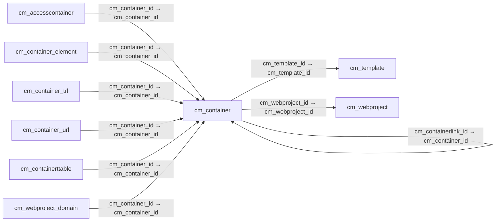

# cm_container — 웹 콘텐츠 컨테이너

[전체 일람](../TABLE_INDEX.md) · [분류 일람](README.md) · [AI 사용 안내](../README.md) · [외래키 읽는 법](../RELATIONSHIPS.md)

## 기본 정보

| 항목 | 내용 |
|---|---|
| 물리명 | `adempiere.cm_container` |
| 한국어 논리명(문서용 해석) | 웹 콘텐츠 컨테이너 |
| 원본 논리명 | Web Container |
| 원본 사전 ID | 855 |
| 분류 | `cm` — 웹 콘텐츠 관리 |
| 전체 테넌트 행 수 | 5 |
| 물리 열 수 | 35 |
| 나가는 FK / 들어오는 FK | 3 / 7 |
| 구조·행 수 확인 시점 | 2026-11-03T23:29:01+09:00 |

## 의미와 쓰임

이미지·텍스트 등의 웹 콘텐츠를 담는 단위로 표시·색인·저장 방식을 정의한다.

- 설명 근거: 원본 애플리케이션 사전 명칭·설명을 한국어로 해석.
- 한국어 이름과 개요는 문서용 해석입니다. 공식 한국어 번역으로 간주하지 않습니다.
- 원본 설명: Web Container contains content like images, text etc.
- 원본 도움말: A Container defines the abstract level around the content, it defines how the content get's displayed, indexed and stored.
- PostgreSQL 테이블 주석: —

## 키와 열

### 기본키·고유 제약조건

| 종류 | 제약조건 | 열(순서 유지) |
|---|---|---|
| PRIMARY KEY | `cm_container_pkey` | `cm_container_id` |
| UNIQUE | `cm_container_uu_idx` | `cm_container_uu` |

### 열 목록

원본 논리명·설명은 `AD_Column`에서 가져왔습니다. 기본값은 실제 PostgreSQL 메타데이터이며, 비어 있는 항목은 `—`로 표시합니다.

| 순서 | 물리명 | 원본 논리명 | PostgreSQL 타입 | NULL | PK | 기본값 | 설명 |
|---:|---|---|---|---|---|---|---|
| 1 | `cm_container_id` | Web Container | numeric(10,0) | 불가 | 예 | — | Web Container contains content like images, text etc. |
| 2 | `ad_client_id` | Tenant | numeric(10,0) | 불가 | — | — | Tenant for this installation. |
| 3 | `ad_org_id` | Organization | numeric(10,0) | 불가 | — | — | Organizational entity within tenant |
| 4 | `isactive` | Active | character(1) | 불가 | — | 'Y'::bpchar | The record is active in the system |
| 5 | `created` | Created | timestamp without time zone | 불가 | — | now() | Date this record was created |
| 6 | `createdby` | Created By | numeric(10,0) | 불가 | — | — | User who created this records |
| 7 | `updated` | Updated | timestamp without time zone | 불가 | — | now() | Date this record was updated |
| 8 | `updatedby` | Updated By | numeric(10,0) | 불가 | — | — | User who updated this records |
| 9 | `name` | Name | character varying(60) | 불가 | — | — | Alphanumeric identifier of the entity |
| 10 | `description` | Description | character varying(2000) | 허용 | — | — | Optional short description of the record |
| 11 | `help` | Comment/Help | character varying(2000) | 허용 | — | — | Comment or Hint |
| 12 | `cm_webproject_id` | Web Project | numeric(10,0) | 불가 | — | — | A web project is the main data container for Containers, URLs, Ads, Media etc. |
| 13 | `cm_template_id` | Template | numeric(10,0) | 허용 | — | — | Template defines how content is displayed |
| 14 | `title` | Title | character varying(60) | 허용 | — | — | Name this entity is referred to as |
| 15 | `notice` | Notice | character varying(2000) | 허용 | — | — | Contains last write notice |
| 16 | `containertype` | Web Container Type | character(1) | 허용 | — | — | Web Container Type |
| 17 | `containerlinkurl` | External Link (URL) | character varying(60) | 허용 | — | — | External Link (URL) for the Container |
| 18 | `relativeurl` | Relative URL | character varying(120) | 허용 | — | — | Contains the relative URL for the container |
| 19 | `priority` | Priority | numeric(10,0) | 허용 | — | 0 | Indicates if this request is of a high, medium or low priority. |
| 20 | `isindexed` | Indexed | character(1) | 불가 | — | 'Y'::bpchar | Index the document for the internal search engine |
| 21 | `issecure` | Secure content | character(1) | 불가 | — | 'Y'::bpchar | Defines whether content must be treated as secure |
| 22 | `meta_robotstag` | Meta RobotsTag | character varying(2000) | 허용 | — | — | RobotsTag defines how search robots should handle this content |
| 23 | `meta_author` | Meta Author | character varying(2000) | 허용 | — | — | Author of the content |
| 24 | `meta_copyright` | Meta Copyright | character varying(2000) | 허용 | — | — | Contains Copyright information for the content |
| 25 | `meta_content` | Meta Content Type | character varying(2000) | 허용 | — | — | Defines the type of content i.e. "text/html; charset=UTF-8" |
| 26 | `meta_description` | Meta Description | character varying(2000) | 허용 | — | — | Meta info describing the contents of the page |
| 27 | `meta_keywords` | Meta Keywords | character varying(2000) | 허용 | — | — | Contains the keywords for the content |
| 28 | `meta_publisher` | Meta Publisher | character varying(2000) | 허용 | — | — | Meta Publisher defines the publisher of the content |
| 29 | `structurexml` | Structure XML | character varying(2000) | 허용 | — | — | Autogenerated Container definition as XML Code |
| 30 | `containerxml` | Container XML | character varying(2000) | 허용 | — | — | Autogenerated Container definition as XML Code |
| 31 | `cm_containerlink_id` | Container Link | numeric(10,0) | 허용 | — | — | Link to another Container in the Web Project |
| 32 | `issummary` | Summary Level | character(1) | 불가 | — | 'N'::bpchar | This is a summary entity |
| 33 | `meta_language` | Meta Language | character(2) | 허용 | — | — | Language HTML Meta Tag |
| 34 | `isvalid` | Valid | character(1) | 불가 | — | 'Y'::bpchar | Element is valid |
| 35 | `cm_container_uu` | CM_Container_UU | uuid | 허용 | — | — | — |

## 외래키 흐름

화살표는 **FK를 가진 자식 → 참조되는 부모**입니다. 업무 처리의 시간 순서나 무조건적인 1:N 관계를 뜻하지 않습니다.

주변 관계 9개 중 9개를 그림으로 표시합니다. **전체 관계는 아래 두 표에 모두 포함**합니다.

### 이 테이블이 참조하는 부모 — 나가는 FK

| 제약조건 | 참조하는 쪽(자식) | 자식 열 | 참조받는 쪽(부모) | 부모 열 | 삭제 / 갱신 | 검증 / 지연 가능 |
|---|---|---|---|---|---|---|
| `cmcontainer_cmcontainerlink` <!-- FK_OUT: adempiere.cm_container.cmcontainer_cmcontainerlink --> | [`cm_container`](cm_container.md) | `cm_containerlink_id` | [`cm_container`](cm_container.md) | `cm_container_id` | SET NULL / NO ACTION | 완료 / 가능 (초기 지연) |
| `cmtemplate_cmcontainer` <!-- FK_OUT: adempiere.cm_container.cmtemplate_cmcontainer --> | [`cm_container`](cm_container.md) | `cm_template_id` | [`cm_template`](cm_template.md) | `cm_template_id` | NO ACTION / NO ACTION | 완료 / 가능 (초기 지연) |
| `cmwebproject_cmcontainer` <!-- FK_OUT: adempiere.cm_container.cmwebproject_cmcontainer --> | [`cm_container`](cm_container.md) | `cm_webproject_id` | [`cm_webproject`](cm_webproject.md) | `cm_webproject_id` | CASCADE / NO ACTION | 완료 / 가능 (초기 지연) |

### 이 테이블을 참조하는 자식 — 들어오는 FK

| 제약조건 | 참조하는 쪽(자식) | 자식 열 | 참조받는 쪽(부모) | 부모 열 | 삭제 / 갱신 | 검증 / 지연 가능 |
|---|---|---|---|---|---|---|
| `cmcontainer_cmaccesscontainer` <!-- FK_IN: adempiere.cm_accesscontainer.cmcontainer_cmaccesscontainer --> | [`cm_accesscontainer`](cm_accesscontainer.md) | `cm_container_id` | [`cm_container`](cm_container.md) | `cm_container_id` | CASCADE / NO ACTION | 완료 / 가능 (초기 지연) |
| `cmcontainer_cmcontainerlink` <!-- FK_IN: adempiere.cm_container.cmcontainer_cmcontainerlink --> | [`cm_container`](cm_container.md) | `cm_containerlink_id` | [`cm_container`](cm_container.md) | `cm_container_id` | SET NULL / NO ACTION | 완료 / 가능 (초기 지연) |
| `cmcontainer_cmcontainerelement` <!-- FK_IN: adempiere.cm_container_element.cmcontainer_cmcontainerelement --> | [`cm_container_element`](cm_container_element.md) | `cm_container_id` | [`cm_container`](cm_container.md) | `cm_container_id` | CASCADE / NO ACTION | 완료 / 가능 (초기 지연) |
| `cmcontainer_cmcontainertrl` <!-- FK_IN: adempiere.cm_container_trl.cmcontainer_cmcontainertrl --> | [`cm_container_trl`](cm_container_trl.md) | `cm_container_id` | [`cm_container`](cm_container.md) | `cm_container_id` | CASCADE / NO ACTION | 완료 / 가능 (초기 지연) |
| `cmcontainer_cmcontainerurl` <!-- FK_IN: adempiere.cm_container_url.cmcontainer_cmcontainerurl --> | [`cm_container_url`](cm_container_url.md) | `cm_container_id` | [`cm_container`](cm_container.md) | `cm_container_id` | CASCADE / NO ACTION | 완료 / 가능 (초기 지연) |
| `cmcontainer_cmcontainerttable` <!-- FK_IN: adempiere.cm_containerttable.cmcontainer_cmcontainerttable --> | [`cm_containerttable`](cm_containerttable.md) | `cm_container_id` | [`cm_container`](cm_container.md) | `cm_container_id` | CASCADE / NO ACTION | 완료 / 가능 (초기 지연) |
| `cmcontainer_cmwebprojectdomain` <!-- FK_IN: adempiere.cm_webproject_domain.cmcontainer_cmwebprojectdomain --> | [`cm_webproject_domain`](cm_webproject_domain.md) | `cm_container_id` | [`cm_container`](cm_container.md) | `cm_container_id` | CASCADE / NO ACTION | 완료 / 가능 (초기 지연) |

## 조회 시 주의

- FK 표의 자식 열과 부모 열을 같은 순서로 대응시킵니다. 복합 FK는 모든 열의 동등 조건을 `AND`로 연결합니다.
- 테이블 이름이나 `_id` 열 이름만으로 물리 FK가 있다고 가정하지 않습니다. FK 미선언은 업무 관계가 없다는 뜻도 아닙니다.
- 자식이 여러 행인 테이블과 조인하면 부모의 금액·건수가 중복될 수 있습니다. 집계 단위를 먼저 정합니다.
- `ad_client_id`가 있습니다. 업무 분석에서는 대상 테넌트를 명시합니다. GardenWorld는 `11`, 시스템 공통 설정은 `0`일 수 있으므로 일괄 필터 적용 전에 테이블 역할을 확인합니다.
- 행 수는 위 확인 시점의 전체 테넌트 값입니다. 최신 업무 실적이나 현재 실행 결과로 재사용하지 않습니다.
