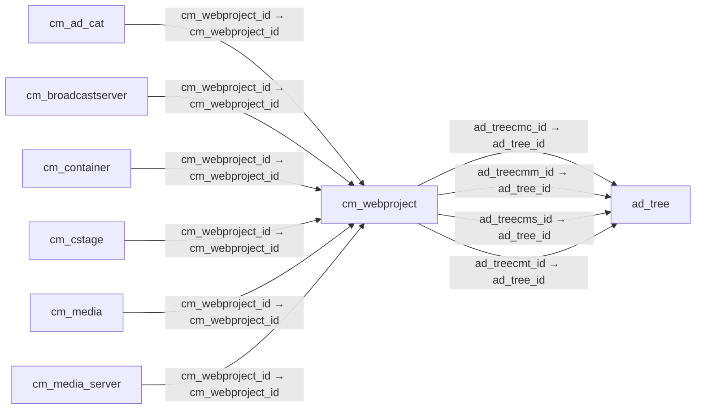

# cm_webproject — 웹 콘텐츠 프로젝트

[전체 일람](../TABLE_INDEX.md) · [분류 일람](README.md) · [AI 사용 안내](../README.md) · [외래키 읽는 법](../RELATIONSHIPS.md)

## 기본 정보

| 항목 | 내용 |
|---|---|
| 물리명 | `adempiere.cm_webproject` |
| 한국어 논리명(문서용 해석) | 웹 콘텐츠 프로젝트 |
| 원본 논리명 | Web Project |
| 원본 사전 ID | 853 |
| 분류 | `cm` — 웹 콘텐츠 관리 |
| 전체 테넌트 행 수 | 1 |
| 물리 열 수 | 21 |
| 나가는 FK / 들어오는 FK | 4 / 12 |
| 구조·행 수 확인 시점 | 2026-11-03T23:29:01+09:00 |

## 의미와 쓰임

콘텐츠 컨테이너·URL·광고·미디어 등을 포괄하는 웹 콘텐츠 관리 프로젝트를 정의한다.

- 설명 근거: 원본 애플리케이션 사전 명칭·설명을 한국어로 해석.
- 한국어 이름과 개요는 문서용 해석입니다. 공식 한국어 번역으로 간주하지 않습니다.
- 원본 설명: A web project is the main data container for Containers, URLs, Ads, Media etc.
- 원본 도움말: A web project is the meta definition which will contain later on all data within the Web Content Management Project. 
- PostgreSQL 테이블 주석: —

## 키와 열

### 기본키·고유 제약조건

| 종류 | 제약조건 | 열(순서 유지) |
|---|---|---|
| PRIMARY KEY | `cm_webproject_pkey` | `cm_webproject_id` |
| UNIQUE | `cm_webproject_uu_idx` | `cm_webproject_uu` |

### 열 목록

원본 논리명·설명은 `AD_Column`에서 가져왔습니다. 기본값은 실제 PostgreSQL 메타데이터이며, 비어 있는 항목은 `—`로 표시합니다.

| 순서 | 물리명 | 원본 논리명 | PostgreSQL 타입 | NULL | PK | 기본값 | 설명 |
|---:|---|---|---|---|---|---|---|
| 1 | `cm_webproject_id` | Web Project | numeric(10,0) | 불가 | 예 | — | A web project is the main data container for Containers, URLs, Ads, Media etc. |
| 2 | `ad_client_id` | Tenant | numeric(10,0) | 불가 | — | — | Tenant for this installation. |
| 3 | `ad_org_id` | Organization | numeric(10,0) | 불가 | — | — | Organizational entity within tenant |
| 4 | `isactive` | Active | character(1) | 불가 | — | 'Y'::bpchar | The record is active in the system |
| 5 | `created` | Created | timestamp without time zone | 불가 | — | now() | Date this record was created |
| 6 | `createdby` | Created By | numeric(10,0) | 불가 | — | — | User who created this records |
| 7 | `updated` | Updated | timestamp without time zone | 불가 | — | now() | Date this record was updated |
| 8 | `updatedby` | Updated By | numeric(10,0) | 불가 | — | — | User who updated this records |
| 9 | `name` | Name | character varying(60) | 불가 | — | — | Alphanumeric identifier of the entity |
| 10 | `description` | Description | character varying(255) | 허용 | — | — | Optional short description of the record |
| 11 | `help` | Comment/Help | character varying(2000) | 허용 | — | — | Comment or Hint |
| 12 | `meta_copyright` | Meta Copyright | character varying(2000) | 불가 | — | — | Contains Copyright information for the content |
| 13 | `meta_publisher` | Meta Publisher | character varying(2000) | 불가 | — | — | Meta Publisher defines the publisher of the content |
| 14 | `meta_robotstag` | Meta RobotsTag | character varying(2000) | 불가 | — | — | RobotsTag defines how search robots should handle this content |
| 15 | `meta_author` | Meta Author | character varying(2000) | 불가 | — | — | Author of the content |
| 16 | `meta_content` | Meta Content Type | character varying(2000) | 불가 | — | — | Defines the type of content i.e. "text/html; charset=UTF-8" |
| 17 | `ad_treecmc_id` | Container Tree | numeric(10,0) | 불가 | — | — | Container Tree |
| 18 | `ad_treecms_id` | Stage Tree | numeric(10,0) | 불가 | — | — | Stage Tree |
| 19 | `ad_treecmm_id` | Media Tree | numeric(10,0) | 불가 | — | — | Media Tree |
| 20 | `ad_treecmt_id` | Template Tree | numeric(10,0) | 불가 | — | — | Template Tree |
| 21 | `cm_webproject_uu` | CM_WebProject_UU | uuid | 허용 | — | — | — |

## 외래키 흐름

화살표는 **FK를 가진 자식 → 참조되는 부모**입니다. 업무 처리의 시간 순서나 무조건적인 1:N 관계를 뜻하지 않습니다.

주변 관계 16개 중 10개를 그림으로 표시합니다. **전체 관계는 아래 두 표에 모두 포함**합니다.

### 이 테이블이 참조하는 부모 — 나가는 FK

| 제약조건 | 참조하는 쪽(자식) | 자식 열 | 참조받는 쪽(부모) | 부모 열 | 삭제 / 갱신 | 검증 / 지연 가능 |
|---|---|---|---|---|---|---|
| `adtreecmc_cmwebproject` <!-- FK_OUT: adempiere.cm_webproject.adtreecmc_cmwebproject --> | [`cm_webproject`](cm_webproject.md) | `ad_treecmc_id` | [`ad_tree`](../ad/ad_tree.md) | `ad_tree_id` | NO ACTION / NO ACTION | 완료 / 가능 (초기 지연) |
| `adtreecmm_cmwebproject` <!-- FK_OUT: adempiere.cm_webproject.adtreecmm_cmwebproject --> | [`cm_webproject`](cm_webproject.md) | `ad_treecmm_id` | [`ad_tree`](../ad/ad_tree.md) | `ad_tree_id` | NO ACTION / NO ACTION | 완료 / 가능 (초기 지연) |
| `adtreecms_cmwebproject` <!-- FK_OUT: adempiere.cm_webproject.adtreecms_cmwebproject --> | [`cm_webproject`](cm_webproject.md) | `ad_treecms_id` | [`ad_tree`](../ad/ad_tree.md) | `ad_tree_id` | NO ACTION / NO ACTION | 완료 / 가능 (초기 지연) |
| `adtreecmt_cmwebproject` <!-- FK_OUT: adempiere.cm_webproject.adtreecmt_cmwebproject --> | [`cm_webproject`](cm_webproject.md) | `ad_treecmt_id` | [`ad_tree`](../ad/ad_tree.md) | `ad_tree_id` | NO ACTION / NO ACTION | 완료 / 가능 (초기 지연) |

### 이 테이블을 참조하는 자식 — 들어오는 FK

| 제약조건 | 참조하는 쪽(자식) | 자식 열 | 참조받는 쪽(부모) | 부모 열 | 삭제 / 갱신 | 검증 / 지연 가능 |
|---|---|---|---|---|---|---|
| `cmwebproject_cmadcat` <!-- FK_IN: adempiere.cm_ad_cat.cmwebproject_cmadcat --> | [`cm_ad_cat`](cm_ad_cat.md) | `cm_webproject_id` | [`cm_webproject`](cm_webproject.md) | `cm_webproject_id` | CASCADE / NO ACTION | 완료 / 가능 (초기 지연) |
| `cmwebproject_cmbroadcastserver` <!-- FK_IN: adempiere.cm_broadcastserver.cmwebproject_cmbroadcastserver --> | [`cm_broadcastserver`](cm_broadcastserver.md) | `cm_webproject_id` | [`cm_webproject`](cm_webproject.md) | `cm_webproject_id` | SET NULL / NO ACTION | 완료 / 가능 (초기 지연) |
| `cmwebproject_cmcontainer` <!-- FK_IN: adempiere.cm_container.cmwebproject_cmcontainer --> | [`cm_container`](cm_container.md) | `cm_webproject_id` | [`cm_webproject`](cm_webproject.md) | `cm_webproject_id` | CASCADE / NO ACTION | 완료 / 가능 (초기 지연) |
| `cmwebproject_cmcstage` <!-- FK_IN: adempiere.cm_cstage.cmwebproject_cmcstage --> | [`cm_cstage`](cm_cstage.md) | `cm_webproject_id` | [`cm_webproject`](cm_webproject.md) | `cm_webproject_id` | CASCADE / NO ACTION | 완료 / 가능 (초기 지연) |
| `cmwebproject_cmmedia` <!-- FK_IN: adempiere.cm_media.cmwebproject_cmmedia --> | [`cm_media`](cm_media.md) | `cm_webproject_id` | [`cm_webproject`](cm_webproject.md) | `cm_webproject_id` | NO ACTION / NO ACTION | 완료 / 가능 (초기 지연) |
| `cmwebproject_cmmediaserver` <!-- FK_IN: adempiere.cm_media_server.cmwebproject_cmmediaserver --> | [`cm_media_server`](cm_media_server.md) | `cm_webproject_id` | [`cm_webproject`](cm_webproject.md) | `cm_webproject_id` | CASCADE / NO ACTION | 완료 / 가능 (초기 지연) |
| `cmwebproject_cmnewschannel` <!-- FK_IN: adempiere.cm_newschannel.cmwebproject_cmnewschannel --> | [`cm_newschannel`](cm_newschannel.md) | `cm_webproject_id` | [`cm_webproject`](cm_webproject.md) | `cm_webproject_id` | CASCADE / NO ACTION | 완료 / 가능 (초기 지연) |
| `cmwebproject_cmtemplate` <!-- FK_IN: adempiere.cm_template.cmwebproject_cmtemplate --> | [`cm_template`](cm_template.md) | `cm_webproject_id` | [`cm_webproject`](cm_webproject.md) | `cm_webproject_id` | CASCADE / NO ACTION | 완료 / 가능 (초기 지연) |
| `cmwebproject_cmwebaccesslog` <!-- FK_IN: adempiere.cm_webaccesslog.cmwebproject_cmwebaccesslog --> | [`cm_webaccesslog`](cm_webaccesslog.md) | `cm_webproject_id` | [`cm_webproject`](cm_webproject.md) | `cm_webproject_id` | NO ACTION / NO ACTION | 완료 / 가능 (초기 지연) |
| `cmwebproject_cmwpdomain` <!-- FK_IN: adempiere.cm_webproject_domain.cmwebproject_cmwpdomain --> | [`cm_webproject_domain`](cm_webproject_domain.md) | `cm_webproject_id` | [`cm_webproject`](cm_webproject.md) | `cm_webproject_id` | CASCADE / NO ACTION | 완료 / 가능 (초기 지연) |
| `cmwebproject_kindex` <!-- FK_IN: adempiere.k_index.cmwebproject_kindex --> | [`k_index`](../k/k_index.md) | `cm_webproject_id` | [`cm_webproject`](cm_webproject.md) | `cm_webproject_id` | CASCADE / NO ACTION | 완료 / 가능 (초기 지연) |
| `cmwebproject_kindexstop` <!-- FK_IN: adempiere.k_indexstop.cmwebproject_kindexstop --> | [`k_indexstop`](../k/k_indexstop.md) | `cm_webproject_id` | [`cm_webproject`](cm_webproject.md) | `cm_webproject_id` | CASCADE / NO ACTION | 완료 / 가능 (초기 지연) |

## 조회 시 주의

- FK 표의 자식 열과 부모 열을 같은 순서로 대응시킵니다. 복합 FK는 모든 열의 동등 조건을 `AND`로 연결합니다.
- 테이블 이름이나 `_id` 열 이름만으로 물리 FK가 있다고 가정하지 않습니다. FK 미선언은 업무 관계가 없다는 뜻도 아닙니다.
- 자식이 여러 행인 테이블과 조인하면 부모의 금액·건수가 중복될 수 있습니다. 집계 단위를 먼저 정합니다.
- `ad_client_id`가 있습니다. 업무 분석에서는 대상 테넌트를 명시합니다. GardenWorld는 `11`, 시스템 공통 설정은 `0`일 수 있으므로 일괄 필터 적용 전에 테이블 역할을 확인합니다.
- 행 수는 위 확인 시점의 전체 테넌트 값입니다. 최신 업무 실적이나 현재 실행 결과로 재사용하지 않습니다.
