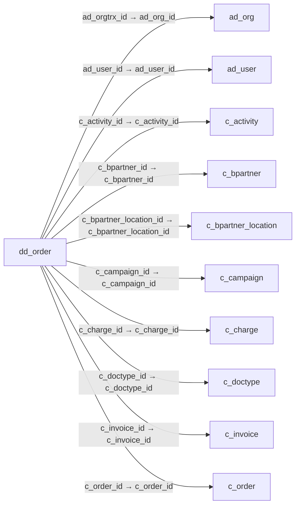

# dd_order — 재고 배분 주문

[전체 일람](../TABLE_INDEX.md) · [분류 일람](README.md) · [AI 사용 안내](../README.md) · [외래키 읽는 법](../RELATIONSHIPS.md)

## 기본 정보

| 항목 | 내용 |
|---|---|
| 물리명 | `adempiere.dd_order` |
| 한국어 논리명(문서용 해석) | 재고 배분 주문 |
| 원본 논리명 | Distribution Order |
| 원본 사전 ID | 53037 |
| 분류 | `dd` — 물류 이동·분배 주문 |
| 전체 테넌트 행 수 | 0 |
| 물리 열 수 | 64 |
| 나가는 FK / 들어오는 FK | 17 / 3 |
| 구조·행 수 확인 시점 | 2026-11-03T23:29:01+09:00 |

## 의미와 쓰임

재고 배분을 지시하는 주문의 머리글을 관리한다.

- 설명 근거: 원본 애플리케이션 사전 명칭·설명을 한국어로 해석.
- 한국어 이름과 개요는 문서용 해석입니다. 공식 한국어 번역으로 간주하지 않습니다.
- 원본 설명: Distribution Order
- 원본 도움말: —
- PostgreSQL 테이블 주석: —

## 키와 열

### 기본키·고유 제약조건

| 종류 | 제약조건 | 열(순서 유지) |
|---|---|---|
| PRIMARY KEY | `dd_order_key` | `dd_order_id` |
| UNIQUE | `dd_order_uu_idx` | `dd_order_uu` |

### 열 목록

원본 논리명·설명은 `AD_Column`에서 가져왔습니다. 기본값은 실제 PostgreSQL 메타데이터이며, 비어 있는 항목은 `—`로 표시합니다.

| 순서 | 물리명 | 원본 논리명 | PostgreSQL 타입 | NULL | PK | 기본값 | 설명 |
|---:|---|---|---|---|---|---|---|
| 1 | `documentno` | Document No | character varying(30) | 불가 | — | — | Document sequence number of the document |
| 2 | `ad_orgtrx_id` | Trx Organization | numeric(10,0) | 허용 | — | — | Performing or initiating organization |
| 3 | `ad_org_id` | Organization | numeric(10,0) | 불가 | — | — | Organizational entity within tenant |
| 4 | `ad_user_id` | User/Contact | numeric(10,0) | 허용 | — | — | User within the system - Internal or Business Partner Contact |
| 5 | `c_activity_id` | Activity | numeric(10,0) | 허용 | — | — | Business Activity |
| 6 | `c_bpartner_id` | Business Partner | numeric(10,0) | 불가 | — | — | Identifies a Business Partner |
| 7 | `c_bpartner_location_id` | Partner Location | numeric(10,0) | 불가 | — | — | Identifies the (ship to) address for this Business Partner |
| 8 | `c_campaign_id` | Campaign | numeric(10,0) | 허용 | — | — | Marketing Campaign |
| 9 | `c_charge_id` | Charge | numeric(10,0) | 허용 | — | — | Additional document charges |
| 10 | `c_doctype_id` | Document Type | numeric(10,0) | 불가 | — | — | Document type or rules |
| 11 | `c_invoice_id` | Invoice | numeric(10,0) | 허용 | — | — | Invoice Identifier |
| 12 | `c_order_id` | Order | numeric(10,0) | 허용 | — | — | Order |
| 13 | `c_project_id` | Project | numeric(10,0) | 허용 | — | — | Financial Project |
| 14 | `chargeamt` | Charge amount | numeric | 허용 | — | — | Charge Amount |
| 15 | `createconfirm` | Create Confirm | character(1) | 허용 | — | — | — |
| 16 | `createfrom` | Create lines from | character(1) | 허용 | — | — | Process which will generate a new document lines based on an existing document |
| 17 | `createpackage` | Create Package | character(1) | 허용 | — | — | — |
| 18 | `created` | Created | timestamp without time zone | 불가 | — | statement_timestamp() | Date this record was created |
| 19 | `createdby` | Created By | numeric(10,0) | 불가 | — | — | User who created this records |
| 20 | `dd_order_id` | Distribution Order | numeric(10,0) | 불가 | 예 | — | — |
| 21 | `dateordered` | Date Ordered | timestamp without time zone | 불가 | — | — | Date of Order |
| 22 | `dateprinted` | Date Printed | timestamp without time zone | 허용 | — | — | Date the document was printed. |
| 23 | `datepromised` | Date Promised | timestamp without time zone | 불가 | — | — | Date Order was promised |
| 24 | `datereceived` | Date Received | timestamp without time zone | 허용 | — | — | Date a product was received |
| 25 | `deliveryrule` | Delivery Rule | character(1) | 불가 | — | 'A'::bpchar | Defines the timing of Delivery |
| 26 | `deliveryviarule` | Delivery Via | character(1) | 불가 | — | 'P'::bpchar | How the order will be delivered |
| 27 | `description` | Description | character varying(255) | 허용 | — | — | Optional short description of the record |
| 28 | `docaction` | Document Action | character(2) | 불가 | — | 'CO'::bpchar | The targeted status of the document |
| 29 | `docstatus` | Document Status | character(2) | 불가 | — | 'DR'::bpchar | The current status of the document |
| 30 | `freightamt` | Freight Amount | numeric | 허용 | — | — | Freight Amount  |
| 31 | `freightcostrule` | Freight Cost Rule | character(1) | 불가 | — | 'I'::bpchar | Method for charging Freight |
| 32 | `generateto` | Generate To | character(1) | 허용 | — | — | Generate To |
| 33 | `isactive` | Active | character(1) | 불가 | — | 'Y'::bpchar | The record is active in the system |
| 34 | `isapproved` | Approved | character(1) | 불가 | — | — | Indicates if this document requires approval |
| 35 | `isdelivered` | Delivered | character(1) | 허용 | — | — | — |
| 36 | `isdropship` | Drop Shipment | character(1) | 허용 | — | — | Drop Shipments are sent directly to the Drop Shipment Location |
| 37 | `isindispute` | In Dispute | character(1) | 불가 | — | — | Document is in dispute |
| 38 | `isintransit` | In Transit | character(1) | 불가 | — | — | Movement is in transit |
| 39 | `isprinted` | Printed | character(1) | 불가 | — | — | Indicates if this document / line is printed |
| 40 | `issotrx` | Sales Transaction | character(1) | 불가 | — | — | This is a Sales Transaction |
| 41 | `isselected` | Selected | character(1) | 허용 | — | — | — |
| 42 | `m_shipper_id` | Shipper | numeric(10,0) | 허용 | — | — | Method or manner of product delivery |
| 43 | `m_warehouse_id` | Warehouse | numeric(10,0) | 불가 | — | — | Storage Warehouse and Service Point |
| 44 | `nopackages` | No Packages | numeric(10,0) | 허용 | — | — | Number of packages shipped |
| 45 | `poreference` | Order Reference | character varying(20) | 허용 | — | — | Transaction Reference Number (Sales Order, Purchase Order) of your Business Partner |
| 46 | `pickdate` | Pick Date | timestamp without time zone | 허용 | — | — | Date/Time when picked for Shipment |
| 47 | `posted` | Posted | character(1) | 불가 | — | — | Posting status |
| 48 | `priorityrule` | Priority | character(1) | 불가 | — | '5'::bpchar | Priority of a document |
| 49 | `processed` | Processed | character(1) | 불가 | — | — | The document has been processed |
| 50 | `processing` | Process Now | character(1) | 허용 | — | — | — |
| 51 | `ref_order_id` | Referenced Order | numeric(10,0) | 허용 | — | — | Reference to corresponding Sales/Purchase Order |
| 52 | `salesrep_id` | Sales Representative | numeric(10,0) | 허용 | — | — | Sales Representative or Company Agent |
| 53 | `sendemail` | Send EMail | character(1) | 불가 | — | — | Enable sending Document EMail |
| 54 | `shipdate` | Ship Date | timestamp without time zone | 허용 | — | — | Shipment Date/Time |
| 55 | `trackingno` | Tracking No | character varying(60) | 허용 | — | — | Number to track the shipment |
| 56 | `updated` | Updated | timestamp without time zone | 불가 | — | statement_timestamp() | Date this record was updated |
| 57 | `updatedby` | Updated By | numeric(10,0) | 불가 | — | — | User who updated this records |
| 58 | `user1_id` | User Element List 1 | numeric(10,0) | 허용 | — | — | User defined list element #1 |
| 59 | `user2_id` | User Element List 2 | numeric(10,0) | 허용 | — | — | User defined list element #2 |
| 60 | `volume` | Volume | numeric | 허용 | — | — | Volume of a product |
| 61 | `ad_client_id` | Tenant | numeric(10,0) | 불가 | — | — | Tenant for this installation. |
| 62 | `weight` | Weight | numeric | 허용 | — | — | Weight of a product |
| 63 | `processedon` | Processed On | numeric | 허용 | — | — | The date+time (expressed in decimal format) when the document has been processed |
| 64 | `dd_order_uu` | DD_Order_UU | uuid | 허용 | — | — | — |

## 외래키 흐름

화살표는 **FK를 가진 자식 → 참조되는 부모**입니다. 업무 처리의 시간 순서나 무조건적인 1:N 관계를 뜻하지 않습니다.

주변 관계 20개 중 10개를 그림으로 표시합니다. **전체 관계는 아래 두 표에 모두 포함**합니다.

### 이 테이블이 참조하는 부모 — 나가는 FK

| 제약조건 | 참조하는 쪽(자식) | 자식 열 | 참조받는 쪽(부모) | 부모 열 | 삭제 / 갱신 | 검증 / 지연 가능 |
|---|---|---|---|---|---|---|
| `adorgtrx_ddorder` <!-- FK_OUT: adempiere.dd_order.adorgtrx_ddorder --> | [`dd_order`](dd_order.md) | `ad_orgtrx_id` | [`ad_org`](../ad/ad_org.md) | `ad_org_id` | NO ACTION / NO ACTION | 완료 / 가능 (초기 지연) |
| `aduser_ddorder` <!-- FK_OUT: adempiere.dd_order.aduser_ddorder --> | [`dd_order`](dd_order.md) | `ad_user_id` | [`ad_user`](../ad/ad_user.md) | `ad_user_id` | NO ACTION / NO ACTION | 완료 / 가능 (초기 지연) |
| `cactivity_ddorder` <!-- FK_OUT: adempiere.dd_order.cactivity_ddorder --> | [`dd_order`](dd_order.md) | `c_activity_id` | [`c_activity`](../c/c_activity.md) | `c_activity_id` | NO ACTION / NO ACTION | 완료 / 가능 (초기 지연) |
| `cbpartner_ddorder` <!-- FK_OUT: adempiere.dd_order.cbpartner_ddorder --> | [`dd_order`](dd_order.md) | `c_bpartner_id` | [`c_bpartner`](../c/c_bpartner.md) | `c_bpartner_id` | NO ACTION / NO ACTION | 완료 / 가능 (초기 지연) |
| `cbpartnerlocation_ddorder` <!-- FK_OUT: adempiere.dd_order.cbpartnerlocation_ddorder --> | [`dd_order`](dd_order.md) | `c_bpartner_location_id` | [`c_bpartner_location`](../c/c_bpartner_location.md) | `c_bpartner_location_id` | NO ACTION / NO ACTION | 완료 / 가능 (초기 지연) |
| `ccampaign_ddorder` <!-- FK_OUT: adempiere.dd_order.ccampaign_ddorder --> | [`dd_order`](dd_order.md) | `c_campaign_id` | [`c_campaign`](../c/c_campaign.md) | `c_campaign_id` | NO ACTION / NO ACTION | 완료 / 가능 (초기 지연) |
| `ccharge_ddorder` <!-- FK_OUT: adempiere.dd_order.ccharge_ddorder --> | [`dd_order`](dd_order.md) | `c_charge_id` | [`c_charge`](../c/c_charge.md) | `c_charge_id` | NO ACTION / NO ACTION | 완료 / 가능 (초기 지연) |
| `cdoctype_ddorder` <!-- FK_OUT: adempiere.dd_order.cdoctype_ddorder --> | [`dd_order`](dd_order.md) | `c_doctype_id` | [`c_doctype`](../c/c_doctype.md) | `c_doctype_id` | NO ACTION / NO ACTION | 완료 / 가능 (초기 지연) |
| `cinvoice_ddorder` <!-- FK_OUT: adempiere.dd_order.cinvoice_ddorder --> | [`dd_order`](dd_order.md) | `c_invoice_id` | [`c_invoice`](../c/c_invoice.md) | `c_invoice_id` | NO ACTION / NO ACTION | 완료 / 가능 (초기 지연) |
| `corder_ddorder` <!-- FK_OUT: adempiere.dd_order.corder_ddorder --> | [`dd_order`](dd_order.md) | `c_order_id` | [`c_order`](../c/c_order.md) | `c_order_id` | NO ACTION / NO ACTION | 완료 / 가능 (초기 지연) |
| `cproject_ddorder` <!-- FK_OUT: adempiere.dd_order.cproject_ddorder --> | [`dd_order`](dd_order.md) | `c_project_id` | [`c_project`](../c/c_project.md) | `c_project_id` | NO ACTION / NO ACTION | 완료 / 가능 (초기 지연) |
| `mshipper_ddorder` <!-- FK_OUT: adempiere.dd_order.mshipper_ddorder --> | [`dd_order`](dd_order.md) | `m_shipper_id` | [`m_shipper`](../m/m_shipper.md) | `m_shipper_id` | NO ACTION / NO ACTION | 완료 / 가능 (초기 지연) |
| `mwarehouse_ddorder` <!-- FK_OUT: adempiere.dd_order.mwarehouse_ddorder --> | [`dd_order`](dd_order.md) | `m_warehouse_id` | [`m_warehouse`](../m/m_warehouse.md) | `m_warehouse_id` | NO ACTION / NO ACTION | 완료 / 가능 (초기 지연) |
| `reforder_ddorder` <!-- FK_OUT: adempiere.dd_order.reforder_ddorder --> | [`dd_order`](dd_order.md) | `ref_order_id` | [`c_order`](../c/c_order.md) | `c_order_id` | NO ACTION / NO ACTION | 완료 / 가능 (초기 지연) |
| `salesrep_ddorder` <!-- FK_OUT: adempiere.dd_order.salesrep_ddorder --> | [`dd_order`](dd_order.md) | `salesrep_id` | [`ad_user`](../ad/ad_user.md) | `ad_user_id` | NO ACTION / NO ACTION | 완료 / 가능 (초기 지연) |
| `user1_ddorder` <!-- FK_OUT: adempiere.dd_order.user1_ddorder --> | [`dd_order`](dd_order.md) | `user1_id` | [`c_elementvalue`](../c/c_elementvalue.md) | `c_elementvalue_id` | NO ACTION / NO ACTION | 완료 / 가능 (초기 지연) |
| `user2_ddorder` <!-- FK_OUT: adempiere.dd_order.user2_ddorder --> | [`dd_order`](dd_order.md) | `user2_id` | [`c_elementvalue`](../c/c_elementvalue.md) | `c_elementvalue_id` | NO ACTION / NO ACTION | 완료 / 가능 (초기 지연) |

### 이 테이블을 참조하는 자식 — 들어오는 FK

| 제약조건 | 참조하는 쪽(자식) | 자식 열 | 참조받는 쪽(부모) | 부모 열 | 삭제 / 갱신 | 검증 / 지연 가능 |
|---|---|---|---|---|---|---|
| `ddorder_ddorderline` <!-- FK_IN: adempiere.dd_orderline.ddorder_ddorderline --> | [`dd_orderline`](dd_orderline.md) | `dd_order_id` | [`dd_order`](dd_order.md) | `dd_order_id` | NO ACTION / NO ACTION | 완료 / 가능 (초기 지연) |
| `ddorder_mmovement` <!-- FK_IN: adempiere.m_movement.ddorder_mmovement --> | [`m_movement`](../m/m_movement.md) | `dd_order_id` | [`dd_order`](dd_order.md) | `dd_order_id` | NO ACTION / NO ACTION | 완료 / 가능 (초기 지연) |
| `ddorder_ppmrp` <!-- FK_IN: adempiere.pp_mrp.ddorder_ppmrp --> | [`pp_mrp`](../pp/pp_mrp.md) | `dd_order_id` | [`dd_order`](dd_order.md) | `dd_order_id` | NO ACTION / NO ACTION | 완료 / 가능 (초기 지연) |

## 조회 시 주의

- FK 표의 자식 열과 부모 열을 같은 순서로 대응시킵니다. 복합 FK는 모든 열의 동등 조건을 `AND`로 연결합니다.
- 테이블 이름이나 `_id` 열 이름만으로 물리 FK가 있다고 가정하지 않습니다. FK 미선언은 업무 관계가 없다는 뜻도 아닙니다.
- 자식이 여러 행인 테이블과 조인하면 부모의 금액·건수가 중복될 수 있습니다. 집계 단위를 먼저 정합니다.
- `ad_client_id`가 있습니다. 업무 분석에서는 대상 테넌트를 명시합니다. GardenWorld는 `11`, 시스템 공통 설정은 `0`일 수 있으므로 일괄 필터 적용 전에 테이블 역할을 확인합니다.
- `issotrx`가 있습니다. 판매(`Y`)와 구매(`N`)를 구분해서 분석합니다.
- 수집 시점에 0행입니다. 이 표만으로 거래 실적·처리 결과를 계산할 수 없습니다.
- 행 수는 위 확인 시점의 전체 테넌트 값입니다. 최신 업무 실적이나 현재 실행 결과로 재사용하지 않습니다.
