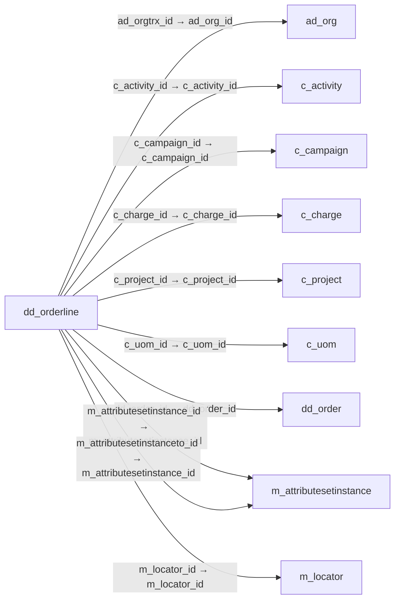

# dd_orderline — 재고 배분 주문 명세

[전체 일람](../TABLE_INDEX.md) · [분류 일람](README.md) · [AI 사용 안내](../README.md) · [외래키 읽는 법](../RELATIONSHIPS.md)

## 기본 정보

| 항목 | 내용 |
|---|---|
| 물리명 | `adempiere.dd_orderline` |
| 한국어 논리명(문서용 해석) | 재고 배분 주문 명세 |
| 원본 논리명 | Distribution Order Line |
| 원본 사전 ID | 53038 |
| 분류 | `dd` — 물류 이동·분배 주문 |
| 전체 테넌트 행 수 | 0 |
| 물리 열 수 | 43 |
| 나가는 FK / 들어오는 FK | 15 / 2 |
| 구조·행 수 확인 시점 | 2026-11-03T23:29:01+09:00 |

## 의미와 쓰임

재고 배분 주문에 포함되는 개별 배분 내역을 관리한다.

- 설명 근거: 원본 애플리케이션 사전 명칭·설명을 한국어로 해석.
- 한국어 이름과 개요는 문서용 해석입니다. 공식 한국어 번역으로 간주하지 않습니다.
- 원본 설명: Distribution Order Line
- 원본 도움말: —
- PostgreSQL 테이블 주석: —

## 키와 열

### 기본키·고유 제약조건

| 종류 | 제약조건 | 열(순서 유지) |
|---|---|---|
| PRIMARY KEY | `dd_orderline_key` | `dd_orderline_id` |
| UNIQUE | `dd_orderline_uu_idx` | `dd_orderline_uu` |

### 열 목록

원본 논리명·설명은 `AD_Column`에서 가져왔습니다. 기본값은 실제 PostgreSQL 메타데이터이며, 비어 있는 항목은 `—`로 표시합니다.

| 순서 | 물리명 | 원본 논리명 | PostgreSQL 타입 | NULL | PK | 기본값 | 설명 |
|---:|---|---|---|---|---|---|---|
| 1 | `line` | Line No | numeric(10,0) | 불가 | — | — | Unique line for this document |
| 2 | `qtyintransit` | Qty In Transit | numeric | 허용 | — | — | — |
| 3 | `qtyordered` | Ordered Quantity | numeric | 불가 | — | — | Ordered Quantity |
| 4 | `m_product_id` | Product | numeric(10,0) | 허용 | — | — | Product, Service, Item |
| 5 | `dd_order_id` | Distribution Order | numeric(10,0) | 불가 | — | — | — |
| 6 | `c_charge_id` | Charge | numeric(10,0) | 허용 | — | — | Additional document charges |
| 7 | `c_project_id` | Project | numeric(10,0) | 허용 | — | — | Financial Project |
| 8 | `c_uom_id` | UOM | numeric(10,0) | 불가 | — | — | Unit of Measure |
| 9 | `confirmedqty` | Confirmed Quantity | numeric | 허용 | — | — | Confirmation of a received quantity |
| 10 | `created` | Created | timestamp without time zone | 불가 | — | statement_timestamp() | Date this record was created |
| 11 | `createdby` | Created By | numeric(10,0) | 불가 | — | — | User who created this records |
| 12 | `dd_orderline_id` | Distribution Order Line | numeric(10,0) | 불가 | 예 | — | — |
| 13 | `datedelivered` | Date Delivered | timestamp without time zone | 허용 | — | — | Date when the product was delivered |
| 14 | `dateordered` | Date Ordered | timestamp without time zone | 허용 | — | — | Date of Order |
| 15 | `datepromised` | Date Promised | timestamp without time zone | 허용 | — | — | Date Order was promised |
| 16 | `description` | Description | character varying(255) | 허용 | — | — | Optional short description of the record |
| 17 | `freightamt` | Freight Amount | numeric | 허용 | — | — | Freight Amount  |
| 18 | `isactive` | Active | character(1) | 불가 | — | 'Y'::bpchar | The record is active in the system |
| 19 | `isdescription` | Description Only | character(1) | 불가 | — | 'N'::bpchar | if true, the line is just description and no transaction |
| 20 | `isinvoiced` | Invoiced | character(1) | 불가 | — | — | Is this invoiced? |
| 21 | `linenetamt` | Line Amount | numeric | 허용 | — | — | Line Extended Amount (Quantity * Actual Price) without Freight and Charges |
| 22 | `m_attributesetinstanceto_id` | Attribute Set Instance To | numeric(10,0) | 허용 | — | — | Target Product Attribute Set Instance |
| 23 | `m_attributesetinstance_id` | Attribute Set Instance | numeric(10,0) | 허용 | — | — | Product Attribute Set Instance |
| 24 | `m_locatorto_id` | Locator To | numeric(10,0) | 불가 | — | — | Location inventory is moved to |
| 25 | `m_locator_id` | Locator | numeric(10,0) | 불가 | — | — | Warehouse Locator |
| 26 | `pickedqty` | Picked Quantity | numeric | 허용 | — | — | — |
| 27 | `processed` | Processed | character(1) | 불가 | — | — | The document has been processed |
| 28 | `qtydelivered` | Delivered Quantity | numeric | 허용 | — | — | Delivered Quantity |
| 29 | `qtyentered` | Quantity | numeric | 불가 | — | — | The Quantity Entered is based on the selected UoM |
| 30 | `qtyreserved` | Reserved Quantity | numeric | 허용 | — | — | Reserved Quantity |
| 31 | `scrappedqty` | Scrapped Quantity | numeric | 허용 | — | (0)::numeric | The Quantity scrapped due to QA issues |
| 32 | `targetqty` | Target Quantity | numeric | 허용 | — | — | Target Movement Quantity |
| 33 | `updated` | Updated | timestamp without time zone | 불가 | — | statement_timestamp() | Date this record was updated |
| 34 | `updatedby` | Updated By | numeric(10,0) | 불가 | — | — | User who updated this records |
| 35 | `user1_id` | User Element List 1 | numeric(10,0) | 허용 | — | — | User defined list element #1 |
| 36 | `ad_client_id` | Tenant | numeric(10,0) | 불가 | — | — | Tenant for this installation. |
| 37 | `user2_id` | User Element List 2 | numeric(10,0) | 허용 | — | — | User defined list element #2 |
| 38 | `ad_orgtrx_id` | Trx Organization | numeric(10,0) | 허용 | — | — | Performing or initiating organization |
| 39 | `ad_org_id` | Organization | numeric(10,0) | 불가 | — | — | Organizational entity within tenant |
| 40 | `c_activity_id` | Activity | numeric(10,0) | 허용 | — | — | Business Activity |
| 41 | `c_campaign_id` | Campaign | numeric(10,0) | 허용 | — | — | Marketing Campaign |
| 42 | `m_shipper_id` | Shipper | numeric(10,0) | 허용 | — | NULL::numeric | Method or manner of product delivery |
| 43 | `dd_orderline_uu` | DD_OrderLine_UU | uuid | 허용 | — | — | — |

## 외래키 흐름

화살표는 **FK를 가진 자식 → 참조되는 부모**입니다. 업무 처리의 시간 순서나 무조건적인 1:N 관계를 뜻하지 않습니다.

주변 관계 17개 중 10개를 그림으로 표시합니다. **전체 관계는 아래 두 표에 모두 포함**합니다.

### 이 테이블이 참조하는 부모 — 나가는 FK

| 제약조건 | 참조하는 쪽(자식) | 자식 열 | 참조받는 쪽(부모) | 부모 열 | 삭제 / 갱신 | 검증 / 지연 가능 |
|---|---|---|---|---|---|---|
| `adorgtrx_ddorderline` <!-- FK_OUT: adempiere.dd_orderline.adorgtrx_ddorderline --> | [`dd_orderline`](dd_orderline.md) | `ad_orgtrx_id` | [`ad_org`](../ad/ad_org.md) | `ad_org_id` | NO ACTION / NO ACTION | 완료 / 가능 (초기 지연) |
| `cactivity_ddorderline` <!-- FK_OUT: adempiere.dd_orderline.cactivity_ddorderline --> | [`dd_orderline`](dd_orderline.md) | `c_activity_id` | [`c_activity`](../c/c_activity.md) | `c_activity_id` | NO ACTION / NO ACTION | 완료 / 가능 (초기 지연) |
| `ccampaign_ddorderline` <!-- FK_OUT: adempiere.dd_orderline.ccampaign_ddorderline --> | [`dd_orderline`](dd_orderline.md) | `c_campaign_id` | [`c_campaign`](../c/c_campaign.md) | `c_campaign_id` | NO ACTION / NO ACTION | 완료 / 가능 (초기 지연) |
| `ccharge_ddorderline` <!-- FK_OUT: adempiere.dd_orderline.ccharge_ddorderline --> | [`dd_orderline`](dd_orderline.md) | `c_charge_id` | [`c_charge`](../c/c_charge.md) | `c_charge_id` | NO ACTION / NO ACTION | 완료 / 가능 (초기 지연) |
| `cproject_ddorderline` <!-- FK_OUT: adempiere.dd_orderline.cproject_ddorderline --> | [`dd_orderline`](dd_orderline.md) | `c_project_id` | [`c_project`](../c/c_project.md) | `c_project_id` | NO ACTION / NO ACTION | 완료 / 가능 (초기 지연) |
| `cuom_ddorderline` <!-- FK_OUT: adempiere.dd_orderline.cuom_ddorderline --> | [`dd_orderline`](dd_orderline.md) | `c_uom_id` | [`c_uom`](../c/c_uom.md) | `c_uom_id` | NO ACTION / NO ACTION | 완료 / 가능 (초기 지연) |
| `ddorder_ddorderline` <!-- FK_OUT: adempiere.dd_orderline.ddorder_ddorderline --> | [`dd_orderline`](dd_orderline.md) | `dd_order_id` | [`dd_order`](dd_order.md) | `dd_order_id` | NO ACTION / NO ACTION | 완료 / 가능 (초기 지연) |
| `mattributesetinstance_ddorderl` <!-- FK_OUT: adempiere.dd_orderline.mattributesetinstance_ddorderl --> | [`dd_orderline`](dd_orderline.md) | `m_attributesetinstance_id` | [`m_attributesetinstance`](../m/m_attributesetinstance.md) | `m_attributesetinstance_id` | NO ACTION / NO ACTION | 완료 / 가능 (초기 지연) |
| `mattributesetinstanceto_ddorde` <!-- FK_OUT: adempiere.dd_orderline.mattributesetinstanceto_ddorde --> | [`dd_orderline`](dd_orderline.md) | `m_attributesetinstanceto_id` | [`m_attributesetinstance`](../m/m_attributesetinstance.md) | `m_attributesetinstance_id` | NO ACTION / NO ACTION | 완료 / 가능 (초기 지연) |
| `mlocator_ddorderline` <!-- FK_OUT: adempiere.dd_orderline.mlocator_ddorderline --> | [`dd_orderline`](dd_orderline.md) | `m_locator_id` | [`m_locator`](../m/m_locator.md) | `m_locator_id` | NO ACTION / NO ACTION | 완료 / 가능 (초기 지연) |
| `mlocatorto_ddorderline` <!-- FK_OUT: adempiere.dd_orderline.mlocatorto_ddorderline --> | [`dd_orderline`](dd_orderline.md) | `m_locatorto_id` | [`m_locator`](../m/m_locator.md) | `m_locator_id` | NO ACTION / NO ACTION | 완료 / 가능 (초기 지연) |
| `mproduct_ddorderline` <!-- FK_OUT: adempiere.dd_orderline.mproduct_ddorderline --> | [`dd_orderline`](dd_orderline.md) | `m_product_id` | [`m_product`](../m/m_product.md) | `m_product_id` | NO ACTION / NO ACTION | 완료 / 가능 (초기 지연) |
| `mshipper_ddorderline` <!-- FK_OUT: adempiere.dd_orderline.mshipper_ddorderline --> | [`dd_orderline`](dd_orderline.md) | `m_shipper_id` | [`m_shipper`](../m/m_shipper.md) | `m_shipper_id` | NO ACTION / NO ACTION | 완료 / 가능 (초기 지연) |
| `user1_ddorderline` <!-- FK_OUT: adempiere.dd_orderline.user1_ddorderline --> | [`dd_orderline`](dd_orderline.md) | `user1_id` | [`c_elementvalue`](../c/c_elementvalue.md) | `c_elementvalue_id` | NO ACTION / NO ACTION | 완료 / 가능 (초기 지연) |
| `user2_ddorderline` <!-- FK_OUT: adempiere.dd_orderline.user2_ddorderline --> | [`dd_orderline`](dd_orderline.md) | `user2_id` | [`c_elementvalue`](../c/c_elementvalue.md) | `c_elementvalue_id` | NO ACTION / NO ACTION | 완료 / 가능 (초기 지연) |

### 이 테이블을 참조하는 자식 — 들어오는 FK

| 제약조건 | 참조하는 쪽(자식) | 자식 열 | 참조받는 쪽(부모) | 부모 열 | 삭제 / 갱신 | 검증 / 지연 가능 |
|---|---|---|---|---|---|---|
| `ddorderline_mmovementline` <!-- FK_IN: adempiere.m_movementline.ddorderline_mmovementline --> | [`m_movementline`](../m/m_movementline.md) | `dd_orderline_id` | [`dd_orderline`](dd_orderline.md) | `dd_orderline_id` | NO ACTION / NO ACTION | 완료 / 가능 (초기 지연) |
| `ddorderline_ppmrp` <!-- FK_IN: adempiere.pp_mrp.ddorderline_ppmrp --> | [`pp_mrp`](../pp/pp_mrp.md) | `dd_orderline_id` | [`dd_orderline`](dd_orderline.md) | `dd_orderline_id` | NO ACTION / NO ACTION | 완료 / 가능 (초기 지연) |

## 조회 시 주의

- FK 표의 자식 열과 부모 열을 같은 순서로 대응시킵니다. 복합 FK는 모든 열의 동등 조건을 `AND`로 연결합니다.
- 테이블 이름이나 `_id` 열 이름만으로 물리 FK가 있다고 가정하지 않습니다. FK 미선언은 업무 관계가 없다는 뜻도 아닙니다.
- 자식이 여러 행인 테이블과 조인하면 부모의 금액·건수가 중복될 수 있습니다. 집계 단위를 먼저 정합니다.
- `ad_client_id`가 있습니다. 업무 분석에서는 대상 테넌트를 명시합니다. GardenWorld는 `11`, 시스템 공통 설정은 `0`일 수 있으므로 일괄 필터 적용 전에 테이블 역할을 확인합니다.
- 수집 시점에 0행입니다. 이 표만으로 거래 실적·처리 결과를 계산할 수 없습니다.
- 행 수는 위 확인 시점의 전체 테넌트 값입니다. 최신 업무 실적이나 현재 실행 결과로 재사용하지 않습니다.
