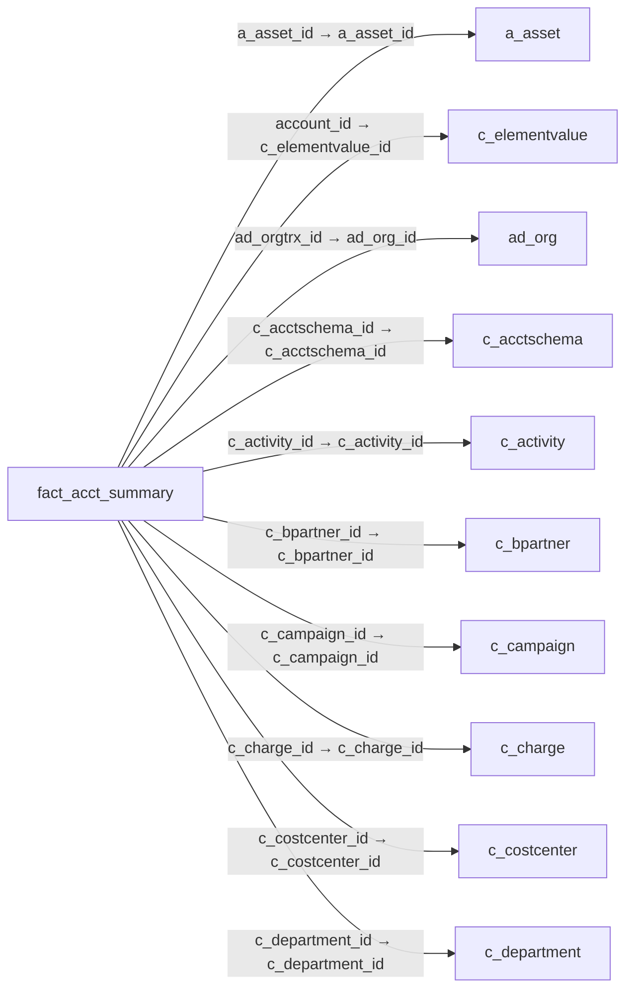

# fact_acct_summary — 회계 분개 집계

[전체 일람](../TABLE_INDEX.md) · [분류 일람](README.md) · [AI 사용 안내](../README.md) · [외래키 읽는 법](../RELATIONSHIPS.md)

## 기본 정보

| 항목 | 내용 |
|---|---|
| 물리명 | `adempiere.fact_acct_summary` |
| 한국어 논리명(문서용 해석) | 회계 분개 집계 |
| 원본 논리명 | Accounting Fact summary |
| 원본 사전 ID | 53203 |
| 분류 | `fact` — 회계 사실·집계 |
| 전체 테넌트 행 수 | 0 |
| 물리 열 수 | 45 |
| 나가는 FK / 들어오는 FK | 26 / 0 |
| 구조·행 수 확인 시점 | 2026-11-03T23:29:01+09:00 |

## 의미와 쓰임

보고 큐브와 계정·기간·조직 등 분석 요소별 회계통화 차변·대변 금액 및 수량 집계를 저장한다. 원분개와 함께 합산하면 중복될 수 있다.

- 설명 근거: 물리명·열·외래키 구조를 근거로 보수적으로 해석.
- 한국어 이름과 개요는 문서용 해석입니다. 공식 한국어 번역으로 간주하지 않습니다.
- 원본 설명: —
- 원본 도움말: —
- PostgreSQL 테이블 주석: —

## 키와 열

### 기본키·고유 제약조건

| 종류 | 제약조건 | 열(순서 유지) |
|---|---|---|
| UNIQUE | `fact_acct_summary_uu_idx` | `fact_acct_summary_uu` |

### 열 목록

원본 논리명·설명은 `AD_Column`에서 가져왔습니다. 기본값은 실제 PostgreSQL 메타데이터이며, 비어 있는 항목은 `—`로 표시합니다.

| 순서 | 물리명 | 원본 논리명 | PostgreSQL 타입 | NULL | PK | 기본값 | 설명 |
|---:|---|---|---|---|---|---|---|
| 1 | `ad_client_id` | Tenant | numeric(10,0) | 불가 | — | — | Tenant for this installation. |
| 2 | `ad_orgtrx_id` | Trx Organization | numeric(10,0) | 허용 | — | NULL::numeric | Performing or initiating organization |
| 3 | `ad_org_id` | Organization | numeric(10,0) | 불가 | — | — | Organizational entity within tenant |
| 4 | `account_id` | Account | numeric(10,0) | 불가 | — | — | Account used |
| 5 | `amtacctcr` | Accounted Credit | numeric | 불가 | — | — | Accounted Credit Amount |
| 6 | `amtacctdr` | Accounted Debit | numeric | 불가 | — | — | Accounted Debit Amount |
| 7 | `c_acctschema_id` | Accounting Schema | numeric(10,0) | 불가 | — | — | Rules for accounting |
| 8 | `c_activity_id` | Activity | numeric(10,0) | 허용 | — | NULL::numeric | Business Activity |
| 9 | `c_bpartner_id` | Business Partner | numeric(10,0) | 허용 | — | NULL::numeric | Identifies a Business Partner |
| 10 | `c_campaign_id` | Campaign | numeric(10,0) | 허용 | — | NULL::numeric | Marketing Campaign |
| 11 | `c_locfrom_id` | Location From | numeric(10,0) | 허용 | — | NULL::numeric | Location that inventory was moved from |
| 12 | `c_locto_id` | Location To | numeric(10,0) | 허용 | — | NULL::numeric | Location that inventory was moved to |
| 13 | `c_period_id` | Period | numeric(10,0) | 불가 | — | — | Period of the Calendar |
| 14 | `c_projectphase_id` | Project Phase | numeric(10,0) | 허용 | — | NULL::numeric | Phase of a Project |
| 15 | `c_projecttask_id` | Project Task | numeric(10,0) | 허용 | — | NULL::numeric | Actual Project Task in a Phase |
| 16 | `c_project_id` | Project | numeric(10,0) | 허용 | — | NULL::numeric | Financial Project |
| 17 | `c_salesregion_id` | Sales Region | numeric(10,0) | 허용 | — | NULL::numeric | Sales coverage region |
| 18 | `c_subacct_id` | Sub Account | numeric(10,0) | 허용 | — | NULL::numeric | Sub account for Element Value |
| 19 | `created` | Created | timestamp without time zone | 불가 | — | statement_timestamp() | Date this record was created |
| 20 | `createdby` | Created By | numeric(10,0) | 불가 | — | — | User who created this records |
| 21 | `gl_budget_id` | Budget | numeric(10,0) | 허용 | — | NULL::numeric | General Ledger Budget |
| 22 | `isactive` | Active | character(1) | 불가 | — | — | The record is active in the system |
| 23 | `m_product_id` | Product | numeric(10,0) | 허용 | — | NULL::numeric | Product, Service, Item |
| 24 | `pa_reportcube_id` | Report Cube | numeric(10,0) | 불가 | — | — | Define reporting cube for pre-calculation of summary accounting data. |
| 25 | `postingtype` | Posting Type | character(1) | 불가 | — | — | The type of posted amount for the transaction |
| 26 | `qty` | Quantity | numeric | 불가 | — | — | Quantity |
| 27 | `updated` | Updated | timestamp without time zone | 불가 | — | statement_timestamp() | Date this record was updated |
| 28 | `updatedby` | Updated By | numeric(10,0) | 불가 | — | — | User who updated this records |
| 29 | `user1_id` | User Element List 1 | numeric(10,0) | 허용 | — | NULL::numeric | User defined list element #1 |
| 30 | `user2_id` | User Element List 2 | numeric(10,0) | 허용 | — | NULL::numeric | User defined list element #2 |
| 31 | `userelement1_id` | User Column 1 | numeric(10,0) | 허용 | — | NULL::numeric | User defined accounting Element |
| 32 | `userelement2_id` | User Column 2 | numeric(10,0) | 허용 | — | NULL::numeric | User defined accounting Element |
| 33 | `dateacct` | Account Date | timestamp without time zone | 허용 | — | — | Accounting Date |
| 34 | `fact_acct_summary_uu` | Fact_Acct_Summary_UU | uuid | 허용 | — | — | — |
| 35 | `a_asset_id` | Asset | numeric(10,0) | 허용 | — | NULL::numeric | Asset used internally or by customers |
| 36 | `c_employee_id` | Employee | numeric(10,0) | 허용 | — | NULL::numeric | Identifies a Business Partner |
| 37 | `c_charge_id` | Charge | numeric(10,0) | 허용 | — | NULL::numeric | Additional document charges |
| 38 | `m_warehouse_id` | Warehouse | numeric(10,0) | 허용 | — | NULL::numeric | Storage Warehouse and Service Point |
| 39 | `customfieldtext1` | Text Column 1 | character varying(255) | 허용 | — | NULL::character varying | User defined accounting Element |
| 40 | `customfieldtext2` | Text Column 2 | character varying(255) | 허용 | — | NULL::character varying | User defined accounting Element |
| 41 | `customfieldtext3` | Text Column 3 | character varying(255) | 허용 | — | NULL::character varying | User defined accounting Element |
| 42 | `customfieldtext4` | Text Column 4 | character varying(255) | 허용 | — | NULL::character varying | User defined accounting Element |
| 43 | `c_department_id` | Department | numeric(10,0) | 허용 | — | NULL::numeric | — |
| 44 | `c_costcenter_id` | Cost Center | numeric(10,0) | 허용 | — | NULL::numeric | — |
| 45 | `m_attributesetinstance_id` | Attribute Set Instance | numeric(10,0) | 허용 | — | NULL::numeric | Product Attribute Set Instance |

## 외래키 흐름

화살표는 **FK를 가진 자식 → 참조되는 부모**입니다. 업무 처리의 시간 순서나 무조건적인 1:N 관계를 뜻하지 않습니다.

주변 관계 26개 중 10개를 그림으로 표시합니다. **전체 관계는 아래 두 표에 모두 포함**합니다.

### 이 테이블이 참조하는 부모 — 나가는 FK

| 제약조건 | 참조하는 쪽(자식) | 자식 열 | 참조받는 쪽(부모) | 부모 열 | 삭제 / 갱신 | 검증 / 지연 가능 |
|---|---|---|---|---|---|---|
| `aasset_factacctsummary` <!-- FK_OUT: adempiere.fact_acct_summary.aasset_factacctsummary --> | [`fact_acct_summary`](fact_acct_summary.md) | `a_asset_id` | [`a_asset`](../a/a_asset.md) | `a_asset_id` | NO ACTION / NO ACTION | 완료 / 가능 (초기 지연) |
| `account_factacctsummary` <!-- FK_OUT: adempiere.fact_acct_summary.account_factacctsummary --> | [`fact_acct_summary`](fact_acct_summary.md) | `account_id` | [`c_elementvalue`](../c/c_elementvalue.md) | `c_elementvalue_id` | NO ACTION / NO ACTION | 완료 / 가능 (초기 지연) |
| `adorgtrx_factacctsummary` <!-- FK_OUT: adempiere.fact_acct_summary.adorgtrx_factacctsummary --> | [`fact_acct_summary`](fact_acct_summary.md) | `ad_orgtrx_id` | [`ad_org`](../ad/ad_org.md) | `ad_org_id` | NO ACTION / NO ACTION | 완료 / 가능 (초기 지연) |
| `cacctschema_factacctsummary` <!-- FK_OUT: adempiere.fact_acct_summary.cacctschema_factacctsummary --> | [`fact_acct_summary`](fact_acct_summary.md) | `c_acctschema_id` | [`c_acctschema`](../c/c_acctschema.md) | `c_acctschema_id` | NO ACTION / NO ACTION | 완료 / 가능 (초기 지연) |
| `cactivity_factacctsummary` <!-- FK_OUT: adempiere.fact_acct_summary.cactivity_factacctsummary --> | [`fact_acct_summary`](fact_acct_summary.md) | `c_activity_id` | [`c_activity`](../c/c_activity.md) | `c_activity_id` | NO ACTION / NO ACTION | 완료 / 가능 (초기 지연) |
| `cbpartner_factacctsummary` <!-- FK_OUT: adempiere.fact_acct_summary.cbpartner_factacctsummary --> | [`fact_acct_summary`](fact_acct_summary.md) | `c_bpartner_id` | [`c_bpartner`](../c/c_bpartner.md) | `c_bpartner_id` | NO ACTION / NO ACTION | 완료 / 가능 (초기 지연) |
| `ccampaign_factacctsummary` <!-- FK_OUT: adempiere.fact_acct_summary.ccampaign_factacctsummary --> | [`fact_acct_summary`](fact_acct_summary.md) | `c_campaign_id` | [`c_campaign`](../c/c_campaign.md) | `c_campaign_id` | NO ACTION / NO ACTION | 완료 / 가능 (초기 지연) |
| `ccharge_factacctsummary` <!-- FK_OUT: adempiere.fact_acct_summary.ccharge_factacctsummary --> | [`fact_acct_summary`](fact_acct_summary.md) | `c_charge_id` | [`c_charge`](../c/c_charge.md) | `c_charge_id` | NO ACTION / NO ACTION | 완료 / 가능 (초기 지연) |
| `ccostcenter_factacctsummary` <!-- FK_OUT: adempiere.fact_acct_summary.ccostcenter_factacctsummary --> | [`fact_acct_summary`](fact_acct_summary.md) | `c_costcenter_id` | [`c_costcenter`](../c/c_costcenter.md) | `c_costcenter_id` | NO ACTION / NO ACTION | 완료 / 가능 (초기 지연) |
| `cdepartment_factacctsummary` <!-- FK_OUT: adempiere.fact_acct_summary.cdepartment_factacctsummary --> | [`fact_acct_summary`](fact_acct_summary.md) | `c_department_id` | [`c_department`](../c/c_department.md) | `c_department_id` | NO ACTION / NO ACTION | 완료 / 가능 (초기 지연) |
| `cemployee_factacctsumm` <!-- FK_OUT: adempiere.fact_acct_summary.cemployee_factacctsumm --> | [`fact_acct_summary`](fact_acct_summary.md) | `c_employee_id` | [`c_bpartner`](../c/c_bpartner.md) | `c_bpartner_id` | NO ACTION / NO ACTION | 완료 / 가능 (초기 지연) |
| `clocfrom_factacctsummary` <!-- FK_OUT: adempiere.fact_acct_summary.clocfrom_factacctsummary --> | [`fact_acct_summary`](fact_acct_summary.md) | `c_locfrom_id` | [`c_location`](../c/c_location.md) | `c_location_id` | NO ACTION / NO ACTION | 완료 / 가능 (초기 지연) |
| `clocto_factacctsummary` <!-- FK_OUT: adempiere.fact_acct_summary.clocto_factacctsummary --> | [`fact_acct_summary`](fact_acct_summary.md) | `c_locto_id` | [`c_location`](../c/c_location.md) | `c_location_id` | NO ACTION / NO ACTION | 완료 / 가능 (초기 지연) |
| `cperiod_factacctsummary` <!-- FK_OUT: adempiere.fact_acct_summary.cperiod_factacctsummary --> | [`fact_acct_summary`](fact_acct_summary.md) | `c_period_id` | [`c_period`](../c/c_period.md) | `c_period_id` | NO ACTION / NO ACTION | 완료 / 가능 (초기 지연) |
| `cproject_factacctsummary` <!-- FK_OUT: adempiere.fact_acct_summary.cproject_factacctsummary --> | [`fact_acct_summary`](fact_acct_summary.md) | `c_project_id` | [`c_project`](../c/c_project.md) | `c_project_id` | NO ACTION / NO ACTION | 완료 / 가능 (초기 지연) |
| `cprojectphase_factacctsummary` <!-- FK_OUT: adempiere.fact_acct_summary.cprojectphase_factacctsummary --> | [`fact_acct_summary`](fact_acct_summary.md) | `c_projectphase_id` | [`c_projectphase`](../c/c_projectphase.md) | `c_projectphase_id` | NO ACTION / NO ACTION | 완료 / 가능 (초기 지연) |
| `cprojecttask_factacctsummary` <!-- FK_OUT: adempiere.fact_acct_summary.cprojecttask_factacctsummary --> | [`fact_acct_summary`](fact_acct_summary.md) | `c_projecttask_id` | [`c_projecttask`](../c/c_projecttask.md) | `c_projecttask_id` | NO ACTION / NO ACTION | 완료 / 가능 (초기 지연) |
| `csalesregion_factacctsummary` <!-- FK_OUT: adempiere.fact_acct_summary.csalesregion_factacctsummary --> | [`fact_acct_summary`](fact_acct_summary.md) | `c_salesregion_id` | [`c_salesregion`](../c/c_salesregion.md) | `c_salesregion_id` | NO ACTION / NO ACTION | 완료 / 가능 (초기 지연) |
| `csubacct_factacctsummary` <!-- FK_OUT: adempiere.fact_acct_summary.csubacct_factacctsummary --> | [`fact_acct_summary`](fact_acct_summary.md) | `c_subacct_id` | [`c_subacct`](../c/c_subacct.md) | `c_subacct_id` | NO ACTION / NO ACTION | 완료 / 가능 (초기 지연) |
| `glbudget_factacctsummary` <!-- FK_OUT: adempiere.fact_acct_summary.glbudget_factacctsummary --> | [`fact_acct_summary`](fact_acct_summary.md) | `gl_budget_id` | [`gl_budget`](../gl/gl_budget.md) | `gl_budget_id` | NO ACTION / NO ACTION | 완료 / 가능 (초기 지연) |
| `mattributesetinstance_factacctsummary` <!-- FK_OUT: adempiere.fact_acct_summary.mattributesetinstance_factacctsummary --> | [`fact_acct_summary`](fact_acct_summary.md) | `m_attributesetinstance_id` | [`m_attributesetinstance`](../m/m_attributesetinstance.md) | `m_attributesetinstance_id` | NO ACTION / NO ACTION | 완료 / 가능 (초기 지연) |
| `mproduct_factacctsummary` <!-- FK_OUT: adempiere.fact_acct_summary.mproduct_factacctsummary --> | [`fact_acct_summary`](fact_acct_summary.md) | `m_product_id` | [`m_product`](../m/m_product.md) | `m_product_id` | NO ACTION / NO ACTION | 완료 / 가능 (초기 지연) |
| `mwarehouse_factacctsummary` <!-- FK_OUT: adempiere.fact_acct_summary.mwarehouse_factacctsummary --> | [`fact_acct_summary`](fact_acct_summary.md) | `m_warehouse_id` | [`m_warehouse`](../m/m_warehouse.md) | `m_warehouse_id` | NO ACTION / NO ACTION | 완료 / 가능 (초기 지연) |
| `pareportcube_factacctsummary` <!-- FK_OUT: adempiere.fact_acct_summary.pareportcube_factacctsummary --> | [`fact_acct_summary`](fact_acct_summary.md) | `pa_reportcube_id` | [`pa_reportcube`](../pa/pa_reportcube.md) | `pa_reportcube_id` | NO ACTION / NO ACTION | 완료 / 가능 (초기 지연) |
| `user1_factacctsummary` <!-- FK_OUT: adempiere.fact_acct_summary.user1_factacctsummary --> | [`fact_acct_summary`](fact_acct_summary.md) | `user1_id` | [`c_elementvalue`](../c/c_elementvalue.md) | `c_elementvalue_id` | NO ACTION / NO ACTION | 완료 / 가능 (초기 지연) |
| `user2_factacctsummary` <!-- FK_OUT: adempiere.fact_acct_summary.user2_factacctsummary --> | [`fact_acct_summary`](fact_acct_summary.md) | `user2_id` | [`c_elementvalue`](../c/c_elementvalue.md) | `c_elementvalue_id` | NO ACTION / NO ACTION | 완료 / 가능 (초기 지연) |

### 이 테이블을 참조하는 자식 — 들어오는 FK

해당 방향의 물리 FK 제약조건은 없습니다. 이름이 비슷한 열만으로 관계를 추가하지 않습니다.

## 조회 시 주의

- FK 표의 자식 열과 부모 열을 같은 순서로 대응시킵니다. 복합 FK는 모든 열의 동등 조건을 `AND`로 연결합니다.
- 테이블 이름이나 `_id` 열 이름만으로 물리 FK가 있다고 가정하지 않습니다. FK 미선언은 업무 관계가 없다는 뜻도 아닙니다.
- 자식이 여러 행인 테이블과 조인하면 부모의 금액·건수가 중복될 수 있습니다. 집계 단위를 먼저 정합니다.
- `ad_client_id`가 있습니다. 업무 분석에서는 대상 테넌트를 명시합니다. GardenWorld는 `11`, 시스템 공통 설정은 `0`일 수 있으므로 일괄 필터 적용 전에 테이블 역할을 확인합니다.
- 수집 시점에 0행입니다. 이 표만으로 거래 실적·처리 결과를 계산할 수 없습니다.
- 행 수는 위 확인 시점의 전체 테넌트 값입니다. 최신 업무 실적이나 현재 실행 결과로 재사용하지 않습니다.
