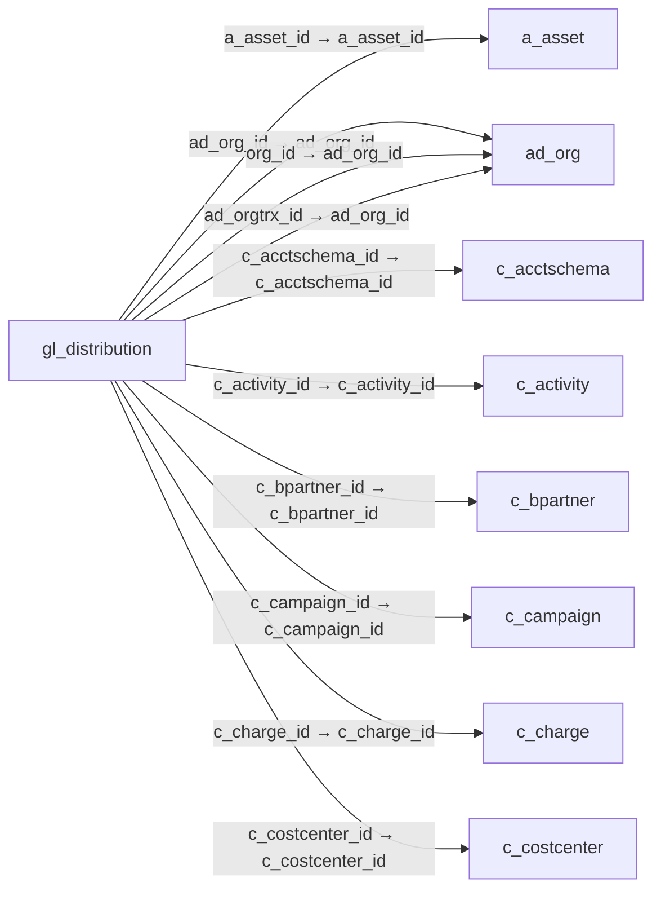

# gl_distribution — 원장 배부 규칙

[전체 일람](../TABLE_INDEX.md) · [분류 일람](README.md) · [AI 사용 안내](../README.md) · [외래키 읽는 법](../RELATIONSHIPS.md)

## 기본 정보

| 항목 | 내용 |
|---|---|
| 물리명 | `adempiere.gl_distribution` |
| 한국어 논리명(문서용 해석) | 원장 배부 규칙 |
| 원본 논리명 | GL Distribution |
| 원본 사전 ID | 708 |
| 분류 | `gl` — 총계정원장·예산·분개 |
| 전체 테넌트 행 수 | 1 |
| 물리 열 수 | 62 |
| 나가는 FK / 들어오는 FK | 23 / 1 |
| 구조·행 수 확인 시점 | 2026-11-03T23:29:01+09:00 |

## 의미와 쓰임

총계정원장 금액을 배부하는 상위 규칙을 관리한다.

- 설명 근거: 원본 애플리케이션 사전 명칭·설명을 한국어로 해석.
- 한국어 이름과 개요는 문서용 해석입니다. 공식 한국어 번역으로 간주하지 않습니다.
- 원본 설명: General Ledger Distribution
- 원본 도움말: —
- PostgreSQL 테이블 주석: —

## 키와 열

### 기본키·고유 제약조건

| 종류 | 제약조건 | 열(순서 유지) |
|---|---|---|
| PRIMARY KEY | `gl_distribution_pkey` | `gl_distribution_id` |
| UNIQUE | `gl_distribution_uu_idx` | `gl_distribution_uu` |

### 열 목록

원본 논리명·설명은 `AD_Column`에서 가져왔습니다. 기본값은 실제 PostgreSQL 메타데이터이며, 비어 있는 항목은 `—`로 표시합니다.

| 순서 | 물리명 | 원본 논리명 | PostgreSQL 타입 | NULL | PK | 기본값 | 설명 |
|---:|---|---|---|---|---|---|---|
| 1 | `gl_distribution_id` | GL Distribution | numeric(10,0) | 불가 | 예 | — | General Ledger Distribution |
| 2 | `ad_client_id` | Tenant | numeric(10,0) | 불가 | — | — | Tenant for this installation. |
| 3 | `ad_org_id` | Organization | numeric(10,0) | 불가 | — | — | Organizational entity within tenant |
| 4 | `isactive` | Active | character(1) | 불가 | — | 'Y'::bpchar | The record is active in the system |
| 5 | `created` | Created | timestamp without time zone | 불가 | — | now() | Date this record was created |
| 6 | `createdby` | Created By | numeric(10,0) | 불가 | — | — | User who created this records |
| 7 | `updated` | Updated | timestamp without time zone | 불가 | — | now() | Date this record was updated |
| 8 | `updatedby` | Updated By | numeric(10,0) | 불가 | — | — | User who updated this records |
| 9 | `name` | Name | character varying(60) | 불가 | — | — | Alphanumeric identifier of the entity |
| 10 | `description` | Description | character varying(255) | 허용 | — | — | Optional short description of the record |
| 11 | `help` | Comment/Help | character varying(2000) | 허용 | — | — | Comment or Hint |
| 12 | `postingtype` | Posting Type | character(1) | 허용 | — | — | The type of posted amount for the transaction |
| 13 | `c_doctype_id` | Document Type | numeric(10,0) | 허용 | — | — | Document type or rules |
| 14 | `c_acctschema_id` | Accounting Schema | numeric(10,0) | 불가 | — | — | Rules for accounting |
| 15 | `anyorg` | Any Organization | character(1) | 불가 | — | 'Y'::bpchar | Match any value of the Organization segment |
| 16 | `org_id` | Organization | numeric(10,0) | 허용 | — | — | Organizational entity within tenant |
| 17 | `anyacct` | Any Account | character(1) | 불가 | — | 'Y'::bpchar | Match any value of the Account segment |
| 18 | `account_id` | Account | numeric(10,0) | 허용 | — | — | Account used |
| 19 | `anyproduct` | Any Product | character(1) | 불가 | — | 'Y'::bpchar | Match any value of the Product segment |
| 20 | `m_product_id` | Product | numeric(10,0) | 허용 | — | — | Product, Service, Item |
| 21 | `anybpartner` | Any Bus.Partner | character(1) | 불가 | — | 'Y'::bpchar | Match any value of the Business Partner segment |
| 22 | `c_bpartner_id` | Business Partner | numeric(10,0) | 허용 | — | — | Identifies a Business Partner |
| 23 | `anyproject` | Any Project | character(1) | 불가 | — | 'Y'::bpchar | Match any value of the Project segment |
| 24 | `c_project_id` | Project | numeric(10,0) | 허용 | — | — | Financial Project |
| 25 | `anycampaign` | Any Campaign | character(1) | 불가 | — | 'Y'::bpchar | Match any value of the Campaign segment |
| 26 | `c_campaign_id` | Campaign | numeric(10,0) | 허용 | — | — | Marketing Campaign |
| 27 | `anyactivity` | Any Activity | character(1) | 불가 | — | 'Y'::bpchar | Match any value of the Activity segment |
| 28 | `c_activity_id` | Activity | numeric(10,0) | 허용 | — | — | Business Activity |
| 29 | `anysalesregion` | Any Sales Region | character(1) | 불가 | — | 'Y'::bpchar | Match any value of the Sales Region segment |
| 30 | `c_salesregion_id` | Sales Region | numeric(10,0) | 허용 | — | — | Sales coverage region |
| 31 | `anyorgtrx` | Any Trx Organization | character(1) | 불가 | — | 'Y'::bpchar | Match any value of the Transaction Organization segment |
| 32 | `ad_orgtrx_id` | Trx Organization | numeric(10,0) | 허용 | — | — | Performing or initiating organization |
| 33 | `anylocto` | Any Location To | character(1) | 불가 | — | 'Y'::bpchar | Match any value of the Location To segment |
| 34 | `c_locto_id` | Location To | numeric(10,0) | 허용 | — | — | Location that inventory was moved to |
| 35 | `anylocfrom` | Any Location From | character(1) | 불가 | — | 'Y'::bpchar | Match any value of the Location From segment |
| 36 | `c_locfrom_id` | Location From | numeric(10,0) | 허용 | — | — | Location that inventory was moved from |
| 37 | `anyuser1` | Any User 1 | character(1) | 불가 | — | 'Y'::bpchar | Match any value of the User 1 segment |
| 38 | `user1_id` | User Element List 1 | numeric(10,0) | 허용 | — | — | User defined list element #1 |
| 39 | `anyuser2` | Any User 2 | character(1) | 불가 | — | 'Y'::bpchar | Match any value of the User 2 segment |
| 40 | `user2_id` | User Element List 2 | numeric(10,0) | 허용 | — | — | User defined list element #2 |
| 41 | `percenttotal` | Total Percent | numeric | 불가 | — | — | Sum of the Percent details  |
| 42 | `isvalid` | Valid | character(1) | 불가 | — | 'N'::bpchar | Element is valid |
| 43 | `processing` | Process Now | character(1) | 허용 | — | — | — |
| 44 | `iscreatereversal` | Create Reversal | character(1) | 불가 | — | 'Y'::bpchar | Indicates that reversal movement will be created, if disabled the original movement will be deleted. |
| 45 | `gl_distribution_uu` | GL_Distribution_UU | uuid | 허용 | — | — | — |
| 46 | `seqno` | Sequence | numeric(10,0) | 불가 | — | '0'::numeric | Method of ordering records; lowest number comes first |
| 47 | `validfrom` | Valid from | timestamp without time zone | 허용 | — | — | Valid from including this date (first day) |
| 48 | `validto` | Valid to | timestamp without time zone | 허용 | — | — | Valid to including this date (last day) |
| 49 | `c_costcenter_id` | Cost Center | numeric(10,0) | 허용 | — | NULL::numeric | — |
| 50 | `c_department_id` | Department | numeric(10,0) | 허용 | — | NULL::numeric | — |
| 51 | `anydepartment` | Any Department | character(1) | 불가 | — | 'Y'::bpchar | Match any value of the Department segment |
| 52 | `anycostcenter` | Any Cost Center | character(1) | 불가 | — | 'Y'::bpchar | Match any value of the Cost Center segment |
| 53 | `anywarehouse` | Any Warehouse | character(1) | 불가 | — | 'Y'::bpchar | Match any value of the Warehouse segment |
| 54 | `m_warehouse_id` | Warehouse | numeric(10,0) | 허용 | — | NULL::numeric | Storage Warehouse and Service Point |
| 55 | `anyasset` | Any Asset | character(1) | 불가 | — | 'Y'::bpchar | Match any value of the Asset segment |
| 56 | `a_asset_id` | Asset | numeric(10,0) | 허용 | — | NULL::numeric | Asset used internally or by customers |
| 57 | `anycharge` | Any Charge | character(1) | 불가 | — | 'Y'::bpchar | Match any value of the Charge segment |
| 58 | `c_charge_id` | Charge | numeric(10,0) | 허용 | — | NULL::numeric | Additional document charges |
| 59 | `anyemployee` | Any Employee | character(1) | 불가 | — | 'Y'::bpchar | Match any value of the Employee segment |
| 60 | `c_employee_id` | Employee | numeric(10,0) | 허용 | — | NULL::numeric | Identifies a Business Partner |
| 61 | `anyattributesetinstance` | Any Attribute Set Instance | character(1) | 불가 | — | 'Y'::bpchar | Match any value of the Employee segment |
| 62 | `m_attributesetinstance_id` | Attribute Set Instance | numeric(10,0) | 허용 | — | NULL::numeric | Product Attribute Set Instance |

## 외래키 흐름

화살표는 **FK를 가진 자식 → 참조되는 부모**입니다. 업무 처리의 시간 순서나 무조건적인 1:N 관계를 뜻하지 않습니다.

주변 관계 24개 중 10개를 그림으로 표시합니다. **전체 관계는 아래 두 표에 모두 포함**합니다.

### 이 테이블이 참조하는 부모 — 나가는 FK

| 제약조건 | 참조하는 쪽(자식) | 자식 열 | 참조받는 쪽(부모) | 부모 열 | 삭제 / 갱신 | 검증 / 지연 가능 |
|---|---|---|---|---|---|---|
| `aasset_gldistribution` <!-- FK_OUT: adempiere.gl_distribution.aasset_gldistribution --> | [`gl_distribution`](gl_distribution.md) | `a_asset_id` | [`a_asset`](../a/a_asset.md) | `a_asset_id` | NO ACTION / NO ACTION | 완료 / 가능 (초기 지연) |
| `adorg_gldist` <!-- FK_OUT: adempiere.gl_distribution.adorg_gldist --> | [`gl_distribution`](gl_distribution.md) | `ad_org_id` | [`ad_org`](../ad/ad_org.md) | `ad_org_id` | NO ACTION / NO ACTION | 완료 / 가능 (초기 지연) |
| `adorgorg_gldist` <!-- FK_OUT: adempiere.gl_distribution.adorgorg_gldist --> | [`gl_distribution`](gl_distribution.md) | `org_id` | [`ad_org`](../ad/ad_org.md) | `ad_org_id` | NO ACTION / NO ACTION | 완료 / 가능 (초기 지연) |
| `adorgtrx_gldist` <!-- FK_OUT: adempiere.gl_distribution.adorgtrx_gldist --> | [`gl_distribution`](gl_distribution.md) | `ad_orgtrx_id` | [`ad_org`](../ad/ad_org.md) | `ad_org_id` | NO ACTION / NO ACTION | 완료 / 가능 (초기 지연) |
| `cacctschema_gldist` <!-- FK_OUT: adempiere.gl_distribution.cacctschema_gldist --> | [`gl_distribution`](gl_distribution.md) | `c_acctschema_id` | [`c_acctschema`](../c/c_acctschema.md) | `c_acctschema_id` | NO ACTION / NO ACTION | 완료 / 가능 (초기 지연) |
| `cactivity_gldist` <!-- FK_OUT: adempiere.gl_distribution.cactivity_gldist --> | [`gl_distribution`](gl_distribution.md) | `c_activity_id` | [`c_activity`](../c/c_activity.md) | `c_activity_id` | NO ACTION / NO ACTION | 완료 / 가능 (초기 지연) |
| `cbpartner_gldist` <!-- FK_OUT: adempiere.gl_distribution.cbpartner_gldist --> | [`gl_distribution`](gl_distribution.md) | `c_bpartner_id` | [`c_bpartner`](../c/c_bpartner.md) | `c_bpartner_id` | NO ACTION / NO ACTION | 완료 / 가능 (초기 지연) |
| `ccampaign_gldist` <!-- FK_OUT: adempiere.gl_distribution.ccampaign_gldist --> | [`gl_distribution`](gl_distribution.md) | `c_campaign_id` | [`c_campaign`](../c/c_campaign.md) | `c_campaign_id` | NO ACTION / NO ACTION | 완료 / 가능 (초기 지연) |
| `ccharge_gldistribution` <!-- FK_OUT: adempiere.gl_distribution.ccharge_gldistribution --> | [`gl_distribution`](gl_distribution.md) | `c_charge_id` | [`c_charge`](../c/c_charge.md) | `c_charge_id` | NO ACTION / NO ACTION | 완료 / 가능 (초기 지연) |
| `ccostcenter_gldistribution` <!-- FK_OUT: adempiere.gl_distribution.ccostcenter_gldistribution --> | [`gl_distribution`](gl_distribution.md) | `c_costcenter_id` | [`c_costcenter`](../c/c_costcenter.md) | `c_costcenter_id` | NO ACTION / NO ACTION | 완료 / 가능 (초기 지연) |
| `cdepartment_gldistribution` <!-- FK_OUT: adempiere.gl_distribution.cdepartment_gldistribution --> | [`gl_distribution`](gl_distribution.md) | `c_department_id` | [`c_department`](../c/c_department.md) | `c_department_id` | NO ACTION / NO ACTION | 완료 / 가능 (초기 지연) |
| `cdoctype_gldistribution` <!-- FK_OUT: adempiere.gl_distribution.cdoctype_gldistribution --> | [`gl_distribution`](gl_distribution.md) | `c_doctype_id` | [`c_doctype`](../c/c_doctype.md) | `c_doctype_id` | NO ACTION / NO ACTION | 완료 / 가능 (초기 지연) |
| `cemployee_gldistribution` <!-- FK_OUT: adempiere.gl_distribution.cemployee_gldistribution --> | [`gl_distribution`](gl_distribution.md) | `c_employee_id` | [`c_bpartner`](../c/c_bpartner.md) | `c_bpartner_id` | NO ACTION / NO ACTION | 완료 / 가능 (초기 지연) |
| `cevalueacct_gldist` <!-- FK_OUT: adempiere.gl_distribution.cevalueacct_gldist --> | [`gl_distribution`](gl_distribution.md) | `account_id` | [`c_elementvalue`](../c/c_elementvalue.md) | `c_elementvalue_id` | NO ACTION / NO ACTION | 완료 / 가능 (초기 지연) |
| `cevalueuser1_gldist` <!-- FK_OUT: adempiere.gl_distribution.cevalueuser1_gldist --> | [`gl_distribution`](gl_distribution.md) | `user1_id` | [`c_elementvalue`](../c/c_elementvalue.md) | `c_elementvalue_id` | NO ACTION / NO ACTION | 완료 / 가능 (초기 지연) |
| `cevalueuser2_gldist` <!-- FK_OUT: adempiere.gl_distribution.cevalueuser2_gldist --> | [`gl_distribution`](gl_distribution.md) | `user2_id` | [`c_elementvalue`](../c/c_elementvalue.md) | `c_elementvalue_id` | NO ACTION / NO ACTION | 완료 / 가능 (초기 지연) |
| `clocfrom_gldist` <!-- FK_OUT: adempiere.gl_distribution.clocfrom_gldist --> | [`gl_distribution`](gl_distribution.md) | `c_locfrom_id` | [`c_location`](../c/c_location.md) | `c_location_id` | NO ACTION / NO ACTION | 완료 / 가능 (초기 지연) |
| `clocto_gldist` <!-- FK_OUT: adempiere.gl_distribution.clocto_gldist --> | [`gl_distribution`](gl_distribution.md) | `c_locto_id` | [`c_location`](../c/c_location.md) | `c_location_id` | NO ACTION / NO ACTION | 완료 / 가능 (초기 지연) |
| `cproject_gldist` <!-- FK_OUT: adempiere.gl_distribution.cproject_gldist --> | [`gl_distribution`](gl_distribution.md) | `c_project_id` | [`c_project`](../c/c_project.md) | `c_project_id` | NO ACTION / NO ACTION | 완료 / 가능 (초기 지연) |
| `csalesregopn_gldist` <!-- FK_OUT: adempiere.gl_distribution.csalesregopn_gldist --> | [`gl_distribution`](gl_distribution.md) | `c_salesregion_id` | [`c_salesregion`](../c/c_salesregion.md) | `c_salesregion_id` | NO ACTION / NO ACTION | 완료 / 가능 (초기 지연) |
| `mattributesetinstance_gldistribution` <!-- FK_OUT: adempiere.gl_distribution.mattributesetinstance_gldistribution --> | [`gl_distribution`](gl_distribution.md) | `m_attributesetinstance_id` | [`m_attributesetinstance`](../m/m_attributesetinstance.md) | `m_attributesetinstance_id` | NO ACTION / NO ACTION | 완료 / 가능 (초기 지연) |
| `mproduct_gldist` <!-- FK_OUT: adempiere.gl_distribution.mproduct_gldist --> | [`gl_distribution`](gl_distribution.md) | `m_product_id` | [`m_product`](../m/m_product.md) | `m_product_id` | NO ACTION / NO ACTION | 완료 / 가능 (초기 지연) |
| `mwarehouse_gldistribution` <!-- FK_OUT: adempiere.gl_distribution.mwarehouse_gldistribution --> | [`gl_distribution`](gl_distribution.md) | `m_warehouse_id` | [`m_warehouse`](../m/m_warehouse.md) | `m_warehouse_id` | NO ACTION / NO ACTION | 완료 / 가능 (초기 지연) |

### 이 테이블을 참조하는 자식 — 들어오는 FK

| 제약조건 | 참조하는 쪽(자식) | 자식 열 | 참조받는 쪽(부모) | 부모 열 | 삭제 / 갱신 | 검증 / 지연 가능 |
|---|---|---|---|---|---|---|
| `gldistribution_gldistline` <!-- FK_IN: adempiere.gl_distributionline.gldistribution_gldistline --> | [`gl_distributionline`](gl_distributionline.md) | `gl_distribution_id` | [`gl_distribution`](gl_distribution.md) | `gl_distribution_id` | CASCADE / NO ACTION | 완료 / 가능 (초기 지연) |

## 조회 시 주의

- FK 표의 자식 열과 부모 열을 같은 순서로 대응시킵니다. 복합 FK는 모든 열의 동등 조건을 `AND`로 연결합니다.
- 테이블 이름이나 `_id` 열 이름만으로 물리 FK가 있다고 가정하지 않습니다. FK 미선언은 업무 관계가 없다는 뜻도 아닙니다.
- 자식이 여러 행인 테이블과 조인하면 부모의 금액·건수가 중복될 수 있습니다. 집계 단위를 먼저 정합니다.
- `ad_client_id`가 있습니다. 업무 분석에서는 대상 테넌트를 명시합니다. GardenWorld는 `11`, 시스템 공통 설정은 `0`일 수 있으므로 일괄 필터 적용 전에 테이블 역할을 확인합니다.
- 행 수는 위 확인 시점의 전체 테넌트 값입니다. 최신 업무 실적이나 현재 실행 결과로 재사용하지 않습니다.
