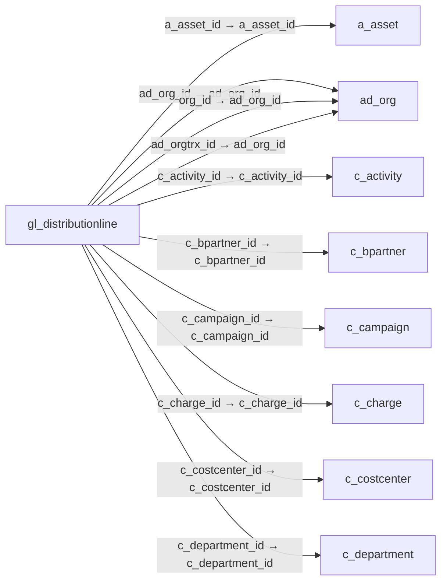

# gl_distributionline — 원장 배부 명세

[전체 일람](../TABLE_INDEX.md) · [분류 일람](README.md) · [AI 사용 안내](../README.md) · [외래키 읽는 법](../RELATIONSHIPS.md)

## 기본 정보

| 항목 | 내용 |
|---|---|
| 물리명 | `adempiere.gl_distributionline` |
| 한국어 논리명(문서용 해석) | 원장 배부 명세 |
| 원본 논리명 | GL Distribution Line |
| 원본 사전 ID | 707 |
| 분류 | `gl` — 총계정원장·예산·분개 |
| 전체 테넌트 행 수 | 2 |
| 물리 열 수 | 53 |
| 나가는 FK / 들어오는 FK | 22 / 0 |
| 구조·행 수 확인 시점 | 2026-11-03T23:29:01+09:00 |

## 의미와 쓰임

총계정원장 배부 규칙의 개별 배부 항목을 관리한다.

- 설명 근거: 원본 애플리케이션 사전 명칭·설명을 한국어로 해석.
- 한국어 이름과 개요는 문서용 해석입니다. 공식 한국어 번역으로 간주하지 않습니다.
- 원본 설명: General Ledger Distribution Line
- 원본 도움말: —
- PostgreSQL 테이블 주석: —

## 키와 열

### 기본키·고유 제약조건

| 종류 | 제약조건 | 열(순서 유지) |
|---|---|---|
| PRIMARY KEY | `gl_distributionline_pkey` | `gl_distributionline_id` |
| UNIQUE | `gl_distributionline_uu_idx` | `gl_distributionline_uu` |

### 열 목록

원본 논리명·설명은 `AD_Column`에서 가져왔습니다. 기본값은 실제 PostgreSQL 메타데이터이며, 비어 있는 항목은 `—`로 표시합니다.

| 순서 | 물리명 | 원본 논리명 | PostgreSQL 타입 | NULL | PK | 기본값 | 설명 |
|---:|---|---|---|---|---|---|---|
| 1 | `gl_distributionline_id` | GL Distribution Line | numeric(10,0) | 불가 | 예 | — | General Ledger Distribution Line |
| 2 | `ad_client_id` | Tenant | numeric(10,0) | 불가 | — | — | Tenant for this installation. |
| 3 | `ad_org_id` | Organization | numeric(10,0) | 불가 | — | — | Organizational entity within tenant |
| 4 | `isactive` | Active | character(1) | 불가 | — | 'Y'::bpchar | The record is active in the system |
| 5 | `created` | Created | timestamp without time zone | 불가 | — | now() | Date this record was created |
| 6 | `createdby` | Created By | numeric(10,0) | 불가 | — | — | User who created this records |
| 7 | `updated` | Updated | timestamp without time zone | 불가 | — | now() | Date this record was updated |
| 8 | `updatedby` | Updated By | numeric(10,0) | 불가 | — | — | User who updated this records |
| 9 | `gl_distribution_id` | GL Distribution | numeric(10,0) | 불가 | — | — | General Ledger Distribution |
| 10 | `line` | Line No | numeric(10,0) | 불가 | — | 0 | Unique line for this document |
| 11 | `percent` | Percent | numeric | 불가 | — | — | Percentage |
| 12 | `description` | Description | character varying(255) | 허용 | — | — | Optional short description of the record |
| 13 | `overwriteorg` | Overwrite Organization | character(1) | 불가 | — | 'N'::bpchar | Overwrite the account segment Organization with the value specified |
| 14 | `org_id` | Organization | numeric(10,0) | 허용 | — | — | Organizational entity within tenant |
| 15 | `overwriteacct` | Overwrite Account | character(1) | 불가 | — | 'N'::bpchar | Overwrite the account segment Account with the value specified |
| 16 | `account_id` | Account | numeric(10,0) | 허용 | — | — | Account used |
| 17 | `overwriteproduct` | Overwrite Product | character(1) | 불가 | — | 'N'::bpchar | Overwrite the account segment Product with the value specified |
| 18 | `m_product_id` | Product | numeric(10,0) | 허용 | — | — | Product, Service, Item |
| 19 | `overwritebpartner` | Overwrite Bus.Partner | character(1) | 불가 | — | 'N'::bpchar | Overwrite the account segment Business Partner with the value specified |
| 20 | `c_bpartner_id` | Business Partner | numeric(10,0) | 허용 | — | — | Identifies a Business Partner |
| 21 | `overwriteproject` | Overwrite Project | character(1) | 불가 | — | 'N'::bpchar | Overwrite the account segment Project with the value specified |
| 22 | `c_project_id` | Project | numeric(10,0) | 허용 | — | — | Financial Project |
| 23 | `overwritecampaign` | Overwrite Campaign | character(1) | 불가 | — | 'N'::bpchar | Overwrite the account segment Campaign with the value specified |
| 24 | `c_campaign_id` | Campaign | numeric(10,0) | 허용 | — | — | Marketing Campaign |
| 25 | `overwriteactivity` | Overwrite Activity | character(1) | 불가 | — | 'N'::bpchar | Overwrite the account segment Activity with the value specified |
| 26 | `c_activity_id` | Activity | numeric(10,0) | 허용 | — | — | Business Activity |
| 27 | `overwritesalesregion` | Overwrite Sales Region | character(1) | 불가 | — | 'N'::bpchar | Overwrite the account segment Sales Region with the value specified |
| 28 | `c_salesregion_id` | Sales Region | numeric(10,0) | 허용 | — | — | Sales coverage region |
| 29 | `overwriteorgtrx` | Overwrite Trx Organization | character(1) | 불가 | — | 'N'::bpchar | Overwrite the account segment Transaction Organization with the value specified |
| 30 | `ad_orgtrx_id` | Trx Organization | numeric(10,0) | 허용 | — | — | Performing or initiating organization |
| 31 | `overwritelocto` | Overwrite Location To | character(1) | 불가 | — | 'N'::bpchar | Overwrite the account segment Location From with the value specified |
| 32 | `c_locto_id` | Location To | numeric(10,0) | 허용 | — | — | Location that inventory was moved to |
| 33 | `overwritelocfrom` | Overwrite Location From | character(1) | 불가 | — | 'N'::bpchar | Overwrite the account segment Location From with the value specified |
| 34 | `c_locfrom_id` | Location From | numeric(10,0) | 허용 | — | — | Location that inventory was moved from |
| 35 | `overwriteuser1` | Overwrite User1 | character(1) | 불가 | — | 'N'::bpchar | Overwrite the account segment User 1 with the value specified |
| 36 | `user1_id` | User Element List 1 | numeric(10,0) | 허용 | — | — | User defined list element #1 |
| 37 | `overwriteuser2` | Overwrite User2 | character(1) | 불가 | — | 'N'::bpchar | Overwrite the account segment User 2 with the value specified |
| 38 | `user2_id` | User Element List 2 | numeric(10,0) | 허용 | — | — | User defined list element #2 |
| 39 | `gl_distributionline_uu` | GL_DistributionLine_UU | uuid | 허용 | — | — | — |
| 40 | `c_costcenter_id` | Cost Center | numeric(10,0) | 허용 | — | NULL::numeric | — |
| 41 | `c_department_id` | Department | numeric(10,0) | 허용 | — | NULL::numeric | — |
| 42 | `overwriteasset` | Overwrite Asset | character(1) | 불가 | — | 'N'::bpchar | Overwrite the account segment Asset with the value specified |
| 43 | `a_asset_id` | Asset | numeric(10,0) | 허용 | — | NULL::numeric | Asset used internally or by customers |
| 44 | `overwriteattributesetinstance` | Overwrite Attribute Set Instance | character(1) | 불가 | — | 'N'::bpchar | Overwrite the account segment Attribute Set Instance with the value specified |
| 45 | `m_attributesetinstance_id` | Attribute Set Instance | numeric(10,0) | 허용 | — | NULL::numeric | Product Attribute Set Instance |
| 46 | `overwritecharge` | Overwrite Charge | character(1) | 불가 | — | 'N'::bpchar | Overwrite the account segment Charge with the value specified |
| 47 | `c_charge_id` | Charge | numeric(10,0) | 허용 | — | NULL::numeric | Additional document charges |
| 48 | `overwritecostcenter` | Overwrite Cost Center | character(1) | 불가 | — | 'N'::bpchar | Overwrite the account segment Cost Center with the value specified |
| 49 | `overwritedepartment` | Overwrite Department | character(1) | 불가 | — | 'N'::bpchar | Overwrite the account segment Department with the value specified |
| 50 | `overwriteemployee` | Overwrite Employee | character(1) | 불가 | — | 'N'::bpchar | Overwrite the account segment Employee with the value specified |
| 51 | `c_employee_id` | Employee | numeric(10,0) | 허용 | — | NULL::numeric | Identifies a Business Partner |
| 52 | `overwritewarehouse` | Overwrite Warehouse | character(1) | 불가 | — | 'N'::bpchar | Overwrite the account segment Warehouse with the value specified |
| 53 | `m_warehouse_id` | Warehouse | numeric(10,0) | 허용 | — | NULL::numeric | Storage Warehouse and Service Point |

## 외래키 흐름

화살표는 **FK를 가진 자식 → 참조되는 부모**입니다. 업무 처리의 시간 순서나 무조건적인 1:N 관계를 뜻하지 않습니다.

주변 관계 22개 중 10개를 그림으로 표시합니다. **전체 관계는 아래 두 표에 모두 포함**합니다.

### 이 테이블이 참조하는 부모 — 나가는 FK

| 제약조건 | 참조하는 쪽(자식) | 자식 열 | 참조받는 쪽(부모) | 부모 열 | 삭제 / 갱신 | 검증 / 지연 가능 |
|---|---|---|---|---|---|---|
| `aasset_gldistributionline` <!-- FK_OUT: adempiere.gl_distributionline.aasset_gldistributionline --> | [`gl_distributionline`](gl_distributionline.md) | `a_asset_id` | [`a_asset`](../a/a_asset.md) | `a_asset_id` | NO ACTION / NO ACTION | 완료 / 가능 (초기 지연) |
| `adorg_gldistline` <!-- FK_OUT: adempiere.gl_distributionline.adorg_gldistline --> | [`gl_distributionline`](gl_distributionline.md) | `ad_org_id` | [`ad_org`](../ad/ad_org.md) | `ad_org_id` | NO ACTION / NO ACTION | 완료 / 가능 (초기 지연) |
| `adorgorg_gldistline` <!-- FK_OUT: adempiere.gl_distributionline.adorgorg_gldistline --> | [`gl_distributionline`](gl_distributionline.md) | `org_id` | [`ad_org`](../ad/ad_org.md) | `ad_org_id` | NO ACTION / NO ACTION | 완료 / 가능 (초기 지연) |
| `adorgtrx_gldistline` <!-- FK_OUT: adempiere.gl_distributionline.adorgtrx_gldistline --> | [`gl_distributionline`](gl_distributionline.md) | `ad_orgtrx_id` | [`ad_org`](../ad/ad_org.md) | `ad_org_id` | NO ACTION / NO ACTION | 완료 / 가능 (초기 지연) |
| `cactivity_gldistline` <!-- FK_OUT: adempiere.gl_distributionline.cactivity_gldistline --> | [`gl_distributionline`](gl_distributionline.md) | `c_activity_id` | [`c_activity`](../c/c_activity.md) | `c_activity_id` | NO ACTION / NO ACTION | 완료 / 가능 (초기 지연) |
| `cbpartner_gldistline` <!-- FK_OUT: adempiere.gl_distributionline.cbpartner_gldistline --> | [`gl_distributionline`](gl_distributionline.md) | `c_bpartner_id` | [`c_bpartner`](../c/c_bpartner.md) | `c_bpartner_id` | NO ACTION / NO ACTION | 완료 / 가능 (초기 지연) |
| `ccampaign_gldistline` <!-- FK_OUT: adempiere.gl_distributionline.ccampaign_gldistline --> | [`gl_distributionline`](gl_distributionline.md) | `c_campaign_id` | [`c_campaign`](../c/c_campaign.md) | `c_campaign_id` | NO ACTION / NO ACTION | 완료 / 가능 (초기 지연) |
| `ccharge_gldistributionline` <!-- FK_OUT: adempiere.gl_distributionline.ccharge_gldistributionline --> | [`gl_distributionline`](gl_distributionline.md) | `c_charge_id` | [`c_charge`](../c/c_charge.md) | `c_charge_id` | NO ACTION / NO ACTION | 완료 / 가능 (초기 지연) |
| `ccostcenter_gldistributionline` <!-- FK_OUT: adempiere.gl_distributionline.ccostcenter_gldistributionline --> | [`gl_distributionline`](gl_distributionline.md) | `c_costcenter_id` | [`c_costcenter`](../c/c_costcenter.md) | `c_costcenter_id` | NO ACTION / NO ACTION | 완료 / 가능 (초기 지연) |
| `cdepartment_gldistributionline` <!-- FK_OUT: adempiere.gl_distributionline.cdepartment_gldistributionline --> | [`gl_distributionline`](gl_distributionline.md) | `c_department_id` | [`c_department`](../c/c_department.md) | `c_department_id` | NO ACTION / NO ACTION | 완료 / 가능 (초기 지연) |
| `cemployee_gldistributionline` <!-- FK_OUT: adempiere.gl_distributionline.cemployee_gldistributionline --> | [`gl_distributionline`](gl_distributionline.md) | `c_employee_id` | [`c_bpartner`](../c/c_bpartner.md) | `c_bpartner_id` | NO ACTION / NO ACTION | 완료 / 가능 (초기 지연) |
| `cevalueacct_gldistline` <!-- FK_OUT: adempiere.gl_distributionline.cevalueacct_gldistline --> | [`gl_distributionline`](gl_distributionline.md) | `account_id` | [`c_elementvalue`](../c/c_elementvalue.md) | `c_elementvalue_id` | NO ACTION / NO ACTION | 완료 / 가능 (초기 지연) |
| `cevalueuser1_gldistline` <!-- FK_OUT: adempiere.gl_distributionline.cevalueuser1_gldistline --> | [`gl_distributionline`](gl_distributionline.md) | `user1_id` | [`c_elementvalue`](../c/c_elementvalue.md) | `c_elementvalue_id` | NO ACTION / NO ACTION | 완료 / 가능 (초기 지연) |
| `cevalueuser2_gldistline` <!-- FK_OUT: adempiere.gl_distributionline.cevalueuser2_gldistline --> | [`gl_distributionline`](gl_distributionline.md) | `user2_id` | [`c_elementvalue`](../c/c_elementvalue.md) | `c_elementvalue_id` | NO ACTION / NO ACTION | 완료 / 가능 (초기 지연) |
| `clocfrom_gldistline` <!-- FK_OUT: adempiere.gl_distributionline.clocfrom_gldistline --> | [`gl_distributionline`](gl_distributionline.md) | `c_locfrom_id` | [`c_location`](../c/c_location.md) | `c_location_id` | NO ACTION / NO ACTION | 완료 / 가능 (초기 지연) |
| `clocto_gldistline` <!-- FK_OUT: adempiere.gl_distributionline.clocto_gldistline --> | [`gl_distributionline`](gl_distributionline.md) | `c_locto_id` | [`c_location`](../c/c_location.md) | `c_location_id` | NO ACTION / NO ACTION | 완료 / 가능 (초기 지연) |
| `cproject_gldistline` <!-- FK_OUT: adempiere.gl_distributionline.cproject_gldistline --> | [`gl_distributionline`](gl_distributionline.md) | `c_project_id` | [`c_project`](../c/c_project.md) | `c_project_id` | NO ACTION / NO ACTION | 완료 / 가능 (초기 지연) |
| `csalesregion_gldistline` <!-- FK_OUT: adempiere.gl_distributionline.csalesregion_gldistline --> | [`gl_distributionline`](gl_distributionline.md) | `c_salesregion_id` | [`c_salesregion`](../c/c_salesregion.md) | `c_salesregion_id` | NO ACTION / NO ACTION | 완료 / 가능 (초기 지연) |
| `gldistribution_gldistline` <!-- FK_OUT: adempiere.gl_distributionline.gldistribution_gldistline --> | [`gl_distributionline`](gl_distributionline.md) | `gl_distribution_id` | [`gl_distribution`](gl_distribution.md) | `gl_distribution_id` | CASCADE / NO ACTION | 완료 / 가능 (초기 지연) |
| `mattributesetinstance_gldistributionline` <!-- FK_OUT: adempiere.gl_distributionline.mattributesetinstance_gldistributionline --> | [`gl_distributionline`](gl_distributionline.md) | `m_attributesetinstance_id` | [`m_attributesetinstance`](../m/m_attributesetinstance.md) | `m_attributesetinstance_id` | NO ACTION / NO ACTION | 완료 / 가능 (초기 지연) |
| `mproduct_gldistline` <!-- FK_OUT: adempiere.gl_distributionline.mproduct_gldistline --> | [`gl_distributionline`](gl_distributionline.md) | `m_product_id` | [`m_product`](../m/m_product.md) | `m_product_id` | NO ACTION / NO ACTION | 완료 / 가능 (초기 지연) |
| `mwarehouse_gldistributionline` <!-- FK_OUT: adempiere.gl_distributionline.mwarehouse_gldistributionline --> | [`gl_distributionline`](gl_distributionline.md) | `m_warehouse_id` | [`m_warehouse`](../m/m_warehouse.md) | `m_warehouse_id` | NO ACTION / NO ACTION | 완료 / 가능 (초기 지연) |

### 이 테이블을 참조하는 자식 — 들어오는 FK

해당 방향의 물리 FK 제약조건은 없습니다. 이름이 비슷한 열만으로 관계를 추가하지 않습니다.

## 조회 시 주의

- FK 표의 자식 열과 부모 열을 같은 순서로 대응시킵니다. 복합 FK는 모든 열의 동등 조건을 `AND`로 연결합니다.
- 테이블 이름이나 `_id` 열 이름만으로 물리 FK가 있다고 가정하지 않습니다. FK 미선언은 업무 관계가 없다는 뜻도 아닙니다.
- 자식이 여러 행인 테이블과 조인하면 부모의 금액·건수가 중복될 수 있습니다. 집계 단위를 먼저 정합니다.
- `ad_client_id`가 있습니다. 업무 분석에서는 대상 테넌트를 명시합니다. GardenWorld는 `11`, 시스템 공통 설정은 `0`일 수 있으므로 일괄 필터 적용 전에 테이블 역할을 확인합니다.
- 행 수는 위 확인 시점의 전체 테넌트 값입니다. 최신 업무 실적이나 현재 실행 결과로 재사용하지 않습니다.
