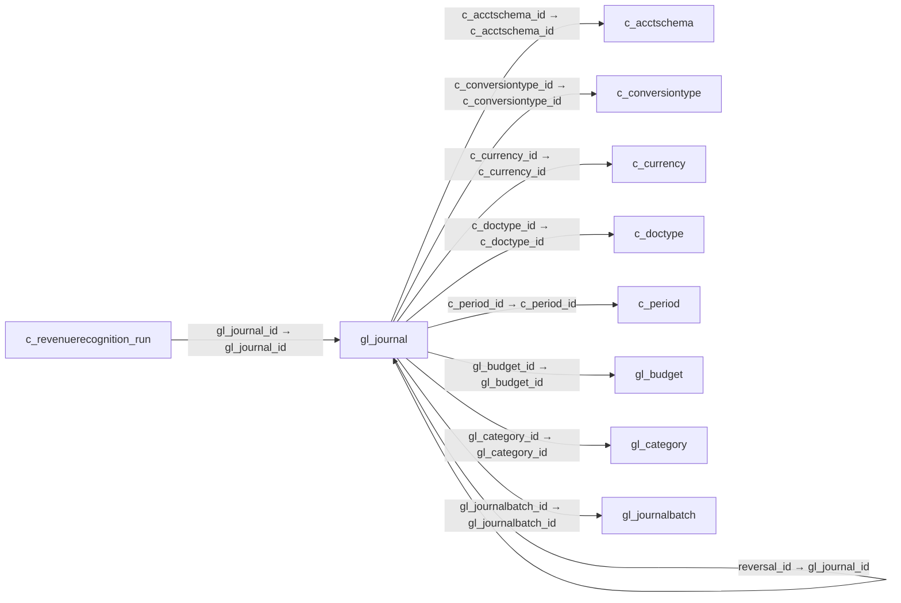

# gl_journal — 원장 분개 전표

[전체 일람](../TABLE_INDEX.md) · [분류 일람](README.md) · [AI 사용 안내](../README.md) · [외래키 읽는 법](../RELATIONSHIPS.md)

## 기본 정보

| 항목 | 내용 |
|---|---|
| 물리명 | `adempiere.gl_journal` |
| 한국어 논리명(문서용 해석) | 원장 분개 전표 |
| 원본 논리명 | Journal |
| 원본 사전 ID | 224 |
| 분류 | `gl` — 총계정원장·예산·분개 |
| 전체 테넌트 행 수 | 2 |
| 물리 열 수 | 36 |
| 나가는 FK / 들어오는 FK | 9 / 5 |
| 구조·행 수 확인 시점 | 2026-11-03T23:29:01+09:00 |

## 의미와 쓰임

총계정원장 분개 전표의 머리글을 관리하며 차변·대변 행은 전표 명세에 저장된다.

- 설명 근거: 원본 애플리케이션 사전 명칭·설명을 한국어로 해석.
- 한국어 이름과 개요는 문서용 해석입니다. 공식 한국어 번역으로 간주하지 않습니다.
- 원본 설명: General Ledger Journal
- 원본 도움말: —
- PostgreSQL 테이블 주석: —

## 키와 열

### 기본키·고유 제약조건

| 종류 | 제약조건 | 열(순서 유지) |
|---|---|---|
| PRIMARY KEY | `gl_journal_pkey` | `gl_journal_id` |
| UNIQUE | `gl_journal_uu_idx` | `gl_journal_uu` |

### 별도 고유 인덱스

PK·UNIQUE 제약조건의 인덱스와 별도로 존재하는 고유 인덱스입니다. 식·조건·열 순서는 원본 정의를 따릅니다.

- `gl_journal_docno`: `CREATE UNIQUE INDEX gl_journal_docno ON adempiere.gl_journal USING btree (ad_org_id, c_period_id, documentno)`

### 열 목록

원본 논리명·설명은 `AD_Column`에서 가져왔습니다. 기본값은 실제 PostgreSQL 메타데이터이며, 비어 있는 항목은 `—`로 표시합니다.

| 순서 | 물리명 | 원본 논리명 | PostgreSQL 타입 | NULL | PK | 기본값 | 설명 |
|---:|---|---|---|---|---|---|---|
| 1 | `gl_journal_id` | Journal | numeric(10,0) | 불가 | 예 | — | General Ledger Journal |
| 2 | `ad_client_id` | Tenant | numeric(10,0) | 불가 | — | — | Tenant for this installation. |
| 3 | `ad_org_id` | Organization | numeric(10,0) | 불가 | — | — | Organizational entity within tenant |
| 4 | `isactive` | Active | character(1) | 불가 | — | 'Y'::bpchar | The record is active in the system |
| 5 | `created` | Created | timestamp without time zone | 불가 | — | now() | Date this record was created |
| 6 | `createdby` | Created By | numeric(10,0) | 불가 | — | — | User who created this records |
| 7 | `updated` | Updated | timestamp without time zone | 불가 | — | now() | Date this record was updated |
| 8 | `updatedby` | Updated By | numeric(10,0) | 불가 | — | — | User who updated this records |
| 9 | `c_acctschema_id` | Accounting Schema | numeric(10,0) | 불가 | — | — | Rules for accounting |
| 10 | `c_doctype_id` | Document Type | numeric(10,0) | 불가 | — | — | Document type or rules |
| 11 | `documentno` | Document No | character varying(30) | 불가 | — | — | Document sequence number of the document |
| 12 | `docstatus` | Document Status | character(2) | 불가 | — | — | The current status of the document |
| 13 | `docaction` | Document Action | character(2) | 불가 | — | — | The targeted status of the document |
| 14 | `isapproved` | Approved | character(1) | 불가 | — | 'N'::bpchar | Indicates if this document requires approval |
| 15 | `isprinted` | Printed | character(1) | 불가 | — | 'N'::bpchar | Indicates if this document / line is printed |
| 16 | `description` | Description | character varying(255) | 불가 | — | — | Optional short description of the record |
| 17 | `postingtype` | Posting Type | character(1) | 불가 | — | — | The type of posted amount for the transaction |
| 18 | `gl_budget_id` | Budget | numeric(10,0) | 허용 | — | — | General Ledger Budget |
| 19 | `gl_category_id` | GL Category | numeric(10,0) | 불가 | — | — | General Ledger Category |
| 20 | `datedoc` | Document Date | timestamp without time zone | 불가 | — | — | Date of the Document |
| 21 | `dateacct` | Account Date | timestamp without time zone | 불가 | — | — | Accounting Date |
| 22 | `c_period_id` | Period | numeric(10,0) | 불가 | — | — | Period of the Calendar |
| 23 | `c_currency_id` | Currency | numeric(10,0) | 허용 | — | — | The Currency for this record |
| 24 | `currencyrate` | Rate | numeric | 불가 | — | 0 | Currency Conversion Rate |
| 25 | `gl_journalbatch_id` | Journal Batch | numeric(10,0) | 허용 | — | — | General Ledger Journal Batch |
| 26 | `totaldr` | Total Debit | numeric | 불가 | — | 0 | Total debit in document currency |
| 27 | `totalcr` | Total Credit | numeric | 불가 | — | 0 | Total Credit in document currency |
| 28 | `controlamt` | Control Amount | numeric | 허용 | — | 0 | If not zero, the Debit amount of the document must be equal this amount |
| 29 | `processing` | Process Now | character(1) | 허용 | — | — | — |
| 30 | `processed` | Processed | character(1) | 허용 | — | 'N'::bpchar | The document has been processed |
| 31 | `posted` | Posted | character(1) | 불가 | — | 'N'::bpchar | Posting status |
| 32 | `c_conversiontype_id` | Currency Type | numeric(10,0) | 불가 | — | — | Currency Conversion Rate Type |
| 33 | `reversal_id` | Reversal ID | numeric(10,0) | 허용 | — | — | ID of document reversal |
| 34 | `processedon` | Processed On | numeric | 허용 | — | — | The date+time (expressed in decimal format) when the document has been processed |
| 35 | `gl_journal_uu` | GL_Journal_UU | uuid | 허용 | — | — | — |
| 36 | `copyfrom` | Copy From | character(1) | 허용 | — | NULL::bpchar | Copy From Record |

## 외래키 흐름

화살표는 **FK를 가진 자식 → 참조되는 부모**입니다. 업무 처리의 시간 순서나 무조건적인 1:N 관계를 뜻하지 않습니다.

주변 관계 13개 중 10개를 그림으로 표시합니다. **전체 관계는 아래 두 표에 모두 포함**합니다.

### 이 테이블이 참조하는 부모 — 나가는 FK

| 제약조건 | 참조하는 쪽(자식) | 자식 열 | 참조받는 쪽(부모) | 부모 열 | 삭제 / 갱신 | 검증 / 지연 가능 |
|---|---|---|---|---|---|---|
| `c_acctschema_gl_journal` <!-- FK_OUT: adempiere.gl_journal.c_acctschema_gl_journal --> | [`gl_journal`](gl_journal.md) | `c_acctschema_id` | [`c_acctschema`](../c/c_acctschema.md) | `c_acctschema_id` | NO ACTION / NO ACTION | 완료 / 가능 (초기 지연) |
| `c_period_journal` <!-- FK_OUT: adempiere.gl_journal.c_period_journal --> | [`gl_journal`](gl_journal.md) | `c_period_id` | [`c_period`](../c/c_period.md) | `c_period_id` | NO ACTION / NO ACTION | 완료 / 가능 (초기 지연) |
| `cconversiontype_gljournal` <!-- FK_OUT: adempiere.gl_journal.cconversiontype_gljournal --> | [`gl_journal`](gl_journal.md) | `c_conversiontype_id` | [`c_conversiontype`](../c/c_conversiontype.md) | `c_conversiontype_id` | NO ACTION / NO ACTION | 완료 / 가능 (초기 지연) |
| `ccurrency_gljournal` <!-- FK_OUT: adempiere.gl_journal.ccurrency_gljournal --> | [`gl_journal`](gl_journal.md) | `c_currency_id` | [`c_currency`](../c/c_currency.md) | `c_currency_id` | NO ACTION / NO ACTION | 완료 / 가능 (초기 지연) |
| `cdoctype_gljournal` <!-- FK_OUT: adempiere.gl_journal.cdoctype_gljournal --> | [`gl_journal`](gl_journal.md) | `c_doctype_id` | [`c_doctype`](../c/c_doctype.md) | `c_doctype_id` | NO ACTION / NO ACTION | 완료 / 가능 (초기 지연) |
| `glbudget_gljournal` <!-- FK_OUT: adempiere.gl_journal.glbudget_gljournal --> | [`gl_journal`](gl_journal.md) | `gl_budget_id` | [`gl_budget`](gl_budget.md) | `gl_budget_id` | NO ACTION / NO ACTION | 완료 / 가능 (초기 지연) |
| `glcategory_gljournal` <!-- FK_OUT: adempiere.gl_journal.glcategory_gljournal --> | [`gl_journal`](gl_journal.md) | `gl_category_id` | [`gl_category`](gl_category.md) | `gl_category_id` | NO ACTION / NO ACTION | 완료 / 가능 (초기 지연) |
| `gljournalbatch_gljournal` <!-- FK_OUT: adempiere.gl_journal.gljournalbatch_gljournal --> | [`gl_journal`](gl_journal.md) | `gl_journalbatch_id` | [`gl_journalbatch`](gl_journalbatch.md) | `gl_journalbatch_id` | CASCADE / NO ACTION | 완료 / 가능 (초기 지연) |
| `reversal_gljournal` <!-- FK_OUT: adempiere.gl_journal.reversal_gljournal --> | [`gl_journal`](gl_journal.md) | `reversal_id` | [`gl_journal`](gl_journal.md) | `gl_journal_id` | NO ACTION / NO ACTION | 완료 / 가능 (초기 지연) |

### 이 테이블을 참조하는 자식 — 들어오는 FK

| 제약조건 | 참조하는 쪽(자식) | 자식 열 | 참조받는 쪽(부모) | 부모 열 | 삭제 / 갱신 | 검증 / 지연 가능 |
|---|---|---|---|---|---|---|
| `gljournal_crevenuerecrun` <!-- FK_IN: adempiere.c_revenuerecognition_run.gljournal_crevenuerecrun --> | [`c_revenuerecognition_run`](../c/c_revenuerecognition_run.md) | `gl_journal_id` | [`gl_journal`](gl_journal.md) | `gl_journal_id` | NO ACTION / NO ACTION | 완료 / 가능 (초기 지연) |
| `reversal_gljournal` <!-- FK_IN: adempiere.gl_journal.reversal_gljournal --> | [`gl_journal`](gl_journal.md) | `reversal_id` | [`gl_journal`](gl_journal.md) | `gl_journal_id` | NO ACTION / NO ACTION | 완료 / 가능 (초기 지연) |
| `gljournal_gljournalline` <!-- FK_IN: adempiere.gl_journalline.gljournal_gljournalline --> | [`gl_journalline`](gl_journalline.md) | `gl_journal_id` | [`gl_journal`](gl_journal.md) | `gl_journal_id` | CASCADE / NO ACTION | 완료 / 가능 (초기 지연) |
| `gljournal_ifajournal` <!-- FK_IN: adempiere.i_fajournal.gljournal_ifajournal --> | [`i_fajournal`](../i/i_fajournal.md) | `gl_journal_id` | [`gl_journal`](gl_journal.md) | `gl_journal_id` | NO ACTION / NO ACTION | 완료 / 가능 (초기 지연) |
| `gljournal_igljournal` <!-- FK_IN: adempiere.i_gljournal.gljournal_igljournal --> | [`i_gljournal`](../i/i_gljournal.md) | `gl_journal_id` | [`gl_journal`](gl_journal.md) | `gl_journal_id` | SET NULL / NO ACTION | 완료 / 가능 (초기 지연) |

## 조회 시 주의

- FK 표의 자식 열과 부모 열을 같은 순서로 대응시킵니다. 복합 FK는 모든 열의 동등 조건을 `AND`로 연결합니다.
- 테이블 이름이나 `_id` 열 이름만으로 물리 FK가 있다고 가정하지 않습니다. FK 미선언은 업무 관계가 없다는 뜻도 아닙니다.
- 자식이 여러 행인 테이블과 조인하면 부모의 금액·건수가 중복될 수 있습니다. 집계 단위를 먼저 정합니다.
- `ad_client_id`가 있습니다. 업무 분석에서는 대상 테넌트를 명시합니다. GardenWorld는 `11`, 시스템 공통 설정은 `0`일 수 있으므로 일괄 필터 적용 전에 테이블 역할을 확인합니다.
- 행 수는 위 확인 시점의 전체 테넌트 값입니다. 최신 업무 실적이나 현재 실행 결과로 재사용하지 않습니다.
