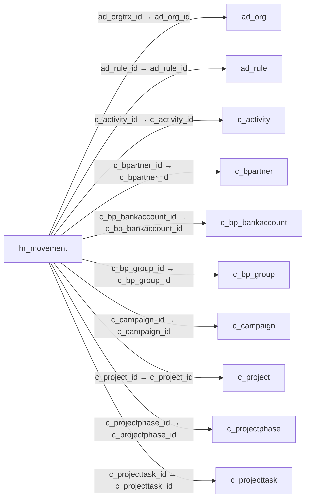

# hr_movement — 급여 계산 내역

[전체 일람](../TABLE_INDEX.md) · [분류 일람](README.md) · [AI 사용 안내](../README.md) · [외래키 읽는 법](../RELATIONSHIPS.md)

## 기본 정보

| 항목 | 내용 |
|---|---|
| 물리명 | `adempiere.hr_movement` |
| 한국어 논리명(문서용 해석) | 급여 계산 내역 |
| 원본 논리명 | Payroll Movement |
| 원본 사전 ID | 53102 |
| 분류 | `hr` — 인사·급여 |
| 전체 테넌트 행 수 | 0 |
| 물리 열 수 | 39 |
| 나가는 FK / 들어오는 FK | 18 / 1 |
| 구조·행 수 확인 시점 | 2026-11-03T23:29:01+09:00 |

## 의미와 쓰임

급여 실행별 직원·급여 항목의 금액·수량·문자 값 및 계산 규칙과 분석 요소를 저장한다.

- 설명 근거: 물리명·열·외래키 구조를 근거로 보수적으로 해석.
- 한국어 이름과 개요는 문서용 해석입니다. 공식 한국어 번역으로 간주하지 않습니다.
- 원본 설명: —
- 원본 도움말: —
- PostgreSQL 테이블 주석: —

## 키와 열

### 기본키·고유 제약조건

| 종류 | 제약조건 | 열(순서 유지) |
|---|---|---|
| PRIMARY KEY | `hr_movement_key` | `hr_movement_id` |
| UNIQUE | `hr_movement_uu_idx` | `hr_movement_uu` |

### 열 목록

원본 논리명·설명은 `AD_Column`에서 가져왔습니다. 기본값은 실제 PostgreSQL 메타데이터이며, 비어 있는 항목은 `—`로 표시합니다.

| 순서 | 물리명 | 원본 논리명 | PostgreSQL 타입 | NULL | PK | 기본값 | 설명 |
|---:|---|---|---|---|---|---|---|
| 1 | `isregistered` | Registered | character(1) | 허용 | — | — | The application is registered. |
| 2 | `hr_concept_category_id` | Payroll Concept Category | numeric(10,0) | 허용 | — | — | — |
| 3 | `hr_process_id` | Payroll Process | numeric(10,0) | 허용 | — | — | — |
| 4 | `c_bpartner_id` | Business Partner | numeric(10,0) | 허용 | — | — | Identifies a Business Partner |
| 5 | `hr_concept_id` | Payroll Concept | numeric(10,0) | 불가 | — | — | — |
| 6 | `columntype` | Column Type | character(1) | 허용 | — | — | — |
| 7 | `created` | Created | timestamp without time zone | 불가 | — | statement_timestamp() | Date this record was created |
| 8 | `createdby` | Created By | numeric(10,0) | 불가 | — | — | User who created this records |
| 9 | `description` | Description | character varying(255) | 허용 | — | — | Optional short description of the record |
| 10 | `hr_department_id` | Payroll Department | numeric(10,0) | 허용 | — | — | — |
| 11 | `hr_job_id` | Payroll Job | numeric(10,0) | 허용 | — | — | — |
| 12 | `hr_movement_id` | Payroll Movement | numeric(10,0) | 불가 | 예 | — | — |
| 13 | `isactive` | Active | character(1) | 불가 | — | — | The record is active in the system |
| 14 | `isprinted` | Printed | character(1) | 허용 | — | — | Indicates if this document / line is printed |
| 15 | `processed` | Processed | character(1) | 불가 | — | — | The document has been processed |
| 16 | `qty` | Quantity | numeric | 허용 | — | — | Quantity |
| 17 | `servicedate` | Service date | timestamp without time zone | 허용 | — | — | Date service was provided |
| 18 | `textmsg` | Text Message | character varying(255) | 허용 | — | — | Text Message |
| 19 | `updated` | Updated | timestamp without time zone | 불가 | — | statement_timestamp() | Date this record was updated |
| 20 | `updatedby` | Updated By | numeric(10,0) | 불가 | — | — | User who updated this records |
| 21 | `validfrom` | Valid from | timestamp without time zone | 불가 | — | — | Valid from including this date (first day) |
| 22 | `ad_client_id` | Tenant | numeric(10,0) | 불가 | — | — | Tenant for this installation. |
| 23 | `validto` | Valid to | timestamp without time zone | 허용 | — | — | Valid to including this date (last day) |
| 24 | `ad_org_id` | Organization | numeric(10,0) | 불가 | — | — | Organizational entity within tenant |
| 25 | `ad_rule_id` | Rule | numeric(10,0) | 허용 | — | — | — |
| 26 | `amount` | Amount | numeric | 허용 | — | — | Amount in a defined currency |
| 27 | `c_activity_id` | Activity | numeric(10,0) | 허용 | — | — | Business Activity |
| 28 | `c_campaign_id` | Campaign | numeric(10,0) | 허용 | — | — | Marketing Campaign |
| 29 | `ad_orgtrx_id` | Trx Organization | numeric(10,0) | 허용 | — | — | Performing or initiating organization |
| 30 | `c_projectphase_id` | Project Phase | numeric(10,0) | 허용 | — | — | Phase of a Project |
| 31 | `c_projecttask_id` | Project Task | numeric(10,0) | 허용 | — | — | Actual Project Task in a Phase |
| 32 | `c_project_id` | Project | numeric(10,0) | 허용 | — | — | Financial Project |
| 33 | `user1_id` | User Element List 1 | numeric(10,0) | 허용 | — | — | User defined list element #1 |
| 34 | `user2_id` | User Element List 2 | numeric(10,0) | 허용 | — | — | User defined list element #2 |
| 35 | `pp_cost_collector_id` | Manufacturing Cost Collector | numeric(10,0) | 허용 | — | — | — |
| 36 | `c_bp_group_id` | Business Partner Group | numeric(10,0) | 허용 | — | NULL::numeric | Business Partner Group |
| 37 | `c_bp_bankaccount_id` | Partner Bank Account | numeric(10,0) | 허용 | — | NULL::numeric | Bank Account of the Business Partner |
| 38 | `accountsign` | Account Sign | character(1) | 허용 | — | NULL::bpchar | Indicates the Natural Sign of the Account as a Debit or Credit |
| 39 | `hr_movement_uu` | HR_Movement_UU | uuid | 허용 | — | — | — |

## 외래키 흐름

화살표는 **FK를 가진 자식 → 참조되는 부모**입니다. 업무 처리의 시간 순서나 무조건적인 1:N 관계를 뜻하지 않습니다.

주변 관계 19개 중 10개를 그림으로 표시합니다. **전체 관계는 아래 두 표에 모두 포함**합니다.

### 이 테이블이 참조하는 부모 — 나가는 FK

| 제약조건 | 참조하는 쪽(자식) | 자식 열 | 참조받는 쪽(부모) | 부모 열 | 삭제 / 갱신 | 검증 / 지연 가능 |
|---|---|---|---|---|---|---|
| `adorgtrx_hrmovement` <!-- FK_OUT: adempiere.hr_movement.adorgtrx_hrmovement --> | [`hr_movement`](hr_movement.md) | `ad_orgtrx_id` | [`ad_org`](../ad/ad_org.md) | `ad_org_id` | NO ACTION / NO ACTION | 완료 / 가능 (초기 지연) |
| `adrule_hrmovement` <!-- FK_OUT: adempiere.hr_movement.adrule_hrmovement --> | [`hr_movement`](hr_movement.md) | `ad_rule_id` | [`ad_rule`](../ad/ad_rule.md) | `ad_rule_id` | NO ACTION / NO ACTION | 완료 / 가능 (초기 지연) |
| `cactivity_hrmovement` <!-- FK_OUT: adempiere.hr_movement.cactivity_hrmovement --> | [`hr_movement`](hr_movement.md) | `c_activity_id` | [`c_activity`](../c/c_activity.md) | `c_activity_id` | NO ACTION / NO ACTION | 완료 / 가능 (초기 지연) |
| `cbpartner_hrmovement` <!-- FK_OUT: adempiere.hr_movement.cbpartner_hrmovement --> | [`hr_movement`](hr_movement.md) | `c_bpartner_id` | [`c_bpartner`](../c/c_bpartner.md) | `c_bpartner_id` | NO ACTION / NO ACTION | 완료 / 가능 (초기 지연) |
| `cbpbankaccount_hrmovement` <!-- FK_OUT: adempiere.hr_movement.cbpbankaccount_hrmovement --> | [`hr_movement`](hr_movement.md) | `c_bp_bankaccount_id` | [`c_bp_bankaccount`](../c/c_bp_bankaccount.md) | `c_bp_bankaccount_id` | NO ACTION / NO ACTION | 완료 / 가능 (초기 지연) |
| `cbpgroup_hrmovement` <!-- FK_OUT: adempiere.hr_movement.cbpgroup_hrmovement --> | [`hr_movement`](hr_movement.md) | `c_bp_group_id` | [`c_bp_group`](../c/c_bp_group.md) | `c_bp_group_id` | NO ACTION / NO ACTION | 완료 / 가능 (초기 지연) |
| `ccampaign_hrmovement` <!-- FK_OUT: adempiere.hr_movement.ccampaign_hrmovement --> | [`hr_movement`](hr_movement.md) | `c_campaign_id` | [`c_campaign`](../c/c_campaign.md) | `c_campaign_id` | NO ACTION / NO ACTION | 완료 / 가능 (초기 지연) |
| `cproject_hrmovement` <!-- FK_OUT: adempiere.hr_movement.cproject_hrmovement --> | [`hr_movement`](hr_movement.md) | `c_project_id` | [`c_project`](../c/c_project.md) | `c_project_id` | NO ACTION / NO ACTION | 완료 / 가능 (초기 지연) |
| `cprojectphase_hrmovement` <!-- FK_OUT: adempiere.hr_movement.cprojectphase_hrmovement --> | [`hr_movement`](hr_movement.md) | `c_projectphase_id` | [`c_projectphase`](../c/c_projectphase.md) | `c_projectphase_id` | NO ACTION / NO ACTION | 완료 / 가능 (초기 지연) |
| `cprojecttask_hrmovement` <!-- FK_OUT: adempiere.hr_movement.cprojecttask_hrmovement --> | [`hr_movement`](hr_movement.md) | `c_projecttask_id` | [`c_projecttask`](../c/c_projecttask.md) | `c_projecttask_id` | NO ACTION / NO ACTION | 완료 / 가능 (초기 지연) |
| `hrconcept_hrmovement` <!-- FK_OUT: adempiere.hr_movement.hrconcept_hrmovement --> | [`hr_movement`](hr_movement.md) | `hr_concept_id` | [`hr_concept`](hr_concept.md) | `hr_concept_id` | NO ACTION / NO ACTION | 완료 / 가능 (초기 지연) |
| `hrconceptcategory_hrmovement` <!-- FK_OUT: adempiere.hr_movement.hrconceptcategory_hrmovement --> | [`hr_movement`](hr_movement.md) | `hr_concept_category_id` | [`hr_concept_category`](hr_concept_category.md) | `hr_concept_category_id` | NO ACTION / NO ACTION | 완료 / 가능 (초기 지연) |
| `hrdepartment_hrmovement` <!-- FK_OUT: adempiere.hr_movement.hrdepartment_hrmovement --> | [`hr_movement`](hr_movement.md) | `hr_department_id` | [`hr_department`](hr_department.md) | `hr_department_id` | NO ACTION / NO ACTION | 완료 / 가능 (초기 지연) |
| `hrjob_hrmovement` <!-- FK_OUT: adempiere.hr_movement.hrjob_hrmovement --> | [`hr_movement`](hr_movement.md) | `hr_job_id` | [`hr_job`](hr_job.md) | `hr_job_id` | NO ACTION / NO ACTION | 완료 / 가능 (초기 지연) |
| `hrprocess_hrmovement` <!-- FK_OUT: adempiere.hr_movement.hrprocess_hrmovement --> | [`hr_movement`](hr_movement.md) | `hr_process_id` | [`hr_process`](hr_process.md) | `hr_process_id` | NO ACTION / NO ACTION | 완료 / 가능 (초기 지연) |
| `ppcostcollector_hrmovement` <!-- FK_OUT: adempiere.hr_movement.ppcostcollector_hrmovement --> | [`hr_movement`](hr_movement.md) | `pp_cost_collector_id` | [`pp_cost_collector`](../pp/pp_cost_collector.md) | `pp_cost_collector_id` | NO ACTION / NO ACTION | 완료 / 가능 (초기 지연) |
| `user1_hrmovement` <!-- FK_OUT: adempiere.hr_movement.user1_hrmovement --> | [`hr_movement`](hr_movement.md) | `user1_id` | [`c_elementvalue`](../c/c_elementvalue.md) | `c_elementvalue_id` | NO ACTION / NO ACTION | 완료 / 가능 (초기 지연) |
| `user2_hrmovement` <!-- FK_OUT: adempiere.hr_movement.user2_hrmovement --> | [`hr_movement`](hr_movement.md) | `user2_id` | [`c_elementvalue`](../c/c_elementvalue.md) | `c_elementvalue_id` | NO ACTION / NO ACTION | 완료 / 가능 (초기 지연) |

### 이 테이블을 참조하는 자식 — 들어오는 FK

| 제약조건 | 참조하는 쪽(자식) | 자식 열 | 참조받는 쪽(부모) | 부모 열 | 삭제 / 갱신 | 검증 / 지연 가능 |
|---|---|---|---|---|---|---|
| `hrmovement_ihrmovement` <!-- FK_IN: adempiere.i_hr_movement.hrmovement_ihrmovement --> | [`i_hr_movement`](../i/i_hr_movement.md) | `hr_movement_id` | [`hr_movement`](hr_movement.md) | `hr_movement_id` | NO ACTION / NO ACTION | 완료 / 가능 (초기 지연) |

## 조회 시 주의

- FK 표의 자식 열과 부모 열을 같은 순서로 대응시킵니다. 복합 FK는 모든 열의 동등 조건을 `AND`로 연결합니다.
- 테이블 이름이나 `_id` 열 이름만으로 물리 FK가 있다고 가정하지 않습니다. FK 미선언은 업무 관계가 없다는 뜻도 아닙니다.
- 자식이 여러 행인 테이블과 조인하면 부모의 금액·건수가 중복될 수 있습니다. 집계 단위를 먼저 정합니다.
- `ad_client_id`가 있습니다. 업무 분석에서는 대상 테넌트를 명시합니다. GardenWorld는 `11`, 시스템 공통 설정은 `0`일 수 있으므로 일괄 필터 적용 전에 테이블 역할을 확인합니다.
- 수집 시점에 0행입니다. 이 표만으로 거래 실적·처리 결과를 계산할 수 없습니다.
- 행 수는 위 확인 시점의 전체 테넌트 값입니다. 최신 업무 실적이나 현재 실행 결과로 재사용하지 않습니다.
