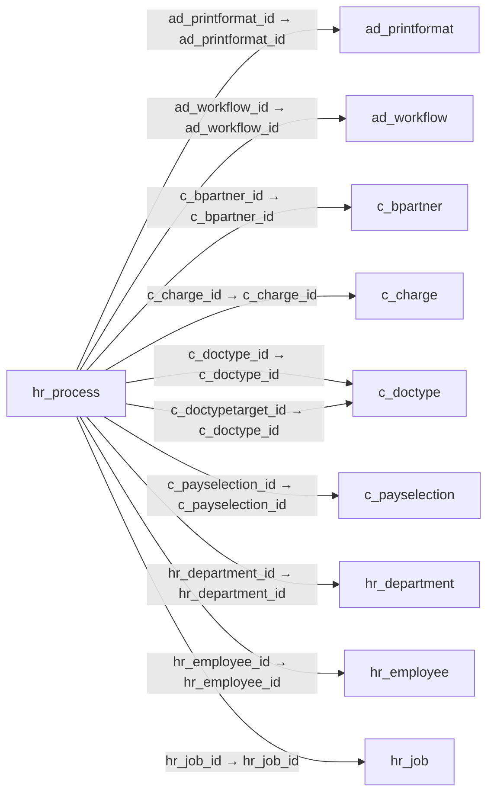

# hr_process — 급여 계산 실행

[전체 일람](../TABLE_INDEX.md) · [분류 일람](README.md) · [AI 사용 안내](../README.md) · [외래키 읽는 법](../RELATIONSHIPS.md)

## 기본 정보

| 항목 | 내용 |
|---|---|
| 물리명 | `adempiere.hr_process` |
| 한국어 논리명(문서용 해석) | 급여 계산 실행 |
| 원본 논리명 | Payroll Process |
| 원본 사전 ID | 53092 |
| 분류 | `hr` — 인사·급여 |
| 전체 테넌트 행 수 | 0 |
| 물리 열 수 | 32 |
| 나가는 FK / 들어오는 FK | 13 / 3 |
| 구조·행 수 확인 시점 | 2026-11-03T23:29:01+09:00 |

## 의미와 쓰임

급여 체계·기간·직원 또는 부서별 급여 처리 전표를 관리한다. 문서 상태·회계 전기·지급 대상 선정 연결을 포함한다.

- 설명 근거: 물리명·열·외래키 구조를 근거로 보수적으로 해석.
- 한국어 이름과 개요는 문서용 해석입니다. 공식 한국어 번역으로 간주하지 않습니다.
- 원본 설명: —
- 원본 도움말: —
- PostgreSQL 테이블 주석: —

## 키와 열

### 기본키·고유 제약조건

| 종류 | 제약조건 | 열(순서 유지) |
|---|---|---|
| PRIMARY KEY | `hr_process_key` | `hr_process_id` |
| UNIQUE | `hr_process_uu_idx` | `hr_process_uu` |

### 열 목록

원본 논리명·설명은 `AD_Column`에서 가져왔습니다. 기본값은 실제 PostgreSQL 메타데이터이며, 비어 있는 항목은 `—`로 표시합니다.

| 순서 | 물리명 | 원본 논리명 | PostgreSQL 타입 | NULL | PK | 기본값 | 설명 |
|---:|---|---|---|---|---|---|---|
| 1 | `hr_job_id` | Payroll Job | numeric(10,0) | 허용 | — | — | — |
| 2 | `c_doctype_id` | Document Type | numeric(10,0) | 허용 | — | — | Document type or rules |
| 3 | `c_payselection_id` | Payment Selection | numeric(10,0) | 허용 | — | — | Payment Selection |
| 4 | `hr_process_id` | Payroll Process | numeric(10,0) | 불가 | 예 | (- (1)::numeric) | — |
| 5 | `hr_employee_id` | Payroll Employee | numeric(10,0) | 허용 | — | — | — |
| 6 | `name` | Name | character varying(60) | 불가 | — | — | Alphanumeric identifier of the entity |
| 7 | `c_doctypetarget_id` | Target Document Type | numeric(10,0) | 불가 | — | — | Target document type for conversing documents |
| 8 | `columnsql` | Column SQL | character varying(255) | 허용 | — | — | Virtual Column (r/o) |
| 9 | `created` | Created | timestamp without time zone | 불가 | — | statement_timestamp() | Date this record was created |
| 10 | `createdby` | Created By | numeric(10,0) | 불가 | — | — | User who created this records |
| 11 | `dateacct` | Account Date | timestamp without time zone | 불가 | — | — | Accounting Date |
| 12 | `docaction` | Document Action | character(2) | 불가 | — | 'CO'::bpchar | The targeted status of the document |
| 13 | `docstatus` | Document Status | character varying(2) | 불가 | — | 'DR'::character varying | The current status of the document |
| 14 | `documentno` | Document No | character varying(90) | 허용 | — | — | Document sequence number of the document |
| 15 | `hr_department_id` | Payroll Department | numeric(10,0) | 허용 | — | — | — |
| 16 | `hr_payroll_id` | Payroll | numeric(10,0) | 불가 | — | — | — |
| 17 | `hr_period_id` | Payroll Period | numeric(10,0) | 허용 | — | — | — |
| 18 | `isactive` | Active | character(1) | 불가 | — | — | The record is active in the system |
| 19 | `posted` | Posted | character(1) | 불가 | — | 'N'::bpchar | Posting status |
| 20 | `processed` | Processed | character(1) | 불가 | — | — | The document has been processed |
| 21 | `processing` | Process Now | character(1) | 허용 | — | — | — |
| 22 | `updated` | Updated | timestamp without time zone | 불가 | — | statement_timestamp() | Date this record was updated |
| 23 | `ad_client_id` | Tenant | numeric(10,0) | 불가 | — | — | Tenant for this installation. |
| 24 | `updatedby` | Updated By | numeric(10,0) | 불가 | — | — | User who updated this records |
| 25 | `ad_org_id` | Organization | numeric(10,0) | 불가 | — | — | Organizational entity within tenant |
| 26 | `ad_printformat_id` | Print Format | numeric(10,0) | 허용 | — | — | Data Print Format |
| 27 | `ad_workflow_id` | Workflow | numeric(10,0) | 허용 | — | — | Workflow or combination of tasks |
| 28 | `c_bpartner_id` | Business Partner | numeric(10,0) | 허용 | — | — | Identifies a Business Partner |
| 29 | `c_charge_id` | Charge | numeric(10,0) | 허용 | — | — | Additional document charges |
| 30 | `reversal_id` | Reversal ID | numeric(10,0) | 허용 | — | — | ID of document reversal |
| 31 | `processedon` | Processed On | numeric | 허용 | — | — | The date+time (expressed in decimal format) when the document has been processed |
| 32 | `hr_process_uu` | HR_Process_UU | uuid | 허용 | — | — | — |

## 외래키 흐름

화살표는 **FK를 가진 자식 → 참조되는 부모**입니다. 업무 처리의 시간 순서나 무조건적인 1:N 관계를 뜻하지 않습니다.

주변 관계 15개 중 10개를 그림으로 표시합니다. **전체 관계는 아래 두 표에 모두 포함**합니다.

### 이 테이블이 참조하는 부모 — 나가는 FK

| 제약조건 | 참조하는 쪽(자식) | 자식 열 | 참조받는 쪽(부모) | 부모 열 | 삭제 / 갱신 | 검증 / 지연 가능 |
|---|---|---|---|---|---|---|
| `adprintformat_hrprocess` <!-- FK_OUT: adempiere.hr_process.adprintformat_hrprocess --> | [`hr_process`](hr_process.md) | `ad_printformat_id` | [`ad_printformat`](../ad/ad_printformat.md) | `ad_printformat_id` | NO ACTION / NO ACTION | 완료 / 가능 (초기 지연) |
| `adworkflow_hrprocess` <!-- FK_OUT: adempiere.hr_process.adworkflow_hrprocess --> | [`hr_process`](hr_process.md) | `ad_workflow_id` | [`ad_workflow`](../ad/ad_workflow.md) | `ad_workflow_id` | NO ACTION / NO ACTION | 완료 / 가능 (초기 지연) |
| `cbpartner_hrprocess` <!-- FK_OUT: adempiere.hr_process.cbpartner_hrprocess --> | [`hr_process`](hr_process.md) | `c_bpartner_id` | [`c_bpartner`](../c/c_bpartner.md) | `c_bpartner_id` | NO ACTION / NO ACTION | 완료 / 가능 (초기 지연) |
| `ccharge_hrprocess` <!-- FK_OUT: adempiere.hr_process.ccharge_hrprocess --> | [`hr_process`](hr_process.md) | `c_charge_id` | [`c_charge`](../c/c_charge.md) | `c_charge_id` | NO ACTION / NO ACTION | 완료 / 가능 (초기 지연) |
| `cdoctype_hrprocess` <!-- FK_OUT: adempiere.hr_process.cdoctype_hrprocess --> | [`hr_process`](hr_process.md) | `c_doctype_id` | [`c_doctype`](../c/c_doctype.md) | `c_doctype_id` | NO ACTION / NO ACTION | 완료 / 가능 (초기 지연) |
| `cdoctypetarget_hrprocess` <!-- FK_OUT: adempiere.hr_process.cdoctypetarget_hrprocess --> | [`hr_process`](hr_process.md) | `c_doctypetarget_id` | [`c_doctype`](../c/c_doctype.md) | `c_doctype_id` | NO ACTION / NO ACTION | 완료 / 가능 (초기 지연) |
| `cpayselection_hrprocess` <!-- FK_OUT: adempiere.hr_process.cpayselection_hrprocess --> | [`hr_process`](hr_process.md) | `c_payselection_id` | [`c_payselection`](../c/c_payselection.md) | `c_payselection_id` | NO ACTION / NO ACTION | 완료 / 가능 (초기 지연) |
| `hrdepartment_hrprocess` <!-- FK_OUT: adempiere.hr_process.hrdepartment_hrprocess --> | [`hr_process`](hr_process.md) | `hr_department_id` | [`hr_department`](hr_department.md) | `hr_department_id` | NO ACTION / NO ACTION | 완료 / 가능 (초기 지연) |
| `hremployee_hrprocess` <!-- FK_OUT: adempiere.hr_process.hremployee_hrprocess --> | [`hr_process`](hr_process.md) | `hr_employee_id` | [`hr_employee`](hr_employee.md) | `hr_employee_id` | NO ACTION / NO ACTION | 완료 / 가능 (초기 지연) |
| `hrjob_hrprocess` <!-- FK_OUT: adempiere.hr_process.hrjob_hrprocess --> | [`hr_process`](hr_process.md) | `hr_job_id` | [`hr_job`](hr_job.md) | `hr_job_id` | NO ACTION / NO ACTION | 완료 / 가능 (초기 지연) |
| `hrpayroll_hrprocess` <!-- FK_OUT: adempiere.hr_process.hrpayroll_hrprocess --> | [`hr_process`](hr_process.md) | `hr_payroll_id` | [`hr_payroll`](hr_payroll.md) | `hr_payroll_id` | NO ACTION / NO ACTION | 완료 / 가능 (초기 지연) |
| `hrperiod_hrprocess` <!-- FK_OUT: adempiere.hr_process.hrperiod_hrprocess --> | [`hr_process`](hr_process.md) | `hr_period_id` | [`hr_period`](hr_period.md) | `hr_period_id` | NO ACTION / NO ACTION | 완료 / 가능 (초기 지연) |
| `reversal_hrprocess` <!-- FK_OUT: adempiere.hr_process.reversal_hrprocess --> | [`hr_process`](hr_process.md) | `reversal_id` | [`hr_process`](hr_process.md) | `hr_process_id` | NO ACTION / NO ACTION | 완료 / 가능 (초기 지연) |

### 이 테이블을 참조하는 자식 — 들어오는 FK

| 제약조건 | 참조하는 쪽(자식) | 자식 열 | 참조받는 쪽(부모) | 부모 열 | 삭제 / 갱신 | 검증 / 지연 가능 |
|---|---|---|---|---|---|---|
| `hrprocess_hrmovement` <!-- FK_IN: adempiere.hr_movement.hrprocess_hrmovement --> | [`hr_movement`](hr_movement.md) | `hr_process_id` | [`hr_process`](hr_process.md) | `hr_process_id` | NO ACTION / NO ACTION | 완료 / 가능 (초기 지연) |
| `reversal_hrprocess` <!-- FK_IN: adempiere.hr_process.reversal_hrprocess --> | [`hr_process`](hr_process.md) | `reversal_id` | [`hr_process`](hr_process.md) | `hr_process_id` | NO ACTION / NO ACTION | 완료 / 가능 (초기 지연) |
| `hrprocess_ihrmovement` <!-- FK_IN: adempiere.i_hr_movement.hrprocess_ihrmovement --> | [`i_hr_movement`](../i/i_hr_movement.md) | `hr_process_id` | [`hr_process`](hr_process.md) | `hr_process_id` | NO ACTION / NO ACTION | 완료 / 가능 (초기 지연) |

## 조회 시 주의

- FK 표의 자식 열과 부모 열을 같은 순서로 대응시킵니다. 복합 FK는 모든 열의 동등 조건을 `AND`로 연결합니다.
- 테이블 이름이나 `_id` 열 이름만으로 물리 FK가 있다고 가정하지 않습니다. FK 미선언은 업무 관계가 없다는 뜻도 아닙니다.
- 자식이 여러 행인 테이블과 조인하면 부모의 금액·건수가 중복될 수 있습니다. 집계 단위를 먼저 정합니다.
- `ad_client_id`가 있습니다. 업무 분석에서는 대상 테넌트를 명시합니다. GardenWorld는 `11`, 시스템 공통 설정은 `0`일 수 있으므로 일괄 필터 적용 전에 테이블 역할을 확인합니다.
- 수집 시점에 0행입니다. 이 표만으로 거래 실적·처리 결과를 계산할 수 없습니다.
- 행 수는 위 확인 시점의 전체 테넌트 값입니다. 최신 업무 실적이나 현재 실행 결과로 재사용하지 않습니다.
