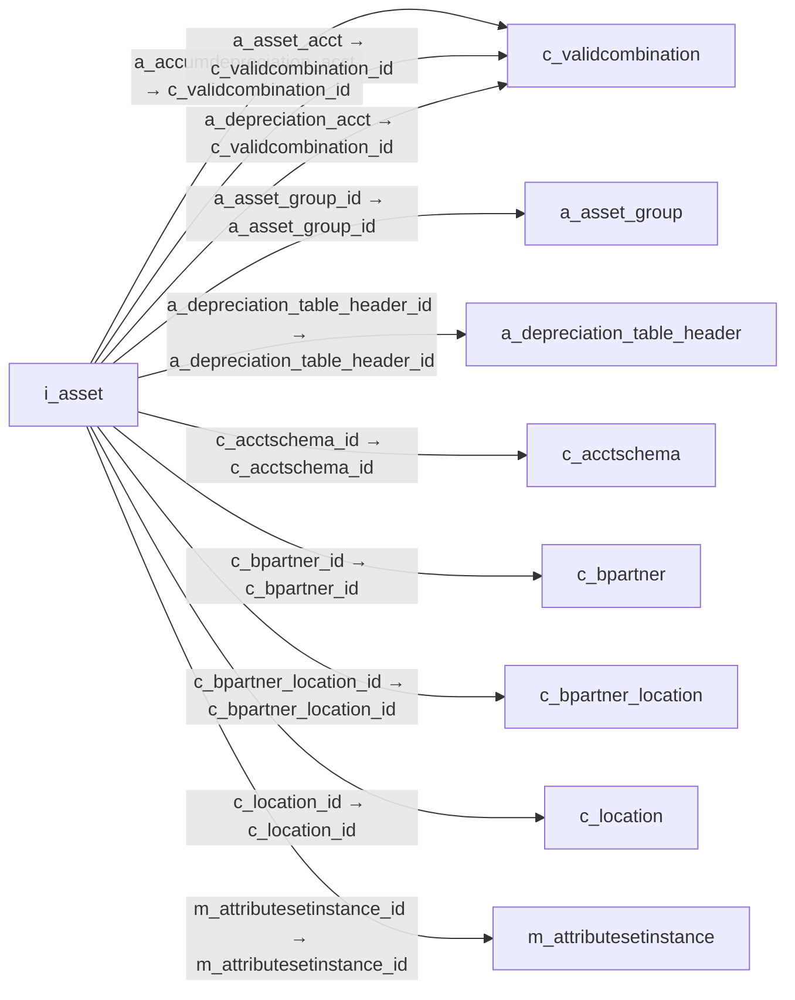

# i_asset — 자산 가져오기 임시 데이터

[전체 일람](../TABLE_INDEX.md) · [분류 일람](README.md) · [AI 사용 안내](../README.md) · [외래키 읽는 법](../RELATIONSHIPS.md)

## 기본 정보

| 항목 | 내용 |
|---|---|
| 물리명 | `adempiere.i_asset` |
| 한국어 논리명(문서용 해석) | 자산 가져오기 임시 데이터 |
| 원본 논리명 | Asset |
| 원본 사전 ID | 53139 |
| 분류 | `i` — 데이터 가져오기 준비 |
| 전체 테넌트 행 수 | 0 |
| 물리 열 수 | 83 |
| 나가는 FK / 들어오는 FK | 12 / 0 |
| 구조·행 수 확인 시점 | 2026-11-03T23:29:01+09:00 |

## 의미와 쓰임

자산과 감가상각·계정·소재지 정보를 정식 데이터로 가져오기 전에 저장하며 가져오기 여부와 오류 메시지를 관리한다.

- 설명 근거: 물리명·열·외래키 구조를 근거로 보수적으로 해석.
- 한국어 이름과 개요는 문서용 해석입니다. 공식 한국어 번역으로 간주하지 않습니다.
- 원본 설명: —
- 원본 도움말: —
- PostgreSQL 테이블 주석: —

## 키와 열

### 기본키·고유 제약조건

| 종류 | 제약조건 | 열(순서 유지) |
|---|---|---|
| PRIMARY KEY | `i_asset_key` | `i_asset_id` |
| UNIQUE | `i_asset_uu_idx` | `i_asset_uu` |

### 열 목록

원본 논리명·설명은 `AD_Column`에서 가져왔습니다. 기본값은 실제 PostgreSQL 메타데이터이며, 비어 있는 항목은 `—`로 표시합니다.

| 순서 | 물리명 | 원본 논리명 | PostgreSQL 타입 | NULL | PK | 기본값 | 설명 |
|---:|---|---|---|---|---|---|---|
| 1 | `i_asset_id` | Asset | numeric(10,0) | 불가 | 예 | — | — |
| 2 | `ad_client_id` | Tenant | numeric(10,0) | 불가 | — | — | Tenant for this installation. |
| 3 | `ad_org_id` | Organization | numeric(10,0) | 불가 | — | — | Organizational entity within tenant |
| 4 | `ad_user_id` | User/Contact | numeric(10,0) | 허용 | — | — | User within the system - Internal or Business Partner Contact |
| 5 | `a_accumdepreciation_acct` | Accumulated Depreciation Account | numeric(10,0) | 허용 | — | — | — |
| 6 | `a_accumulated_depr` | Accumulated Depreciation | numeric | 허용 | — | — | — |
| 7 | `a_asset_acct` | Asset Acct | numeric(10,0) | 허용 | — | — | — |
| 8 | `a_asset_cost` | Asset Cost | numeric | 허용 | — | — | — |
| 9 | `a_asset_group_id` | Asset Group | numeric(10,0) | 허용 | — | — | Group of Assets |
| 10 | `a_asset_id` | Asset | numeric(10,0) | 허용 | — | — | Asset used internally or by customers |
| 11 | `a_asset_life_current_year` | A_Asset_Life_Current_Year | numeric(10,0) | 허용 | — | — | — |
| 12 | `a_asset_life_years` | Life Years | numeric | 허용 | — | — | — |
| 13 | `a_asset_spread_type` | Spread Type | character varying(10) | 허용 | — | — | — |
| 14 | `a_base_amount` | A_Base_Amount | numeric | 허용 | — | — | — |
| 15 | `a_calc_accumulated_depr` | A_Calc_Accumulated_Depr | numeric | 허용 | — | — | — |
| 16 | `a_curr_dep_exp` | A_Curr_Dep_Exp | numeric | 허용 | — | — | — |
| 17 | `a_current_period` | Current Period | numeric(10,0) | 허용 | — | — | — |
| 18 | `a_depreciation_acct` | Depreciation Account | numeric(10,0) | 허용 | — | — | — |
| 19 | `a_depreciation_calc_type` | Calculation Type | character varying(10) | 허용 | — | — | — |
| 20 | `a_depreciation_manual_amount` | A_Depreciation_Manual_Amount | numeric | 허용 | — | — | — |
| 21 | `a_depreciation_manual_period` | A_Depreciation_Manual_Period | character varying(2) | 허용 | — | — | — |
| 22 | `a_depreciation_table_header_id` | A_Depreciation_Table_Header_ID | numeric(10,0) | 허용 | — | — | — |
| 23 | `a_depreciation_variable_perc` | Variable Percent | numeric | 허용 | — | — | — |
| 24 | `a_disposal_loss` | Loss on Disposal | character varying(22) | 허용 | — | — | — |
| 25 | `a_disposal_revenue` | Disposal Revenue | character varying(22) | 허용 | — | — | — |
| 26 | `a_life_period` | Life Periods | numeric(10,0) | 허용 | — | — | — |
| 27 | `a_parent_asset_id` | Parent Asset | numeric(10,0) | 허용 | — | (0)::numeric | — |
| 28 | `a_period_end` | A_Period_End | numeric(10,0) | 허용 | — | — | — |
| 29 | `a_period_posted` | A_Period_Posted | numeric(10,0) | 허용 | — | — | — |
| 30 | `a_period_start` | A_Period_Start | numeric(10,0) | 허용 | — | — | — |
| 31 | `a_prior_year_accumulated_depr` | A_Prior_Year_Accumulated_Depr | numeric | 허용 | — | — | — |
| 32 | `a_qty_current` | Current Qty | numeric(10,0) | 허용 | — | — | — |
| 33 | `a_qty_original` | A_QTY_Original | numeric(10,0) | 허용 | — | — | — |
| 34 | `a_reval_accumdep_offset_cur` | Revaluation Accumulated Depreciation Offset for Current Year | character varying(22) | 허용 | — | — | — |
| 35 | `lifeuseunits` | Life use | numeric(10,0) | 허용 | — | — | Units of use until the asset is not usable anymore |
| 36 | `isowned` | Owned | character(1) | 허용 | — | — | The asset is owned by the organization |
| 37 | `isinposession` | In Possession | character(1) | 허용 | — | — | The asset is in the possession of the organization |
| 38 | `isfullydepreciated` | Fully depreciated | character(1) | 허용 | — | — | The asset is fully depreciated |
| 39 | `isdisposed` | Disposed | character(1) | 허용 | — | — | The asset is disposed |
| 40 | `isdepreciated` | Depreciate | character(1) | 허용 | — | — | The asset will be depreciated |
| 41 | `isactive` | Active | character(1) | 허용 | — | — | The record is active in the system |
| 42 | `i_isimported` | Imported | character(1) | 허용 | — | — | Has this import been processed |
| 43 | `i_errormsg` | Import Error Message | character varying(2000) | 허용 | — | — | Messages generated from import process |
| 44 | `versionno` | Version No | character varying(20) | 허용 | — | — | Version Number |
| 45 | `value` | Search Key | character varying(40) | 허용 | — | — | Search key for the record in the format required - must be unique |
| 46 | `useunits` | Use units | numeric(10,0) | 허용 | — | — | Currently used units of the assets |
| 47 | `uselifeyears` | Usable Life - Years | numeric | 허용 | — | — | Years of the usable life of the asset |
| 48 | `uselifemonths` | Usable Life - Months | numeric(10,0) | 허용 | — | — | Months of the usable life of the asset |
| 49 | `updatedby` | Updated By | numeric(10,0) | 불가 | — | — | User who updated this records |
| 50 | `updated` | Updated | timestamp without time zone | 불가 | — | statement_timestamp() | Date this record was updated |
| 51 | `serno` | Serial No | character varying(20) | 허용 | — | — | Product Serial Number  |
| 52 | `processing` | Process Now | character(1) | 허용 | — | — | — |
| 53 | `processed` | Processed | character(1) | 허용 | — | — | The document has been processed |
| 54 | `postingtype` | Posting Type | character varying(10) | 허용 | — | — | The type of posted amount for the transaction |
| 55 | `name` | Name | character varying(60) | 허용 | — | — | Alphanumeric identifier of the entity |
| 56 | `m_product_id` | Product | numeric(10,0) | 허용 | — | — | Product, Service, Item |
| 57 | `m_locator_id` | Locator | numeric(10,0) | 허용 | — | — | Warehouse Locator |
| 58 | `m_attributesetinstance_id` | Attribute Set Instance | numeric(10,0) | 허용 | — | — | Product Attribute Set Instance |
| 59 | `lot` | Lot No | character varying(20) | 허용 | — | — | Lot number (alphanumeric) |
| 60 | `locationcomment` | Location comment | character varying(255) | 허용 | — | — | Additional comments or remarks concerning the location |
| 61 | `a_reval_accumdep_offset_prior` | Revaluation Accumulated Depreciation Offset for Prior Year | character varying(22) | 허용 | — | — | — |
| 62 | `a_reval_cal_method` | A_Reval_Cal_Method | character varying(3) | 허용 | — | — | — |
| 63 | `a_reval_cost_offset` | Revaluation Cost Offset for Current Year | character varying(22) | 허용 | — | — | — |
| 64 | `a_reval_cost_offset_prior` | Revaluation Cost Offset for Prior Year | character varying(22) | 허용 | — | — | — |
| 65 | `a_reval_depexp_offset` | Revaluation Expense Offs | character varying(22) | 허용 | — | — | — |
| 66 | `a_salvage_value` | Asset Salvage Value | numeric | 허용 | — | — | — |
| 67 | `a_split_percent` | Split Percent | numeric | 허용 | — | — | — |
| 68 | `assetdepreciationdate` | Asset Depreciation Date | timestamp without time zone | 허용 | — | — | Date of last depreciation |
| 69 | `assetdisposaldate` | Asset Disposal Date | timestamp without time zone | 허용 | — | — | Date when the asset is/was disposed |
| 70 | `assetmarketvalueamt` | Market value Amount | numeric | 허용 | — | — | Market value of the asset |
| 71 | `assetservicedate` | In Service Date | timestamp without time zone | 허용 | — | — | Date when Asset was put into service |
| 72 | `c_acctschema_id` | Accounting Schema | numeric(10,0) | 허용 | — | — | Rules for accounting |
| 73 | `c_bpartner_id` | Business Partner | numeric(10,0) | 허용 | — | — | Identifies a Business Partner |
| 74 | `c_bpartner_location_id` | Partner Location | numeric(10,0) | 허용 | — | — | Identifies the (ship to) address for this Business Partner |
| 75 | `c_location_id` | Address | numeric(10,0) | 허용 | — | — | Location or Address |
| 76 | `conventiontype` | Convention Type | character varying(10) | 허용 | — | — | — |
| 77 | `created` | Created | timestamp without time zone | 불가 | — | statement_timestamp() | Date this record was created |
| 78 | `createdby` | Created By | numeric(10,0) | 허용 | — | — | User who created this records |
| 79 | `depreciationtype` | Depreciation Type | character varying(10) | 허용 | — | — | — |
| 80 | `description` | Description | character varying(510) | 허용 | — | — | Optional short description of the record |
| 81 | `guaranteedate` | Guarantee Date | timestamp without time zone | 허용 | — | — | Date when guarantee expires |
| 82 | `help` | Comment/Help | character varying(2000) | 허용 | — | — | Comment or Hint |
| 83 | `i_asset_uu` | I_Asset_UU | uuid | 허용 | — | — | — |

## 외래키 흐름

화살표는 **FK를 가진 자식 → 참조되는 부모**입니다. 업무 처리의 시간 순서나 무조건적인 1:N 관계를 뜻하지 않습니다.

주변 관계 12개 중 10개를 그림으로 표시합니다. **전체 관계는 아래 두 표에 모두 포함**합니다.

### 이 테이블이 참조하는 부모 — 나가는 FK

| 제약조건 | 참조하는 쪽(자식) | 자식 열 | 참조받는 쪽(부모) | 부모 열 | 삭제 / 갱신 | 검증 / 지연 가능 |
|---|---|---|---|---|---|---|
| `aaccumdepreciation_iasset` <!-- FK_OUT: adempiere.i_asset.aaccumdepreciation_iasset --> | [`i_asset`](i_asset.md) | `a_accumdepreciation_acct` | [`c_validcombination`](../c/c_validcombination.md) | `c_validcombination_id` | NO ACTION / NO ACTION | 완료 / 가능 (초기 지연) |
| `aasset_iasset` <!-- FK_OUT: adempiere.i_asset.aasset_iasset --> | [`i_asset`](i_asset.md) | `a_asset_acct` | [`c_validcombination`](../c/c_validcombination.md) | `c_validcombination_id` | NO ACTION / NO ACTION | 완료 / 가능 (초기 지연) |
| `aassetgroup_iasset` <!-- FK_OUT: adempiere.i_asset.aassetgroup_iasset --> | [`i_asset`](i_asset.md) | `a_asset_group_id` | [`a_asset_group`](../a/a_asset_group.md) | `a_asset_group_id` | NO ACTION / NO ACTION | 완료 / 가능 (초기 지연) |
| `adepreciation_iasset` <!-- FK_OUT: adempiere.i_asset.adepreciation_iasset --> | [`i_asset`](i_asset.md) | `a_depreciation_acct` | [`c_validcombination`](../c/c_validcombination.md) | `c_validcombination_id` | NO ACTION / NO ACTION | 완료 / 가능 (초기 지연) |
| `adepreciationtableheader_iasse` <!-- FK_OUT: adempiere.i_asset.adepreciationtableheader_iasse --> | [`i_asset`](i_asset.md) | `a_depreciation_table_header_id` | [`a_depreciation_table_header`](../a/a_depreciation_table_header.md) | `a_depreciation_table_header_id` | NO ACTION / NO ACTION | 완료 / 가능 (초기 지연) |
| `cacctschema_iasset` <!-- FK_OUT: adempiere.i_asset.cacctschema_iasset --> | [`i_asset`](i_asset.md) | `c_acctschema_id` | [`c_acctschema`](../c/c_acctschema.md) | `c_acctschema_id` | NO ACTION / NO ACTION | 완료 / 가능 (초기 지연) |
| `cbpartner_iasset` <!-- FK_OUT: adempiere.i_asset.cbpartner_iasset --> | [`i_asset`](i_asset.md) | `c_bpartner_id` | [`c_bpartner`](../c/c_bpartner.md) | `c_bpartner_id` | NO ACTION / NO ACTION | 완료 / 가능 (초기 지연) |
| `cbpartnerlocation_iasset` <!-- FK_OUT: adempiere.i_asset.cbpartnerlocation_iasset --> | [`i_asset`](i_asset.md) | `c_bpartner_location_id` | [`c_bpartner_location`](../c/c_bpartner_location.md) | `c_bpartner_location_id` | NO ACTION / NO ACTION | 완료 / 가능 (초기 지연) |
| `clocation_iasset` <!-- FK_OUT: adempiere.i_asset.clocation_iasset --> | [`i_asset`](i_asset.md) | `c_location_id` | [`c_location`](../c/c_location.md) | `c_location_id` | NO ACTION / NO ACTION | 완료 / 가능 (초기 지연) |
| `mattributesetinstance_iasset` <!-- FK_OUT: adempiere.i_asset.mattributesetinstance_iasset --> | [`i_asset`](i_asset.md) | `m_attributesetinstance_id` | [`m_attributesetinstance`](../m/m_attributesetinstance.md) | `m_attributesetinstance_id` | NO ACTION / NO ACTION | 완료 / 가능 (초기 지연) |
| `mlocator_iasset` <!-- FK_OUT: adempiere.i_asset.mlocator_iasset --> | [`i_asset`](i_asset.md) | `m_locator_id` | [`m_locator`](../m/m_locator.md) | `m_locator_id` | NO ACTION / NO ACTION | 완료 / 가능 (초기 지연) |
| `mproduct_iasset` <!-- FK_OUT: adempiere.i_asset.mproduct_iasset --> | [`i_asset`](i_asset.md) | `m_product_id` | [`m_product`](../m/m_product.md) | `m_product_id` | NO ACTION / NO ACTION | 완료 / 가능 (초기 지연) |

### 이 테이블을 참조하는 자식 — 들어오는 FK

해당 방향의 물리 FK 제약조건은 없습니다. 이름이 비슷한 열만으로 관계를 추가하지 않습니다.

## 조회 시 주의

- FK 표의 자식 열과 부모 열을 같은 순서로 대응시킵니다. 복합 FK는 모든 열의 동등 조건을 `AND`로 연결합니다.
- 테이블 이름이나 `_id` 열 이름만으로 물리 FK가 있다고 가정하지 않습니다. FK 미선언은 업무 관계가 없다는 뜻도 아닙니다.
- 자식이 여러 행인 테이블과 조인하면 부모의 금액·건수가 중복될 수 있습니다. 집계 단위를 먼저 정합니다.
- `ad_client_id`가 있습니다. 업무 분석에서는 대상 테넌트를 명시합니다. GardenWorld는 `11`, 시스템 공통 설정은 `0`일 수 있으므로 일괄 필터 적용 전에 테이블 역할을 확인합니다.
- 수집 시점에 0행입니다. 이 표만으로 거래 실적·처리 결과를 계산할 수 없습니다.
- 행 수는 위 확인 시점의 전체 테넌트 값입니다. 최신 업무 실적이나 현재 실행 결과로 재사용하지 않습니다.
