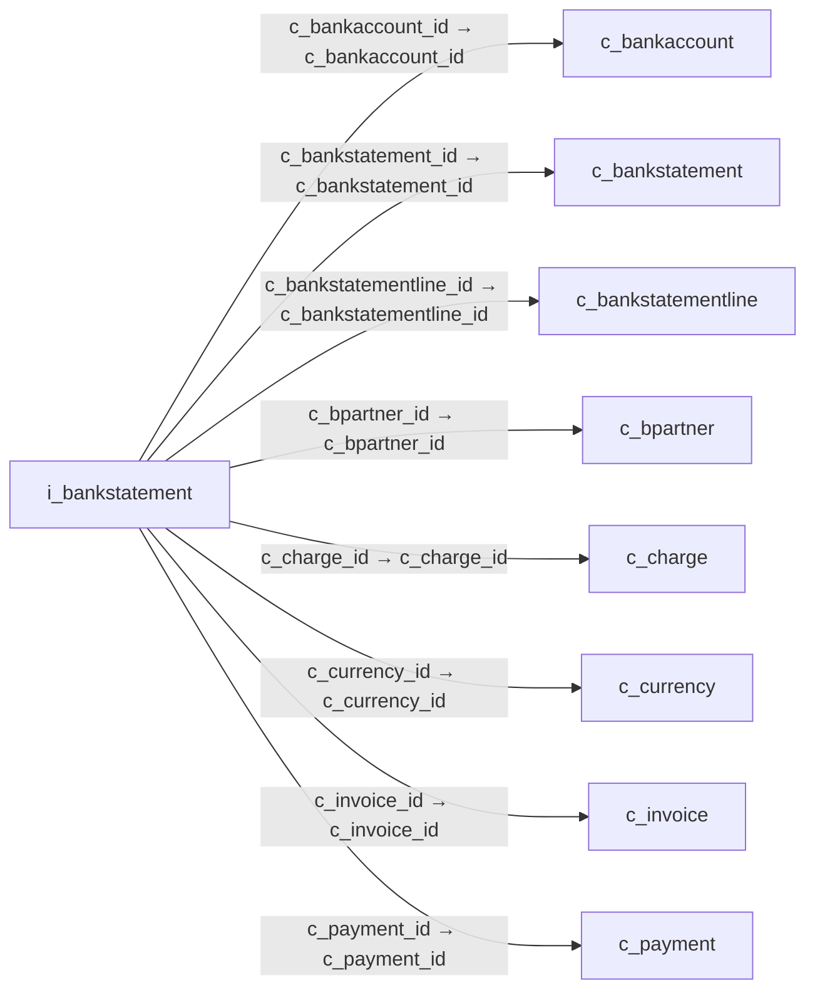

# i_bankstatement — 은행명세 가져오기 임시 데이터

[전체 일람](../TABLE_INDEX.md) · [분류 일람](README.md) · [AI 사용 안내](../README.md) · [외래키 읽는 법](../RELATIONSHIPS.md)

## 기본 정보

| 항목 | 내용 |
|---|---|
| 물리명 | `adempiere.i_bankstatement` |
| 한국어 논리명(문서용 해석) | 은행명세 가져오기 임시 데이터 |
| 원본 논리명 | Import Bank Statement |
| 원본 사전 ID | 600 |
| 분류 | `i` — 데이터 가져오기 준비 |
| 전체 테넌트 행 수 | 0 |
| 물리 열 수 | 60 |
| 나가는 FK / 들어오는 FK | 8 / 0 |
| 구조·행 수 확인 시점 | 2026-11-03T23:29:01+09:00 |

## 의미와 쓰임

외부 은행거래 명세를 정식 명세로 가져오기 위한 입력 데이터를 저장한다.

- 설명 근거: 원본 애플리케이션 사전 명칭·설명을 한국어로 해석.
- 한국어 이름과 개요는 문서용 해석입니다. 공식 한국어 번역으로 간주하지 않습니다.
- 원본 설명: Import of the Bank Statement
- 원본 도움말: —
- PostgreSQL 테이블 주석: —

## 키와 열

### 기본키·고유 제약조건

| 종류 | 제약조건 | 열(순서 유지) |
|---|---|---|
| PRIMARY KEY | `i_bankstatement_pkey` | `i_bankstatement_id` |
| UNIQUE | `i_bankstatement_uu_idx` | `i_bankstatement_uu` |

### 열 목록

원본 논리명·설명은 `AD_Column`에서 가져왔습니다. 기본값은 실제 PostgreSQL 메타데이터이며, 비어 있는 항목은 `—`로 표시합니다.

| 순서 | 물리명 | 원본 논리명 | PostgreSQL 타입 | NULL | PK | 기본값 | 설명 |
|---:|---|---|---|---|---|---|---|
| 1 | `i_bankstatement_id` | Import Bank Statement | numeric(10,0) | 불가 | 예 | — | Import of the Bank Statement |
| 2 | `ad_client_id` | Tenant | numeric(10,0) | 허용 | — | — | Tenant for this installation. |
| 3 | `ad_org_id` | Organization | numeric(10,0) | 허용 | — | — | Organizational entity within tenant |
| 4 | `isactive` | Active | character(1) | 허용 | — | 'Y'::bpchar | The record is active in the system |
| 5 | `created` | Created | timestamp without time zone | 불가 | — | statement_timestamp() | Date this record was created |
| 6 | `createdby` | Created By | numeric(10,0) | 허용 | — | — | User who created this records |
| 7 | `updated` | Updated | timestamp without time zone | 불가 | — | statement_timestamp() | Date this record was updated |
| 8 | `updatedby` | Updated By | numeric(10,0) | 허용 | — | — | User who updated this records |
| 9 | `i_isimported` | Imported | character(1) | 불가 | — | 'N'::bpchar | Has this import been processed |
| 10 | `i_errormsg` | Import Error Message | character varying(2000) | 허용 | — | — | Messages generated from import process |
| 11 | `processed` | Processed | character(1) | 허용 | — | 'N'::bpchar | The document has been processed |
| 12 | `c_bankstatement_id` | Bank Statement | numeric(10,0) | 허용 | — | — | Bank Statement of account |
| 13 | `statementdate` | Statement date | timestamp without time zone | 허용 | — | — | Date of the statement |
| 14 | `description` | Description | character varying(255) | 허용 | — | — | Optional short description of the record |
| 15 | `c_bankaccount_id` | Bank Account | numeric(10,0) | 허용 | — | — | Account at the Bank |
| 16 | `routingno` | Routing No | character varying(20) | 허용 | — | — | Bank Routing Number |
| 17 | `bankaccountno` | Bank Account No | character varying(20) | 허용 | — | — | Bank Account Number |
| 18 | `c_payment_id` | Payment | numeric(10,0) | 허용 | — | — | Payment identifier |
| 19 | `paymentdocumentno` | Payment Document No | character varying(30) | 허용 | — | — | Document number of the Payment |
| 20 | `c_currency_id` | Currency | numeric(10,0) | 허용 | — | — | The Currency for this record |
| 21 | `iso_code` | ISO Currency Code | character(3) | 허용 | — | — | Three letter ISO 4217 Code of the Currency |
| 22 | `c_bpartner_id` | Business Partner | numeric(10,0) | 허용 | — | — | Identifies a Business Partner |
| 23 | `name` | Name | character varying(60) | 허용 | — | — | Alphanumeric identifier of the entity |
| 24 | `bpartnervalue` | Business Partner Key | character varying(40) | 허용 | — | — | Key of the Business Partner |
| 25 | `c_invoice_id` | Invoice | numeric(10,0) | 허용 | — | — | Invoice Identifier |
| 26 | `invoicedocumentno` | Invoice Document No | character varying(30) | 허용 | — | — | Document Number of the Invoice |
| 27 | `c_charge_id` | Charge | numeric(10,0) | 허용 | — | — | Additional document charges |
| 28 | `chargename` | Charge Name | character varying(60) | 허용 | — | — | Name of the Charge |
| 29 | `chargeamt` | Charge amount | numeric | 허용 | — | 0 | Charge Amount |
| 30 | `c_bankstatementline_id` | Bank statement line | numeric(10,0) | 허용 | — | — | Line on a statement from this Bank |
| 31 | `line` | Line No | numeric(10,0) | 허용 | — | — | Unique line for this document |
| 32 | `dateacct` | Account Date | timestamp without time zone | 허용 | — | — | Accounting Date |
| 33 | `valutadate` | Effective date | timestamp without time zone | 허용 | — | — | Date when money is available |
| 34 | `statementlinedate` | Statement Line Date | timestamp without time zone | 허용 | — | — | Date of the Statement Line |
| 35 | `trxtype` | Transaction Type | character varying(20) | 허용 | — | — | Type of credit card transaction |
| 36 | `referenceno` | Reference No | character varying(255) | 허용 | — | — | Your customer or vendor number at the Business Partner's site |
| 37 | `memo` | Memo | character varying(4000) | 허용 | — | — | Memo Text |
| 38 | `isreversal` | Reversal | character(1) | 허용 | — | 'N'::bpchar | This is a reversing transaction |
| 39 | `interestamt` | Interest Amount | numeric | 허용 | — | 0 | Interest Amount |
| 40 | `trxamt` | Transaction Amount | numeric | 허용 | — | 0 | Amount of a transaction |
| 41 | `linedescription` | Line Description | character varying(1000) | 허용 | — | — | Description of the Line |
| 42 | `stmtamt` | Statement amount | numeric | 허용 | — | 0 | Statement Amount |
| 43 | `eftstatementdate` | EFT Statement Date | timestamp without time zone | 허용 | — | — | Electronic Funds Transfer Statement Date |
| 44 | `eftstatementreference` | EFT Statement Reference | character varying(60) | 허용 | — | — | Electronic Funds Transfer Statement Reference |
| 45 | `eftstatementlinedate` | EFT Statement Line Date | timestamp without time zone | 허용 | — | — | Electronic Funds Transfer Statement Line Date |
| 46 | `eftvalutadate` | EFT Effective Date | timestamp without time zone | 허용 | — | — | Electronic Funds Transfer Valuta (effective) Date |
| 47 | `eftreference` | EFT Reference | character varying(255) | 허용 | — | — | Electronic Funds Transfer Reference |
| 48 | `eftcheckno` | EFT Check No | character varying(20) | 허용 | — | — | Electronic Funds Transfer Check No |
| 49 | `efttrxid` | EFT Trx ID | character varying(40) | 허용 | — | — | Electronic Funds Transfer Transaction ID |
| 50 | `efttrxtype` | EFT Trx Type | character varying(255) | 허용 | — | — | Electronic Funds Transfer Transaction Type |
| 51 | `eftmemo` | EFT Memo | character varying(4000) | 허용 | — | — | Electronic Funds Transfer Memo |
| 52 | `eftpayee` | EFT Payee | character varying(255) | 허용 | — | — | Electronic Funds Transfer Payee information |
| 53 | `eftpayeeaccount` | EFT Payee Account | character varying(40) | 허용 | — | — | Electronic Funds Transfer Payee Account Information |
| 54 | `eftamt` | EFT Amount | numeric | 허용 | — | 0 | Electronic Funds Transfer Amount |
| 55 | `eftcurrency` | EFT Currency | character varying(20) | 허용 | — | — | Electronic Funds Transfer Currency |
| 56 | `createpayment` | Create Payment | character(1) | 허용 | — | — | — |
| 57 | `processing` | Process Now | character(1) | 허용 | — | — | — |
| 58 | `matchstatement` | Match Statement | character(1) | 허용 | — | — | — |
| 59 | `i_bankstatement_uu` | I_BankStatement_UU | uuid | 허용 | — | — | — |
| 60 | `iban` | IBAN | character varying(40) | 허용 | — | NULL::character varying | International Bank Account Number |

## 외래키 흐름

화살표는 **FK를 가진 자식 → 참조되는 부모**입니다. 업무 처리의 시간 순서나 무조건적인 1:N 관계를 뜻하지 않습니다.

주변 관계 8개 중 8개를 그림으로 표시합니다. **전체 관계는 아래 두 표에 모두 포함**합니다.

### 이 테이블이 참조하는 부모 — 나가는 FK

| 제약조건 | 참조하는 쪽(자식) | 자식 열 | 참조받는 쪽(부모) | 부모 열 | 삭제 / 갱신 | 검증 / 지연 가능 |
|---|---|---|---|---|---|---|
| `cbankaccount_ibankstatement` <!-- FK_OUT: adempiere.i_bankstatement.cbankaccount_ibankstatement --> | [`i_bankstatement`](i_bankstatement.md) | `c_bankaccount_id` | [`c_bankaccount`](../c/c_bankaccount.md) | `c_bankaccount_id` | SET NULL / NO ACTION | 완료 / 가능 (초기 지연) |
| `cbankstatement_ibankstatement` <!-- FK_OUT: adempiere.i_bankstatement.cbankstatement_ibankstatement --> | [`i_bankstatement`](i_bankstatement.md) | `c_bankstatement_id` | [`c_bankstatement`](../c/c_bankstatement.md) | `c_bankstatement_id` | SET NULL / NO ACTION | 완료 / 가능 (초기 지연) |
| `cbankstmtline_ibankstmt` <!-- FK_OUT: adempiere.i_bankstatement.cbankstmtline_ibankstmt --> | [`i_bankstatement`](i_bankstatement.md) | `c_bankstatementline_id` | [`c_bankstatementline`](../c/c_bankstatementline.md) | `c_bankstatementline_id` | SET NULL / NO ACTION | 완료 / 가능 (초기 지연) |
| `cbpartner_ibankstatement` <!-- FK_OUT: adempiere.i_bankstatement.cbpartner_ibankstatement --> | [`i_bankstatement`](i_bankstatement.md) | `c_bpartner_id` | [`c_bpartner`](../c/c_bpartner.md) | `c_bpartner_id` | SET NULL / NO ACTION | 완료 / 가능 (초기 지연) |
| `ccharge_ibankstmt` <!-- FK_OUT: adempiere.i_bankstatement.ccharge_ibankstmt --> | [`i_bankstatement`](i_bankstatement.md) | `c_charge_id` | [`c_charge`](../c/c_charge.md) | `c_charge_id` | SET NULL / NO ACTION | 완료 / 가능 (초기 지연) |
| `ccurrency_ibankstatement` <!-- FK_OUT: adempiere.i_bankstatement.ccurrency_ibankstatement --> | [`i_bankstatement`](i_bankstatement.md) | `c_currency_id` | [`c_currency`](../c/c_currency.md) | `c_currency_id` | SET NULL / NO ACTION | 완료 / 가능 (초기 지연) |
| `cinvoice_ibankstatement` <!-- FK_OUT: adempiere.i_bankstatement.cinvoice_ibankstatement --> | [`i_bankstatement`](i_bankstatement.md) | `c_invoice_id` | [`c_invoice`](../c/c_invoice.md) | `c_invoice_id` | SET NULL / NO ACTION | 완료 / 가능 (초기 지연) |
| `cpayment_ibankstatement` <!-- FK_OUT: adempiere.i_bankstatement.cpayment_ibankstatement --> | [`i_bankstatement`](i_bankstatement.md) | `c_payment_id` | [`c_payment`](../c/c_payment.md) | `c_payment_id` | SET NULL / NO ACTION | 완료 / 가능 (초기 지연) |

### 이 테이블을 참조하는 자식 — 들어오는 FK

해당 방향의 물리 FK 제약조건은 없습니다. 이름이 비슷한 열만으로 관계를 추가하지 않습니다.

## 조회 시 주의

- FK 표의 자식 열과 부모 열을 같은 순서로 대응시킵니다. 복합 FK는 모든 열의 동등 조건을 `AND`로 연결합니다.
- 테이블 이름이나 `_id` 열 이름만으로 물리 FK가 있다고 가정하지 않습니다. FK 미선언은 업무 관계가 없다는 뜻도 아닙니다.
- 자식이 여러 행인 테이블과 조인하면 부모의 금액·건수가 중복될 수 있습니다. 집계 단위를 먼저 정합니다.
- `ad_client_id`가 있습니다. 업무 분석에서는 대상 테넌트를 명시합니다. GardenWorld는 `11`, 시스템 공통 설정은 `0`일 수 있으므로 일괄 필터 적용 전에 테이블 역할을 확인합니다.
- 수집 시점에 0행입니다. 이 표만으로 거래 실적·처리 결과를 계산할 수 없습니다.
- 행 수는 위 확인 시점의 전체 테넌트 값입니다. 최신 업무 실적이나 현재 실행 결과로 재사용하지 않습니다.
