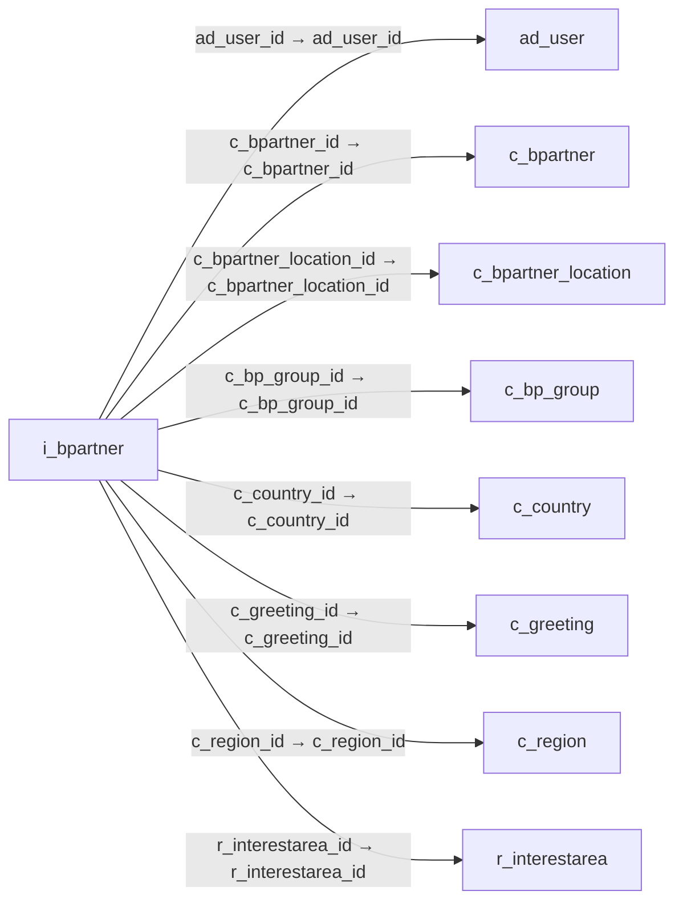

# i_bpartner — 거래처 가져오기 임시 데이터

[전체 일람](../TABLE_INDEX.md) · [분류 일람](README.md) · [AI 사용 안내](../README.md) · [외래키 읽는 법](../RELATIONSHIPS.md)

## 기본 정보

| 항목 | 내용 |
|---|---|
| 물리명 | `adempiere.i_bpartner` |
| 한국어 논리명(문서용 해석) | 거래처 가져오기 임시 데이터 |
| 원본 논리명 | Import Business Partner |
| 원본 사전 ID | 533 |
| 분류 | `i` — 데이터 가져오기 준비 |
| 전체 테넌트 행 수 | 0 |
| 물리 열 수 | 51 |
| 나가는 FK / 들어오는 FK | 8 / 0 |
| 구조·행 수 확인 시점 | 2026-11-03T23:29:01+09:00 |

## 의미와 쓰임

거래처·주소·연락처와 고객·공급업체·직원 구분을 가져오기 전에 저장하며 결과 식별자와 오류 상태를 관리한다.

- 설명 근거: 물리명·열·외래키 구조를 근거로 보수적으로 해석.
- 한국어 이름과 개요는 문서용 해석입니다. 공식 한국어 번역으로 간주하지 않습니다.
- 원본 설명: —
- 원본 도움말: —
- PostgreSQL 테이블 주석: —

## 키와 열

### 기본키·고유 제약조건

| 종류 | 제약조건 | 열(순서 유지) |
|---|---|---|
| PRIMARY KEY | `i_bpartner_pkey` | `i_bpartner_id` |
| UNIQUE | `i_bpartner_uu_idx` | `i_bpartner_uu` |

### 열 목록

원본 논리명·설명은 `AD_Column`에서 가져왔습니다. 기본값은 실제 PostgreSQL 메타데이터이며, 비어 있는 항목은 `—`로 표시합니다.

| 순서 | 물리명 | 원본 논리명 | PostgreSQL 타입 | NULL | PK | 기본값 | 설명 |
|---:|---|---|---|---|---|---|---|
| 1 | `i_bpartner_id` | Import Business Partner | numeric(10,0) | 불가 | 예 | — | — |
| 2 | `ad_client_id` | Tenant | numeric(10,0) | 허용 | — | — | Tenant for this installation. |
| 3 | `ad_org_id` | Organization | numeric(10,0) | 허용 | — | — | Organizational entity within tenant |
| 4 | `isactive` | Active | character(1) | 허용 | — | 'Y'::bpchar | The record is active in the system |
| 5 | `created` | Created | timestamp without time zone | 불가 | — | statement_timestamp() | Date this record was created |
| 6 | `createdby` | Created By | numeric(10,0) | 허용 | — | — | User who created this records |
| 7 | `updated` | Updated | timestamp without time zone | 불가 | — | statement_timestamp() | Date this record was updated |
| 8 | `updatedby` | Updated By | numeric(10,0) | 허용 | — | — | User who updated this records |
| 9 | `i_isimported` | Imported | character(1) | 불가 | — | 'N'::bpchar | Has this import been processed |
| 10 | `i_errormsg` | Import Error Message | character varying(2000) | 허용 | — | — | Messages generated from import process |
| 11 | `c_bpartner_id` | Business Partner | numeric(10,0) | 허용 | — | — | Identifies a Business Partner |
| 12 | `value` | Search Key | character varying(40) | 허용 | — | — | Search key for the record in the format required - must be unique |
| 13 | `name` | Name | character varying(60) | 허용 | — | — | Alphanumeric identifier of the entity |
| 14 | `name2` | Name 2 | character varying(60) | 허용 | — | — | Additional Name |
| 15 | `description` | Description | character varying(255) | 허용 | — | — | Optional short description of the record |
| 16 | `duns` | D-U-N-S | character varying(11) | 허용 | — | — | Dun &amp; Bradstreet Number |
| 17 | `taxid` | Tax ID | character varying(20) | 허용 | — | — | Tax Identification |
| 18 | `naics` | NAICS/SIC | character varying(6) | 허용 | — | — | Standard Industry Code or its successor NAIC - http://www.osha.gov/oshstats/sicser.html |
| 19 | `groupvalue` | Group Key | character varying(40) | 허용 | — | — | Business Partner Group Key |
| 20 | `c_bp_group_id` | Business Partner Group | numeric(10,0) | 허용 | — | — | Business Partner Group |
| 21 | `c_bpartner_location_id` | Partner Location | numeric(10,0) | 허용 | — | — | Identifies the (ship to) address for this Business Partner |
| 22 | `address1` | Address 1 | character varying(60) | 허용 | — | — | Address line 1 for this location |
| 23 | `address2` | Address 2 | character varying(60) | 허용 | — | — | Address line 2 for this location |
| 24 | `postal` | ZIP | character varying(10) | 허용 | — | — | Postal code |
| 25 | `postal_add` | Additional Zip | character varying(10) | 허용 | — | — | Additional ZIP or Postal code |
| 26 | `city` | City | character varying(60) | 허용 | — | — | Identifies a City |
| 27 | `c_region_id` | Region | numeric(10,0) | 허용 | — | — | Identifies a geographical Region |
| 28 | `regionname` | Region | character varying(60) | 허용 | — | — | Name of the Region |
| 29 | `c_country_id` | Country | numeric(10,0) | 허용 | — | — | Country  |
| 30 | `countrycode` | ISO Country Code | character(2) | 허용 | — | — | Upper-case two-letter alphanumeric ISO Country code according to ISO 3166-1 |
| 31 | `title` | Title | character varying(40) | 허용 | — | — | Name this entity is referred to as |
| 32 | `contactname` | Contact Name | character varying(60) | 허용 | — | — | Business Partner Contact Name |
| 33 | `contactdescription` | Contact Description | character varying(255) | 허용 | — | — | Description of Contact |
| 34 | `comments` | Comments | character varying(2000) | 허용 | — | — | Comments or additional information |
| 35 | `phone` | Phone | character varying(40) | 허용 | — | — | Identifies a telephone number |
| 36 | `phone2` | 2nd Phone | character varying(40) | 허용 | — | — | Identifies an alternate telephone number. |
| 37 | `fax` | Fax | character varying(40) | 허용 | — | — | Facsimile number |
| 38 | `email` | EMail Address | character varying(60) | 허용 | — | — | Electronic Mail Address |
| 39 | `password` | Password | character varying(20) | 허용 | — | — | Password of any length (case sensitive) |
| 40 | `birthday` | Birthday | timestamp without time zone | 허용 | — | — | Birthday or Anniversary day |
| 41 | `c_greeting_id` | Greeting | numeric(10,0) | 허용 | — | — | Greeting to print on correspondence |
| 42 | `bpcontactgreeting` | BP Contact Greeting | character varying(60) | 허용 | — | — | Greeting for Business Partner Contact |
| 43 | `processing` | Process Now | character(1) | 허용 | — | — | — |
| 44 | `processed` | Processed | character(1) | 허용 | — | 'N'::bpchar | The document has been processed |
| 45 | `ad_user_id` | User/Contact | numeric(10,0) | 허용 | — | — | User within the system - Internal or Business Partner Contact |
| 46 | `r_interestarea_id` | Interest Area | numeric(10,0) | 허용 | — | — | Interest Area or Topic |
| 47 | `interestareaname` | Interest Area | character varying(40) | 허용 | — | — | Name of the Interest Area |
| 48 | `iscustomer` | Customer | character(1) | 허용 | — | NULL::bpchar | Indicates if this Business Partner is a Customer |
| 49 | `isemployee` | Employee | character(1) | 허용 | — | NULL::bpchar | Indicates if  this Business Partner is an employee |
| 50 | `isvendor` | Vendor | character(1) | 허용 | — | NULL::bpchar | Indicates if this Business Partner is a Vendor |
| 51 | `i_bpartner_uu` | I_BPartner_UU | uuid | 허용 | — | — | — |

## 외래키 흐름

화살표는 **FK를 가진 자식 → 참조되는 부모**입니다. 업무 처리의 시간 순서나 무조건적인 1:N 관계를 뜻하지 않습니다.

주변 관계 8개 중 8개를 그림으로 표시합니다. **전체 관계는 아래 두 표에 모두 포함**합니다.

### 이 테이블이 참조하는 부모 — 나가는 FK

| 제약조건 | 참조하는 쪽(자식) | 자식 열 | 참조받는 쪽(부모) | 부모 열 | 삭제 / 갱신 | 검증 / 지연 가능 |
|---|---|---|---|---|---|---|
| `aduser_ibpartner` <!-- FK_OUT: adempiere.i_bpartner.aduser_ibpartner --> | [`i_bpartner`](i_bpartner.md) | `ad_user_id` | [`ad_user`](../ad/ad_user.md) | `ad_user_id` | SET NULL / NO ACTION | 완료 / 가능 (초기 지연) |
| `cbpartner_ibpartner` <!-- FK_OUT: adempiere.i_bpartner.cbpartner_ibpartner --> | [`i_bpartner`](i_bpartner.md) | `c_bpartner_id` | [`c_bpartner`](../c/c_bpartner.md) | `c_bpartner_id` | SET NULL / NO ACTION | 완료 / 가능 (초기 지연) |
| `cbpartnerlocation_ibpartner` <!-- FK_OUT: adempiere.i_bpartner.cbpartnerlocation_ibpartner --> | [`i_bpartner`](i_bpartner.md) | `c_bpartner_location_id` | [`c_bpartner_location`](../c/c_bpartner_location.md) | `c_bpartner_location_id` | SET NULL / NO ACTION | 완료 / 가능 (초기 지연) |
| `cbpgroup_ibpartner` <!-- FK_OUT: adempiere.i_bpartner.cbpgroup_ibpartner --> | [`i_bpartner`](i_bpartner.md) | `c_bp_group_id` | [`c_bp_group`](../c/c_bp_group.md) | `c_bp_group_id` | SET NULL / NO ACTION | 완료 / 가능 (초기 지연) |
| `ccountry_ipartner` <!-- FK_OUT: adempiere.i_bpartner.ccountry_ipartner --> | [`i_bpartner`](i_bpartner.md) | `c_country_id` | [`c_country`](../c/c_country.md) | `c_country_id` | SET NULL / NO ACTION | 완료 / 가능 (초기 지연) |
| `cgreeting_ibpartner` <!-- FK_OUT: adempiere.i_bpartner.cgreeting_ibpartner --> | [`i_bpartner`](i_bpartner.md) | `c_greeting_id` | [`c_greeting`](../c/c_greeting.md) | `c_greeting_id` | SET NULL / NO ACTION | 완료 / 가능 (초기 지연) |
| `cregion_ibpartner` <!-- FK_OUT: adempiere.i_bpartner.cregion_ibpartner --> | [`i_bpartner`](i_bpartner.md) | `c_region_id` | [`c_region`](../c/c_region.md) | `c_region_id` | SET NULL / NO ACTION | 완료 / 가능 (초기 지연) |
| `rinterestarea_ibpartner` <!-- FK_OUT: adempiere.i_bpartner.rinterestarea_ibpartner --> | [`i_bpartner`](i_bpartner.md) | `r_interestarea_id` | [`r_interestarea`](../r/r_interestarea.md) | `r_interestarea_id` | NO ACTION / NO ACTION | 완료 / 가능 (초기 지연) |

### 이 테이블을 참조하는 자식 — 들어오는 FK

해당 방향의 물리 FK 제약조건은 없습니다. 이름이 비슷한 열만으로 관계를 추가하지 않습니다.

## 조회 시 주의

- FK 표의 자식 열과 부모 열을 같은 순서로 대응시킵니다. 복합 FK는 모든 열의 동등 조건을 `AND`로 연결합니다.
- 테이블 이름이나 `_id` 열 이름만으로 물리 FK가 있다고 가정하지 않습니다. FK 미선언은 업무 관계가 없다는 뜻도 아닙니다.
- 자식이 여러 행인 테이블과 조인하면 부모의 금액·건수가 중복될 수 있습니다. 집계 단위를 먼저 정합니다.
- `ad_client_id`가 있습니다. 업무 분석에서는 대상 테넌트를 명시합니다. GardenWorld는 `11`, 시스템 공통 설정은 `0`일 수 있으므로 일괄 필터 적용 전에 테이블 역할을 확인합니다.
- 수집 시점에 0행입니다. 이 표만으로 거래 실적·처리 결과를 계산할 수 없습니다.
- 행 수는 위 확인 시점의 전체 테넌트 값입니다. 최신 업무 실적이나 현재 실행 결과로 재사용하지 않습니다.
