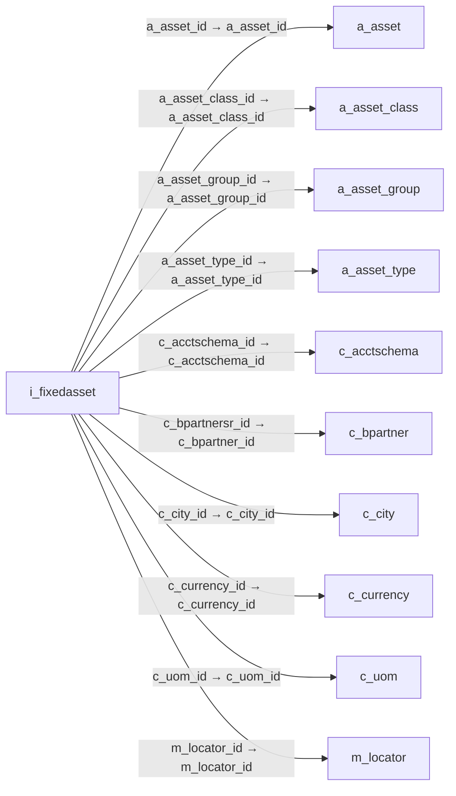

# i_fixedasset — 고정자산 가져오기

[전체 일람](../TABLE_INDEX.md) · [분류 일람](README.md) · [AI 사용 안내](../README.md) · [외래키 읽는 법](../RELATIONSHIPS.md)

## 기본 정보

| 항목 | 내용 |
|---|---|
| 물리명 | `adempiere.i_fixedasset` |
| 한국어 논리명(문서용 해석) | 고정자산 가져오기 |
| 원본 논리명 | Imported Fixed Asset |
| 원본 사전 ID | 53277 |
| 분류 | `i` — 데이터 가져오기 준비 |
| 전체 테넌트 행 수 | 0 |
| 물리 열 수 | 54 |
| 나가는 FK / 들어오는 FK | 11 / 1 |
| 구조·행 수 확인 시점 | 2026-11-03T23:29:01+09:00 |

## 의미와 쓰임

취득원가·누적감가상각·사용연수 등 외부 고정자산 정보를 자산 대장으로 옮기기 위한 데이터를 저장한다.

- 설명 근거: 물리명·열·외래키 구조를 근거로 보수적으로 해석.
- 한국어 이름과 개요는 문서용 해석입니다. 공식 한국어 번역으로 간주하지 않습니다.
- 원본 설명: —
- 원본 도움말: —
- PostgreSQL 테이블 주석: —

## 키와 열

### 기본키·고유 제약조건

| 종류 | 제약조건 | 열(순서 유지) |
|---|---|---|
| PRIMARY KEY | `i_fixedasset_key` | `i_fixedasset_id` |
| UNIQUE | `i_fixedasset_uu_idx` | `i_fixedasset_uu` |

### 열 목록

원본 논리명·설명은 `AD_Column`에서 가져왔습니다. 기본값은 실제 PostgreSQL 메타데이터이며, 비어 있는 항목은 `—`로 표시합니다.

| 순서 | 물리명 | 원본 논리명 | PostgreSQL 타입 | NULL | PK | 기본값 | 설명 |
|---:|---|---|---|---|---|---|---|
| 1 | `i_fixedasset_id` | Imported Fixed Asset | numeric(10,0) | 불가 | 예 | NULL::numeric | — |
| 2 | `ad_client_id` | Tenant | numeric(10,0) | 불가 | — | — | Tenant for this installation. |
| 3 | `ad_org_id` | Organization | numeric(10,0) | 불가 | — | — | Organizational entity within tenant |
| 4 | `isactive` | Active | character(1) | 불가 | — | 'Y'::bpchar | The record is active in the system |
| 5 | `created` | Created | timestamp without time zone | 불가 | — | statement_timestamp() | Date this record was created |
| 6 | `createdby` | Created By | numeric(10,0) | 불가 | — | — | User who created this records |
| 7 | `updated` | Updated | timestamp without time zone | 불가 | — | statement_timestamp() | Date this record was updated |
| 8 | `updatedby` | Updated By | numeric(10,0) | 불가 | — | — | User who updated this records |
| 9 | `inventoryno` | Inventory No | character varying(30) | 허용 | — | NULL::character varying | — |
| 10 | `name` | Name | character varying(120) | 허용 | — | NULL::character varying | Alphanumeric identifier of the entity |
| 11 | `a_asset_group_id` | Asset Group | numeric(10,0) | 허용 | — | NULL::numeric | Group of Assets |
| 12 | `a_asset_group_value` | Asset Group Key | character varying(40) | 허용 | — | NULL::character varying | — |
| 13 | `a_asset_class_id` | Asset class | numeric(10,0) | 허용 | — | NULL::numeric | — |
| 14 | `a_asset_class_value` | Asset Class Key | character varying(40) | 허용 | — | NULL::character varying | — |
| 15 | `m_product_id` | Product | numeric(10,0) | 허용 | — | NULL::numeric | Product, Service, Item |
| 16 | `productvalue` | Product Key | character varying(40) | 허용 | — | NULL::character varying | Key of the Product |
| 17 | `assetservicedate` | In Service Date | timestamp without time zone | 허용 | — | — | Date when Asset was put into service |
| 18 | `a_asset_cost` | Asset Cost | numeric | 불가 | — | (0)::numeric | — |
| 19 | `a_accumulated_depr` | Accumulated Depreciation | numeric | 허용 | — | — | — |
| 20 | `a_accumulated_depr_f` | Accumulated Depreciation (fiscal) | numeric | 허용 | — | — | — |
| 21 | `uselifemonths` | Usable Life - Months | numeric(10,0) | 허용 | — | — | Months of the usable life of the asset |
| 22 | `uselifemonths_f` | Use Life - Months (fiscal) | numeric(10,0) | 허용 | — | — | — |
| 23 | `a_current_period` | Current Period | numeric(10,0) | 허용 | — | NULL::numeric | — |
| 24 | `dateacct` | Account Date | timestamp without time zone | 허용 | — | — | Accounting Date |
| 25 | `a_asset_id` | Asset | numeric(10,0) | 허용 | — | NULL::numeric | Asset used internally or by customers |
| 26 | `i_isimported` | Imported | character(1) | 불가 | — | 'N'::bpchar | Has this import been processed |
| 27 | `i_errormsg` | Import Error Message | character varying(2000) | 허용 | — | NULL::character varying | Messages generated from import process |
| 28 | `processing` | Process Now | character(1) | 허용 | — | NULL::bpchar | — |
| 29 | `processed` | Processed | character(1) | 허용 | — | NULL::bpchar | The document has been processed |
| 30 | `a_remaining_period` | Remaining Period | numeric(10,0) | 불가 | — | (0)::numeric | — |
| 31 | `docaction` | Document Action | character varying(2) | 불가 | — | 'CO'::character varying | The targeted status of the document |
| 32 | `assetperioddepreciationamt` | Depreciation Amount / Period | numeric | 불가 | — | (0)::numeric | Applies to Straight Line depreciation |
| 33 | `assetdepreciationdate` | Asset Depreciation Date | timestamp without time zone | 허용 | — | — | Date of last depreciation |
| 34 | `m_locator_id` | Locator | numeric(10,0) | 허용 | — | NULL::numeric | Warehouse Locator |
| 35 | `locatorvalue` | Locator Key | character varying(40) | 허용 | — | NULL::character varying | Key of the Warehouse Locator |
| 36 | `qty` | Quantity | numeric | 허용 | — | (1)::numeric | Quantity |
| 37 | `uomsymbol` | Symbol | character varying(10) | 허용 | — | NULL::character varying | Symbol for a Unit of Measure |
| 38 | `c_uom_id` | UOM | numeric(10,0) | 허용 | — | NULL::numeric | Unit of Measure |
| 39 | `description` | Description | character varying(255) | 허용 | — | NULL::character varying | Optional short description of the record |
| 40 | `c_city_value` | City Value | character varying(40) | 허용 | — | NULL::character varying | — |
| 41 | `seqno` | Sequence | numeric(10,0) | 허용 | — | (1)::numeric | Method of ordering records; lowest number comes first |
| 42 | `bpartner_value` | Business Partner Key | character varying(40) | 허용 | — | NULL::character varying | The Key of the Business Partner |
| 43 | `c_bpartnersr_id` | BPartner (Agent) | numeric(10,0) | 허용 | — | NULL::numeric | Business Partner (Agent or Sales Rep) |
| 44 | `c_city_id` | City | numeric(10,0) | 허용 | — | NULL::numeric | City |
| 45 | `a_asset_type_id` | Asset Type | numeric(10,0) | 허용 | — | — | — |
| 46 | `a_asset_type_value` | Asset Type Value | character varying(40) | 허용 | — | NULL::character varying | — |
| 47 | `a_salvage_value` | Asset Salvage Value | numeric | 허용 | — | — | — |
| 48 | `i_fixedasset_uu` | I_FixedAsset_UU | uuid | 허용 | — | — | — |
| 49 | `iso_code` | ISO Currency Code | character varying(3) | 허용 | — | NULL::character varying | Three letter ISO 4217 Code of the Currency |
| 50 | `c_currency_id` | Currency | numeric(10,0) | 허용 | — | NULL::numeric | The Currency for this record |
| 51 | `assetamtentered` | Entered Amount | numeric | 불가 | — | '0'::numeric | — |
| 52 | `assetsourceamt` | Source Amount | numeric | 불가 | — | '0'::numeric | — |
| 53 | `acctschemaname` | Account Schema Name | character varying(120) | 허용 | — | NULL::character varying | Name of the Accounting Schema |
| 54 | `c_acctschema_id` | Accounting Schema | numeric(10,0) | 허용 | — | NULL::numeric | Rules for accounting |

## 외래키 흐름

화살표는 **FK를 가진 자식 → 참조되는 부모**입니다. 업무 처리의 시간 순서나 무조건적인 1:N 관계를 뜻하지 않습니다.

주변 관계 12개 중 10개를 그림으로 표시합니다. **전체 관계는 아래 두 표에 모두 포함**합니다.

### 이 테이블이 참조하는 부모 — 나가는 FK

| 제약조건 | 참조하는 쪽(자식) | 자식 열 | 참조받는 쪽(부모) | 부모 열 | 삭제 / 갱신 | 검증 / 지연 가능 |
|---|---|---|---|---|---|---|
| `aasset_ifixedasset` <!-- FK_OUT: adempiere.i_fixedasset.aasset_ifixedasset --> | [`i_fixedasset`](i_fixedasset.md) | `a_asset_id` | [`a_asset`](../a/a_asset.md) | `a_asset_id` | NO ACTION / NO ACTION | 완료 / 가능 (초기 지연) |
| `aassetclass_ifixedasset` <!-- FK_OUT: adempiere.i_fixedasset.aassetclass_ifixedasset --> | [`i_fixedasset`](i_fixedasset.md) | `a_asset_class_id` | [`a_asset_class`](../a/a_asset_class.md) | `a_asset_class_id` | NO ACTION / NO ACTION | 완료 / 가능 (초기 지연) |
| `aassetgroup_ifixedasset` <!-- FK_OUT: adempiere.i_fixedasset.aassetgroup_ifixedasset --> | [`i_fixedasset`](i_fixedasset.md) | `a_asset_group_id` | [`a_asset_group`](../a/a_asset_group.md) | `a_asset_group_id` | NO ACTION / NO ACTION | 완료 / 가능 (초기 지연) |
| `aassettype_ifixedasset` <!-- FK_OUT: adempiere.i_fixedasset.aassettype_ifixedasset --> | [`i_fixedasset`](i_fixedasset.md) | `a_asset_type_id` | [`a_asset_type`](../a/a_asset_type.md) | `a_asset_type_id` | NO ACTION / NO ACTION | 완료 / 가능 (초기 지연) |
| `cacctschema_ifixedasset` <!-- FK_OUT: adempiere.i_fixedasset.cacctschema_ifixedasset --> | [`i_fixedasset`](i_fixedasset.md) | `c_acctschema_id` | [`c_acctschema`](../c/c_acctschema.md) | `c_acctschema_id` | CASCADE / NO ACTION | 완료 / 가능 (초기 지연) |
| `cbpartnersr_ifixedasset` <!-- FK_OUT: adempiere.i_fixedasset.cbpartnersr_ifixedasset --> | [`i_fixedasset`](i_fixedasset.md) | `c_bpartnersr_id` | [`c_bpartner`](../c/c_bpartner.md) | `c_bpartner_id` | NO ACTION / NO ACTION | 완료 / 가능 (초기 지연) |
| `ccity_ifixedasset` <!-- FK_OUT: adempiere.i_fixedasset.ccity_ifixedasset --> | [`i_fixedasset`](i_fixedasset.md) | `c_city_id` | [`c_city`](../c/c_city.md) | `c_city_id` | NO ACTION / NO ACTION | 완료 / 가능 (초기 지연) |
| `ccurrency_ifixedasset` <!-- FK_OUT: adempiere.i_fixedasset.ccurrency_ifixedasset --> | [`i_fixedasset`](i_fixedasset.md) | `c_currency_id` | [`c_currency`](../c/c_currency.md) | `c_currency_id` | NO ACTION / NO ACTION | 완료 / 가능 (초기 지연) |
| `cuom_ifixedasset` <!-- FK_OUT: adempiere.i_fixedasset.cuom_ifixedasset --> | [`i_fixedasset`](i_fixedasset.md) | `c_uom_id` | [`c_uom`](../c/c_uom.md) | `c_uom_id` | NO ACTION / NO ACTION | 완료 / 가능 (초기 지연) |
| `mlocator_ifixedasset` <!-- FK_OUT: adempiere.i_fixedasset.mlocator_ifixedasset --> | [`i_fixedasset`](i_fixedasset.md) | `m_locator_id` | [`m_locator`](../m/m_locator.md) | `m_locator_id` | NO ACTION / NO ACTION | 완료 / 가능 (초기 지연) |
| `mproduct_ifixedasset` <!-- FK_OUT: adempiere.i_fixedasset.mproduct_ifixedasset --> | [`i_fixedasset`](i_fixedasset.md) | `m_product_id` | [`m_product`](../m/m_product.md) | `m_product_id` | NO ACTION / NO ACTION | 완료 / 가능 (초기 지연) |

### 이 테이블을 참조하는 자식 — 들어오는 FK

| 제약조건 | 참조하는 쪽(자식) | 자식 열 | 참조받는 쪽(부모) | 부모 열 | 삭제 / 갱신 | 검증 / 지연 가능 |
|---|---|---|---|---|---|---|
| `ifixedasset_aassetaddition` <!-- FK_IN: adempiere.a_asset_addition.ifixedasset_aassetaddition --> | [`a_asset_addition`](../a/a_asset_addition.md) | `i_fixedasset_id` | [`i_fixedasset`](i_fixedasset.md) | `i_fixedasset_id` | NO ACTION / NO ACTION | 완료 / 가능 (초기 지연) |

## 조회 시 주의

- FK 표의 자식 열과 부모 열을 같은 순서로 대응시킵니다. 복합 FK는 모든 열의 동등 조건을 `AND`로 연결합니다.
- 테이블 이름이나 `_id` 열 이름만으로 물리 FK가 있다고 가정하지 않습니다. FK 미선언은 업무 관계가 없다는 뜻도 아닙니다.
- 자식이 여러 행인 테이블과 조인하면 부모의 금액·건수가 중복될 수 있습니다. 집계 단위를 먼저 정합니다.
- `ad_client_id`가 있습니다. 업무 분석에서는 대상 테넌트를 명시합니다. GardenWorld는 `11`, 시스템 공통 설정은 `0`일 수 있으므로 일괄 필터 적용 전에 테이블 역할을 확인합니다.
- 수집 시점에 0행입니다. 이 표만으로 거래 실적·처리 결과를 계산할 수 없습니다.
- 행 수는 위 확인 시점의 전체 테넌트 값입니다. 최신 업무 실적이나 현재 실행 결과로 재사용하지 않습니다.
