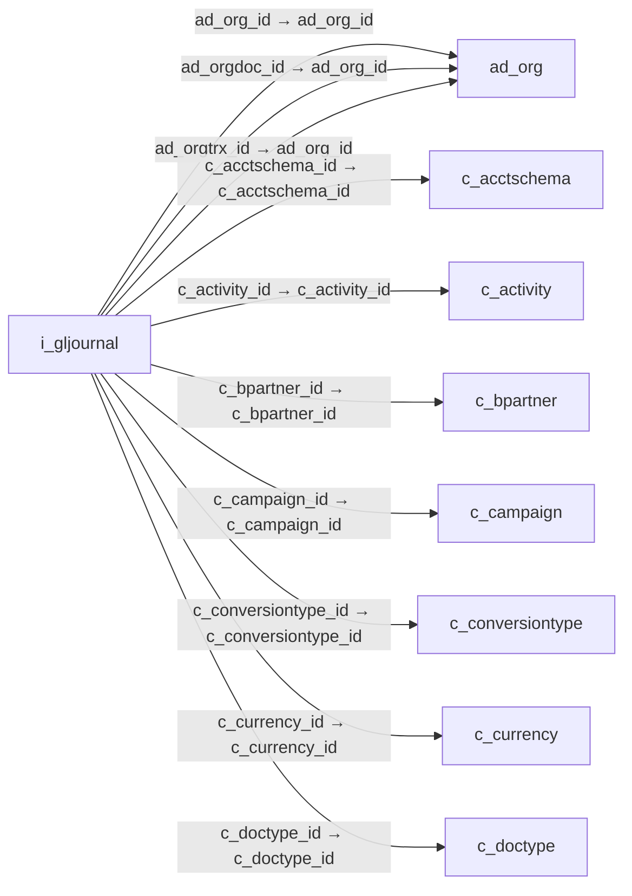

# i_gljournal — 총계정원장 분개 가져오기

[전체 일람](../TABLE_INDEX.md) · [분류 일람](README.md) · [AI 사용 안내](../README.md) · [외래키 읽는 법](../RELATIONSHIPS.md)

## 기본 정보

| 항목 | 내용 |
|---|---|
| 물리명 | `adempiere.i_gljournal` |
| 한국어 논리명(문서용 해석) | 총계정원장 분개 가져오기 |
| 원본 논리명 | Import GL Journal |
| 원본 사전 ID | 599 |
| 분류 | `i` — 데이터 가져오기 준비 |
| 전체 테넌트 행 수 | 0 |
| 물리 열 수 | 70 |
| 나가는 FK / 들어오는 FK | 26 / 0 |
| 구조·행 수 확인 시점 | 2026-11-03T23:29:01+09:00 |

## 의미와 쓰임

외부 총계정원장 분개를 가져오기 위한 입력 데이터를 보관한다.

- 설명 근거: 원본 애플리케이션 사전 명칭·설명을 한국어로 해석.
- 한국어 이름과 개요는 문서용 해석입니다. 공식 한국어 번역으로 간주하지 않습니다.
- 원본 설명: Import General Ledger Journal
- 원본 도움말: —
- PostgreSQL 테이블 주석: —

## 키와 열

### 기본키·고유 제약조건

| 종류 | 제약조건 | 열(순서 유지) |
|---|---|---|
| PRIMARY KEY | `i_gljournal_pkey` | `i_gljournal_id` |
| UNIQUE | `i_gljournal_uu_idx` | `i_gljournal_uu` |

### 열 목록

원본 논리명·설명은 `AD_Column`에서 가져왔습니다. 기본값은 실제 PostgreSQL 메타데이터이며, 비어 있는 항목은 `—`로 표시합니다.

| 순서 | 물리명 | 원본 논리명 | PostgreSQL 타입 | NULL | PK | 기본값 | 설명 |
|---:|---|---|---|---|---|---|---|
| 1 | `i_gljournal_id` | Import GL Journal | numeric(10,0) | 불가 | 예 | — | Import General Ledger Journal |
| 2 | `ad_client_id` | Tenant | numeric(10,0) | 허용 | — | — | Tenant for this installation. |
| 3 | `clientvalue` | Tenant Key | character varying(40) | 허용 | — | — | Key of the Tenant |
| 4 | `ad_orgdoc_id` | Document Org | numeric(10,0) | 허용 | — | — | Document Organization (independent from account organization) |
| 5 | `isactive` | Active | character(1) | 허용 | — | 'Y'::bpchar | The record is active in the system |
| 6 | `created` | Created | timestamp without time zone | 불가 | — | statement_timestamp() | Date this record was created |
| 7 | `createdby` | Created By | numeric(10,0) | 허용 | — | — | User who created this records |
| 8 | `updated` | Updated | timestamp without time zone | 불가 | — | statement_timestamp() | Date this record was updated |
| 9 | `updatedby` | Updated By | numeric(10,0) | 허용 | — | — | User who updated this records |
| 10 | `i_isimported` | Imported | character(1) | 불가 | — | 'N'::bpchar | Has this import been processed |
| 11 | `i_errormsg` | Import Error Message | character varying(2000) | 허용 | — | — | Messages generated from import process |
| 12 | `processing` | Process Now | character(1) | 허용 | — | — | — |
| 13 | `processed` | Processed | character(1) | 허용 | — | 'N'::bpchar | The document has been processed |
| 14 | `gl_journalbatch_id` | Journal Batch | numeric(10,0) | 허용 | — | — | General Ledger Journal Batch |
| 15 | `batchdocumentno` | Batch Document No | character varying(30) | 허용 | — | — | Document Number of the Batch |
| 16 | `batchdescription` | Batch Description | character varying(255) | 허용 | — | — | Description of the Batch |
| 17 | `gl_journal_id` | Journal | numeric(10,0) | 허용 | — | — | General Ledger Journal |
| 18 | `journaldocumentno` | Journal Document No | character varying(30) | 허용 | — | — | Document number of the Journal |
| 19 | `postingtype` | Posting Type | character(1) | 허용 | — | — | The type of posted amount for the transaction |
| 20 | `c_acctschema_id` | Accounting Schema | numeric(10,0) | 허용 | — | — | Rules for accounting |
| 21 | `acctschemaname` | Account Schema Name | character varying(60) | 허용 | — | — | Name of the Accounting Schema |
| 22 | `c_doctype_id` | Document Type | numeric(10,0) | 허용 | — | — | Document type or rules |
| 23 | `doctypename` | Document Type Name | character varying(60) | 허용 | — | — | Name of the Document Type |
| 24 | `gl_category_id` | GL Category | numeric(10,0) | 허용 | — | — | General Ledger Category |
| 25 | `categoryname` | Category Name | character varying(60) | 허용 | — | — | Name of the Category |
| 26 | `c_period_id` | Period | numeric(10,0) | 허용 | — | — | Period of the Calendar |
| 27 | `gl_budget_id` | Budget | numeric(10,0) | 허용 | — | — | General Ledger Budget |
| 28 | `gl_journalline_id` | Journal Line | numeric(10,0) | 허용 | — | — | General Ledger Journal Line |
| 29 | `line` | Line No | numeric(10,0) | 허용 | — | — | Unique line for this document |
| 30 | `dateacct` | Account Date | timestamp without time zone | 허용 | — | — | Accounting Date |
| 31 | `description` | Description | character varying(255) | 허용 | — | — | Optional short description of the record |
| 32 | `amtsourcedr` | Source Debit | numeric | 허용 | — | 0 | Source Debit Amount |
| 33 | `amtacctdr` | Accounted Debit | numeric | 허용 | — | 0 | Accounted Debit Amount |
| 34 | `amtsourcecr` | Source Credit | numeric | 허용 | — | 0 | Source Credit Amount |
| 35 | `amtacctcr` | Accounted Credit | numeric | 허용 | — | 0 | Accounted Credit Amount |
| 36 | `c_currency_id` | Currency | numeric(10,0) | 허용 | — | — | The Currency for this record |
| 37 | `iso_code` | ISO Currency Code | character(3) | 허용 | — | — | Three letter ISO 4217 Code of the Currency |
| 38 | `conversiontypevalue` | Currency Type Key | character varying(40) | 허용 | — | — | Key value for the Currency Conversion Rate Type |
| 39 | `c_conversiontype_id` | Currency Type | numeric(10,0) | 허용 | — | — | Currency Conversion Rate Type |
| 40 | `currencyrate` | Rate | numeric | 허용 | — | 0 | Currency Conversion Rate |
| 41 | `c_uom_id` | UOM | numeric(10,0) | 허용 | — | — | Unit of Measure |
| 42 | `qty` | Quantity | numeric | 허용 | — | 0 | Quantity |
| 43 | `c_validcombination_id` | Combination | numeric(10,0) | 허용 | — | — | Valid Account Combination |
| 44 | `orgvalue` | Org Key | character varying(40) | 허용 | — | — | Key of the Organization |
| 45 | `ad_org_id` | Organization | numeric(10,0) | 허용 | — | — | Organizational entity within tenant |
| 46 | `account_id` | Account | numeric(10,0) | 허용 | — | — | Account used |
| 47 | `accountvalue` | Account Key | character varying(40) | 허용 | — | — | Key of Account Element |
| 48 | `ad_orgtrx_id` | Trx Organization | numeric(10,0) | 허용 | — | — | Performing or initiating organization |
| 49 | `orgtrxvalue` | Trx Org Key | character varying(40) | 허용 | — | — | Key of the Transaction Organization |
| 50 | `m_product_id` | Product | numeric(10,0) | 허용 | — | — | Product, Service, Item |
| 51 | `productvalue` | Product Key | character varying(40) | 허용 | — | — | Key of the Product |
| 52 | `upc` | UPC/EAN | character varying(30) | 허용 | — | — | Bar Code (Universal Product Code or its superset European Article Number) |
| 53 | `sku` | SKU | character varying(30) | 허용 | — | — | Stock Keeping Unit |
| 54 | `c_bpartner_id` | Business Partner | numeric(10,0) | 허용 | — | — | Identifies a Business Partner |
| 55 | `bpartnervalue` | Business Partner Key | character varying(40) | 허용 | — | — | Key of the Business Partner |
| 56 | `c_project_id` | Project | numeric(10,0) | 허용 | — | — | Financial Project |
| 57 | `projectvalue` | Project Key | character varying(40) | 허용 | — | — | Key of the Project |
| 58 | `c_locto_id` | Location To | numeric(10,0) | 허용 | — | — | Location that inventory was moved to |
| 59 | `c_locfrom_id` | Location From | numeric(10,0) | 허용 | — | — | Location that inventory was moved from |
| 60 | `c_salesregion_id` | Sales Region | numeric(10,0) | 허용 | — | — | Sales coverage region |
| 61 | `c_activity_id` | Activity | numeric(10,0) | 허용 | — | — | Business Activity |
| 62 | `c_campaign_id` | Campaign | numeric(10,0) | 허용 | — | — | Marketing Campaign |
| 63 | `user1_id` | User Element List 1 | numeric(10,0) | 허용 | — | — | User defined list element #1 |
| 64 | `user2_id` | User Element List 2 | numeric(10,0) | 허용 | — | — | User defined list element #2 |
| 65 | `iscreatenewbatch` | Create New Batch | character(1) | 허용 | — | 'N'::bpchar | If selected a new batch is created |
| 66 | `iscreatenewjournal` | Create New Journal | character(1) | 허용 | — | 'N'::bpchar | If selected a new journal within the batch is created |
| 67 | `i_gljournal_uu` | I_GLJournal_UU | uuid | 허용 | — | — | — |
| 68 | `activityvalue` | Activity Key | character varying(40) | 허용 | — | NULL::character varying | Text key for Activity |
| 69 | `campaignvalue` | Campaign Key | character varying(40) | 허용 | — | NULL::character varying | Text key of the Campaign |
| 70 | `salesregionvalue` | Sales Region Key | character varying(40) | 허용 | — | NULL::character varying | Text key of the Sales Region |

## 외래키 흐름

화살표는 **FK를 가진 자식 → 참조되는 부모**입니다. 업무 처리의 시간 순서나 무조건적인 1:N 관계를 뜻하지 않습니다.

주변 관계 26개 중 10개를 그림으로 표시합니다. **전체 관계는 아래 두 표에 모두 포함**합니다.

### 이 테이블이 참조하는 부모 — 나가는 FK

| 제약조건 | 참조하는 쪽(자식) | 자식 열 | 참조받는 쪽(부모) | 부모 열 | 삭제 / 갱신 | 검증 / 지연 가능 |
|---|---|---|---|---|---|---|
| `adorg_igljournal` <!-- FK_OUT: adempiere.i_gljournal.adorg_igljournal --> | [`i_gljournal`](i_gljournal.md) | `ad_org_id` | [`ad_org`](../ad/ad_org.md) | `ad_org_id` | SET NULL / NO ACTION | 완료 / 가능 (초기 지연) |
| `adorgdoc_igljournal` <!-- FK_OUT: adempiere.i_gljournal.adorgdoc_igljournal --> | [`i_gljournal`](i_gljournal.md) | `ad_orgdoc_id` | [`ad_org`](../ad/ad_org.md) | `ad_org_id` | SET NULL / NO ACTION | 완료 / 가능 (초기 지연) |
| `adorgtrx_igljournal` <!-- FK_OUT: adempiere.i_gljournal.adorgtrx_igljournal --> | [`i_gljournal`](i_gljournal.md) | `ad_orgtrx_id` | [`ad_org`](../ad/ad_org.md) | `ad_org_id` | SET NULL / NO ACTION | 완료 / 가능 (초기 지연) |
| `cacctschema_igljournal` <!-- FK_OUT: adempiere.i_gljournal.cacctschema_igljournal --> | [`i_gljournal`](i_gljournal.md) | `c_acctschema_id` | [`c_acctschema`](../c/c_acctschema.md) | `c_acctschema_id` | SET NULL / NO ACTION | 완료 / 가능 (초기 지연) |
| `cactivity_gljournal` <!-- FK_OUT: adempiere.i_gljournal.cactivity_gljournal --> | [`i_gljournal`](i_gljournal.md) | `c_activity_id` | [`c_activity`](../c/c_activity.md) | `c_activity_id` | SET NULL / NO ACTION | 완료 / 가능 (초기 지연) |
| `cbpartner_igljournal` <!-- FK_OUT: adempiere.i_gljournal.cbpartner_igljournal --> | [`i_gljournal`](i_gljournal.md) | `c_bpartner_id` | [`c_bpartner`](../c/c_bpartner.md) | `c_bpartner_id` | SET NULL / NO ACTION | 완료 / 가능 (초기 지연) |
| `ccampaign_igljournal` <!-- FK_OUT: adempiere.i_gljournal.ccampaign_igljournal --> | [`i_gljournal`](i_gljournal.md) | `c_campaign_id` | [`c_campaign`](../c/c_campaign.md) | `c_campaign_id` | SET NULL / NO ACTION | 완료 / 가능 (초기 지연) |
| `cconversiontype_igljournal` <!-- FK_OUT: adempiere.i_gljournal.cconversiontype_igljournal --> | [`i_gljournal`](i_gljournal.md) | `c_conversiontype_id` | [`c_conversiontype`](../c/c_conversiontype.md) | `c_conversiontype_id` | SET NULL / NO ACTION | 완료 / 가능 (초기 지연) |
| `ccurrency_igljournal` <!-- FK_OUT: adempiere.i_gljournal.ccurrency_igljournal --> | [`i_gljournal`](i_gljournal.md) | `c_currency_id` | [`c_currency`](../c/c_currency.md) | `c_currency_id` | SET NULL / NO ACTION | 완료 / 가능 (초기 지연) |
| `cdoctype_igljournal` <!-- FK_OUT: adempiere.i_gljournal.cdoctype_igljournal --> | [`i_gljournal`](i_gljournal.md) | `c_doctype_id` | [`c_doctype`](../c/c_doctype.md) | `c_doctype_id` | SET NULL / NO ACTION | 완료 / 가능 (초기 지연) |
| `celvalueaccount_igljournal` <!-- FK_OUT: adempiere.i_gljournal.celvalueaccount_igljournal --> | [`i_gljournal`](i_gljournal.md) | `account_id` | [`c_elementvalue`](../c/c_elementvalue.md) | `c_elementvalue_id` | SET NULL / NO ACTION | 완료 / 가능 (초기 지연) |
| `celvalueuser2_igljournal` <!-- FK_OUT: adempiere.i_gljournal.celvalueuser2_igljournal --> | [`i_gljournal`](i_gljournal.md) | `user2_id` | [`c_elementvalue`](../c/c_elementvalue.md) | `c_elementvalue_id` | SET NULL / NO ACTION | 완료 / 가능 (초기 지연) |
| `cevalueuser1_igljournal` <!-- FK_OUT: adempiere.i_gljournal.cevalueuser1_igljournal --> | [`i_gljournal`](i_gljournal.md) | `user1_id` | [`c_elementvalue`](../c/c_elementvalue.md) | `c_elementvalue_id` | SET NULL / NO ACTION | 완료 / 가능 (초기 지연) |
| `clocfrom_igljournal` <!-- FK_OUT: adempiere.i_gljournal.clocfrom_igljournal --> | [`i_gljournal`](i_gljournal.md) | `c_locfrom_id` | [`c_location`](../c/c_location.md) | `c_location_id` | SET NULL / NO ACTION | 완료 / 가능 (초기 지연) |
| `clocto_igljournal` <!-- FK_OUT: adempiere.i_gljournal.clocto_igljournal --> | [`i_gljournal`](i_gljournal.md) | `c_locto_id` | [`c_location`](../c/c_location.md) | `c_location_id` | SET NULL / NO ACTION | 완료 / 가능 (초기 지연) |
| `cperiod_igljournal` <!-- FK_OUT: adempiere.i_gljournal.cperiod_igljournal --> | [`i_gljournal`](i_gljournal.md) | `c_period_id` | [`c_period`](../c/c_period.md) | `c_period_id` | SET NULL / NO ACTION | 완료 / 가능 (초기 지연) |
| `cproject_igljournal` <!-- FK_OUT: adempiere.i_gljournal.cproject_igljournal --> | [`i_gljournal`](i_gljournal.md) | `c_project_id` | [`c_project`](../c/c_project.md) | `c_project_id` | SET NULL / NO ACTION | 완료 / 가능 (초기 지연) |
| `csalesregion_igljournal` <!-- FK_OUT: adempiere.i_gljournal.csalesregion_igljournal --> | [`i_gljournal`](i_gljournal.md) | `c_salesregion_id` | [`c_salesregion`](../c/c_salesregion.md) | `c_salesregion_id` | SET NULL / NO ACTION | 완료 / 가능 (초기 지연) |
| `cuom_igljournal` <!-- FK_OUT: adempiere.i_gljournal.cuom_igljournal --> | [`i_gljournal`](i_gljournal.md) | `c_uom_id` | [`c_uom`](../c/c_uom.md) | `c_uom_id` | NO ACTION / NO ACTION | 완료 / 가능 (초기 지연) |
| `cvalidcombination_igljournal` <!-- FK_OUT: adempiere.i_gljournal.cvalidcombination_igljournal --> | [`i_gljournal`](i_gljournal.md) | `c_validcombination_id` | [`c_validcombination`](../c/c_validcombination.md) | `c_validcombination_id` | SET NULL / NO ACTION | 완료 / 가능 (초기 지연) |
| `glbudget_igljournal` <!-- FK_OUT: adempiere.i_gljournal.glbudget_igljournal --> | [`i_gljournal`](i_gljournal.md) | `gl_budget_id` | [`gl_budget`](../gl/gl_budget.md) | `gl_budget_id` | SET NULL / NO ACTION | 완료 / 가능 (초기 지연) |
| `glcategory_igljournal` <!-- FK_OUT: adempiere.i_gljournal.glcategory_igljournal --> | [`i_gljournal`](i_gljournal.md) | `gl_category_id` | [`gl_category`](../gl/gl_category.md) | `gl_category_id` | SET NULL / NO ACTION | 완료 / 가능 (초기 지연) |
| `gljourbelline_igljournal` <!-- FK_OUT: adempiere.i_gljournal.gljourbelline_igljournal --> | [`i_gljournal`](i_gljournal.md) | `gl_journalline_id` | [`gl_journalline`](../gl/gl_journalline.md) | `gl_journalline_id` | SET NULL / NO ACTION | 완료 / 가능 (초기 지연) |
| `gljournal_igljournal` <!-- FK_OUT: adempiere.i_gljournal.gljournal_igljournal --> | [`i_gljournal`](i_gljournal.md) | `gl_journal_id` | [`gl_journal`](../gl/gl_journal.md) | `gl_journal_id` | SET NULL / NO ACTION | 완료 / 가능 (초기 지연) |
| `gljournalbatch_igljournal` <!-- FK_OUT: adempiere.i_gljournal.gljournalbatch_igljournal --> | [`i_gljournal`](i_gljournal.md) | `gl_journalbatch_id` | [`gl_journalbatch`](../gl/gl_journalbatch.md) | `gl_journalbatch_id` | SET NULL / NO ACTION | 완료 / 가능 (초기 지연) |
| `mproduct_ogljournal` <!-- FK_OUT: adempiere.i_gljournal.mproduct_ogljournal --> | [`i_gljournal`](i_gljournal.md) | `m_product_id` | [`m_product`](../m/m_product.md) | `m_product_id` | SET NULL / NO ACTION | 완료 / 가능 (초기 지연) |

### 이 테이블을 참조하는 자식 — 들어오는 FK

해당 방향의 물리 FK 제약조건은 없습니다. 이름이 비슷한 열만으로 관계를 추가하지 않습니다.

## 조회 시 주의

- FK 표의 자식 열과 부모 열을 같은 순서로 대응시킵니다. 복합 FK는 모든 열의 동등 조건을 `AND`로 연결합니다.
- 테이블 이름이나 `_id` 열 이름만으로 물리 FK가 있다고 가정하지 않습니다. FK 미선언은 업무 관계가 없다는 뜻도 아닙니다.
- 자식이 여러 행인 테이블과 조인하면 부모의 금액·건수가 중복될 수 있습니다. 집계 단위를 먼저 정합니다.
- `ad_client_id`가 있습니다. 업무 분석에서는 대상 테넌트를 명시합니다. GardenWorld는 `11`, 시스템 공통 설정은 `0`일 수 있으므로 일괄 필터 적용 전에 테이블 역할을 확인합니다.
- 수집 시점에 0행입니다. 이 표만으로 거래 실적·처리 결과를 계산할 수 없습니다.
- 행 수는 위 확인 시점의 전체 테넌트 값입니다. 최신 업무 실적이나 현재 실행 결과로 재사용하지 않습니다.
