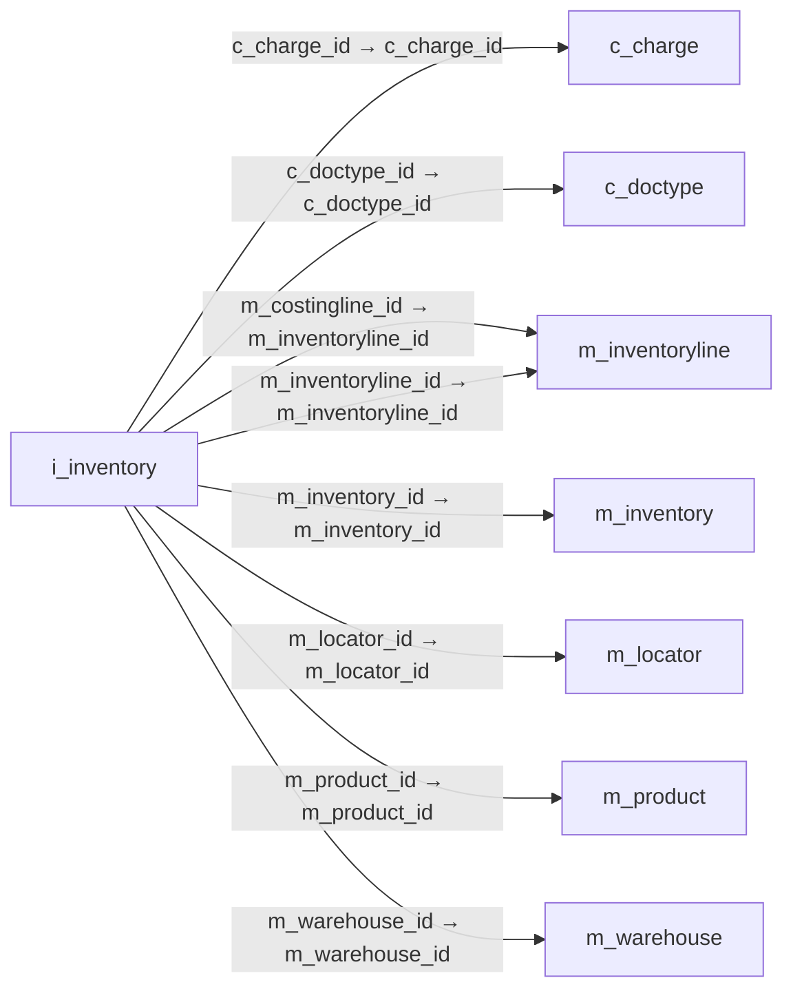

# i_inventory — 재고 거래 가져오기

[전체 일람](../TABLE_INDEX.md) · [분류 일람](README.md) · [AI 사용 안내](../README.md) · [외래키 읽는 법](../RELATIONSHIPS.md)

## 기본 정보

| 항목 | 내용 |
|---|---|
| 물리명 | `adempiere.i_inventory` |
| 한국어 논리명(문서용 해석) | 재고 거래 가져오기 |
| 원본 논리명 | Import Inventory |
| 원본 사전 ID | 572 |
| 분류 | `i` — 데이터 가져오기 준비 |
| 전체 테넌트 행 수 | 0 |
| 물리 열 수 | 38 |
| 나가는 FK / 들어오는 FK | 8 / 0 |
| 구조·행 수 확인 시점 | 2026-11-03T23:29:01+09:00 |

## 의미와 쓰임

외부 재고 거래를 시스템 재고 문서로 가져오기 위한 입력 데이터를 저장한다.

- 설명 근거: 원본 애플리케이션 사전 명칭·설명을 한국어로 해석.
- 한국어 이름과 개요는 문서용 해석입니다. 공식 한국어 번역으로 간주하지 않습니다.
- 원본 설명: Import Inventory Transactions
- 원본 도움말: —
- PostgreSQL 테이블 주석: —

## 키와 열

### 기본키·고유 제약조건

| 종류 | 제약조건 | 열(순서 유지) |
|---|---|---|
| PRIMARY KEY | `i_inventory_pkey` | `i_inventory_id` |
| UNIQUE | `i_inventory_uu_idx` | `i_inventory_uu` |

### 열 목록

원본 논리명·설명은 `AD_Column`에서 가져왔습니다. 기본값은 실제 PostgreSQL 메타데이터이며, 비어 있는 항목은 `—`로 표시합니다.

| 순서 | 물리명 | 원본 논리명 | PostgreSQL 타입 | NULL | PK | 기본값 | 설명 |
|---:|---|---|---|---|---|---|---|
| 1 | `i_inventory_id` | Import Inventory | numeric(10,0) | 불가 | 예 | — | Import Inventory Transactions |
| 2 | `ad_client_id` | Tenant | numeric(10,0) | 허용 | — | — | Tenant for this installation. |
| 3 | `ad_org_id` | Organization | numeric(10,0) | 허용 | — | — | Organizational entity within tenant |
| 4 | `isactive` | Active | character(1) | 허용 | — | 'Y'::bpchar | The record is active in the system |
| 5 | `created` | Created | timestamp without time zone | 불가 | — | statement_timestamp() | Date this record was created |
| 6 | `createdby` | Created By | numeric(10,0) | 허용 | — | — | User who created this records |
| 7 | `updated` | Updated | timestamp without time zone | 불가 | — | statement_timestamp() | Date this record was updated |
| 8 | `updatedby` | Updated By | numeric(10,0) | 허용 | — | — | User who updated this records |
| 9 | `i_isimported` | Imported | character(1) | 불가 | — | 'N'::bpchar | Has this import been processed |
| 10 | `i_errormsg` | Import Error Message | character varying(2000) | 허용 | — | — | Messages generated from import process |
| 11 | `m_product_id` | Product | numeric(10,0) | 허용 | — | — | Product, Service, Item |
| 12 | `upc` | UPC/EAN | character varying(30) | 허용 | — | — | Bar Code (Universal Product Code or its superset European Article Number) |
| 13 | `value` | Search Key | character varying(40) | 허용 | — | — | Search key for the record in the format required - must be unique |
| 14 | `lot` | Lot No | character varying(20) | 허용 | — | — | Lot number (alphanumeric) |
| 15 | `serno` | Serial No | character varying(20) | 허용 | — | — | Product Serial Number  |
| 16 | `m_locator_id` | Locator | numeric(10,0) | 허용 | — | — | Warehouse Locator |
| 17 | `m_warehouse_id` | Warehouse | numeric(10,0) | 허용 | — | — | Storage Warehouse and Service Point |
| 18 | `warehousevalue` | Warehouse Key | character varying(40) | 허용 | — | — | Key of the Warehouse |
| 19 | `locatorvalue` | Locator Key | character varying(40) | 허용 | — | — | Key of the Warehouse Locator |
| 20 | `x` | Aisle (X) | character varying(60) | 허용 | — | — | X dimension, e.g., Aisle |
| 21 | `y` | Bin (Y) | character varying(60) | 허용 | — | — | Y dimension, e.g., Bin |
| 22 | `z` | Level (Z) | character varying(60) | 허용 | — | — | Z dimension, e.g., Level |
| 23 | `m_inventory_id` | Phys.Inventory | numeric(10,0) | 허용 | — | — | Parameters for a Physical Inventory |
| 24 | `m_inventoryline_id` | Phys.Inventory Line | numeric(10,0) | 허용 | — | — | Unique line in an Inventory document |
| 25 | `qtybook` | Quantity book | numeric | 허용 | — | 0 | Book Quantity |
| 26 | `qtycount` | Quantity count | numeric | 허용 | — | 0 | Counted Quantity |
| 27 | `movementdate` | Movement Date | timestamp without time zone | 허용 | — | — | Date a product was moved in or out of inventory |
| 28 | `description` | Description | character varying(255) | 허용 | — | — | Optional short description of the record |
| 29 | `processing` | Process Now | character(1) | 허용 | — | — | — |
| 30 | `processed` | Processed | character(1) | 허용 | — | 'N'::bpchar | The document has been processed |
| 31 | `currentcostprice` | Current Cost Price | numeric | 허용 | — | — | The currently used cost price |
| 32 | `i_inventory_uu` | I_Inventory_UU | uuid | 허용 | — | — | — |
| 33 | `doctypename` | Document Type Name | character varying(60) | 허용 | — | NULL::character varying | Name of the Document Type |
| 34 | `c_doctype_id` | Document Type | numeric(10,0) | 허용 | — | NULL::numeric | Document type or rules |
| 35 | `qtyinternaluse` | Internal Use Qty | numeric | 허용 | — | — | Internal Use Quantity removed from Inventory |
| 36 | `c_charge_id` | Charge | numeric(10,0) | 허용 | — | NULL::numeric | Additional document charges |
| 37 | `chargename` | Charge Name | character varying(60) | 허용 | — | NULL::character varying | Name of the Charge |
| 38 | `m_costingline_id` | Cost Adjustment Line | numeric(10,0) | 허용 | — | NULL::numeric | Unique line in an Inventory cost adjustment document |

## 외래키 흐름

화살표는 **FK를 가진 자식 → 참조되는 부모**입니다. 업무 처리의 시간 순서나 무조건적인 1:N 관계를 뜻하지 않습니다.

주변 관계 8개 중 8개를 그림으로 표시합니다. **전체 관계는 아래 두 표에 모두 포함**합니다.

### 이 테이블이 참조하는 부모 — 나가는 FK

| 제약조건 | 참조하는 쪽(자식) | 자식 열 | 참조받는 쪽(부모) | 부모 열 | 삭제 / 갱신 | 검증 / 지연 가능 |
|---|---|---|---|---|---|---|
| `ccharge_iinventory` <!-- FK_OUT: adempiere.i_inventory.ccharge_iinventory --> | [`i_inventory`](i_inventory.md) | `c_charge_id` | [`c_charge`](../c/c_charge.md) | `c_charge_id` | NO ACTION / NO ACTION | 완료 / 가능 (초기 지연) |
| `cdoctype_iinventory` <!-- FK_OUT: adempiere.i_inventory.cdoctype_iinventory --> | [`i_inventory`](i_inventory.md) | `c_doctype_id` | [`c_doctype`](../c/c_doctype.md) | `c_doctype_id` | NO ACTION / NO ACTION | 완료 / 가능 (초기 지연) |
| `mcostingline_iinventory` <!-- FK_OUT: adempiere.i_inventory.mcostingline_iinventory --> | [`i_inventory`](i_inventory.md) | `m_costingline_id` | [`m_inventoryline`](../m/m_inventoryline.md) | `m_inventoryline_id` | NO ACTION / NO ACTION | 완료 / 가능 (초기 지연) |
| `minventory_iinventory` <!-- FK_OUT: adempiere.i_inventory.minventory_iinventory --> | [`i_inventory`](i_inventory.md) | `m_inventory_id` | [`m_inventory`](../m/m_inventory.md) | `m_inventory_id` | SET NULL / NO ACTION | 완료 / 가능 (초기 지연) |
| `minventoryline_iinventory` <!-- FK_OUT: adempiere.i_inventory.minventoryline_iinventory --> | [`i_inventory`](i_inventory.md) | `m_inventoryline_id` | [`m_inventoryline`](../m/m_inventoryline.md) | `m_inventoryline_id` | SET NULL / NO ACTION | 완료 / 가능 (초기 지연) |
| `mlocator_iinventory` <!-- FK_OUT: adempiere.i_inventory.mlocator_iinventory --> | [`i_inventory`](i_inventory.md) | `m_locator_id` | [`m_locator`](../m/m_locator.md) | `m_locator_id` | SET NULL / NO ACTION | 완료 / 가능 (초기 지연) |
| `mproduct_iinventory` <!-- FK_OUT: adempiere.i_inventory.mproduct_iinventory --> | [`i_inventory`](i_inventory.md) | `m_product_id` | [`m_product`](../m/m_product.md) | `m_product_id` | SET NULL / NO ACTION | 완료 / 가능 (초기 지연) |
| `mwarehouse_iinventory` <!-- FK_OUT: adempiere.i_inventory.mwarehouse_iinventory --> | [`i_inventory`](i_inventory.md) | `m_warehouse_id` | [`m_warehouse`](../m/m_warehouse.md) | `m_warehouse_id` | SET NULL / NO ACTION | 완료 / 가능 (초기 지연) |

### 이 테이블을 참조하는 자식 — 들어오는 FK

해당 방향의 물리 FK 제약조건은 없습니다. 이름이 비슷한 열만으로 관계를 추가하지 않습니다.

## 조회 시 주의

- FK 표의 자식 열과 부모 열을 같은 순서로 대응시킵니다. 복합 FK는 모든 열의 동등 조건을 `AND`로 연결합니다.
- 테이블 이름이나 `_id` 열 이름만으로 물리 FK가 있다고 가정하지 않습니다. FK 미선언은 업무 관계가 없다는 뜻도 아닙니다.
- 자식이 여러 행인 테이블과 조인하면 부모의 금액·건수가 중복될 수 있습니다. 집계 단위를 먼저 정합니다.
- `ad_client_id`가 있습니다. 업무 분석에서는 대상 테넌트를 명시합니다. GardenWorld는 `11`, 시스템 공통 설정은 `0`일 수 있으므로 일괄 필터 적용 전에 테이블 역할을 확인합니다.
- 수집 시점에 0행입니다. 이 표만으로 거래 실적·처리 결과를 계산할 수 없습니다.
- 행 수는 위 확인 시점의 전체 테넌트 값입니다. 최신 업무 실적이나 현재 실행 결과로 재사용하지 않습니다.
