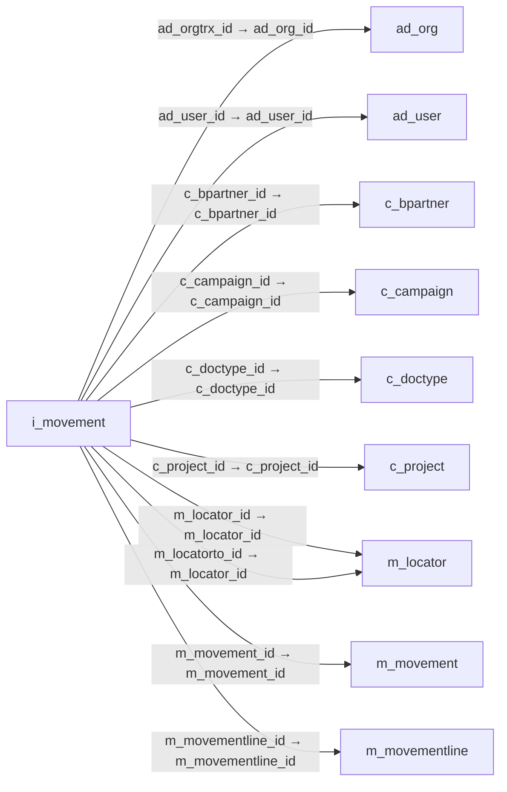

# i_movement — 재고 이동 가져오기

[전체 일람](../TABLE_INDEX.md) · [분류 일람](README.md) · [AI 사용 안내](../README.md) · [외래키 읽는 법](../RELATIONSHIPS.md)

## 기본 정보

| 항목 | 내용 |
|---|---|
| 물리명 | `adempiere.i_movement` |
| 한국어 논리명(문서용 해석) | 재고 이동 가져오기 |
| 원본 논리명 | I_Movement_ID |
| 원본 사전 ID | 53278 |
| 분류 | `i` — 데이터 가져오기 준비 |
| 전체 테넌트 행 수 | 0 |
| 물리 열 수 | 44 |
| 나가는 FK / 들어오는 FK | 12 / 0 |
| 구조·행 수 확인 시점 | 2026-11-03T23:29:01+09:00 |

## 의미와 쓰임

출발·도착 보관 위치와 제품·이동 수량을 재고 이동 문서 및 행으로 가져오기 위한 데이터를 저장한다.

- 설명 근거: 물리명·열·외래키 구조를 근거로 보수적으로 해석.
- 한국어 이름과 개요는 문서용 해석입니다. 공식 한국어 번역으로 간주하지 않습니다.
- 원본 설명: —
- 원본 도움말: —
- PostgreSQL 테이블 주석: —

## 키와 열

### 기본키·고유 제약조건

| 종류 | 제약조건 | 열(순서 유지) |
|---|---|---|
| PRIMARY KEY | `i_movement_key` | `i_movement_id` |
| UNIQUE | `i_movement_uu_idx` | `i_movement_uu` |

### 열 목록

원본 논리명·설명은 `AD_Column`에서 가져왔습니다. 기본값은 실제 PostgreSQL 메타데이터이며, 비어 있는 항목은 `—`로 표시합니다.

| 순서 | 물리명 | 원본 논리명 | PostgreSQL 타입 | NULL | PK | 기본값 | 설명 |
|---:|---|---|---|---|---|---|---|
| 1 | `i_movement_id` | I_Movement_ID | numeric(10,0) | 불가 | 예 | — | — |
| 2 | `ad_org_id` | Organization | numeric(10,0) | 불가 | — | — | Organizational entity within tenant |
| 3 | `ad_client_id` | Tenant | numeric(10,0) | 불가 | — | — | Tenant for this installation. |
| 4 | `updated` | Updated | timestamp without time zone | 불가 | — | statement_timestamp() | Date this record was updated |
| 5 | `updatedby` | Updated By | numeric(10,0) | 불가 | — | — | User who updated this records |
| 6 | `isactive` | Active | character(1) | 불가 | — | — | The record is active in the system |
| 7 | `created` | Created | timestamp without time zone | 불가 | — | statement_timestamp() | Date this record was created |
| 8 | `createdby` | Created By | numeric(10,0) | 불가 | — | — | User who created this records |
| 9 | `processed` | Processed | character(1) | 불가 | — | 'N'::bpchar | The document has been processed |
| 10 | `i_isimported` | Imported | character(1) | 불가 | — | 'N'::bpchar | Has this import been processed |
| 11 | `processing` | Process Now | character(1) | 불가 | — | 'N'::bpchar | — |
| 12 | `i_errormsg` | Import Error Message | character varying(2000) | 허용 | — | NULL::character varying | Messages generated from import process |
| 13 | `productvalue` | Product Key | character varying(40) | 허용 | — | NULL::character varying | Key of the Product |
| 14 | `m_product_id` | Product | numeric(10,0) | 허용 | — | NULL::numeric | Product, Service, Item |
| 15 | `movementdate` | Movement Date | timestamp without time zone | 허용 | — | — | Date a product was moved in or out of inventory |
| 16 | `m_locator_id` | Locator | numeric(10,0) | 허용 | — | NULL::numeric | Warehouse Locator |
| 17 | `locatorvalue` | Locator Key | character varying(40) | 허용 | — | NULL::character varying | Key of the Warehouse Locator |
| 18 | `m_locatorto_id` | Locator To | numeric(10,0) | 허용 | — | NULL::numeric | Location inventory is moved to |
| 19 | `locatortovalue` | Locator To Key | character varying(40) | 허용 | — | NULL::character varying | — |
| 20 | `orgvalue` | Org Key | character varying(40) | 허용 | — | NULL::character varying | Key of the Organization |
| 21 | `movementqty` | Movement Quantity | numeric | 허용 | — | — | Quantity of a product moved. |
| 22 | `documentno` | Document No | character varying(40) | 허용 | — | — | Document sequence number of the document |
| 23 | `c_doctype_id` | Document Type | numeric(10,0) | 허용 | — | NULL::numeric | Document type or rules |
| 24 | `doctypename` | Document Type Name | character varying(40) | 허용 | — | NULL::character varying | Name of the Document Type |
| 25 | `c_bpartner_id` | Business Partner | numeric(10,0) | 허용 | — | NULL::numeric | Identifies a Business Partner |
| 26 | `bpartnervalue` | Business Partner Key | character varying(40) | 허용 | — | NULL::character varying | Key of the Business Partner |
| 27 | `m_shipper_id` | Shipper | numeric(10,0) | 허용 | — | NULL::numeric | Method or manner of product delivery |
| 28 | `shippername` | Shipper Name | character varying(40) | 허용 | — | NULL::character varying | — |
| 29 | `ad_user_id` | User/Contact | numeric(10,0) | 허용 | — | NULL::numeric | User within the system - Internal or Business Partner Contact |
| 30 | `deliveryviarule` | Delivery Via | character varying(40) | 허용 | — | NULL::character varying | How the order will be delivered |
| 31 | `deliveryrule` | Delivery Rule | character varying(40) | 허용 | — | NULL::character varying | Defines the timing of Delivery |
| 32 | `priorityrule` | Priority | character varying(40) | 허용 | — | NULL::character varying | Priority of a document |
| 33 | `freightcostrule` | Freight Cost Rule | character varying(40) | 허용 | — | NULL::character varying | Method for charging Freight |
| 34 | `c_project_id` | Project | numeric(10,0) | 허용 | — | NULL::numeric | Financial Project |
| 35 | `projectvalue` | Project Key | character varying(40) | 허용 | — | NULL::character varying | Key of the Project |
| 36 | `c_campaign_id` | Campaign | numeric(10,0) | 허용 | — | NULL::numeric | Marketing Campaign |
| 37 | `campaignvalue` | Campaign Key | character varying(40) | 허용 | — | NULL::character varying | Text key of the Campaign |
| 38 | `ad_orgtrx_id` | Trx Organization | numeric(10,0) | 허용 | — | NULL::numeric | Performing or initiating organization |
| 39 | `orgtrxvalue` | Trx Org Key | character varying(40) | 허용 | — | NULL::character varying | Key of the Transaction Organization |
| 40 | `user1_id` | User Element List 1 | character varying(10) | 허용 | — | NULL::character varying | User defined list element #1 |
| 41 | `user2_id` | User Element List 2 | character varying(10) | 허용 | — | NULL::character varying | User defined list element #2 |
| 42 | `m_movement_id` | Inventory Move | numeric(10,0) | 허용 | — | NULL::numeric | Movement of Inventory |
| 43 | `m_movementline_id` | Move Line | numeric(10,0) | 허용 | — | — | Inventory Move document Line |
| 44 | `i_movement_uu` | I_Movement_UU | uuid | 허용 | — | — | — |

## 외래키 흐름

화살표는 **FK를 가진 자식 → 참조되는 부모**입니다. 업무 처리의 시간 순서나 무조건적인 1:N 관계를 뜻하지 않습니다.

주변 관계 12개 중 10개를 그림으로 표시합니다. **전체 관계는 아래 두 표에 모두 포함**합니다.

### 이 테이블이 참조하는 부모 — 나가는 FK

| 제약조건 | 참조하는 쪽(자식) | 자식 열 | 참조받는 쪽(부모) | 부모 열 | 삭제 / 갱신 | 검증 / 지연 가능 |
|---|---|---|---|---|---|---|
| `adorgtrx_imovement` <!-- FK_OUT: adempiere.i_movement.adorgtrx_imovement --> | [`i_movement`](i_movement.md) | `ad_orgtrx_id` | [`ad_org`](../ad/ad_org.md) | `ad_org_id` | NO ACTION / NO ACTION | 완료 / 가능 (초기 지연) |
| `aduser_imovement` <!-- FK_OUT: adempiere.i_movement.aduser_imovement --> | [`i_movement`](i_movement.md) | `ad_user_id` | [`ad_user`](../ad/ad_user.md) | `ad_user_id` | NO ACTION / NO ACTION | 완료 / 가능 (초기 지연) |
| `cbpartner_imovement` <!-- FK_OUT: adempiere.i_movement.cbpartner_imovement --> | [`i_movement`](i_movement.md) | `c_bpartner_id` | [`c_bpartner`](../c/c_bpartner.md) | `c_bpartner_id` | NO ACTION / NO ACTION | 완료 / 가능 (초기 지연) |
| `ccampaign_imovement` <!-- FK_OUT: adempiere.i_movement.ccampaign_imovement --> | [`i_movement`](i_movement.md) | `c_campaign_id` | [`c_campaign`](../c/c_campaign.md) | `c_campaign_id` | NO ACTION / NO ACTION | 완료 / 가능 (초기 지연) |
| `cdoctype_imovement` <!-- FK_OUT: adempiere.i_movement.cdoctype_imovement --> | [`i_movement`](i_movement.md) | `c_doctype_id` | [`c_doctype`](../c/c_doctype.md) | `c_doctype_id` | NO ACTION / NO ACTION | 완료 / 가능 (초기 지연) |
| `cproject_imovement` <!-- FK_OUT: adempiere.i_movement.cproject_imovement --> | [`i_movement`](i_movement.md) | `c_project_id` | [`c_project`](../c/c_project.md) | `c_project_id` | NO ACTION / NO ACTION | 완료 / 가능 (초기 지연) |
| `mlocator_imovement` <!-- FK_OUT: adempiere.i_movement.mlocator_imovement --> | [`i_movement`](i_movement.md) | `m_locator_id` | [`m_locator`](../m/m_locator.md) | `m_locator_id` | NO ACTION / NO ACTION | 완료 / 가능 (초기 지연) |
| `mlocatorto_imovement` <!-- FK_OUT: adempiere.i_movement.mlocatorto_imovement --> | [`i_movement`](i_movement.md) | `m_locatorto_id` | [`m_locator`](../m/m_locator.md) | `m_locator_id` | NO ACTION / NO ACTION | 완료 / 가능 (초기 지연) |
| `mmovement_imovement` <!-- FK_OUT: adempiere.i_movement.mmovement_imovement --> | [`i_movement`](i_movement.md) | `m_movement_id` | [`m_movement`](../m/m_movement.md) | `m_movement_id` | NO ACTION / NO ACTION | 완료 / 가능 (초기 지연) |
| `mmovementline_imovement` <!-- FK_OUT: adempiere.i_movement.mmovementline_imovement --> | [`i_movement`](i_movement.md) | `m_movementline_id` | [`m_movementline`](../m/m_movementline.md) | `m_movementline_id` | NO ACTION / NO ACTION | 완료 / 가능 (초기 지연) |
| `mproduct_imovement` <!-- FK_OUT: adempiere.i_movement.mproduct_imovement --> | [`i_movement`](i_movement.md) | `m_product_id` | [`m_product`](../m/m_product.md) | `m_product_id` | NO ACTION / NO ACTION | 완료 / 가능 (초기 지연) |
| `mshipper_imovement` <!-- FK_OUT: adempiere.i_movement.mshipper_imovement --> | [`i_movement`](i_movement.md) | `m_shipper_id` | [`m_shipper`](../m/m_shipper.md) | `m_shipper_id` | NO ACTION / NO ACTION | 완료 / 가능 (초기 지연) |

### 이 테이블을 참조하는 자식 — 들어오는 FK

해당 방향의 물리 FK 제약조건은 없습니다. 이름이 비슷한 열만으로 관계를 추가하지 않습니다.

## 조회 시 주의

- FK 표의 자식 열과 부모 열을 같은 순서로 대응시킵니다. 복합 FK는 모든 열의 동등 조건을 `AND`로 연결합니다.
- 테이블 이름이나 `_id` 열 이름만으로 물리 FK가 있다고 가정하지 않습니다. FK 미선언은 업무 관계가 없다는 뜻도 아닙니다.
- 자식이 여러 행인 테이블과 조인하면 부모의 금액·건수가 중복될 수 있습니다. 집계 단위를 먼저 정합니다.
- `ad_client_id`가 있습니다. 업무 분석에서는 대상 테넌트를 명시합니다. GardenWorld는 `11`, 시스템 공통 설정은 `0`일 수 있으므로 일괄 필터 적용 전에 테이블 역할을 확인합니다.
- 수집 시점에 0행입니다. 이 표만으로 거래 실적·처리 결과를 계산할 수 없습니다.
- 행 수는 위 확인 시점의 전체 테넌트 값입니다. 최신 업무 실적이나 현재 실행 결과로 재사용하지 않습니다.
