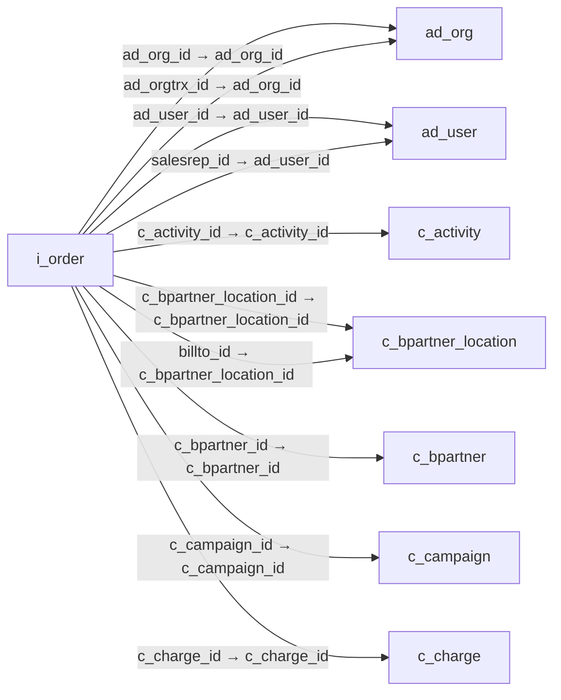

# i_order — 주문 가져오기

[전체 일람](../TABLE_INDEX.md) · [분류 일람](README.md) · [AI 사용 안내](../README.md) · [외래키 읽는 법](../RELATIONSHIPS.md)

## 기본 정보

| 항목 | 내용 |
|---|---|
| 물리명 | `adempiere.i_order` |
| 한국어 논리명(문서용 해석) | 주문 가져오기 |
| 원본 논리명 | Import Order |
| 원본 사전 ID | 591 |
| 분류 | `i` — 데이터 가져오기 준비 |
| 전체 테넌트 행 수 | 0 |
| 물리 열 수 | 68 |
| 나가는 FK / 들어오는 FK | 26 / 0 |
| 구조·행 수 확인 시점 | 2026-11-03T23:29:01+09:00 |

## 의미와 쓰임

외부 주문을 시스템 주문으로 등록하기 위한 중간 데이터를 저장한다.

- 설명 근거: 원본 애플리케이션 사전 명칭·설명을 한국어로 해석.
- 한국어 이름과 개요는 문서용 해석입니다. 공식 한국어 번역으로 간주하지 않습니다.
- 원본 설명: Import Orders
- 원본 도움말: —
- PostgreSQL 테이블 주석: —

## 키와 열

### 기본키·고유 제약조건

| 종류 | 제약조건 | 열(순서 유지) |
|---|---|---|
| PRIMARY KEY | `i_order_pkey` | `i_order_id` |
| UNIQUE | `i_order_uu_idx` | `i_order_uu` |

### 열 목록

원본 논리명·설명은 `AD_Column`에서 가져왔습니다. 기본값은 실제 PostgreSQL 메타데이터이며, 비어 있는 항목은 `—`로 표시합니다.

| 순서 | 물리명 | 원본 논리명 | PostgreSQL 타입 | NULL | PK | 기본값 | 설명 |
|---:|---|---|---|---|---|---|---|
| 1 | `i_order_id` | Import Order | numeric(10,0) | 불가 | 예 | — | Import Orders |
| 2 | `ad_client_id` | Tenant | numeric(10,0) | 허용 | — | — | Tenant for this installation. |
| 3 | `ad_org_id` | Organization | numeric(10,0) | 허용 | — | — | Organizational entity within tenant |
| 4 | `ad_orgtrx_id` | Trx Organization | numeric(10,0) | 허용 | — | — | Performing or initiating organization |
| 5 | `isactive` | Active | character(1) | 허용 | — | 'Y'::bpchar | The record is active in the system |
| 6 | `created` | Created | timestamp without time zone | 불가 | — | statement_timestamp() | Date this record was created |
| 7 | `createdby` | Created By | numeric(10,0) | 허용 | — | — | User who created this records |
| 8 | `updated` | Updated | timestamp without time zone | 불가 | — | statement_timestamp() | Date this record was updated |
| 9 | `updatedby` | Updated By | numeric(10,0) | 허용 | — | — | User who updated this records |
| 10 | `i_isimported` | Imported | character(1) | 불가 | — | 'N'::bpchar | Has this import been processed |
| 11 | `i_errormsg` | Import Error Message | character varying(2000) | 허용 | — | — | Messages generated from import process |
| 12 | `processing` | Process Now | character(1) | 허용 | — | — | — |
| 13 | `processed` | Processed | character(1) | 허용 | — | 'N'::bpchar | The document has been processed |
| 14 | `salesrep_id` | Sales Representative | numeric(10,0) | 허용 | — | — | Sales Representative or Company Agent |
| 15 | `m_warehouse_id` | Warehouse | numeric(10,0) | 허용 | — | — | Storage Warehouse and Service Point |
| 16 | `m_pricelist_id` | Price List | numeric(10,0) | 허용 | — | — | Unique identifier of a Price List |
| 17 | `c_currency_id` | Currency | numeric(10,0) | 허용 | — | — | The Currency for this record |
| 18 | `m_shipper_id` | Shipper | numeric(10,0) | 허용 | — | — | Method or manner of product delivery |
| 19 | `issotrx` | Sales Transaction | character(1) | 허용 | — | 'Y'::bpchar | This is a Sales Transaction |
| 20 | `c_bpartner_id` | Business Partner | numeric(10,0) | 허용 | — | — | Identifies a Business Partner |
| 21 | `bpartnervalue` | Business Partner Key | character varying(40) | 허용 | — | — | Key of the Business Partner |
| 22 | `name` | Name | character varying(60) | 허용 | — | — | Alphanumeric identifier of the entity |
| 23 | `c_bpartner_location_id` | Partner Location | numeric(10,0) | 허용 | — | — | Identifies the (ship to) address for this Business Partner |
| 24 | `billto_id` | Invoice To | numeric(10,0) | 허용 | — | — | Bill to Address |
| 25 | `c_location_id` | Address | numeric(10,0) | 허용 | — | — | Location or Address |
| 26 | `address1` | Address 1 | character varying(60) | 허용 | — | — | Address line 1 for this location |
| 27 | `address2` | Address 2 | character varying(60) | 허용 | — | — | Address line 2 for this location |
| 28 | `postal` | ZIP | character varying(10) | 허용 | — | — | Postal code |
| 29 | `city` | City | character varying(60) | 허용 | — | — | Identifies a City |
| 30 | `c_region_id` | Region | numeric(10,0) | 허용 | — | — | Identifies a geographical Region |
| 31 | `regionname` | Region | character varying(60) | 허용 | — | — | Name of the Region |
| 32 | `c_country_id` | Country | numeric(10,0) | 허용 | — | — | Country  |
| 33 | `countrycode` | ISO Country Code | character(2) | 허용 | — | — | Upper-case two-letter alphanumeric ISO Country code according to ISO 3166-1 |
| 34 | `ad_user_id` | User/Contact | numeric(10,0) | 허용 | — | — | User within the system - Internal or Business Partner Contact |
| 35 | `contactname` | Contact Name | character varying(60) | 허용 | — | — | Business Partner Contact Name |
| 36 | `email` | EMail Address | character varying(60) | 허용 | — | — | Electronic Mail Address |
| 37 | `phone` | Phone | character varying(40) | 허용 | — | — | Identifies a telephone number |
| 38 | `c_project_id` | Project | numeric(10,0) | 허용 | — | — | Financial Project |
| 39 | `c_activity_id` | Activity | numeric(10,0) | 허용 | — | — | Business Activity |
| 40 | `c_doctype_id` | Document Type | numeric(10,0) | 허용 | — | — | Document type or rules |
| 41 | `doctypename` | Document Type Name | character varying(60) | 허용 | — | — | Name of the Document Type |
| 42 | `c_paymentterm_id` | Payment Term | numeric(10,0) | 허용 | — | — | The terms of Payment (timing, discount) |
| 43 | `paymenttermvalue` | Payment Term Key | character varying(40) | 허용 | — | — | Key of the Payment Term |
| 44 | `c_order_id` | Order | numeric(10,0) | 허용 | — | — | Order |
| 45 | `documentno` | Document No | character varying(30) | 허용 | — | — | Document sequence number of the document |
| 46 | `dateordered` | Date Ordered | timestamp without time zone | 허용 | — | — | Date of Order |
| 47 | `dateacct` | Account Date | timestamp without time zone | 허용 | — | — | Accounting Date |
| 48 | `description` | Description | character varying(255) | 허용 | — | — | Optional short description of the record |
| 49 | `m_product_id` | Product | numeric(10,0) | 허용 | — | — | Product, Service, Item |
| 50 | `productvalue` | Product Key | character varying(40) | 허용 | — | — | Key of the Product |
| 51 | `upc` | UPC/EAN | character varying(30) | 허용 | — | — | Bar Code (Universal Product Code or its superset European Article Number) |
| 52 | `sku` | SKU | character varying(30) | 허용 | — | — | Stock Keeping Unit |
| 53 | `c_tax_id` | Tax | numeric(10,0) | 허용 | — | — | Tax identifier |
| 54 | `taxindicator` | Tax Indicator | character varying(10) | 허용 | — | — | Short form for Tax to be printed on documents |
| 55 | `taxamt` | Tax Amount | numeric | 허용 | — | 0 | Tax Amount for a document |
| 56 | `c_orderline_id` | Sales Order Line | numeric(10,0) | 허용 | — | — | Sales Order Line |
| 57 | `linedescription` | Line Description | character varying(255) | 허용 | — | — | Description of the Line |
| 58 | `c_uom_id` | UOM | numeric(10,0) | 허용 | — | — | Unit of Measure |
| 59 | `qtyordered` | Ordered Quantity | numeric | 허용 | — | 0 | Ordered Quantity |
| 60 | `priceactual` | Unit Price | numeric | 허용 | — | 0 | Actual Price  |
| 61 | `freightamt` | Freight Amount | numeric | 허용 | — | 0 | Freight Amount  |
| 62 | `c_campaign_id` | Campaign | numeric(10,0) | 허용 | — | — | Marketing Campaign |
| 63 | `c_charge_id` | Charge | numeric(10,0) | 허용 | — | — | Additional document charges |
| 64 | `chargename` | Charge Name | character varying(60) | 허용 | — | — | Name of the Charge |
| 65 | `c_ordersource_id` | Order Source | numeric(10,0) | 허용 | — | NULL::numeric | — |
| 66 | `c_ordersourcevalue` | Order Source Key | character varying(40) | 허용 | — | NULL::character varying | — |
| 67 | `deliveryrule` | Delivery Rule | character(1) | 허용 | — | NULL::bpchar | Defines the timing of Delivery |
| 68 | `i_order_uu` | I_Order_UU | uuid | 허용 | — | — | — |

## 외래키 흐름

화살표는 **FK를 가진 자식 → 참조되는 부모**입니다. 업무 처리의 시간 순서나 무조건적인 1:N 관계를 뜻하지 않습니다.

주변 관계 26개 중 10개를 그림으로 표시합니다. **전체 관계는 아래 두 표에 모두 포함**합니다.

### 이 테이블이 참조하는 부모 — 나가는 FK

| 제약조건 | 참조하는 쪽(자식) | 자식 열 | 참조받는 쪽(부모) | 부모 열 | 삭제 / 갱신 | 검증 / 지연 가능 |
|---|---|---|---|---|---|---|
| `adorg_iorder` <!-- FK_OUT: adempiere.i_order.adorg_iorder --> | [`i_order`](i_order.md) | `ad_org_id` | [`ad_org`](../ad/ad_org.md) | `ad_org_id` | SET NULL / NO ACTION | 완료 / 가능 (초기 지연) |
| `adorgtrx_iorder` <!-- FK_OUT: adempiere.i_order.adorgtrx_iorder --> | [`i_order`](i_order.md) | `ad_orgtrx_id` | [`ad_org`](../ad/ad_org.md) | `ad_org_id` | SET NULL / NO ACTION | 완료 / 가능 (초기 지연) |
| `aduser_iorder` <!-- FK_OUT: adempiere.i_order.aduser_iorder --> | [`i_order`](i_order.md) | `ad_user_id` | [`ad_user`](../ad/ad_user.md) | `ad_user_id` | SET NULL / NO ACTION | 완료 / 가능 (초기 지연) |
| `adusersalesrep_iorder` <!-- FK_OUT: adempiere.i_order.adusersalesrep_iorder --> | [`i_order`](i_order.md) | `salesrep_id` | [`ad_user`](../ad/ad_user.md) | `ad_user_id` | SET NULL / NO ACTION | 완료 / 가능 (초기 지연) |
| `cactivity_iorder` <!-- FK_OUT: adempiere.i_order.cactivity_iorder --> | [`i_order`](i_order.md) | `c_activity_id` | [`c_activity`](../c/c_activity.md) | `c_activity_id` | SET NULL / NO ACTION | 완료 / 가능 (초기 지연) |
| `cbolocation_iorder` <!-- FK_OUT: adempiere.i_order.cbolocation_iorder --> | [`i_order`](i_order.md) | `c_bpartner_location_id` | [`c_bpartner_location`](../c/c_bpartner_location.md) | `c_bpartner_location_id` | SET NULL / NO ACTION | 완료 / 가능 (초기 지연) |
| `cbpartner_iorder` <!-- FK_OUT: adempiere.i_order.cbpartner_iorder --> | [`i_order`](i_order.md) | `c_bpartner_id` | [`c_bpartner`](../c/c_bpartner.md) | `c_bpartner_id` | SET NULL / NO ACTION | 완료 / 가능 (초기 지연) |
| `cbpartnerlocbillto_iorder` <!-- FK_OUT: adempiere.i_order.cbpartnerlocbillto_iorder --> | [`i_order`](i_order.md) | `billto_id` | [`c_bpartner_location`](../c/c_bpartner_location.md) | `c_bpartner_location_id` | SET NULL / NO ACTION | 완료 / 가능 (초기 지연) |
| `ccampaign_iorder` <!-- FK_OUT: adempiere.i_order.ccampaign_iorder --> | [`i_order`](i_order.md) | `c_campaign_id` | [`c_campaign`](../c/c_campaign.md) | `c_campaign_id` | SET NULL / NO ACTION | 완료 / 가능 (초기 지연) |
| `ccharge_iorder` <!-- FK_OUT: adempiere.i_order.ccharge_iorder --> | [`i_order`](i_order.md) | `c_charge_id` | [`c_charge`](../c/c_charge.md) | `c_charge_id` | NO ACTION / NO ACTION | 완료 / 가능 (초기 지연) |
| `ccountry_iorder` <!-- FK_OUT: adempiere.i_order.ccountry_iorder --> | [`i_order`](i_order.md) | `c_country_id` | [`c_country`](../c/c_country.md) | `c_country_id` | SET NULL / NO ACTION | 완료 / 가능 (초기 지연) |
| `ccurrency_iorder` <!-- FK_OUT: adempiere.i_order.ccurrency_iorder --> | [`i_order`](i_order.md) | `c_currency_id` | [`c_currency`](../c/c_currency.md) | `c_currency_id` | SET NULL / NO ACTION | 완료 / 가능 (초기 지연) |
| `cdoctype_iorder` <!-- FK_OUT: adempiere.i_order.cdoctype_iorder --> | [`i_order`](i_order.md) | `c_doctype_id` | [`c_doctype`](../c/c_doctype.md) | `c_doctype_id` | SET NULL / NO ACTION | 완료 / 가능 (초기 지연) |
| `clocation_iorder` <!-- FK_OUT: adempiere.i_order.clocation_iorder --> | [`i_order`](i_order.md) | `c_location_id` | [`c_location`](../c/c_location.md) | `c_location_id` | SET NULL / NO ACTION | 완료 / 가능 (초기 지연) |
| `corder_iorder` <!-- FK_OUT: adempiere.i_order.corder_iorder --> | [`i_order`](i_order.md) | `c_order_id` | [`c_order`](../c/c_order.md) | `c_order_id` | SET NULL / NO ACTION | 완료 / 가능 (초기 지연) |
| `corderline_iorder` <!-- FK_OUT: adempiere.i_order.corderline_iorder --> | [`i_order`](i_order.md) | `c_orderline_id` | [`c_orderline`](../c/c_orderline.md) | `c_orderline_id` | SET NULL / NO ACTION | 완료 / 가능 (초기 지연) |
| `cordersource_iorder` <!-- FK_OUT: adempiere.i_order.cordersource_iorder --> | [`i_order`](i_order.md) | `c_ordersource_id` | [`c_ordersource`](../c/c_ordersource.md) | `c_ordersource_id` | NO ACTION / NO ACTION | 완료 / 가능 (초기 지연) |
| `cpaymentterm_iorder` <!-- FK_OUT: adempiere.i_order.cpaymentterm_iorder --> | [`i_order`](i_order.md) | `c_paymentterm_id` | [`c_paymentterm`](../c/c_paymentterm.md) | `c_paymentterm_id` | SET NULL / NO ACTION | 완료 / 가능 (초기 지연) |
| `cproject_iorder` <!-- FK_OUT: adempiere.i_order.cproject_iorder --> | [`i_order`](i_order.md) | `c_project_id` | [`c_project`](../c/c_project.md) | `c_project_id` | SET NULL / NO ACTION | 완료 / 가능 (초기 지연) |
| `cregion_iorder` <!-- FK_OUT: adempiere.i_order.cregion_iorder --> | [`i_order`](i_order.md) | `c_region_id` | [`c_region`](../c/c_region.md) | `c_region_id` | SET NULL / NO ACTION | 완료 / 가능 (초기 지연) |
| `ctax_iorder` <!-- FK_OUT: adempiere.i_order.ctax_iorder --> | [`i_order`](i_order.md) | `c_tax_id` | [`c_tax`](../c/c_tax.md) | `c_tax_id` | SET NULL / NO ACTION | 완료 / 가능 (초기 지연) |
| `cuom_iorder` <!-- FK_OUT: adempiere.i_order.cuom_iorder --> | [`i_order`](i_order.md) | `c_uom_id` | [`c_uom`](../c/c_uom.md) | `c_uom_id` | SET NULL / NO ACTION | 완료 / 가능 (초기 지연) |
| `mpricelist_iorder` <!-- FK_OUT: adempiere.i_order.mpricelist_iorder --> | [`i_order`](i_order.md) | `m_pricelist_id` | [`m_pricelist`](../m/m_pricelist.md) | `m_pricelist_id` | SET NULL / NO ACTION | 완료 / 가능 (초기 지연) |
| `mproduct_iorder` <!-- FK_OUT: adempiere.i_order.mproduct_iorder --> | [`i_order`](i_order.md) | `m_product_id` | [`m_product`](../m/m_product.md) | `m_product_id` | SET NULL / NO ACTION | 완료 / 가능 (초기 지연) |
| `mshipper_iorder` <!-- FK_OUT: adempiere.i_order.mshipper_iorder --> | [`i_order`](i_order.md) | `m_shipper_id` | [`m_shipper`](../m/m_shipper.md) | `m_shipper_id` | SET NULL / NO ACTION | 완료 / 가능 (초기 지연) |
| `mwarehouse_iorder` <!-- FK_OUT: adempiere.i_order.mwarehouse_iorder --> | [`i_order`](i_order.md) | `m_warehouse_id` | [`m_warehouse`](../m/m_warehouse.md) | `m_warehouse_id` | SET NULL / NO ACTION | 완료 / 가능 (초기 지연) |

### 이 테이블을 참조하는 자식 — 들어오는 FK

해당 방향의 물리 FK 제약조건은 없습니다. 이름이 비슷한 열만으로 관계를 추가하지 않습니다.

## 조회 시 주의

- FK 표의 자식 열과 부모 열을 같은 순서로 대응시킵니다. 복합 FK는 모든 열의 동등 조건을 `AND`로 연결합니다.
- 테이블 이름이나 `_id` 열 이름만으로 물리 FK가 있다고 가정하지 않습니다. FK 미선언은 업무 관계가 없다는 뜻도 아닙니다.
- 자식이 여러 행인 테이블과 조인하면 부모의 금액·건수가 중복될 수 있습니다. 집계 단위를 먼저 정합니다.
- `ad_client_id`가 있습니다. 업무 분석에서는 대상 테넌트를 명시합니다. GardenWorld는 `11`, 시스템 공통 설정은 `0`일 수 있으므로 일괄 필터 적용 전에 테이블 역할을 확인합니다.
- `issotrx`가 있습니다. 판매(`Y`)와 구매(`N`)를 구분해서 분석합니다.
- 수집 시점에 0행입니다. 이 표만으로 거래 실적·처리 결과를 계산할 수 없습니다.
- 행 수는 위 확인 시점의 전체 테넌트 값입니다. 최신 업무 실적이나 현재 실행 결과로 재사용하지 않습니다.
