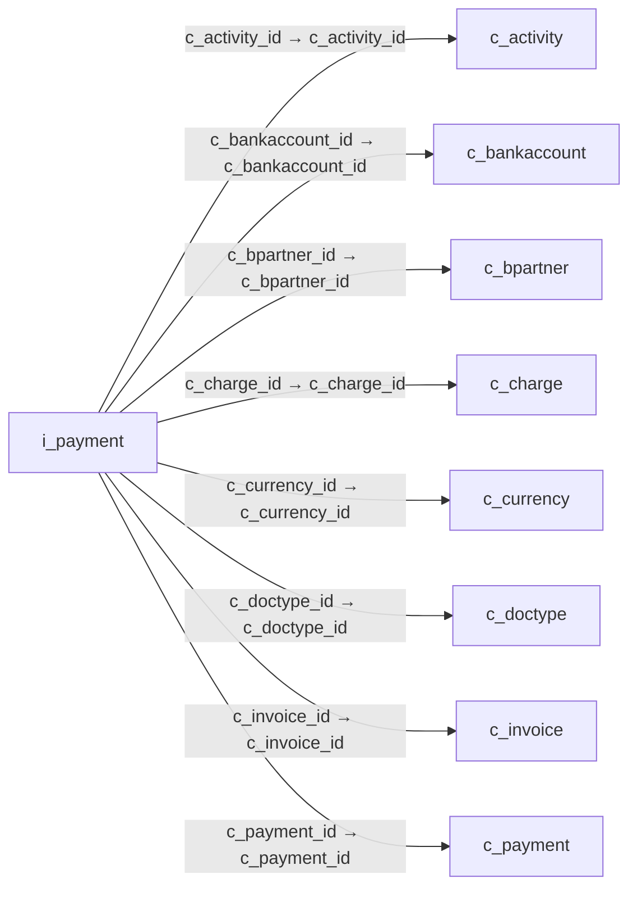

# i_payment — 지급·수금 가져오기

[전체 일람](../TABLE_INDEX.md) · [분류 일람](README.md) · [AI 사용 안내](../README.md) · [외래키 읽는 법](../RELATIONSHIPS.md)

## 기본 정보

| 항목 | 내용 |
|---|---|
| 물리명 | `adempiere.i_payment` |
| 한국어 논리명(문서용 해석) | 지급·수금 가져오기 |
| 원본 논리명 | Import Payment |
| 원본 사전 ID | 597 |
| 분류 | `i` — 데이터 가져오기 준비 |
| 전체 테넌트 행 수 | 0 |
| 물리 열 수 | 74 |
| 나가는 FK / 들어오는 FK | 8 / 0 |
| 구조·행 수 확인 시점 | 2026-11-03T23:29:01+09:00 |

## 의미와 쓰임

외부 지급 또는 수금 데이터를 결제 기록으로 가져오기 위한 입력 데이터를 저장한다.

- 설명 근거: 원본 애플리케이션 사전 명칭·설명을 한국어로 해석.
- 한국어 이름과 개요는 문서용 해석입니다. 공식 한국어 번역으로 간주하지 않습니다.
- 원본 설명: Import Payment
- 원본 도움말: —
- PostgreSQL 테이블 주석: —

## 키와 열

### 기본키·고유 제약조건

| 종류 | 제약조건 | 열(순서 유지) |
|---|---|---|
| PRIMARY KEY | `i_payment_pkey` | `i_payment_id` |
| UNIQUE | `i_payment_uu_idx` | `i_payment_uu` |

### 열 목록

원본 논리명·설명은 `AD_Column`에서 가져왔습니다. 기본값은 실제 PostgreSQL 메타데이터이며, 비어 있는 항목은 `—`로 표시합니다.

| 순서 | 물리명 | 원본 논리명 | PostgreSQL 타입 | NULL | PK | 기본값 | 설명 |
|---:|---|---|---|---|---|---|---|
| 1 | `i_payment_id` | Import Payment | numeric(10,0) | 불가 | 예 | — | Import Payment |
| 2 | `ad_client_id` | Tenant | numeric(10,0) | 허용 | — | — | Tenant for this installation. |
| 3 | `ad_org_id` | Organization | numeric(10,0) | 허용 | — | — | Organizational entity within tenant |
| 4 | `isactive` | Active | character(1) | 허용 | — | 'Y'::bpchar | The record is active in the system |
| 5 | `created` | Created | timestamp without time zone | 불가 | — | statement_timestamp() | Date this record was created |
| 6 | `createdby` | Created By | numeric(10,0) | 허용 | — | — | User who created this records |
| 7 | `updated` | Updated | timestamp without time zone | 불가 | — | statement_timestamp() | Date this record was updated |
| 8 | `updatedby` | Updated By | numeric(10,0) | 허용 | — | — | User who updated this records |
| 9 | `i_isimported` | Imported | character(1) | 불가 | — | 'N'::bpchar | Has this import been processed |
| 10 | `i_errormsg` | Import Error Message | character varying(2000) | 허용 | — | — | Messages generated from import process |
| 11 | `processed` | Processed | character(1) | 허용 | — | 'N'::bpchar | The document has been processed |
| 12 | `c_payment_id` | Payment | numeric(10,0) | 허용 | — | — | Payment identifier |
| 13 | `documentno` | Document No | character varying(30) | 허용 | — | — | Document sequence number of the document |
| 14 | `datetrx` | Transaction Date | timestamp without time zone | 허용 | — | — | Transaction Date |
| 15 | `isreceipt` | Receipt | character(1) | 허용 | — | 'Y'::bpchar | This is a sales transaction (receipt) |
| 16 | `c_doctype_id` | Document Type | numeric(10,0) | 허용 | — | — | Document type or rules |
| 17 | `doctypename` | Document Type Name | character varying(60) | 허용 | — | — | Name of the Document Type |
| 18 | `trxtype` | Transaction Type | character(1) | 허용 | — | — | Type of credit card transaction |
| 19 | `c_bankaccount_id` | Bank Account | numeric(10,0) | 허용 | — | — | Account at the Bank |
| 20 | `bankaccountno` | Bank Account No | character varying(20) | 허용 | — | — | Bank Account Number |
| 21 | `c_bpartner_id` | Business Partner | numeric(10,0) | 허용 | — | — | Identifies a Business Partner |
| 22 | `bpartnervalue` | Business Partner Key | character varying(40) | 허용 | — | — | Key of the Business Partner |
| 23 | `c_invoice_id` | Invoice | numeric(10,0) | 허용 | — | — | Invoice Identifier |
| 24 | `invoicedocumentno` | Invoice Document No | character varying(30) | 허용 | — | — | Document Number of the Invoice |
| 25 | `tendertype` | Tender type | character(1) | 허용 | — | — | Method of Payment |
| 26 | `creditcardtype` | Credit Card | character(1) | 허용 | — | — | Credit Card (Visa, MC, AmEx) |
| 27 | `creditcardnumber` | Number | character varying(20) | 허용 | — | — | Credit Card Number  |
| 28 | `creditcardvv` | Verification Code | character varying(4) | 허용 | — | — | Credit Card Verification code on credit card |
| 29 | `creditcardexpmm` | Exp. Month | numeric(10,0) | 허용 | — | — | Expiry Month |
| 30 | `creditcardexpyy` | Exp. Year | numeric(10,0) | 허용 | — | — | Expiry Year |
| 31 | `micr` | Micr | character varying(20) | 허용 | — | — | Combination of routing no, account and check no |
| 32 | `routingno` | Routing No | character varying(20) | 허용 | — | — | Bank Routing Number |
| 33 | `accountno` | Account No | character varying(20) | 허용 | — | — | Account Number |
| 34 | `checkno` | Check No | character varying(20) | 허용 | — | — | Check Number |
| 35 | `a_name` | Account Name | character varying(60) | 허용 | — | — | Name on Credit Card or Account holder |
| 36 | `a_street` | Account Street | character varying(60) | 허용 | — | — | Street address of the Credit Card or Account holder |
| 37 | `a_city` | Account City | character varying(60) | 허용 | — | — | City or the Credit Card or Account Holder |
| 38 | `a_state` | Account State | character varying(40) | 허용 | — | — | State of the Credit Card or Account holder |
| 39 | `a_zip` | Account Zip/Postal | character varying(20) | 허용 | — | — | Zip Code of the Credit Card or Account Holder |
| 40 | `a_country` | Account Country | character varying(40) | 허용 | — | — | Country |
| 41 | `a_ident_dl` | Driver License | character varying(20) | 허용 | — | — | Payment Identification - Driver License |
| 42 | `a_ident_ssn` | Social Security No | character varying(20) | 허용 | — | — | Payment Identification - Social Security No |
| 43 | `a_email` | Account EMail | character varying(60) | 허용 | — | — | Email Address |
| 44 | `voiceauthcode` | Voice authorization code | character varying(20) | 허용 | — | — | Voice Authorization Code from credit card company |
| 45 | `swipe` | Swipe | character varying(80) | 허용 | — | — | Track 1 and 2 of the Credit Card |
| 46 | `orig_trxid` | Original Transaction ID | character varying(20) | 허용 | — | — | Original Transaction ID |
| 47 | `ponum` | PO Number | character varying(60) | 허용 | — | — | Purchase Order Number |
| 48 | `c_currency_id` | Currency | numeric(10,0) | 허용 | — | — | The Currency for this record |
| 49 | `payamt` | Payment amount | numeric | 허용 | — | 0 | Amount being paid |
| 50 | `discountamt` | Discount Amount | numeric | 허용 | — | 0 | Calculated amount of discount |
| 51 | `writeoffamt` | Write-off Amount | numeric | 허용 | — | 0 | Amount to write-off |
| 52 | `isoverunderpayment` | Over/Under Payment | character(1) | 허용 | — | 'N'::bpchar | Over-Payment (unallocated) or Under-Payment (partial payment) |
| 53 | `overunderamt` | Over/Under Payment | numeric | 허용 | — | 0 | Over-Payment (unallocated) or Under-Payment (partial payment) Amount |
| 54 | `c_charge_id` | Charge | numeric(10,0) | 허용 | — | — | Additional document charges |
| 55 | `chargename` | Charge Name | character varying(60) | 허용 | — | — | Name of the Charge |
| 56 | `chargeamt` | Charge amount | numeric | 허용 | — | 0 | Charge Amount |
| 57 | `taxamt` | Tax Amount | numeric | 허용 | — | 0 | Tax Amount for a document |
| 58 | `isapproved` | Approved | character(1) | 허용 | — | 'N'::bpchar | Indicates if this document requires approval |
| 59 | `isselfservice` | Self-Service | character(1) | 허용 | — | 'N'::bpchar | This is a Self-Service entry or this entry can be changed via Self-Service |
| 60 | `isdelayedcapture` | Delayed Capture | character(1) | 허용 | — | 'N'::bpchar | Charge after Shipment |
| 61 | `r_pnref` | Reference | character varying(20) | 허용 | — | — | Payment reference |
| 62 | `r_result` | Result | character varying(20) | 허용 | — | — | Result of transmission |
| 63 | `r_respmsg` | Response Message | character varying(60) | 허용 | — | — | Response message |
| 64 | `r_authcode` | Authorization Code | character varying(20) | 허용 | — | — | Authorization Code returned |
| 65 | `r_info` | Info | character varying(2000) | 허용 | — | — | Response info |
| 66 | `processing` | Process Now | character(1) | 허용 | — | — | — |
| 67 | `iso_code` | ISO Currency Code | character(3) | 허용 | — | — | Three letter ISO 4217 Code of the Currency |
| 68 | `dateacct` | Account Date | timestamp without time zone | 허용 | — | — | Accounting Date |
| 69 | `i_payment_uu` | I_Payment_UU | uuid | 허용 | — | — | — |
| 70 | `iban` | IBAN | character varying(40) | 허용 | — | NULL::character varying | International Bank Account Number |
| 71 | `swiftcode` | Swift code | character varying(20) | 허용 | — | NULL::character varying | Swift Code or BIC |
| 72 | `description` | Description | character varying(255) | 허용 | — | NULL::character varying | Optional short description of the record |
| 73 | `c_activity_id` | Activity | numeric(10,0) | 허용 | — | NULL::numeric | Business Activity |
| 74 | `activityvalue` | Activity Key | character varying(40) | 허용 | — | NULL::character varying | Text key for Activity |

## 외래키 흐름

화살표는 **FK를 가진 자식 → 참조되는 부모**입니다. 업무 처리의 시간 순서나 무조건적인 1:N 관계를 뜻하지 않습니다.

주변 관계 8개 중 8개를 그림으로 표시합니다. **전체 관계는 아래 두 표에 모두 포함**합니다.

### 이 테이블이 참조하는 부모 — 나가는 FK

| 제약조건 | 참조하는 쪽(자식) | 자식 열 | 참조받는 쪽(부모) | 부모 열 | 삭제 / 갱신 | 검증 / 지연 가능 |
|---|---|---|---|---|---|---|
| `cactivity_ipayment` <!-- FK_OUT: adempiere.i_payment.cactivity_ipayment --> | [`i_payment`](i_payment.md) | `c_activity_id` | [`c_activity`](../c/c_activity.md) | `c_activity_id` | NO ACTION / NO ACTION | 완료 / 가능 (초기 지연) |
| `cbankaccount_ipayment` <!-- FK_OUT: adempiere.i_payment.cbankaccount_ipayment --> | [`i_payment`](i_payment.md) | `c_bankaccount_id` | [`c_bankaccount`](../c/c_bankaccount.md) | `c_bankaccount_id` | SET NULL / NO ACTION | 완료 / 가능 (초기 지연) |
| `cbpartner_ipayment` <!-- FK_OUT: adempiere.i_payment.cbpartner_ipayment --> | [`i_payment`](i_payment.md) | `c_bpartner_id` | [`c_bpartner`](../c/c_bpartner.md) | `c_bpartner_id` | SET NULL / NO ACTION | 완료 / 가능 (초기 지연) |
| `ccharge_ipayment` <!-- FK_OUT: adempiere.i_payment.ccharge_ipayment --> | [`i_payment`](i_payment.md) | `c_charge_id` | [`c_charge`](../c/c_charge.md) | `c_charge_id` | SET NULL / NO ACTION | 완료 / 가능 (초기 지연) |
| `ccurrency_ipayment` <!-- FK_OUT: adempiere.i_payment.ccurrency_ipayment --> | [`i_payment`](i_payment.md) | `c_currency_id` | [`c_currency`](../c/c_currency.md) | `c_currency_id` | NO ACTION / NO ACTION | 완료 / 가능 (초기 지연) |
| `cdoctype_ipayment` <!-- FK_OUT: adempiere.i_payment.cdoctype_ipayment --> | [`i_payment`](i_payment.md) | `c_doctype_id` | [`c_doctype`](../c/c_doctype.md) | `c_doctype_id` | SET NULL / NO ACTION | 완료 / 가능 (초기 지연) |
| `cinvoice_ipayment` <!-- FK_OUT: adempiere.i_payment.cinvoice_ipayment --> | [`i_payment`](i_payment.md) | `c_invoice_id` | [`c_invoice`](../c/c_invoice.md) | `c_invoice_id` | SET NULL / NO ACTION | 완료 / 가능 (초기 지연) |
| `cpayment_ipayment` <!-- FK_OUT: adempiere.i_payment.cpayment_ipayment --> | [`i_payment`](i_payment.md) | `c_payment_id` | [`c_payment`](../c/c_payment.md) | `c_payment_id` | SET NULL / NO ACTION | 완료 / 가능 (초기 지연) |

### 이 테이블을 참조하는 자식 — 들어오는 FK

해당 방향의 물리 FK 제약조건은 없습니다. 이름이 비슷한 열만으로 관계를 추가하지 않습니다.

## 조회 시 주의

- FK 표의 자식 열과 부모 열을 같은 순서로 대응시킵니다. 복합 FK는 모든 열의 동등 조건을 `AND`로 연결합니다.
- 테이블 이름이나 `_id` 열 이름만으로 물리 FK가 있다고 가정하지 않습니다. FK 미선언은 업무 관계가 없다는 뜻도 아닙니다.
- 자식이 여러 행인 테이블과 조인하면 부모의 금액·건수가 중복될 수 있습니다. 집계 단위를 먼저 정합니다.
- `ad_client_id`가 있습니다. 업무 분석에서는 대상 테넌트를 명시합니다. GardenWorld는 `11`, 시스템 공통 설정은 `0`일 수 있으므로 일괄 필터 적용 전에 테이블 역할을 확인합니다.
- 수집 시점에 0행입니다. 이 표만으로 거래 실적·처리 결과를 계산할 수 없습니다.
- 행 수는 위 확인 시점의 전체 테넌트 값입니다. 최신 업무 실적이나 현재 실행 결과로 재사용하지 않습니다.
