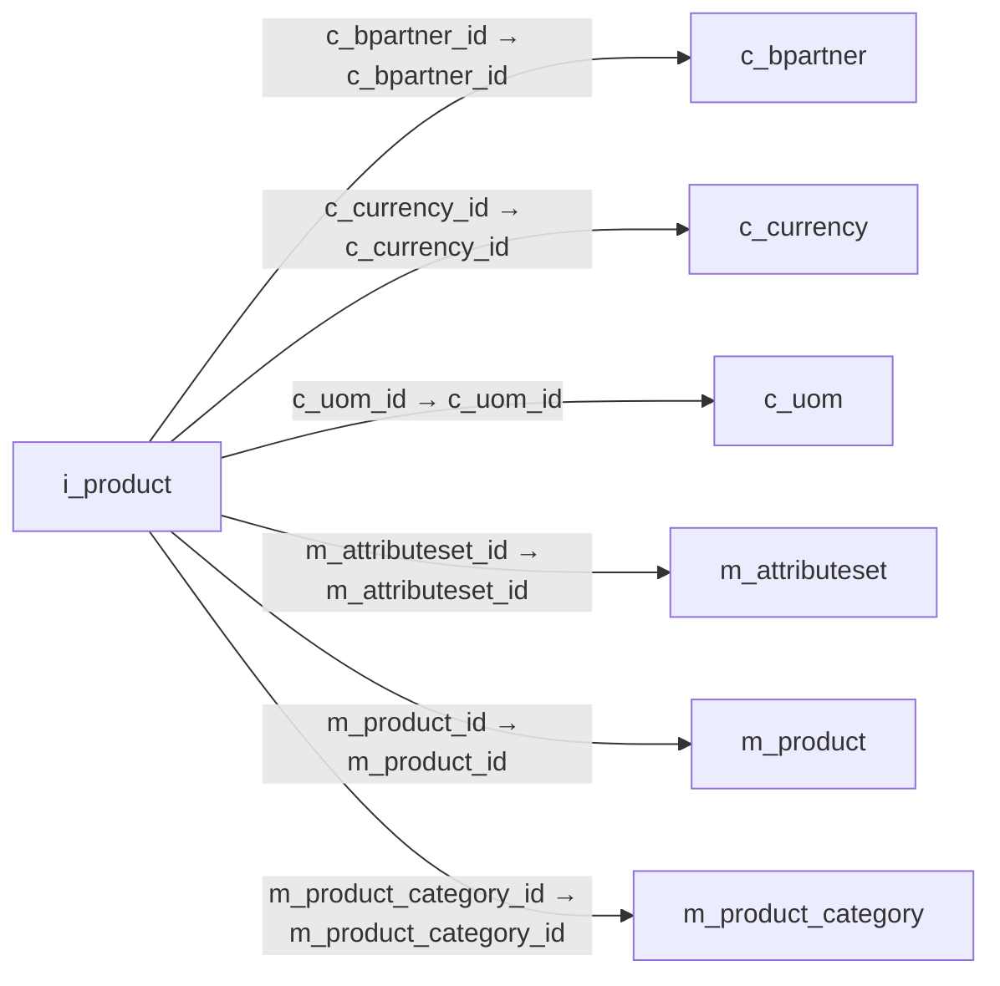

# i_product — 제품·서비스 가져오기

[전체 일람](../TABLE_INDEX.md) · [분류 일람](README.md) · [AI 사용 안내](../README.md) · [외래키 읽는 법](../RELATIONSHIPS.md)

## 기본 정보

| 항목 | 내용 |
|---|---|
| 물리명 | `adempiere.i_product` |
| 한국어 논리명(문서용 해석) | 제품·서비스 가져오기 |
| 원본 논리명 | Import Product |
| 원본 사전 ID | 532 |
| 분류 | `i` — 데이터 가져오기 준비 |
| 전체 테넌트 행 수 | 0 |
| 물리 열 수 | 59 |
| 나가는 FK / 들어오는 FK | 6 / 0 |
| 구조·행 수 확인 시점 | 2026-11-03T23:29:01+09:00 |

## 의미와 쓰임

외부 품목 또는 서비스 정보를 제품 사전에 등록하기 위한 입력 데이터를 보관한다.

- 설명 근거: 원본 애플리케이션 사전 명칭·설명을 한국어로 해석.
- 한국어 이름과 개요는 문서용 해석입니다. 공식 한국어 번역으로 간주하지 않습니다.
- 원본 설명: Import Item or Service
- 원본 도움말: —
- PostgreSQL 테이블 주석: —

## 키와 열

### 기본키·고유 제약조건

| 종류 | 제약조건 | 열(순서 유지) |
|---|---|---|
| PRIMARY KEY | `i_product_pkey` | `i_product_id` |
| UNIQUE | `i_product_uu_idx` | `i_product_uu` |

### 열 목록

원본 논리명·설명은 `AD_Column`에서 가져왔습니다. 기본값은 실제 PostgreSQL 메타데이터이며, 비어 있는 항목은 `—`로 표시합니다.

| 순서 | 물리명 | 원본 논리명 | PostgreSQL 타입 | NULL | PK | 기본값 | 설명 |
|---:|---|---|---|---|---|---|---|
| 1 | `i_product_id` | Import Product | numeric(10,0) | 불가 | 예 | — | Import Item or Service |
| 2 | `ad_client_id` | Tenant | numeric(10,0) | 허용 | — | — | Tenant for this installation. |
| 3 | `ad_org_id` | Organization | numeric(10,0) | 허용 | — | — | Organizational entity within tenant |
| 4 | `isactive` | Active | character(1) | 허용 | — | 'Y'::bpchar | The record is active in the system |
| 5 | `created` | Created | timestamp without time zone | 불가 | — | statement_timestamp() | Date this record was created |
| 6 | `createdby` | Created By | numeric(10,0) | 허용 | — | — | User who created this records |
| 7 | `updated` | Updated | timestamp without time zone | 불가 | — | statement_timestamp() | Date this record was updated |
| 8 | `updatedby` | Updated By | numeric(10,0) | 허용 | — | — | User who updated this records |
| 9 | `i_isimported` | Imported | character(1) | 불가 | — | 'N'::bpchar | Has this import been processed |
| 10 | `i_errormsg` | Import Error Message | character varying(2000) | 허용 | — | — | Messages generated from import process |
| 11 | `m_product_id` | Product | numeric(10,0) | 허용 | — | — | Product, Service, Item |
| 12 | `value` | Search Key | character varying(40) | 허용 | — | — | Search key for the record in the format required - must be unique |
| 13 | `name` | Name | character varying(255) | 허용 | — | — | Alphanumeric identifier of the entity |
| 14 | `description` | Description | character varying(255) | 허용 | — | — | Optional short description of the record |
| 15 | `documentnote` | Document Note | character varying(2000) | 허용 | — | — | Additional information for a Document |
| 16 | `help` | Comment/Help | character varying(2000) | 허용 | — | — | Comment or Hint |
| 17 | `upc` | UPC/EAN | character varying(30) | 허용 | — | — | Bar Code (Universal Product Code or its superset European Article Number) |
| 18 | `sku` | SKU | character varying(30) | 허용 | — | — | Stock Keeping Unit |
| 19 | `x12de355` | UOM Code | character varying(4) | 허용 | — | — | UOM EDI X12 Code |
| 20 | `c_uom_id` | UOM | numeric(10,0) | 허용 | — | — | Unit of Measure |
| 21 | `productcategory_value` | Product Category Key | character varying(40) | 허용 | — | — | — |
| 22 | `m_product_category_id` | Product Category | numeric(10,0) | 허용 | — | — | Category of a Product |
| 23 | `producttype` | Product Type | character(1) | 허용 | — | 'I'::bpchar | Type of product |
| 24 | `classification` | Classification | character(1) | 허용 | — | — | Classification for grouping |
| 25 | `volume` | Volume | numeric | 허용 | — | 0 | Volume of a product |
| 26 | `weight` | Weight | numeric | 허용 | — | 0 | Weight of a product |
| 27 | `shelfwidth` | Shelf Width | numeric(10,0) | 허용 | — | — | Shelf width required |
| 28 | `shelfheight` | Shelf Height | numeric | 허용 | — | — | Shelf height required |
| 29 | `shelfdepth` | Shelf Depth | numeric(10,0) | 허용 | — | — | Shelf depth required |
| 30 | `unitsperpallet` | Units Per Pallet | numeric(10,0) | 허용 | — | — | Units Per Pallet |
| 31 | `discontinued` | Discontinued | character(1) | 허용 | — | 'N'::bpchar | This product is no longer available |
| 32 | `discontinuedby` | — | timestamp without time zone | 허용 | — | — | — |
| 33 | `imageurl` | Image URL | character varying(120) | 허용 | — | — | URL of  image |
| 34 | `descriptionurl` | Description URL | character varying(120) | 허용 | — | — | URL for the description |
| 35 | `bpartner_value` | Business Partner Key | character varying(40) | 허용 | — | — | The Key of the Business Partner |
| 36 | `c_bpartner_id` | Business Partner | numeric(10,0) | 허용 | — | — | Identifies a Business Partner |
| 37 | `iso_code` | ISO Currency Code | character(3) | 허용 | — | — | Three letter ISO 4217 Code of the Currency |
| 38 | `c_currency_id` | Currency | numeric(10,0) | 허용 | — | — | The Currency for this record |
| 39 | `pricelist` | List Price | numeric | 허용 | — | 0 | List Price |
| 40 | `pricepo` | PO Price | numeric | 허용 | — | 0 | Price based on a purchase order |
| 41 | `royaltyamt` | Royalty Amount | numeric | 허용 | — | 0 | (Included) Amount for copyright, etc. |
| 42 | `priceeffective` | Price effective | timestamp without time zone | 허용 | — | — | Effective Date of Price |
| 43 | `vendorproductno` | Partner Product Key | character varying(40) | 허용 | — | — | Product Key of the Business Partner |
| 44 | `vendorcategory` | Partner Category | character varying(30) | 허용 | — | — | Product Category of the Business Partner |
| 45 | `manufacturer` | Manufacturer | character varying(30) | 허용 | — | — | Manufacturer of the Product |
| 46 | `order_min` | Minimum Order Qty | numeric | 허용 | — | 0 | Minimum order quantity in UOM |
| 47 | `order_pack` | Order Pack Qty | numeric | 허용 | — | 0 | Package order size in UOM (e.g. order set of 5 units) |
| 48 | `costperorder` | Cost per Order | numeric | 허용 | — | 0 | Fixed Cost Per Order |
| 49 | `deliverytime_promised` | Promised Delivery Time | numeric(10,0) | 허용 | — | — | Promised days between order and delivery |
| 50 | `processing` | Process Now | character(1) | 허용 | — | — | — |
| 51 | `processed` | Processed | character(1) | 허용 | — | 'N'::bpchar | The document has been processed |
| 52 | `pricestd` | Standard Price | numeric | 허용 | — | — | Standard Price |
| 53 | `pricelimit` | Limit Price | numeric | 허용 | — | — | Lowest price for a product |
| 54 | `discontinuedat` | Discontinued At | timestamp without time zone | 허용 | — | — | Discontinued At indicates Date when product was discontinued |
| 55 | `i_product_uu` | I_Product_UU | uuid | 허용 | — | — | — |
| 56 | `customstariffnumber` | Customs Tariff Number | character varying(20) | 허용 | — | — | Customs Tariff Number, usually the HS-Code |
| 57 | `group1` | Group1 | character varying(255) | 허용 | — | NULL::character varying | — |
| 58 | `group2` | Group2 | character varying(255) | 허용 | — | NULL::character varying | — |
| 59 | `m_attributeset_id` | Attribute Set | numeric(10,0) | 허용 | — | NULL::numeric | Product Attribute Set |

## 외래키 흐름

화살표는 **FK를 가진 자식 → 참조되는 부모**입니다. 업무 처리의 시간 순서나 무조건적인 1:N 관계를 뜻하지 않습니다.

주변 관계 6개 중 6개를 그림으로 표시합니다. **전체 관계는 아래 두 표에 모두 포함**합니다.

### 이 테이블이 참조하는 부모 — 나가는 FK

| 제약조건 | 참조하는 쪽(자식) | 자식 열 | 참조받는 쪽(부모) | 부모 열 | 삭제 / 갱신 | 검증 / 지연 가능 |
|---|---|---|---|---|---|---|
| `cbpartner_iproduct` <!-- FK_OUT: adempiere.i_product.cbpartner_iproduct --> | [`i_product`](i_product.md) | `c_bpartner_id` | [`c_bpartner`](../c/c_bpartner.md) | `c_bpartner_id` | SET NULL / NO ACTION | 완료 / 가능 (초기 지연) |
| `ccurrency_iproduct` <!-- FK_OUT: adempiere.i_product.ccurrency_iproduct --> | [`i_product`](i_product.md) | `c_currency_id` | [`c_currency`](../c/c_currency.md) | `c_currency_id` | SET NULL / NO ACTION | 완료 / 가능 (초기 지연) |
| `cuom_iproduct` <!-- FK_OUT: adempiere.i_product.cuom_iproduct --> | [`i_product`](i_product.md) | `c_uom_id` | [`c_uom`](../c/c_uom.md) | `c_uom_id` | SET NULL / NO ACTION | 완료 / 가능 (초기 지연) |
| `mattributeset_iproduct` <!-- FK_OUT: adempiere.i_product.mattributeset_iproduct --> | [`i_product`](i_product.md) | `m_attributeset_id` | [`m_attributeset`](../m/m_attributeset.md) | `m_attributeset_id` | SET NULL / NO ACTION | 완료 / 가능 (초기 지연) |
| `mproduct_iproduct` <!-- FK_OUT: adempiere.i_product.mproduct_iproduct --> | [`i_product`](i_product.md) | `m_product_id` | [`m_product`](../m/m_product.md) | `m_product_id` | SET NULL / NO ACTION | 완료 / 가능 (초기 지연) |
| `mproductcategory_iproduct` <!-- FK_OUT: adempiere.i_product.mproductcategory_iproduct --> | [`i_product`](i_product.md) | `m_product_category_id` | [`m_product_category`](../m/m_product_category.md) | `m_product_category_id` | SET NULL / NO ACTION | 완료 / 가능 (초기 지연) |

### 이 테이블을 참조하는 자식 — 들어오는 FK

해당 방향의 물리 FK 제약조건은 없습니다. 이름이 비슷한 열만으로 관계를 추가하지 않습니다.

## 조회 시 주의

- FK 표의 자식 열과 부모 열을 같은 순서로 대응시킵니다. 복합 FK는 모든 열의 동등 조건을 `AND`로 연결합니다.
- 테이블 이름이나 `_id` 열 이름만으로 물리 FK가 있다고 가정하지 않습니다. FK 미선언은 업무 관계가 없다는 뜻도 아닙니다.
- 자식이 여러 행인 테이블과 조인하면 부모의 금액·건수가 중복될 수 있습니다. 집계 단위를 먼저 정합니다.
- `ad_client_id`가 있습니다. 업무 분석에서는 대상 테넌트를 명시합니다. GardenWorld는 `11`, 시스템 공통 설정은 `0`일 수 있으므로 일괄 필터 적용 전에 테이블 역할을 확인합니다.
- 수집 시점에 0행입니다. 이 표만으로 거래 실적·처리 결과를 계산할 수 없습니다.
- 행 수는 위 확인 시점의 전체 테넌트 값입니다. 최신 업무 실적이나 현재 실행 결과로 재사용하지 않습니다.
