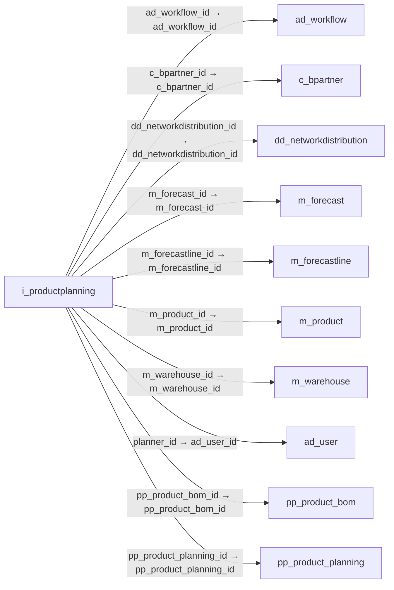

# i_productplanning — 제품 계획 가져오기

[전체 일람](../TABLE_INDEX.md) · [분류 일람](README.md) · [AI 사용 안내](../README.md) · [외래키 읽는 법](../RELATIONSHIPS.md)

## 기본 정보

| 항목 | 내용 |
|---|---|
| 물리명 | `adempiere.i_productplanning` |
| 한국어 논리명(문서용 해석) | 제품 계획 가져오기 |
| 원본 논리명 | Import Product Planning |
| 원본 사전 ID | 53260 |
| 분류 | `i` — 데이터 가져오기 준비 |
| 전체 테넌트 행 수 | 0 |
| 물리 열 수 | 52 |
| 나가는 FK / 들어오는 FK | 12 / 0 |
| 구조·행 수 확인 시점 | 2026-11-03T23:29:01+09:00 |

## 의미와 쓰임

제품·창고별 보충 정책과 BOM·자원·안전재고 등을 제품 계획으로 가져오기 위한 데이터를 저장한다.

- 설명 근거: 물리명·열·외래키 구조를 근거로 보수적으로 해석.
- 한국어 이름과 개요는 문서용 해석입니다. 공식 한국어 번역으로 간주하지 않습니다.
- 원본 설명: —
- 원본 도움말: —
- PostgreSQL 테이블 주석: —

## 키와 열

### 기본키·고유 제약조건

| 종류 | 제약조건 | 열(순서 유지) |
|---|---|---|
| PRIMARY KEY | `i_productplanning_key` | `i_productplanning_id` |
| UNIQUE | `i_productplanning_uu_idx` | `i_productplanning_uu` |

### 열 목록

원본 논리명·설명은 `AD_Column`에서 가져왔습니다. 기본값은 실제 PostgreSQL 메타데이터이며, 비어 있는 항목은 `—`로 표시합니다.

| 순서 | 물리명 | 원본 논리명 | PostgreSQL 타입 | NULL | PK | 기본값 | 설명 |
|---:|---|---|---|---|---|---|---|
| 1 | `i_productplanning_id` | Import Product Planning | numeric(10,0) | 불가 | 예 | — | — |
| 2 | `ad_client_id` | Tenant | numeric(10,0) | 불가 | — | — | Tenant for this installation. |
| 3 | `ad_org_id` | Organization | numeric(10,0) | 불가 | — | — | Organizational entity within tenant |
| 4 | `created` | Created | timestamp without time zone | 불가 | — | statement_timestamp() | Date this record was created |
| 5 | `createdby` | Created By | numeric(10,0) | 불가 | — | — | User who created this records |
| 6 | `isactive` | Active | character(1) | 불가 | — | 'Y'::bpchar | The record is active in the system |
| 7 | `updated` | Updated | timestamp without time zone | 불가 | — | statement_timestamp() | Date this record was updated |
| 8 | `updatedby` | Updated By | numeric(10,0) | 불가 | — | — | User who updated this records |
| 9 | `bpartner_value` | Business Partner Key | character varying(40) | 허용 | — | NULL::character varying | The Key of the Business Partner |
| 10 | `c_bpartner_id` | Business Partner | numeric(10,0) | 허용 | — | NULL::numeric | Identifies a Business Partner |
| 11 | `i_errormsg` | Import Error Message | character varying(2000) | 허용 | — | NULL::character varying | Messages generated from import process |
| 12 | `i_isimported` | Imported | character(1) | 불가 | — | — | Has this import been processed |
| 13 | `processed` | Processed | character(1) | 허용 | — | NULL::bpchar | The document has been processed |
| 14 | `processing` | Process Now | character(1) | 허용 | — | NULL::bpchar | — |
| 15 | `ad_workflow_id` | Workflow | numeric(10,0) | 허용 | — | NULL::numeric | Workflow or combination of tasks |
| 16 | `dd_networkdistribution_id` | Network Distribution | numeric(10,0) | 허용 | — | NULL::numeric | — |
| 17 | `deliverytime_promised` | Promised Delivery Time | numeric | 허용 | — | — | Promised days between order and delivery |
| 18 | `iscreateplan` | Create Plan | character(1) | 불가 | — | — | Indicates whether planned orders will be generated by MRP |
| 19 | `ismps` | Is MPS | character(1) | 허용 | — | NULL::bpchar | — |
| 20 | `isphantom` | Phantom | character(1) | 불가 | — | — | Phantom Component |
| 21 | `m_product_id` | Product | numeric(10,0) | 허용 | — | NULL::numeric | Product, Service, Item |
| 22 | `m_warehouse_id` | Warehouse | numeric(10,0) | 허용 | — | NULL::numeric | Storage Warehouse and Service Point |
| 23 | `order_max` | Maximum Order Qty | numeric | 허용 | — | — | Maximum order quantity in UOM |
| 24 | `order_min` | Minimum Order Qty | numeric | 허용 | — | — | Minimum order quantity in UOM |
| 25 | `order_pack` | Order Pack Qty | numeric | 허용 | — | — | Package order size in UOM (e.g. order set of 5 units) |
| 26 | `order_period` | Order Period | numeric | 허용 | — | — | — |
| 27 | `order_policy` | Order Policy | character varying(3) | 허용 | — | NULL::character varying | — |
| 28 | `order_qty` | Order Qty | numeric | 허용 | — | — | — |
| 29 | `planner_id` | Planner | numeric(10,0) | 허용 | — | NULL::numeric | — |
| 30 | `pp_product_bom_id` | BOM &amp; Formula | numeric(10,0) | 허용 | — | NULL::numeric | BOM &amp; Formula |
| 31 | `safetystock` | Safety Stock Qty | numeric | 허용 | — | — | Safety stock is a term used to describe a level of stock that is maintained below the cycle stock to buffer against stock-outs |
| 32 | `s_resource_id` | Resource | numeric(10,0) | 허용 | — | NULL::numeric | Resource |
| 33 | `timefence` | Time Fence | numeric | 허용 | — | — | — |
| 34 | `transferttime` | Transfer Time | numeric | 허용 | — | — | — |
| 35 | `workingtime` | Working Time | numeric | 허용 | — | — | Workflow Simulation Execution Time |
| 36 | `yield` | Yield % | numeric(10,0) | 허용 | — | NULL::numeric | The Yield is the percentage of a lot that is expected to be of acceptable wuality may fall below 100 percent |
| 37 | `datepromised` | Date Promised | timestamp without time zone | 허용 | — | — | Date Order was promised |
| 38 | `m_forecast_id` | Forecast | numeric(10,0) | 허용 | — | NULL::numeric | Material Forecast |
| 39 | `qty` | Quantity | numeric | 불가 | — | — | Quantity |
| 40 | `salesrep_id` | Sales Representative | numeric(10,0) | 허용 | — | NULL::numeric | Sales Representative or Company Agent |
| 41 | `productvalue` | Product Key | character varying(40) | 허용 | — | NULL::character varying | Key of the Product |
| 42 | `warehousevalue` | Warehouse Key | character varying(40) | 허용 | — | NULL::character varying | Key of the Warehouse |
| 43 | `orgvalue` | Org Key | character varying(40) | 허용 | — | NULL::character varying | Key of the Organization |
| 44 | `networkdistributionvalue` | Network Distribution Key | character varying(40) | 허용 | — | NULL::character varying | Key of the Network Distribution |
| 45 | `product_bom_value` | Product BOM Key | character varying(40) | 허용 | — | NULL::character varying | Key of Product BOM |
| 46 | `forecastvalue` | Forecast Key | character varying(40) | 허용 | — | NULL::character varying | Key of the Forecast |
| 47 | `resourcevalue` | Resource Key | character varying(40) | 허용 | — | NULL::character varying | Key of the Resource |
| 48 | `plannervalue` | Planner Key | character varying(40) | 허용 | — | NULL::character varying | Search Key of the Planning |
| 49 | `m_forecastline_id` | Forecast Line | numeric(10,0) | 허용 | — | NULL::numeric | Forecast Line |
| 50 | `pp_product_planning_id` | Product Planning | numeric(10,0) | 허용 | — | NULL::numeric | — |
| 51 | `vendorproductno` | Partner Product Key | character varying(30) | 허용 | — | NULL::character varying | Product Key of the Business Partner |
| 52 | `i_productplanning_uu` | I_ProductPlanning_UU | uuid | 허용 | — | — | — |

## 외래키 흐름

화살표는 **FK를 가진 자식 → 참조되는 부모**입니다. 업무 처리의 시간 순서나 무조건적인 1:N 관계를 뜻하지 않습니다.

주변 관계 12개 중 10개를 그림으로 표시합니다. **전체 관계는 아래 두 표에 모두 포함**합니다.

### 이 테이블이 참조하는 부모 — 나가는 FK

| 제약조건 | 참조하는 쪽(자식) | 자식 열 | 참조받는 쪽(부모) | 부모 열 | 삭제 / 갱신 | 검증 / 지연 가능 |
|---|---|---|---|---|---|---|
| `adworkflow_iproductplanning` <!-- FK_OUT: adempiere.i_productplanning.adworkflow_iproductplanning --> | [`i_productplanning`](i_productplanning.md) | `ad_workflow_id` | [`ad_workflow`](../ad/ad_workflow.md) | `ad_workflow_id` | NO ACTION / NO ACTION | 완료 / 가능 (초기 지연) |
| `cbpartner_iproductplanning` <!-- FK_OUT: adempiere.i_productplanning.cbpartner_iproductplanning --> | [`i_productplanning`](i_productplanning.md) | `c_bpartner_id` | [`c_bpartner`](../c/c_bpartner.md) | `c_bpartner_id` | NO ACTION / NO ACTION | 완료 / 가능 (초기 지연) |
| `ddnetworkdistribution_iproduct` <!-- FK_OUT: adempiere.i_productplanning.ddnetworkdistribution_iproduct --> | [`i_productplanning`](i_productplanning.md) | `dd_networkdistribution_id` | [`dd_networkdistribution`](../dd/dd_networkdistribution.md) | `dd_networkdistribution_id` | NO ACTION / NO ACTION | 완료 / 가능 (초기 지연) |
| `mforecast_iproductplanning` <!-- FK_OUT: adempiere.i_productplanning.mforecast_iproductplanning --> | [`i_productplanning`](i_productplanning.md) | `m_forecast_id` | [`m_forecast`](../m/m_forecast.md) | `m_forecast_id` | NO ACTION / NO ACTION | 완료 / 가능 (초기 지연) |
| `mforecastline_iproductplanning` <!-- FK_OUT: adempiere.i_productplanning.mforecastline_iproductplanning --> | [`i_productplanning`](i_productplanning.md) | `m_forecastline_id` | [`m_forecastline`](../m/m_forecastline.md) | `m_forecastline_id` | NO ACTION / NO ACTION | 완료 / 가능 (초기 지연) |
| `mproduct_iproductplanning` <!-- FK_OUT: adempiere.i_productplanning.mproduct_iproductplanning --> | [`i_productplanning`](i_productplanning.md) | `m_product_id` | [`m_product`](../m/m_product.md) | `m_product_id` | NO ACTION / NO ACTION | 완료 / 가능 (초기 지연) |
| `mwarehouse_iproductplanning` <!-- FK_OUT: adempiere.i_productplanning.mwarehouse_iproductplanning --> | [`i_productplanning`](i_productplanning.md) | `m_warehouse_id` | [`m_warehouse`](../m/m_warehouse.md) | `m_warehouse_id` | NO ACTION / NO ACTION | 완료 / 가능 (초기 지연) |
| `planner_iproductplanning` <!-- FK_OUT: adempiere.i_productplanning.planner_iproductplanning --> | [`i_productplanning`](i_productplanning.md) | `planner_id` | [`ad_user`](../ad/ad_user.md) | `ad_user_id` | NO ACTION / NO ACTION | 완료 / 가능 (초기 지연) |
| `ppproductbom_iproductplanning` <!-- FK_OUT: adempiere.i_productplanning.ppproductbom_iproductplanning --> | [`i_productplanning`](i_productplanning.md) | `pp_product_bom_id` | [`pp_product_bom`](../pp/pp_product_bom.md) | `pp_product_bom_id` | NO ACTION / NO ACTION | 완료 / 가능 (초기 지연) |
| `ppproductplanning_iproductplan` <!-- FK_OUT: adempiere.i_productplanning.ppproductplanning_iproductplan --> | [`i_productplanning`](i_productplanning.md) | `pp_product_planning_id` | [`pp_product_planning`](../pp/pp_product_planning.md) | `pp_product_planning_id` | NO ACTION / NO ACTION | 완료 / 가능 (초기 지연) |
| `salesrep_iproductplanning` <!-- FK_OUT: adempiere.i_productplanning.salesrep_iproductplanning --> | [`i_productplanning`](i_productplanning.md) | `salesrep_id` | [`ad_user`](../ad/ad_user.md) | `ad_user_id` | NO ACTION / NO ACTION | 완료 / 가능 (초기 지연) |
| `sresource_iproductplanning` <!-- FK_OUT: adempiere.i_productplanning.sresource_iproductplanning --> | [`i_productplanning`](i_productplanning.md) | `s_resource_id` | [`s_resource`](../s/s_resource.md) | `s_resource_id` | NO ACTION / NO ACTION | 완료 / 가능 (초기 지연) |

### 이 테이블을 참조하는 자식 — 들어오는 FK

해당 방향의 물리 FK 제약조건은 없습니다. 이름이 비슷한 열만으로 관계를 추가하지 않습니다.

## 조회 시 주의

- FK 표의 자식 열과 부모 열을 같은 순서로 대응시킵니다. 복합 FK는 모든 열의 동등 조건을 `AND`로 연결합니다.
- 테이블 이름이나 `_id` 열 이름만으로 물리 FK가 있다고 가정하지 않습니다. FK 미선언은 업무 관계가 없다는 뜻도 아닙니다.
- 자식이 여러 행인 테이블과 조인하면 부모의 금액·건수가 중복될 수 있습니다. 집계 단위를 먼저 정합니다.
- `ad_client_id`가 있습니다. 업무 분석에서는 대상 테넌트를 명시합니다. GardenWorld는 `11`, 시스템 공통 설정은 `0`일 수 있으므로 일괄 필터 적용 전에 테이블 역할을 확인합니다.
- 수집 시점에 0행입니다. 이 표만으로 거래 실적·처리 결과를 계산할 수 없습니다.
- 행 수는 위 확인 시점의 전체 테넌트 값입니다. 최신 업무 실적이나 현재 실행 결과로 재사용하지 않습니다.
