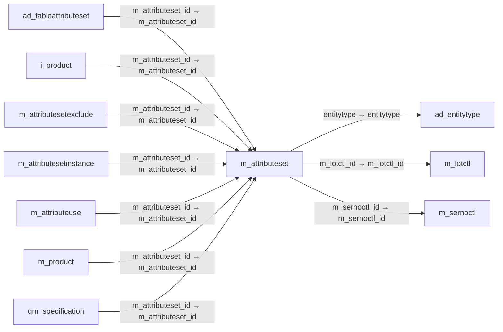

# m_attributeset — 제품 속성 집합

[전체 일람](../TABLE_INDEX.md) · [분류 일람](README.md) · [AI 사용 안내](../README.md) · [외래키 읽는 법](../RELATIONSHIPS.md)

## 기본 정보

| 항목 | 내용 |
|---|---|
| 물리명 | `adempiere.m_attributeset` |
| 한국어 논리명(문서용 해석) | 제품 속성 집합 |
| 원본 논리명 | Attribute Set |
| 원본 사전 ID | 560 |
| 분류 | `m` — 제품·재고·출하/입고·원가 |
| 전체 테넌트 행 수 | 4 |
| 물리 열 수 | 30 |
| 나가는 FK / 들어오는 FK | 3 / 7 |
| 구조·행 수 확인 시점 | 2026-11-03T23:29:01+09:00 |

## 의미와 쓰임

제품에 함께 적용할 속성들의 묶음을 정의한다.

- 설명 근거: 원본 애플리케이션 사전 명칭·설명을 한국어로 해석.
- 한국어 이름과 개요는 문서용 해석입니다. 공식 한국어 번역으로 간주하지 않습니다.
- 원본 설명: Product Attribute Set
- 원본 도움말: —
- PostgreSQL 테이블 주석: —

## 키와 열

### 기본키·고유 제약조건

| 종류 | 제약조건 | 열(순서 유지) |
|---|---|---|
| PRIMARY KEY | `m_attributeset_pkey` | `m_attributeset_id` |
| UNIQUE | `m_attributeset_uu_idx` | `m_attributeset_uu` |

### 열 목록

원본 논리명·설명은 `AD_Column`에서 가져왔습니다. 기본값은 실제 PostgreSQL 메타데이터이며, 비어 있는 항목은 `—`로 표시합니다.

| 순서 | 물리명 | 원본 논리명 | PostgreSQL 타입 | NULL | PK | 기본값 | 설명 |
|---:|---|---|---|---|---|---|---|
| 1 | `m_attributeset_id` | Attribute Set | numeric(10,0) | 불가 | 예 | — | Product Attribute Set |
| 2 | `ad_client_id` | Tenant | numeric(10,0) | 불가 | — | — | Tenant for this installation. |
| 3 | `ad_org_id` | Organization | numeric(10,0) | 불가 | — | — | Organizational entity within tenant |
| 4 | `isactive` | Active | character(1) | 불가 | — | 'Y'::bpchar | The record is active in the system |
| 5 | `created` | Created | timestamp without time zone | 불가 | — | now() | Date this record was created |
| 6 | `createdby` | Created By | numeric(10,0) | 불가 | — | — | User who created this records |
| 7 | `updated` | Updated | timestamp without time zone | 불가 | — | now() | Date this record was updated |
| 8 | `updatedby` | Updated By | numeric(10,0) | 불가 | — | — | User who updated this records |
| 9 | `name` | Name | character varying(60) | 불가 | — | — | Alphanumeric identifier of the entity |
| 10 | `description` | Description | character varying(255) | 허용 | — | — | Optional short description of the record |
| 11 | `isserno` | Serial No | character(1) | 불가 | — | 'Y'::bpchar | The product instances have Serial Numbers |
| 12 | `m_sernoctl_id` | Serial No Control | numeric(10,0) | 허용 | — | — | Product Serial Number Control |
| 13 | `islot` | Lot | character(1) | 불가 | — | 'Y'::bpchar | The product instances have a Lot Number |
| 14 | `m_lotctl_id` | Lot Control | numeric(10,0) | 허용 | — | — | Product Lot Control |
| 15 | `isguaranteedate` | Guarantee Date | character(1) | 불가 | — | 'N'::bpchar | Product has Guarantee or Expiry Date |
| 16 | `guaranteedays` | Guarantee Days | numeric(10,0) | 허용 | — | — | Number of days the product is guaranteed or available |
| 17 | `isinstanceattribute` | Instance Attribute | character(1) | 불가 | — | 'N'::bpchar | The product attribute is specific to the instance (like Serial No, Lot or Guarantee Date) |
| 18 | `mandatorytype` | Mandatory Type | character(1) | 불가 | — | 'N'::bpchar | The specification of a Product Attribute Instance is mandatory |
| 19 | `isguaranteedatemandatory` | Mandatory Guarantee Date | character(1) | 불가 | — | 'N'::bpchar | The entry of a Guarantee Date is mandatory when creating a Product Instance |
| 20 | `islotmandatory` | Mandatory Lot | character(1) | 불가 | — | 'N'::bpchar | The entry of Lot info is mandatory when creating a Product Instance |
| 21 | `issernomandatory` | Mandatory Serial No | character(1) | 불가 | — | 'N'::bpchar | The entry of a Serial No is mandatory when creating a Product Instance |
| 22 | `sernocharsoverwrite` | Ser No Char Start Overwrite | character(1) | 허용 | — | — | Serial Number Start Indicator overwrite - default # |
| 23 | `lotcharsoverwrite` | Lot Char Start Overwrite | character(1) | 허용 | — | — | Lot/Batch Start Indicator overwrite - default « |
| 24 | `lotchareoverwrite` | Lot Char End Overwrite | character(1) | 허용 | — | — | Lot/Batch End Indicator overwrite - default » |
| 25 | `sernochareoverwrite` | Ser No Char End Overwrite | character(1) | 허용 | — | — | Serial Number End Indicator overwrite - default empty |
| 26 | `m_attributeset_uu` | M_AttributeSet_UU | uuid | 허용 | — | — | — |
| 27 | `useguaranteedateformpolicy` | Use Guarantee Date for Material Policy | character(1) | 허용 | — | 'N'::bpchar | — |
| 28 | `isautogeneratelot` | Is Auto Generate Lot | character(1) | 허용 | — | 'N'::bpchar | — |
| 29 | `m_attributeset_type` | Attribute Set Type | character varying(3) | 허용 | — | 'MMS'::character varying | — |
| 30 | `entitytype` | Entity Type | character varying(40) | 허용 | — | NULL::character varying | Dictionary Entity Type; Determines ownership and synchronization |

## 외래키 흐름

화살표는 **FK를 가진 자식 → 참조되는 부모**입니다. 업무 처리의 시간 순서나 무조건적인 1:N 관계를 뜻하지 않습니다.

주변 관계 10개 중 10개를 그림으로 표시합니다. **전체 관계는 아래 두 표에 모두 포함**합니다.

### 이 테이블이 참조하는 부모 — 나가는 FK

| 제약조건 | 참조하는 쪽(자식) | 자식 열 | 참조받는 쪽(부모) | 부모 열 | 삭제 / 갱신 | 검증 / 지연 가능 |
|---|---|---|---|---|---|---|
| `entitytype_mattributeset` <!-- FK_OUT: adempiere.m_attributeset.entitytype_mattributeset --> | [`m_attributeset`](m_attributeset.md) | `entitytype` | [`ad_entitytype`](../ad/ad_entitytype.md) | `entitytype` | NO ACTION / NO ACTION | 완료 / 가능 (초기 지연) |
| `mlotctl_mattributeset` <!-- FK_OUT: adempiere.m_attributeset.mlotctl_mattributeset --> | [`m_attributeset`](m_attributeset.md) | `m_lotctl_id` | [`m_lotctl`](m_lotctl.md) | `m_lotctl_id` | NO ACTION / NO ACTION | 완료 / 가능 (초기 지연) |
| `msernoctl_attributeset` <!-- FK_OUT: adempiere.m_attributeset.msernoctl_attributeset --> | [`m_attributeset`](m_attributeset.md) | `m_sernoctl_id` | [`m_sernoctl`](m_sernoctl.md) | `m_sernoctl_id` | NO ACTION / NO ACTION | 완료 / 가능 (초기 지연) |

### 이 테이블을 참조하는 자식 — 들어오는 FK

| 제약조건 | 참조하는 쪽(자식) | 자식 열 | 참조받는 쪽(부모) | 부모 열 | 삭제 / 갱신 | 검증 / 지연 가능 |
|---|---|---|---|---|---|---|
| `mattributeset_adtableattributeset` <!-- FK_IN: adempiere.ad_tableattributeset.mattributeset_adtableattributeset --> | [`ad_tableattributeset`](../ad/ad_tableattributeset.md) | `m_attributeset_id` | [`m_attributeset`](m_attributeset.md) | `m_attributeset_id` | NO ACTION / NO ACTION | 완료 / 가능 (초기 지연) |
| `mattributeset_iproduct` <!-- FK_IN: adempiere.i_product.mattributeset_iproduct --> | [`i_product`](../i/i_product.md) | `m_attributeset_id` | [`m_attributeset`](m_attributeset.md) | `m_attributeset_id` | SET NULL / NO ACTION | 완료 / 가능 (초기 지연) |
| `mattributeset_masexclude` <!-- FK_IN: adempiere.m_attributesetexclude.mattributeset_masexclude --> | [`m_attributesetexclude`](m_attributesetexclude.md) | `m_attributeset_id` | [`m_attributeset`](m_attributeset.md) | `m_attributeset_id` | NO ACTION / NO ACTION | 완료 / 가능 (초기 지연) |
| `mattributeset_mattribsetinst` <!-- FK_IN: adempiere.m_attributesetinstance.mattributeset_mattribsetinst --> | [`m_attributesetinstance`](m_attributesetinstance.md) | `m_attributeset_id` | [`m_attributeset`](m_attributeset.md) | `m_attributeset_id` | NO ACTION / NO ACTION | 완료 / 가능 (초기 지연) |
| `mattributeset_mattributeuse` <!-- FK_IN: adempiere.m_attributeuse.mattributeset_mattributeuse --> | [`m_attributeuse`](m_attributeuse.md) | `m_attributeset_id` | [`m_attributeset`](m_attributeset.md) | `m_attributeset_id` | NO ACTION / NO ACTION | 완료 / 가능 (초기 지연) |
| `mattributeset_mproduct` <!-- FK_IN: adempiere.m_product.mattributeset_mproduct --> | [`m_product`](m_product.md) | `m_attributeset_id` | [`m_attributeset`](m_attributeset.md) | `m_attributeset_id` | CASCADE / NO ACTION | 완료 / 가능 (초기 지연) |
| `mattributeset_qmspecification` <!-- FK_IN: adempiere.qm_specification.mattributeset_qmspecification --> | [`qm_specification`](../qm/qm_specification.md) | `m_attributeset_id` | [`m_attributeset`](m_attributeset.md) | `m_attributeset_id` | NO ACTION / NO ACTION | 완료 / 가능 (초기 지연) |

## 조회 시 주의

- FK 표의 자식 열과 부모 열을 같은 순서로 대응시킵니다. 복합 FK는 모든 열의 동등 조건을 `AND`로 연결합니다.
- 테이블 이름이나 `_id` 열 이름만으로 물리 FK가 있다고 가정하지 않습니다. FK 미선언은 업무 관계가 없다는 뜻도 아닙니다.
- 자식이 여러 행인 테이블과 조인하면 부모의 금액·건수가 중복될 수 있습니다. 집계 단위를 먼저 정합니다.
- `ad_client_id`가 있습니다. 업무 분석에서는 대상 테넌트를 명시합니다. GardenWorld는 `11`, 시스템 공통 설정은 `0`일 수 있으므로 일괄 필터 적용 전에 테이블 역할을 확인합니다.
- 행 수는 위 확인 시점의 전체 테넌트 값입니다. 최신 업무 실적이나 현재 실행 결과로 재사용하지 않습니다.
