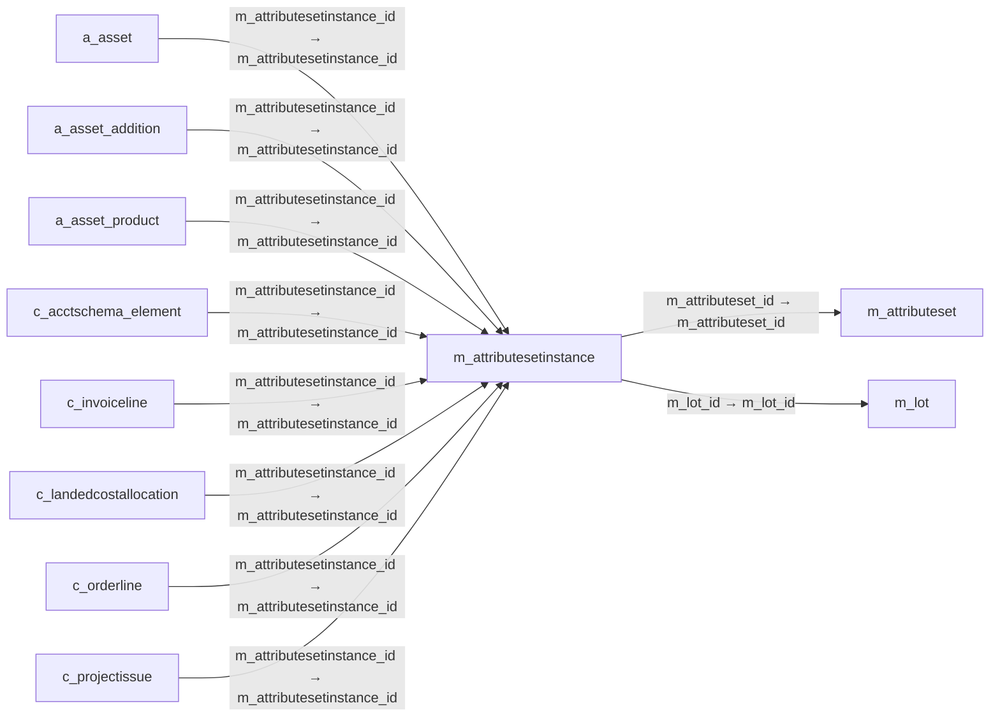

# m_attributesetinstance — 제품 속성 집합 인스턴스

[전체 일람](../TABLE_INDEX.md) · [분류 일람](README.md) · [AI 사용 안내](../README.md) · [외래키 읽는 법](../RELATIONSHIPS.md)

## 기본 정보

| 항목 | 내용 |
|---|---|
| 물리명 | `adempiere.m_attributesetinstance` |
| 한국어 논리명(문서용 해석) | 제품 속성 집합 인스턴스 |
| 원본 논리명 | Attribute Set Instance |
| 원본 사전 ID | 559 |
| 분류 | `m` — 제품·재고·출하/입고·원가 |
| 전체 테넌트 행 수 | 4 |
| 물리 열 수 | 15 |
| 나가는 FK / 들어오는 FK | 2 / 53 |
| 구조·행 수 확인 시점 | 2026-11-03T23:29:01+09:00 |

## 의미와 쓰임

제품 속성 집합이 실제 적용된 개별 인스턴스를 식별한다.

- 설명 근거: 원본 애플리케이션 사전 명칭·설명을 한국어로 해석.
- 한국어 이름과 개요는 문서용 해석입니다. 공식 한국어 번역으로 간주하지 않습니다.
- 원본 설명: Product Attribute Set Instance
- 원본 도움말: —
- PostgreSQL 테이블 주석: —

## 키와 열

### 기본키·고유 제약조건

| 종류 | 제약조건 | 열(순서 유지) |
|---|---|---|
| PRIMARY KEY | `m_attributesetinstance_pkey` | `m_attributesetinstance_id` |
| UNIQUE | `m_attributesetinstance_uu_idx` | `m_attributesetinstance_uu` |

### 열 목록

원본 논리명·설명은 `AD_Column`에서 가져왔습니다. 기본값은 실제 PostgreSQL 메타데이터이며, 비어 있는 항목은 `—`로 표시합니다.

| 순서 | 물리명 | 원본 논리명 | PostgreSQL 타입 | NULL | PK | 기본값 | 설명 |
|---:|---|---|---|---|---|---|---|
| 1 | `m_attributesetinstance_id` | Attribute Set Instance | numeric(10,0) | 불가 | 예 | — | Product Attribute Set Instance |
| 2 | `ad_client_id` | Tenant | numeric(10,0) | 불가 | — | — | Tenant for this installation. |
| 3 | `ad_org_id` | Organization | numeric(10,0) | 불가 | — | — | Organizational entity within tenant |
| 4 | `isactive` | Active | character(1) | 불가 | — | 'Y'::bpchar | The record is active in the system |
| 5 | `created` | Created | timestamp without time zone | 불가 | — | now() | Date this record was created |
| 6 | `createdby` | Created By | numeric(10,0) | 불가 | — | — | User who created this records |
| 7 | `updated` | Updated | timestamp without time zone | 불가 | — | now() | Date this record was updated |
| 8 | `updatedby` | Updated By | numeric(10,0) | 불가 | — | — | User who updated this records |
| 9 | `m_attributeset_id` | Attribute Set | numeric(10,0) | 허용 | — | — | Product Attribute Set |
| 10 | `serno` | Serial No | character varying(40) | 허용 | — | — | Product Serial Number  |
| 11 | `lot` | Lot No | character varying(40) | 허용 | — | — | Lot number (alphanumeric) |
| 12 | `guaranteedate` | Guarantee Date | timestamp without time zone | 허용 | — | — | Date when guarantee expires |
| 13 | `description` | Description | character varying(1023) | 허용 | — | — | Optional short description of the record |
| 14 | `m_lot_id` | Lot | numeric(10,0) | 허용 | — | — | Product Lot Definition |
| 15 | `m_attributesetinstance_uu` | M_AttributeSetInstance_UU | uuid | 허용 | — | — | — |

## 외래키 흐름

화살표는 **FK를 가진 자식 → 참조되는 부모**입니다. 업무 처리의 시간 순서나 무조건적인 1:N 관계를 뜻하지 않습니다.

주변 관계 55개 중 10개를 그림으로 표시합니다. **전체 관계는 아래 두 표에 모두 포함**합니다.

### 이 테이블이 참조하는 부모 — 나가는 FK

| 제약조건 | 참조하는 쪽(자식) | 자식 열 | 참조받는 쪽(부모) | 부모 열 | 삭제 / 갱신 | 검증 / 지연 가능 |
|---|---|---|---|---|---|---|
| `mattributeset_mattribsetinst` <!-- FK_OUT: adempiere.m_attributesetinstance.mattributeset_mattribsetinst --> | [`m_attributesetinstance`](m_attributesetinstance.md) | `m_attributeset_id` | [`m_attributeset`](m_attributeset.md) | `m_attributeset_id` | NO ACTION / NO ACTION | 완료 / 가능 (초기 지연) |
| `mlot_mattributesetinstance` <!-- FK_OUT: adempiere.m_attributesetinstance.mlot_mattributesetinstance --> | [`m_attributesetinstance`](m_attributesetinstance.md) | `m_lot_id` | [`m_lot`](m_lot.md) | `m_lot_id` | NO ACTION / NO ACTION | 완료 / 가능 (초기 지연) |

### 이 테이블을 참조하는 자식 — 들어오는 FK

| 제약조건 | 참조하는 쪽(자식) | 자식 열 | 참조받는 쪽(부모) | 부모 열 | 삭제 / 갱신 | 검증 / 지연 가능 |
|---|---|---|---|---|---|---|
| `mattributesetinstance_aasset` <!-- FK_IN: adempiere.a_asset.mattributesetinstance_aasset --> | [`a_asset`](../a/a_asset.md) | `m_attributesetinstance_id` | [`m_attributesetinstance`](m_attributesetinstance.md) | `m_attributesetinstance_id` | NO ACTION / NO ACTION | 완료 / 가능 (초기 지연) |
| `mattributesetinstance_aassetad` <!-- FK_IN: adempiere.a_asset_addition.mattributesetinstance_aassetad --> | [`a_asset_addition`](../a/a_asset_addition.md) | `m_attributesetinstance_id` | [`m_attributesetinstance`](m_attributesetinstance.md) | `m_attributesetinstance_id` | NO ACTION / NO ACTION | 완료 / 가능 (초기 지연) |
| `mattributesetinstance_aassetpr` <!-- FK_IN: adempiere.a_asset_product.mattributesetinstance_aassetpr --> | [`a_asset_product`](../a/a_asset_product.md) | `m_attributesetinstance_id` | [`m_attributesetinstance`](m_attributesetinstance.md) | `m_attributesetinstance_id` | NO ACTION / NO ACTION | 완료 / 가능 (초기 지연) |
| `mattributesetinstance_cacctschemaelement` <!-- FK_IN: adempiere.c_acctschema_element.mattributesetinstance_cacctschemaelement --> | [`c_acctschema_element`](../c/c_acctschema_element.md) | `m_attributesetinstance_id` | [`m_attributesetinstance`](m_attributesetinstance.md) | `m_attributesetinstance_id` | NO ACTION / NO ACTION | 완료 / 가능 (초기 지연) |
| `mattrsetinst_cinvoiceline` <!-- FK_IN: adempiere.c_invoiceline.mattrsetinst_cinvoiceline --> | [`c_invoiceline`](../c/c_invoiceline.md) | `m_attributesetinstance_id` | [`m_attributesetinstance`](m_attributesetinstance.md) | `m_attributesetinstance_id` | NO ACTION / NO ACTION | 완료 / 가능 (초기 지연) |
| `masi_clandedcostallocation` <!-- FK_IN: adempiere.c_landedcostallocation.masi_clandedcostallocation --> | [`c_landedcostallocation`](../c/c_landedcostallocation.md) | `m_attributesetinstance_id` | [`m_attributesetinstance`](m_attributesetinstance.md) | `m_attributesetinstance_id` | NO ACTION / NO ACTION | 완료 / 가능 (초기 지연) |
| `mattrsetinst_corderline` <!-- FK_IN: adempiere.c_orderline.mattrsetinst_corderline --> | [`c_orderline`](../c/c_orderline.md) | `m_attributesetinstance_id` | [`m_attributesetinstance`](m_attributesetinstance.md) | `m_attributesetinstance_id` | NO ACTION / NO ACTION | 완료 / 가능 (초기 지연) |
| `mattrsetinst_cprojectissue` <!-- FK_IN: adempiere.c_projectissue.mattrsetinst_cprojectissue --> | [`c_projectissue`](../c/c_projectissue.md) | `m_attributesetinstance_id` | [`m_attributesetinstance`](m_attributesetinstance.md) | `m_attributesetinstance_id` | NO ACTION / NO ACTION | 완료 / 가능 (초기 지연) |
| `masi_cprojectissuema` <!-- FK_IN: adempiere.c_projectissuema.masi_cprojectissuema --> | [`c_projectissuema`](../c/c_projectissuema.md) | `m_attributesetinstance_id` | [`m_attributesetinstance`](m_attributesetinstance.md) | `m_attributesetinstance_id` | NO ACTION / NO ACTION | 완료 / 가능 (초기 지연) |
| `masetinstance_crfqline` <!-- FK_IN: adempiere.c_rfqline.masetinstance_crfqline --> | [`c_rfqline`](../c/c_rfqline.md) | `m_attributesetinstance_id` | [`m_attributesetinstance`](m_attributesetinstance.md) | `m_attributesetinstance_id` | NO ACTION / NO ACTION | 완료 / 가능 (초기 지연) |
| `mattributesetinstance_ddorderl` <!-- FK_IN: adempiere.dd_orderline.mattributesetinstance_ddorderl --> | [`dd_orderline`](../dd/dd_orderline.md) | `m_attributesetinstance_id` | [`m_attributesetinstance`](m_attributesetinstance.md) | `m_attributesetinstance_id` | NO ACTION / NO ACTION | 완료 / 가능 (초기 지연) |
| `mattributesetinstanceto_ddorde` <!-- FK_IN: adempiere.dd_orderline.mattributesetinstanceto_ddorde --> | [`dd_orderline`](../dd/dd_orderline.md) | `m_attributesetinstanceto_id` | [`m_attributesetinstance`](m_attributesetinstance.md) | `m_attributesetinstance_id` | NO ACTION / NO ACTION | 완료 / 가능 (초기 지연) |
| `mattributesetinstance_factacct` <!-- FK_IN: adempiere.fact_acct.mattributesetinstance_factacct --> | [`fact_acct`](../fact/fact_acct.md) | `m_attributesetinstance_id` | [`m_attributesetinstance`](m_attributesetinstance.md) | `m_attributesetinstance_id` | NO ACTION / NO ACTION | 완료 / 가능 (초기 지연) |
| `mattributesetinstance_factacctsummary` <!-- FK_IN: adempiere.fact_acct_summary.mattributesetinstance_factacctsummary --> | [`fact_acct_summary`](../fact/fact_acct_summary.md) | `m_attributesetinstance_id` | [`m_attributesetinstance`](m_attributesetinstance.md) | `m_attributesetinstance_id` | NO ACTION / NO ACTION | 완료 / 가능 (초기 지연) |
| `mattributesetinstance_gldistribution` <!-- FK_IN: adempiere.gl_distribution.mattributesetinstance_gldistribution --> | [`gl_distribution`](../gl/gl_distribution.md) | `m_attributesetinstance_id` | [`m_attributesetinstance`](m_attributesetinstance.md) | `m_attributesetinstance_id` | NO ACTION / NO ACTION | 완료 / 가능 (초기 지연) |
| `mattributesetinstance_gldistributionline` <!-- FK_IN: adempiere.gl_distributionline.mattributesetinstance_gldistributionline --> | [`gl_distributionline`](../gl/gl_distributionline.md) | `m_attributesetinstance_id` | [`m_attributesetinstance`](m_attributesetinstance.md) | `m_attributesetinstance_id` | NO ACTION / NO ACTION | 완료 / 가능 (초기 지연) |
| `mattributesetinstance_gljournalline` <!-- FK_IN: adempiere.gl_journalline.mattributesetinstance_gljournalline --> | [`gl_journalline`](../gl/gl_journalline.md) | `m_attributesetinstance_id` | [`m_attributesetinstance`](m_attributesetinstance.md) | `m_attributesetinstance_id` | NO ACTION / NO ACTION | 완료 / 가능 (초기 지연) |
| `mattributesetinstance_iasset` <!-- FK_IN: adempiere.i_asset.mattributesetinstance_iasset --> | [`i_asset`](../i/i_asset.md) | `m_attributesetinstance_id` | [`m_attributesetinstance`](m_attributesetinstance.md) | `m_attributesetinstance_id` | NO ACTION / NO ACTION | 완료 / 가능 (초기 지연) |
| `mattrsetinst__mattrinst` <!-- FK_IN: adempiere.m_attributeinstance.mattrsetinst__mattrinst --> | [`m_attributeinstance`](m_attributeinstance.md) | `m_attributesetinstance_id` | [`m_attributesetinstance`](m_attributesetinstance.md) | `m_attributesetinstance_id` | CASCADE / NO ACTION | 완료 / 가능 (초기 지연) |
| `masi_mbomproduct` <!-- FK_IN: adempiere.m_bomproduct.masi_mbomproduct --> | [`m_bomproduct`](m_bomproduct.md) | `m_attributesetinstance_id` | [`m_attributesetinstance`](m_attributesetinstance.md) | `m_attributesetinstance_id` | NO ACTION / NO ACTION | 완료 / 가능 (초기 지연) |
| `masi_mcost` <!-- FK_IN: adempiere.m_cost.masi_mcost --> | [`m_cost`](m_cost.md) | `m_attributesetinstance_id` | [`m_attributesetinstance`](m_attributesetinstance.md) | `m_attributesetinstance_id` | CASCADE / NO ACTION | 완료 / 가능 (초기 지연) |
| `masi_mcostdetail` <!-- FK_IN: adempiere.m_costdetail.masi_mcostdetail --> | [`m_costdetail`](m_costdetail.md) | `m_attributesetinstance_id` | [`m_attributesetinstance`](m_attributesetinstance.md) | `m_attributesetinstance_id` | NO ACTION / NO ACTION | 완료 / 가능 (초기 지연) |
| `mattributesetinstance_mcosthis` <!-- FK_IN: adempiere.m_costhistory.mattributesetinstance_mcosthis --> | [`m_costhistory`](m_costhistory.md) | `m_attributesetinstance_id` | [`m_attributesetinstance`](m_attributesetinstance.md) | `m_attributesetinstance_id` | NO ACTION / NO ACTION | 완료 / 가능 (초기 지연) |
| `masi_mcostqueue` <!-- FK_IN: adempiere.m_costqueue.masi_mcostqueue --> | [`m_costqueue`](m_costqueue.md) | `m_attributesetinstance_id` | [`m_attributesetinstance`](m_attributesetinstance.md) | `m_attributesetinstance_id` | CASCADE / NO ACTION | 완료 / 가능 (초기 지연) |
| `mattrsetinst_minoutline` <!-- FK_IN: adempiere.m_inoutline.mattrsetinst_minoutline --> | [`m_inoutline`](m_inoutline.md) | `m_attributesetinstance_id` | [`m_attributesetinstance`](m_attributesetinstance.md) | `m_attributesetinstance_id` | NO ACTION / NO ACTION | 완료 / 가능 (초기 지연) |
| `masi_minourlinema` <!-- FK_IN: adempiere.m_inoutlinema.masi_minourlinema --> | [`m_inoutlinema`](m_inoutlinema.md) | `m_attributesetinstance_id` | [`m_attributesetinstance`](m_attributesetinstance.md) | `m_attributesetinstance_id` | CASCADE / NO ACTION | 완료 / 가능 (초기 지연) |
| `mattrsetinst_minventoryline` <!-- FK_IN: adempiere.m_inventoryline.mattrsetinst_minventoryline --> | [`m_inventoryline`](m_inventoryline.md) | `m_attributesetinstance_id` | [`m_attributesetinstance`](m_attributesetinstance.md) | `m_attributesetinstance_id` | NO ACTION / NO ACTION | 완료 / 가능 (초기 지연) |
| `masi_minventorylinema` <!-- FK_IN: adempiere.m_inventorylinema.masi_minventorylinema --> | [`m_inventorylinema`](m_inventorylinema.md) | `m_attributesetinstance_id` | [`m_attributesetinstance`](m_attributesetinstance.md) | `m_attributesetinstance_id` | CASCADE / NO ACTION | 완료 / 가능 (초기 지연) |
| `mattributesetinstance_mmatchin` <!-- FK_IN: adempiere.m_matchinv.mattributesetinstance_mmatchin --> | [`m_matchinv`](m_matchinv.md) | `m_attributesetinstance_id` | [`m_attributesetinstance`](m_attributesetinstance.md) | `m_attributesetinstance_id` | NO ACTION / NO ACTION | 완료 / 가능 (초기 지연) |
| `mattributesetinstance_mmatchpo` <!-- FK_IN: adempiere.m_matchpo.mattributesetinstance_mmatchpo --> | [`m_matchpo`](m_matchpo.md) | `m_attributesetinstance_id` | [`m_attributesetinstance`](m_attributesetinstance.md) | `m_attributesetinstance_id` | NO ACTION / NO ACTION | 완료 / 가능 (초기 지연) |
| `mattributesetinstanceto_mmovem` <!-- FK_IN: adempiere.m_movementline.mattributesetinstanceto_mmovem --> | [`m_movementline`](m_movementline.md) | `m_attributesetinstanceto_id` | [`m_attributesetinstance`](m_attributesetinstance.md) | `m_attributesetinstance_id` | NO ACTION / NO ACTION | 완료 / 가능 (초기 지연) |
| `mattrsetinst_mmovementline` <!-- FK_IN: adempiere.m_movementline.mattrsetinst_mmovementline --> | [`m_movementline`](m_movementline.md) | `m_attributesetinstance_id` | [`m_attributesetinstance`](m_attributesetinstance.md) | `m_attributesetinstance_id` | NO ACTION / NO ACTION | 완료 / 가능 (초기 지연) |
| `masi_mmovementlinema` <!-- FK_IN: adempiere.m_movementlinema.masi_mmovementlinema --> | [`m_movementlinema`](m_movementlinema.md) | `m_attributesetinstance_id` | [`m_attributesetinstance`](m_attributesetinstance.md) | `m_attributesetinstance_id` | CASCADE / NO ACTION | 완료 / 가능 (초기 지연) |
| `mattrsetinst_mproduct` <!-- FK_IN: adempiere.m_product.mattrsetinst_mproduct --> | [`m_product`](m_product.md) | `m_attributesetinstance_id` | [`m_attributesetinstance`](m_attributesetinstance.md) | `m_attributesetinstance_id` | NO ACTION / NO ACTION | 완료 / 가능 (초기 지연) |
| `mattrsetinst_mproductionline` <!-- FK_IN: adempiere.m_productionline.mattrsetinst_mproductionline --> | [`m_productionline`](m_productionline.md) | `m_attributesetinstance_id` | [`m_attributesetinstance`](m_attributesetinstance.md) | `m_attributesetinstance_id` | NO ACTION / NO ACTION | 완료 / 가능 (초기 지연) |
| `masi_mproductionlinema` <!-- FK_IN: adempiere.m_productionlinema.masi_mproductionlinema --> | [`m_productionlinema`](m_productionlinema.md) | `m_attributesetinstance_id` | [`m_attributesetinstance`](m_attributesetinstance.md) | `m_attributesetinstance_id` | CASCADE / NO ACTION | 완료 / 가능 (초기 지연) |
| `mattributesetinstance_mquality` <!-- FK_IN: adempiere.m_qualitytestresult.mattributesetinstance_mquality --> | [`m_qualitytestresult`](m_qualitytestresult.md) | `m_attributesetinstance_id` | [`m_attributesetinstance`](m_attributesetinstance.md) | `m_attributesetinstance_id` | NO ACTION / NO ACTION | 완료 / 가능 (초기 지연) |
| `mattributesetinstance_mrequisi` <!-- FK_IN: adempiere.m_requisitionline.mattributesetinstance_mrequisi --> | [`m_requisitionline`](m_requisitionline.md) | `m_attributesetinstance_id` | [`m_attributesetinstance`](m_attributesetinstance.md) | `m_attributesetinstance_id` | NO ACTION / NO ACTION | 완료 / 가능 (초기 지연) |
| `mattributesetinstance_mstoraoh` <!-- FK_IN: adempiere.m_storageonhand.mattributesetinstance_mstoraoh --> | [`m_storageonhand`](m_storageonhand.md) | `m_attributesetinstance_id` | [`m_attributesetinstance`](m_attributesetinstance.md) | `m_attributesetinstance_id` | NO ACTION / NO ACTION | 완료 / 가능 (초기 지연) |
| `mattributesetinstance_mstorare` <!-- FK_IN: adempiere.m_storagereservation.mattributesetinstance_mstorare --> | [`m_storagereservation`](m_storagereservation.md) | `m_attributesetinstance_id` | [`m_attributesetinstance`](m_attributesetinstance.md) | `m_attributesetinstance_id` | NO ACTION / NO ACTION | 완료 / 가능 (초기 지연) |
| `mattributesetinstance_mstorage` <!-- FK_IN: adempiere.m_storagereservationlog.mattributesetinstance_mstorage --> | [`m_storagereservationlog`](m_storagereservationlog.md) | `m_attributesetinstance_id` | [`m_attributesetinstance`](m_attributesetinstance.md) | `m_attributesetinstance_id` | NO ACTION / NO ACTION | 완료 / 가능 (초기 지연) |
| `mattrsetinst_mtransaction` <!-- FK_IN: adempiere.m_transaction.mattrsetinst_mtransaction --> | [`m_transaction`](m_transaction.md) | `m_attributesetinstance_id` | [`m_attributesetinstance`](m_attributesetinstance.md) | `m_attributesetinstance_id` | NO ACTION / NO ACTION | 완료 / 가능 (초기 지연) |
| `mattributesetinst_mtrxalloc` <!-- FK_IN: adempiere.m_transactionallocation.mattributesetinst_mtrxalloc --> | [`m_transactionallocation`](m_transactionallocation.md) | `m_attributesetinstance_id` | [`m_attributesetinstance`](m_attributesetinstance.md) | `m_attributesetinstance_id` | NO ACTION / NO ACTION | 완료 / 가능 (초기 지연) |
| `mattributesetinstance_ppcostco` <!-- FK_IN: adempiere.pp_cost_collector.mattributesetinstance_ppcostco --> | [`pp_cost_collector`](../pp/pp_cost_collector.md) | `m_attributesetinstance_id` | [`m_attributesetinstance`](m_attributesetinstance.md) | `m_attributesetinstance_id` | NO ACTION / NO ACTION | 완료 / 가능 (초기 지연) |
| `mattributesetinstance_ppcostma` <!-- FK_IN: adempiere.pp_cost_collectorma.mattributesetinstance_ppcostma --> | [`pp_cost_collectorma`](../pp/pp_cost_collectorma.md) | `m_attributesetinstance_id` | [`m_attributesetinstance`](m_attributesetinstance.md) | `m_attributesetinstance_id` | NO ACTION / NO ACTION | 완료 / 가능 (초기 지연) |
| `mattributesetinstance_pporder` <!-- FK_IN: adempiere.pp_order.mattributesetinstance_pporder --> | [`pp_order`](../pp/pp_order.md) | `m_attributesetinstance_id` | [`m_attributesetinstance`](m_attributesetinstance.md) | `m_attributesetinstance_id` | NO ACTION / NO ACTION | 완료 / 가능 (초기 지연) |
| `mattributesetinstance_pporderb` <!-- FK_IN: adempiere.pp_order_bom.mattributesetinstance_pporderb --> | [`pp_order_bom`](../pp/pp_order_bom.md) | `m_attributesetinstance_id` | [`m_attributesetinstance`](m_attributesetinstance.md) | `m_attributesetinstance_id` | NO ACTION / NO ACTION | 완료 / 가능 (초기 지연) |
| `mattributesetinstance_ppordbl` <!-- FK_IN: adempiere.pp_order_bomline.mattributesetinstance_ppordbl --> | [`pp_order_bomline`](../pp/pp_order_bomline.md) | `m_attributesetinstance_id` | [`m_attributesetinstance`](m_attributesetinstance.md) | `m_attributesetinstance_id` | NO ACTION / NO ACTION | 완료 / 가능 (초기 지연) |
| `mattributesetinstance_pporderc` <!-- FK_IN: adempiere.pp_order_cost.mattributesetinstance_pporderc --> | [`pp_order_cost`](../pp/pp_order_cost.md) | `m_attributesetinstance_id` | [`m_attributesetinstance`](m_attributesetinstance.md) | `m_attributesetinstance_id` | NO ACTION / NO ACTION | 완료 / 가능 (초기 지연) |
| `mattributesetinstance_ppproduc` <!-- FK_IN: adempiere.pp_product_bom.mattributesetinstance_ppproduc --> | [`pp_product_bom`](../pp/pp_product_bom.md) | `m_attributesetinstance_id` | [`m_attributesetinstance`](m_attributesetinstance.md) | `m_attributesetinstance_id` | NO ACTION / NO ACTION | 완료 / 가능 (초기 지연) |
| `mattributesetinstance_ppprodbl` <!-- FK_IN: adempiere.pp_product_bomline.mattributesetinstance_ppprodbl --> | [`pp_product_bomline`](../pp/pp_product_bomline.md) | `m_attributesetinstance_id` | [`m_attributesetinstance`](m_attributesetinstance.md) | `m_attributesetinstance_id` | NO ACTION / NO ACTION | 완료 / 가능 (초기 지연) |
| `masi_tinventoryvalue` <!-- FK_IN: adempiere.t_inventoryvalue.masi_tinventoryvalue --> | [`t_inventoryvalue`](../t/t_inventoryvalue.md) | `m_attributesetinstance_id` | [`m_attributesetinstance`](m_attributesetinstance.md) | `m_attributesetinstance_id` | CASCADE / NO ACTION | 완료 / 가능 (초기 지연) |
| `masi_ttransaction` <!-- FK_IN: adempiere.t_transaction.masi_ttransaction --> | [`t_transaction`](../t/t_transaction.md) | `m_attributesetinstance_id` | [`m_attributesetinstance`](m_attributesetinstance.md) | `m_attributesetinstance_id` | CASCADE / NO ACTION | 완료 / 가능 (초기 지연) |

## 조회 시 주의

- FK 표의 자식 열과 부모 열을 같은 순서로 대응시킵니다. 복합 FK는 모든 열의 동등 조건을 `AND`로 연결합니다.
- 테이블 이름이나 `_id` 열 이름만으로 물리 FK가 있다고 가정하지 않습니다. FK 미선언은 업무 관계가 없다는 뜻도 아닙니다.
- 자식이 여러 행인 테이블과 조인하면 부모의 금액·건수가 중복될 수 있습니다. 집계 단위를 먼저 정합니다.
- `ad_client_id`가 있습니다. 업무 분석에서는 대상 테넌트를 명시합니다. GardenWorld는 `11`, 시스템 공통 설정은 `0`일 수 있으므로 일괄 필터 적용 전에 테이블 역할을 확인합니다.
- 행 수는 위 확인 시점의 전체 테넌트 값입니다. 최신 업무 실적이나 현재 실행 결과로 재사용하지 않습니다.
