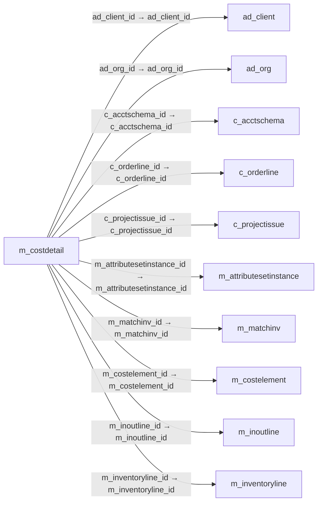

# m_costdetail — 원가 상세

[전체 일람](../TABLE_INDEX.md) · [분류 일람](README.md) · [AI 사용 안내](../README.md) · [외래키 읽는 법](../RELATIONSHIPS.md)

## 기본 정보

| 항목 | 내용 |
|---|---|
| 물리명 | `adempiere.m_costdetail` |
| 한국어 논리명(문서용 해석) | 원가 상세 |
| 원본 논리명 | Cost Detail |
| 원본 사전 ID | 808 |
| 분류 | `m` — 제품·재고·출하/입고·원가 |
| 전체 테넌트 행 수 | 0 |
| 물리 열 수 | 37 |
| 나가는 FK / 들어오는 FK | 15 / 1 |
| 구조·행 수 확인 시점 | 2026-11-03T23:29:01+09:00 |

## 의미와 쓰임

제품 원가 계산에 사용하는 상세 원가 정보를 저장한다.

- 설명 근거: 원본 애플리케이션 사전 명칭·설명을 한국어로 해석.
- 한국어 이름과 개요는 문서용 해석입니다. 공식 한국어 번역으로 간주하지 않습니다.
- 원본 설명: Cost Detail Information
- 원본 도움말: —
- PostgreSQL 테이블 주석: —

## 키와 열

### 기본키·고유 제약조건

| 종류 | 제약조건 | 열(순서 유지) |
|---|---|---|
| PRIMARY KEY | `m_costdetail_pkey` | `m_costdetail_id` |
| UNIQUE | `m_costdetail_uu_idx` | `m_costdetail_uu` |

### 열 목록

원본 논리명·설명은 `AD_Column`에서 가져왔습니다. 기본값은 실제 PostgreSQL 메타데이터이며, 비어 있는 항목은 `—`로 표시합니다.

| 순서 | 물리명 | 원본 논리명 | PostgreSQL 타입 | NULL | PK | 기본값 | 설명 |
|---:|---|---|---|---|---|---|---|
| 1 | `m_costdetail_id` | Cost Detail | numeric(10,0) | 불가 | 예 | — | Cost Detail Information |
| 2 | `ad_client_id` | Tenant | numeric(10,0) | 불가 | — | — | Tenant for this installation. |
| 3 | `ad_org_id` | Organization | numeric(10,0) | 불가 | — | — | Organizational entity within tenant |
| 4 | `c_acctschema_id` | Accounting Schema | numeric(10,0) | 불가 | — | — | Rules for accounting |
| 5 | `m_product_id` | Product | numeric(10,0) | 불가 | — | — | Product, Service, Item |
| 6 | `m_attributesetinstance_id` | Attribute Set Instance | numeric(10,0) | 불가 | — | — | Product Attribute Set Instance |
| 7 | `isactive` | Active | character(1) | 불가 | — | 'Y'::bpchar | The record is active in the system |
| 8 | `created` | Created | timestamp without time zone | 불가 | — | now() | Date this record was created |
| 9 | `createdby` | Created By | numeric(10,0) | 불가 | — | — | User who created this records |
| 10 | `updated` | Updated | timestamp without time zone | 불가 | — | now() | Date this record was updated |
| 11 | `updatedby` | Updated By | numeric(10,0) | 불가 | — | — | User who updated this records |
| 12 | `m_costelement_id` | Cost Element | numeric(10,0) | 허용 | — | — | Product Cost Element |
| 13 | `c_orderline_id` | Sales Order Line | numeric(10,0) | 허용 | — | — | Sales Order Line |
| 14 | `m_inoutline_id` | Shipment/Receipt Line | numeric(10,0) | 허용 | — | — | Line on Shipment or Receipt document |
| 15 | `c_invoiceline_id` | Invoice Line | numeric(10,0) | 허용 | — | — | Invoice Detail Line |
| 16 | `m_movementline_id` | Move Line | numeric(10,0) | 허용 | — | — | Inventory Move document Line |
| 17 | `m_inventoryline_id` | Phys.Inventory Line | numeric(10,0) | 허용 | — | — | Unique line in an Inventory document |
| 18 | `m_productionline_id` | Production Line | numeric(10,0) | 허용 | — | — | Document Line representing a production |
| 19 | `c_projectissue_id` | Project Issue | numeric(10,0) | 허용 | — | — | Project Issues (Material, Labor) |
| 20 | `issotrx` | Sales Transaction | character(1) | 불가 | — | 'Y'::bpchar | This is a Sales Transaction |
| 21 | `amt` | Amount | numeric | 불가 | — | 0 | Amount |
| 22 | `qty` | Quantity | numeric | 불가 | — | 0 | Quantity |
| 23 | `deltaamt` | Delta Amount | numeric | 허용 | — | 0 | Difference Amount |
| 24 | `deltaqty` | Delta Quantity | numeric | 허용 | — | 0 | Quantity Difference |
| 25 | `description` | Description | character varying(255) | 허용 | — | — | Optional short description of the record |
| 26 | `processed` | Processed | character(1) | 불가 | — | 'N'::bpchar | The document has been processed |
| 27 | `pp_cost_collector_id` | Manufacturing Cost Collector | numeric(10,0) | 허용 | — | — | — |
| 28 | `currentcostprice` | Current Cost Price | numeric | 허용 | — | — | The currently used cost price |
| 29 | `currentqty` | Current Quantity | numeric | 허용 | — | — | Current Quantity |
| 30 | `cumulatedamt` | Accumulated Amt | numeric | 허용 | — | — | Total Amount |
| 31 | `cumulatedqty` | Accumulated Qty | numeric | 허용 | — | — | Total Quantity |
| 32 | `m_costdetail_uu` | M_CostDetail_UU | uuid | 허용 | — | — | — |
| 33 | `m_matchinv_id` | Match Invoice | numeric(10,0) | 허용 | — | NULL::numeric | Match Shipment/Receipt to Invoice |
| 34 | `dateacct` | Account Date | timestamp without time zone | 불가 | — | — | Accounting Date |
| 35 | `isbackdate` | Back-Date | character(1) | 불가 | — | 'N'::bpchar | — |
| 36 | `backdateprocessedon` | Back-Date Processed On | timestamp without time zone | 허용 | — | — | The date+time (expressed in decimal format) when the document has been processed |
| 37 | `ref_costdetail_id` | Referenced Cost Detail | numeric(10,0) | 허용 | — | NULL::numeric | — |

## 외래키 흐름

화살표는 **FK를 가진 자식 → 참조되는 부모**입니다. 업무 처리의 시간 순서나 무조건적인 1:N 관계를 뜻하지 않습니다.

주변 관계 16개 중 10개를 그림으로 표시합니다. **전체 관계는 아래 두 표에 모두 포함**합니다.

### 이 테이블이 참조하는 부모 — 나가는 FK

| 제약조건 | 참조하는 쪽(자식) | 자식 열 | 참조받는 쪽(부모) | 부모 열 | 삭제 / 갱신 | 검증 / 지연 가능 |
|---|---|---|---|---|---|---|
| `adclient_mcostdetail` <!-- FK_OUT: adempiere.m_costdetail.adclient_mcostdetail --> | [`m_costdetail`](m_costdetail.md) | `ad_client_id` | [`ad_client`](../ad/ad_client.md) | `ad_client_id` | NO ACTION / NO ACTION | 완료 / 가능 (초기 지연) |
| `adorg_mcostdetail` <!-- FK_OUT: adempiere.m_costdetail.adorg_mcostdetail --> | [`m_costdetail`](m_costdetail.md) | `ad_org_id` | [`ad_org`](../ad/ad_org.md) | `ad_org_id` | NO ACTION / NO ACTION | 완료 / 가능 (초기 지연) |
| `cacctschema_mcostdetail` <!-- FK_OUT: adempiere.m_costdetail.cacctschema_mcostdetail --> | [`m_costdetail`](m_costdetail.md) | `c_acctschema_id` | [`c_acctschema`](../c/c_acctschema.md) | `c_acctschema_id` | NO ACTION / NO ACTION | 완료 / 가능 (초기 지연) |
| `corderline_mcostdetail` <!-- FK_OUT: adempiere.m_costdetail.corderline_mcostdetail --> | [`m_costdetail`](m_costdetail.md) | `c_orderline_id` | [`c_orderline`](../c/c_orderline.md) | `c_orderline_id` | NO ACTION / NO ACTION | 완료 / 가능 (초기 지연) |
| `cprojectissue_mcostdetail` <!-- FK_OUT: adempiere.m_costdetail.cprojectissue_mcostdetail --> | [`m_costdetail`](m_costdetail.md) | `c_projectissue_id` | [`c_projectissue`](../c/c_projectissue.md) | `c_projectissue_id` | NO ACTION / NO ACTION | 완료 / 가능 (초기 지연) |
| `masi_mcostdetail` <!-- FK_OUT: adempiere.m_costdetail.masi_mcostdetail --> | [`m_costdetail`](m_costdetail.md) | `m_attributesetinstance_id` | [`m_attributesetinstance`](m_attributesetinstance.md) | `m_attributesetinstance_id` | NO ACTION / NO ACTION | 완료 / 가능 (초기 지연) |
| `mcostdetail_matchinv` <!-- FK_OUT: adempiere.m_costdetail.mcostdetail_matchinv --> | [`m_costdetail`](m_costdetail.md) | `m_matchinv_id` | [`m_matchinv`](m_matchinv.md) | `m_matchinv_id` | NO ACTION / NO ACTION | 완료 / 가능 (초기 지연) |
| `mcostelement_mcostdetail` <!-- FK_OUT: adempiere.m_costdetail.mcostelement_mcostdetail --> | [`m_costdetail`](m_costdetail.md) | `m_costelement_id` | [`m_costelement`](m_costelement.md) | `m_costelement_id` | NO ACTION / NO ACTION | 완료 / 가능 (초기 지연) |
| `minoutline_mcostdetail` <!-- FK_OUT: adempiere.m_costdetail.minoutline_mcostdetail --> | [`m_costdetail`](m_costdetail.md) | `m_inoutline_id` | [`m_inoutline`](m_inoutline.md) | `m_inoutline_id` | NO ACTION / NO ACTION | 완료 / 가능 (초기 지연) |
| `minventoryline_mcostdetail` <!-- FK_OUT: adempiere.m_costdetail.minventoryline_mcostdetail --> | [`m_costdetail`](m_costdetail.md) | `m_inventoryline_id` | [`m_inventoryline`](m_inventoryline.md) | `m_inventoryline_id` | NO ACTION / NO ACTION | 완료 / 가능 (초기 지연) |
| `minvoiceline_mcostdetail` <!-- FK_OUT: adempiere.m_costdetail.minvoiceline_mcostdetail --> | [`m_costdetail`](m_costdetail.md) | `c_invoiceline_id` | [`c_invoiceline`](../c/c_invoiceline.md) | `c_invoiceline_id` | NO ACTION / NO ACTION | 완료 / 가능 (초기 지연) |
| `mmovementline_mcostdetail` <!-- FK_OUT: adempiere.m_costdetail.mmovementline_mcostdetail --> | [`m_costdetail`](m_costdetail.md) | `m_movementline_id` | [`m_movementline`](m_movementline.md) | `m_movementline_id` | NO ACTION / NO ACTION | 완료 / 가능 (초기 지연) |
| `mproduct_mcostdetail` <!-- FK_OUT: adempiere.m_costdetail.mproduct_mcostdetail --> | [`m_costdetail`](m_costdetail.md) | `m_product_id` | [`m_product`](m_product.md) | `m_product_id` | NO ACTION / NO ACTION | 완료 / 가능 (초기 지연) |
| `mproductionline_mcostdetail` <!-- FK_OUT: adempiere.m_costdetail.mproductionline_mcostdetail --> | [`m_costdetail`](m_costdetail.md) | `m_productionline_id` | [`m_productionline`](m_productionline.md) | `m_productionline_id` | NO ACTION / NO ACTION | 완료 / 가능 (초기 지연) |
| `ppcostcollector_mcostdetail` <!-- FK_OUT: adempiere.m_costdetail.ppcostcollector_mcostdetail --> | [`m_costdetail`](m_costdetail.md) | `pp_cost_collector_id` | [`pp_cost_collector`](../pp/pp_cost_collector.md) | `pp_cost_collector_id` | NO ACTION / NO ACTION | 완료 / 가능 (초기 지연) |

### 이 테이블을 참조하는 자식 — 들어오는 FK

| 제약조건 | 참조하는 쪽(자식) | 자식 열 | 참조받는 쪽(부모) | 부모 열 | 삭제 / 갱신 | 검증 / 지연 가능 |
|---|---|---|---|---|---|---|
| `mcostdetail_mcosthistory` <!-- FK_IN: adempiere.m_costhistory.mcostdetail_mcosthistory --> | [`m_costhistory`](m_costhistory.md) | `m_costdetail_id` | [`m_costdetail`](m_costdetail.md) | `m_costdetail_id` | NO ACTION / NO ACTION | 완료 / 가능 (초기 지연) |

## 조회 시 주의

- FK 표의 자식 열과 부모 열을 같은 순서로 대응시킵니다. 복합 FK는 모든 열의 동등 조건을 `AND`로 연결합니다.
- 테이블 이름이나 `_id` 열 이름만으로 물리 FK가 있다고 가정하지 않습니다. FK 미선언은 업무 관계가 없다는 뜻도 아닙니다.
- 자식이 여러 행인 테이블과 조인하면 부모의 금액·건수가 중복될 수 있습니다. 집계 단위를 먼저 정합니다.
- `ad_client_id`가 있습니다. 업무 분석에서는 대상 테넌트를 명시합니다. GardenWorld는 `11`, 시스템 공통 설정은 `0`일 수 있으므로 일괄 필터 적용 전에 테이블 역할을 확인합니다.
- `issotrx`가 있습니다. 판매(`Y`)와 구매(`N`)를 구분해서 분석합니다.
- 수집 시점에 0행입니다. 이 표만으로 거래 실적·처리 결과를 계산할 수 없습니다.
- 행 수는 위 확인 시점의 전체 테넌트 값입니다. 최신 업무 실적이나 현재 실행 결과로 재사용하지 않습니다.
