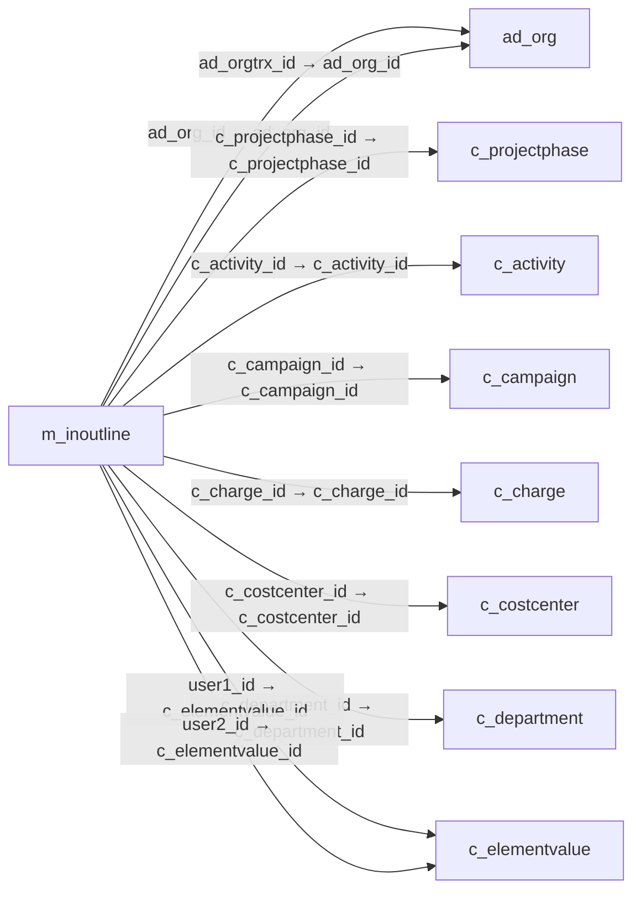

# m_inoutline — 출하·입고행

[전체 일람](../TABLE_INDEX.md) · [분류 일람](README.md) · [AI 사용 안내](../README.md) · [외래키 읽는 법](../RELATIONSHIPS.md)

## 기본 정보

| 항목 | 내용 |
|---|---|
| 물리명 | `adempiere.m_inoutline` |
| 한국어 논리명(문서용 해석) | 출하·입고행 |
| 원본 논리명 | Shipment/Receipt Line |
| 원본 사전 ID | 320 |
| 분류 | `m` — 제품·재고·출하/입고·원가 |
| 전체 테넌트 행 수 | 27 |
| 물리 열 수 | 42 |
| 나가는 FK / 들어오는 FK | 21 / 21 |
| 구조·행 수 확인 시점 | 2026-11-03T23:29:01+09:00 |

## 의미와 쓰임

출하 또는 입고 문서의 제품별 상세 행을 저장한다.

- 설명 근거: 원본 애플리케이션 사전 명칭·설명을 한국어로 해석.
- 한국어 이름과 개요는 문서용 해석입니다. 공식 한국어 번역으로 간주하지 않습니다.
- 원본 설명: Line on Shipment or Receipt document
- 원본 도움말: —
- PostgreSQL 테이블 주석: —

## 키와 열

### 기본키·고유 제약조건

| 종류 | 제약조건 | 열(순서 유지) |
|---|---|---|
| PRIMARY KEY | `m_inoutline_pkey` | `m_inoutline_id` |
| UNIQUE | `m_inoutline_uu_idx` | `m_inoutline_uu` |

### 열 목록

원본 논리명·설명은 `AD_Column`에서 가져왔습니다. 기본값은 실제 PostgreSQL 메타데이터이며, 비어 있는 항목은 `—`로 표시합니다.

| 순서 | 물리명 | 원본 논리명 | PostgreSQL 타입 | NULL | PK | 기본값 | 설명 |
|---:|---|---|---|---|---|---|---|
| 1 | `m_inoutline_id` | Shipment/Receipt Line | numeric(10,0) | 불가 | 예 | — | Line on Shipment or Receipt document |
| 2 | `ad_client_id` | Tenant | numeric(10,0) | 불가 | — | — | Tenant for this installation. |
| 3 | `ad_org_id` | Organization | numeric(10,0) | 불가 | — | — | Organizational entity within tenant |
| 4 | `isactive` | Active | character(1) | 불가 | — | 'Y'::bpchar | The record is active in the system |
| 5 | `created` | Created | timestamp without time zone | 불가 | — | now() | Date this record was created |
| 6 | `createdby` | Created By | numeric(10,0) | 불가 | — | — | User who created this records |
| 7 | `updated` | Updated | timestamp without time zone | 불가 | — | now() | Date this record was updated |
| 8 | `updatedby` | Updated By | numeric(10,0) | 불가 | — | — | User who updated this records |
| 9 | `line` | Line No | numeric(10,0) | 불가 | — | — | Unique line for this document |
| 10 | `description` | Description | character varying(255) | 허용 | — | — | Optional short description of the record |
| 11 | `m_inout_id` | Shipment/Receipt | numeric(10,0) | 불가 | — | — | Material Shipment Document |
| 12 | `c_orderline_id` | Sales Order Line | numeric(10,0) | 허용 | — | — | Sales Order Line |
| 13 | `m_locator_id` | Locator | numeric(10,0) | 허용 | — | — | Warehouse Locator |
| 14 | `m_product_id` | Product | numeric(10,0) | 허용 | — | — | Product, Service, Item |
| 15 | `c_uom_id` | UOM | numeric(10,0) | 불가 | — | — | Unit of Measure |
| 16 | `movementqty` | Movement Quantity | numeric | 불가 | — | 0 | Quantity of a product moved. |
| 17 | `isinvoiced` | Invoiced | character(1) | 불가 | — | 'N'::bpchar | Is this invoiced? |
| 18 | `m_attributesetinstance_id` | Attribute Set Instance | numeric(10,0) | 허용 | — | 0 | Product Attribute Set Instance |
| 19 | `isdescription` | Description Only | character(1) | 불가 | — | 'N'::bpchar | if true, the line is just description and no transaction |
| 20 | `confirmedqty` | Confirmed Quantity | numeric | 허용 | — | 0 | Confirmation of a received quantity |
| 21 | `pickedqty` | Picked Quantity | numeric | 허용 | — | 0 | — |
| 22 | `scrappedqty` | Scrapped Quantity | numeric | 허용 | — | 0 | The Quantity scrapped due to QA issues |
| 23 | `targetqty` | Target Quantity | numeric | 허용 | — | 0 | Target Movement Quantity |
| 24 | `ref_inoutline_id` | Referenced Shipment Line | numeric(10,0) | 허용 | — | — | — |
| 25 | `processed` | Processed | character(1) | 불가 | — | 'N'::bpchar | The document has been processed |
| 26 | `qtyentered` | Quantity | numeric | 불가 | — | — | The Quantity Entered is based on the selected UoM |
| 27 | `c_charge_id` | Charge | numeric(10,0) | 허용 | — | — | Additional document charges |
| 28 | `c_project_id` | Project | numeric(10,0) | 허용 | — | — | Financial Project |
| 29 | `c_projectphase_id` | Project Phase | numeric(10,0) | 허용 | — | — | Phase of a Project |
| 30 | `c_projecttask_id` | Project Task | numeric(10,0) | 허용 | — | — | Actual Project Task in a Phase |
| 31 | `c_campaign_id` | Campaign | numeric(10,0) | 허용 | — | — | Marketing Campaign |
| 32 | `c_activity_id` | Activity | numeric(10,0) | 허용 | — | — | Business Activity |
| 33 | `user1_id` | User Element List 1 | numeric(10,0) | 허용 | — | — | User defined list element #1 |
| 34 | `user2_id` | User Element List 2 | numeric(10,0) | 허용 | — | — | User defined list element #2 |
| 35 | `ad_orgtrx_id` | Trx Organization | numeric(10,0) | 허용 | — | — | Performing or initiating organization |
| 36 | `m_rmaline_id` | RMA Line | numeric(10,0) | 허용 | — | — | Return Material Authorization Line |
| 37 | `reversalline_id` | Reversal Line | numeric(10,0) | 허용 | — | — | Use to keep the reversal line ID for reversing costing purpose |
| 38 | `m_inoutline_uu` | M_InOutLine_UU | uuid | 허용 | — | — | — |
| 39 | `qtyoverreceipt` | Over Receipt | numeric | 허용 | — | 0 | Over Receipt Quantity |
| 40 | `isautoproduce` | Auto Produce | character(1) | 허용 | — | 'N'::bpchar | Auto create production to fulfill shipment |
| 41 | `c_costcenter_id` | Cost Center | numeric(10,0) | 허용 | — | NULL::numeric | — |
| 42 | `c_department_id` | Department | numeric(10,0) | 허용 | — | NULL::numeric | — |

## 외래키 흐름

화살표는 **FK를 가진 자식 → 참조되는 부모**입니다. 업무 처리의 시간 순서나 무조건적인 1:N 관계를 뜻하지 않습니다.

주변 관계 40개 중 10개를 그림으로 표시합니다. **전체 관계는 아래 두 표에 모두 포함**합니다.

### 이 테이블이 참조하는 부모 — 나가는 FK

| 제약조건 | 참조하는 쪽(자식) | 자식 열 | 참조받는 쪽(부모) | 부모 열 | 삭제 / 갱신 | 검증 / 지연 가능 |
|---|---|---|---|---|---|---|
| `adorg_minoutline` <!-- FK_OUT: adempiere.m_inoutline.adorg_minoutline --> | [`m_inoutline`](m_inoutline.md) | `ad_org_id` | [`ad_org`](../ad/ad_org.md) | `ad_org_id` | NO ACTION / NO ACTION | 완료 / 가능 (초기 지연) |
| `adorgtrx_minoutline` <!-- FK_OUT: adempiere.m_inoutline.adorgtrx_minoutline --> | [`m_inoutline`](m_inoutline.md) | `ad_orgtrx_id` | [`ad_org`](../ad/ad_org.md) | `ad_org_id` | NO ACTION / NO ACTION | 완료 / 가능 (초기 지연) |
| `c_projectphase_minoutline` <!-- FK_OUT: adempiere.m_inoutline.c_projectphase_minoutline --> | [`m_inoutline`](m_inoutline.md) | `c_projectphase_id` | [`c_projectphase`](../c/c_projectphase.md) | `c_projectphase_id` | NO ACTION / NO ACTION | 완료 / 가능 (초기 지연) |
| `cactivity_minoutline` <!-- FK_OUT: adempiere.m_inoutline.cactivity_minoutline --> | [`m_inoutline`](m_inoutline.md) | `c_activity_id` | [`c_activity`](../c/c_activity.md) | `c_activity_id` | NO ACTION / NO ACTION | 완료 / 가능 (초기 지연) |
| `ccampaign_minoutline` <!-- FK_OUT: adempiere.m_inoutline.ccampaign_minoutline --> | [`m_inoutline`](m_inoutline.md) | `c_campaign_id` | [`c_campaign`](../c/c_campaign.md) | `c_campaign_id` | NO ACTION / NO ACTION | 완료 / 가능 (초기 지연) |
| `ccharge_minoutline` <!-- FK_OUT: adempiere.m_inoutline.ccharge_minoutline --> | [`m_inoutline`](m_inoutline.md) | `c_charge_id` | [`c_charge`](../c/c_charge.md) | `c_charge_id` | NO ACTION / NO ACTION | 완료 / 가능 (초기 지연) |
| `ccostcenter_minoutline` <!-- FK_OUT: adempiere.m_inoutline.ccostcenter_minoutline --> | [`m_inoutline`](m_inoutline.md) | `c_costcenter_id` | [`c_costcenter`](../c/c_costcenter.md) | `c_costcenter_id` | NO ACTION / NO ACTION | 완료 / 가능 (초기 지연) |
| `cdepartment_minoutline` <!-- FK_OUT: adempiere.m_inoutline.cdepartment_minoutline --> | [`m_inoutline`](m_inoutline.md) | `c_department_id` | [`c_department`](../c/c_department.md) | `c_department_id` | NO ACTION / NO ACTION | 완료 / 가능 (초기 지연) |
| `celemenrvalueuser1_minoutline` <!-- FK_OUT: adempiere.m_inoutline.celemenrvalueuser1_minoutline --> | [`m_inoutline`](m_inoutline.md) | `user1_id` | [`c_elementvalue`](../c/c_elementvalue.md) | `c_elementvalue_id` | NO ACTION / NO ACTION | 완료 / 가능 (초기 지연) |
| `celemenrvalueuser2_minoutline` <!-- FK_OUT: adempiere.m_inoutline.celemenrvalueuser2_minoutline --> | [`m_inoutline`](m_inoutline.md) | `user2_id` | [`c_elementvalue`](../c/c_elementvalue.md) | `c_elementvalue_id` | NO ACTION / NO ACTION | 완료 / 가능 (초기 지연) |
| `corderline_minout` <!-- FK_OUT: adempiere.m_inoutline.corderline_minout --> | [`m_inoutline`](m_inoutline.md) | `c_orderline_id` | [`c_orderline`](../c/c_orderline.md) | `c_orderline_id` | NO ACTION / NO ACTION | 완료 / 가능 (초기 지연) |
| `cproject_minoutline` <!-- FK_OUT: adempiere.m_inoutline.cproject_minoutline --> | [`m_inoutline`](m_inoutline.md) | `c_project_id` | [`c_project`](../c/c_project.md) | `c_project_id` | NO ACTION / NO ACTION | 완료 / 가능 (초기 지연) |
| `cprojecttask_minoutline` <!-- FK_OUT: adempiere.m_inoutline.cprojecttask_minoutline --> | [`m_inoutline`](m_inoutline.md) | `c_projecttask_id` | [`c_projecttask`](../c/c_projecttask.md) | `c_projecttask_id` | NO ACTION / NO ACTION | 완료 / 가능 (초기 지연) |
| `cuom_minoutline` <!-- FK_OUT: adempiere.m_inoutline.cuom_minoutline --> | [`m_inoutline`](m_inoutline.md) | `c_uom_id` | [`c_uom`](../c/c_uom.md) | `c_uom_id` | NO ACTION / NO ACTION | 완료 / 가능 (초기 지연) |
| `mattrsetinst_minoutline` <!-- FK_OUT: adempiere.m_inoutline.mattrsetinst_minoutline --> | [`m_inoutline`](m_inoutline.md) | `m_attributesetinstance_id` | [`m_attributesetinstance`](m_attributesetinstance.md) | `m_attributesetinstance_id` | NO ACTION / NO ACTION | 완료 / 가능 (초기 지연) |
| `minout_minoutline` <!-- FK_OUT: adempiere.m_inoutline.minout_minoutline --> | [`m_inoutline`](m_inoutline.md) | `m_inout_id` | [`m_inout`](m_inout.md) | `m_inout_id` | CASCADE / NO ACTION | 완료 / 가능 (초기 지연) |
| `minoutline_ref` <!-- FK_OUT: adempiere.m_inoutline.minoutline_ref --> | [`m_inoutline`](m_inoutline.md) | `ref_inoutline_id` | [`m_inoutline`](m_inoutline.md) | `m_inoutline_id` | NO ACTION / NO ACTION | 완료 / 가능 (초기 지연) |
| `mlocator_minoutline` <!-- FK_OUT: adempiere.m_inoutline.mlocator_minoutline --> | [`m_inoutline`](m_inoutline.md) | `m_locator_id` | [`m_locator`](m_locator.md) | `m_locator_id` | NO ACTION / NO ACTION | 완료 / 가능 (초기 지연) |
| `mproduct_minoutline` <!-- FK_OUT: adempiere.m_inoutline.mproduct_minoutline --> | [`m_inoutline`](m_inoutline.md) | `m_product_id` | [`m_product`](m_product.md) | `m_product_id` | NO ACTION / NO ACTION | 완료 / 가능 (초기 지연) |
| `mrmaline_minoutline` <!-- FK_OUT: adempiere.m_inoutline.mrmaline_minoutline --> | [`m_inoutline`](m_inoutline.md) | `m_rmaline_id` | [`m_rmaline`](m_rmaline.md) | `m_rmaline_id` | NO ACTION / NO ACTION | 완료 / 가능 (초기 지연) |
| `reversalline_minoutline` <!-- FK_OUT: adempiere.m_inoutline.reversalline_minoutline --> | [`m_inoutline`](m_inoutline.md) | `reversalline_id` | [`m_inoutline`](m_inoutline.md) | `m_inoutline_id` | NO ACTION / NO ACTION | 완료 / 가능 (초기 지연) |

### 이 테이블을 참조하는 자식 — 들어오는 FK

| 제약조건 | 참조하는 쪽(자식) | 자식 열 | 참조받는 쪽(부모) | 부모 열 | 삭제 / 갱신 | 검증 / 지연 가능 |
|---|---|---|---|---|---|---|
| `minoutline_aasset` <!-- FK_IN: adempiere.a_asset.minoutline_aasset --> | [`a_asset`](../a/a_asset.md) | `m_inoutline_id` | [`m_inoutline`](m_inoutline.md) | `m_inoutline_id` | NO ACTION / NO ACTION | 완료 / 가능 (초기 지연) |
| `minoutline_aassetaddition` <!-- FK_IN: adempiere.a_asset_addition.minoutline_aassetaddition --> | [`a_asset_addition`](../a/a_asset_addition.md) | `m_inoutline_id` | [`m_inoutline`](m_inoutline.md) | `m_inoutline_id` | NO ACTION / NO ACTION | 완료 / 가능 (초기 지연) |
| `moutline_aassetdelivery` <!-- FK_IN: adempiere.a_asset_delivery.moutline_aassetdelivery --> | [`a_asset_delivery`](../a/a_asset_delivery.md) | `m_inoutline_id` | [`m_inoutline`](m_inoutline.md) | `m_inoutline_id` | CASCADE / NO ACTION | 완료 / 가능 (초기 지연) |
| `minoutline_cinvoiceline` <!-- FK_IN: adempiere.c_invoiceline.minoutline_cinvoiceline --> | [`c_invoiceline`](../c/c_invoiceline.md) | `m_inoutline_id` | [`m_inoutline`](m_inoutline.md) | `m_inoutline_id` | NO ACTION / NO ACTION | 완료 / 가능 (초기 지연) |
| `minoutline_clandedcost` <!-- FK_IN: adempiere.c_landedcost.minoutline_clandedcost --> | [`c_landedcost`](../c/c_landedcost.md) | `m_inoutline_id` | [`m_inoutline`](m_inoutline.md) | `m_inoutline_id` | NO ACTION / NO ACTION | 완료 / 가능 (초기 지연) |
| `minoutline_clandedcostallocati` <!-- FK_IN: adempiere.c_landedcostallocation.minoutline_clandedcostallocati --> | [`c_landedcostallocation`](../c/c_landedcostallocation.md) | `m_inoutline_id` | [`m_inoutline`](m_inoutline.md) | `m_inoutline_id` | NO ACTION / NO ACTION | 완료 / 가능 (초기 지연) |
| `minoutline_cprojectissue` <!-- FK_IN: adempiere.c_projectissue.minoutline_cprojectissue --> | [`c_projectissue`](../c/c_projectissue.md) | `m_inoutline_id` | [`m_inoutline`](m_inoutline.md) | `m_inoutline_id` | NO ACTION / NO ACTION | 완료 / 가능 (초기 지연) |
| `minoutline_mcostdetail` <!-- FK_IN: adempiere.m_costdetail.minoutline_mcostdetail --> | [`m_costdetail`](m_costdetail.md) | `m_inoutline_id` | [`m_inoutline`](m_inoutline.md) | `m_inoutline_id` | NO ACTION / NO ACTION | 완료 / 가능 (초기 지연) |
| `minoutline_ref` <!-- FK_IN: adempiere.m_inoutline.minoutline_ref --> | [`m_inoutline`](m_inoutline.md) | `ref_inoutline_id` | [`m_inoutline`](m_inoutline.md) | `m_inoutline_id` | NO ACTION / NO ACTION | 완료 / 가능 (초기 지연) |
| `reversalline_minoutline` <!-- FK_IN: adempiere.m_inoutline.reversalline_minoutline --> | [`m_inoutline`](m_inoutline.md) | `reversalline_id` | [`m_inoutline`](m_inoutline.md) | `m_inoutline_id` | NO ACTION / NO ACTION | 완료 / 가능 (초기 지연) |
| `minoutline_minoutconfirm` <!-- FK_IN: adempiere.m_inoutlineconfirm.minoutline_minoutconfirm --> | [`m_inoutlineconfirm`](m_inoutlineconfirm.md) | `m_inoutline_id` | [`m_inoutline`](m_inoutline.md) | `m_inoutline_id` | CASCADE / NO ACTION | 완료 / 가능 (초기 지연) |
| `minoutline_minoutlinema` <!-- FK_IN: adempiere.m_inoutlinema.minoutline_minoutlinema --> | [`m_inoutlinema`](m_inoutlinema.md) | `m_inoutline_id` | [`m_inoutline`](m_inoutline.md) | `m_inoutline_id` | CASCADE / NO ACTION | 완료 / 가능 (초기 지연) |
| `minoutline_mmatchinv` <!-- FK_IN: adempiere.m_matchinv.minoutline_mmatchinv --> | [`m_matchinv`](m_matchinv.md) | `m_inoutline_id` | [`m_inoutline`](m_inoutline.md) | `m_inoutline_id` | NO ACTION / NO ACTION | 완료 / 가능 (초기 지연) |
| `minoutline_mmatchpo` <!-- FK_IN: adempiere.m_matchpo.minoutline_mmatchpo --> | [`m_matchpo`](m_matchpo.md) | `m_inoutline_id` | [`m_inoutline`](m_inoutline.md) | `m_inoutline_id` | NO ACTION / NO ACTION | 완료 / 가능 (초기 지연) |
| `minoutline_mpackageline` <!-- FK_IN: adempiere.m_packageline.minoutline_mpackageline --> | [`m_packageline`](m_packageline.md) | `m_inoutline_id` | [`m_inoutline`](m_inoutline.md) | `m_inoutline_id` | NO ACTION / NO ACTION | 완료 / 가능 (초기 지연) |
| `minoutline_mproduction` <!-- FK_IN: adempiere.m_production.minoutline_mproduction --> | [`m_production`](m_production.md) | `m_inoutline_id` | [`m_inoutline`](m_inoutline.md) | `m_inoutline_id` | NO ACTION / NO ACTION | 완료 / 가능 (초기 지연) |
| `minoutline_mrmaline` <!-- FK_IN: adempiere.m_rmaline.minoutline_mrmaline --> | [`m_rmaline`](m_rmaline.md) | `m_inoutline_id` | [`m_inoutline`](m_inoutline.md) | `m_inoutline_id` | NO ACTION / NO ACTION | 완료 / 가능 (초기 지연) |
| `minoutline_mtransaction` <!-- FK_IN: adempiere.m_transaction.minoutline_mtransaction --> | [`m_transaction`](m_transaction.md) | `m_inoutline_id` | [`m_inoutline`](m_inoutline.md) | `m_inoutline_id` | NO ACTION / NO ACTION | 완료 / 가능 (초기 지연) |
| `minoutline_mtrxalloc` <!-- FK_IN: adempiere.m_transactionallocation.minoutline_mtrxalloc --> | [`m_transactionallocation`](m_transactionallocation.md) | `m_inoutline_id` | [`m_inoutline`](m_inoutline.md) | `m_inoutline_id` | NO ACTION / NO ACTION | 완료 / 가능 (초기 지연) |
| `minoutlineout_mtrxalloc` <!-- FK_IN: adempiere.m_transactionallocation.minoutlineout_mtrxalloc --> | [`m_transactionallocation`](m_transactionallocation.md) | `out_m_inoutline_id` | [`m_inoutline`](m_inoutline.md) | `m_inoutline_id` | NO ACTION / NO ACTION | 완료 / 가능 (초기 지연) |
| `minoutline_ttransaction` <!-- FK_IN: adempiere.t_transaction.minoutline_ttransaction --> | [`t_transaction`](../t/t_transaction.md) | `m_inoutline_id` | [`m_inoutline`](m_inoutline.md) | `m_inoutline_id` | CASCADE / NO ACTION | 완료 / 가능 (초기 지연) |

## 조회 시 주의

- FK 표의 자식 열과 부모 열을 같은 순서로 대응시킵니다. 복합 FK는 모든 열의 동등 조건을 `AND`로 연결합니다.
- 테이블 이름이나 `_id` 열 이름만으로 물리 FK가 있다고 가정하지 않습니다. FK 미선언은 업무 관계가 없다는 뜻도 아닙니다.
- 자식이 여러 행인 테이블과 조인하면 부모의 금액·건수가 중복될 수 있습니다. 집계 단위를 먼저 정합니다.
- `ad_client_id`가 있습니다. 업무 분석에서는 대상 테넌트를 명시합니다. GardenWorld는 `11`, 시스템 공통 설정은 `0`일 수 있으므로 일괄 필터 적용 전에 테이블 역할을 확인합니다.
- 행 수는 위 확인 시점의 전체 테넌트 값입니다. 최신 업무 실적이나 현재 실행 결과로 재사용하지 않습니다.
