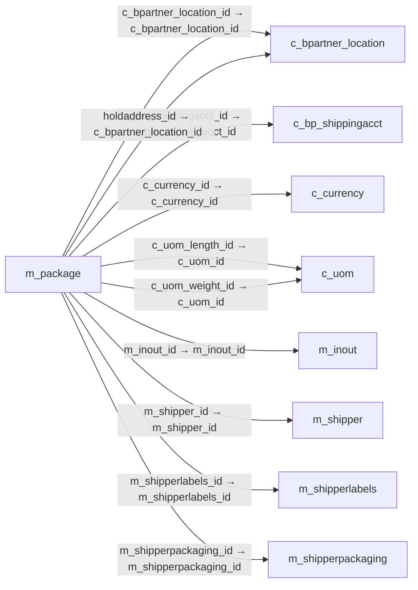

# m_package — 출하 포장

[전체 일람](../TABLE_INDEX.md) · [분류 일람](README.md) · [AI 사용 안내](../README.md) · [외래키 읽는 법](../RELATIONSHIPS.md)

## 기본 정보

| 항목 | 내용 |
|---|---|
| 물리명 | `adempiere.m_package` |
| 한국어 논리명(문서용 해석) | 출하 포장 |
| 원본 논리명 | Package |
| 원본 사전 ID | 664 |
| 분류 | `m` — 제품·재고·출하/입고·원가 |
| 전체 테넌트 행 수 | 1 |
| 물리 열 수 | 72 |
| 나가는 FK / 들어오는 FK | 11 / 3 |
| 구조·행 수 확인 시점 | 2026-11-03T23:29:01+09:00 |

## 의미와 쓰임

출하에 사용되는 포장 단위 정보를 저장한다.

- 설명 근거: 원본 애플리케이션 사전 명칭·설명을 한국어로 해석.
- 한국어 이름과 개요는 문서용 해석입니다. 공식 한국어 번역으로 간주하지 않습니다.
- 원본 설명: Shipment Package
- 원본 도움말: —
- PostgreSQL 테이블 주석: —

## 키와 열

### 기본키·고유 제약조건

| 종류 | 제약조건 | 열(순서 유지) |
|---|---|---|
| PRIMARY KEY | `m_package_pkey` | `m_package_id` |
| UNIQUE | `m_package_uu_idx` | `m_package_uu` |

### 열 목록

원본 논리명·설명은 `AD_Column`에서 가져왔습니다. 기본값은 실제 PostgreSQL 메타데이터이며, 비어 있는 항목은 `—`로 표시합니다.

| 순서 | 물리명 | 원본 논리명 | PostgreSQL 타입 | NULL | PK | 기본값 | 설명 |
|---:|---|---|---|---|---|---|---|
| 1 | `m_package_id` | Package | numeric(10,0) | 불가 | 예 | — | Shipment Package |
| 2 | `ad_client_id` | Tenant | numeric(10,0) | 불가 | — | — | Tenant for this installation. |
| 3 | `ad_org_id` | Organization | numeric(10,0) | 불가 | — | — | Organizational entity within tenant |
| 4 | `isactive` | Active | character(1) | 불가 | — | 'Y'::bpchar | The record is active in the system |
| 5 | `created` | Created | timestamp without time zone | 불가 | — | now() | Date this record was created |
| 6 | `createdby` | Created By | numeric(10,0) | 불가 | — | — | User who created this records |
| 7 | `updated` | Updated | timestamp without time zone | 불가 | — | now() | Date this record was updated |
| 8 | `updatedby` | Updated By | numeric(10,0) | 불가 | — | — | User who updated this records |
| 9 | `documentno` | Document No | character varying(30) | 불가 | — | — | Document sequence number of the document |
| 10 | `m_inout_id` | Shipment/Receipt | numeric(10,0) | 불가 | — | — | Material Shipment Document |
| 11 | `description` | Description | character varying(255) | 허용 | — | — | Optional short description of the record |
| 12 | `m_shipper_id` | Shipper | numeric(10,0) | 불가 | — | — | Method or manner of product delivery |
| 13 | `trackinginfo` | Tracking Info | character varying(255) | 허용 | — | — | — |
| 14 | `datereceived` | Date Received | timestamp without time zone | 허용 | — | — | Date a product was received |
| 15 | `receivedinfo` | Info Received | character varying(255) | 허용 | — | — | Information of the receipt of the package (acknowledgement) |
| 16 | `shipdate` | Ship Date | timestamp without time zone | 허용 | — | — | Shipment Date/Time |
| 17 | `m_package_uu` | M_Package_UU | uuid | 허용 | — | — | — |
| 18 | `boxcount` | Box Count | numeric(10,0) | 허용 | — | (1)::numeric | — |
| 19 | `cashondelivery` | COD | character(1) | 불가 | — | 'N'::bpchar | — |
| 20 | `c_bpartner_location_id` | Partner Location | numeric(10,0) | 허용 | — | NULL::numeric | Identifies the (ship to) address for this Business Partner |
| 21 | `c_currency_id` | Currency | numeric(10,0) | 허용 | — | NULL::numeric | The Currency for this record |
| 22 | `c_uom_length_id` | UOM for Length | numeric(10,0) | 허용 | — | NULL::numeric | Standard Unit of Measure for Length |
| 23 | `c_uom_weight_id` | UOM for Weight | numeric(10,0) | 허용 | — | NULL::numeric | Standard Unit of Measure for Weight |
| 24 | `deliveryconfirmation` | Delivery Confirmation | character(1) | 불가 | — | 'N'::bpchar | EMail Delivery confirmation |
| 25 | `dothazardclassordivision` | Dot Hazard Class or Division | character varying(30) | 허용 | — | NULL::character varying | — |
| 26 | `handlingcharge` | Handling Charge | numeric | 허용 | — | — | — |
| 27 | `height` | Height | numeric | 허용 | — | — | — |
| 28 | `homedeliverypremiumdate` | Date | timestamp without time zone | 허용 | — | — | — |
| 29 | `homedeliverypremiumtype` | Home Delivery Premium Type | character varying(30) | 허용 | — | NULL::character varying | — |
| 30 | `insuredamount` | Insured Amount | numeric | 허용 | — | — | — |
| 31 | `isaccessible` | Accessible | character(1) | 불가 | — | 'N'::bpchar | — |
| 32 | `iscargoaircraftonly` | Cargo Aircraft Only | character(1) | 불가 | — | 'N'::bpchar | — |
| 33 | `isdryice` | Dry Ice | character(1) | 불가 | — | 'N'::bpchar | — |
| 34 | `isdutiable` | Dutiable | character(1) | 불가 | — | 'N'::bpchar | — |
| 35 | `isfuturedayshipment` | Future Day Shipment | character(1) | 불가 | — | 'N'::bpchar | — |
| 36 | `ishazmat` | Hazardous Materials | character(1) | 불가 | — | 'N'::bpchar | — |
| 37 | `isholdatlocation` | Hold At Location | character(1) | 불가 | — | 'N'::bpchar | — |
| 38 | `isignorezipnotfound` | Ignore Zip Not Found | character(1) | 불가 | — | 'N'::bpchar | — |
| 39 | `isignorezipstatenotmatch` | Ignore Zip State Not Match | character(1) | 불가 | — | 'N'::bpchar | — |
| 40 | `isresidential` | Residential | character(1) | 불가 | — | 'Y'::bpchar | — |
| 41 | `labelprint` | Label Print | character(1) | 허용 | — | NULL::bpchar | — |
| 42 | `latestpickuptime` | Latest Pickup Time | timestamp without time zone | 허용 | — | — | — |
| 43 | `length` | Length | numeric | 허용 | — | — | — |
| 44 | `notificationtype` | Notification Type | character varying(2) | 허용 | — | NULL::character varying | Type of Notifications |
| 45 | `oprocessing` | Online Processing | character(1) | 허용 | — | NULL::bpchar | This payment can be processed online |
| 46 | `price` | Price | numeric | 허용 | — | — | Price |
| 47 | `priceactual` | Unit Price | numeric | 허용 | — | — | Actual Price  |
| 48 | `processed` | Processed | character(1) | 불가 | — | 'N'::bpchar | The document has been processed |
| 49 | `rateinquirymessage` | Rate Inquiry Message | character varying(2000) | 허용 | — | NULL::character varying | — |
| 50 | `issaturdaydelivery` | Saturday Delivery | character(1) | 불가 | — | 'N'::bpchar | — |
| 51 | `issaturdaypickup` | Saturday Pickup | character(1) | 불가 | — | 'N'::bpchar | — |
| 52 | `shippingrateinquiry` | Rate Inquiry | character(1) | 허용 | — | NULL::bpchar | — |
| 53 | `shippingrespmessage` | Response Message | character varying(2000) | 허용 | — | NULL::character varying | — |
| 54 | `surcharges` | Surcharges | numeric | 허용 | — | — | — |
| 55 | `trackingno` | Tracking No | character varying(255) | 허용 | — | NULL::character varying | Number to track the shipment |
| 56 | `voidit` | Void It | character(1) | 허용 | — | NULL::bpchar | — |
| 57 | `weight` | Weight | numeric | 허용 | — | — | Weight of a product |
| 58 | `width` | Width | numeric | 허용 | — | — | — |
| 59 | `c_bp_shippingacct_id` | Business Partner Shipping Account | numeric(10,0) | 허용 | — | NULL::numeric | — |
| 60 | `dutiesshipperaccount` | Duties Shipper Account | character varying(40) | 허용 | — | NULL::character varying | — |
| 61 | `m_shipperlabels_id` | Shipper Labels | numeric(10,0) | 허용 | — | NULL::numeric | — |
| 62 | `m_shipperpackaging_id` | Shipper Packaging | numeric(10,0) | 허용 | — | NULL::numeric | — |
| 63 | `m_shipperpickuptypes_id` | Shipper Pickup Types | numeric(10,0) | 허용 | — | NULL::numeric | — |
| 64 | `shipperaccount` | Shipper Account Number | character varying(40) | 허용 | — | NULL::character varying | — |
| 65 | `homedeliverypremiumphone` | Phone Number | character varying(30) | 허용 | — | NULL::character varying | — |
| 66 | `dryiceweight` | Dry Ice Weight | numeric | 허용 | — | — | — |
| 67 | `notificationmessage` | Notification Message | character varying(255) | 허용 | — | NULL::character varying | — |
| 68 | `isverbalconfirmation` | Verbal Confirmation | character(1) | 불가 | — | 'N'::bpchar | — |
| 69 | `isaddedhandling` | Added Handling | character(1) | 불가 | — | 'N'::bpchar | — |
| 70 | `paymentrule` | Payment Rule | character(1) | 허용 | — | NULL::bpchar | How you pay the invoice |
| 71 | `deliveryconfirmationtype` | Delivery Confirmation Type | character varying(30) | 허용 | — | NULL::character varying | — |
| 72 | `holdaddress_id` | Hold Address | numeric(10,0) | 허용 | — | NULL::numeric | — |

## 외래키 흐름

화살표는 **FK를 가진 자식 → 참조되는 부모**입니다. 업무 처리의 시간 순서나 무조건적인 1:N 관계를 뜻하지 않습니다.

주변 관계 14개 중 10개를 그림으로 표시합니다. **전체 관계는 아래 두 표에 모두 포함**합니다.

### 이 테이블이 참조하는 부모 — 나가는 FK

| 제약조건 | 참조하는 쪽(자식) | 자식 열 | 참조받는 쪽(부모) | 부모 열 | 삭제 / 갱신 | 검증 / 지연 가능 |
|---|---|---|---|---|---|---|
| `cbpartnerlocation_mpackage` <!-- FK_OUT: adempiere.m_package.cbpartnerlocation_mpackage --> | [`m_package`](m_package.md) | `c_bpartner_location_id` | [`c_bpartner_location`](../c/c_bpartner_location.md) | `c_bpartner_location_id` | NO ACTION / NO ACTION | 완료 / 가능 (초기 지연) |
| `cbpshippingacct_mpackage` <!-- FK_OUT: adempiere.m_package.cbpshippingacct_mpackage --> | [`m_package`](m_package.md) | `c_bp_shippingacct_id` | [`c_bp_shippingacct`](../c/c_bp_shippingacct.md) | `c_bp_shippingacct_id` | NO ACTION / NO ACTION | 완료 / 가능 (초기 지연) |
| `ccurrency_mpackage` <!-- FK_OUT: adempiere.m_package.ccurrency_mpackage --> | [`m_package`](m_package.md) | `c_currency_id` | [`c_currency`](../c/c_currency.md) | `c_currency_id` | NO ACTION / NO ACTION | 완료 / 가능 (초기 지연) |
| `cuomlength_mpackage` <!-- FK_OUT: adempiere.m_package.cuomlength_mpackage --> | [`m_package`](m_package.md) | `c_uom_length_id` | [`c_uom`](../c/c_uom.md) | `c_uom_id` | NO ACTION / NO ACTION | 완료 / 가능 (초기 지연) |
| `cuomweight_mpackage` <!-- FK_OUT: adempiere.m_package.cuomweight_mpackage --> | [`m_package`](m_package.md) | `c_uom_weight_id` | [`c_uom`](../c/c_uom.md) | `c_uom_id` | NO ACTION / NO ACTION | 완료 / 가능 (초기 지연) |
| `holdaddress_mpackage` <!-- FK_OUT: adempiere.m_package.holdaddress_mpackage --> | [`m_package`](m_package.md) | `holdaddress_id` | [`c_bpartner_location`](../c/c_bpartner_location.md) | `c_bpartner_location_id` | NO ACTION / NO ACTION | 완료 / 가능 (초기 지연) |
| `minout_mpackage` <!-- FK_OUT: adempiere.m_package.minout_mpackage --> | [`m_package`](m_package.md) | `m_inout_id` | [`m_inout`](m_inout.md) | `m_inout_id` | NO ACTION / NO ACTION | 완료 / 가능 (초기 지연) |
| `mshipper_mpackage` <!-- FK_OUT: adempiere.m_package.mshipper_mpackage --> | [`m_package`](m_package.md) | `m_shipper_id` | [`m_shipper`](m_shipper.md) | `m_shipper_id` | NO ACTION / NO ACTION | 완료 / 가능 (초기 지연) |
| `mshipperlabels_mpackage` <!-- FK_OUT: adempiere.m_package.mshipperlabels_mpackage --> | [`m_package`](m_package.md) | `m_shipperlabels_id` | [`m_shipperlabels`](m_shipperlabels.md) | `m_shipperlabels_id` | NO ACTION / NO ACTION | 완료 / 가능 (초기 지연) |
| `mshipperpackaging_mpackage` <!-- FK_OUT: adempiere.m_package.mshipperpackaging_mpackage --> | [`m_package`](m_package.md) | `m_shipperpackaging_id` | [`m_shipperpackaging`](m_shipperpackaging.md) | `m_shipperpackaging_id` | NO ACTION / NO ACTION | 완료 / 가능 (초기 지연) |
| `mshipperpickuptypes_mpackage` <!-- FK_OUT: adempiere.m_package.mshipperpickuptypes_mpackage --> | [`m_package`](m_package.md) | `m_shipperpickuptypes_id` | [`m_shipperpickuptypes`](m_shipperpickuptypes.md) | `m_shipperpickuptypes_id` | NO ACTION / NO ACTION | 완료 / 가능 (초기 지연) |

### 이 테이블을 참조하는 자식 — 들어오는 FK

| 제약조건 | 참조하는 쪽(자식) | 자식 열 | 참조받는 쪽(부모) | 부모 열 | 삭제 / 갱신 | 검증 / 지연 가능 |
|---|---|---|---|---|---|---|
| `mpackage_mpackageline` <!-- FK_IN: adempiere.m_packageline.mpackage_mpackageline --> | [`m_packageline`](m_packageline.md) | `m_package_id` | [`m_package`](m_package.md) | `m_package_id` | NO ACTION / NO ACTION | 완료 / 가능 (초기 지연) |
| `mpackage_mpackagemps` <!-- FK_IN: adempiere.m_packagemps.mpackage_mpackagemps --> | [`m_packagemps`](m_packagemps.md) | `m_package_id` | [`m_package`](m_package.md) | `m_package_id` | NO ACTION / NO ACTION | 완료 / 가능 (초기 지연) |
| `mpackage_mshippingtransaction` <!-- FK_IN: adempiere.m_shippingtransaction.mpackage_mshippingtransaction --> | [`m_shippingtransaction`](m_shippingtransaction.md) | `m_package_id` | [`m_package`](m_package.md) | `m_package_id` | NO ACTION / NO ACTION | 완료 / 가능 (초기 지연) |

## 조회 시 주의

- FK 표의 자식 열과 부모 열을 같은 순서로 대응시킵니다. 복합 FK는 모든 열의 동등 조건을 `AND`로 연결합니다.
- 테이블 이름이나 `_id` 열 이름만으로 물리 FK가 있다고 가정하지 않습니다. FK 미선언은 업무 관계가 없다는 뜻도 아닙니다.
- 자식이 여러 행인 테이블과 조인하면 부모의 금액·건수가 중복될 수 있습니다. 집계 단위를 먼저 정합니다.
- `ad_client_id`가 있습니다. 업무 분석에서는 대상 테넌트를 명시합니다. GardenWorld는 `11`, 시스템 공통 설정은 `0`일 수 있으므로 일괄 필터 적용 전에 테이블 역할을 확인합니다.
- 행 수는 위 확인 시점의 전체 테넌트 값입니다. 최신 업무 실적이나 현재 실행 결과로 재사용하지 않습니다.
