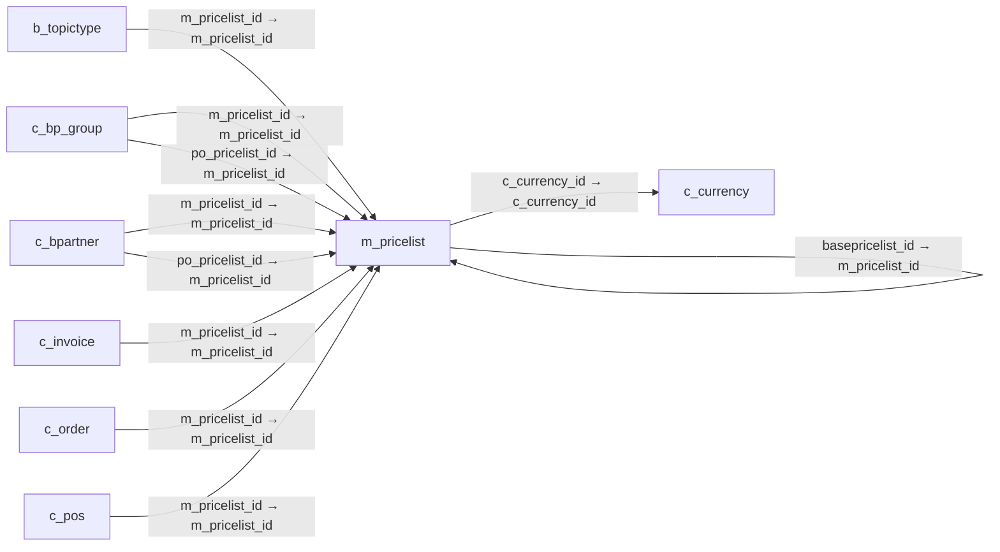

# m_pricelist — 가격표

[전체 일람](../TABLE_INDEX.md) · [분류 일람](README.md) · [AI 사용 안내](../README.md) · [외래키 읽는 법](../RELATIONSHIPS.md)

## 기본 정보

| 항목 | 내용 |
|---|---|
| 물리명 | `adempiere.m_pricelist` |
| 한국어 논리명(문서용 해석) | 가격표 |
| 원본 논리명 | Price List |
| 원본 사전 ID | 255 |
| 분류 | `m` — 제품·재고·출하/입고·원가 |
| 전체 테넌트 행 수 | 4 |
| 물리 열 수 | 20 |
| 나가는 FK / 들어오는 FK | 2 / 22 |
| 구조·행 수 확인 시점 | 2026-11-03T23:29:01+09:00 |

## 의미와 쓰임

제품 가격을 관리하는 가격표를 식별한다.

- 설명 근거: 원본 애플리케이션 사전 명칭·설명을 한국어로 해석.
- 한국어 이름과 개요는 문서용 해석입니다. 공식 한국어 번역으로 간주하지 않습니다.
- 원본 설명: Unique identifier of a Price List
- 원본 도움말: —
- PostgreSQL 테이블 주석: —

## 키와 열

### 기본키·고유 제약조건

| 종류 | 제약조건 | 열(순서 유지) |
|---|---|---|
| PRIMARY KEY | `m_pricelist_pkey` | `m_pricelist_id` |
| UNIQUE | `m_pricelist_uu_idx` | `m_pricelist_uu` |

### 별도 고유 인덱스

PK·UNIQUE 제약조건의 인덱스와 별도로 존재하는 고유 인덱스입니다. 식·조건·열 순서는 원본 정의를 따릅니다.

- `m_pricelist_name`: `CREATE UNIQUE INDEX m_pricelist_name ON adempiere.m_pricelist USING btree (ad_client_id, name)`

### 열 목록

원본 논리명·설명은 `AD_Column`에서 가져왔습니다. 기본값은 실제 PostgreSQL 메타데이터이며, 비어 있는 항목은 `—`로 표시합니다.

| 순서 | 물리명 | 원본 논리명 | PostgreSQL 타입 | NULL | PK | 기본값 | 설명 |
|---:|---|---|---|---|---|---|---|
| 1 | `m_pricelist_id` | Price List | numeric(10,0) | 불가 | 예 | — | Unique identifier of a Price List |
| 2 | `ad_client_id` | Tenant | numeric(10,0) | 불가 | — | — | Tenant for this installation. |
| 3 | `ad_org_id` | Organization | numeric(10,0) | 불가 | — | — | Organizational entity within tenant |
| 4 | `isactive` | Active | character(1) | 불가 | — | 'Y'::bpchar | The record is active in the system |
| 5 | `created` | Created | timestamp without time zone | 불가 | — | now() | Date this record was created |
| 6 | `createdby` | Created By | numeric(10,0) | 불가 | — | — | User who created this records |
| 7 | `updated` | Updated | timestamp without time zone | 불가 | — | now() | Date this record was updated |
| 8 | `updatedby` | Updated By | numeric(10,0) | 불가 | — | — | User who updated this records |
| 9 | `name` | Name | character varying(60) | 불가 | — | — | Alphanumeric identifier of the entity |
| 10 | `description` | Description | character varying(255) | 허용 | — | — | Optional short description of the record |
| 11 | `basepricelist_id` | Base Price List | numeric(10,0) | 허용 | — | — | Pricelist to be used, if product not found on this pricelist |
| 12 | `istaxincluded` | Price includes Tax | character(1) | 불가 | — | 'N'::bpchar | Tax is included in the price  |
| 13 | `issopricelist` | Sales Price list | character(1) | 불가 | — | 'Y'::bpchar | This is a Sales Price List |
| 14 | `isdefault` | Default | character(1) | 불가 | — | 'N'::bpchar | Default value |
| 15 | `c_currency_id` | Currency | numeric(10,0) | 불가 | — | — | The Currency for this record |
| 16 | `enforcepricelimit` | Enforce price limit | character(1) | 불가 | — | 'N'::bpchar | Do not allow prices below the limit price |
| 17 | `priceprecision` | Price Precision | numeric(10,0) | 불가 | — | 2 | Precision (number of decimals) for the Price |
| 18 | `ismandatory` | Mandatory | character(1) | 허용 | — | 'N'::bpchar | Data entry is required in this column |
| 19 | `ispresentforproduct` | Is Present For Product | character(1) | 허용 | — | 'N'::bpchar | — |
| 20 | `m_pricelist_uu` | M_PriceList_UU | uuid | 허용 | — | — | — |

## 외래키 흐름

화살표는 **FK를 가진 자식 → 참조되는 부모**입니다. 업무 처리의 시간 순서나 무조건적인 1:N 관계를 뜻하지 않습니다.

주변 관계 23개 중 10개를 그림으로 표시합니다. **전체 관계는 아래 두 표에 모두 포함**합니다.

### 이 테이블이 참조하는 부모 — 나가는 FK

| 제약조건 | 참조하는 쪽(자식) | 자식 열 | 참조받는 쪽(부모) | 부모 열 | 삭제 / 갱신 | 검증 / 지연 가능 |
|---|---|---|---|---|---|---|
| `basepricelist` <!-- FK_OUT: adempiere.m_pricelist.basepricelist --> | [`m_pricelist`](m_pricelist.md) | `basepricelist_id` | [`m_pricelist`](m_pricelist.md) | `m_pricelist_id` | NO ACTION / NO ACTION | 완료 / 가능 (초기 지연) |
| `ccurrency_mpricelist` <!-- FK_OUT: adempiere.m_pricelist.ccurrency_mpricelist --> | [`m_pricelist`](m_pricelist.md) | `c_currency_id` | [`c_currency`](../c/c_currency.md) | `c_currency_id` | NO ACTION / NO ACTION | 완료 / 가능 (초기 지연) |

### 이 테이블을 참조하는 자식 — 들어오는 FK

| 제약조건 | 참조하는 쪽(자식) | 자식 열 | 참조받는 쪽(부모) | 부모 열 | 삭제 / 갱신 | 검증 / 지연 가능 |
|---|---|---|---|---|---|---|
| `mpricelist_btopictype` <!-- FK_IN: adempiere.b_topictype.mpricelist_btopictype --> | [`b_topictype`](../b/b_topictype.md) | `m_pricelist_id` | [`m_pricelist`](m_pricelist.md) | `m_pricelist_id` | NO ACTION / NO ACTION | 완료 / 가능 (초기 지연) |
| `mpricelist_cbpgroup` <!-- FK_IN: adempiere.c_bp_group.mpricelist_cbpgroup --> | [`c_bp_group`](../c/c_bp_group.md) | `m_pricelist_id` | [`m_pricelist`](m_pricelist.md) | `m_pricelist_id` | SET NULL / NO ACTION | 완료 / 가능 (초기 지연) |
| `mpricelistpo_cbpgroup` <!-- FK_IN: adempiere.c_bp_group.mpricelistpo_cbpgroup --> | [`c_bp_group`](../c/c_bp_group.md) | `po_pricelist_id` | [`m_pricelist`](m_pricelist.md) | `m_pricelist_id` | SET NULL / NO ACTION | 완료 / 가능 (초기 지연) |
| `mpricelist_cbpartner` <!-- FK_IN: adempiere.c_bpartner.mpricelist_cbpartner --> | [`c_bpartner`](../c/c_bpartner.md) | `m_pricelist_id` | [`m_pricelist`](m_pricelist.md) | `m_pricelist_id` | SET NULL / NO ACTION | 완료 / 가능 (초기 지연) |
| `mpricelistpo_cbuspartner` <!-- FK_IN: adempiere.c_bpartner.mpricelistpo_cbuspartner --> | [`c_bpartner`](../c/c_bpartner.md) | `po_pricelist_id` | [`m_pricelist`](m_pricelist.md) | `m_pricelist_id` | SET NULL / NO ACTION | 완료 / 가능 (초기 지연) |
| `mpricelist_cinvoice` <!-- FK_IN: adempiere.c_invoice.mpricelist_cinvoice --> | [`c_invoice`](../c/c_invoice.md) | `m_pricelist_id` | [`m_pricelist`](m_pricelist.md) | `m_pricelist_id` | NO ACTION / NO ACTION | 완료 / 가능 (초기 지연) |
| `mpricelist_soheader` <!-- FK_IN: adempiere.c_order.mpricelist_soheader --> | [`c_order`](../c/c_order.md) | `m_pricelist_id` | [`m_pricelist`](m_pricelist.md) | `m_pricelist_id` | NO ACTION / NO ACTION | 완료 / 가능 (초기 지연) |
| `mpricelist_cpos` <!-- FK_IN: adempiere.c_pos.mpricelist_cpos --> | [`c_pos`](../c/c_pos.md) | `m_pricelist_id` | [`m_pricelist`](m_pricelist.md) | `m_pricelist_id` | NO ACTION / NO ACTION | 완료 / 가능 (초기 지연) |
| `mpricelist_iinvoice` <!-- FK_IN: adempiere.i_invoice.mpricelist_iinvoice --> | [`i_invoice`](../i/i_invoice.md) | `m_pricelist_id` | [`m_pricelist`](m_pricelist.md) | `m_pricelist_id` | SET NULL / NO ACTION | 완료 / 가능 (초기 지연) |
| `mpricelist_iorder` <!-- FK_IN: adempiere.i_order.mpricelist_iorder --> | [`i_order`](../i/i_order.md) | `m_pricelist_id` | [`m_pricelist`](m_pricelist.md) | `m_pricelist_id` | SET NULL / NO ACTION | 완료 / 가능 (초기 지연) |
| `mpricelist_ipricelist` <!-- FK_IN: adempiere.i_pricelist.mpricelist_ipricelist --> | [`i_pricelist`](../i/i_pricelist.md) | `m_pricelist_id` | [`m_pricelist`](m_pricelist.md) | `m_pricelist_id` | NO ACTION / NO ACTION | 완료 / 가능 (초기 지연) |
| `mpricelist_mforecast` <!-- FK_IN: adempiere.m_forecast.mpricelist_mforecast --> | [`m_forecast`](m_forecast.md) | `m_pricelist_id` | [`m_pricelist`](m_pricelist.md) | `m_pricelist_id` | NO ACTION / NO ACTION | 완료 / 가능 (초기 지연) |
| `basepricelist` <!-- FK_IN: adempiere.m_pricelist.basepricelist --> | [`m_pricelist`](m_pricelist.md) | `basepricelist_id` | [`m_pricelist`](m_pricelist.md) | `m_pricelist_id` | NO ACTION / NO ACTION | 완료 / 가능 (초기 지연) |
| `mpricelist_mpricelisttrl` <!-- FK_IN: adempiere.m_pricelist_trl.mpricelist_mpricelisttrl --> | [`m_pricelist_trl`](m_pricelist_trl.md) | `m_pricelist_id` | [`m_pricelist`](m_pricelist.md) | `m_pricelist_id` | CASCADE / NO ACTION | 완료 / 가능 (초기 지연) |
| `mpricelist_mpricelistversion` <!-- FK_IN: adempiere.m_pricelist_version.mpricelist_mpricelistversion --> | [`m_pricelist_version`](m_pricelist_version.md) | `m_pricelist_id` | [`m_pricelist`](m_pricelist.md) | `m_pricelist_id` | CASCADE / NO ACTION | 완료 / 가능 (초기 지연) |
| `mpricelist_mpromotionprecondit` <!-- FK_IN: adempiere.m_promotionprecondition.mpricelist_mpromotionprecondit --> | [`m_promotionprecondition`](m_promotionprecondition.md) | `m_pricelist_id` | [`m_pricelist`](m_pricelist.md) | `m_pricelist_id` | NO ACTION / NO ACTION | 완료 / 가능 (초기 지연) |
| `mprocelist_mrequisition` <!-- FK_IN: adempiere.m_requisition.mprocelist_mrequisition --> | [`m_requisition`](m_requisition.md) | `m_pricelist_id` | [`m_pricelist`](m_pricelist.md) | `m_pricelist_id` | NO ACTION / NO ACTION | 완료 / 가능 (초기 지연) |
| `mpricelist_stimeexpense` <!-- FK_IN: adempiere.s_timeexpense.mpricelist_stimeexpense --> | [`s_timeexpense`](../s/s_timeexpense.md) | `m_pricelist_id` | [`m_pricelist`](m_pricelist.md) | `m_pricelist_id` | NO ACTION / NO ACTION | 완료 / 가능 (초기 지연) |
| `popricelist_uposterminal` <!-- FK_IN: adempiere.u_posterminal.popricelist_uposterminal --> | [`u_posterminal`](../u/u_posterminal.md) | `po_pricelist_id` | [`m_pricelist`](m_pricelist.md) | `m_pricelist_id` | NO ACTION / NO ACTION | 완료 / 가능 (초기 지연) |
| `sopricelist_uposterminal` <!-- FK_IN: adempiere.u_posterminal.sopricelist_uposterminal --> | [`u_posterminal`](../u/u_posterminal.md) | `so_pricelist_id` | [`m_pricelist`](m_pricelist.md) | `m_pricelist_id` | NO ACTION / NO ACTION | 완료 / 가능 (초기 지연) |
| `mpricelist_wbasket` <!-- FK_IN: adempiere.w_basket.mpricelist_wbasket --> | [`w_basket`](../w/w_basket.md) | `m_pricelist_id` | [`m_pricelist`](m_pricelist.md) | `m_pricelist_id` | NO ACTION / NO ACTION | 완료 / 가능 (초기 지연) |
| `mpricelist_wstore` <!-- FK_IN: adempiere.w_store.mpricelist_wstore --> | [`w_store`](../w/w_store.md) | `m_pricelist_id` | [`m_pricelist`](m_pricelist.md) | `m_pricelist_id` | NO ACTION / NO ACTION | 완료 / 가능 (초기 지연) |

## 조회 시 주의

- FK 표의 자식 열과 부모 열을 같은 순서로 대응시킵니다. 복합 FK는 모든 열의 동등 조건을 `AND`로 연결합니다.
- 테이블 이름이나 `_id` 열 이름만으로 물리 FK가 있다고 가정하지 않습니다. FK 미선언은 업무 관계가 없다는 뜻도 아닙니다.
- 자식이 여러 행인 테이블과 조인하면 부모의 금액·건수가 중복될 수 있습니다. 집계 단위를 먼저 정합니다.
- `ad_client_id`가 있습니다. 업무 분석에서는 대상 테넌트를 명시합니다. GardenWorld는 `11`, 시스템 공통 설정은 `0`일 수 있으므로 일괄 필터 적용 전에 테이블 역할을 확인합니다.
- 행 수는 위 확인 시점의 전체 테넌트 값입니다. 최신 업무 실적이나 현재 실행 결과로 재사용하지 않습니다.
