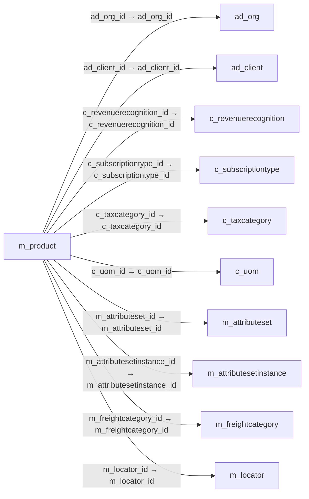

# m_product — 제품·서비스

[전체 일람](../TABLE_INDEX.md) · [분류 일람](README.md) · [AI 사용 안내](../README.md) · [외래키 읽는 법](../RELATIONSHIPS.md)

## 기본 정보

| 항목 | 내용 |
|---|---|
| 물리명 | `adempiere.m_product` |
| 한국어 논리명(문서용 해석) | 제품·서비스 |
| 원본 논리명 | Product |
| 원본 사전 ID | 208 |
| 분류 | `m` — 제품·재고·출하/입고·원가 |
| 전체 테넌트 행 수 | 255 |
| 물리 열 수 | 73 |
| 나가는 FK / 들어오는 FK | 16 / 124 |
| 구조·행 수 확인 시점 | 2026-11-03T23:29:01+09:00 |

## 의미와 쓰임

제품·서비스·품목의 공통 기본 정보를 관리하는 마스터다.

- 설명 근거: 원본 애플리케이션 사전 명칭·설명을 한국어로 해석.
- 한국어 이름과 개요는 문서용 해석입니다. 공식 한국어 번역으로 간주하지 않습니다.
- 원본 설명: Product Service Item
- 원본 도움말: —
- PostgreSQL 테이블 주석: —

## 키와 열

### 기본키·고유 제약조건

| 종류 | 제약조건 | 열(순서 유지) |
|---|---|---|
| PRIMARY KEY | `m_product_pkey` | `m_product_id` |
| UNIQUE | `m_product_uu_idx` | `m_product_uu` |

### 별도 고유 인덱스

PK·UNIQUE 제약조건의 인덱스와 별도로 존재하는 고유 인덱스입니다. 식·조건·열 순서는 원본 정의를 따릅니다.

- `m_product_expensetype`: `CREATE UNIQUE INDEX m_product_expensetype ON adempiere.m_product USING btree (s_expensetype_id)`
- `m_product_resource`: `CREATE UNIQUE INDEX m_product_resource ON adempiere.m_product USING btree (s_resource_id)`
- `m_product_value`: `CREATE UNIQUE INDEX m_product_value ON adempiere.m_product USING btree (ad_client_id, value)`

### 열 목록

원본 논리명·설명은 `AD_Column`에서 가져왔습니다. 기본값은 실제 PostgreSQL 메타데이터이며, 비어 있는 항목은 `—`로 표시합니다.

| 순서 | 물리명 | 원본 논리명 | PostgreSQL 타입 | NULL | PK | 기본값 | 설명 |
|---:|---|---|---|---|---|---|---|
| 1 | `m_product_id` | Product | numeric(10,0) | 불가 | 예 | — | Product, Service, Item |
| 2 | `ad_client_id` | Tenant | numeric(10,0) | 불가 | — | — | Tenant for this installation. |
| 3 | `ad_org_id` | Organization | numeric(10,0) | 불가 | — | — | Organizational entity within tenant |
| 4 | `isactive` | Active | character(1) | 불가 | — | 'Y'::bpchar | The record is active in the system |
| 5 | `created` | Created | timestamp without time zone | 불가 | — | now() | Date this record was created |
| 6 | `createdby` | Created By | numeric(10,0) | 불가 | — | — | User who created this records |
| 7 | `updated` | Updated | timestamp without time zone | 불가 | — | now() | Date this record was updated |
| 8 | `updatedby` | Updated By | numeric(10,0) | 불가 | — | — | User who updated this records |
| 9 | `value` | Search Key | character varying(510) | 불가 | — | — | Search key for the record in the format required - must be unique |
| 10 | `name` | Name | character varying(255) | 불가 | — | — | Alphanumeric identifier of the entity |
| 11 | `description` | Description | character varying(255) | 허용 | — | — | Optional short description of the record |
| 12 | `documentnote` | Document Note | character varying(2000) | 허용 | — | — | Additional information for a Document |
| 13 | `help` | Comment/Help | character varying(2000) | 허용 | — | — | Comment or Hint |
| 14 | `upc` | UPC/EAN | character varying(30) | 허용 | — | — | Bar Code (Universal Product Code or its superset European Article Number) |
| 15 | `sku` | SKU | character varying(30) | 허용 | — | — | Stock Keeping Unit |
| 16 | `c_uom_id` | UOM | numeric(10,0) | 불가 | — | — | Unit of Measure |
| 17 | `salesrep_id` | Sales Representative | numeric(10,0) | 허용 | — | — | Sales Representative or Company Agent |
| 18 | `issummary` | Summary Level | character(1) | 불가 | — | 'N'::bpchar | This is a summary entity |
| 19 | `isstocked` | Stocked | character(1) | 불가 | — | 'Y'::bpchar | Organization stocks this product |
| 20 | `ispurchased` | Purchased | character(1) | 불가 | — | 'Y'::bpchar | Organization purchases this product |
| 21 | `issold` | Sold | character(1) | 불가 | — | 'Y'::bpchar | Organization sells this product |
| 22 | `isbom` | Bill of Materials | character(1) | 불가 | — | 'N'::bpchar | Bill of Materials |
| 23 | `isinvoiceprintdetails` | Print detail records on invoice | character(1) | 불가 | — | 'N'::bpchar | Print detail BOM elements on the invoice |
| 24 | `ispicklistprintdetails` | Print detail records on pick list | character(1) | 불가 | — | 'N'::bpchar | Print detail BOM elements on the pick list |
| 25 | `isverified` | Verified | character(1) | 불가 | — | 'N'::bpchar | The BOM configuration has been verified |
| 26 | `c_revenuerecognition_id` | Revenue Recognition | numeric(10,0) | 허용 | — | — | Method for recording revenue |
| 27 | `m_product_category_id` | Product Category | numeric(10,0) | 불가 | — | — | Category of a Product |
| 28 | `classification` | Classification | character varying(12) | 허용 | — | — | Classification for grouping |
| 29 | `volume` | Volume | numeric | 허용 | — | 0 | Volume of a product |
| 30 | `weight` | Weight | numeric | 허용 | — | 0 | Weight of a product |
| 31 | `shelfwidth` | Shelf Width | numeric(10,0) | 허용 | — | — | Shelf width required |
| 32 | `shelfheight` | Shelf Height | numeric | 허용 | — | — | Shelf height required |
| 33 | `shelfdepth` | Shelf Depth | numeric(10,0) | 허용 | — | — | Shelf depth required |
| 34 | `unitsperpallet` | Units Per Pallet | numeric | 허용 | — | — | Units Per Pallet |
| 35 | `c_taxcategory_id` | Tax Category | numeric(10,0) | 불가 | — | — | Tax Category |
| 36 | `s_resource_id` | Resource | numeric(10,0) | 허용 | — | — | Resource |
| 37 | `discontinued` | Discontinued | character(1) | 허용 | — | 'N'::bpchar | This product is no longer available |
| 38 | `discontinuedby` | — | timestamp without time zone | 허용 | — | — | — |
| 39 | `processing` | Process Now | character(1) | 허용 | — | — | — |
| 40 | `s_expensetype_id` | Expense Type | numeric(10,0) | 허용 | — | — | Expense report type |
| 41 | `producttype` | Product Type | character(1) | 불가 | — | 'I'::bpchar | Type of product |
| 42 | `imageurl` | Image URL | character varying(120) | 허용 | — | — | URL of  image |
| 43 | `descriptionurl` | Description URL | character varying(120) | 허용 | — | — | URL for the description |
| 44 | `guaranteedays` | Guarantee Days | numeric(10,0) | 허용 | — | — | Number of days the product is guaranteed or available |
| 45 | `r_mailtext_id` | Mail Template | numeric(10,0) | 허용 | — | — | Text templates for mailings |
| 46 | `versionno` | Version No | character varying(20) | 허용 | — | — | Version Number |
| 47 | `m_attributeset_id` | Attribute Set | numeric(10,0) | 허용 | — | — | Product Attribute Set |
| 48 | `m_attributesetinstance_id` | Attribute Set Instance | numeric(10,0) | 허용 | — | 0 | Product Attribute Set Instance |
| 49 | `downloadurl` | — | character varying(120) | 허용 | — | — | — |
| 50 | `m_freightcategory_id` | Freight Category | numeric(10,0) | 허용 | — | — | Category of the Freight |
| 51 | `m_locator_id` | Locator | numeric(10,0) | 허용 | — | — | Warehouse Locator |
| 52 | `guaranteedaysmin` | Min Guarantee Days | numeric(10,0) | 허용 | — | — | Minimum number of guarantee days |
| 53 | `iswebstorefeatured` | Featured in Web Store | character(1) | 불가 | — | 'N'::bpchar | If selected, the product is displayed in the initial or any empty search |
| 54 | `isselfservice` | Self-Service | character(1) | 불가 | — | 'Y'::bpchar | This is a Self-Service entry or this entry can be changed via Self-Service |
| 55 | `c_subscriptiontype_id` | Subscription Type | numeric(10,0) | 허용 | — | — | Type of subscription |
| 56 | `isdropship` | Drop Shipment | character(1) | 불가 | — | 'N'::bpchar | Drop Shipments are sent directly to the Drop Shipment Location |
| 57 | `isexcludeautodelivery` | Exclude Auto Delivery | character(1) | 불가 | — | 'N'::bpchar | Exclude from automatic Delivery |
| 58 | `group1` | Group1 | character varying(255) | 허용 | — | — | — |
| 59 | `group2` | Group2 | character varying(255) | 허용 | — | — | — |
| 60 | `istoformule` | — | character(1) | 허용 | — | — | — |
| 61 | `lowlevel` | Low Level | numeric(10,0) | 불가 | — | (0)::numeric | The Low Level is used to calculate the material plan and determines if a net requirement should be exploited |
| 62 | `unitsperpack` | Units Per Pack | numeric(10,0) | 불가 | — | 1 | The Units Per Pack indicates the no of units of a product packed together. |
| 63 | `discontinuedat` | Discontinued At | timestamp without time zone | 허용 | — | — | Discontinued At indicates Date when product was discontinued |
| 64 | `copyfrom` | Copy From | character(1) | 허용 | — | NULL::bpchar | Copy From Record |
| 65 | `m_product_uu` | M_Product_UU | uuid | 허용 | — | — | — |
| 66 | `m_parttype_id` | Part Type | numeric(10,0) | 허용 | — | NULL::numeric | — |
| 67 | `iskanban` | Kanban controlled | character(1) | 불가 | — | 'N'::bpchar | This part is Kanban controlled |
| 68 | `ismanufactured` | Manufactured | character(1) | 불가 | — | 'N'::bpchar | This product is manufactured |
| 69 | `isphantom` | Phantom | character(1) | 허용 | — | 'N'::bpchar | Phantom Component |
| 70 | `isownbox` | Own Box | character(1) | 불가 | — | 'N'::bpchar | — |
| 71 | `customstariffnumber` | Customs Tariff Number | character varying(20) | 허용 | — | — | Customs Tariff Number, usually the HS-Code |
| 72 | `isautoproduce` | Auto Produce | character(1) | 불가 | — | 'N'::bpchar | Auto create production to fulfill shipment |
| 73 | `isbompriceoverride` | Calculate BOM price if Zero | character(1) | 불가 | — | 'Y'::bpchar | — |

## 외래키 흐름

화살표는 **FK를 가진 자식 → 참조되는 부모**입니다. 업무 처리의 시간 순서나 무조건적인 1:N 관계를 뜻하지 않습니다.

주변 관계 140개 중 10개를 그림으로 표시합니다. **전체 관계는 아래 두 표에 모두 포함**합니다.

### 이 테이블이 참조하는 부모 — 나가는 FK

| 제약조건 | 참조하는 쪽(자식) | 자식 열 | 참조받는 쪽(부모) | 부모 열 | 삭제 / 갱신 | 검증 / 지연 가능 |
|---|---|---|---|---|---|---|
| `ad_org_mproduct` <!-- FK_OUT: adempiere.m_product.ad_org_mproduct --> | [`m_product`](m_product.md) | `ad_org_id` | [`ad_org`](../ad/ad_org.md) | `ad_org_id` | NO ACTION / NO ACTION | 완료 / 가능 (초기 지연) |
| `adclient_mproduct` <!-- FK_OUT: adempiere.m_product.adclient_mproduct --> | [`m_product`](m_product.md) | `ad_client_id` | [`ad_client`](../ad/ad_client.md) | `ad_client_id` | NO ACTION / NO ACTION | 완료 / 가능 (초기 지연) |
| `crevrecognition_mproduct` <!-- FK_OUT: adempiere.m_product.crevrecognition_mproduct --> | [`m_product`](m_product.md) | `c_revenuerecognition_id` | [`c_revenuerecognition`](../c/c_revenuerecognition.md) | `c_revenuerecognition_id` | NO ACTION / NO ACTION | 완료 / 가능 (초기 지연) |
| `csubscriptiontype_mproduct` <!-- FK_OUT: adempiere.m_product.csubscriptiontype_mproduct --> | [`m_product`](m_product.md) | `c_subscriptiontype_id` | [`c_subscriptiontype`](../c/c_subscriptiontype.md) | `c_subscriptiontype_id` | NO ACTION / NO ACTION | 완료 / 가능 (초기 지연) |
| `ctaxcategory_mproduct` <!-- FK_OUT: adempiere.m_product.ctaxcategory_mproduct --> | [`m_product`](m_product.md) | `c_taxcategory_id` | [`c_taxcategory`](../c/c_taxcategory.md) | `c_taxcategory_id` | NO ACTION / NO ACTION | 완료 / 가능 (초기 지연) |
| `cuom_mproduct` <!-- FK_OUT: adempiere.m_product.cuom_mproduct --> | [`m_product`](m_product.md) | `c_uom_id` | [`c_uom`](../c/c_uom.md) | `c_uom_id` | NO ACTION / NO ACTION | 완료 / 가능 (초기 지연) |
| `mattributeset_mproduct` <!-- FK_OUT: adempiere.m_product.mattributeset_mproduct --> | [`m_product`](m_product.md) | `m_attributeset_id` | [`m_attributeset`](m_attributeset.md) | `m_attributeset_id` | CASCADE / NO ACTION | 완료 / 가능 (초기 지연) |
| `mattrsetinst_mproduct` <!-- FK_OUT: adempiere.m_product.mattrsetinst_mproduct --> | [`m_product`](m_product.md) | `m_attributesetinstance_id` | [`m_attributesetinstance`](m_attributesetinstance.md) | `m_attributesetinstance_id` | NO ACTION / NO ACTION | 완료 / 가능 (초기 지연) |
| `mfreightcategory_mproduct` <!-- FK_OUT: adempiere.m_product.mfreightcategory_mproduct --> | [`m_product`](m_product.md) | `m_freightcategory_id` | [`m_freightcategory`](m_freightcategory.md) | `m_freightcategory_id` | NO ACTION / NO ACTION | 완료 / 가능 (초기 지연) |
| `mlocator_mproduct` <!-- FK_OUT: adempiere.m_product.mlocator_mproduct --> | [`m_product`](m_product.md) | `m_locator_id` | [`m_locator`](m_locator.md) | `m_locator_id` | NO ACTION / NO ACTION | 완료 / 가능 (초기 지연) |
| `mparttype_mproduct` <!-- FK_OUT: adempiere.m_product.mparttype_mproduct --> | [`m_product`](m_product.md) | `m_parttype_id` | [`m_parttype`](m_parttype.md) | `m_parttype_id` | NO ACTION / NO ACTION | 완료 / 가능 (초기 지연) |
| `mproduct_mproductcategory` <!-- FK_OUT: adempiere.m_product.mproduct_mproductcategory --> | [`m_product`](m_product.md) | `m_product_category_id` | [`m_product_category`](m_product_category.md) | `m_product_category_id` | NO ACTION / NO ACTION | 완료 / 가능 (초기 지연) |
| `rmailtext_mproduct` <!-- FK_OUT: adempiere.m_product.rmailtext_mproduct --> | [`m_product`](m_product.md) | `r_mailtext_id` | [`r_mailtext`](../r/r_mailtext.md) | `r_mailtext_id` | NO ACTION / NO ACTION | 완료 / 가능 (초기 지연) |
| `salesrep_mproduct` <!-- FK_OUT: adempiere.m_product.salesrep_mproduct --> | [`m_product`](m_product.md) | `salesrep_id` | [`ad_user`](../ad/ad_user.md) | `ad_user_id` | NO ACTION / NO ACTION | 완료 / 가능 (초기 지연) |
| `sexpensetype_mproduct` <!-- FK_OUT: adempiere.m_product.sexpensetype_mproduct --> | [`m_product`](m_product.md) | `s_expensetype_id` | [`s_expensetype`](../s/s_expensetype.md) | `s_expensetype_id` | NO ACTION / NO ACTION | 완료 / 가능 (초기 지연) |
| `sresource_mproduct` <!-- FK_OUT: adempiere.m_product.sresource_mproduct --> | [`m_product`](m_product.md) | `s_resource_id` | [`s_resource`](../s/s_resource.md) | `s_resource_id` | NO ACTION / NO ACTION | 완료 / 가능 (초기 지연) |

### 이 테이블을 참조하는 자식 — 들어오는 FK

| 제약조건 | 참조하는 쪽(자식) | 자식 열 | 참조받는 쪽(부모) | 부모 열 | 삭제 / 갱신 | 검증 / 지연 가능 |
|---|---|---|---|---|---|---|
| `mproduct_aasset` <!-- FK_IN: adempiere.a_asset.mproduct_aasset --> | [`a_asset`](../a/a_asset.md) | `m_product_id` | [`m_product`](m_product.md) | `m_product_id` | NO ACTION / NO ACTION | 완료 / 가능 (초기 지연) |
| `mproduct_aassetaddition` <!-- FK_IN: adempiere.a_asset_addition.mproduct_aassetaddition --> | [`a_asset_addition`](../a/a_asset_addition.md) | `m_product_id` | [`m_product`](m_product.md) | `m_product_id` | NO ACTION / NO ACTION | 완료 / 가능 (초기 지연) |
| `mproduct_aassetproduct` <!-- FK_IN: adempiere.a_asset_product.mproduct_aassetproduct --> | [`a_asset_product`](../a/a_asset_product.md) | `m_product_id` | [`m_product`](m_product.md) | `m_product_id` | NO ACTION / NO ACTION | 완료 / 가능 (초기 지연) |
| `mproduct_aregistration` <!-- FK_IN: adempiere.a_registration.mproduct_aregistration --> | [`a_registration`](../a/a_registration.md) | `m_product_id` | [`m_product`](m_product.md) | `m_product_id` | NO ACTION / NO ACTION | 완료 / 가능 (초기 지연) |
| `mproduct_aregproduct` <!-- FK_IN: adempiere.a_registrationproduct.mproduct_aregproduct --> | [`a_registrationproduct`](../a/a_registrationproduct.md) | `m_product_id` | [`m_product`](m_product.md) | `m_product_id` | NO ACTION / NO ACTION | 완료 / 가능 (초기 지연) |
| `mproductfreight_adclientinfo` <!-- FK_IN: adempiere.ad_clientinfo.mproductfreight_adclientinfo --> | [`ad_clientinfo`](../ad/ad_clientinfo.md) | `m_productfreight_id` | [`m_product`](m_product.md) | `m_product_id` | NO ACTION / NO ACTION | 완료 / 가능 (초기 지연) |
| `mproduct_btopictype` <!-- FK_IN: adempiere.b_topictype.mproduct_btopictype --> | [`b_topictype`](../b/b_topictype.md) | `m_product_id` | [`m_product`](m_product.md) | `m_product_id` | NO ACTION / NO ACTION | 완료 / 가능 (초기 지연) |
| `mproduct_btopictypemember` <!-- FK_IN: adempiere.b_topictype.mproduct_btopictypemember --> | [`b_topictype`](../b/b_topictype.md) | `m_productmember_id` | [`m_product`](m_product.md) | `m_product_id` | NO ACTION / NO ACTION | 완료 / 가능 (초기 지연) |
| `mproduct_caschemaelement` <!-- FK_IN: adempiere.c_acctschema_element.mproduct_caschemaelement --> | [`c_acctschema_element`](../c/c_acctschema_element.md) | `m_product_id` | [`m_product`](m_product.md) | `m_product_id` | NO ACTION / NO ACTION | 완료 / 가능 (초기 지연) |
| `mproduct_cbpproduct` <!-- FK_IN: adempiere.c_bpartner_product.mproduct_cbpproduct --> | [`c_bpartner_product`](../c/c_bpartner_product.md) | `m_product_id` | [`m_product`](m_product.md) | `m_product_id` | CASCADE / NO ACTION | 완료 / 가능 (초기 지연) |
| `mproduct_ccashplanline` <!-- FK_IN: adempiere.c_cashplanline.mproduct_ccashplanline --> | [`c_cashplanline`](../c/c_cashplanline.md) | `m_product_id` | [`m_product`](m_product.md) | `m_product_id` | NO ACTION / NO ACTION | 완료 / 가능 (초기 지연) |
| `mproduct_ccommission` <!-- FK_IN: adempiere.c_commission.mproduct_ccommission --> | [`c_commission`](../c/c_commission.md) | `m_product_id` | [`m_product`](m_product.md) | `m_product_id` | NO ACTION / NO ACTION | 완료 / 가능 (초기 지연) |
| `mproduct_ccommissionline` <!-- FK_IN: adempiere.c_commissionline.mproduct_ccommissionline --> | [`c_commissionline`](../c/c_commissionline.md) | `m_product_id` | [`m_product`](m_product.md) | `m_product_id` | NO ACTION / NO ACTION | 완료 / 가능 (초기 지연) |
| `mproduct_cinvoiceline` <!-- FK_IN: adempiere.c_invoiceline.mproduct_cinvoiceline --> | [`c_invoiceline`](../c/c_invoiceline.md) | `m_product_id` | [`m_product`](m_product.md) | `m_product_id` | NO ACTION / NO ACTION | 완료 / 가능 (초기 지연) |
| `mproduct_clandedcost` <!-- FK_IN: adempiere.c_landedcost.mproduct_clandedcost --> | [`c_landedcost`](../c/c_landedcost.md) | `m_product_id` | [`m_product`](m_product.md) | `m_product_id` | NO ACTION / NO ACTION | 완료 / 가능 (초기 지연) |
| `mproduct_clandedcostalloc` <!-- FK_IN: adempiere.c_landedcostallocation.mproduct_clandedcostalloc --> | [`c_landedcostallocation`](../c/c_landedcostallocation.md) | `m_product_id` | [`m_product`](m_product.md) | `m_product_id` | NO ACTION / NO ACTION | 완료 / 가능 (초기 지연) |
| `mproduct_corderline` <!-- FK_IN: adempiere.c_orderline.mproduct_corderline --> | [`c_orderline`](../c/c_orderline.md) | `m_product_id` | [`m_product`](m_product.md) | `m_product_id` | NO ACTION / NO ACTION | 완료 / 가능 (초기 지연) |
| `mproduct_cphase` <!-- FK_IN: adempiere.c_phase.mproduct_cphase --> | [`c_phase`](../c/c_phase.md) | `m_product_id` | [`m_product`](m_product.md) | `m_product_id` | NO ACTION / NO ACTION | 완료 / 가능 (초기 지연) |
| `mproduct_cposkey` <!-- FK_IN: adempiere.c_poskey.mproduct_cposkey --> | [`c_poskey`](../c/c_poskey.md) | `m_product_id` | [`m_product`](m_product.md) | `m_product_id` | NO ACTION / NO ACTION | 완료 / 가능 (초기 지연) |
| `mproduct_cprojectissue` <!-- FK_IN: adempiere.c_projectissue.mproduct_cprojectissue --> | [`c_projectissue`](../c/c_projectissue.md) | `m_product_id` | [`m_product`](m_product.md) | `m_product_id` | NO ACTION / NO ACTION | 완료 / 가능 (초기 지연) |
| `mproduct_cprojectline` <!-- FK_IN: adempiere.c_projectline.mproduct_cprojectline --> | [`c_projectline`](../c/c_projectline.md) | `m_product_id` | [`m_product`](m_product.md) | `m_product_id` | NO ACTION / NO ACTION | 완료 / 가능 (초기 지연) |
| `mproduct_cprojectphase` <!-- FK_IN: adempiere.c_projectphase.mproduct_cprojectphase --> | [`c_projectphase`](../c/c_projectphase.md) | `m_product_id` | [`m_product`](m_product.md) | `m_product_id` | NO ACTION / NO ACTION | 완료 / 가능 (초기 지연) |
| `mproduct_cprojecttask` <!-- FK_IN: adempiere.c_projecttask.mproduct_cprojecttask --> | [`c_projecttask`](../c/c_projecttask.md) | `m_product_id` | [`m_product`](m_product.md) | `m_product_id` | NO ACTION / NO ACTION | 완료 / 가능 (초기 지연) |
| `mproduct_crfqtsubonly` <!-- FK_IN: adempiere.c_rfq_topicsubscriberonly.mproduct_crfqtsubonly --> | [`c_rfq_topicsubscriberonly`](../c/c_rfq_topicsubscriberonly.md) | `m_product_id` | [`m_product`](m_product.md) | `m_product_id` | NO ACTION / NO ACTION | 완료 / 가능 (초기 지연) |
| `mproduct_crfqline` <!-- FK_IN: adempiere.c_rfqline.mproduct_crfqline --> | [`c_rfqline`](../c/c_rfqline.md) | `m_product_id` | [`m_product`](m_product.md) | `m_product_id` | NO ACTION / NO ACTION | 완료 / 가능 (초기 지연) |
| `mproduct_cservicelevel` <!-- FK_IN: adempiere.c_servicelevel.mproduct_cservicelevel --> | [`c_servicelevel`](../c/c_servicelevel.md) | `m_product_id` | [`m_product`](m_product.md) | `m_product_id` | NO ACTION / NO ACTION | 완료 / 가능 (초기 지연) |
| `mproduct_csubscription` <!-- FK_IN: adempiere.c_subscription.mproduct_csubscription --> | [`c_subscription`](../c/c_subscription.md) | `m_product_id` | [`m_product`](m_product.md) | `m_product_id` | NO ACTION / NO ACTION | 완료 / 가능 (초기 지연) |
| `mproduct_ctask` <!-- FK_IN: adempiere.c_task.mproduct_ctask --> | [`c_task`](../c/c_task.md) | `m_product_id` | [`m_product`](m_product.md) | `m_product_id` | NO ACTION / NO ACTION | 완료 / 가능 (초기 지연) |
| `mproduct_ctaxdefinition` <!-- FK_IN: adempiere.c_taxdefinition.mproduct_ctaxdefinition --> | [`c_taxdefinition`](../c/c_taxdefinition.md) | `m_product_id` | [`m_product`](m_product.md) | `m_product_id` | NO ACTION / NO ACTION | 완료 / 가능 (초기 지연) |
| `mproduct_cuomconversion` <!-- FK_IN: adempiere.c_uom_conversion.mproduct_cuomconversion --> | [`c_uom_conversion`](../c/c_uom_conversion.md) | `m_product_id` | [`m_product`](m_product.md) | `m_product_id` | NO ACTION / NO ACTION | 완료 / 가능 (초기 지연) |
| `mproduct_vc` <!-- FK_IN: adempiere.c_validcombination.mproduct_vc --> | [`c_validcombination`](../c/c_validcombination.md) | `m_product_id` | [`m_product`](m_product.md) | `m_product_id` | NO ACTION / NO ACTION | 완료 / 가능 (초기 지연) |
| `mproduct_ddorderline` <!-- FK_IN: adempiere.dd_orderline.mproduct_ddorderline --> | [`dd_orderline`](../dd/dd_orderline.md) | `m_product_id` | [`m_product`](m_product.md) | `m_product_id` | NO ACTION / NO ACTION | 완료 / 가능 (초기 지연) |
| `m_product_fact_acct` <!-- FK_IN: adempiere.fact_acct.m_product_fact_acct --> | [`fact_acct`](../fact/fact_acct.md) | `m_product_id` | [`m_product`](m_product.md) | `m_product_id` | NO ACTION / NO ACTION | 완료 / 가능 (초기 지연) |
| `mproduct_factacctsummary` <!-- FK_IN: adempiere.fact_acct_summary.mproduct_factacctsummary --> | [`fact_acct_summary`](../fact/fact_acct_summary.md) | `m_product_id` | [`m_product`](m_product.md) | `m_product_id` | NO ACTION / NO ACTION | 완료 / 가능 (초기 지연) |
| `mproduct_gldist` <!-- FK_IN: adempiere.gl_distribution.mproduct_gldist --> | [`gl_distribution`](../gl/gl_distribution.md) | `m_product_id` | [`m_product`](m_product.md) | `m_product_id` | NO ACTION / NO ACTION | 완료 / 가능 (초기 지연) |
| `mproduct_gldistline` <!-- FK_IN: adempiere.gl_distributionline.mproduct_gldistline --> | [`gl_distributionline`](../gl/gl_distributionline.md) | `m_product_id` | [`m_product`](m_product.md) | `m_product_id` | NO ACTION / NO ACTION | 완료 / 가능 (초기 지연) |
| `mproduct_gljournalline` <!-- FK_IN: adempiere.gl_journalline.mproduct_gljournalline --> | [`gl_journalline`](../gl/gl_journalline.md) | `m_product_id` | [`m_product`](m_product.md) | `m_product_id` | NO ACTION / NO ACTION | 완료 / 가능 (초기 지연) |
| `mproduct_iasset` <!-- FK_IN: adempiere.i_asset.mproduct_iasset --> | [`i_asset`](../i/i_asset.md) | `m_product_id` | [`m_product`](m_product.md) | `m_product_id` | NO ACTION / NO ACTION | 완료 / 가능 (초기 지연) |
| `mproduct_ifajournal` <!-- FK_IN: adempiere.i_fajournal.mproduct_ifajournal --> | [`i_fajournal`](../i/i_fajournal.md) | `m_product_id` | [`m_product`](m_product.md) | `m_product_id` | NO ACTION / NO ACTION | 완료 / 가능 (초기 지연) |
| `mproduct_ifixedasset` <!-- FK_IN: adempiere.i_fixedasset.mproduct_ifixedasset --> | [`i_fixedasset`](../i/i_fixedasset.md) | `m_product_id` | [`m_product`](m_product.md) | `m_product_id` | NO ACTION / NO ACTION | 완료 / 가능 (초기 지연) |
| `mproduct_ogljournal` <!-- FK_IN: adempiere.i_gljournal.mproduct_ogljournal --> | [`i_gljournal`](../i/i_gljournal.md) | `m_product_id` | [`m_product`](m_product.md) | `m_product_id` | SET NULL / NO ACTION | 완료 / 가능 (초기 지연) |
| `mproduct_iinventory` <!-- FK_IN: adempiere.i_inventory.mproduct_iinventory --> | [`i_inventory`](../i/i_inventory.md) | `m_product_id` | [`m_product`](m_product.md) | `m_product_id` | SET NULL / NO ACTION | 완료 / 가능 (초기 지연) |
| `nproduct_iinvoice` <!-- FK_IN: adempiere.i_invoice.nproduct_iinvoice --> | [`i_invoice`](../i/i_invoice.md) | `m_product_id` | [`m_product`](m_product.md) | `m_product_id` | SET NULL / NO ACTION | 완료 / 가능 (초기 지연) |
| `mproduct_imovement` <!-- FK_IN: adempiere.i_movement.mproduct_imovement --> | [`i_movement`](../i/i_movement.md) | `m_product_id` | [`m_product`](m_product.md) | `m_product_id` | NO ACTION / NO ACTION | 완료 / 가능 (초기 지연) |
| `mproduct_iorder` <!-- FK_IN: adempiere.i_order.mproduct_iorder --> | [`i_order`](../i/i_order.md) | `m_product_id` | [`m_product`](m_product.md) | `m_product_id` | SET NULL / NO ACTION | 완료 / 가능 (초기 지연) |
| `mproduct_ipricelist` <!-- FK_IN: adempiere.i_pricelist.mproduct_ipricelist --> | [`i_pricelist`](../i/i_pricelist.md) | `m_product_id` | [`m_product`](m_product.md) | `m_product_id` | NO ACTION / NO ACTION | 완료 / 가능 (초기 지연) |
| `mproduct_iproduct` <!-- FK_IN: adempiere.i_product.mproduct_iproduct --> | [`i_product`](../i/i_product.md) | `m_product_id` | [`m_product`](m_product.md) | `m_product_id` | SET NULL / NO ACTION | 완료 / 가능 (초기 지연) |
| `mproduct_iproductplanning` <!-- FK_IN: adempiere.i_productplanning.mproduct_iproductplanning --> | [`i_productplanning`](../i/i_productplanning.md) | `m_product_id` | [`m_product`](m_product.md) | `m_product_id` | NO ACTION / NO ACTION | 완료 / 가능 (초기 지연) |
| `mproduct_mbom` <!-- FK_IN: adempiere.m_bom.mproduct_mbom --> | [`m_bom`](m_bom.md) | `m_product_id` | [`m_product`](m_product.md) | `m_product_id` | CASCADE / NO ACTION | 완료 / 가능 (초기 지연) |
| `mproduct_mbomalternative` <!-- FK_IN: adempiere.m_bomalternative.mproduct_mbomalternative --> | [`m_bomalternative`](m_bomalternative.md) | `m_product_id` | [`m_product`](m_product.md) | `m_product_id` | CASCADE / NO ACTION | 완료 / 가능 (초기 지연) |
| `mproduct_mbomproduct` <!-- FK_IN: adempiere.m_bomproduct.mproduct_mbomproduct --> | [`m_bomproduct`](m_bomproduct.md) | `m_productbom_id` | [`m_product`](m_product.md) | `m_product_id` | NO ACTION / NO ACTION | 완료 / 가능 (초기 지연) |
| `mproduct_mbpprice` <!-- FK_IN: adempiere.m_bp_price.mproduct_mbpprice --> | [`m_bp_price`](m_bp_price.md) | `m_product_id` | [`m_product`](m_product.md) | `m_product_id` | NO ACTION / NO ACTION | 완료 / 가능 (초기 지연) |
| `mproduct_mcommodityshipment` <!-- FK_IN: adempiere.m_commodityshipment.mproduct_mcommodityshipment --> | [`m_commodityshipment`](m_commodityshipment.md) | `m_product_id` | [`m_product`](m_product.md) | `m_product_id` | NO ACTION / NO ACTION | 완료 / 가능 (초기 지연) |
| `mproduct_mcost` <!-- FK_IN: adempiere.m_cost.mproduct_mcost --> | [`m_cost`](m_cost.md) | `m_product_id` | [`m_product`](m_product.md) | `m_product_id` | NO ACTION / NO ACTION | 완료 / 가능 (초기 지연) |
| `mproduct_mcostdetail` <!-- FK_IN: adempiere.m_costdetail.mproduct_mcostdetail --> | [`m_costdetail`](m_costdetail.md) | `m_product_id` | [`m_product`](m_product.md) | `m_product_id` | NO ACTION / NO ACTION | 완료 / 가능 (초기 지연) |
| `mproduct_mcosthistory` <!-- FK_IN: adempiere.m_costhistory.mproduct_mcosthistory --> | [`m_costhistory`](m_costhistory.md) | `m_product_id` | [`m_product`](m_product.md) | `m_product_id` | NO ACTION / NO ACTION | 완료 / 가능 (초기 지연) |
| `mproduct_mcostqueue` <!-- FK_IN: adempiere.m_costqueue.mproduct_mcostqueue --> | [`m_costqueue`](m_costqueue.md) | `m_product_id` | [`m_product`](m_product.md) | `m_product_id` | NO ACTION / NO ACTION | 완료 / 가능 (초기 지연) |
| `mproduct_mdemandline` <!-- FK_IN: adempiere.m_demandline.mproduct_mdemandline --> | [`m_demandline`](m_demandline.md) | `m_product_id` | [`m_product`](m_product.md) | `m_product_id` | CASCADE / NO ACTION | 완료 / 가능 (초기 지연) |
| `mproduct_mdiscountsbreak` <!-- FK_IN: adempiere.m_discountschemabreak.mproduct_mdiscountsbreak --> | [`m_discountschemabreak`](m_discountschemabreak.md) | `m_product_id` | [`m_product`](m_product.md) | `m_product_id` | NO ACTION / NO ACTION | 완료 / 가능 (초기 지연) |
| `mproduct_mdiscountsline` <!-- FK_IN: adempiere.m_discountschemaline.mproduct_mdiscountsline --> | [`m_discountschemaline`](m_discountschemaline.md) | `m_product_id` | [`m_product`](m_product.md) | `m_product_id` | SET NULL / NO ACTION | 완료 / 가능 (초기 지연) |
| `mproduct_mdistributionrun` <!-- FK_IN: adempiere.m_distributionrunline.mproduct_mdistributionrun --> | [`m_distributionrunline`](m_distributionrunline.md) | `m_product_id` | [`m_product`](m_product.md) | `m_product_id` | NO ACTION / NO ACTION | 완료 / 가능 (초기 지연) |
| `mproduct_medi` <!-- FK_IN: adempiere.m_edi.mproduct_medi --> | [`m_edi`](m_edi.md) | `m_product_id` | [`m_product`](m_product.md) | `m_product_id` | NO ACTION / NO ACTION | 완료 / 가능 (초기 지연) |
| `mproduct_mforecastline` <!-- FK_IN: adempiere.m_forecastline.mproduct_mforecastline --> | [`m_forecastline`](m_forecastline.md) | `m_product_id` | [`m_product`](m_product.md) | `m_product_id` | CASCADE / NO ACTION | 완료 / 가능 (초기 지연) |
| `mproduct_minoutline` <!-- FK_IN: adempiere.m_inoutline.mproduct_minoutline --> | [`m_inoutline`](m_inoutline.md) | `m_product_id` | [`m_product`](m_product.md) | `m_product_id` | NO ACTION / NO ACTION | 완료 / 가능 (초기 지연) |
| `mproduct_minventoryline` <!-- FK_IN: adempiere.m_inventoryline.mproduct_minventoryline --> | [`m_inventoryline`](m_inventoryline.md) | `m_product_id` | [`m_product`](m_product.md) | `m_product_id` | NO ACTION / NO ACTION | 완료 / 가능 (초기 지연) |
| `mproduct_mlot` <!-- FK_IN: adempiere.m_lot.mproduct_mlot --> | [`m_lot`](m_lot.md) | `m_product_id` | [`m_product`](m_product.md) | `m_product_id` | NO ACTION / NO ACTION | 완료 / 가능 (초기 지연) |
| `mproduct_mmatchinv` <!-- FK_IN: adempiere.m_matchinv.mproduct_mmatchinv --> | [`m_matchinv`](m_matchinv.md) | `m_product_id` | [`m_product`](m_product.md) | `m_product_id` | NO ACTION / NO ACTION | 완료 / 가능 (초기 지연) |
| `mproduct_mmatchpo` <!-- FK_IN: adempiere.m_matchpo.mproduct_mmatchpo --> | [`m_matchpo`](m_matchpo.md) | `m_product_id` | [`m_product`](m_product.md) | `m_product_id` | NO ACTION / NO ACTION | 완료 / 가능 (초기 지연) |
| `mproduct_mmovementline` <!-- FK_IN: adempiere.m_movementline.mproduct_mmovementline --> | [`m_movementline`](m_movementline.md) | `m_product_id` | [`m_product`](m_product.md) | `m_product_id` | NO ACTION / NO ACTION | 완료 / 가능 (초기 지연) |
| `mproduct_mpackageline` <!-- FK_IN: adempiere.m_packageline.mproduct_mpackageline --> | [`m_packageline`](m_packageline.md) | `m_product_id` | [`m_product`](m_product.md) | `m_product_id` | NO ACTION / NO ACTION | 완료 / 가능 (초기 지연) |
| `m_product_m_product_acct` <!-- FK_IN: adempiere.m_product_acct.m_product_m_product_acct --> | [`m_product_acct`](m_product_acct.md) | `m_product_id` | [`m_product`](m_product.md) | `m_product_id` | CASCADE / NO ACTION | 완료 / 가능 (초기 지연) |
| `mproduct_bomproduct` <!-- FK_IN: adempiere.m_product_bom_old.mproduct_bomproduct --> | [`m_product_bom_old`](m_product_bom_old.md) | `m_productbom_id` | [`m_product`](m_product.md) | `m_product_id` | NO ACTION / NO ACTION | 완료 / 가능 (초기 지연) |
| `mproduct_mproductbom` <!-- FK_IN: adempiere.m_product_bom_old.mproduct_mproductbom --> | [`m_product_bom_old`](m_product_bom_old.md) | `m_product_id` | [`m_product`](m_product.md) | `m_product_id` | CASCADE / NO ACTION | 완료 / 가능 (초기 지연) |
| `m_product_productpo` <!-- FK_IN: adempiere.m_product_po.m_product_productpo --> | [`m_product_po`](m_product_po.md) | `m_product_id` | [`m_product`](m_product.md) | `m_product_id` | CASCADE / NO ACTION | 완료 / 가능 (초기 지연) |
| `mproduct_mproductqualitytest` <!-- FK_IN: adempiere.m_product_qualitytest.mproduct_mproductqualitytest --> | [`m_product_qualitytest`](m_product_qualitytest.md) | `m_product_id` | [`m_product`](m_product.md) | `m_product_id` | NO ACTION / NO ACTION | 완료 / 가능 (초기 지연) |
| `mproduct_mproducttrl` <!-- FK_IN: adempiere.m_product_trl.mproduct_mproducttrl --> | [`m_product_trl`](m_product_trl.md) | `m_product_id` | [`m_product`](m_product.md) | `m_product_id` | CASCADE / NO ACTION | 완료 / 가능 (초기 지연) |
| `mproduct_mproductdownload` <!-- FK_IN: adempiere.m_productdownload.mproduct_mproductdownload --> | [`m_productdownload`](m_productdownload.md) | `m_product_id` | [`m_product`](m_product.md) | `m_product_id` | NO ACTION / NO ACTION | 완료 / 가능 (초기 지연) |
| `mproduct_mproduction` <!-- FK_IN: adempiere.m_production.mproduct_mproduction --> | [`m_production`](m_production.md) | `m_product_id` | [`m_product`](m_product.md) | `m_product_id` | NO ACTION / NO ACTION | 완료 / 가능 (초기 지연) |
| `mproduct_mproductionline` <!-- FK_IN: adempiere.m_productionline.mproduct_mproductionline --> | [`m_productionline`](m_productionline.md) | `m_product_id` | [`m_product`](m_product.md) | `m_product_id` | NO ACTION / NO ACTION | 완료 / 가능 (초기 지연) |
| `mproduct_mproductionplan` <!-- FK_IN: adempiere.m_productionplan.mproduct_mproductionplan --> | [`m_productionplan`](m_productionplan.md) | `m_product_id` | [`m_product`](m_product.md) | `m_product_id` | NO ACTION / NO ACTION | 완료 / 가능 (초기 지연) |
| `mproduct_mproductoperation` <!-- FK_IN: adempiere.m_productoperation.mproduct_mproductoperation --> | [`m_productoperation`](m_productoperation.md) | `m_product_id` | [`m_product`](m_product.md) | `m_product_id` | CASCADE / NO ACTION | 완료 / 가능 (초기 지연) |
| `mproduct_mproductprice` <!-- FK_IN: adempiere.m_productprice.mproduct_mproductprice --> | [`m_productprice`](m_productprice.md) | `m_product_id` | [`m_product`](m_product.md) | `m_product_id` | CASCADE / NO ACTION | 완료 / 가능 (초기 지연) |
| `mproduct_mproductpricevendorbr` <!-- FK_IN: adempiere.m_productpricevendorbreak.mproduct_mproductpricevendorbr --> | [`m_productpricevendorbreak`](m_productpricevendorbreak.md) | `m_product_id` | [`m_product`](m_product.md) | `m_product_id` | NO ACTION / NO ACTION | 완료 / 가능 (초기 지연) |
| `mproduct_mpromotiongroupline` <!-- FK_IN: adempiere.m_promotiongroupline.mproduct_mpromotiongroupline --> | [`m_promotiongroupline`](m_promotiongroupline.md) | `m_product_id` | [`m_product`](m_product.md) | `m_product_id` | NO ACTION / NO ACTION | 완료 / 가능 (초기 지연) |
| `mproduct_mrelated_product` <!-- FK_IN: adempiere.m_relatedproduct.mproduct_mrelated_product --> | [`m_relatedproduct`](m_relatedproduct.md) | `m_product_id` | [`m_product`](m_product.md) | `m_product_id` | CASCADE / NO ACTION | 완료 / 가능 (초기 지연) |
| `mproduct_mrelatedproduct` <!-- FK_IN: adempiere.m_relatedproduct.mproduct_mrelatedproduct --> | [`m_relatedproduct`](m_relatedproduct.md) | `relatedproduct_id` | [`m_product`](m_product.md) | `m_product_id` | CASCADE / NO ACTION | 완료 / 가능 (초기 지연) |
| `m_product_replenish` <!-- FK_IN: adempiere.m_replenish.m_product_replenish --> | [`m_replenish`](m_replenish.md) | `m_product_id` | [`m_product`](m_product.md) | `m_product_id` | CASCADE / NO ACTION | 완료 / 가능 (초기 지연) |
| `mproduct_mrequisitionline` <!-- FK_IN: adempiere.m_requisitionline.mproduct_mrequisitionline --> | [`m_requisitionline`](m_requisitionline.md) | `m_product_id` | [`m_product`](m_product.md) | `m_product_id` | NO ACTION / NO ACTION | 완료 / 가능 (초기 지연) |
| `mproduct_mrmaline` <!-- FK_IN: adempiere.m_rmaline.mproduct_mrmaline --> | [`m_rmaline`](m_rmaline.md) | `m_product_id` | [`m_product`](m_product.md) | `m_product_id` | NO ACTION / NO ACTION | 완료 / 가능 (초기 지연) |
| `mproduct_mstorageonhand` <!-- FK_IN: adempiere.m_storageonhand.mproduct_mstorageonhand --> | [`m_storageonhand`](m_storageonhand.md) | `m_product_id` | [`m_product`](m_product.md) | `m_product_id` | NO ACTION / NO ACTION | 완료 / 가능 (초기 지연) |
| `mproduct_mstoragereservation` <!-- FK_IN: adempiere.m_storagereservation.mproduct_mstoragereservation --> | [`m_storagereservation`](m_storagereservation.md) | `m_product_id` | [`m_product`](m_product.md) | `m_product_id` | NO ACTION / NO ACTION | 완료 / 가능 (초기 지연) |
| `mproduct_mstoragereservationlo` <!-- FK_IN: adempiere.m_storagereservationlog.mproduct_mstoragereservationlo --> | [`m_storagereservationlog`](m_storagereservationlog.md) | `m_product_id` | [`m_product`](m_product.md) | `m_product_id` | NO ACTION / NO ACTION | 완료 / 가능 (초기 지연) |
| `mproduct_substitute` <!-- FK_IN: adempiere.m_substitute.mproduct_substitute --> | [`m_substitute`](m_substitute.md) | `m_product_id` | [`m_product`](m_product.md) | `m_product_id` | CASCADE / NO ACTION | 완료 / 가능 (초기 지연) |
| `mproduct_substitutesub` <!-- FK_IN: adempiere.m_substitute.mproduct_substitutesub --> | [`m_substitute`](m_substitute.md) | `substitute_id` | [`m_product`](m_product.md) | `m_product_id` | CASCADE / NO ACTION | 완료 / 가능 (초기 지연) |
| `mproduct_minventorycount` <!-- FK_IN: adempiere.m_transaction.mproduct_minventorycount --> | [`m_transaction`](m_transaction.md) | `m_product_id` | [`m_product`](m_product.md) | `m_product_id` | NO ACTION / NO ACTION | 완료 / 가능 (초기 지연) |
| `mproduct_mtrxalloc` <!-- FK_IN: adempiere.m_transactionallocation.mproduct_mtrxalloc --> | [`m_transactionallocation`](m_transactionallocation.md) | `m_product_id` | [`m_product`](m_product.md) | `m_product_id` | NO ACTION / NO ACTION | 완료 / 가능 (초기 지연) |
| `mproduct_pagoalrestriction` <!-- FK_IN: adempiere.pa_goalrestriction.mproduct_pagoalrestriction --> | [`pa_goalrestriction`](../pa/pa_goalrestriction.md) | `m_product_id` | [`m_product`](m_product.md) | `m_product_id` | NO ACTION / NO ACTION | 완료 / 가능 (초기 지연) |
| `mproduct_pareportcolumn` <!-- FK_IN: adempiere.pa_reportcolumn.mproduct_pareportcolumn --> | [`pa_reportcolumn`](../pa/pa_reportcolumn.md) | `m_product_id` | [`m_product`](m_product.md) | `m_product_id` | NO ACTION / NO ACTION | 완료 / 가능 (초기 지연) |
| `mproduct_pareportsource` <!-- FK_IN: adempiere.pa_reportsource.mproduct_pareportsource --> | [`pa_reportsource`](../pa/pa_reportsource.md) | `m_product_id` | [`m_product`](m_product.md) | `m_product_id` | NO ACTION / NO ACTION | 완료 / 가능 (초기 지연) |
| `mproduct_ppcostcollector` <!-- FK_IN: adempiere.pp_cost_collector.mproduct_ppcostcollector --> | [`pp_cost_collector`](../pp/pp_cost_collector.md) | `m_product_id` | [`m_product`](m_product.md) | `m_product_id` | NO ACTION / NO ACTION | 완료 / 가능 (초기 지연) |
| `mproduct_ppmrp` <!-- FK_IN: adempiere.pp_mrp.mproduct_ppmrp --> | [`pp_mrp`](../pp/pp_mrp.md) | `m_product_id` | [`m_product`](m_product.md) | `m_product_id` | NO ACTION / NO ACTION | 완료 / 가능 (초기 지연) |
| `mproduct_pporder` <!-- FK_IN: adempiere.pp_order.mproduct_pporder --> | [`pp_order`](../pp/pp_order.md) | `m_product_id` | [`m_product`](m_product.md) | `m_product_id` | NO ACTION / NO ACTION | 완료 / 가능 (초기 지연) |
| `mproduct_pporderbom` <!-- FK_IN: adempiere.pp_order_bom.mproduct_pporderbom --> | [`pp_order_bom`](../pp/pp_order_bom.md) | `m_product_id` | [`m_product`](m_product.md) | `m_product_id` | NO ACTION / NO ACTION | 완료 / 가능 (초기 지연) |
| `mproduct_pporderbomline` <!-- FK_IN: adempiere.pp_order_bomline.mproduct_pporderbomline --> | [`pp_order_bomline`](../pp/pp_order_bomline.md) | `m_product_id` | [`m_product`](m_product.md) | `m_product_id` | NO ACTION / NO ACTION | 완료 / 가능 (초기 지연) |
| `mproduct_ppordercost` <!-- FK_IN: adempiere.pp_order_cost.mproduct_ppordercost --> | [`pp_order_cost`](../pp/pp_order_cost.md) | `m_product_id` | [`m_product`](m_product.md) | `m_product_id` | NO ACTION / NO ACTION | 완료 / 가능 (초기 지연) |
| `mproduct_ppordernodeproduct` <!-- FK_IN: adempiere.pp_order_node_product.mproduct_ppordernodeproduct --> | [`pp_order_node_product`](../pp/pp_order_node_product.md) | `m_product_id` | [`m_product`](m_product.md) | `m_product_id` | NO ACTION / NO ACTION | 완료 / 가능 (초기 지연) |
| `mproduct_ppproductbom` <!-- FK_IN: adempiere.pp_product_bom.mproduct_ppproductbom --> | [`pp_product_bom`](../pp/pp_product_bom.md) | `m_product_id` | [`m_product`](m_product.md) | `m_product_id` | NO ACTION / NO ACTION | 완료 / 가능 (초기 지연) |
| `mproduct_ppproductbomline` <!-- FK_IN: adempiere.pp_product_bomline.mproduct_ppproductbomline --> | [`pp_product_bomline`](../pp/pp_product_bomline.md) | `m_product_id` | [`m_product`](m_product.md) | `m_product_id` | NO ACTION / NO ACTION | 완료 / 가능 (초기 지연) |
| `mproduct_ppproductplanning` <!-- FK_IN: adempiere.pp_product_planning.mproduct_ppproductplanning --> | [`pp_product_planning`](../pp/pp_product_planning.md) | `m_product_id` | [`m_product`](m_product.md) | `m_product_id` | NO ACTION / NO ACTION | 완료 / 가능 (초기 지연) |
| `mproduct_ppwfnodeproduct` <!-- FK_IN: adempiere.pp_wf_node_product.mproduct_ppwfnodeproduct --> | [`pp_wf_node_product`](../pp/pp_wf_node_product.md) | `m_product_id` | [`m_product`](m_product.md) | `m_product_id` | NO ACTION / NO ACTION | 완료 / 가능 (초기 지연) |
| `mproduct_qmspecification` <!-- FK_IN: adempiere.qm_specification.mproduct_qmspecification --> | [`qm_specification`](../qm/qm_specification.md) | `m_product_id` | [`m_product`](m_product.md) | `m_product_id` | NO ACTION / NO ACTION | 완료 / 가능 (초기 지연) |
| `mproduct_rcategory` <!-- FK_IN: adempiere.r_category.mproduct_rcategory --> | [`r_category`](../r/r_category.md) | `m_product_id` | [`m_product`](m_product.md) | `m_product_id` | NO ACTION / NO ACTION | 완료 / 가능 (초기 지연) |
| `mproduct_rrequest` <!-- FK_IN: adempiere.r_request.mproduct_rrequest --> | [`r_request`](../r/r_request.md) | `m_product_id` | [`m_product`](m_product.md) | `m_product_id` | NO ACTION / NO ACTION | 완료 / 가능 (초기 지연) |
| `mproductspent_rrequest` <!-- FK_IN: adempiere.r_request.mproductspent_rrequest --> | [`r_request`](../r/r_request.md) | `m_productspent_id` | [`m_product`](m_product.md) | `m_product_id` | NO ACTION / NO ACTION | 완료 / 가능 (초기 지연) |
| `mproduct_rrequestaction` <!-- FK_IN: adempiere.r_requestaction.mproduct_rrequestaction --> | [`r_requestaction`](../r/r_requestaction.md) | `m_product_id` | [`m_product`](m_product.md) | `m_product_id` | NO ACTION / NO ACTION | 완료 / 가능 (초기 지연) |
| `mproductspent_rrequestaction` <!-- FK_IN: adempiere.r_requestaction.mproductspent_rrequestaction --> | [`r_requestaction`](../r/r_requestaction.md) | `m_productspent_id` | [`m_product`](m_product.md) | `m_product_id` | NO ACTION / NO ACTION | 완료 / 가능 (초기 지연) |
| `mproductspent_rrequestupdate` <!-- FK_IN: adempiere.r_requestupdate.mproductspent_rrequestupdate --> | [`r_requestupdate`](../r/r_requestupdate.md) | `m_productspent_id` | [`m_product`](m_product.md) | `m_product_id` | NO ACTION / NO ACTION | 완료 / 가능 (초기 지연) |
| `mproduct_stimeexpenseline` <!-- FK_IN: adempiere.s_timeexpenseline.mproduct_stimeexpenseline --> | [`s_timeexpenseline`](../s/s_timeexpenseline.md) | `m_product_id` | [`m_product`](m_product.md) | `m_product_id` | NO ACTION / NO ACTION | 완료 / 가능 (초기 지연) |
| `mproduct_strainingclass` <!-- FK_IN: adempiere.s_training_class.mproduct_strainingclass --> | [`s_training_class`](../s/s_training_class.md) | `m_product_id` | [`m_product`](m_product.md) | `m_product_id` | NO ACTION / NO ACTION | 완료 / 가능 (초기 지연) |
| `mproduct_tdrdetail` <!-- FK_IN: adempiere.t_distributionrundetail.mproduct_tdrdetail --> | [`t_distributionrundetail`](../t/t_distributionrundetail.md) | `m_product_id` | [`m_product`](m_product.md) | `m_product_id` | CASCADE / NO ACTION | 완료 / 가능 (초기 지연) |
| `mproduct_tinventoryvalue` <!-- FK_IN: adempiere.t_inventoryvalue.mproduct_tinventoryvalue --> | [`t_inventoryvalue`](../t/t_inventoryvalue.md) | `m_product_id` | [`m_product`](m_product.md) | `m_product_id` | CASCADE / NO ACTION | 완료 / 가능 (초기 지연) |
| `mproduct_treplenish` <!-- FK_IN: adempiere.t_replenish.mproduct_treplenish --> | [`t_replenish`](../t/t_replenish.md) | `m_product_id` | [`m_product`](m_product.md) | `m_product_id` | CASCADE / NO ACTION | 완료 / 가능 (초기 지연) |
| `mproduct_ttransaction` <!-- FK_IN: adempiere.t_transaction.mproduct_ttransaction --> | [`t_transaction`](../t/t_transaction.md) | `m_product_id` | [`m_product`](m_product.md) | `m_product_id` | CASCADE / NO ACTION | 완료 / 가능 (초기 지연) |
| `mproduct_wbasketline` <!-- FK_IN: adempiere.w_basketline.mproduct_wbasketline --> | [`w_basketline`](../w/w_basketline.md) | `m_product_id` | [`m_product`](m_product.md) | `m_product_id` | NO ACTION / NO ACTION | 완료 / 가능 (초기 지연) |

## 조회 시 주의

- FK 표의 자식 열과 부모 열을 같은 순서로 대응시킵니다. 복합 FK는 모든 열의 동등 조건을 `AND`로 연결합니다.
- 테이블 이름이나 `_id` 열 이름만으로 물리 FK가 있다고 가정하지 않습니다. FK 미선언은 업무 관계가 없다는 뜻도 아닙니다.
- 자식이 여러 행인 테이블과 조인하면 부모의 금액·건수가 중복될 수 있습니다. 집계 단위를 먼저 정합니다.
- `ad_client_id`가 있습니다. 업무 분석에서는 대상 테넌트를 명시합니다. GardenWorld는 `11`, 시스템 공통 설정은 `0`일 수 있으므로 일괄 필터 적용 전에 테이블 역할을 확인합니다.
- 행 수는 위 확인 시점의 전체 테넌트 값입니다. 최신 업무 실적이나 현재 실행 결과로 재사용하지 않습니다.
