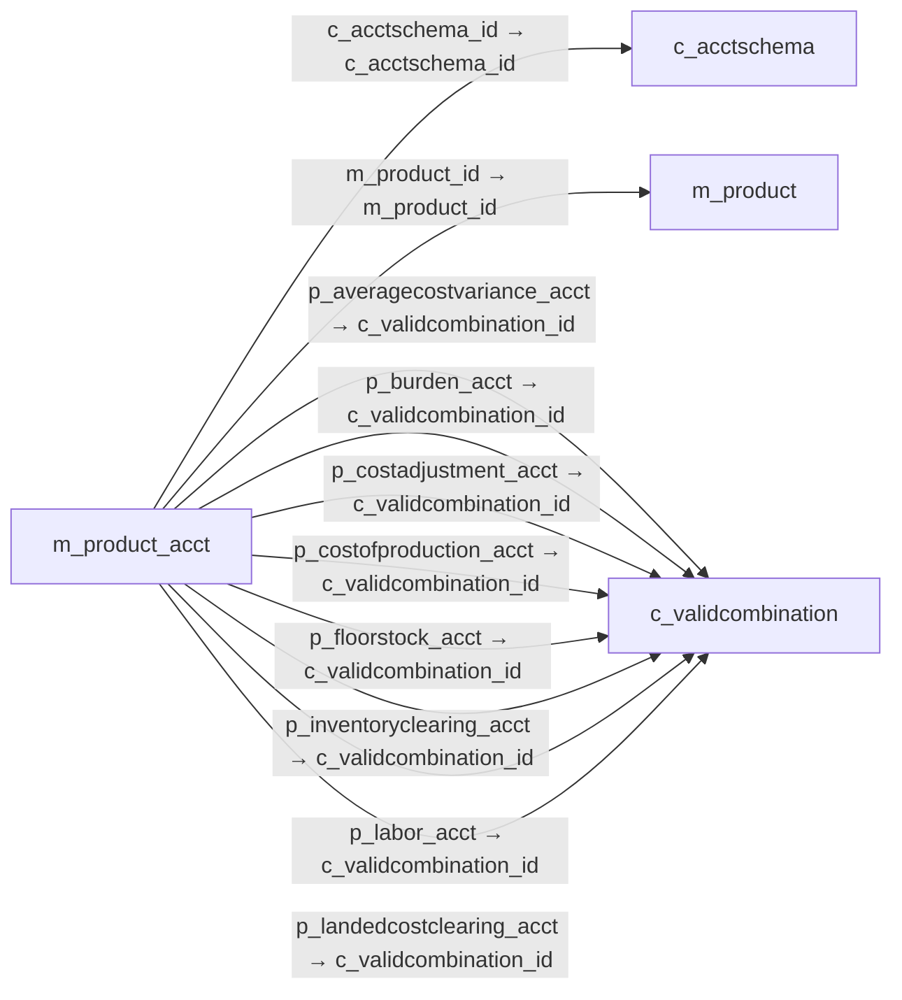

# m_product_acct — 제품별 회계 계정

[전체 일람](../TABLE_INDEX.md) · [분류 일람](README.md) · [AI 사용 안내](../README.md) · [외래키 읽는 법](../RELATIONSHIPS.md)

## 기본 정보

| 항목 | 내용 |
|---|---|
| 물리명 | `adempiere.m_product_acct` |
| 한국어 논리명(문서용 해석) | 제품별 회계 계정 |
| 원본 논리명 | Product Acct |
| 원본 사전 ID | 273 |
| 분류 | `m` — 제품·재고·출하/입고·원가 |
| 전체 테넌트 행 수 | 110 |
| 물리 열 수 | 34 |
| 나가는 FK / 들어오는 FK | 26 / 0 |
| 구조·행 수 확인 시점 | 2026-11-03T23:29:01+09:00 |

## 의미와 쓰임

제품과 회계 스키마별 매출·비용·재고·매출원가 및 제조 관련 계정을 연결한다.

- 설명 근거: 물리명·열·외래키 구조를 근거로 보수적으로 해석.
- 한국어 이름과 개요는 문서용 해석입니다. 공식 한국어 번역으로 간주하지 않습니다.
- 원본 설명: —
- 원본 도움말: —
- PostgreSQL 테이블 주석: —

## 키와 열

### 기본키·고유 제약조건

| 종류 | 제약조건 | 열(순서 유지) |
|---|---|---|
| PRIMARY KEY | `m_product_acct_pkey` | `m_product_id`, `c_acctschema_id` |
| UNIQUE | `m_product_acct_uu_idx` | `m_product_acct_uu` |

### 열 목록

원본 논리명·설명은 `AD_Column`에서 가져왔습니다. 기본값은 실제 PostgreSQL 메타데이터이며, 비어 있는 항목은 `—`로 표시합니다.

| 순서 | 물리명 | 원본 논리명 | PostgreSQL 타입 | NULL | PK | 기본값 | 설명 |
|---:|---|---|---|---|---|---|---|
| 1 | `m_product_id` | Product | numeric(10,0) | 불가 | 예 | — | Product, Service, Item |
| 2 | `c_acctschema_id` | Accounting Schema | numeric(10,0) | 불가 | 예 | — | Rules for accounting |
| 3 | `ad_client_id` | Tenant | numeric(10,0) | 불가 | — | — | Tenant for this installation. |
| 4 | `ad_org_id` | Organization | numeric(10,0) | 불가 | — | — | Organizational entity within tenant |
| 5 | `isactive` | Active | character(1) | 불가 | — | 'Y'::bpchar | The record is active in the system |
| 6 | `created` | Created | timestamp without time zone | 불가 | — | now() | Date this record was created |
| 7 | `createdby` | Created By | numeric(10,0) | 불가 | — | — | User who created this records |
| 8 | `updated` | Updated | timestamp without time zone | 불가 | — | now() | Date this record was updated |
| 9 | `updatedby` | Updated By | numeric(10,0) | 불가 | — | — | User who updated this records |
| 10 | `p_revenue_acct` | Product Revenue | numeric(10,0) | 불가 | — | — | Account for Product Revenue (Sales Account) |
| 11 | `p_expense_acct` | Product Expense | numeric(10,0) | 불가 | — | — | Account for Product Expense |
| 12 | `p_asset_acct` | Product Asset | numeric(10,0) | 불가 | — | — | Account for Product Asset (Inventory) |
| 13 | `p_purchasepricevariance_acct` | Purchase Price Variance | numeric(10,0) | 불가 | — | — | Difference between Standard Cost and Purchase Price (PPV) |
| 14 | `p_invoicepricevariance_acct` | Invoice Price Variance | numeric(10,0) | 불가 | — | — | Difference between Costs and Invoice Price (IPV) |
| 15 | `p_cogs_acct` | Product COGS | numeric(10,0) | 불가 | — | — | Account for Cost of Goods Sold |
| 16 | `p_tradediscountrec_acct` | Trade Discount Received | numeric(10,0) | 불가 | — | — | Trade Discount Receivable Account |
| 17 | `p_tradediscountgrant_acct` | Trade Discount Granted | numeric(10,0) | 불가 | — | — | Trade Discount Granted Account |
| 18 | `p_inventoryclearing_acct` | Inventory Clearing | numeric(10,0) | 허용 | — | — | Product Inventory Clearing Account |
| 19 | `p_costadjustment_acct` | Cost Adjustment | numeric(10,0) | 허용 | — | — | Product Cost Adjustment Account |
| 20 | `p_wip_acct` | Work In Process | numeric(10,0) | 허용 | — | — | The Work in Process account is the account used Manufacturing Order |
| 21 | `p_methodchangevariance_acct` | Method Change Variance | numeric(10,0) | 허용 | — | — | The Method Change Variance account is the account used Manufacturing Order |
| 22 | `p_usagevariance_acct` | Usage Variance | numeric(10,0) | 허용 | — | — | The Usage Variance account is the account used Manufacturing Order |
| 23 | `p_ratevariance_acct` | Rate Variance | numeric(10,0) | 허용 | — | — | The Rate Variance account is the account used Manufacturing Order |
| 24 | `p_mixvariance_acct` | Mix Variance | numeric(10,0) | 허용 | — | — | The Mix Variance account is the account used Manufacturing Order |
| 25 | `p_floorstock_acct` | Floor Stock | numeric(10,0) | 허용 | — | — | The Floor Stock account is the account used Manufacturing Order |
| 26 | `p_costofproduction_acct` | Cost Of Production | numeric(10,0) | 허용 | — | — | The Cost Of Production account is the account used Manufacturing Order |
| 27 | `p_labor_acct` | Labor | numeric(10,0) | 허용 | — | — | The Labor account is the account used Manufacturing Order |
| 28 | `p_burden_acct` | Burden | numeric(10,0) | 허용 | — | — | The Burden account is the account used Manufacturing Order |
| 29 | `p_outsideprocessing_acct` | Outside Processing | numeric(10,0) | 허용 | — | — | The Outside Processing Account is the account used in Manufacturing Order |
| 30 | `p_overhead_acct` | Overhead | numeric(10,0) | 허용 | — | — | The Overhead account is the account used  in Manufacturing Order  |
| 31 | `p_scrap_acct` | Scrap | numeric(10,0) | 허용 | — | — | The Scrap account is the account used  in Manufacturing Order  |
| 32 | `p_averagecostvariance_acct` | Average Cost Variance | numeric(10,0) | 허용 | — | NULL::numeric | Average Cost Variance |
| 33 | `m_product_acct_uu` | M_Product_Acct_UU | uuid | 허용 | — | — | — |
| 34 | `p_landedcostclearing_acct` | Landed Cost Clearing | numeric(10,0) | 허용 | — | NULL::numeric | Product Landed Cost Clearing Account |

## 외래키 흐름

화살표는 **FK를 가진 자식 → 참조되는 부모**입니다. 업무 처리의 시간 순서나 무조건적인 1:N 관계를 뜻하지 않습니다.

주변 관계 26개 중 10개를 그림으로 표시합니다. **전체 관계는 아래 두 표에 모두 포함**합니다.

### 이 테이블이 참조하는 부모 — 나가는 FK

| 제약조건 | 참조하는 쪽(자식) | 자식 열 | 참조받는 쪽(부모) | 부모 열 | 삭제 / 갱신 | 검증 / 지연 가능 |
|---|---|---|---|---|---|---|
| `cacctschema_mproductacct` <!-- FK_OUT: adempiere.m_product_acct.cacctschema_mproductacct --> | [`m_product_acct`](m_product_acct.md) | `c_acctschema_id` | [`c_acctschema`](../c/c_acctschema.md) | `c_acctschema_id` | CASCADE / NO ACTION | 완료 / 가능 (초기 지연) |
| `m_product_m_product_acct` <!-- FK_OUT: adempiere.m_product_acct.m_product_m_product_acct --> | [`m_product_acct`](m_product_acct.md) | `m_product_id` | [`m_product`](m_product.md) | `m_product_id` | CASCADE / NO ACTION | 완료 / 가능 (초기 지연) |
| `paveragecostvariance_mproducta` <!-- FK_OUT: adempiere.m_product_acct.paveragecostvariance_mproducta --> | [`m_product_acct`](m_product_acct.md) | `p_averagecostvariance_acct` | [`c_validcombination`](../c/c_validcombination.md) | `c_validcombination_id` | NO ACTION / NO ACTION | 완료 / 가능 (초기 지연) |
| `pburden_mproductacct` <!-- FK_OUT: adempiere.m_product_acct.pburden_mproductacct --> | [`m_product_acct`](m_product_acct.md) | `p_burden_acct` | [`c_validcombination`](../c/c_validcombination.md) | `c_validcombination_id` | NO ACTION / NO ACTION | 완료 / 가능 (초기 지연) |
| `pcostadjustment_mproductacct` <!-- FK_OUT: adempiere.m_product_acct.pcostadjustment_mproductacct --> | [`m_product_acct`](m_product_acct.md) | `p_costadjustment_acct` | [`c_validcombination`](../c/c_validcombination.md) | `c_validcombination_id` | NO ACTION / NO ACTION | 완료 / 가능 (초기 지연) |
| `pcostofproduction_mproductacct` <!-- FK_OUT: adempiere.m_product_acct.pcostofproduction_mproductacct --> | [`m_product_acct`](m_product_acct.md) | `p_costofproduction_acct` | [`c_validcombination`](../c/c_validcombination.md) | `c_validcombination_id` | NO ACTION / NO ACTION | 완료 / 가능 (초기 지연) |
| `pfloorstock_mproductacct` <!-- FK_OUT: adempiere.m_product_acct.pfloorstock_mproductacct --> | [`m_product_acct`](m_product_acct.md) | `p_floorstock_acct` | [`c_validcombination`](../c/c_validcombination.md) | `c_validcombination_id` | NO ACTION / NO ACTION | 완료 / 가능 (초기 지연) |
| `pinventoryclearing_mproductacc` <!-- FK_OUT: adempiere.m_product_acct.pinventoryclearing_mproductacc --> | [`m_product_acct`](m_product_acct.md) | `p_inventoryclearing_acct` | [`c_validcombination`](../c/c_validcombination.md) | `c_validcombination_id` | NO ACTION / NO ACTION | 완료 / 가능 (초기 지연) |
| `plabor_mproductacct` <!-- FK_OUT: adempiere.m_product_acct.plabor_mproductacct --> | [`m_product_acct`](m_product_acct.md) | `p_labor_acct` | [`c_validcombination`](../c/c_validcombination.md) | `c_validcombination_id` | NO ACTION / NO ACTION | 완료 / 가능 (초기 지연) |
| `plandedcostclearingvc_mprodacc` <!-- FK_OUT: adempiere.m_product_acct.plandedcostclearingvc_mprodacc --> | [`m_product_acct`](m_product_acct.md) | `p_landedcostclearing_acct` | [`c_validcombination`](../c/c_validcombination.md) | `c_validcombination_id` | NO ACTION / NO ACTION | 완료 / 가능 (초기 지연) |
| `pmethodchangevariance_mproduct` <!-- FK_OUT: adempiere.m_product_acct.pmethodchangevariance_mproduct --> | [`m_product_acct`](m_product_acct.md) | `p_methodchangevariance_acct` | [`c_validcombination`](../c/c_validcombination.md) | `c_validcombination_id` | NO ACTION / NO ACTION | 완료 / 가능 (초기 지연) |
| `pmixvariance_mproductacct` <!-- FK_OUT: adempiere.m_product_acct.pmixvariance_mproductacct --> | [`m_product_acct`](m_product_acct.md) | `p_mixvariance_acct` | [`c_validcombination`](../c/c_validcombination.md) | `c_validcombination_id` | NO ACTION / NO ACTION | 완료 / 가능 (초기 지연) |
| `poutsideprocessing_mproductacc` <!-- FK_OUT: adempiere.m_product_acct.poutsideprocessing_mproductacc --> | [`m_product_acct`](m_product_acct.md) | `p_outsideprocessing_acct` | [`c_validcombination`](../c/c_validcombination.md) | `c_validcombination_id` | NO ACTION / NO ACTION | 완료 / 가능 (초기 지연) |
| `poverhead_mproductacct` <!-- FK_OUT: adempiere.m_product_acct.poverhead_mproductacct --> | [`m_product_acct`](m_product_acct.md) | `p_overhead_acct` | [`c_validcombination`](../c/c_validcombination.md) | `c_validcombination_id` | NO ACTION / NO ACTION | 완료 / 가능 (초기 지연) |
| `pratevariance_mproductacct` <!-- FK_OUT: adempiere.m_product_acct.pratevariance_mproductacct --> | [`m_product_acct`](m_product_acct.md) | `p_ratevariance_acct` | [`c_validcombination`](../c/c_validcombination.md) | `c_validcombination_id` | NO ACTION / NO ACTION | 완료 / 가능 (초기 지연) |
| `pscrap_mproductacct` <!-- FK_OUT: adempiere.m_product_acct.pscrap_mproductacct --> | [`m_product_acct`](m_product_acct.md) | `p_scrap_acct` | [`c_validcombination`](../c/c_validcombination.md) | `c_validcombination_id` | NO ACTION / NO ACTION | 완료 / 가능 (초기 지연) |
| `pusagevariance_mproductacct` <!-- FK_OUT: adempiere.m_product_acct.pusagevariance_mproductacct --> | [`m_product_acct`](m_product_acct.md) | `p_usagevariance_acct` | [`c_validcombination`](../c/c_validcombination.md) | `c_validcombination_id` | NO ACTION / NO ACTION | 완료 / 가능 (초기 지연) |
| `pwip_mproductacct` <!-- FK_OUT: adempiere.m_product_acct.pwip_mproductacct --> | [`m_product_acct`](m_product_acct.md) | `p_wip_acct` | [`c_validcombination`](../c/c_validcombination.md) | `c_validcombination_id` | NO ACTION / NO ACTION | 완료 / 가능 (초기 지연) |
| `vc_passet_mproduct` <!-- FK_OUT: adempiere.m_product_acct.vc_passet_mproduct --> | [`m_product_acct`](m_product_acct.md) | `p_asset_acct` | [`c_validcombination`](../c/c_validcombination.md) | `c_validcombination_id` | NO ACTION / NO ACTION | 완료 / 가능 (초기 지연) |
| `vc_pcogs_mproduct` <!-- FK_OUT: adempiere.m_product_acct.vc_pcogs_mproduct --> | [`m_product_acct`](m_product_acct.md) | `p_cogs_acct` | [`c_validcombination`](../c/c_validcombination.md) | `c_validcombination_id` | NO ACTION / NO ACTION | 완료 / 가능 (초기 지연) |
| `vc_pexpense_mproduct` <!-- FK_OUT: adempiere.m_product_acct.vc_pexpense_mproduct --> | [`m_product_acct`](m_product_acct.md) | `p_expense_acct` | [`c_validcombination`](../c/c_validcombination.md) | `c_validcombination_id` | NO ACTION / NO ACTION | 완료 / 가능 (초기 지연) |
| `vc_pinvoicepv_mproduct` <!-- FK_OUT: adempiere.m_product_acct.vc_pinvoicepv_mproduct --> | [`m_product_acct`](m_product_acct.md) | `p_invoicepricevariance_acct` | [`c_validcombination`](../c/c_validcombination.md) | `c_validcombination_id` | NO ACTION / NO ACTION | 완료 / 가능 (초기 지연) |
| `vc_ppurchasepv_mproduct` <!-- FK_OUT: adempiere.m_product_acct.vc_ppurchasepv_mproduct --> | [`m_product_acct`](m_product_acct.md) | `p_purchasepricevariance_acct` | [`c_validcombination`](../c/c_validcombination.md) | `c_validcombination_id` | NO ACTION / NO ACTION | 완료 / 가능 (초기 지연) |
| `vc_prevenue_mproduct` <!-- FK_OUT: adempiere.m_product_acct.vc_prevenue_mproduct --> | [`m_product_acct`](m_product_acct.md) | `p_revenue_acct` | [`c_validcombination`](../c/c_validcombination.md) | `c_validcombination_id` | NO ACTION / NO ACTION | 완료 / 가능 (초기 지연) |
| `vc_ptdiscountgrant_mproduct` <!-- FK_OUT: adempiere.m_product_acct.vc_ptdiscountgrant_mproduct --> | [`m_product_acct`](m_product_acct.md) | `p_tradediscountgrant_acct` | [`c_validcombination`](../c/c_validcombination.md) | `c_validcombination_id` | NO ACTION / NO ACTION | 완료 / 가능 (초기 지연) |
| `vc_ptdiscountrec_mproduct` <!-- FK_OUT: adempiere.m_product_acct.vc_ptdiscountrec_mproduct --> | [`m_product_acct`](m_product_acct.md) | `p_tradediscountrec_acct` | [`c_validcombination`](../c/c_validcombination.md) | `c_validcombination_id` | NO ACTION / NO ACTION | 완료 / 가능 (초기 지연) |

### 이 테이블을 참조하는 자식 — 들어오는 FK

해당 방향의 물리 FK 제약조건은 없습니다. 이름이 비슷한 열만으로 관계를 추가하지 않습니다.

## 조회 시 주의

- FK 표의 자식 열과 부모 열을 같은 순서로 대응시킵니다. 복합 FK는 모든 열의 동등 조건을 `AND`로 연결합니다.
- 테이블 이름이나 `_id` 열 이름만으로 물리 FK가 있다고 가정하지 않습니다. FK 미선언은 업무 관계가 없다는 뜻도 아닙니다.
- 자식이 여러 행인 테이블과 조인하면 부모의 금액·건수가 중복될 수 있습니다. 집계 단위를 먼저 정합니다.
- `ad_client_id`가 있습니다. 업무 분석에서는 대상 테넌트를 명시합니다. GardenWorld는 `11`, 시스템 공통 설정은 `0`일 수 있으므로 일괄 필터 적용 전에 테이블 역할을 확인합니다.
- 행 수는 위 확인 시점의 전체 테넌트 값입니다. 최신 업무 실적이나 현재 실행 결과로 재사용하지 않습니다.
