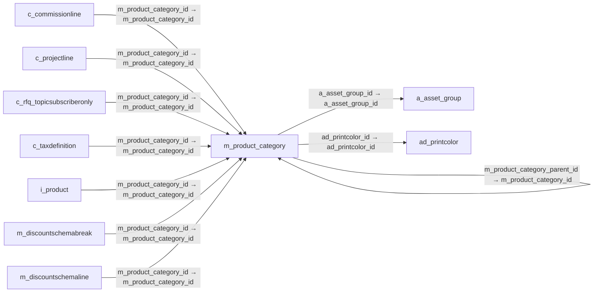

# m_product_category — 제품 분류

[전체 일람](../TABLE_INDEX.md) · [분류 일람](README.md) · [AI 사용 안내](../README.md) · [외래키 읽는 법](../RELATIONSHIPS.md)

## 기본 정보

| 항목 | 내용 |
|---|---|
| 물리명 | `adempiere.m_product_category` |
| 한국어 논리명(문서용 해석) | 제품 분류 |
| 원본 논리명 | Product Category |
| 원본 사전 ID | 209 |
| 분류 | `m` — 제품·재고·출하/입고·원가 |
| 전체 테넌트 행 수 | 14 |
| 물리 열 수 | 19 |
| 나가는 FK / 들어오는 FK | 3 / 16 |
| 구조·행 수 확인 시점 | 2026-11-03T23:29:01+09:00 |

## 의미와 쓰임

제품을 묶어 관리하는 분류를 정의한다.

- 설명 근거: 원본 애플리케이션 사전 명칭·설명을 한국어로 해석.
- 한국어 이름과 개요는 문서용 해석입니다. 공식 한국어 번역으로 간주하지 않습니다.
- 원본 설명: Category of a Product
- 원본 도움말: —
- PostgreSQL 테이블 주석: —

## 키와 열

### 기본키·고유 제약조건

| 종류 | 제약조건 | 열(순서 유지) |
|---|---|---|
| PRIMARY KEY | `m_product_category_pkey` | `m_product_category_id` |
| UNIQUE | `m_product_category_uu_idx` | `m_product_category_uu` |

### 별도 고유 인덱스

PK·UNIQUE 제약조건의 인덱스와 별도로 존재하는 고유 인덱스입니다. 식·조건·열 순서는 원본 정의를 따릅니다.

- `m_product_category_value`: `CREATE UNIQUE INDEX m_product_category_value ON adempiere.m_product_category USING btree (ad_client_id, value)`

### 열 목록

원본 논리명·설명은 `AD_Column`에서 가져왔습니다. 기본값은 실제 PostgreSQL 메타데이터이며, 비어 있는 항목은 `—`로 표시합니다.

| 순서 | 물리명 | 원본 논리명 | PostgreSQL 타입 | NULL | PK | 기본값 | 설명 |
|---:|---|---|---|---|---|---|---|
| 1 | `m_product_category_id` | Product Category | numeric(10,0) | 불가 | 예 | — | Category of a Product |
| 2 | `ad_client_id` | Tenant | numeric(10,0) | 불가 | — | — | Tenant for this installation. |
| 3 | `ad_org_id` | Organization | numeric(10,0) | 불가 | — | — | Organizational entity within tenant |
| 4 | `isactive` | Active | character(1) | 불가 | — | 'Y'::bpchar | The record is active in the system |
| 5 | `created` | Created | timestamp without time zone | 불가 | — | now() | Date this record was created |
| 6 | `createdby` | Created By | numeric(10,0) | 불가 | — | — | User who created this records |
| 7 | `updated` | Updated | timestamp without time zone | 불가 | — | now() | Date this record was updated |
| 8 | `updatedby` | Updated By | numeric(10,0) | 불가 | — | — | User who updated this records |
| 9 | `value` | Search Key | character varying(40) | 불가 | — | — | Search key for the record in the format required - must be unique |
| 10 | `name` | Name | character varying(60) | 불가 | — | — | Alphanumeric identifier of the entity |
| 11 | `description` | Description | character varying(255) | 허용 | — | — | Optional short description of the record |
| 12 | `isdefault` | Default | character(1) | 불가 | — | 'N'::bpchar | Default value |
| 13 | `plannedmargin` | Planned Margin % | numeric | 불가 | — | — | Project's planned margin as a percentage |
| 14 | `a_asset_group_id` | Asset Group | numeric(10,0) | 허용 | — | — | Group of Assets |
| 15 | `isselfservice` | Self-Service | character(1) | 불가 | — | 'Y'::bpchar | This is a Self-Service entry or this entry can be changed via Self-Service |
| 16 | `ad_printcolor_id` | Print Color | numeric(10,0) | 허용 | — | — | Color used for printing and display |
| 17 | `mmpolicy` | Material Policy | character(1) | 불가 | — | 'F'::bpchar | Material Movement Policy |
| 18 | `m_product_category_parent_id` | Parent Product Category | numeric(10,0) | 허용 | — | — | — |
| 19 | `m_product_category_uu` | M_Product_Category_UU | uuid | 허용 | — | — | — |

## 외래키 흐름

화살표는 **FK를 가진 자식 → 참조되는 부모**입니다. 업무 처리의 시간 순서나 무조건적인 1:N 관계를 뜻하지 않습니다.

주변 관계 18개 중 10개를 그림으로 표시합니다. **전체 관계는 아래 두 표에 모두 포함**합니다.

### 이 테이블이 참조하는 부모 — 나가는 FK

| 제약조건 | 참조하는 쪽(자식) | 자식 열 | 참조받는 쪽(부모) | 부모 열 | 삭제 / 갱신 | 검증 / 지연 가능 |
|---|---|---|---|---|---|---|
| `aassetgroup_mproductcategory` <!-- FK_OUT: adempiere.m_product_category.aassetgroup_mproductcategory --> | [`m_product_category`](m_product_category.md) | `a_asset_group_id` | [`a_asset_group`](../a/a_asset_group.md) | `a_asset_group_id` | NO ACTION / NO ACTION | 완료 / 가능 (초기 지연) |
| `adprintcolor_mproductcategory` <!-- FK_OUT: adempiere.m_product_category.adprintcolor_mproductcategory --> | [`m_product_category`](m_product_category.md) | `ad_printcolor_id` | [`ad_printcolor`](../ad/ad_printcolor.md) | `ad_printcolor_id` | NO ACTION / NO ACTION | 완료 / 가능 (초기 지연) |
| `mproductcat_parentcat` <!-- FK_OUT: adempiere.m_product_category.mproductcat_parentcat --> | [`m_product_category`](m_product_category.md) | `m_product_category_parent_id` | [`m_product_category`](m_product_category.md) | `m_product_category_id` | NO ACTION / NO ACTION | 완료 / 가능 (초기 지연) |

### 이 테이블을 참조하는 자식 — 들어오는 FK

| 제약조건 | 참조하는 쪽(자식) | 자식 열 | 참조받는 쪽(부모) | 부모 열 | 삭제 / 갱신 | 검증 / 지연 가능 |
|---|---|---|---|---|---|---|
| `mproductcat_ccommissionline` <!-- FK_IN: adempiere.c_commissionline.mproductcat_ccommissionline --> | [`c_commissionline`](../c/c_commissionline.md) | `m_product_category_id` | [`m_product_category`](m_product_category.md) | `m_product_category_id` | NO ACTION / NO ACTION | 완료 / 가능 (초기 지연) |
| `mproductcat_cprojectline` <!-- FK_IN: adempiere.c_projectline.mproductcat_cprojectline --> | [`c_projectline`](../c/c_projectline.md) | `m_product_category_id` | [`m_product_category`](m_product_category.md) | `m_product_category_id` | NO ACTION / NO ACTION | 완료 / 가능 (초기 지연) |
| `mprodcategory_crfqtsubonly` <!-- FK_IN: adempiere.c_rfq_topicsubscriberonly.mprodcategory_crfqtsubonly --> | [`c_rfq_topicsubscriberonly`](../c/c_rfq_topicsubscriberonly.md) | `m_product_category_id` | [`m_product_category`](m_product_category.md) | `m_product_category_id` | NO ACTION / NO ACTION | 완료 / 가능 (초기 지연) |
| `mproductcategory_ctaxdefinitio` <!-- FK_IN: adempiere.c_taxdefinition.mproductcategory_ctaxdefinitio --> | [`c_taxdefinition`](../c/c_taxdefinition.md) | `m_product_category_id` | [`m_product_category`](m_product_category.md) | `m_product_category_id` | NO ACTION / NO ACTION | 완료 / 가능 (초기 지연) |
| `mproductcategory_iproduct` <!-- FK_IN: adempiere.i_product.mproductcategory_iproduct --> | [`i_product`](../i/i_product.md) | `m_product_category_id` | [`m_product_category`](m_product_category.md) | `m_product_category_id` | SET NULL / NO ACTION | 완료 / 가능 (초기 지연) |
| `mprodcategory_mdiscountsbreak` <!-- FK_IN: adempiere.m_discountschemabreak.mprodcategory_mdiscountsbreak --> | [`m_discountschemabreak`](m_discountschemabreak.md) | `m_product_category_id` | [`m_product_category`](m_product_category.md) | `m_product_category_id` | NO ACTION / NO ACTION | 완료 / 가능 (초기 지연) |
| `mprodcategory_mdiscountsline` <!-- FK_IN: adempiere.m_discountschemaline.mprodcategory_mdiscountsline --> | [`m_discountschemaline`](m_discountschemaline.md) | `m_product_category_id` | [`m_product_category`](m_product_category.md) | `m_product_category_id` | NO ACTION / NO ACTION | 완료 / 가능 (초기 지연) |
| `mprodcategory_mperpetualinv` <!-- FK_IN: adempiere.m_perpetualinv.mprodcategory_mperpetualinv --> | [`m_perpetualinv`](m_perpetualinv.md) | `m_product_category_id` | [`m_product_category`](m_product_category.md) | `m_product_category_id` | NO ACTION / NO ACTION | 완료 / 가능 (초기 지연) |
| `mproduct_mproductcategory` <!-- FK_IN: adempiere.m_product.mproduct_mproductcategory --> | [`m_product`](m_product.md) | `m_product_category_id` | [`m_product_category`](m_product_category.md) | `m_product_category_id` | NO ACTION / NO ACTION | 완료 / 가능 (초기 지연) |
| `mproductcat_parentcat` <!-- FK_IN: adempiere.m_product_category.mproductcat_parentcat --> | [`m_product_category`](m_product_category.md) | `m_product_category_parent_id` | [`m_product_category`](m_product_category.md) | `m_product_category_id` | NO ACTION / NO ACTION | 완료 / 가능 (초기 지연) |
| `mprodcat_mprodcatacct` <!-- FK_IN: adempiere.m_product_category_acct.mprodcat_mprodcatacct --> | [`m_product_category_acct`](m_product_category_acct.md) | `m_product_category_id` | [`m_product_category`](m_product_category.md) | `m_product_category_id` | CASCADE / NO ACTION | 완료 / 가능 (초기 지연) |
| `mproductcategory_mproductcateg` <!-- FK_IN: adempiere.m_product_category_trl.mproductcategory_mproductcateg --> | [`m_product_category_trl`](m_product_category_trl.md) | `m_product_category_id` | [`m_product_category`](m_product_category.md) | `m_product_category_id` | CASCADE / NO ACTION | 완료 / 가능 (초기 지연) |
| `mproductcat_pagoalrestriction` <!-- FK_IN: adempiere.pa_goalrestriction.mproductcat_pagoalrestriction --> | [`pa_goalrestriction`](../pa/pa_goalrestriction.md) | `m_product_category_id` | [`m_product_category`](m_product_category.md) | `m_product_category_id` | NO ACTION / NO ACTION | 완료 / 가능 (초기 지연) |
| `mproductcategory_sexpensetype` <!-- FK_IN: adempiere.s_expensetype.mproductcategory_sexpensetype --> | [`s_expensetype`](../s/s_expensetype.md) | `m_product_category_id` | [`m_product_category`](m_product_category.md) | `m_product_category_id` | NO ACTION / NO ACTION | 완료 / 가능 (초기 지연) |
| `mprodcategory_sresourcetype` <!-- FK_IN: adempiere.s_resourcetype.mprodcategory_sresourcetype --> | [`s_resourcetype`](../s/s_resourcetype.md) | `m_product_category_id` | [`m_product_category`](m_product_category.md) | `m_product_category_id` | NO ACTION / NO ACTION | 완료 / 가능 (초기 지연) |
| `mproductcategory_straining` <!-- FK_IN: adempiere.s_training.mproductcategory_straining --> | [`s_training`](../s/s_training.md) | `m_product_category_id` | [`m_product_category`](m_product_category.md) | `m_product_category_id` | NO ACTION / NO ACTION | 완료 / 가능 (초기 지연) |

## 조회 시 주의

- FK 표의 자식 열과 부모 열을 같은 순서로 대응시킵니다. 복합 FK는 모든 열의 동등 조건을 `AND`로 연결합니다.
- 테이블 이름이나 `_id` 열 이름만으로 물리 FK가 있다고 가정하지 않습니다. FK 미선언은 업무 관계가 없다는 뜻도 아닙니다.
- 자식이 여러 행인 테이블과 조인하면 부모의 금액·건수가 중복될 수 있습니다. 집계 단위를 먼저 정합니다.
- `ad_client_id`가 있습니다. 업무 분석에서는 대상 테넌트를 명시합니다. GardenWorld는 `11`, 시스템 공통 설정은 `0`일 수 있으므로 일괄 필터 적용 전에 테이블 역할을 확인합니다.
- 행 수는 위 확인 시점의 전체 테넌트 값입니다. 최신 업무 실적이나 현재 실행 결과로 재사용하지 않습니다.
