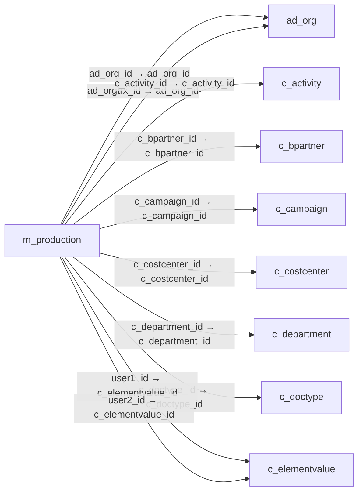

# m_production — 생산 문서

[전체 일람](../TABLE_INDEX.md) · [분류 일람](README.md) · [AI 사용 안내](../README.md) · [외래키 읽는 법](../RELATIONSHIPS.md)

## 기본 정보

| 항목 | 내용 |
|---|---|
| 물리명 | `adempiere.m_production` |
| 한국어 논리명(문서용 해석) | 생산 문서 |
| 원본 논리명 | Production |
| 원본 사전 ID | 325 |
| 분류 | `m` — 제품·재고·출하/입고·원가 |
| 전체 테넌트 행 수 | 0 |
| 물리 열 수 | 43 |
| 나가는 FK / 들어오는 FK | 19 / 4 |
| 구조·행 수 확인 시점 | 2026-11-03T23:29:01+09:00 |

## 의미와 쓰임

제품 생산 계획을 나타내는 생산 문서의 기본 정보를 저장한다.

- 설명 근거: 원본 애플리케이션 사전 명칭·설명을 한국어로 해석.
- 한국어 이름과 개요는 문서용 해석입니다. 공식 한국어 번역으로 간주하지 않습니다.
- 원본 설명: Plan for producing a product
- 원본 도움말: —
- PostgreSQL 테이블 주석: —

## 키와 열

### 기본키·고유 제약조건

| 종류 | 제약조건 | 열(순서 유지) |
|---|---|---|
| PRIMARY KEY | `m_production_pkey` | `m_production_id` |
| UNIQUE | `m_production_uu_idx` | `m_production_uu` |

### 열 목록

원본 논리명·설명은 `AD_Column`에서 가져왔습니다. 기본값은 실제 PostgreSQL 메타데이터이며, 비어 있는 항목은 `—`로 표시합니다.

| 순서 | 물리명 | 원본 논리명 | PostgreSQL 타입 | NULL | PK | 기본값 | 설명 |
|---:|---|---|---|---|---|---|---|
| 1 | `m_production_id` | Production | numeric(10,0) | 불가 | 예 | — | Plan for producing a product |
| 2 | `ad_client_id` | Tenant | numeric(10,0) | 불가 | — | — | Tenant for this installation. |
| 3 | `ad_org_id` | Organization | numeric(10,0) | 불가 | — | — | Organizational entity within tenant |
| 4 | `isactive` | Active | character(1) | 불가 | — | 'Y'::bpchar | The record is active in the system |
| 5 | `created` | Created | timestamp without time zone | 불가 | — | now() | Date this record was created |
| 6 | `createdby` | Created By | numeric(10,0) | 불가 | — | — | User who created this records |
| 7 | `updated` | Updated | timestamp without time zone | 불가 | — | now() | Date this record was updated |
| 8 | `updatedby` | Updated By | numeric(10,0) | 불가 | — | — | User who updated this records |
| 9 | `name` | Name | character varying(60) | 허용 | — | — | Alphanumeric identifier of the entity |
| 10 | `description` | Description | character varying(255) | 허용 | — | — | Optional short description of the record |
| 11 | `movementdate` | Movement Date | timestamp without time zone | 불가 | — | — | Date a product was moved in or out of inventory |
| 12 | `iscreated` | Records created | character(1) | 불가 | — | 'N'::bpchar | — |
| 13 | `posted` | Posted | character(1) | 불가 | — | 'N'::bpchar | Posting status |
| 14 | `processed` | Processed | character(1) | 불가 | — | 'N'::bpchar | The document has been processed |
| 15 | `processing` | Process Now | character(1) | 허용 | — | — | — |
| 16 | `ad_orgtrx_id` | Trx Organization | numeric(10,0) | 허용 | — | — | Performing or initiating organization |
| 17 | `c_project_id` | Project | numeric(10,0) | 허용 | — | — | Financial Project |
| 18 | `c_campaign_id` | Campaign | numeric(10,0) | 허용 | — | — | Marketing Campaign |
| 19 | `c_activity_id` | Activity | numeric(10,0) | 허용 | — | — | Business Activity |
| 20 | `user1_id` | User Element List 1 | numeric(10,0) | 허용 | — | — | User defined list element #1 |
| 21 | `user2_id` | User Element List 2 | numeric(10,0) | 허용 | — | — | User defined list element #2 |
| 22 | `processedon` | Processed On | numeric | 허용 | — | — | The date+time (expressed in decimal format) when the document has been processed |
| 23 | `m_production_uu` | M_Production_UU | uuid | 허용 | — | — | — |
| 24 | `documentno` | Document No | character varying(30) | 불가 | — | — | Document sequence number of the document |
| 25 | `m_product_id` | Product | numeric(10,0) | 허용 | — | — | Product, Service, Item |
| 26 | `m_locator_id` | Locator | numeric(10,0) | 허용 | — | — | Warehouse Locator |
| 27 | `productionqty` | Production Quantity | numeric | 불가 | — | 0 | Quantity of products to produce |
| 28 | `datepromised` | Date Promised | timestamp without time zone | 허용 | — | — | Date Order was promised |
| 29 | `iscomplete` | Complete | character(1) | 허용 | — | NULL::bpchar | It is complete |
| 30 | `c_orderline_id` | Sales Order Line | numeric(10,0) | 허용 | — | NULL::numeric | Sales Order Line |
| 31 | `createfrom` | Create lines from | character(1) | 허용 | — | 'N'::bpchar | Process which will generate a new document lines based on an existing document |
| 32 | `c_bpartner_id` | Business Partner | numeric(10,0) | 허용 | — | NULL::numeric | Identifies a Business Partner |
| 33 | `isuseproductionplan` | Use Production Plan | character(1) | 불가 | — | 'N'::bpchar | — |
| 34 | `docaction` | Document Action | character(2) | 불가 | — | 'CO'::bpchar | The targeted status of the document |
| 35 | `docstatus` | Document Status | character varying(2) | 불가 | — | 'DR'::character varying | The current status of the document |
| 36 | `reversal_id` | Reversal ID | numeric(10,0) | 허용 | — | NULL::numeric | ID of document reversal |
| 37 | `c_projectphase_id` | Project Phase | numeric(10,0) | 허용 | — | NULL::numeric | Phase of a Project |
| 38 | `c_projecttask_id` | Project Task | numeric(10,0) | 허용 | — | NULL::numeric | Actual Project Task in a Phase |
| 39 | `pp_product_bom_id` | BOM &amp; Formula | numeric(10,0) | 허용 | — | NULL::numeric | BOM &amp; Formula |
| 40 | `m_inoutline_id` | Shipment/Receipt Line | numeric(10,0) | 허용 | — | NULL::numeric | Line on Shipment or Receipt document |
| 41 | `c_doctype_id` | Document Type | numeric(10,0) | 불가 | — | NULL::numeric | Document type or rules |
| 42 | `c_costcenter_id` | Cost Center | numeric(10,0) | 허용 | — | NULL::numeric | — |
| 43 | `c_department_id` | Department | numeric(10,0) | 허용 | — | NULL::numeric | — |

## 외래키 흐름

화살표는 **FK를 가진 자식 → 참조되는 부모**입니다. 업무 처리의 시간 순서나 무조건적인 1:N 관계를 뜻하지 않습니다.

주변 관계 22개 중 10개를 그림으로 표시합니다. **전체 관계는 아래 두 표에 모두 포함**합니다.

### 이 테이블이 참조하는 부모 — 나가는 FK

| 제약조건 | 참조하는 쪽(자식) | 자식 열 | 참조받는 쪽(부모) | 부모 열 | 삭제 / 갱신 | 검증 / 지연 가능 |
|---|---|---|---|---|---|---|
| `adorg_mproduction` <!-- FK_OUT: adempiere.m_production.adorg_mproduction --> | [`m_production`](m_production.md) | `ad_org_id` | [`ad_org`](../ad/ad_org.md) | `ad_org_id` | NO ACTION / NO ACTION | 완료 / 가능 (초기 지연) |
| `adorgtrx_mproduction` <!-- FK_OUT: adempiere.m_production.adorgtrx_mproduction --> | [`m_production`](m_production.md) | `ad_orgtrx_id` | [`ad_org`](../ad/ad_org.md) | `ad_org_id` | NO ACTION / NO ACTION | 완료 / 가능 (초기 지연) |
| `cactivity_mproduction` <!-- FK_OUT: adempiere.m_production.cactivity_mproduction --> | [`m_production`](m_production.md) | `c_activity_id` | [`c_activity`](../c/c_activity.md) | `c_activity_id` | NO ACTION / NO ACTION | 완료 / 가능 (초기 지연) |
| `cbpartner_mproduction` <!-- FK_OUT: adempiere.m_production.cbpartner_mproduction --> | [`m_production`](m_production.md) | `c_bpartner_id` | [`c_bpartner`](../c/c_bpartner.md) | `c_bpartner_id` | NO ACTION / NO ACTION | 완료 / 가능 (초기 지연) |
| `ccampaign_mproduction` <!-- FK_OUT: adempiere.m_production.ccampaign_mproduction --> | [`m_production`](m_production.md) | `c_campaign_id` | [`c_campaign`](../c/c_campaign.md) | `c_campaign_id` | NO ACTION / NO ACTION | 완료 / 가능 (초기 지연) |
| `ccostcenter_mproduction` <!-- FK_OUT: adempiere.m_production.ccostcenter_mproduction --> | [`m_production`](m_production.md) | `c_costcenter_id` | [`c_costcenter`](../c/c_costcenter.md) | `c_costcenter_id` | NO ACTION / NO ACTION | 완료 / 가능 (초기 지연) |
| `cdepartment_mproduction` <!-- FK_OUT: adempiere.m_production.cdepartment_mproduction --> | [`m_production`](m_production.md) | `c_department_id` | [`c_department`](../c/c_department.md) | `c_department_id` | NO ACTION / NO ACTION | 완료 / 가능 (초기 지연) |
| `cdoctype_mproduction` <!-- FK_OUT: adempiere.m_production.cdoctype_mproduction --> | [`m_production`](m_production.md) | `c_doctype_id` | [`c_doctype`](../c/c_doctype.md) | `c_doctype_id` | NO ACTION / NO ACTION | 완료 / 가능 (초기 지연) |
| `celementvalueuser1_mprod` <!-- FK_OUT: adempiere.m_production.celementvalueuser1_mprod --> | [`m_production`](m_production.md) | `user1_id` | [`c_elementvalue`](../c/c_elementvalue.md) | `c_elementvalue_id` | NO ACTION / NO ACTION | 완료 / 가능 (초기 지연) |
| `celementvalueuser2_mprod` <!-- FK_OUT: adempiere.m_production.celementvalueuser2_mprod --> | [`m_production`](m_production.md) | `user2_id` | [`c_elementvalue`](../c/c_elementvalue.md) | `c_elementvalue_id` | NO ACTION / NO ACTION | 완료 / 가능 (초기 지연) |
| `corderline_mproduction` <!-- FK_OUT: adempiere.m_production.corderline_mproduction --> | [`m_production`](m_production.md) | `c_orderline_id` | [`c_orderline`](../c/c_orderline.md) | `c_orderline_id` | NO ACTION / NO ACTION | 완료 / 가능 (초기 지연) |
| `cproject_mproduction` <!-- FK_OUT: adempiere.m_production.cproject_mproduction --> | [`m_production`](m_production.md) | `c_project_id` | [`c_project`](../c/c_project.md) | `c_project_id` | NO ACTION / NO ACTION | 완료 / 가능 (초기 지연) |
| `cprojectphase_mproduction` <!-- FK_OUT: adempiere.m_production.cprojectphase_mproduction --> | [`m_production`](m_production.md) | `c_projectphase_id` | [`c_projectphase`](../c/c_projectphase.md) | `c_projectphase_id` | NO ACTION / NO ACTION | 완료 / 가능 (초기 지연) |
| `cprojecttask_mproduction` <!-- FK_OUT: adempiere.m_production.cprojecttask_mproduction --> | [`m_production`](m_production.md) | `c_projecttask_id` | [`c_projecttask`](../c/c_projecttask.md) | `c_projecttask_id` | NO ACTION / NO ACTION | 완료 / 가능 (초기 지연) |
| `minoutline_mproduction` <!-- FK_OUT: adempiere.m_production.minoutline_mproduction --> | [`m_production`](m_production.md) | `m_inoutline_id` | [`m_inoutline`](m_inoutline.md) | `m_inoutline_id` | NO ACTION / NO ACTION | 완료 / 가능 (초기 지연) |
| `mlocator_mproduction` <!-- FK_OUT: adempiere.m_production.mlocator_mproduction --> | [`m_production`](m_production.md) | `m_locator_id` | [`m_locator`](m_locator.md) | `m_locator_id` | NO ACTION / NO ACTION | 완료 / 가능 (초기 지연) |
| `mproduct_mproduction` <!-- FK_OUT: adempiere.m_production.mproduct_mproduction --> | [`m_production`](m_production.md) | `m_product_id` | [`m_product`](m_product.md) | `m_product_id` | NO ACTION / NO ACTION | 완료 / 가능 (초기 지연) |
| `ppproductbom_mproduction` <!-- FK_OUT: adempiere.m_production.ppproductbom_mproduction --> | [`m_production`](m_production.md) | `pp_product_bom_id` | [`pp_product_bom`](../pp/pp_product_bom.md) | `pp_product_bom_id` | NO ACTION / NO ACTION | 완료 / 가능 (초기 지연) |
| `reversal_mproduction` <!-- FK_OUT: adempiere.m_production.reversal_mproduction --> | [`m_production`](m_production.md) | `reversal_id` | [`m_production`](m_production.md) | `m_production_id` | NO ACTION / NO ACTION | 완료 / 가능 (초기 지연) |

### 이 테이블을 참조하는 자식 — 들어오는 FK

| 제약조건 | 참조하는 쪽(자식) | 자식 열 | 참조받는 쪽(부모) | 부모 열 | 삭제 / 갱신 | 검증 / 지연 가능 |
|---|---|---|---|---|---|---|
| `mproduction_cprojectline` <!-- FK_IN: adempiere.c_projectline.mproduction_cprojectline --> | [`c_projectline`](../c/c_projectline.md) | `m_production_id` | [`m_production`](m_production.md) | `m_production_id` | NO ACTION / NO ACTION | 완료 / 가능 (초기 지연) |
| `reversal_mproduction` <!-- FK_IN: adempiere.m_production.reversal_mproduction --> | [`m_production`](m_production.md) | `reversal_id` | [`m_production`](m_production.md) | `m_production_id` | NO ACTION / NO ACTION | 완료 / 가능 (초기 지연) |
| `mproduction_mproductionline` <!-- FK_IN: adempiere.m_productionline.mproduction_mproductionline --> | [`m_productionline`](m_productionline.md) | `m_production_id` | [`m_production`](m_production.md) | `m_production_id` | NO ACTION / NO ACTION | 완료 / 가능 (초기 지연) |
| `mproduction_plan` <!-- FK_IN: adempiere.m_productionplan.mproduction_plan --> | [`m_productionplan`](m_productionplan.md) | `m_production_id` | [`m_production`](m_production.md) | `m_production_id` | CASCADE / NO ACTION | 완료 / 가능 (초기 지연) |

## 조회 시 주의

- FK 표의 자식 열과 부모 열을 같은 순서로 대응시킵니다. 복합 FK는 모든 열의 동등 조건을 `AND`로 연결합니다.
- 테이블 이름이나 `_id` 열 이름만으로 물리 FK가 있다고 가정하지 않습니다. FK 미선언은 업무 관계가 없다는 뜻도 아닙니다.
- 자식이 여러 행인 테이블과 조인하면 부모의 금액·건수가 중복될 수 있습니다. 집계 단위를 먼저 정합니다.
- `ad_client_id`가 있습니다. 업무 분석에서는 대상 테넌트를 명시합니다. GardenWorld는 `11`, 시스템 공통 설정은 `0`일 수 있으므로 일괄 필터 적용 전에 테이블 역할을 확인합니다.
- 수집 시점에 0행입니다. 이 표만으로 거래 실적·처리 결과를 계산할 수 없습니다.
- 행 수는 위 확인 시점의 전체 테넌트 값입니다. 최신 업무 실적이나 현재 실행 결과로 재사용하지 않습니다.
