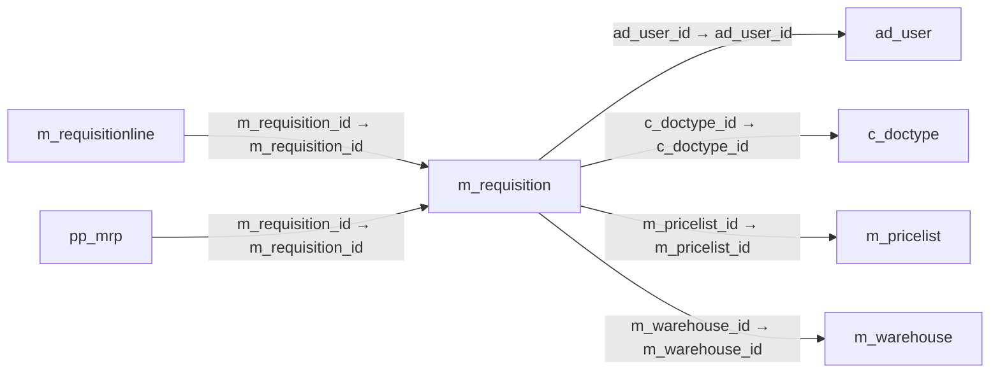

# m_requisition — 자재 요청서

[전체 일람](../TABLE_INDEX.md) · [분류 일람](README.md) · [AI 사용 안내](../README.md) · [외래키 읽는 법](../RELATIONSHIPS.md)

## 기본 정보

| 항목 | 내용 |
|---|---|
| 물리명 | `adempiere.m_requisition` |
| 한국어 논리명(문서용 해석) | 자재 요청서 |
| 원본 논리명 | Requisition |
| 원본 사전 ID | 702 |
| 분류 | `m` — 제품·재고·출하/입고·원가 |
| 전체 테넌트 행 수 | 1 |
| 물리 열 수 | 27 |
| 나가는 FK / 들어오는 FK | 4 / 2 |
| 구조·행 수 확인 시점 | 2026-11-03T23:29:01+09:00 |

## 의미와 쓰임

자재 조달 요청 문서의 기본 정보를 저장한다.

- 설명 근거: 원본 애플리케이션 사전 명칭·설명을 한국어로 해석.
- 한국어 이름과 개요는 문서용 해석입니다. 공식 한국어 번역으로 간주하지 않습니다.
- 원본 설명: Material Requisition
- 원본 도움말: —
- PostgreSQL 테이블 주석: —

## 키와 열

### 기본키·고유 제약조건

| 종류 | 제약조건 | 열(순서 유지) |
|---|---|---|
| PRIMARY KEY | `m_requisition_pkey` | `m_requisition_id` |
| UNIQUE | `m_requisition_uu_idx` | `m_requisition_uu` |

### 열 목록

원본 논리명·설명은 `AD_Column`에서 가져왔습니다. 기본값은 실제 PostgreSQL 메타데이터이며, 비어 있는 항목은 `—`로 표시합니다.

| 순서 | 물리명 | 원본 논리명 | PostgreSQL 타입 | NULL | PK | 기본값 | 설명 |
|---:|---|---|---|---|---|---|---|
| 1 | `m_requisition_id` | Requisition | numeric(10,0) | 불가 | 예 | — | Material Requisition |
| 2 | `ad_client_id` | Tenant | numeric(10,0) | 불가 | — | — | Tenant for this installation. |
| 3 | `ad_org_id` | Organization | numeric(10,0) | 불가 | — | — | Organizational entity within tenant |
| 4 | `isactive` | Active | character(1) | 불가 | — | 'Y'::bpchar | The record is active in the system |
| 5 | `created` | Created | timestamp without time zone | 불가 | — | now() | Date this record was created |
| 6 | `createdby` | Created By | numeric(10,0) | 불가 | — | — | User who created this records |
| 7 | `updated` | Updated | timestamp without time zone | 불가 | — | now() | Date this record was updated |
| 8 | `updatedby` | Updated By | numeric(10,0) | 불가 | — | — | User who updated this records |
| 9 | `documentno` | Document No | character varying(30) | 불가 | — | — | Document sequence number of the document |
| 10 | `description` | Description | character varying(255) | 허용 | — | — | Optional short description of the record |
| 11 | `help` | Comment/Help | character varying(2000) | 허용 | — | — | Comment or Hint |
| 12 | `ad_user_id` | User/Contact | numeric(10,0) | 불가 | — | — | User within the system - Internal or Business Partner Contact |
| 13 | `m_pricelist_id` | Price List | numeric(10,0) | 불가 | — | — | Unique identifier of a Price List |
| 14 | `m_warehouse_id` | Warehouse | numeric(10,0) | 불가 | — | — | Storage Warehouse and Service Point |
| 15 | `isapproved` | Approved | character(1) | 불가 | — | 'Y'::bpchar | Indicates if this document requires approval |
| 16 | `priorityrule` | Priority | character(1) | 불가 | — | — | Priority of a document |
| 17 | `daterequired` | Date Required | timestamp without time zone | 불가 | — | — | Date when required |
| 18 | `totallines` | Total Lines | numeric | 불가 | — | 0 | Total of all document lines |
| 19 | `docaction` | Document Action | character(2) | 불가 | — | — | The targeted status of the document |
| 20 | `docstatus` | Document Status | character(2) | 불가 | — | — | The current status of the document |
| 21 | `processing` | Process Now | character(1) | 허용 | — | — | — |
| 22 | `processed` | Processed | character(1) | 불가 | — | 'N'::bpchar | The document has been processed |
| 23 | `posted` | Posted | character(1) | 불가 | — | 'N'::bpchar | Posting status |
| 24 | `datedoc` | Document Date | timestamp without time zone | 불가 | — | now() | Date of the Document |
| 25 | `c_doctype_id` | Document Type | numeric(10,0) | 불가 | — | — | Document type or rules |
| 26 | `processedon` | Processed On | numeric | 허용 | — | — | The date+time (expressed in decimal format) when the document has been processed |
| 27 | `m_requisition_uu` | M_Requisition_UU | uuid | 허용 | — | — | — |

## 외래키 흐름

화살표는 **FK를 가진 자식 → 참조되는 부모**입니다. 업무 처리의 시간 순서나 무조건적인 1:N 관계를 뜻하지 않습니다.

주변 관계 6개 중 6개를 그림으로 표시합니다. **전체 관계는 아래 두 표에 모두 포함**합니다.

### 이 테이블이 참조하는 부모 — 나가는 FK

| 제약조건 | 참조하는 쪽(자식) | 자식 열 | 참조받는 쪽(부모) | 부모 열 | 삭제 / 갱신 | 검증 / 지연 가능 |
|---|---|---|---|---|---|---|
| `aduser_mrequisition` <!-- FK_OUT: adempiere.m_requisition.aduser_mrequisition --> | [`m_requisition`](m_requisition.md) | `ad_user_id` | [`ad_user`](../ad/ad_user.md) | `ad_user_id` | NO ACTION / NO ACTION | 완료 / 가능 (초기 지연) |
| `cdoctype_mrequisition` <!-- FK_OUT: adempiere.m_requisition.cdoctype_mrequisition --> | [`m_requisition`](m_requisition.md) | `c_doctype_id` | [`c_doctype`](../c/c_doctype.md) | `c_doctype_id` | NO ACTION / NO ACTION | 완료 / 가능 (초기 지연) |
| `mprocelist_mrequisition` <!-- FK_OUT: adempiere.m_requisition.mprocelist_mrequisition --> | [`m_requisition`](m_requisition.md) | `m_pricelist_id` | [`m_pricelist`](m_pricelist.md) | `m_pricelist_id` | NO ACTION / NO ACTION | 완료 / 가능 (초기 지연) |
| `mwarehouse_mrequisition` <!-- FK_OUT: adempiere.m_requisition.mwarehouse_mrequisition --> | [`m_requisition`](m_requisition.md) | `m_warehouse_id` | [`m_warehouse`](m_warehouse.md) | `m_warehouse_id` | NO ACTION / NO ACTION | 완료 / 가능 (초기 지연) |

### 이 테이블을 참조하는 자식 — 들어오는 FK

| 제약조건 | 참조하는 쪽(자식) | 자식 열 | 참조받는 쪽(부모) | 부모 열 | 삭제 / 갱신 | 검증 / 지연 가능 |
|---|---|---|---|---|---|---|
| `mrequisition_mrequisitionline` <!-- FK_IN: adempiere.m_requisitionline.mrequisition_mrequisitionline --> | [`m_requisitionline`](m_requisitionline.md) | `m_requisition_id` | [`m_requisition`](m_requisition.md) | `m_requisition_id` | CASCADE / NO ACTION | 완료 / 가능 (초기 지연) |
| `mrequisition_ppmrp` <!-- FK_IN: adempiere.pp_mrp.mrequisition_ppmrp --> | [`pp_mrp`](../pp/pp_mrp.md) | `m_requisition_id` | [`m_requisition`](m_requisition.md) | `m_requisition_id` | NO ACTION / NO ACTION | 완료 / 가능 (초기 지연) |

## 조회 시 주의

- FK 표의 자식 열과 부모 열을 같은 순서로 대응시킵니다. 복합 FK는 모든 열의 동등 조건을 `AND`로 연결합니다.
- 테이블 이름이나 `_id` 열 이름만으로 물리 FK가 있다고 가정하지 않습니다. FK 미선언은 업무 관계가 없다는 뜻도 아닙니다.
- 자식이 여러 행인 테이블과 조인하면 부모의 금액·건수가 중복될 수 있습니다. 집계 단위를 먼저 정합니다.
- `ad_client_id`가 있습니다. 업무 분석에서는 대상 테넌트를 명시합니다. GardenWorld는 `11`, 시스템 공통 설정은 `0`일 수 있으므로 일괄 필터 적용 전에 테이블 역할을 확인합니다.
- 행 수는 위 확인 시점의 전체 테넌트 값입니다. 최신 업무 실적이나 현재 실행 결과로 재사용하지 않습니다.
