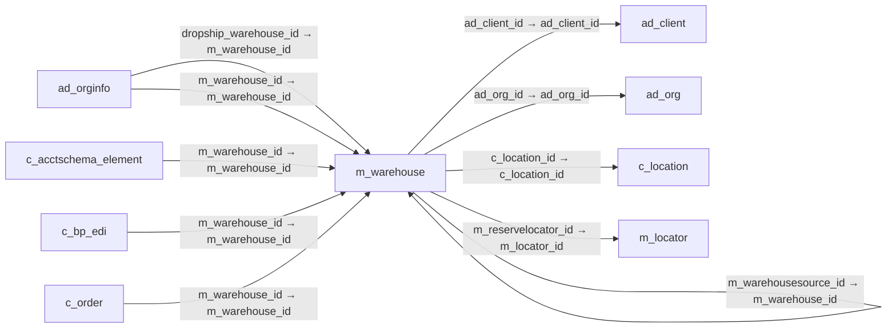

# m_warehouse — 창고·서비스 지점

[전체 일람](../TABLE_INDEX.md) · [분류 일람](README.md) · [AI 사용 안내](../README.md) · [외래키 읽는 법](../RELATIONSHIPS.md)

## 기본 정보

| 항목 | 내용 |
|---|---|
| 물리명 | `adempiere.m_warehouse` |
| 한국어 논리명(문서용 해석) | 창고·서비스 지점 |
| 원본 논리명 | Warehouse |
| 원본 사전 ID | 190 |
| 분류 | `m` — 제품·재고·출하/입고·원가 |
| 전체 테넌트 행 수 | 11 |
| 물리 열 수 | 20 |
| 나가는 FK / 들어오는 FK | 5 / 48 |
| 구조·행 수 확인 시점 | 2026-11-03T23:29:01+09:00 |

## 의미와 쓰임

재고를 보관하는 창고와 서비스 제공 지점을 정의한다.

- 설명 근거: 원본 애플리케이션 사전 명칭·설명을 한국어로 해석.
- 한국어 이름과 개요는 문서용 해석입니다. 공식 한국어 번역으로 간주하지 않습니다.
- 원본 설명: Storage Warehouse and Service Point
- 원본 도움말: —
- PostgreSQL 테이블 주석: —

## 키와 열

### 기본키·고유 제약조건

| 종류 | 제약조건 | 열(순서 유지) |
|---|---|---|
| PRIMARY KEY | `m_warehouse_pkey` | `m_warehouse_id` |
| UNIQUE | `m_warehouse_uu_idx` | `m_warehouse_uu` |

### 별도 고유 인덱스

PK·UNIQUE 제약조건의 인덱스와 별도로 존재하는 고유 인덱스입니다. 식·조건·열 순서는 원본 정의를 따릅니다.

- `m_warehouse_name`: `CREATE UNIQUE INDEX m_warehouse_name ON adempiere.m_warehouse USING btree (ad_client_id, name)`

### 열 목록

원본 논리명·설명은 `AD_Column`에서 가져왔습니다. 기본값은 실제 PostgreSQL 메타데이터이며, 비어 있는 항목은 `—`로 표시합니다.

| 순서 | 물리명 | 원본 논리명 | PostgreSQL 타입 | NULL | PK | 기본값 | 설명 |
|---:|---|---|---|---|---|---|---|
| 1 | `m_warehouse_id` | Warehouse | numeric(10,0) | 불가 | 예 | — | Storage Warehouse and Service Point |
| 2 | `ad_client_id` | Tenant | numeric(10,0) | 불가 | — | — | Tenant for this installation. |
| 3 | `ad_org_id` | Organization | numeric(10,0) | 불가 | — | — | Organizational entity within tenant |
| 4 | `isactive` | Active | character(1) | 불가 | — | 'Y'::bpchar | The record is active in the system |
| 5 | `created` | Created | timestamp without time zone | 불가 | — | now() | Date this record was created |
| 6 | `createdby` | Created By | numeric(10,0) | 불가 | — | — | User who created this records |
| 7 | `updated` | Updated | timestamp without time zone | 불가 | — | now() | Date this record was updated |
| 8 | `updatedby` | Updated By | numeric(10,0) | 불가 | — | — | User who updated this records |
| 9 | `value` | Search Key | character varying(40) | 불가 | — | — | Search key for the record in the format required - must be unique |
| 10 | `name` | Name | character varying(60) | 불가 | — | — | Alphanumeric identifier of the entity |
| 11 | `description` | Description | character varying(255) | 허용 | — | — | Optional short description of the record |
| 12 | `c_location_id` | Address | numeric(10,0) | 불가 | — | — | Location or Address |
| 13 | `separator` | Element Separator | character(1) | 불가 | — | — | Element Separator |
| 14 | `m_warehousesource_id` | Source Warehouse | numeric(10,0) | 허용 | — | — | Optional Warehouse to replenish from |
| 15 | `replenishmentclass` | Replenishment Class | character varying(60) | 허용 | — | — | Custom class to calculate Quantity to Order |
| 16 | `isintransit` | In Transit | character(1) | 허용 | — | 'N'::bpchar | Movement is in transit |
| 17 | `isdisallownegativeinv` | Disallow Negative Inventory | character(1) | 불가 | — | 'N'::bpchar | Negative Inventory is not allowed in this warehouse |
| 18 | `m_warehouse_uu` | M_Warehouse_UU | uuid | 허용 | — | — | — |
| 19 | `m_reservelocator_id` | Reservation Locator | numeric(10,0) | 허용 | — | NULL::numeric | Reservation Locator (just for reporting purposes) |
| 20 | `isdisableinventorypopup` | Disable Insufficient Inventory Popup | character(1) | 불가 | — | 'N'::bpchar | — |

## 외래키 흐름

화살표는 **FK를 가진 자식 → 참조되는 부모**입니다. 업무 처리의 시간 순서나 무조건적인 1:N 관계를 뜻하지 않습니다.

주변 관계 52개 중 10개를 그림으로 표시합니다. **전체 관계는 아래 두 표에 모두 포함**합니다.

### 이 테이블이 참조하는 부모 — 나가는 FK

| 제약조건 | 참조하는 쪽(자식) | 자식 열 | 참조받는 쪽(부모) | 부모 열 | 삭제 / 갱신 | 검증 / 지연 가능 |
|---|---|---|---|---|---|---|
| `c_location_warehouse` <!-- FK_OUT: adempiere.m_warehouse.c_location_warehouse --> | [`m_warehouse`](m_warehouse.md) | `c_location_id` | [`c_location`](../c/c_location.md) | `c_location_id` | NO ACTION / NO ACTION | 완료 / 가능 (초기 지연) |
| `m_warehouse_client` <!-- FK_OUT: adempiere.m_warehouse.m_warehouse_client --> | [`m_warehouse`](m_warehouse.md) | `ad_client_id` | [`ad_client`](../ad/ad_client.md) | `ad_client_id` | NO ACTION / NO ACTION | 완료 / 가능 (초기 지연) |
| `m_warehouse_org` <!-- FK_OUT: adempiere.m_warehouse.m_warehouse_org --> | [`m_warehouse`](m_warehouse.md) | `ad_org_id` | [`ad_org`](../ad/ad_org.md) | `ad_org_id` | NO ACTION / NO ACTION | 완료 / 가능 (초기 지연) |
| `mreservelocator_mwarehouse` <!-- FK_OUT: adempiere.m_warehouse.mreservelocator_mwarehouse --> | [`m_warehouse`](m_warehouse.md) | `m_reservelocator_id` | [`m_locator`](m_locator.md) | `m_locator_id` | NO ACTION / NO ACTION | 완료 / 가능 (초기 지연) |
| `mwarehousesource_mwarehouse` <!-- FK_OUT: adempiere.m_warehouse.mwarehousesource_mwarehouse --> | [`m_warehouse`](m_warehouse.md) | `m_warehousesource_id` | [`m_warehouse`](m_warehouse.md) | `m_warehouse_id` | NO ACTION / NO ACTION | 완료 / 가능 (초기 지연) |

### 이 테이블을 참조하는 자식 — 들어오는 FK

| 제약조건 | 참조하는 쪽(자식) | 자식 열 | 참조받는 쪽(부모) | 부모 열 | 삭제 / 갱신 | 검증 / 지연 가능 |
|---|---|---|---|---|---|---|
| `dropshipwarehouse_adorginfo` <!-- FK_IN: adempiere.ad_orginfo.dropshipwarehouse_adorginfo --> | [`ad_orginfo`](../ad/ad_orginfo.md) | `dropship_warehouse_id` | [`m_warehouse`](m_warehouse.md) | `m_warehouse_id` | NO ACTION / NO ACTION | 완료 / 가능 (초기 지연) |
| `mwarehouse_adorginfo` <!-- FK_IN: adempiere.ad_orginfo.mwarehouse_adorginfo --> | [`ad_orginfo`](../ad/ad_orginfo.md) | `m_warehouse_id` | [`m_warehouse`](m_warehouse.md) | `m_warehouse_id` | NO ACTION / NO ACTION | 완료 / 가능 (초기 지연) |
| `mwarehouse_cacctschemaelement` <!-- FK_IN: adempiere.c_acctschema_element.mwarehouse_cacctschemaelement --> | [`c_acctschema_element`](../c/c_acctschema_element.md) | `m_warehouse_id` | [`m_warehouse`](m_warehouse.md) | `m_warehouse_id` | NO ACTION / NO ACTION | 완료 / 가능 (초기 지연) |
| `mwarehouse_cbpedi` <!-- FK_IN: adempiere.c_bp_edi.mwarehouse_cbpedi --> | [`c_bp_edi`](../c/c_bp_edi.md) | `m_warehouse_id` | [`m_warehouse`](m_warehouse.md) | `m_warehouse_id` | NO ACTION / NO ACTION | 완료 / 가능 (초기 지연) |
| `mwarehouse_corder` <!-- FK_IN: adempiere.c_order.mwarehouse_corder --> | [`c_order`](../c/c_order.md) | `m_warehouse_id` | [`m_warehouse`](m_warehouse.md) | `m_warehouse_id` | NO ACTION / NO ACTION | 완료 / 가능 (초기 지연) |
| `mwarehouse_corderline` <!-- FK_IN: adempiere.c_orderline.mwarehouse_corderline --> | [`c_orderline`](../c/c_orderline.md) | `m_warehouse_id` | [`m_warehouse`](m_warehouse.md) | `m_warehouse_id` | NO ACTION / NO ACTION | 완료 / 가능 (초기 지연) |
| `mwarehouse_cpos` <!-- FK_IN: adempiere.c_pos.mwarehouse_cpos --> | [`c_pos`](../c/c_pos.md) | `m_warehouse_id` | [`m_warehouse`](m_warehouse.md) | `m_warehouse_id` | NO ACTION / NO ACTION | 완료 / 가능 (초기 지연) |
| `mwarehouse_cproject` <!-- FK_IN: adempiere.c_project.mwarehouse_cproject --> | [`c_project`](../c/c_project.md) | `m_warehouse_id` | [`m_warehouse`](m_warehouse.md) | `m_warehouse_id` | NO ACTION / NO ACTION | 완료 / 가능 (초기 지연) |
| `mwarehouse_ddnetworkdistributi` <!-- FK_IN: adempiere.dd_networkdistributionline.mwarehouse_ddnetworkdistributi --> | [`dd_networkdistributionline`](../dd/dd_networkdistributionline.md) | `m_warehouse_id` | [`m_warehouse`](m_warehouse.md) | `m_warehouse_id` | NO ACTION / NO ACTION | 완료 / 가능 (초기 지연) |
| `mwarehousesource_ddnetworkdist` <!-- FK_IN: adempiere.dd_networkdistributionline.mwarehousesource_ddnetworkdist --> | [`dd_networkdistributionline`](../dd/dd_networkdistributionline.md) | `m_warehousesource_id` | [`m_warehouse`](m_warehouse.md) | `m_warehouse_id` | NO ACTION / NO ACTION | 완료 / 가능 (초기 지연) |
| `mwarehouse_ddorder` <!-- FK_IN: adempiere.dd_order.mwarehouse_ddorder --> | [`dd_order`](../dd/dd_order.md) | `m_warehouse_id` | [`m_warehouse`](m_warehouse.md) | `m_warehouse_id` | NO ACTION / NO ACTION | 완료 / 가능 (초기 지연) |
| `mwarehouse_factacct` <!-- FK_IN: adempiere.fact_acct.mwarehouse_factacct --> | [`fact_acct`](../fact/fact_acct.md) | `m_warehouse_id` | [`m_warehouse`](m_warehouse.md) | `m_warehouse_id` | NO ACTION / NO ACTION | 완료 / 가능 (초기 지연) |
| `mwarehouse_factacctsummary` <!-- FK_IN: adempiere.fact_acct_summary.mwarehouse_factacctsummary --> | [`fact_acct_summary`](../fact/fact_acct_summary.md) | `m_warehouse_id` | [`m_warehouse`](m_warehouse.md) | `m_warehouse_id` | NO ACTION / NO ACTION | 완료 / 가능 (초기 지연) |
| `mwarehouse_gldistribution` <!-- FK_IN: adempiere.gl_distribution.mwarehouse_gldistribution --> | [`gl_distribution`](../gl/gl_distribution.md) | `m_warehouse_id` | [`m_warehouse`](m_warehouse.md) | `m_warehouse_id` | NO ACTION / NO ACTION | 완료 / 가능 (초기 지연) |
| `mwarehouse_gldistributionline` <!-- FK_IN: adempiere.gl_distributionline.mwarehouse_gldistributionline --> | [`gl_distributionline`](../gl/gl_distributionline.md) | `m_warehouse_id` | [`m_warehouse`](m_warehouse.md) | `m_warehouse_id` | NO ACTION / NO ACTION | 완료 / 가능 (초기 지연) |
| `mwarehouse_gljournalline` <!-- FK_IN: adempiere.gl_journalline.mwarehouse_gljournalline --> | [`gl_journalline`](../gl/gl_journalline.md) | `m_warehouse_id` | [`m_warehouse`](m_warehouse.md) | `m_warehouse_id` | NO ACTION / NO ACTION | 완료 / 가능 (초기 지연) |
| `mwarehouse_iinventory` <!-- FK_IN: adempiere.i_inventory.mwarehouse_iinventory --> | [`i_inventory`](../i/i_inventory.md) | `m_warehouse_id` | [`m_warehouse`](m_warehouse.md) | `m_warehouse_id` | SET NULL / NO ACTION | 완료 / 가능 (초기 지연) |
| `mwarehouse_iorder` <!-- FK_IN: adempiere.i_order.mwarehouse_iorder --> | [`i_order`](../i/i_order.md) | `m_warehouse_id` | [`m_warehouse`](m_warehouse.md) | `m_warehouse_id` | SET NULL / NO ACTION | 완료 / 가능 (초기 지연) |
| `mwarehouse_iproductplanning` <!-- FK_IN: adempiere.i_productplanning.mwarehouse_iproductplanning --> | [`i_productplanning`](../i/i_productplanning.md) | `m_warehouse_id` | [`m_warehouse`](m_warehouse.md) | `m_warehouse_id` | NO ACTION / NO ACTION | 완료 / 가능 (초기 지연) |
| `mwarehouse_medi` <!-- FK_IN: adempiere.m_edi.mwarehouse_medi --> | [`m_edi`](m_edi.md) | `m_warehouse_id` | [`m_warehouse`](m_warehouse.md) | `m_warehouse_id` | NO ACTION / NO ACTION | 완료 / 가능 (초기 지연) |
| `mwarehouse_mforecastline` <!-- FK_IN: adempiere.m_forecastline.mwarehouse_mforecastline --> | [`m_forecastline`](m_forecastline.md) | `m_warehouse_id` | [`m_warehouse`](m_warehouse.md) | `m_warehouse_id` | NO ACTION / NO ACTION | 완료 / 가능 (초기 지연) |
| `mwarehouse_minout` <!-- FK_IN: adempiere.m_inout.mwarehouse_minout --> | [`m_inout`](m_inout.md) | `m_warehouse_id` | [`m_warehouse`](m_warehouse.md) | `m_warehouse_id` | NO ACTION / NO ACTION | 완료 / 가능 (초기 지연) |
| `mwarehouse_minventory` <!-- FK_IN: adempiere.m_inventory.mwarehouse_minventory --> | [`m_inventory`](m_inventory.md) | `m_warehouse_id` | [`m_warehouse`](m_warehouse.md) | `m_warehouse_id` | NO ACTION / NO ACTION | 완료 / 가능 (초기 지연) |
| `m_warehouse_locator` <!-- FK_IN: adempiere.m_locator.m_warehouse_locator --> | [`m_locator`](m_locator.md) | `m_warehouse_id` | [`m_warehouse`](m_warehouse.md) | `m_warehouse_id` | CASCADE / NO ACTION | 완료 / 가능 (초기 지연) |
| `mwarehouse_mmovement` <!-- FK_IN: adempiere.m_movement.mwarehouse_mmovement --> | [`m_movement`](m_movement.md) | `m_warehouse_id` | [`m_warehouse`](m_warehouse.md) | `m_warehouse_id` | NO ACTION / NO ACTION | 완료 / 가능 (초기 지연) |
| `mwarehouseto_mmovement` <!-- FK_IN: adempiere.m_movement.mwarehouseto_mmovement --> | [`m_movement`](m_movement.md) | `m_warehouseto_id` | [`m_warehouse`](m_warehouse.md) | `m_warehouse_id` | NO ACTION / NO ACTION | 완료 / 가능 (초기 지연) |
| `mwarehouse_mperpetualinv` <!-- FK_IN: adempiere.m_perpetualinv.mwarehouse_mperpetualinv --> | [`m_perpetualinv`](m_perpetualinv.md) | `m_warehouse_id` | [`m_warehouse`](m_warehouse.md) | `m_warehouse_id` | NO ACTION / NO ACTION | 완료 / 가능 (초기 지연) |
| `mwarehouse_mpromotionprecondit` <!-- FK_IN: adempiere.m_promotionprecondition.mwarehouse_mpromotionprecondit --> | [`m_promotionprecondition`](m_promotionprecondition.md) | `m_warehouse_id` | [`m_warehouse`](m_warehouse.md) | `m_warehouse_id` | NO ACTION / NO ACTION | 완료 / 가능 (초기 지연) |
| `m_warehouse_replenish` <!-- FK_IN: adempiere.m_replenish.m_warehouse_replenish --> | [`m_replenish`](m_replenish.md) | `m_warehouse_id` | [`m_warehouse`](m_warehouse.md) | `m_warehouse_id` | CASCADE / NO ACTION | 완료 / 가능 (초기 지연) |
| `mwarehousesource_mreplenish` <!-- FK_IN: adempiere.m_replenish.mwarehousesource_mreplenish --> | [`m_replenish`](m_replenish.md) | `m_warehousesource_id` | [`m_warehouse`](m_warehouse.md) | `m_warehouse_id` | NO ACTION / NO ACTION | 완료 / 가능 (초기 지연) |
| `mwarehouse_mrequisition` <!-- FK_IN: adempiere.m_requisition.mwarehouse_mrequisition --> | [`m_requisition`](m_requisition.md) | `m_warehouse_id` | [`m_warehouse`](m_warehouse.md) | `m_warehouse_id` | NO ACTION / NO ACTION | 완료 / 가능 (초기 지연) |
| `mwarehouse_mshippingtransactio` <!-- FK_IN: adempiere.m_shippingtransaction.mwarehouse_mshippingtransactio --> | [`m_shippingtransaction`](m_shippingtransaction.md) | `m_warehouse_id` | [`m_warehouse`](m_warehouse.md) | `m_warehouse_id` | NO ACTION / NO ACTION | 완료 / 가능 (초기 지연) |
| `mwarehouse_mstoragereservation` <!-- FK_IN: adempiere.m_storagereservation.mwarehouse_mstoragereservation --> | [`m_storagereservation`](m_storagereservation.md) | `m_warehouse_id` | [`m_warehouse`](m_warehouse.md) | `m_warehouse_id` | NO ACTION / NO ACTION | 완료 / 가능 (초기 지연) |
| `mwh_mstoragereservationlog` <!-- FK_IN: adempiere.m_storagereservationlog.mwh_mstoragereservationlog --> | [`m_storagereservationlog`](m_storagereservationlog.md) | `m_warehouse_id` | [`m_warehouse`](m_warehouse.md) | `m_warehouse_id` | NO ACTION / NO ACTION | 완료 / 가능 (초기 지연) |
| `mwarehousesource_mwarehouse` <!-- FK_IN: adempiere.m_warehouse.mwarehousesource_mwarehouse --> | [`m_warehouse`](m_warehouse.md) | `m_warehousesource_id` | [`m_warehouse`](m_warehouse.md) | `m_warehouse_id` | NO ACTION / NO ACTION | 완료 / 가능 (초기 지연) |
| `m_warehouse_warehouse_acct` <!-- FK_IN: adempiere.m_warehouse_acct.m_warehouse_warehouse_acct --> | [`m_warehouse_acct`](m_warehouse_acct.md) | `m_warehouse_id` | [`m_warehouse`](m_warehouse.md) | `m_warehouse_id` | CASCADE / NO ACTION | 완료 / 가능 (초기 지연) |
| `mwarehouse_ppcostcollector` <!-- FK_IN: adempiere.pp_cost_collector.mwarehouse_ppcostcollector --> | [`pp_cost_collector`](../pp/pp_cost_collector.md) | `m_warehouse_id` | [`m_warehouse`](m_warehouse.md) | `m_warehouse_id` | NO ACTION / NO ACTION | 완료 / 가능 (초기 지연) |
| `mwarehouse_ppmrp` <!-- FK_IN: adempiere.pp_mrp.mwarehouse_ppmrp --> | [`pp_mrp`](../pp/pp_mrp.md) | `m_warehouse_id` | [`m_warehouse`](m_warehouse.md) | `m_warehouse_id` | NO ACTION / NO ACTION | 완료 / 가능 (초기 지연) |
| `mwarehouse_pporder` <!-- FK_IN: adempiere.pp_order.mwarehouse_pporder --> | [`pp_order`](../pp/pp_order.md) | `m_warehouse_id` | [`m_warehouse`](m_warehouse.md) | `m_warehouse_id` | NO ACTION / NO ACTION | 완료 / 가능 (초기 지연) |
| `mwarehouse_pporderbomline` <!-- FK_IN: adempiere.pp_order_bomline.mwarehouse_pporderbomline --> | [`pp_order_bomline`](../pp/pp_order_bomline.md) | `m_warehouse_id` | [`m_warehouse`](m_warehouse.md) | `m_warehouse_id` | NO ACTION / NO ACTION | 완료 / 가능 (초기 지연) |
| `mwarehouse_ppproductplanning` <!-- FK_IN: adempiere.pp_product_planning.mwarehouse_ppproductplanning --> | [`pp_product_planning`](../pp/pp_product_planning.md) | `m_warehouse_id` | [`m_warehouse`](m_warehouse.md) | `m_warehouse_id` | NO ACTION / NO ACTION | 완료 / 가능 (초기 지연) |
| `mwarehouse_sresource` <!-- FK_IN: adempiere.s_resource.mwarehouse_sresource --> | [`s_resource`](../s/s_resource.md) | `m_warehouse_id` | [`m_warehouse`](m_warehouse.md) | `m_warehouse_id` | NO ACTION / NO ACTION | 완료 / 가능 (초기 지연) |
| `mwarehouse_stimeexpense` <!-- FK_IN: adempiere.s_timeexpense.mwarehouse_stimeexpense --> | [`s_timeexpense`](../s/s_timeexpense.md) | `m_warehouse_id` | [`m_warehouse`](m_warehouse.md) | `m_warehouse_id` | NO ACTION / NO ACTION | 완료 / 가능 (초기 지연) |
| `mwarehouse_tinventoryvalue` <!-- FK_IN: adempiere.t_inventoryvalue.mwarehouse_tinventoryvalue --> | [`t_inventoryvalue`](../t/t_inventoryvalue.md) | `m_warehouse_id` | [`m_warehouse`](m_warehouse.md) | `m_warehouse_id` | CASCADE / NO ACTION | 완료 / 가능 (초기 지연) |
| `mwarehouse_treplenish` <!-- FK_IN: adempiere.t_replenish.mwarehouse_treplenish --> | [`t_replenish`](../t/t_replenish.md) | `m_warehouse_id` | [`m_warehouse`](m_warehouse.md) | `m_warehouse_id` | CASCADE / NO ACTION | 완료 / 가능 (초기 지연) |
| `mwarehousesource_treplenish` <!-- FK_IN: adempiere.t_replenish.mwarehousesource_treplenish --> | [`t_replenish`](../t/t_replenish.md) | `m_warehousesource_id` | [`m_warehouse`](m_warehouse.md) | `m_warehouse_id` | CASCADE / NO ACTION | 완료 / 가능 (초기 지연) |
| `mwarehouse_uposterminal` <!-- FK_IN: adempiere.u_posterminal.mwarehouse_uposterminal --> | [`u_posterminal`](../u/u_posterminal.md) | `m_warehouse_id` | [`m_warehouse`](m_warehouse.md) | `m_warehouse_id` | NO ACTION / NO ACTION | 완료 / 가능 (초기 지연) |
| `mwarehouse_wstore` <!-- FK_IN: adempiere.w_store.mwarehouse_wstore --> | [`w_store`](../w/w_store.md) | `m_warehouse_id` | [`m_warehouse`](m_warehouse.md) | `m_warehouse_id` | NO ACTION / NO ACTION | 완료 / 가능 (초기 지연) |

## 조회 시 주의

- FK 표의 자식 열과 부모 열을 같은 순서로 대응시킵니다. 복합 FK는 모든 열의 동등 조건을 `AND`로 연결합니다.
- 테이블 이름이나 `_id` 열 이름만으로 물리 FK가 있다고 가정하지 않습니다. FK 미선언은 업무 관계가 없다는 뜻도 아닙니다.
- 자식이 여러 행인 테이블과 조인하면 부모의 금액·건수가 중복될 수 있습니다. 집계 단위를 먼저 정합니다.
- `ad_client_id`가 있습니다. 업무 분석에서는 대상 테넌트를 명시합니다. GardenWorld는 `11`, 시스템 공통 설정은 `0`일 수 있으므로 일괄 필터 적용 전에 테이블 역할을 확인합니다.
- 행 수는 위 확인 시점의 전체 테넌트 값입니다. 최신 업무 실적이나 현재 실행 결과로 재사용하지 않습니다.
