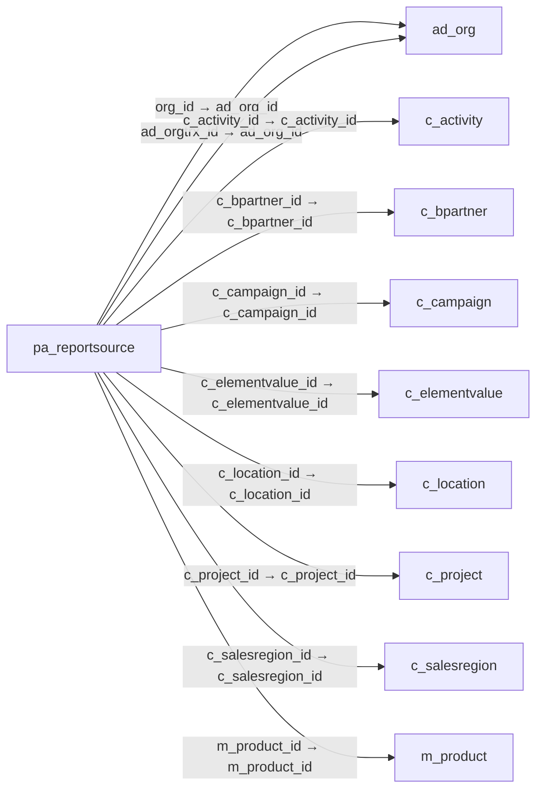

# pa_reportsource — 재무 보고서 자료 조건

[전체 일람](../TABLE_INDEX.md) · [분류 일람](README.md) · [AI 사용 안내](../README.md) · [외래키 읽는 법](../RELATIONSHIPS.md)

## 기본 정보

| 항목 | 내용 |
|---|---|
| 물리명 | `adempiere.pa_reportsource` |
| 한국어 논리명(문서용 해석) | 재무 보고서 자료 조건 |
| 원본 논리명 | Report Source |
| 원본 사전 ID | 450 |
| 분류 | `pa` — 성과·보고서·대시보드 |
| 전체 테넌트 행 수 | 93 |
| 물리 열 수 | 36 |
| 나가는 FK / 들어오는 FK | 11 / 1 |
| 구조·행 수 확인 시점 | 2026-11-03T23:29:01+09:00 |

## 의미와 쓰임

보고서 행에 포함할 자료의 범위를 제한하는 조건을 정의한다.

- 설명 근거: 원본 애플리케이션 사전 명칭·설명을 한국어로 해석.
- 한국어 이름과 개요는 문서용 해석입니다. 공식 한국어 번역으로 간주하지 않습니다.
- 원본 설명: Restriction of what will be shown in Report Line
- 원본 도움말: —
- PostgreSQL 테이블 주석: —

## 키와 열

### 기본키·고유 제약조건

| 종류 | 제약조건 | 열(순서 유지) |
|---|---|---|
| PRIMARY KEY | `pa_reportsource_pkey` | `pa_reportsource_id` |
| UNIQUE | `pa_reportsource_uu_idx` | `pa_reportsource_uu` |

### 열 목록

원본 논리명·설명은 `AD_Column`에서 가져왔습니다. 기본값은 실제 PostgreSQL 메타데이터이며, 비어 있는 항목은 `—`로 표시합니다.

| 순서 | 물리명 | 원본 논리명 | PostgreSQL 타입 | NULL | PK | 기본값 | 설명 |
|---:|---|---|---|---|---|---|---|
| 1 | `pa_reportsource_id` | Report Source | numeric(10,0) | 불가 | 예 | — | Restriction of what will be shown in Report Line |
| 2 | `ad_client_id` | Tenant | numeric(10,0) | 불가 | — | — | Tenant for this installation. |
| 3 | `ad_org_id` | Organization | numeric(10,0) | 불가 | — | — | Organizational entity within tenant |
| 4 | `isactive` | Active | character(1) | 불가 | — | 'Y'::bpchar | The record is active in the system |
| 5 | `created` | Created | timestamp without time zone | 불가 | — | now() | Date this record was created |
| 6 | `createdby` | Created By | numeric(10,0) | 불가 | — | — | User who created this records |
| 7 | `updated` | Updated | timestamp without time zone | 불가 | — | now() | Date this record was updated |
| 8 | `updatedby` | Updated By | numeric(10,0) | 불가 | — | — | User who updated this records |
| 9 | `description` | Description | character varying(255) | 허용 | — | — | Optional short description of the record |
| 10 | `pa_reportline_id` | Report Line | numeric(10,0) | 불가 | — | — | — |
| 11 | `elementtype` | Type | character(2) | 불가 | — | — | Element Type (account or user defined) |
| 12 | `org_id` | Organization | numeric(10,0) | 허용 | — | — | Organizational entity within tenant |
| 13 | `c_elementvalue_id` | Account Element | numeric(10,0) | 허용 | — | — | Account Element |
| 14 | `c_project_id` | Project | numeric(10,0) | 허용 | — | — | Financial Project |
| 15 | `c_bpartner_id` | Business Partner | numeric(10,0) | 허용 | — | — | Identifies a Business Partner |
| 16 | `m_product_id` | Product | numeric(10,0) | 허용 | — | — | Product, Service, Item |
| 17 | `c_campaign_id` | Campaign | numeric(10,0) | 허용 | — | — | Marketing Campaign |
| 18 | `c_location_id` | Address | numeric(10,0) | 허용 | — | — | Location or Address |
| 19 | `c_salesregion_id` | Sales Region | numeric(10,0) | 허용 | — | — | Sales coverage region |
| 20 | `c_activity_id` | Activity | numeric(10,0) | 허용 | — | — | Business Activity |
| 21 | `userelement1_id` | User Column 1 | numeric(10,0) | 허용 | — | — | User defined accounting Element |
| 22 | `userelement2_id` | User Column 2 | numeric(10,0) | 허용 | — | — | User defined accounting Element |
| 23 | `isincludenullsorg` | Include Nulls in Org | character(1) | 불가 | — | 'N'::bpchar | Include nulls in the selection of the organization |
| 24 | `isincludenullselementvalue` | Include Nulls in Account | character(1) | 불가 | — | 'N'::bpchar | Include nulls in the selection of the account |
| 25 | `isincludenullsbpartner` | Include Nulls in BPartner | character(1) | 불가 | — | 'N'::bpchar | Include nulls in the selection of the business partner |
| 26 | `isincludenullsproduct` | Include Nulls in Product | character(1) | 불가 | — | 'N'::bpchar | Include nulls in the selection of the product |
| 27 | `isincludenullslocation` | Include Nulls in Location | character(1) | 불가 | — | 'N'::bpchar | Include nulls in the selection of the location |
| 28 | `isincludenullsproject` | Include Nulls in Project | character(1) | 불가 | — | 'N'::bpchar | Include nulls in the selection of the project |
| 29 | `isincludenullssalesregion` | Include Nulls in Sales Region | character(1) | 불가 | — | 'N'::bpchar | Include nulls in the selection of the sales region |
| 30 | `isincludenullsactivity` | Include Nulls in Activity | character(1) | 불가 | — | 'N'::bpchar | Include nulls in the selection of the activity |
| 31 | `isincludenullscampaign` | Include Nulls in Campaign | character(1) | 불가 | — | 'N'::bpchar | Include nulls in the selection of the campaign |
| 32 | `isincludenullsuserelement1` | Include Nulls in User Element 1 | character(1) | 불가 | — | 'N'::bpchar | Include nulls in the selection of the user element 1 |
| 33 | `isincludenullsuserelement2` | Include Nulls in User Element 2 | character(1) | 불가 | — | 'N'::bpchar | Include nulls in the selection of the user element 2 |
| 34 | `isincludenullsorgtrx` | Include Nulls in Org Trx | character(1) | 불가 | — | 'N'::bpchar | Include nulls in the selection of the organization transaction |
| 35 | `ad_orgtrx_id` | Trx Organization | numeric(10,0) | 허용 | — | — | Performing or initiating organization |
| 36 | `pa_reportsource_uu` | PA_ReportSource_UU | uuid | 허용 | — | — | — |

## 외래키 흐름

화살표는 **FK를 가진 자식 → 참조되는 부모**입니다. 업무 처리의 시간 순서나 무조건적인 1:N 관계를 뜻하지 않습니다.

주변 관계 12개 중 10개를 그림으로 표시합니다. **전체 관계는 아래 두 표에 모두 포함**합니다.

### 이 테이블이 참조하는 부모 — 나가는 FK

| 제약조건 | 참조하는 쪽(자식) | 자식 열 | 참조받는 쪽(부모) | 부모 열 | 삭제 / 갱신 | 검증 / 지연 가능 |
|---|---|---|---|---|---|---|
| `adorg_pareportsource` <!-- FK_OUT: adempiere.pa_reportsource.adorg_pareportsource --> | [`pa_reportsource`](pa_reportsource.md) | `org_id` | [`ad_org`](../ad/ad_org.md) | `ad_org_id` | NO ACTION / NO ACTION | 완료 / 가능 (초기 지연) |
| `adorgtrx_pareportsource` <!-- FK_OUT: adempiere.pa_reportsource.adorgtrx_pareportsource --> | [`pa_reportsource`](pa_reportsource.md) | `ad_orgtrx_id` | [`ad_org`](../ad/ad_org.md) | `ad_org_id` | NO ACTION / NO ACTION | 완료 / 가능 (초기 지연) |
| `cactivity_pareportsource` <!-- FK_OUT: adempiere.pa_reportsource.cactivity_pareportsource --> | [`pa_reportsource`](pa_reportsource.md) | `c_activity_id` | [`c_activity`](../c/c_activity.md) | `c_activity_id` | NO ACTION / NO ACTION | 완료 / 가능 (초기 지연) |
| `cbpartner_pareportsource` <!-- FK_OUT: adempiere.pa_reportsource.cbpartner_pareportsource --> | [`pa_reportsource`](pa_reportsource.md) | `c_bpartner_id` | [`c_bpartner`](../c/c_bpartner.md) | `c_bpartner_id` | NO ACTION / NO ACTION | 완료 / 가능 (초기 지연) |
| `ccampaign_pareportsource` <!-- FK_OUT: adempiere.pa_reportsource.ccampaign_pareportsource --> | [`pa_reportsource`](pa_reportsource.md) | `c_campaign_id` | [`c_campaign`](../c/c_campaign.md) | `c_campaign_id` | NO ACTION / NO ACTION | 완료 / 가능 (초기 지연) |
| `celementvalue_pareportsource` <!-- FK_OUT: adempiere.pa_reportsource.celementvalue_pareportsource --> | [`pa_reportsource`](pa_reportsource.md) | `c_elementvalue_id` | [`c_elementvalue`](../c/c_elementvalue.md) | `c_elementvalue_id` | NO ACTION / NO ACTION | 완료 / 가능 (초기 지연) |
| `clocation_pareportsource` <!-- FK_OUT: adempiere.pa_reportsource.clocation_pareportsource --> | [`pa_reportsource`](pa_reportsource.md) | `c_location_id` | [`c_location`](../c/c_location.md) | `c_location_id` | NO ACTION / NO ACTION | 완료 / 가능 (초기 지연) |
| `cproject_pareportsource` <!-- FK_OUT: adempiere.pa_reportsource.cproject_pareportsource --> | [`pa_reportsource`](pa_reportsource.md) | `c_project_id` | [`c_project`](../c/c_project.md) | `c_project_id` | NO ACTION / NO ACTION | 완료 / 가능 (초기 지연) |
| `csalesregion_pareportsource` <!-- FK_OUT: adempiere.pa_reportsource.csalesregion_pareportsource --> | [`pa_reportsource`](pa_reportsource.md) | `c_salesregion_id` | [`c_salesregion`](../c/c_salesregion.md) | `c_salesregion_id` | NO ACTION / NO ACTION | 완료 / 가능 (초기 지연) |
| `mproduct_pareportsource` <!-- FK_OUT: adempiere.pa_reportsource.mproduct_pareportsource --> | [`pa_reportsource`](pa_reportsource.md) | `m_product_id` | [`m_product`](../m/m_product.md) | `m_product_id` | NO ACTION / NO ACTION | 완료 / 가능 (초기 지연) |
| `pareportline_pareportsource` <!-- FK_OUT: adempiere.pa_reportsource.pareportline_pareportsource --> | [`pa_reportsource`](pa_reportsource.md) | `pa_reportline_id` | [`pa_reportline`](pa_reportline.md) | `pa_reportline_id` | CASCADE / NO ACTION | 완료 / 가능 (초기 지연) |

### 이 테이블을 참조하는 자식 — 들어오는 FK

| 제약조건 | 참조하는 쪽(자식) | 자식 열 | 참조받는 쪽(부모) | 부모 열 | 삭제 / 갱신 | 검증 / 지연 가능 |
|---|---|---|---|---|---|---|
| `pareportsource_ireportline` <!-- FK_IN: adempiere.i_reportline.pareportsource_ireportline --> | [`i_reportline`](../i/i_reportline.md) | `pa_reportsource_id` | [`pa_reportsource`](pa_reportsource.md) | `pa_reportsource_id` | SET NULL / NO ACTION | 완료 / 가능 (초기 지연) |

## 조회 시 주의

- FK 표의 자식 열과 부모 열을 같은 순서로 대응시킵니다. 복합 FK는 모든 열의 동등 조건을 `AND`로 연결합니다.
- 테이블 이름이나 `_id` 열 이름만으로 물리 FK가 있다고 가정하지 않습니다. FK 미선언은 업무 관계가 없다는 뜻도 아닙니다.
- 자식이 여러 행인 테이블과 조인하면 부모의 금액·건수가 중복될 수 있습니다. 집계 단위를 먼저 정합니다.
- `ad_client_id`가 있습니다. 업무 분석에서는 대상 테넌트를 명시합니다. GardenWorld는 `11`, 시스템 공통 설정은 `0`일 수 있으므로 일괄 필터 적용 전에 테이블 역할을 확인합니다.
- 행 수는 위 확인 시점의 전체 테넌트 값입니다. 최신 업무 실적이나 현재 실행 결과로 재사용하지 않습니다.
