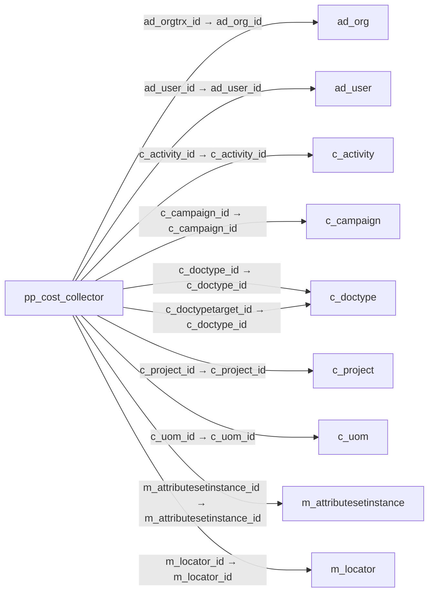

# pp_cost_collector — 제조 원가 수집 문서

[전체 일람](../TABLE_INDEX.md) · [분류 일람](README.md) · [AI 사용 안내](../README.md) · [외래키 읽는 법](../RELATIONSHIPS.md)

## 기본 정보

| 항목 | 내용 |
|---|---|
| 물리명 | `adempiere.pp_cost_collector` |
| 한국어 논리명(문서용 해석) | 제조 원가 수집 문서 |
| 원본 논리명 | Manufacturing Cost Collector |
| 원본 사전 ID | 53035 |
| 분류 | `pp` — 제조·생산 계획·제품 구성 |
| 전체 테넌트 행 수 | 0 |
| 물리 열 수 | 47 |
| 나가는 FK / 들어오는 FK | 20 / 6 |
| 구조·행 수 확인 시점 | 2026-11-03T23:29:01+09:00 |

## 의미와 쓰임

제조 주문·공정·구성품의 실제 수량과 작업 시간을 기록하여 원가 집계에 사용하는 문서다.

- 설명 근거: 물리명·열·외래키 구조를 근거로 보수적으로 해석.
- 한국어 이름과 개요는 문서용 해석입니다. 공식 한국어 번역으로 간주하지 않습니다.
- 원본 설명: —
- 원본 도움말: —
- PostgreSQL 테이블 주석: —

## 키와 열

### 기본키·고유 제약조건

| 종류 | 제약조건 | 열(순서 유지) |
|---|---|---|
| PRIMARY KEY | `pp_cost_collector_key` | `pp_cost_collector_id` |
| UNIQUE | `pp_cost_collector_uu_idx` | `pp_cost_collector_uu` |

### 열 목록

원본 논리명·설명은 `AD_Column`에서 가져왔습니다. 기본값은 실제 PostgreSQL 메타데이터이며, 비어 있는 항목은 `—`로 표시합니다.

| 순서 | 물리명 | 원본 논리명 | PostgreSQL 타입 | NULL | PK | 기본값 | 설명 |
|---:|---|---|---|---|---|---|---|
| 1 | `m_product_id` | Product | numeric(10,0) | 불가 | — | — | Product, Service, Item |
| 2 | `ad_orgtrx_id` | Trx Organization | numeric(10,0) | 허용 | — | — | Performing or initiating organization |
| 3 | `ad_org_id` | Organization | numeric(10,0) | 불가 | — | — | Organizational entity within tenant |
| 4 | `ad_user_id` | User/Contact | numeric(10,0) | 허용 | — | — | User within the system - Internal or Business Partner Contact |
| 5 | `c_activity_id` | Activity | numeric(10,0) | 허용 | — | — | Business Activity |
| 6 | `c_campaign_id` | Campaign | numeric(10,0) | 허용 | — | — | Marketing Campaign |
| 7 | `c_doctypetarget_id` | Target Document Type | numeric(10,0) | 불가 | — | — | Target document type for conversing documents |
| 8 | `c_doctype_id` | Document Type | numeric(10,0) | 불가 | — | — | Document type or rules |
| 9 | `c_project_id` | Project | numeric(10,0) | 허용 | — | — | Financial Project |
| 10 | `c_uom_id` | UOM | numeric(10,0) | 허용 | — | — | Unit of Measure |
| 11 | `created` | Created | timestamp without time zone | 불가 | — | statement_timestamp() | Date this record was created |
| 12 | `createdby` | Created By | numeric(10,0) | 불가 | — | — | User who created this records |
| 13 | `dateacct` | Account Date | timestamp without time zone | 불가 | — | — | Accounting Date |
| 14 | `description` | Description | character varying(255) | 허용 | — | — | Optional short description of the record |
| 15 | `docaction` | Document Action | character(2) | 허용 | — | 'CO'::bpchar | The targeted status of the document |
| 16 | `docstatus` | Document Status | character(2) | 허용 | — | 'DR'::bpchar | The current status of the document |
| 17 | `durationreal` | Duration Real | numeric | 허용 | — | — | — |
| 18 | `isactive` | Active | character(1) | 불가 | — | — | The record is active in the system |
| 19 | `isbatchtime` | Is Batch Time | character(1) | 허용 | — | 'N'::bpchar | — |
| 20 | `m_attributesetinstance_id` | Attribute Set Instance | numeric(10,0) | 허용 | — | — | Product Attribute Set Instance |
| 21 | `m_locator_id` | Locator | numeric(10,0) | 불가 | — | — | Warehouse Locator |
| 22 | `m_warehouse_id` | Warehouse | numeric(10,0) | 불가 | — | — | Storage Warehouse and Service Point |
| 23 | `movementdate` | Movement Date | timestamp without time zone | 불가 | — | — | Date a product was moved in or out of inventory |
| 24 | `movementqty` | Movement Quantity | numeric | 불가 | — | (0)::numeric | Quantity of a product moved. |
| 25 | `pp_cost_collector_id` | Manufacturing Cost Collector | numeric(10,0) | 불가 | 예 | — | — |
| 26 | `pp_order_bomline_id` | Manufacturing Order BOM Line | numeric(10,0) | 허용 | — | — | — |
| 27 | `pp_order_id` | Manufacturing Order | numeric(10,0) | 불가 | — | — | Manufacturing Order |
| 28 | `pp_order_node_id` | Manufacturing Order Activity | numeric(10,0) | 허용 | — | — | Workflow Node (activity), step or process |
| 29 | `pp_order_workflow_id` | Manufacturing Order Workflow | numeric(10,0) | 허용 | — | — | — |
| 30 | `posted` | Posted | character(1) | 불가 | — | — | Posting status |
| 31 | `processed` | Processed | character(1) | 불가 | — | — | The document has been processed |
| 32 | `processing` | Process Now | character(1) | 허용 | — | — | — |
| 33 | `qtyreject` | Qty Reject | numeric | 허용 | — | (0)::numeric | — |
| 34 | `s_resource_id` | Resource | numeric(10,0) | 불가 | — | — | Resource |
| 35 | `scrappedqty` | Scrapped Quantity | numeric | 허용 | — | (0)::numeric | The Quantity scrapped due to QA issues |
| 36 | `setuptimereal` | Setup Time Real | numeric | 허용 | — | (0)::numeric | — |
| 37 | `updated` | Updated | timestamp without time zone | 불가 | — | statement_timestamp() | Date this record was updated |
| 38 | `updatedby` | Updated By | numeric(10,0) | 불가 | — | — | User who updated this records |
| 39 | `user1_id` | User Element List 1 | numeric(10,0) | 허용 | — | — | User defined list element #1 |
| 40 | `ad_client_id` | Tenant | numeric(10,0) | 불가 | — | — | Tenant for this installation. |
| 41 | `user2_id` | User Element List 2 | numeric(10,0) | 허용 | — | — | User defined list element #2 |
| 42 | `reversal_id` | Reversal ID | numeric(10,0) | 허용 | — | — | ID of document reversal |
| 43 | `costcollectortype` | Cost Collector Type | character varying(3) | 불가 | — | — | Transaction Type for Manufacturing Management |
| 44 | `issubcontracting` | Is Subcontracting | character(1) | 허용 | — | — | — |
| 45 | `documentno` | Document No | character varying(30) | 불가 | — | — | Document sequence number of the document |
| 46 | `processedon` | Processed On | numeric | 허용 | — | — | The date+time (expressed in decimal format) when the document has been processed |
| 47 | `pp_cost_collector_uu` | PP_Cost_Collector_UU | uuid | 허용 | — | — | — |

## 외래키 흐름

화살표는 **FK를 가진 자식 → 참조되는 부모**입니다. 업무 처리의 시간 순서나 무조건적인 1:N 관계를 뜻하지 않습니다.

주변 관계 25개 중 10개를 그림으로 표시합니다. **전체 관계는 아래 두 표에 모두 포함**합니다.

### 이 테이블이 참조하는 부모 — 나가는 FK

| 제약조건 | 참조하는 쪽(자식) | 자식 열 | 참조받는 쪽(부모) | 부모 열 | 삭제 / 갱신 | 검증 / 지연 가능 |
|---|---|---|---|---|---|---|
| `adorgtrx_ppcostcollector` <!-- FK_OUT: adempiere.pp_cost_collector.adorgtrx_ppcostcollector --> | [`pp_cost_collector`](pp_cost_collector.md) | `ad_orgtrx_id` | [`ad_org`](../ad/ad_org.md) | `ad_org_id` | NO ACTION / NO ACTION | 완료 / 가능 (초기 지연) |
| `aduser_ppcostcollector` <!-- FK_OUT: adempiere.pp_cost_collector.aduser_ppcostcollector --> | [`pp_cost_collector`](pp_cost_collector.md) | `ad_user_id` | [`ad_user`](../ad/ad_user.md) | `ad_user_id` | NO ACTION / NO ACTION | 완료 / 가능 (초기 지연) |
| `cactivity_ppcostcollector` <!-- FK_OUT: adempiere.pp_cost_collector.cactivity_ppcostcollector --> | [`pp_cost_collector`](pp_cost_collector.md) | `c_activity_id` | [`c_activity`](../c/c_activity.md) | `c_activity_id` | NO ACTION / NO ACTION | 완료 / 가능 (초기 지연) |
| `ccampaign_ppcostcollector` <!-- FK_OUT: adempiere.pp_cost_collector.ccampaign_ppcostcollector --> | [`pp_cost_collector`](pp_cost_collector.md) | `c_campaign_id` | [`c_campaign`](../c/c_campaign.md) | `c_campaign_id` | NO ACTION / NO ACTION | 완료 / 가능 (초기 지연) |
| `cdoctype_ppcostcollector` <!-- FK_OUT: adempiere.pp_cost_collector.cdoctype_ppcostcollector --> | [`pp_cost_collector`](pp_cost_collector.md) | `c_doctype_id` | [`c_doctype`](../c/c_doctype.md) | `c_doctype_id` | NO ACTION / NO ACTION | 완료 / 가능 (초기 지연) |
| `cdoctypetarget_ppcostcollector` <!-- FK_OUT: adempiere.pp_cost_collector.cdoctypetarget_ppcostcollector --> | [`pp_cost_collector`](pp_cost_collector.md) | `c_doctypetarget_id` | [`c_doctype`](../c/c_doctype.md) | `c_doctype_id` | NO ACTION / NO ACTION | 완료 / 가능 (초기 지연) |
| `cproject_ppcostcollector` <!-- FK_OUT: adempiere.pp_cost_collector.cproject_ppcostcollector --> | [`pp_cost_collector`](pp_cost_collector.md) | `c_project_id` | [`c_project`](../c/c_project.md) | `c_project_id` | NO ACTION / NO ACTION | 완료 / 가능 (초기 지연) |
| `cuom_ppcostcollector` <!-- FK_OUT: adempiere.pp_cost_collector.cuom_ppcostcollector --> | [`pp_cost_collector`](pp_cost_collector.md) | `c_uom_id` | [`c_uom`](../c/c_uom.md) | `c_uom_id` | NO ACTION / NO ACTION | 완료 / 가능 (초기 지연) |
| `mattributesetinstance_ppcostco` <!-- FK_OUT: adempiere.pp_cost_collector.mattributesetinstance_ppcostco --> | [`pp_cost_collector`](pp_cost_collector.md) | `m_attributesetinstance_id` | [`m_attributesetinstance`](../m/m_attributesetinstance.md) | `m_attributesetinstance_id` | NO ACTION / NO ACTION | 완료 / 가능 (초기 지연) |
| `mlocator_ppcostcollector` <!-- FK_OUT: adempiere.pp_cost_collector.mlocator_ppcostcollector --> | [`pp_cost_collector`](pp_cost_collector.md) | `m_locator_id` | [`m_locator`](../m/m_locator.md) | `m_locator_id` | NO ACTION / NO ACTION | 완료 / 가능 (초기 지연) |
| `mproduct_ppcostcollector` <!-- FK_OUT: adempiere.pp_cost_collector.mproduct_ppcostcollector --> | [`pp_cost_collector`](pp_cost_collector.md) | `m_product_id` | [`m_product`](../m/m_product.md) | `m_product_id` | NO ACTION / NO ACTION | 완료 / 가능 (초기 지연) |
| `mwarehouse_ppcostcollector` <!-- FK_OUT: adempiere.pp_cost_collector.mwarehouse_ppcostcollector --> | [`pp_cost_collector`](pp_cost_collector.md) | `m_warehouse_id` | [`m_warehouse`](../m/m_warehouse.md) | `m_warehouse_id` | NO ACTION / NO ACTION | 완료 / 가능 (초기 지연) |
| `pporder_ppcostcollector` <!-- FK_OUT: adempiere.pp_cost_collector.pporder_ppcostcollector --> | [`pp_cost_collector`](pp_cost_collector.md) | `pp_order_id` | [`pp_order`](pp_order.md) | `pp_order_id` | NO ACTION / NO ACTION | 완료 / 가능 (초기 지연) |
| `pporderbomline_ppcostcollector` <!-- FK_OUT: adempiere.pp_cost_collector.pporderbomline_ppcostcollector --> | [`pp_cost_collector`](pp_cost_collector.md) | `pp_order_bomline_id` | [`pp_order_bomline`](pp_order_bomline.md) | `pp_order_bomline_id` | NO ACTION / NO ACTION | 완료 / 가능 (초기 지연) |
| `ppordernode_ppcostcollector` <!-- FK_OUT: adempiere.pp_cost_collector.ppordernode_ppcostcollector --> | [`pp_cost_collector`](pp_cost_collector.md) | `pp_order_node_id` | [`pp_order_node`](pp_order_node.md) | `pp_order_node_id` | NO ACTION / NO ACTION | 완료 / 가능 (초기 지연) |
| `pporderworkflow_ppcostcollecto` <!-- FK_OUT: adempiere.pp_cost_collector.pporderworkflow_ppcostcollecto --> | [`pp_cost_collector`](pp_cost_collector.md) | `pp_order_workflow_id` | [`pp_order_workflow`](pp_order_workflow.md) | `pp_order_workflow_id` | NO ACTION / NO ACTION | 완료 / 가능 (초기 지연) |
| `reversal_ppcostcollector` <!-- FK_OUT: adempiere.pp_cost_collector.reversal_ppcostcollector --> | [`pp_cost_collector`](pp_cost_collector.md) | `reversal_id` | [`pp_cost_collector`](pp_cost_collector.md) | `pp_cost_collector_id` | NO ACTION / NO ACTION | 완료 / 가능 (초기 지연) |
| `sresource_ppcostcollector` <!-- FK_OUT: adempiere.pp_cost_collector.sresource_ppcostcollector --> | [`pp_cost_collector`](pp_cost_collector.md) | `s_resource_id` | [`s_resource`](../s/s_resource.md) | `s_resource_id` | NO ACTION / NO ACTION | 완료 / 가능 (초기 지연) |
| `user1_ppcostcollector` <!-- FK_OUT: adempiere.pp_cost_collector.user1_ppcostcollector --> | [`pp_cost_collector`](pp_cost_collector.md) | `user1_id` | [`ad_user`](../ad/ad_user.md) | `ad_user_id` | NO ACTION / NO ACTION | 완료 / 가능 (초기 지연) |
| `user2_ppcostcollector` <!-- FK_OUT: adempiere.pp_cost_collector.user2_ppcostcollector --> | [`pp_cost_collector`](pp_cost_collector.md) | `user2_id` | [`ad_user`](../ad/ad_user.md) | `ad_user_id` | NO ACTION / NO ACTION | 완료 / 가능 (초기 지연) |

### 이 테이블을 참조하는 자식 — 들어오는 FK

| 제약조건 | 참조하는 쪽(자식) | 자식 열 | 참조받는 쪽(부모) | 부모 열 | 삭제 / 갱신 | 검증 / 지연 가능 |
|---|---|---|---|---|---|---|
| `ppcostcollector_corderline` <!-- FK_IN: adempiere.c_orderline.ppcostcollector_corderline --> | [`c_orderline`](../c/c_orderline.md) | `pp_cost_collector_id` | [`pp_cost_collector`](pp_cost_collector.md) | `pp_cost_collector_id` | NO ACTION / NO ACTION | 완료 / 가능 (초기 지연) |
| `ppcostcollector_hrmovement` <!-- FK_IN: adempiere.hr_movement.ppcostcollector_hrmovement --> | [`hr_movement`](../hr/hr_movement.md) | `pp_cost_collector_id` | [`pp_cost_collector`](pp_cost_collector.md) | `pp_cost_collector_id` | NO ACTION / NO ACTION | 완료 / 가능 (초기 지연) |
| `ppcostcollector_mcostdetail` <!-- FK_IN: adempiere.m_costdetail.ppcostcollector_mcostdetail --> | [`m_costdetail`](../m/m_costdetail.md) | `pp_cost_collector_id` | [`pp_cost_collector`](pp_cost_collector.md) | `pp_cost_collector_id` | NO ACTION / NO ACTION | 완료 / 가능 (초기 지연) |
| `ppcostcollector_mtransaction` <!-- FK_IN: adempiere.m_transaction.ppcostcollector_mtransaction --> | [`m_transaction`](../m/m_transaction.md) | `pp_cost_collector_id` | [`pp_cost_collector`](pp_cost_collector.md) | `pp_cost_collector_id` | NO ACTION / NO ACTION | 완료 / 가능 (초기 지연) |
| `reversal_ppcostcollector` <!-- FK_IN: adempiere.pp_cost_collector.reversal_ppcostcollector --> | [`pp_cost_collector`](pp_cost_collector.md) | `reversal_id` | [`pp_cost_collector`](pp_cost_collector.md) | `pp_cost_collector_id` | NO ACTION / NO ACTION | 완료 / 가능 (초기 지연) |
| `ppcostcollector_ppccma` <!-- FK_IN: adempiere.pp_cost_collectorma.ppcostcollector_ppccma --> | [`pp_cost_collectorma`](pp_cost_collectorma.md) | `pp_cost_collector_id` | [`pp_cost_collector`](pp_cost_collector.md) | `pp_cost_collector_id` | NO ACTION / NO ACTION | 완료 / 가능 (초기 지연) |

## 조회 시 주의

- FK 표의 자식 열과 부모 열을 같은 순서로 대응시킵니다. 복합 FK는 모든 열의 동등 조건을 `AND`로 연결합니다.
- 테이블 이름이나 `_id` 열 이름만으로 물리 FK가 있다고 가정하지 않습니다. FK 미선언은 업무 관계가 없다는 뜻도 아닙니다.
- 자식이 여러 행인 테이블과 조인하면 부모의 금액·건수가 중복될 수 있습니다. 집계 단위를 먼저 정합니다.
- `ad_client_id`가 있습니다. 업무 분석에서는 대상 테넌트를 명시합니다. GardenWorld는 `11`, 시스템 공통 설정은 `0`일 수 있으므로 일괄 필터 적용 전에 테이블 역할을 확인합니다.
- 수집 시점에 0행입니다. 이 표만으로 거래 실적·처리 결과를 계산할 수 없습니다.
- 행 수는 위 확인 시점의 전체 테넌트 값입니다. 최신 업무 실적이나 현재 실행 결과로 재사용하지 않습니다.
