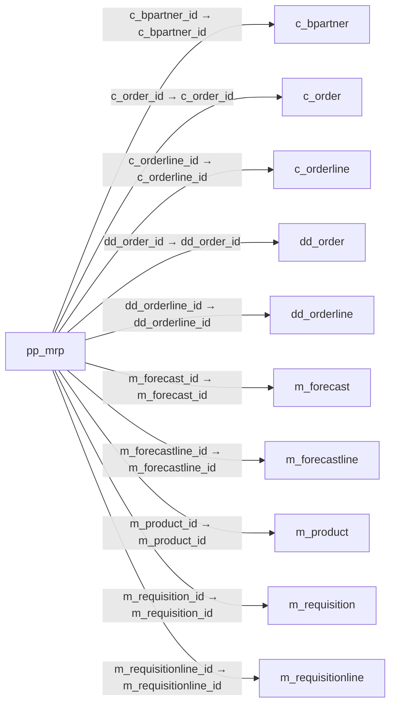

# pp_mrp — 자재 소요 계획

[전체 일람](../TABLE_INDEX.md) · [분류 일람](README.md) · [AI 사용 안내](../README.md) · [외래키 읽는 법](../RELATIONSHIPS.md)

## 기본 정보

| 항목 | 내용 |
|---|---|
| 물리명 | `adempiere.pp_mrp` |
| 한국어 논리명(문서용 해석) | 자재 소요 계획 |
| 원본 논리명 | Material Requirement Planning |
| 원본 사전 ID | 53043 |
| 분류 | `pp` — 제조·생산 계획·제품 구성 |
| 전체 테넌트 행 수 | 56 |
| 물리 열 수 | 41 |
| 나가는 FK / 들어오는 FK | 15 / 0 |
| 구조·행 수 확인 시점 | 2026-11-03T23:29:01+09:00 |

## 의미와 쓰임

자재 소요 계획(MRP)에 사용하는 계획 내역을 저장한다.

- 설명 근거: 원본 애플리케이션 사전 명칭·설명을 한국어로 해석.
- 한국어 이름과 개요는 문서용 해석입니다. 공식 한국어 번역으로 간주하지 않습니다.
- 원본 설명: Material Requirement Planning
- 원본 도움말: —
- PostgreSQL 테이블 주석: —

## 키와 열

### 기본키·고유 제약조건

| 종류 | 제약조건 | 열(순서 유지) |
|---|---|---|
| PRIMARY KEY | `pp_mrp_key` | `pp_mrp_id` |
| UNIQUE | `pp_mrp_uu_idx` | `pp_mrp_uu` |

### 열 목록

원본 논리명·설명은 `AD_Column`에서 가져왔습니다. 기본값은 실제 PostgreSQL 메타데이터이며, 비어 있는 항목은 `—`로 표시합니다.

| 순서 | 물리명 | 원본 논리명 | PostgreSQL 타입 | NULL | PK | 기본값 | 설명 |
|---:|---|---|---|---|---|---|---|
| 1 | `name` | Name | character varying(120) | 허용 | — | — | Alphanumeric identifier of the entity |
| 2 | `ad_org_id` | Organization | numeric(10,0) | 불가 | — | — | Organizational entity within tenant |
| 3 | `c_bpartner_id` | Business Partner | numeric(10,0) | 허용 | — | — | Identifies a Business Partner |
| 4 | `c_orderline_id` | Sales Order Line | numeric(10,0) | 허용 | — | — | Sales Order Line |
| 5 | `c_order_id` | Order | numeric(10,0) | 허용 | — | — | Order |
| 6 | `created` | Created | timestamp without time zone | 불가 | — | statement_timestamp() | Date this record was created |
| 7 | `createdby` | Created By | numeric(10,0) | 불가 | — | — | User who created this records |
| 8 | `dateconfirm` | Date Confirm | timestamp without time zone | 허용 | — | — | Date Confirm of this Order |
| 9 | `datefinishschedule` | Date Finish Schedule | timestamp without time zone | 허용 | — | — | Scheduled Finish date for this Order |
| 10 | `dateordered` | Date Ordered | timestamp without time zone | 불가 | — | — | Date of Order |
| 11 | `datepromised` | Date Promised | timestamp without time zone | 불가 | — | — | Date Order was promised |
| 12 | `datesimulation` | Date Simulation | timestamp without time zone | 허용 | — | — | Simulation date for this Material Plan |
| 13 | `datestart` | Date Start | timestamp without time zone | 허용 | — | — | Date Start for this Order |
| 14 | `datestartschedule` | Date Start Schedule | timestamp without time zone | 허용 | — | — | Scheduled start date for this Order |
| 15 | `description` | Description | character varying(1020) | 허용 | — | — | Optional short description of the record |
| 16 | `docstatus` | Document Status | character varying(2) | 허용 | — | — | The current status of the document |
| 17 | `isactive` | Active | character(1) | 불가 | — | — | The record is active in the system |
| 18 | `isavailable` | Available | character(1) | 허용 | — | — | Resource is available |
| 19 | `m_forecastline_id` | Forecast Line | numeric(10,0) | 허용 | — | — | Forecast Line |
| 20 | `m_forecast_id` | Forecast | numeric(10,0) | 허용 | — | — | Material Forecast |
| 21 | `m_product_id` | Product | numeric(10,0) | 허용 | — | — | Product, Service, Item |
| 22 | `m_requisitionline_id` | Requisition Line | numeric(10,0) | 허용 | — | — | Material Requisition Line |
| 23 | `m_requisition_id` | Requisition | numeric(10,0) | 허용 | — | — | Material Requisition |
| 24 | `m_warehouse_id` | Warehouse | numeric(10,0) | 불가 | — | — | Storage Warehouse and Service Point |
| 25 | `pp_mrp_id` | Material Requirement Planning | numeric(10,0) | 불가 | 예 | — | MRP ID |
| 26 | `pp_order_bomline_id` | Manufacturing Order BOM Line | numeric(10,0) | 허용 | — | — | — |
| 27 | `pp_order_id` | Manufacturing Order | numeric(10,0) | 허용 | — | — | Manufacturing Order |
| 28 | `planner_id` | Planner | numeric(10,0) | 허용 | — | — | — |
| 29 | `priority` | Priority | character varying(10) | 허용 | — | — | Indicates if this request is of a high, medium or low priority. |
| 30 | `qty` | Quantity | numeric | 허용 | — | — | Quantity |
| 31 | `s_resource_id` | Resource | numeric(10,0) | 허용 | — | — | Resource |
| 32 | `ordertype` | Order Type | character varying(3) | 허용 | — | — | Type of Order: MRP records grouped by source (Sales Order, Purchase Order, Distribution Order, Requisition) |
| 33 | `typemrp` | MRP Type | character(1) | 허용 | — | — | MRP Type determines whether a record is demand or supply |
| 34 | `updated` | Updated | timestamp without time zone | 불가 | — | statement_timestamp() | Date this record was updated |
| 35 | `updatedby` | Updated By | numeric(10,0) | 불가 | — | — | User who updated this records |
| 36 | `value` | Search Key | character varying(80) | 불가 | — | — | Search key for the record in the format required - must be unique |
| 37 | `ad_client_id` | Tenant | numeric(10,0) | 불가 | — | — | Tenant for this installation. |
| 38 | `version` | Version | numeric | 허용 | — | — | Version of the table definition |
| 39 | `dd_order_id` | Distribution Order | numeric(10,0) | 허용 | — | — | — |
| 40 | `dd_orderline_id` | Distribution Order Line | numeric(10,0) | 허용 | — | — | — |
| 41 | `pp_mrp_uu` | PP_MRP_UU | uuid | 허용 | — | — | — |

## 외래키 흐름

화살표는 **FK를 가진 자식 → 참조되는 부모**입니다. 업무 처리의 시간 순서나 무조건적인 1:N 관계를 뜻하지 않습니다.

주변 관계 15개 중 10개를 그림으로 표시합니다. **전체 관계는 아래 두 표에 모두 포함**합니다.

### 이 테이블이 참조하는 부모 — 나가는 FK

| 제약조건 | 참조하는 쪽(자식) | 자식 열 | 참조받는 쪽(부모) | 부모 열 | 삭제 / 갱신 | 검증 / 지연 가능 |
|---|---|---|---|---|---|---|
| `cbpartner_ppmrp` <!-- FK_OUT: adempiere.pp_mrp.cbpartner_ppmrp --> | [`pp_mrp`](pp_mrp.md) | `c_bpartner_id` | [`c_bpartner`](../c/c_bpartner.md) | `c_bpartner_id` | NO ACTION / NO ACTION | 완료 / 가능 (초기 지연) |
| `corder_ppmrp` <!-- FK_OUT: adempiere.pp_mrp.corder_ppmrp --> | [`pp_mrp`](pp_mrp.md) | `c_order_id` | [`c_order`](../c/c_order.md) | `c_order_id` | NO ACTION / NO ACTION | 완료 / 가능 (초기 지연) |
| `corderline_ppmrp` <!-- FK_OUT: adempiere.pp_mrp.corderline_ppmrp --> | [`pp_mrp`](pp_mrp.md) | `c_orderline_id` | [`c_orderline`](../c/c_orderline.md) | `c_orderline_id` | NO ACTION / NO ACTION | 완료 / 가능 (초기 지연) |
| `ddorder_ppmrp` <!-- FK_OUT: adempiere.pp_mrp.ddorder_ppmrp --> | [`pp_mrp`](pp_mrp.md) | `dd_order_id` | [`dd_order`](../dd/dd_order.md) | `dd_order_id` | NO ACTION / NO ACTION | 완료 / 가능 (초기 지연) |
| `ddorderline_ppmrp` <!-- FK_OUT: adempiere.pp_mrp.ddorderline_ppmrp --> | [`pp_mrp`](pp_mrp.md) | `dd_orderline_id` | [`dd_orderline`](../dd/dd_orderline.md) | `dd_orderline_id` | NO ACTION / NO ACTION | 완료 / 가능 (초기 지연) |
| `mforecast_ppmrp` <!-- FK_OUT: adempiere.pp_mrp.mforecast_ppmrp --> | [`pp_mrp`](pp_mrp.md) | `m_forecast_id` | [`m_forecast`](../m/m_forecast.md) | `m_forecast_id` | NO ACTION / NO ACTION | 완료 / 가능 (초기 지연) |
| `mforecastline_ppmrp` <!-- FK_OUT: adempiere.pp_mrp.mforecastline_ppmrp --> | [`pp_mrp`](pp_mrp.md) | `m_forecastline_id` | [`m_forecastline`](../m/m_forecastline.md) | `m_forecastline_id` | NO ACTION / NO ACTION | 완료 / 가능 (초기 지연) |
| `mproduct_ppmrp` <!-- FK_OUT: adempiere.pp_mrp.mproduct_ppmrp --> | [`pp_mrp`](pp_mrp.md) | `m_product_id` | [`m_product`](../m/m_product.md) | `m_product_id` | NO ACTION / NO ACTION | 완료 / 가능 (초기 지연) |
| `mrequisition_ppmrp` <!-- FK_OUT: adempiere.pp_mrp.mrequisition_ppmrp --> | [`pp_mrp`](pp_mrp.md) | `m_requisition_id` | [`m_requisition`](../m/m_requisition.md) | `m_requisition_id` | NO ACTION / NO ACTION | 완료 / 가능 (초기 지연) |
| `mrequisitionline_ppmrp` <!-- FK_OUT: adempiere.pp_mrp.mrequisitionline_ppmrp --> | [`pp_mrp`](pp_mrp.md) | `m_requisitionline_id` | [`m_requisitionline`](../m/m_requisitionline.md) | `m_requisitionline_id` | NO ACTION / NO ACTION | 완료 / 가능 (초기 지연) |
| `mwarehouse_ppmrp` <!-- FK_OUT: adempiere.pp_mrp.mwarehouse_ppmrp --> | [`pp_mrp`](pp_mrp.md) | `m_warehouse_id` | [`m_warehouse`](../m/m_warehouse.md) | `m_warehouse_id` | NO ACTION / NO ACTION | 완료 / 가능 (초기 지연) |
| `planner_ppmrp` <!-- FK_OUT: adempiere.pp_mrp.planner_ppmrp --> | [`pp_mrp`](pp_mrp.md) | `planner_id` | [`ad_user`](../ad/ad_user.md) | `ad_user_id` | NO ACTION / NO ACTION | 완료 / 가능 (초기 지연) |
| `pporder_ppmrp` <!-- FK_OUT: adempiere.pp_mrp.pporder_ppmrp --> | [`pp_mrp`](pp_mrp.md) | `pp_order_id` | [`pp_order`](pp_order.md) | `pp_order_id` | NO ACTION / NO ACTION | 완료 / 가능 (초기 지연) |
| `pporderbomline_ppmrp` <!-- FK_OUT: adempiere.pp_mrp.pporderbomline_ppmrp --> | [`pp_mrp`](pp_mrp.md) | `pp_order_bomline_id` | [`pp_order_bomline`](pp_order_bomline.md) | `pp_order_bomline_id` | NO ACTION / NO ACTION | 완료 / 가능 (초기 지연) |
| `sresource_ppmrp` <!-- FK_OUT: adempiere.pp_mrp.sresource_ppmrp --> | [`pp_mrp`](pp_mrp.md) | `s_resource_id` | [`s_resource`](../s/s_resource.md) | `s_resource_id` | NO ACTION / NO ACTION | 완료 / 가능 (초기 지연) |

### 이 테이블을 참조하는 자식 — 들어오는 FK

해당 방향의 물리 FK 제약조건은 없습니다. 이름이 비슷한 열만으로 관계를 추가하지 않습니다.

## 조회 시 주의

- FK 표의 자식 열과 부모 열을 같은 순서로 대응시킵니다. 복합 FK는 모든 열의 동등 조건을 `AND`로 연결합니다.
- 테이블 이름이나 `_id` 열 이름만으로 물리 FK가 있다고 가정하지 않습니다. FK 미선언은 업무 관계가 없다는 뜻도 아닙니다.
- 자식이 여러 행인 테이블과 조인하면 부모의 금액·건수가 중복될 수 있습니다. 집계 단위를 먼저 정합니다.
- `ad_client_id`가 있습니다. 업무 분석에서는 대상 테넌트를 명시합니다. GardenWorld는 `11`, 시스템 공통 설정은 `0`일 수 있으므로 일괄 필터 적용 전에 테이블 역할을 확인합니다.
- 행 수는 위 확인 시점의 전체 테넌트 값입니다. 최신 업무 실적이나 현재 실행 결과로 재사용하지 않습니다.
