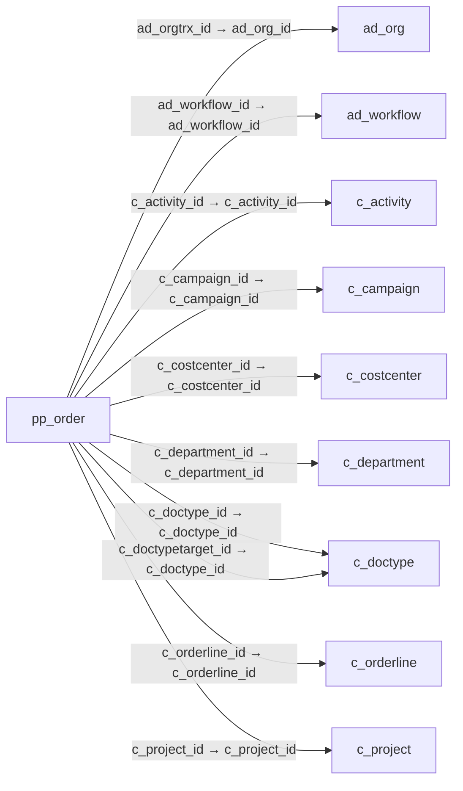

# pp_order — 제조 주문

[전체 일람](../TABLE_INDEX.md) · [분류 일람](README.md) · [AI 사용 안내](../README.md) · [외래키 읽는 법](../RELATIONSHIPS.md)

## 기본 정보

| 항목 | 내용 |
|---|---|
| 물리명 | `adempiere.pp_order` |
| 한국어 논리명(문서용 해석) | 제조 주문 |
| 원본 논리명 | Manufacturing Order |
| 원본 사전 ID | 53027 |
| 분류 | `pp` — 제조·생산 계획·제품 구성 |
| 전체 테넌트 행 수 | 2 |
| 물리 열 수 | 68 |
| 나가는 FK / 들어오는 FK | 19 / 10 |
| 구조·행 수 확인 시점 | 2026-11-03T23:29:01+09:00 |

## 의미와 쓰임

지정된 부품 또는 제품을 정해진 수량으로 제조하도록 지시하는 문서다.

- 설명 근거: 원본 애플리케이션 사전 명칭·설명을 한국어로 해석.
- 한국어 이름과 개요는 문서용 해석입니다. 공식 한국어 번역으로 간주하지 않습니다.
- 원본 설명: Manufacturing Order
- 원본 도움말: Manufacturing Schedule is a document group of documents or schedule identity  conveying authority for the manufacture of specified parts or products in specified quantities.
- PostgreSQL 테이블 주석: —

## 키와 열

### 기본키·고유 제약조건

| 종류 | 제약조건 | 열(순서 유지) |
|---|---|---|
| PRIMARY KEY | `pp_order_key` | `pp_order_id` |
| UNIQUE | `pp_order_uu_idx` | `pp_order_uu` |

### 열 목록

원본 논리명·설명은 `AD_Column`에서 가져왔습니다. 기본값은 실제 PostgreSQL 메타데이터이며, 비어 있는 항목은 `—`로 표시합니다.

| 순서 | 물리명 | 원본 논리명 | PostgreSQL 타입 | NULL | PK | 기본값 | 설명 |
|---:|---|---|---|---|---|---|---|
| 1 | `documentno` | Document No | character varying(60) | 불가 | — | — | Document sequence number of the document |
| 2 | `s_resource_id` | Resource | numeric(10,0) | 불가 | — | — | Resource |
| 3 | `m_product_id` | Product | numeric(10,0) | 불가 | — | — | Product, Service, Item |
| 4 | `m_warehouse_id` | Warehouse | numeric(10,0) | 불가 | — | — | Storage Warehouse and Service Point |
| 5 | `assay` | Quantity Assay | numeric | 허용 | — | (0)::numeric | Indicated the Quantity Assay to use into Quality Order |
| 6 | `c_activity_id` | Activity | numeric(10,0) | 허용 | — | — | Business Activity |
| 7 | `c_campaign_id` | Campaign | numeric(10,0) | 허용 | — | — | Marketing Campaign |
| 8 | `c_doctypetarget_id` | Target Document Type | numeric(10,0) | 불가 | — | (0)::numeric | Target document type for conversing documents |
| 9 | `c_doctype_id` | Document Type | numeric(10,0) | 허용 | — | (0)::numeric | Document type or rules |
| 10 | `c_orderline_id` | Sales Order Line | numeric(10,0) | 허용 | — | — | Sales Order Line |
| 11 | `c_project_id` | Project | numeric(10,0) | 허용 | — | — | Financial Project |
| 12 | `c_uom_id` | UOM | numeric(10,0) | 불가 | — | — | Unit of Measure |
| 13 | `copyfrom` | Copy From | character(1) | 허용 | — | — | Copy From Record |
| 14 | `created` | Created | timestamp without time zone | 불가 | — | statement_timestamp() | Date this record was created |
| 15 | `createdby` | Created By | numeric(10,0) | 불가 | — | — | User who created this records |
| 16 | `dateconfirm` | Date Confirm | timestamp without time zone | 허용 | — | — | Date Confirm of this Order |
| 17 | `datedelivered` | Date Delivered | timestamp without time zone | 허용 | — | — | Date when the product was delivered |
| 18 | `datefinish` | Finish Date | timestamp without time zone | 허용 | — | — | Finish or (planned) completion date |
| 19 | `datefinishschedule` | Date Finish Schedule | timestamp without time zone | 허용 | — | — | Scheduled Finish date for this Order |
| 20 | `dateordered` | Date Ordered | timestamp without time zone | 불가 | — | — | Date of Order |
| 21 | `datepromised` | Date Promised | timestamp without time zone | 불가 | — | — | Date Order was promised |
| 22 | `datestart` | Date Start | timestamp without time zone | 허용 | — | — | Date Start for this Order |
| 23 | `datestartschedule` | Date Start Schedule | timestamp without time zone | 불가 | — | — | Scheduled start date for this Order |
| 24 | `description` | Description | character varying(510) | 허용 | — | — | Optional short description of the record |
| 25 | `docaction` | Document Action | character(2) | 불가 | — | '--'::bpchar | The targeted status of the document |
| 26 | `docstatus` | Document Status | character(2) | 불가 | — | 'DR'::bpchar | The current status of the document |
| 27 | `floatafter` | Float After | numeric | 허용 | — | — | — |
| 28 | `floatbefored` | Float Before | numeric | 허용 | — | — | — |
| 29 | `isactive` | Active | character(1) | 불가 | — | — | The record is active in the system |
| 30 | `isapproved` | Approved | character(1) | 불가 | — | 'N'::bpchar | Indicates if this document requires approval |
| 31 | `isprinted` | Printed | character(1) | 불가 | — | 'N'::bpchar | Indicates if this document / line is printed |
| 32 | `isqtypercentage` | Is Qty Percentage | character(1) | 허용 | — | — | Indicate that this component is based in % Quantity |
| 33 | `issotrx` | Sales Transaction | character(1) | 불가 | — | 'N'::bpchar | This is a Sales Transaction |
| 34 | `isselected` | Selected | character(1) | 불가 | — | 'N'::bpchar | — |
| 35 | `line` | Line No | numeric(10,0) | 불가 | — | — | Unique line for this document |
| 36 | `lot` | Lot No | character varying(20) | 허용 | — | — | Lot number (alphanumeric) |
| 37 | `m_attributesetinstance_id` | Attribute Set Instance | numeric(10,0) | 허용 | — | — | Product Attribute Set Instance |
| 38 | `ordertype` | Order Type | character varying(1) | 허용 | — | — | Type of Order: MRP records grouped by source (Sales Order, Purchase Order, Distribution Order, Requisition) |
| 39 | `pp_order_id` | Manufacturing Order | numeric(10,0) | 불가 | 예 | — | Manufacturing Order |
| 40 | `pp_product_bom_id` | BOM &amp; Formula | numeric(10,0) | 불가 | — | — | BOM &amp; Formula |
| 41 | `planner_id` | Planner | numeric(10,0) | 허용 | — | — | — |
| 42 | `posted` | Posted | character(1) | 허용 | — | — | Posting status |
| 43 | `priorityrule` | Priority | character(1) | 불가 | — | — | Priority of a document |
| 44 | `processed` | Processed | character(1) | 불가 | — | 'N'::bpchar | The document has been processed |
| 45 | `processing` | Process Now | character(1) | 허용 | — | — | — |
| 46 | `qtybatchsize` | Qty Batch Size | numeric | 허용 | — | (0)::numeric | — |
| 47 | `qtybatchs` | Qty Batch | numeric | 허용 | — | (0)::numeric | — |
| 48 | `qtydelivered` | Delivered Quantity | numeric | 불가 | — | (0)::numeric | Delivered Quantity |
| 49 | `qtyentered` | Quantity | numeric | 허용 | — | (1)::numeric | The Quantity Entered is based on the selected UoM |
| 50 | `qtyordered` | Ordered Quantity | numeric | 불가 | — | (1)::numeric | Ordered Quantity |
| 51 | `qtyreject` | Qty Reject | numeric | 불가 | — | (0)::numeric | — |
| 52 | `qtyreserved` | Reserved Quantity | numeric | 허용 | — | — | Reserved Quantity |
| 53 | `qtyscrap` | Scrap % | numeric | 불가 | — | (0)::numeric | Scrap % Quantity for this component |
| 54 | `scheduletype` | Schedule Type | character varying(1) | 허용 | — | 'D'::character varying | Type of schedule |
| 55 | `serno` | Serial No | character varying(20) | 허용 | — | — | Product Serial Number  |
| 56 | `updated` | Updated | timestamp without time zone | 불가 | — | statement_timestamp() | Date this record was updated |
| 57 | `updatedby` | Updated By | numeric(10,0) | 불가 | — | — | User who updated this records |
| 58 | `user1_id` | User Element List 1 | numeric(10,0) | 허용 | — | — | User defined list element #1 |
| 59 | `user2_id` | User Element List 2 | numeric(10,0) | 허용 | — | — | User defined list element #2 |
| 60 | `ad_client_id` | Tenant | numeric(10,0) | 불가 | — | — | Tenant for this installation. |
| 61 | `yield` | Yield % | numeric | 불가 | — | (100)::numeric | The Yield is the percentage of a lot that is expected to be of acceptable wuality may fall below 100 percent |
| 62 | `ad_orgtrx_id` | Trx Organization | numeric(10,0) | 허용 | — | — | Performing or initiating organization |
| 63 | `ad_org_id` | Organization | numeric(10,0) | 불가 | — | — | Organizational entity within tenant |
| 64 | `ad_workflow_id` | Workflow | numeric(10,0) | 불가 | — | — | Workflow or combination of tasks |
| 65 | `processedon` | Processed On | numeric | 허용 | — | — | The date+time (expressed in decimal format) when the document has been processed |
| 66 | `pp_order_uu` | PP_Order_UU | uuid | 허용 | — | — | — |
| 67 | `c_costcenter_id` | Cost Center | numeric(10,0) | 허용 | — | NULL::numeric | — |
| 68 | `c_department_id` | Department | numeric(10,0) | 허용 | — | NULL::numeric | — |

## 외래키 흐름

화살표는 **FK를 가진 자식 → 참조되는 부모**입니다. 업무 처리의 시간 순서나 무조건적인 1:N 관계를 뜻하지 않습니다.

주변 관계 29개 중 10개를 그림으로 표시합니다. **전체 관계는 아래 두 표에 모두 포함**합니다.

### 이 테이블이 참조하는 부모 — 나가는 FK

| 제약조건 | 참조하는 쪽(자식) | 자식 열 | 참조받는 쪽(부모) | 부모 열 | 삭제 / 갱신 | 검증 / 지연 가능 |
|---|---|---|---|---|---|---|
| `adorgtrx_pporder` <!-- FK_OUT: adempiere.pp_order.adorgtrx_pporder --> | [`pp_order`](pp_order.md) | `ad_orgtrx_id` | [`ad_org`](../ad/ad_org.md) | `ad_org_id` | NO ACTION / NO ACTION | 완료 / 가능 (초기 지연) |
| `adworkflow_pporder` <!-- FK_OUT: adempiere.pp_order.adworkflow_pporder --> | [`pp_order`](pp_order.md) | `ad_workflow_id` | [`ad_workflow`](../ad/ad_workflow.md) | `ad_workflow_id` | NO ACTION / NO ACTION | 완료 / 가능 (초기 지연) |
| `cactivity_pporder` <!-- FK_OUT: adempiere.pp_order.cactivity_pporder --> | [`pp_order`](pp_order.md) | `c_activity_id` | [`c_activity`](../c/c_activity.md) | `c_activity_id` | NO ACTION / NO ACTION | 완료 / 가능 (초기 지연) |
| `ccampaign_pporder` <!-- FK_OUT: adempiere.pp_order.ccampaign_pporder --> | [`pp_order`](pp_order.md) | `c_campaign_id` | [`c_campaign`](../c/c_campaign.md) | `c_campaign_id` | NO ACTION / NO ACTION | 완료 / 가능 (초기 지연) |
| `ccostcenter_pporder` <!-- FK_OUT: adempiere.pp_order.ccostcenter_pporder --> | [`pp_order`](pp_order.md) | `c_costcenter_id` | [`c_costcenter`](../c/c_costcenter.md) | `c_costcenter_id` | NO ACTION / NO ACTION | 완료 / 가능 (초기 지연) |
| `cdepartment_pporder` <!-- FK_OUT: adempiere.pp_order.cdepartment_pporder --> | [`pp_order`](pp_order.md) | `c_department_id` | [`c_department`](../c/c_department.md) | `c_department_id` | NO ACTION / NO ACTION | 완료 / 가능 (초기 지연) |
| `cdoctype_pporder` <!-- FK_OUT: adempiere.pp_order.cdoctype_pporder --> | [`pp_order`](pp_order.md) | `c_doctype_id` | [`c_doctype`](../c/c_doctype.md) | `c_doctype_id` | NO ACTION / NO ACTION | 완료 / 가능 (초기 지연) |
| `cdoctypetarget_pporder` <!-- FK_OUT: adempiere.pp_order.cdoctypetarget_pporder --> | [`pp_order`](pp_order.md) | `c_doctypetarget_id` | [`c_doctype`](../c/c_doctype.md) | `c_doctype_id` | NO ACTION / NO ACTION | 완료 / 가능 (초기 지연) |
| `corderline_pporder` <!-- FK_OUT: adempiere.pp_order.corderline_pporder --> | [`pp_order`](pp_order.md) | `c_orderline_id` | [`c_orderline`](../c/c_orderline.md) | `c_orderline_id` | NO ACTION / NO ACTION | 완료 / 가능 (초기 지연) |
| `cproject_pporder` <!-- FK_OUT: adempiere.pp_order.cproject_pporder --> | [`pp_order`](pp_order.md) | `c_project_id` | [`c_project`](../c/c_project.md) | `c_project_id` | NO ACTION / NO ACTION | 완료 / 가능 (초기 지연) |
| `cuom_pporder` <!-- FK_OUT: adempiere.pp_order.cuom_pporder --> | [`pp_order`](pp_order.md) | `c_uom_id` | [`c_uom`](../c/c_uom.md) | `c_uom_id` | NO ACTION / NO ACTION | 완료 / 가능 (초기 지연) |
| `mattributesetinstance_pporder` <!-- FK_OUT: adempiere.pp_order.mattributesetinstance_pporder --> | [`pp_order`](pp_order.md) | `m_attributesetinstance_id` | [`m_attributesetinstance`](../m/m_attributesetinstance.md) | `m_attributesetinstance_id` | NO ACTION / NO ACTION | 완료 / 가능 (초기 지연) |
| `mproduct_pporder` <!-- FK_OUT: adempiere.pp_order.mproduct_pporder --> | [`pp_order`](pp_order.md) | `m_product_id` | [`m_product`](../m/m_product.md) | `m_product_id` | NO ACTION / NO ACTION | 완료 / 가능 (초기 지연) |
| `mwarehouse_pporder` <!-- FK_OUT: adempiere.pp_order.mwarehouse_pporder --> | [`pp_order`](pp_order.md) | `m_warehouse_id` | [`m_warehouse`](../m/m_warehouse.md) | `m_warehouse_id` | NO ACTION / NO ACTION | 완료 / 가능 (초기 지연) |
| `planner_pporder` <!-- FK_OUT: adempiere.pp_order.planner_pporder --> | [`pp_order`](pp_order.md) | `planner_id` | [`ad_user`](../ad/ad_user.md) | `ad_user_id` | NO ACTION / NO ACTION | 완료 / 가능 (초기 지연) |
| `ppproductbom_pporder` <!-- FK_OUT: adempiere.pp_order.ppproductbom_pporder --> | [`pp_order`](pp_order.md) | `pp_product_bom_id` | [`pp_product_bom`](pp_product_bom.md) | `pp_product_bom_id` | NO ACTION / NO ACTION | 완료 / 가능 (초기 지연) |
| `sresource_pporder` <!-- FK_OUT: adempiere.pp_order.sresource_pporder --> | [`pp_order`](pp_order.md) | `s_resource_id` | [`s_resource`](../s/s_resource.md) | `s_resource_id` | NO ACTION / NO ACTION | 완료 / 가능 (초기 지연) |
| `user1_pporder` <!-- FK_OUT: adempiere.pp_order.user1_pporder --> | [`pp_order`](pp_order.md) | `user1_id` | [`c_elementvalue`](../c/c_elementvalue.md) | `c_elementvalue_id` | NO ACTION / NO ACTION | 완료 / 가능 (초기 지연) |
| `user2_pporder` <!-- FK_OUT: adempiere.pp_order.user2_pporder --> | [`pp_order`](pp_order.md) | `user2_id` | [`c_elementvalue`](../c/c_elementvalue.md) | `c_elementvalue_id` | NO ACTION / NO ACTION | 완료 / 가능 (초기 지연) |

### 이 테이블을 참조하는 자식 — 들어오는 FK

| 제약조건 | 참조하는 쪽(자식) | 자식 열 | 참조받는 쪽(부모) | 부모 열 | 삭제 / 갱신 | 검증 / 지연 가능 |
|---|---|---|---|---|---|---|
| `pporder_ppcostcollector` <!-- FK_IN: adempiere.pp_cost_collector.pporder_ppcostcollector --> | [`pp_cost_collector`](pp_cost_collector.md) | `pp_order_id` | [`pp_order`](pp_order.md) | `pp_order_id` | NO ACTION / NO ACTION | 완료 / 가능 (초기 지연) |
| `pporder_ppmrp` <!-- FK_IN: adempiere.pp_mrp.pporder_ppmrp --> | [`pp_mrp`](pp_mrp.md) | `pp_order_id` | [`pp_order`](pp_order.md) | `pp_order_id` | NO ACTION / NO ACTION | 완료 / 가능 (초기 지연) |
| `pporder_pporderbom` <!-- FK_IN: adempiere.pp_order_bom.pporder_pporderbom --> | [`pp_order_bom`](pp_order_bom.md) | `pp_order_id` | [`pp_order`](pp_order.md) | `pp_order_id` | NO ACTION / NO ACTION | 완료 / 가능 (초기 지연) |
| `pporder_pporderbomline` <!-- FK_IN: adempiere.pp_order_bomline.pporder_pporderbomline --> | [`pp_order_bomline`](pp_order_bomline.md) | `pp_order_id` | [`pp_order`](pp_order.md) | `pp_order_id` | NO ACTION / NO ACTION | 완료 / 가능 (초기 지연) |
| `pporder_ppordercost` <!-- FK_IN: adempiere.pp_order_cost.pporder_ppordercost --> | [`pp_order_cost`](pp_order_cost.md) | `pp_order_id` | [`pp_order`](pp_order.md) | `pp_order_id` | NO ACTION / NO ACTION | 완료 / 가능 (초기 지연) |
| `pporder_ppordernode` <!-- FK_IN: adempiere.pp_order_node.pporder_ppordernode --> | [`pp_order_node`](pp_order_node.md) | `pp_order_id` | [`pp_order`](pp_order.md) | `pp_order_id` | NO ACTION / NO ACTION | 완료 / 가능 (초기 지연) |
| `pporder_ppordernodeasset` <!-- FK_IN: adempiere.pp_order_node_asset.pporder_ppordernodeasset --> | [`pp_order_node_asset`](pp_order_node_asset.md) | `pp_order_id` | [`pp_order`](pp_order.md) | `pp_order_id` | NO ACTION / NO ACTION | 완료 / 가능 (초기 지연) |
| `pporder_ppordernodeproduct` <!-- FK_IN: adempiere.pp_order_node_product.pporder_ppordernodeproduct --> | [`pp_order_node_product`](pp_order_node_product.md) | `pp_order_id` | [`pp_order`](pp_order.md) | `pp_order_id` | NO ACTION / NO ACTION | 완료 / 가능 (초기 지연) |
| `pporder_ppordernodenext` <!-- FK_IN: adempiere.pp_order_nodenext.pporder_ppordernodenext --> | [`pp_order_nodenext`](pp_order_nodenext.md) | `pp_order_id` | [`pp_order`](pp_order.md) | `pp_order_id` | NO ACTION / NO ACTION | 완료 / 가능 (초기 지연) |
| `pporder_pporderworkflow` <!-- FK_IN: adempiere.pp_order_workflow.pporder_pporderworkflow --> | [`pp_order_workflow`](pp_order_workflow.md) | `pp_order_id` | [`pp_order`](pp_order.md) | `pp_order_id` | NO ACTION / NO ACTION | 완료 / 가능 (초기 지연) |

## 조회 시 주의

- FK 표의 자식 열과 부모 열을 같은 순서로 대응시킵니다. 복합 FK는 모든 열의 동등 조건을 `AND`로 연결합니다.
- 테이블 이름이나 `_id` 열 이름만으로 물리 FK가 있다고 가정하지 않습니다. FK 미선언은 업무 관계가 없다는 뜻도 아닙니다.
- 자식이 여러 행인 테이블과 조인하면 부모의 금액·건수가 중복될 수 있습니다. 집계 단위를 먼저 정합니다.
- `ad_client_id`가 있습니다. 업무 분석에서는 대상 테넌트를 명시합니다. GardenWorld는 `11`, 시스템 공통 설정은 `0`일 수 있으므로 일괄 필터 적용 전에 테이블 역할을 확인합니다.
- `issotrx`가 있습니다. 판매(`Y`)와 구매(`N`)를 구분해서 분석합니다.
- 행 수는 위 확인 시점의 전체 테넌트 값입니다. 최신 업무 실적이나 현재 실행 결과로 재사용하지 않습니다.
