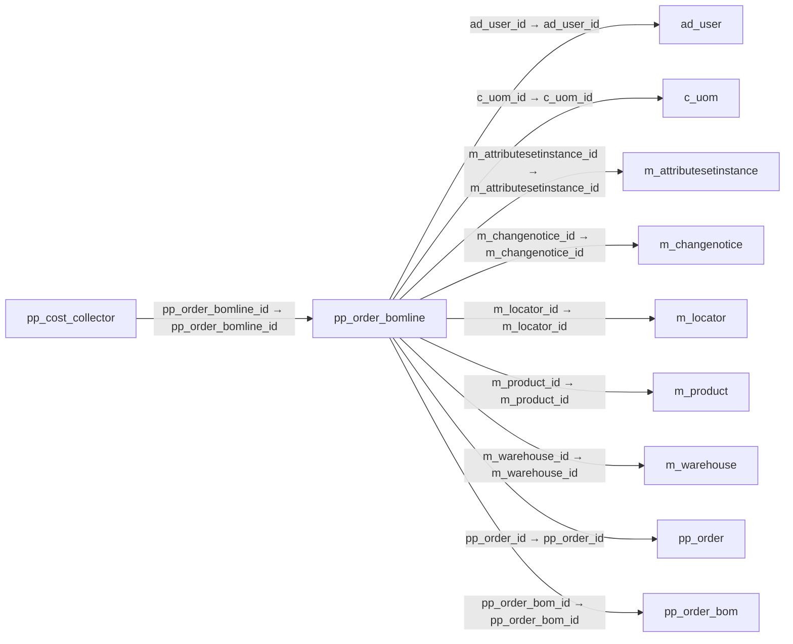

# pp_order_bomline — 제조 주문 BOM 구성행

[전체 일람](../TABLE_INDEX.md) · [분류 일람](README.md) · [AI 사용 안내](../README.md) · [외래키 읽는 법](../RELATIONSHIPS.md)

## 기본 정보

| 항목 | 내용 |
|---|---|
| 물리명 | `adempiere.pp_order_bomline` |
| 한국어 논리명(문서용 해석) | 제조 주문 BOM 구성행 |
| 원본 논리명 | Manufacturing Order BOM Line |
| 원본 사전 ID | 53025 |
| 분류 | `pp` — 제조·생산 계획·제품 구성 |
| 전체 테넌트 행 수 | 4 |
| 물리 열 수 | 44 |
| 나가는 FK / 들어오는 FK | 9 / 3 |
| 구조·행 수 확인 시점 | 2026-11-03T23:29:01+09:00 |

## 의미와 쓰임

완제품 제조에 사용할 각 구성품 정보를 주문별 BOM 행으로 저장한다.

- 설명 근거: 원본 애플리케이션 사전 명칭·설명을 한국어로 해석.
- 한국어 이름과 개요는 문서용 해석입니다. 공식 한국어 번역으로 간주하지 않습니다.
- 원본 설명: —
- 원본 도움말: The information relative to every component that will be used in the manufacture of the finished product is taken from the Bill of Materials. This information is contained in the Order BOM/Formula Line tab.
- PostgreSQL 테이블 주석: —

## 키와 열

### 기본키·고유 제약조건

| 종류 | 제약조건 | 열(순서 유지) |
|---|---|---|
| PRIMARY KEY | `pp_order_bomline_key` | `pp_order_bomline_id` |
| UNIQUE | `pp_order_bomline_uu_idx` | `pp_order_bomline_uu` |

### 열 목록

원본 논리명·설명은 `AD_Column`에서 가져왔습니다. 기본값은 실제 PostgreSQL 메타데이터이며, 비어 있는 항목은 `—`로 표시합니다.

| 순서 | 물리명 | 원본 논리명 | PostgreSQL 타입 | NULL | PK | 기본값 | 설명 |
|---:|---|---|---|---|---|---|---|
| 1 | `description` | Description | character varying(255) | 허용 | — | — | Optional short description of the record |
| 2 | `feature` | Feature | character varying(30) | 허용 | — | — | Indicated the Feature for Product Configure |
| 3 | `m_product_id` | Product | numeric(10,0) | 불가 | — | — | Product, Service, Item |
| 4 | `backflushgroup` | Backflush Group | character varying(30) | 허용 | — | — | The Grouping Components to the Backflush |
| 5 | `c_uom_id` | UOM | numeric(10,0) | 불가 | — | — | Unit of Measure |
| 6 | `componenttype` | Component Type | character(2) | 허용 | — | 'CO'::bpchar | Component Type for a Bill of Material or Formula |
| 7 | `created` | Created | timestamp without time zone | 불가 | — | statement_timestamp() | Date this record was created |
| 8 | `createdby` | Created By | numeric(10,0) | 불가 | — | — | User who created this records |
| 9 | `datedelivered` | Date Delivered | timestamp without time zone | 허용 | — | — | Date when the product was delivered |
| 10 | `forecast` | Forecast | numeric | 허용 | — | — | Indicated the % of participation this component into a of the BOM Planning |
| 11 | `help` | Comment/Help | character varying(2000) | 허용 | — | — | Comment or Hint |
| 12 | `isactive` | Active | character(1) | 불가 | — | — | The record is active in the system |
| 13 | `iscritical` | Is Critical Component | character(1) | 불가 | — | — | Indicate that a Manufacturing Order can not begin without have this component |
| 14 | `isqtypercentage` | Is Qty Percentage | character(1) | 허용 | — | — | Indicate that this component is based in % Quantity |
| 15 | `issuemethod` | Issue Method | character(1) | 허용 | — | — | There are two methods for issue the components to Manufacturing Order |
| 16 | `leadtimeoffset` | Lead Time Offset | numeric(10,0) | 허용 | — | — | Optional Lead Time offset before starting production |
| 17 | `line` | Line No | numeric(10,0) | 불가 | — | — | Unique line for this document |
| 18 | `m_attributesetinstance_id` | Attribute Set Instance | numeric(10,0) | 허용 | — | — | Product Attribute Set Instance |
| 19 | `m_changenotice_id` | Change Notice | numeric(10,0) | 허용 | — | — | Bill of Materials (Engineering) Change Notice (Version) |
| 20 | `m_locator_id` | Locator | numeric(10,0) | 허용 | — | — | Warehouse Locator |
| 21 | `m_warehouse_id` | Warehouse | numeric(10,0) | 불가 | — | — | Storage Warehouse and Service Point |
| 22 | `pp_order_bomline_id` | Manufacturing Order BOM Line | numeric(10,0) | 불가 | 예 | — | — |
| 23 | `pp_order_bom_id` | Manufacturing Order BOM | numeric(10,0) | 불가 | — | — | — |
| 24 | `pp_order_id` | Manufacturing Order | numeric(10,0) | 불가 | — | — | Manufacturing Order |
| 25 | `qtybom` | Quantity | numeric | 불가 | — | — | Indicate the Quantity use in this BOM |
| 26 | `qtybatch` | Quantity in % | numeric | 불가 | — | — | Indicate the Quantity % use in this Formula |
| 27 | `qtydelivered` | Delivered Quantity | numeric | 불가 | — | — | Delivered Quantity |
| 28 | `qtyentered` | Quantity | numeric | 허용 | — | (1)::numeric | The Quantity Entered is based on the selected UoM |
| 29 | `qtypost` | Qty Post | numeric | 불가 | — | — | — |
| 30 | `qtyreject` | Qty Reject | numeric | 불가 | — | — | — |
| 31 | `qtyrequiered` | Qty Required | numeric | 불가 | — | — | — |
| 32 | `qtyreserved` | Reserved Quantity | numeric | 불가 | — | — | Reserved Quantity |
| 33 | `qtyscrap` | Scrap % | numeric | 불가 | — | — | Scrap % Quantity for this component |
| 34 | `scrap` | Scrap % | numeric | 허용 | — | — | Indicate the Scrap %  for calculate the Scrap Quantity |
| 35 | `updated` | Updated | timestamp without time zone | 불가 | — | statement_timestamp() | Date this record was updated |
| 36 | `updatedby` | Updated By | numeric(10,0) | 불가 | — | — | User who updated this records |
| 37 | `validfrom` | Valid from | timestamp without time zone | 불가 | — | — | Valid from including this date (first day) |
| 38 | `ad_client_id` | Tenant | numeric(10,0) | 불가 | — | — | Tenant for this installation. |
| 39 | `validto` | Valid to | timestamp without time zone | 허용 | — | — | Valid to including this date (last day) |
| 40 | `ad_org_id` | Organization | numeric(10,0) | 불가 | — | — | Organizational entity within tenant |
| 41 | `assay` | Quantity Assay | numeric | 허용 | — | — | Indicated the Quantity Assay to use into Quality Order |
| 42 | `ad_user_id` | User/Contact | numeric(10,0) | 허용 | — | — | User within the system - Internal or Business Partner Contact |
| 43 | `costallocationperc` | Cost Allocation Percent | numeric | 허용 | — | (0)::numeric | Cost allocation percent in case of a co-product. |
| 44 | `pp_order_bomline_uu` | PP_Order_BOMLine_UU | uuid | 허용 | — | — | — |

## 외래키 흐름

화살표는 **FK를 가진 자식 → 참조되는 부모**입니다. 업무 처리의 시간 순서나 무조건적인 1:N 관계를 뜻하지 않습니다.

주변 관계 12개 중 10개를 그림으로 표시합니다. **전체 관계는 아래 두 표에 모두 포함**합니다.

### 이 테이블이 참조하는 부모 — 나가는 FK

| 제약조건 | 참조하는 쪽(자식) | 자식 열 | 참조받는 쪽(부모) | 부모 열 | 삭제 / 갱신 | 검증 / 지연 가능 |
|---|---|---|---|---|---|---|
| `aduser_pporderbomline` <!-- FK_OUT: adempiere.pp_order_bomline.aduser_pporderbomline --> | [`pp_order_bomline`](pp_order_bomline.md) | `ad_user_id` | [`ad_user`](../ad/ad_user.md) | `ad_user_id` | NO ACTION / NO ACTION | 완료 / 가능 (초기 지연) |
| `cuom_pporderbomline` <!-- FK_OUT: adempiere.pp_order_bomline.cuom_pporderbomline --> | [`pp_order_bomline`](pp_order_bomline.md) | `c_uom_id` | [`c_uom`](../c/c_uom.md) | `c_uom_id` | NO ACTION / NO ACTION | 완료 / 가능 (초기 지연) |
| `mattributesetinstance_ppordbl` <!-- FK_OUT: adempiere.pp_order_bomline.mattributesetinstance_ppordbl --> | [`pp_order_bomline`](pp_order_bomline.md) | `m_attributesetinstance_id` | [`m_attributesetinstance`](../m/m_attributesetinstance.md) | `m_attributesetinstance_id` | NO ACTION / NO ACTION | 완료 / 가능 (초기 지연) |
| `mchangenotice_pporderbomline` <!-- FK_OUT: adempiere.pp_order_bomline.mchangenotice_pporderbomline --> | [`pp_order_bomline`](pp_order_bomline.md) | `m_changenotice_id` | [`m_changenotice`](../m/m_changenotice.md) | `m_changenotice_id` | NO ACTION / NO ACTION | 완료 / 가능 (초기 지연) |
| `mlocator_pporderbomline` <!-- FK_OUT: adempiere.pp_order_bomline.mlocator_pporderbomline --> | [`pp_order_bomline`](pp_order_bomline.md) | `m_locator_id` | [`m_locator`](../m/m_locator.md) | `m_locator_id` | NO ACTION / NO ACTION | 완료 / 가능 (초기 지연) |
| `mproduct_pporderbomline` <!-- FK_OUT: adempiere.pp_order_bomline.mproduct_pporderbomline --> | [`pp_order_bomline`](pp_order_bomline.md) | `m_product_id` | [`m_product`](../m/m_product.md) | `m_product_id` | NO ACTION / NO ACTION | 완료 / 가능 (초기 지연) |
| `mwarehouse_pporderbomline` <!-- FK_OUT: adempiere.pp_order_bomline.mwarehouse_pporderbomline --> | [`pp_order_bomline`](pp_order_bomline.md) | `m_warehouse_id` | [`m_warehouse`](../m/m_warehouse.md) | `m_warehouse_id` | NO ACTION / NO ACTION | 완료 / 가능 (초기 지연) |
| `pporder_pporderbomline` <!-- FK_OUT: adempiere.pp_order_bomline.pporder_pporderbomline --> | [`pp_order_bomline`](pp_order_bomline.md) | `pp_order_id` | [`pp_order`](pp_order.md) | `pp_order_id` | NO ACTION / NO ACTION | 완료 / 가능 (초기 지연) |
| `pporderbom_pporderbomline` <!-- FK_OUT: adempiere.pp_order_bomline.pporderbom_pporderbomline --> | [`pp_order_bomline`](pp_order_bomline.md) | `pp_order_bom_id` | [`pp_order_bom`](pp_order_bom.md) | `pp_order_bom_id` | NO ACTION / NO ACTION | 완료 / 가능 (초기 지연) |

### 이 테이블을 참조하는 자식 — 들어오는 FK

| 제약조건 | 참조하는 쪽(자식) | 자식 열 | 참조받는 쪽(부모) | 부모 열 | 삭제 / 갱신 | 검증 / 지연 가능 |
|---|---|---|---|---|---|---|
| `pporderbomline_ppcostcollector` <!-- FK_IN: adempiere.pp_cost_collector.pporderbomline_ppcostcollector --> | [`pp_cost_collector`](pp_cost_collector.md) | `pp_order_bomline_id` | [`pp_order_bomline`](pp_order_bomline.md) | `pp_order_bomline_id` | NO ACTION / NO ACTION | 완료 / 가능 (초기 지연) |
| `pporderbomline_ppmrp` <!-- FK_IN: adempiere.pp_mrp.pporderbomline_ppmrp --> | [`pp_mrp`](pp_mrp.md) | `pp_order_bomline_id` | [`pp_order_bomline`](pp_order_bomline.md) | `pp_order_bomline_id` | NO ACTION / NO ACTION | 완료 / 가능 (초기 지연) |
| `pporderbomline_pporderbomlinet` <!-- FK_IN: adempiere.pp_order_bomline_trl.pporderbomline_pporderbomlinet --> | [`pp_order_bomline_trl`](pp_order_bomline_trl.md) | `pp_order_bomline_id` | [`pp_order_bomline`](pp_order_bomline.md) | `pp_order_bomline_id` | NO ACTION / NO ACTION | 완료 / 가능 (초기 지연) |

## 조회 시 주의

- FK 표의 자식 열과 부모 열을 같은 순서로 대응시킵니다. 복합 FK는 모든 열의 동등 조건을 `AND`로 연결합니다.
- 테이블 이름이나 `_id` 열 이름만으로 물리 FK가 있다고 가정하지 않습니다. FK 미선언은 업무 관계가 없다는 뜻도 아닙니다.
- 자식이 여러 행인 테이블과 조인하면 부모의 금액·건수가 중복될 수 있습니다. 집계 단위를 먼저 정합니다.
- `ad_client_id`가 있습니다. 업무 분석에서는 대상 테넌트를 명시합니다. GardenWorld는 `11`, 시스템 공통 설정은 `0`일 수 있으므로 일괄 필터 적용 전에 테이블 역할을 확인합니다.
- 행 수는 위 확인 시점의 전체 테넌트 값입니다. 최신 업무 실적이나 현재 실행 결과로 재사용하지 않습니다.
