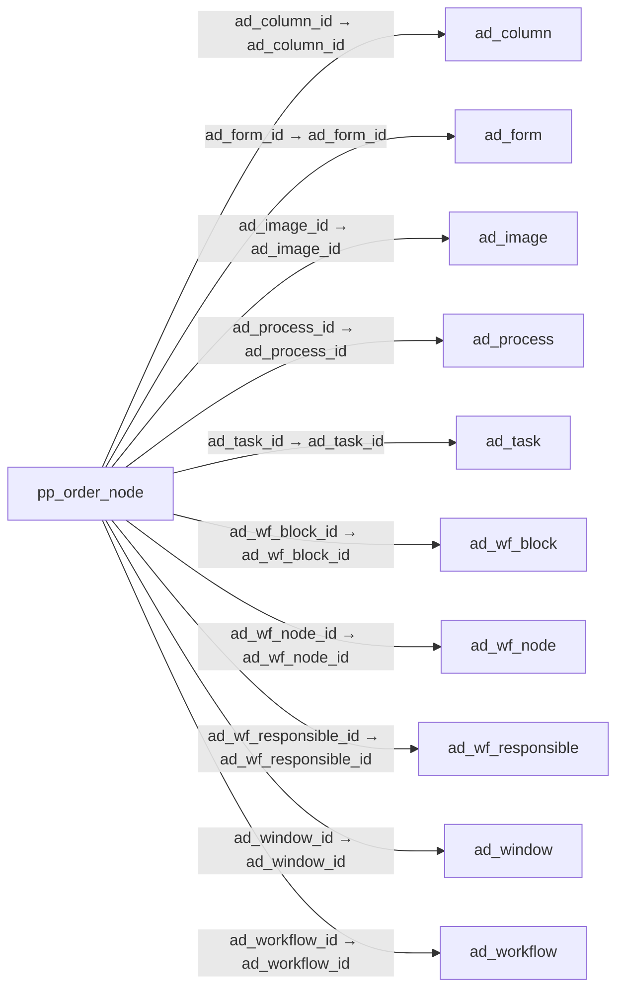

# pp_order_node — 제조 주문 공정

[전체 일람](../TABLE_INDEX.md) · [분류 일람](README.md) · [AI 사용 안내](../README.md) · [외래키 읽는 법](../RELATIONSHIPS.md)

## 기본 정보

| 항목 | 내용 |
|---|---|
| 물리명 | `adempiere.pp_order_node` |
| 한국어 논리명(문서용 해석) | 제조 주문 공정 |
| 원본 논리명 | Manufacturing Order Activity |
| 원본 사전 ID | 53022 |
| 분류 | `pp` — 제조·생산 계획·제품 구성 |
| 전체 테넌트 행 수 | 2 |
| 물리 열 수 | 70 |
| 나가는 FK / 들어오는 FK | 16 / 7 |
| 구조·행 수 확인 시점 | 2026-11-03T23:29:01+09:00 |

## 의미와 쓰임

제조 주문의 작업 경로를 구성하는 개별 공정을 정의한다.

- 설명 근거: 원본 애플리케이션 사전 명칭·설명을 한국어로 해석.
- 한국어 이름과 개요는 문서용 해석입니다. 공식 한국어 번역으로 간주하지 않습니다.
- 원본 설명: Manufacturing Order Activity
- 원본 도움말: Introduce the Name to identify the operations from the manufacturing routing. If desired give a Description for operation.
- PostgreSQL 테이블 주석: —

## 키와 열

### 기본키·고유 제약조건

| 종류 | 제약조건 | 열(순서 유지) |
|---|---|---|
| PRIMARY KEY | `pp_order_node_key` | `pp_order_node_id` |
| UNIQUE | `pp_order_node_uu_idx` | `pp_order_node_uu` |

### 열 목록

원본 논리명·설명은 `AD_Column`에서 가져왔습니다. 기본값은 실제 PostgreSQL 메타데이터이며, 비어 있는 항목은 `—`로 표시합니다.

| 순서 | 물리명 | 원본 논리명 | PostgreSQL 타입 | NULL | PK | 기본값 | 설명 |
|---:|---|---|---|---|---|---|---|
| 1 | `name` | Name | character varying(60) | 불가 | — | — | Alphanumeric identifier of the entity |
| 2 | `ad_column_id` | Column | numeric(10,0) | 허용 | — | — | Column in the table |
| 3 | `ad_form_id` | Special Form | numeric(10,0) | 허용 | — | — | Special Form |
| 4 | `ad_image_id` | Image | numeric(10,0) | 허용 | — | — | Image or Icon |
| 5 | `ad_org_id` | Organization | numeric(10,0) | 불가 | — | — | Organizational entity within tenant |
| 6 | `ad_process_id` | Process | numeric(10,0) | 허용 | — | — | Process or Report |
| 7 | `ad_task_id` | OS Task | numeric(10,0) | 허용 | — | — | Operation System Task |
| 8 | `ad_wf_block_id` | Workflow Block | numeric(10,0) | 허용 | — | — | Workflow Transaction Execution Block |
| 9 | `ad_wf_node_id` | Node | numeric(10,0) | 불가 | — | — | Workflow Node (activity), step or process |
| 10 | `ad_wf_responsible_id` | Workflow Responsible | numeric(10,0) | 허용 | — | — | Responsible for Workflow Execution |
| 11 | `ad_window_id` | Window | numeric(10,0) | 허용 | — | — | Data entry or display window |
| 12 | `ad_workflow_id` | Workflow | numeric(10,0) | 불가 | — | — | Workflow or combination of tasks |
| 13 | `action` | Action | character(1) | 불가 | — | 'N'::bpchar | Indicates the Action to be performed |
| 14 | `attributename` | Attribute Name | character varying(60) | 허용 | — | — | Name of the Attribute |
| 15 | `attributevalue` | Attribute Value | character varying(60) | 허용 | — | — | Value of the Attribute |
| 16 | `c_bpartner_id` | Business Partner | numeric(10,0) | 허용 | — | — | Identifies a Business Partner |
| 17 | `cost` | Cost | numeric | 불가 | — | — | Cost information |
| 18 | `created` | Created | timestamp without time zone | 불가 | — | statement_timestamp() | Date this record was created |
| 19 | `createdby` | Created By | numeric(10,0) | 불가 | — | — | User who created this records |
| 20 | `datefinish` | Finish Date | timestamp without time zone | 허용 | — | — | Finish or (planned) completion date |
| 21 | `datefinishschedule` | Date Finish Schedule | timestamp without time zone | 허용 | — | — | Scheduled Finish date for this Order |
| 22 | `datestart` | Date Start | timestamp without time zone | 허용 | — | — | Date Start for this Order |
| 23 | `datestartschedule` | Date Start Schedule | timestamp without time zone | 허용 | — | — | Scheduled start date for this Order |
| 24 | `description` | Description | character varying(255) | 허용 | — | — | Optional short description of the record |
| 25 | `docaction` | Document Action | character(2) | 허용 | — | — | The targeted status of the document |
| 26 | `docstatus` | Document Status | character(2) | 허용 | — | — | The current status of the document |
| 27 | `duration` | Duration | numeric(10,0) | 허용 | — | (0)::numeric | Normal Duration in Duration Unit |
| 28 | `durationreal` | Duration Real | numeric(10,0) | 허용 | — | — | — |
| 29 | `durationrequiered` | Duration Required | numeric(10,0) | 허용 | — | — | — |
| 30 | `entitytype` | Entity Type | character varying(40) | 불가 | — | 'U'::character varying | Dictionary Entity Type; Determines ownership and synchronization |
| 31 | `finishmode` | Finish Mode | character(1) | 허용 | — | — | Workflow Activity Finish Mode |
| 32 | `help` | Comment/Help | character varying(2000) | 허용 | — | — | Comment or Hint |
| 33 | `isactive` | Active | character(1) | 불가 | — | — | The record is active in the system |
| 34 | `iscentrallymaintained` | Centrally maintained | character(1) | 불가 | — | — | Information maintained in System Element table |
| 35 | `ismilestone` | Is Milestone | character(1) | 허용 | — | — | — |
| 36 | `issubcontracting` | Is Subcontracting | character(1) | 허용 | — | — | — |
| 37 | `joinelement` | Join Element | character(1) | 불가 | — | 'X'::bpchar | Semantics for multiple incoming Transitions |
| 38 | `limit` | Duration Limit | numeric(10,0) | 불가 | — | — | Maximum Duration in Duration Unit |
| 39 | `movingtime` | Moving Time | numeric(10,0) | 허용 | — | — | — |
| 40 | `overlapunits` | Overlap Units | numeric(10,0) | 허용 | — | — | Overlap Units are number of units that must be completed before they are moved the next activity |
| 41 | `pp_order_id` | Manufacturing Order | numeric(10,0) | 불가 | — | — | Manufacturing Order |
| 42 | `pp_order_node_id` | Manufacturing Order Activity | numeric(10,0) | 불가 | 예 | — | Workflow Node (activity), step or process |
| 43 | `pp_order_workflow_id` | Manufacturing Order Workflow | numeric(10,0) | 불가 | — | — | — |
| 44 | `priority` | Priority | numeric(10,0) | 불가 | — | — | Indicates if this request is of a high, medium or low priority. |
| 45 | `qtydelivered` | Delivered Quantity | numeric | 허용 | — | — | Delivered Quantity |
| 46 | `qtyreject` | Qty Reject | numeric | 허용 | — | — | — |
| 47 | `qtyrequiered` | Qty Required | numeric | 허용 | — | — | — |
| 48 | `qtyscrap` | Scrap % | numeric | 허용 | — | — | Scrap % Quantity for this component |
| 49 | `queuingtime` | Queuing Time | numeric(10,0) | 허용 | — | — | Queue time is the time a job waits at a work center before begin handled. |
| 50 | `s_resource_id` | Resource | numeric(10,0) | 허용 | — | — | Resource |
| 51 | `setuptime` | Setup Time | numeric(10,0) | 허용 | — | — | Setup time before starting Production |
| 52 | `setuptimereal` | Setup Time Real | numeric(10,0) | 허용 | — | — | — |
| 53 | `setuptimerequiered` | Setup Time Required | numeric(10,0) | 허용 | — | — | — |
| 54 | `splitelement` | Split Element | character(1) | 불가 | — | 'X'::bpchar | Semantics for multiple outgoing Transitions |
| 55 | `startmode` | Start Mode | character(1) | 허용 | — | — | Workflow Activity Start Mode  |
| 56 | `subflowexecution` | Subflow Execution | character(1) | 허용 | — | — | Mode how the sub-workflow is executed |
| 57 | `unitscycles` | Units by Cycles | numeric(10,0) | 허용 | — | — | The Units by Cycles are defined for process type  Flow Repetitive Dedicated and  indicated the product to be manufactured on a production line for duration unit. |
| 58 | `updated` | Updated | timestamp without time zone | 불가 | — | statement_timestamp() | Date this record was updated |
| 59 | `updatedby` | Updated By | numeric(10,0) | 불가 | — | — | User who updated this records |
| 60 | `validfrom` | Valid from | timestamp without time zone | 허용 | — | — | Valid from including this date (first day) |
| 61 | `validto` | Valid to | timestamp without time zone | 허용 | — | — | Valid to including this date (last day) |
| 62 | `value` | Search Key | character varying(40) | 불가 | — | — | Search key for the record in the format required - must be unique |
| 63 | `waitingtime` | Waiting Time | numeric(10,0) | 불가 | — | — | Workflow Simulation Waiting time |
| 64 | `workflow_id` | Workflow | numeric(10,0) | 허용 | — | — | Workflow or tasks |
| 65 | `workingtime` | Working Time | numeric(10,0) | 불가 | — | — | Workflow Simulation Execution Time |
| 66 | `xposition` | X Position | numeric(10,0) | 불가 | — | — | Absolute X (horizontal) position in 1/72 of an inch |
| 67 | `ad_client_id` | Tenant | numeric(10,0) | 불가 | — | — | Tenant for this installation. |
| 68 | `yposition` | Y Position | numeric(10,0) | 불가 | — | — | Absolute Y (vertical) position in 1/72 of an inch |
| 69 | `yield` | Yield % | numeric(10,0) | 허용 | — | (100)::numeric | The Yield is the percentage of a lot that is expected to be of acceptable wuality may fall below 100 percent |
| 70 | `pp_order_node_uu` | PP_Order_Node_UU | uuid | 허용 | — | — | — |

## 외래키 흐름

화살표는 **FK를 가진 자식 → 참조되는 부모**입니다. 업무 처리의 시간 순서나 무조건적인 1:N 관계를 뜻하지 않습니다.

주변 관계 23개 중 10개를 그림으로 표시합니다. **전체 관계는 아래 두 표에 모두 포함**합니다.

### 이 테이블이 참조하는 부모 — 나가는 FK

| 제약조건 | 참조하는 쪽(자식) | 자식 열 | 참조받는 쪽(부모) | 부모 열 | 삭제 / 갱신 | 검증 / 지연 가능 |
|---|---|---|---|---|---|---|
| `adcolumn_ppordernode` <!-- FK_OUT: adempiere.pp_order_node.adcolumn_ppordernode --> | [`pp_order_node`](pp_order_node.md) | `ad_column_id` | [`ad_column`](../ad/ad_column.md) | `ad_column_id` | NO ACTION / NO ACTION | 완료 / 가능 (초기 지연) |
| `adform_ppordernode` <!-- FK_OUT: adempiere.pp_order_node.adform_ppordernode --> | [`pp_order_node`](pp_order_node.md) | `ad_form_id` | [`ad_form`](../ad/ad_form.md) | `ad_form_id` | NO ACTION / NO ACTION | 완료 / 가능 (초기 지연) |
| `adimage_ppordernode` <!-- FK_OUT: adempiere.pp_order_node.adimage_ppordernode --> | [`pp_order_node`](pp_order_node.md) | `ad_image_id` | [`ad_image`](../ad/ad_image.md) | `ad_image_id` | NO ACTION / NO ACTION | 완료 / 가능 (초기 지연) |
| `adprocess_ppordernode` <!-- FK_OUT: adempiere.pp_order_node.adprocess_ppordernode --> | [`pp_order_node`](pp_order_node.md) | `ad_process_id` | [`ad_process`](../ad/ad_process.md) | `ad_process_id` | NO ACTION / NO ACTION | 완료 / 가능 (초기 지연) |
| `adtask_ppordernode` <!-- FK_OUT: adempiere.pp_order_node.adtask_ppordernode --> | [`pp_order_node`](pp_order_node.md) | `ad_task_id` | [`ad_task`](../ad/ad_task.md) | `ad_task_id` | NO ACTION / NO ACTION | 완료 / 가능 (초기 지연) |
| `adwfblock_ppordernode` <!-- FK_OUT: adempiere.pp_order_node.adwfblock_ppordernode --> | [`pp_order_node`](pp_order_node.md) | `ad_wf_block_id` | [`ad_wf_block`](../ad/ad_wf_block.md) | `ad_wf_block_id` | NO ACTION / NO ACTION | 완료 / 가능 (초기 지연) |
| `adwfnode_ppordernode` <!-- FK_OUT: adempiere.pp_order_node.adwfnode_ppordernode --> | [`pp_order_node`](pp_order_node.md) | `ad_wf_node_id` | [`ad_wf_node`](../ad/ad_wf_node.md) | `ad_wf_node_id` | NO ACTION / NO ACTION | 완료 / 가능 (초기 지연) |
| `adwfresponsible_ppordernode` <!-- FK_OUT: adempiere.pp_order_node.adwfresponsible_ppordernode --> | [`pp_order_node`](pp_order_node.md) | `ad_wf_responsible_id` | [`ad_wf_responsible`](../ad/ad_wf_responsible.md) | `ad_wf_responsible_id` | NO ACTION / NO ACTION | 완료 / 가능 (초기 지연) |
| `adwindow_ppordernode` <!-- FK_OUT: adempiere.pp_order_node.adwindow_ppordernode --> | [`pp_order_node`](pp_order_node.md) | `ad_window_id` | [`ad_window`](../ad/ad_window.md) | `ad_window_id` | NO ACTION / NO ACTION | 완료 / 가능 (초기 지연) |
| `adworkflow_ppordernode` <!-- FK_OUT: adempiere.pp_order_node.adworkflow_ppordernode --> | [`pp_order_node`](pp_order_node.md) | `ad_workflow_id` | [`ad_workflow`](../ad/ad_workflow.md) | `ad_workflow_id` | NO ACTION / NO ACTION | 완료 / 가능 (초기 지연) |
| `cbpartner_ppordernode` <!-- FK_OUT: adempiere.pp_order_node.cbpartner_ppordernode --> | [`pp_order_node`](pp_order_node.md) | `c_bpartner_id` | [`c_bpartner`](../c/c_bpartner.md) | `c_bpartner_id` | NO ACTION / NO ACTION | 완료 / 가능 (초기 지연) |
| `entityt_ppordernode` <!-- FK_OUT: adempiere.pp_order_node.entityt_ppordernode --> | [`pp_order_node`](pp_order_node.md) | `entitytype` | [`ad_entitytype`](../ad/ad_entitytype.md) | `entitytype` | NO ACTION / NO ACTION | 완료 / 가능 (초기 지연) |
| `pporder_ppordernode` <!-- FK_OUT: adempiere.pp_order_node.pporder_ppordernode --> | [`pp_order_node`](pp_order_node.md) | `pp_order_id` | [`pp_order`](pp_order.md) | `pp_order_id` | NO ACTION / NO ACTION | 완료 / 가능 (초기 지연) |
| `pporderworkflow_ppordernode` <!-- FK_OUT: adempiere.pp_order_node.pporderworkflow_ppordernode --> | [`pp_order_node`](pp_order_node.md) | `pp_order_workflow_id` | [`pp_order_workflow`](pp_order_workflow.md) | `pp_order_workflow_id` | NO ACTION / NO ACTION | 완료 / 가능 (초기 지연) |
| `sresource_ppordernode` <!-- FK_OUT: adempiere.pp_order_node.sresource_ppordernode --> | [`pp_order_node`](pp_order_node.md) | `s_resource_id` | [`s_resource`](../s/s_resource.md) | `s_resource_id` | NO ACTION / NO ACTION | 완료 / 가능 (초기 지연) |
| `workflow_ppordernode` <!-- FK_OUT: adempiere.pp_order_node.workflow_ppordernode --> | [`pp_order_node`](pp_order_node.md) | `workflow_id` | [`ad_workflow`](../ad/ad_workflow.md) | `ad_workflow_id` | NO ACTION / NO ACTION | 완료 / 가능 (초기 지연) |

### 이 테이블을 참조하는 자식 — 들어오는 FK

| 제약조건 | 참조하는 쪽(자식) | 자식 열 | 참조받는 쪽(부모) | 부모 열 | 삭제 / 갱신 | 검증 / 지연 가능 |
|---|---|---|---|---|---|---|
| `ppordernode_ppcostcollector` <!-- FK_IN: adempiere.pp_cost_collector.ppordernode_ppcostcollector --> | [`pp_cost_collector`](pp_cost_collector.md) | `pp_order_node_id` | [`pp_order_node`](pp_order_node.md) | `pp_order_node_id` | NO ACTION / NO ACTION | 완료 / 가능 (초기 지연) |
| `ppordernode_ppordernodeasset` <!-- FK_IN: adempiere.pp_order_node_asset.ppordernode_ppordernodeasset --> | [`pp_order_node_asset`](pp_order_node_asset.md) | `pp_order_node_id` | [`pp_order_node`](pp_order_node.md) | `pp_order_node_id` | NO ACTION / NO ACTION | 완료 / 가능 (초기 지연) |
| `ppordernode_ppordernodeproduct` <!-- FK_IN: adempiere.pp_order_node_product.ppordernode_ppordernodeproduct --> | [`pp_order_node_product`](pp_order_node_product.md) | `pp_order_node_id` | [`pp_order_node`](pp_order_node.md) | `pp_order_node_id` | NO ACTION / NO ACTION | 완료 / 가능 (초기 지연) |
| `ppordernode_ppordernodetrl` <!-- FK_IN: adempiere.pp_order_node_trl.ppordernode_ppordernodetrl --> | [`pp_order_node_trl`](pp_order_node_trl.md) | `pp_order_node_id` | [`pp_order_node`](pp_order_node.md) | `pp_order_node_id` | NO ACTION / NO ACTION | 완료 / 가능 (초기 지연) |
| `ppordernext_ppordernodenext` <!-- FK_IN: adempiere.pp_order_nodenext.ppordernext_ppordernodenext --> | [`pp_order_nodenext`](pp_order_nodenext.md) | `pp_order_next_id` | [`pp_order_node`](pp_order_node.md) | `pp_order_node_id` | NO ACTION / NO ACTION | 완료 / 가능 (초기 지연) |
| `ppordernode_ppordernodenext` <!-- FK_IN: adempiere.pp_order_nodenext.ppordernode_ppordernodenext --> | [`pp_order_nodenext`](pp_order_nodenext.md) | `pp_order_node_id` | [`pp_order_node`](pp_order_node.md) | `pp_order_node_id` | NO ACTION / NO ACTION | 완료 / 가능 (초기 지연) |
| `ppordernode_pporderworkflow` <!-- FK_IN: adempiere.pp_order_workflow.ppordernode_pporderworkflow --> | [`pp_order_workflow`](pp_order_workflow.md) | `pp_order_node_id` | [`pp_order_node`](pp_order_node.md) | `pp_order_node_id` | NO ACTION / NO ACTION | 완료 / 가능 (초기 지연) |

## 조회 시 주의

- FK 표의 자식 열과 부모 열을 같은 순서로 대응시킵니다. 복합 FK는 모든 열의 동등 조건을 `AND`로 연결합니다.
- 테이블 이름이나 `_id` 열 이름만으로 물리 FK가 있다고 가정하지 않습니다. FK 미선언은 업무 관계가 없다는 뜻도 아닙니다.
- 자식이 여러 행인 테이블과 조인하면 부모의 금액·건수가 중복될 수 있습니다. 집계 단위를 먼저 정합니다.
- `ad_client_id`가 있습니다. 업무 분석에서는 대상 테넌트를 명시합니다. GardenWorld는 `11`, 시스템 공통 설정은 `0`일 수 있으므로 일괄 필터 적용 전에 테이블 역할을 확인합니다.
- 행 수는 위 확인 시점의 전체 테넌트 값입니다. 최신 업무 실적이나 현재 실행 결과로 재사용하지 않습니다.
