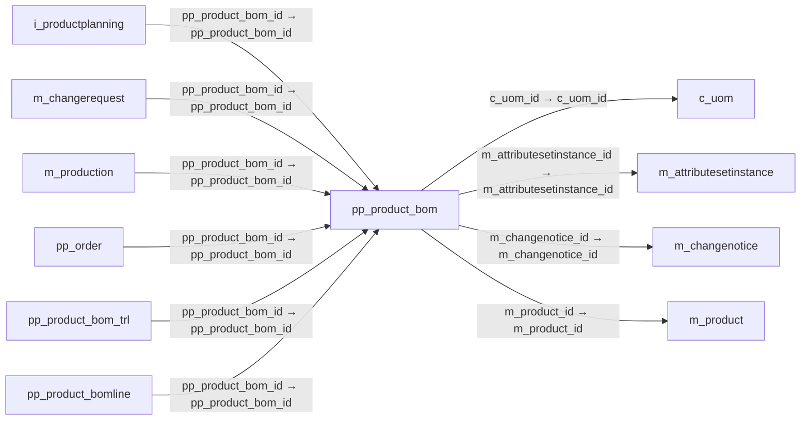

# pp_product_bom — 제품 BOM·배합

[전체 일람](../TABLE_INDEX.md) · [분류 일람](README.md) · [AI 사용 안내](../README.md) · [외래키 읽는 법](../RELATIONSHIPS.md)

## 기본 정보

| 항목 | 내용 |
|---|---|
| 물리명 | `adempiere.pp_product_bom` |
| 한국어 논리명(문서용 해석) | 제품 BOM·배합 |
| 원본 논리명 | BOM &amp; Formula |
| 원본 사전 ID | 53018 |
| 분류 | `pp` — 제조·생산 계획·제품 구성 |
| 전체 테넌트 행 수 | 7 |
| 물리 열 수 | 25 |
| 나가는 FK / 들어오는 FK | 4 / 9 |
| 구조·행 수 확인 시점 | 2026-11-03T23:29:01+09:00 |

## 의미와 쓰임

제품의 자재명세서와 배합을 정의한다.

- 설명 근거: 원본 애플리케이션 사전 명칭·설명을 한국어로 해석.
- 한국어 이름과 개요는 문서용 해석입니다. 공식 한국어 번역으로 간주하지 않습니다.
- 원본 설명: BOM &amp; Formula
- 원본 도움말: —
- PostgreSQL 테이블 주석: —

## 키와 열

### 기본키·고유 제약조건

| 종류 | 제약조건 | 열(순서 유지) |
|---|---|---|
| PRIMARY KEY | `pp_product_bom_key` | `pp_product_bom_id` |
| UNIQUE | `pp_product_bom_uu_idx` | `pp_product_bom_uu` |

### 별도 고유 인덱스

PK·UNIQUE 제약조건의 인덱스와 별도로 존재하는 고유 인덱스입니다. 식·조건·열 순서는 원본 정의를 따릅니다.

- `ppproductbomunique`: `CREATE UNIQUE INDEX ppproductbomunique ON adempiere.pp_product_bom USING btree (ad_client_id, value)`

### 열 목록

원본 논리명·설명은 `AD_Column`에서 가져왔습니다. 기본값은 실제 PostgreSQL 메타데이터이며, 비어 있는 항목은 `—`로 표시합니다.

| 순서 | 물리명 | 원본 논리명 | PostgreSQL 타입 | NULL | PK | 기본값 | 설명 |
|---:|---|---|---|---|---|---|---|
| 1 | `value` | Search Key | character varying(80) | 불가 | — | — | Search key for the record in the format required - must be unique |
| 2 | `name` | Name | character varying(60) | 불가 | — | — | Alphanumeric identifier of the entity |
| 3 | `documentno` | Document No | character varying(22) | 허용 | — | — | Document sequence number of the document |
| 4 | `revision` | Revision | character varying(10) | 허용 | — | — | — |
| 5 | `description` | Description | character varying(255) | 허용 | — | — | Optional short description of the record |
| 6 | `copyfrom` | Copy From | character(1) | 허용 | — | — | Copy From Record |
| 7 | `created` | Created | timestamp without time zone | 불가 | — | statement_timestamp() | Date this record was created |
| 8 | `createdby` | Created By | numeric(10,0) | 불가 | — | — | User who created this records |
| 9 | `help` | Comment/Help | character varying(2000) | 허용 | — | — | Comment or Hint |
| 10 | `isactive` | Active | character(1) | 불가 | — | — | The record is active in the system |
| 11 | `ad_client_id` | Tenant | numeric(10,0) | 불가 | — | — | Tenant for this installation. |
| 12 | `m_changenotice_id` | Change Notice | numeric(10,0) | 허용 | — | — | Bill of Materials (Engineering) Change Notice (Version) |
| 13 | `m_product_id` | Product | numeric(10,0) | 불가 | — | — | Product, Service, Item |
| 14 | `pp_product_bom_id` | BOM &amp; Formula | numeric(10,0) | 불가 | 예 | — | BOM &amp; Formula |
| 15 | `processing` | Process Now | character(1) | 허용 | — | — | — |
| 16 | `updated` | Updated | timestamp without time zone | 불가 | — | statement_timestamp() | Date this record was updated |
| 17 | `updatedby` | Updated By | numeric(10,0) | 불가 | — | — | User who updated this records |
| 18 | `validfrom` | Valid from | timestamp without time zone | 허용 | — | — | Valid from including this date (first day) |
| 19 | `validto` | Valid to | timestamp without time zone | 허용 | — | — | Valid to including this date (last day) |
| 20 | `m_attributesetinstance_id` | Attribute Set Instance | numeric(10,0) | 허용 | — | — | Product Attribute Set Instance |
| 21 | `ad_org_id` | Organization | numeric(10,0) | 불가 | — | — | Organizational entity within tenant |
| 22 | `bomtype` | BOM Type | character(1) | 허용 | — | 'A'::bpchar | Type of BOM |
| 23 | `bomuse` | BOM Use | character(1) | 허용 | — | 'M'::bpchar | The use of the Bill of Material |
| 24 | `c_uom_id` | UOM | numeric(10,0) | 허용 | — | — | Unit of Measure |
| 25 | `pp_product_bom_uu` | PP_Product_BOM_UU | uuid | 허용 | — | — | — |

## 외래키 흐름

화살표는 **FK를 가진 자식 → 참조되는 부모**입니다. 업무 처리의 시간 순서나 무조건적인 1:N 관계를 뜻하지 않습니다.

주변 관계 13개 중 10개를 그림으로 표시합니다. **전체 관계는 아래 두 표에 모두 포함**합니다.

### 이 테이블이 참조하는 부모 — 나가는 FK

| 제약조건 | 참조하는 쪽(자식) | 자식 열 | 참조받는 쪽(부모) | 부모 열 | 삭제 / 갱신 | 검증 / 지연 가능 |
|---|---|---|---|---|---|---|
| `cuom_ppproductbom` <!-- FK_OUT: adempiere.pp_product_bom.cuom_ppproductbom --> | [`pp_product_bom`](pp_product_bom.md) | `c_uom_id` | [`c_uom`](../c/c_uom.md) | `c_uom_id` | NO ACTION / NO ACTION | 완료 / 가능 (초기 지연) |
| `mattributesetinstance_ppproduc` <!-- FK_OUT: adempiere.pp_product_bom.mattributesetinstance_ppproduc --> | [`pp_product_bom`](pp_product_bom.md) | `m_attributesetinstance_id` | [`m_attributesetinstance`](../m/m_attributesetinstance.md) | `m_attributesetinstance_id` | NO ACTION / NO ACTION | 완료 / 가능 (초기 지연) |
| `mchangenotice_ppproductbom` <!-- FK_OUT: adempiere.pp_product_bom.mchangenotice_ppproductbom --> | [`pp_product_bom`](pp_product_bom.md) | `m_changenotice_id` | [`m_changenotice`](../m/m_changenotice.md) | `m_changenotice_id` | NO ACTION / NO ACTION | 완료 / 가능 (초기 지연) |
| `mproduct_ppproductbom` <!-- FK_OUT: adempiere.pp_product_bom.mproduct_ppproductbom --> | [`pp_product_bom`](pp_product_bom.md) | `m_product_id` | [`m_product`](../m/m_product.md) | `m_product_id` | NO ACTION / NO ACTION | 완료 / 가능 (초기 지연) |

### 이 테이블을 참조하는 자식 — 들어오는 FK

| 제약조건 | 참조하는 쪽(자식) | 자식 열 | 참조받는 쪽(부모) | 부모 열 | 삭제 / 갱신 | 검증 / 지연 가능 |
|---|---|---|---|---|---|---|
| `ppproductbom_iproductplanning` <!-- FK_IN: adempiere.i_productplanning.ppproductbom_iproductplanning --> | [`i_productplanning`](../i/i_productplanning.md) | `pp_product_bom_id` | [`pp_product_bom`](pp_product_bom.md) | `pp_product_bom_id` | NO ACTION / NO ACTION | 완료 / 가능 (초기 지연) |
| `ppproductbom_mchangerequest` <!-- FK_IN: adempiere.m_changerequest.ppproductbom_mchangerequest --> | [`m_changerequest`](../m/m_changerequest.md) | `pp_product_bom_id` | [`pp_product_bom`](pp_product_bom.md) | `pp_product_bom_id` | NO ACTION / NO ACTION | 완료 / 가능 (초기 지연) |
| `ppproductbom_mproduction` <!-- FK_IN: adempiere.m_production.ppproductbom_mproduction --> | [`m_production`](../m/m_production.md) | `pp_product_bom_id` | [`pp_product_bom`](pp_product_bom.md) | `pp_product_bom_id` | NO ACTION / NO ACTION | 완료 / 가능 (초기 지연) |
| `ppproductbom_pporder` <!-- FK_IN: adempiere.pp_order.ppproductbom_pporder --> | [`pp_order`](pp_order.md) | `pp_product_bom_id` | [`pp_product_bom`](pp_product_bom.md) | `pp_product_bom_id` | NO ACTION / NO ACTION | 완료 / 가능 (초기 지연) |
| `ppproductbom_ppproductbomtrl` <!-- FK_IN: adempiere.pp_product_bom_trl.ppproductbom_ppproductbomtrl --> | [`pp_product_bom_trl`](pp_product_bom_trl.md) | `pp_product_bom_id` | [`pp_product_bom`](pp_product_bom.md) | `pp_product_bom_id` | NO ACTION / NO ACTION | 완료 / 가능 (초기 지연) |
| `ppproductbom_ppproductbomline` <!-- FK_IN: adempiere.pp_product_bomline.ppproductbom_ppproductbomline --> | [`pp_product_bomline`](pp_product_bomline.md) | `pp_product_bom_id` | [`pp_product_bom`](pp_product_bom.md) | `pp_product_bom_id` | NO ACTION / NO ACTION | 완료 / 가능 (초기 지연) |
| `ppproductbom_ppproductplanning` <!-- FK_IN: adempiere.pp_product_planning.ppproductbom_ppproductplanning --> | [`pp_product_planning`](pp_product_planning.md) | `pp_product_bom_id` | [`pp_product_bom`](pp_product_bom.md) | `pp_product_bom_id` | NO ACTION / NO ACTION | 완료 / 가능 (초기 지연) |
| `ppproductbom_qmspecification` <!-- FK_IN: adempiere.qm_specification.ppproductbom_qmspecification --> | [`qm_specification`](../qm/qm_specification.md) | `pp_product_bom_id` | [`pp_product_bom`](pp_product_bom.md) | `pp_product_bom_id` | NO ACTION / NO ACTION | 완료 / 가능 (초기 지연) |
| `ppproductbom_rgroup` <!-- FK_IN: adempiere.r_group.ppproductbom_rgroup --> | [`r_group`](../r/r_group.md) | `pp_product_bom_id` | [`pp_product_bom`](pp_product_bom.md) | `pp_product_bom_id` | NO ACTION / NO ACTION | 완료 / 가능 (초기 지연) |

## 조회 시 주의

- FK 표의 자식 열과 부모 열을 같은 순서로 대응시킵니다. 복합 FK는 모든 열의 동등 조건을 `AND`로 연결합니다.
- 테이블 이름이나 `_id` 열 이름만으로 물리 FK가 있다고 가정하지 않습니다. FK 미선언은 업무 관계가 없다는 뜻도 아닙니다.
- 자식이 여러 행인 테이블과 조인하면 부모의 금액·건수가 중복될 수 있습니다. 집계 단위를 먼저 정합니다.
- `ad_client_id`가 있습니다. 업무 분석에서는 대상 테넌트를 명시합니다. GardenWorld는 `11`, 시스템 공통 설정은 `0`일 수 있으므로 일괄 필터 적용 전에 테이블 역할을 확인합니다.
- 행 수는 위 확인 시점의 전체 테넌트 값입니다. 최신 업무 실적이나 현재 실행 결과로 재사용하지 않습니다.
