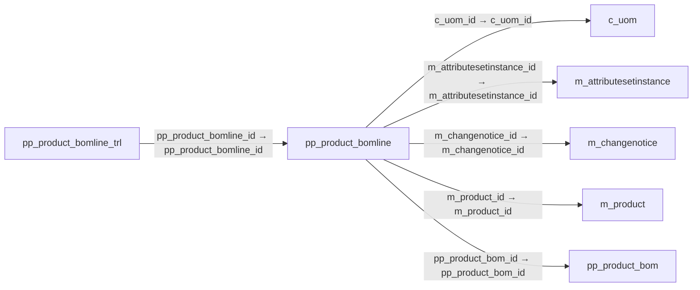

# pp_product_bomline — 제품 BOM 구성행

[전체 일람](../TABLE_INDEX.md) · [분류 일람](README.md) · [AI 사용 안내](../README.md) · [외래키 읽는 법](../RELATIONSHIPS.md)

## 기본 정보

| 항목 | 내용 |
|---|---|
| 물리명 | `adempiere.pp_product_bomline` |
| 한국어 논리명(문서용 해석) | 제품 BOM 구성행 |
| 원본 논리명 | BOM Line |
| 원본 사전 ID | 53019 |
| 분류 | `pp` — 제조·생산 계획·제품 구성 |
| 전체 테넌트 행 수 | 21 |
| 물리 열 수 | 32 |
| 나가는 FK / 들어오는 FK | 5 / 1 |
| 구조·행 수 확인 시점 | 2026-11-03T23:29:01+09:00 |

## 의미와 쓰임

완제품의 BOM 및 배합에 들어가는 개별 구성품 정보를 정의한다.

- 설명 근거: 원본 애플리케이션 사전 명칭·설명을 한국어로 해석.
- 한국어 이름과 개요는 문서용 해석입니다. 공식 한국어 번역으로 간주하지 않습니다.
- 원본 설명: BOM Line
- 원본 도움말: The information relative to every component that will be used in the BOM &amp; Formula of the finished product.
- PostgreSQL 테이블 주석: —

## 키와 열

### 기본키·고유 제약조건

| 종류 | 제약조건 | 열(순서 유지) |
|---|---|---|
| PRIMARY KEY | `pp_product_bomline_key` | `pp_product_bomline_id` |
| UNIQUE | `pp_product_bomline_uu_idx` | `pp_product_bomline_uu` |

### 열 목록

원본 논리명·설명은 `AD_Column`에서 가져왔습니다. 기본값은 실제 PostgreSQL 메타데이터이며, 비어 있는 항목은 `—`로 표시합니다.

| 순서 | 물리명 | 원본 논리명 | PostgreSQL 타입 | NULL | PK | 기본값 | 설명 |
|---:|---|---|---|---|---|---|---|
| 1 | `feature` | Feature | character varying(30) | 허용 | — | — | Indicated the Feature for Product Configure |
| 2 | `ad_org_id` | Organization | numeric(10,0) | 불가 | — | — | Organizational entity within tenant |
| 3 | `assay` | Quantity Assay | numeric | 허용 | — | — | Indicated the Quantity Assay to use into Quality Order |
| 4 | `backflushgroup` | Backflush Group | character varying(20) | 허용 | — | — | The Grouping Components to the Backflush |
| 5 | `c_uom_id` | UOM | numeric(10,0) | 허용 | — | — | Unit of Measure |
| 6 | `componenttype` | Component Type | character(2) | 허용 | — | 'CO'::bpchar | Component Type for a Bill of Material or Formula |
| 7 | `created` | Created | timestamp without time zone | 불가 | — | statement_timestamp() | Date this record was created |
| 8 | `createdby` | Created By | numeric(10,0) | 불가 | — | — | User who created this records |
| 9 | `description` | Description | character varying(255) | 허용 | — | — | Optional short description of the record |
| 10 | `forecast` | Forecast | numeric | 허용 | — | — | Indicated the % of participation this component into a of the BOM Planning |
| 11 | `help` | Comment/Help | character varying(2000) | 허용 | — | — | Comment or Hint |
| 12 | `isactive` | Active | character(1) | 불가 | — | — | The record is active in the system |
| 13 | `iscritical` | Is Critical Component | character(1) | 허용 | — | 'N'::bpchar | Indicate that a Manufacturing Order can not begin without have this component |
| 14 | `isqtypercentage` | Is Qty Percentage | character(1) | 허용 | — | — | Indicate that this component is based in % Quantity |
| 15 | `issuemethod` | Issue Method | character(1) | 허용 | — | '1'::bpchar | There are two methods for issue the components to Manufacturing Order |
| 16 | `leadtimeoffset` | Lead Time Offset | numeric(10,0) | 허용 | — | — | Optional Lead Time offset before starting production |
| 17 | `line` | Line No | numeric(10,0) | 불가 | — | — | Unique line for this document |
| 18 | `m_attributesetinstance_id` | Attribute Set Instance | numeric(10,0) | 허용 | — | — | Product Attribute Set Instance |
| 19 | `m_changenotice_id` | Change Notice | numeric(10,0) | 허용 | — | — | Bill of Materials (Engineering) Change Notice (Version) |
| 20 | `m_product_id` | Product | numeric(10,0) | 불가 | — | — | Product, Service, Item |
| 21 | `pp_product_bomline_id` | BOM Line | numeric(10,0) | 불가 | 예 | — | BOM Line |
| 22 | `pp_product_bom_id` | BOM &amp; Formula | numeric(10,0) | 불가 | — | — | BOM &amp; Formula |
| 23 | `qtybom` | Quantity | numeric | 허용 | — | — | Indicate the Quantity use in this BOM |
| 24 | `qtybatch` | Quantity in % | numeric | 허용 | — | — | Indicate the Quantity % use in this Formula |
| 25 | `scrap` | Scrap % | numeric | 허용 | — | — | Indicate the Scrap %  for calculate the Scrap Quantity |
| 26 | `updated` | Updated | timestamp without time zone | 불가 | — | statement_timestamp() | Date this record was updated |
| 27 | `updatedby` | Updated By | numeric(10,0) | 불가 | — | — | User who updated this records |
| 28 | `validfrom` | Valid from | timestamp without time zone | 허용 | — | — | Valid from including this date (first day) |
| 29 | `ad_client_id` | Tenant | numeric(10,0) | 불가 | — | — | Tenant for this installation. |
| 30 | `validto` | Valid to | timestamp without time zone | 허용 | — | — | Valid to including this date (last day) |
| 31 | `costallocationperc` | Cost Allocation Percent | numeric | 허용 | — | (0)::numeric | Cost allocation percent in case of a co-product. |
| 32 | `pp_product_bomline_uu` | PP_Product_BOMLine_UU | uuid | 허용 | — | — | — |

## 외래키 흐름

화살표는 **FK를 가진 자식 → 참조되는 부모**입니다. 업무 처리의 시간 순서나 무조건적인 1:N 관계를 뜻하지 않습니다.

주변 관계 6개 중 6개를 그림으로 표시합니다. **전체 관계는 아래 두 표에 모두 포함**합니다.

### 이 테이블이 참조하는 부모 — 나가는 FK

| 제약조건 | 참조하는 쪽(자식) | 자식 열 | 참조받는 쪽(부모) | 부모 열 | 삭제 / 갱신 | 검증 / 지연 가능 |
|---|---|---|---|---|---|---|
| `cuom_ppproductbomline` <!-- FK_OUT: adempiere.pp_product_bomline.cuom_ppproductbomline --> | [`pp_product_bomline`](pp_product_bomline.md) | `c_uom_id` | [`c_uom`](../c/c_uom.md) | `c_uom_id` | NO ACTION / NO ACTION | 완료 / 가능 (초기 지연) |
| `mattributesetinstance_ppprodbl` <!-- FK_OUT: adempiere.pp_product_bomline.mattributesetinstance_ppprodbl --> | [`pp_product_bomline`](pp_product_bomline.md) | `m_attributesetinstance_id` | [`m_attributesetinstance`](../m/m_attributesetinstance.md) | `m_attributesetinstance_id` | NO ACTION / NO ACTION | 완료 / 가능 (초기 지연) |
| `mchangenotice_ppproductbomline` <!-- FK_OUT: adempiere.pp_product_bomline.mchangenotice_ppproductbomline --> | [`pp_product_bomline`](pp_product_bomline.md) | `m_changenotice_id` | [`m_changenotice`](../m/m_changenotice.md) | `m_changenotice_id` | NO ACTION / NO ACTION | 완료 / 가능 (초기 지연) |
| `mproduct_ppproductbomline` <!-- FK_OUT: adempiere.pp_product_bomline.mproduct_ppproductbomline --> | [`pp_product_bomline`](pp_product_bomline.md) | `m_product_id` | [`m_product`](../m/m_product.md) | `m_product_id` | NO ACTION / NO ACTION | 완료 / 가능 (초기 지연) |
| `ppproductbom_ppproductbomline` <!-- FK_OUT: adempiere.pp_product_bomline.ppproductbom_ppproductbomline --> | [`pp_product_bomline`](pp_product_bomline.md) | `pp_product_bom_id` | [`pp_product_bom`](pp_product_bom.md) | `pp_product_bom_id` | NO ACTION / NO ACTION | 완료 / 가능 (초기 지연) |

### 이 테이블을 참조하는 자식 — 들어오는 FK

| 제약조건 | 참조하는 쪽(자식) | 자식 열 | 참조받는 쪽(부모) | 부모 열 | 삭제 / 갱신 | 검증 / 지연 가능 |
|---|---|---|---|---|---|---|
| `ppproductbomline_ppproductboml` <!-- FK_IN: adempiere.pp_product_bomline_trl.ppproductbomline_ppproductboml --> | [`pp_product_bomline_trl`](pp_product_bomline_trl.md) | `pp_product_bomline_id` | [`pp_product_bomline`](pp_product_bomline.md) | `pp_product_bomline_id` | NO ACTION / NO ACTION | 완료 / 가능 (초기 지연) |

## 조회 시 주의

- FK 표의 자식 열과 부모 열을 같은 순서로 대응시킵니다. 복합 FK는 모든 열의 동등 조건을 `AND`로 연결합니다.
- 테이블 이름이나 `_id` 열 이름만으로 물리 FK가 있다고 가정하지 않습니다. FK 미선언은 업무 관계가 없다는 뜻도 아닙니다.
- 자식이 여러 행인 테이블과 조인하면 부모의 금액·건수가 중복될 수 있습니다. 집계 단위를 먼저 정합니다.
- `ad_client_id`가 있습니다. 업무 분석에서는 대상 테넌트를 명시합니다. GardenWorld는 `11`, 시스템 공통 설정은 `0`일 수 있으므로 일괄 필터 적용 전에 테이블 역할을 확인합니다.
- 행 수는 위 확인 시점의 전체 테넌트 값입니다. 최신 업무 실적이나 현재 실행 결과로 재사용하지 않습니다.
